# 45 – MES: work orders, scheduling, dispatch, machine interface, traceability, OEE (HTTP + Modbus TCP gateway)

Tab **Ball screw + guide factory**, item **6 · MES – work orders, dispatch, traceability, OEE (HTTP)**.
Deep link: `/?bfitem=6#bsf`.

This guide is the textbook for the **Manufacturing Execution System (MES)** of the new ball screw + profiled linear guide
factory. Guide 40 explains the products, guide 41 the routings (51 operations, 73 machines), guide 42 the hall and the
live digital twin, guide 43 the communication (only Ethernet + Modbus TCP + HTTP), guide 44 the quality system. This
guide answers the next questions:

* What is an MES, what does it do that the ERP and the machines do not do, and where does it sit (ISA-95 / IEC 62264)?
* Which data does it keep – work orders, lots, operations, confirmations, serial numbers, heat lots, furnace loads,
  downtime – and how do they hang together?
* How does it plan the next days on 73 machines with finite capacity – rules EDD, SPT, CR, set-up families on the thread
  grinders, drum-buffer-rope at the bottleneck – and how does it react to a breakdown?
* How does an order reach a machine and how do the good / scrap counts come back – with only Modbus TCP below the
  gateway and HTTP above it?
* How do we trace a ball screw set back to the steel heat, block a lot after a bad gate result, call an AGV, refill the
  ball supermarket and calculate OEE the ISO 22400 way?
* Should we write the MES ourselves or buy one?

| What | Example result of this guide |
|---|---|
| Data model | **14 entities**, one model in the browser (web/bsfmes_core.js) and the server (twin/bsf_mes.py); keys readable on labels (WO-00012, WO-00012-BS-01, BS3210-261113-0042) |
| Work order → lots | BS 40 pcs: route yield Π(1 − scrap) = **0.938** → start 43 → lots **20 + 20 + 3** (transfer lot 20 of item 3) |
| Readiness | material (heat lots), tools (wheel + dresser per family), gauges (calibration) – BS-4010 has no Ø40 × 10 dresser → **HTTP 422 "not ready"** |
| Scheduling | forward, finite capacity, non-delay; hand cases: EDD Σ tardiness **360 min**, SPT **480**, CR **600**; thread grinder EDD **580 min** vs families **520 min** |
| DBR | drum = 8 thread grinders BS-TGR; buffer 16 h; live example: **26 lots released later, mean WIP 85 → 79 lots** |
| Machine interface | `POST /api/bsf/command` → FC03 read 200 – 202 + 8 – 10 → FC16 write 200 – 225 → FC06 toggle REQ → FC03 poll ACK; counters hs.lotDone → **automatic confirmations** |
| Traceability | heat H7741 → shaft BS3210-… → assembly A-BS-… ← nut BN3210-… ← heat H5512; GS1 Data Matrix (01)(11)(21)(10)(240) |
| OEE | PBT 450 min, down 30, set-up 15, PRI 40 min, 9 made, 8 good: **A 0.900 × E 0.889 × Q 0.889 = OEE 0.711** |
| Kanban | balls Ø6.35: N = ceil(7 200 × 5 × 1.2 / 5 000) = **9 boxes** |
| Little | WIP = 120 sets/day × 5 days = **600 sets** |
| Self-check | `&bf6test`: **50 checks** (hand numbers, Python = JavaScript scheduler, genealogy, idempotency, holds, server round trip) |

> **All numbers are examples.** They show the method. Check every value with your MES team, the machine makers, the ERP
> and your own data before you use it.

## Contents

1. Purpose and scope
2. How to use the page
3. What an MES does – ISA-95 / IEC 62264 and the MESA functions
4. The data model
5. Order life cycle – work order, lot, operation
6. Scheduling theory with worked numbers
7. Dispatching – from the plan to the machine
8. Machine integration – Modbus TCP gateway + HTTP
9. Serial numbers and labels (GS1 Data Matrix)
10. Genealogy and traceability
11. Quality integration – gate results, holds, NCR, SPC stop
12. Logistics – AGV transport, kanban, finished goods
13. OEE (ISO 22400) and the other KPIs
14. The machine terminal and downtime reasons
15. Andon
16. Shift report
17. Users, roles and security
18. Persistence, backup and restore
19. IT hardware for the MES
20. Roll-out plan
21. Tests and the self-check
22. Build or buy?
23. Buy list – catalogue examples
24. Shopping list – MES roll-out
25. Standards register
26. Glossary
27. Questions for the MES supplier
28. Next to read

Appendix A – HTTP API reference with JSON for every endpoint
Appendix B – File map and how the code is built

---

## 1. Purpose and scope

### 1.1 What this guide is for

The ERP (item 7) knows **what** the customer wants and **when**: 120 ball screw sets and 200 guide sets per day. The
machines (items 2, 3, 8) know **how** to cut, harden, grind and measure one part. Between them is a gap of hours and
minutes: which lot goes on which machine next, is the material there, is the wheel dressed, did the last lot pass the
gate, how many good parts did the night shift make, why was BS-TGR-03 down for 40 minutes, which steel heat is in the
screw that a customer sent back? Closing this gap is the job of the **MES**.

The guide is written for the mechanical engineer who plans the factory and must talk to MES suppliers, IT and the
production team. It explains the ideas with simple words, gives the formulas with example numbers and shows a working
MES (page + server) that you can try.

### 1.2 What item 6 builds

| Part | File | What it does |
|---|---|---|
| Shared data model | `web/bsfmes_data.js` | products of the family, lot sizes, states, entities, reason codes, ISA-95 map, roles, kanban loops, GS1 helpers, API list, hand-check numbers – **item 7 (ERP) imports it** |
| MES core (browser) | `web/bsfmes_core.js` | scheduler, OEE, MES state + a local "HTTP router" with the same paths and JSON as the server |
| Page | `web/bsfmes.js`, `bsfmes_view.js`, `bsfmes_card.js`, `bsfmes.css` | 11 sections + catalogue card, self-check |
| MES server | `twin/bsf_mes.py`, `twin/bsf_mes_core.py` | stdlib Python service under `/api/bsf/mes/...`, SQLite persistence, links to gateway (item 4), QA (item 5), AGV + ERP demo (item 4) |
| Drawings | `docs/img/45_*.svg` (+ copies in `web/img/`) | 12 drawings |

### 1.3 Reference products and plant

| Code | Product | Route (item 2) | Lot (item 3) | Daily target |
|---|---|---|---|---|
| BS-3210-1000-C5 | ground ball screw Ø32, lead 10, 1 000 mm | BS, 12 operations | 20 | 120 |
| BN-3210-FL | flanged ball nut | BN, 8 operations | 40 | 120 |
| LG-25-1000 | profiled rail size 25 | LG, 10 operations | 50 | 200 |
| LB-25-FL | carriage size 25, flange | LB, 9 operations (end caps bought) | 100 | 400 |
| FABS-3210-1000-C5 | ball screw set = screw + nut | FABS, 5 operations | 20 | 120 |
| FALG-25-1000 | guide set = rail + 2 matched carriages | FALG, 3 operations | 50 | 200 |

The MES also knows family members (BS-2505-600-C7, BS-3220-1200-C5, BS-4010-1500-C5, BN-…, LG-20-800, LG-35-1500, LB-20 /
35, FABS-4010, FALG-35). Their cycle times are the reference times × a size factor k (example: BS-4010-1500 k = 1.5). The
family key (screw Ø × lead, or guide size) decides the set-up on the grinders.

73 machines (item 2 `MACHINES`), 2 shifts × 7.5 h net (heat treatment 3 shifts), OEE target 0.75 – all from item 2 / 3.

### 1.4 Who reads what

| Reader | Read first |
|---|---|
| Plant manager | 1, 3, 13, 20, 22 |
| Production planner | 4 – 7, 12 |
| Production supervisor | 2, 7, 14 – 16 |
| Quality engineer | 9 – 11 |
| Maintenance | 8, 14 |
| IT / automation | 8, 17 – 19, Appendix A |
| Purchasing | 22 – 24, 27 |

---

## 2. How to use the page

### 2.1 The sections

| # | Section | What you do there |
|---|---|---|
| 1 | Data model + flow | read the entities, life cycles, ISA-95 map, roles; heat lots and furnace loads |
| 2 | Work orders + lots | create a work order (`POST /workorders`), release it (readiness check), click into lots |
| 3 | Scheduling + dispatch | choose the rule (EDD / SPT / CR / FIFO / FAM), DBR on / off, Gantt of 73 machines (zoom 8 h … 7 days), rule comparison, dispatch list |
| 4 | Machine terminal | the operator page: download the next lot (handshake frames), confirm good / scrap, scan a serial, book downtime, andon call |
| 5 | Andon board | 73 tiles in 5 areas, colours by state, calls, holds, plan vs actual |
| 6 | Quality link | simulate a gate NOK (lot hold) or an SPC alarm (machine stop), release them |
| 7 | Logistics link | AGV transport request, kanban loops (scan an empty bin), finished-goods bookings |
| 8 | Performance | OEE worked example, OEE per machine type, plant loss tree, downtime Pareto, shift report |
| 9 | Trace search | serial or heat → genealogy tree with operations and measurement records, label preview |
| 10 | API "try it" | send any request, see the real HTTP request and the JSON answer |
| 11 | Build or buy | honest comparison |
| – | Catalogue card | 12 drawings, buy list (25 rows), shopping list |

### 2.2 Two modes – server MES or browser demo

The page calls every function through one helper `mes(method, path, body)`:

* **Server mode** – `python server.py` runs and `GET /api/bsf/mes/health` answers `"mode": "server"`: the request goes over
  HTTP to `twin/bsf_mes.py`. The badge is green: "MES server /api/bsf/mes: online".
* **Browser demo** – no server (file opened offline, or `&bf6demo`): the same request goes to the local router in
  `web/bsfmes_core.js`. Same paths, same JSON, same status codes, same problem+json errors. The page never shows an error
  because the server is missing.

If the server is online you can switch to the browser demo and back (button next to the badge).

### 2.3 Where the live data comes from

The live twin of item 3 (`window.BSF`) is the shop floor. Every 2 s the page sends the **changes** of the shop floor to the
MES (`POST /api/bsf/mes/twin`):

* orders (item 3 creates one FABS and one FALG order per day at 06:00) → MES work orders `WO-T0012` (ERP order = `SO-0012`)
* lots with their operation history `h = [[op, machine, tIn, tOut, good, scrap], …]` → MES lots + **confirmations**
  (in time order, so components are confirmed before the assembly that uses them)
* 73 machine states (state, alarm, lot, counters, run / set-up / down times, OEE factors) → andon, downtime records with an
  automatic reason guess, furnace loads, OEE

In the real plant the same information comes from the Modbus TCP gateway (`POST /api/bsf/mes/sync`, chapter 8): the MES
reads the counters of the lots it downloaded. The twin feed is the stand-in for the plant until it exists.

### 2.4 URL parameters

| Parameter | Effect |
|---|---|
| `?bfitem=6#bsf` | open item 6 |
| `&bf6card=model\|wo\|sched\|term\|andon\|qual\|log\|perf\|trace\|api\|buy` | scroll to a section |
| `&bf6only=<same>\|card` | show only one section (screenshots) |
| `&bf6m=BS-TGR-03` | machine for dispatch list + terminal |
| `&bf6sn=A-BS-261113-0005` | open the trace of a serial |
| `&bf6rule=FAM` · `&bf6zoom=480\|1440\|4320\|10080` | start rule, Gantt zoom in minutes |
| `&bf6demo` | force the browser demo even if the server runs |
| `&bf6test` | self-check (console `BF6TEST …`, box at the end of the page) |
| `&bf6hold` | test only: keeps the page load pending for headless screenshots |
| `&bf6tab=draw\|buy\|shop`, `&bf6box=N` | catalogue card tab, open drawing N |

### 2.5 A 12-step walk-through

1. Open `/?bfitem=6#bsf`. Check the badge: server or browser demo.
2. Section 2: product BS-3210-1000-C5, qty 40, due 5 days, **POST work order**. Read the answer: 3 lots 20 + 20 + 3.
3. Press **release**. The readiness check is OK → status `released`, heat lot assigned.
4. Create BS-4010-1500-C5 and release → **422 not ready** (no Ø40 × 10 dresser). Press **release with force** – the audit
   journal notes "FORCED".
5. Section 3: rule EDD, **schedule now**. Read the KPI tiles and the Gantt (hatched = set-up, grey = no shift).
6. Switch the rule to FAM and SPT. Compare on-time %, set-ups, BS-TGR utilisation in the comparison table.
7. Tick **drum-buffer-rope**: "n lots released later", mean WIP falls.
8. Press **breakdown BS-TGR-03 (2 h)**: the twin sets the machine down, the MES re-schedules automatically (log line
   "breakdown BS-TGR-03"), the row label turns red.
9. Section 4: machine BS-TGR-03, **download next lot** – read the 6 Modbus frames (FC03, FC03, FC16, FC06, FC03, FC03).
10. Confirm 1 good, book 12 min downtime reason 210, press andon "maintenance" – see the call on the andon board.
11. Section 6: **simulate a gate NOK** → the lot is on hold, it disappears from the dispatch list.
12. Section 9: click an assembly serial → the tree shows screw + nut, their heats, operations and measurement records.

---

## 3. What an MES does – ISA-95 / IEC 62264 and the MESA functions

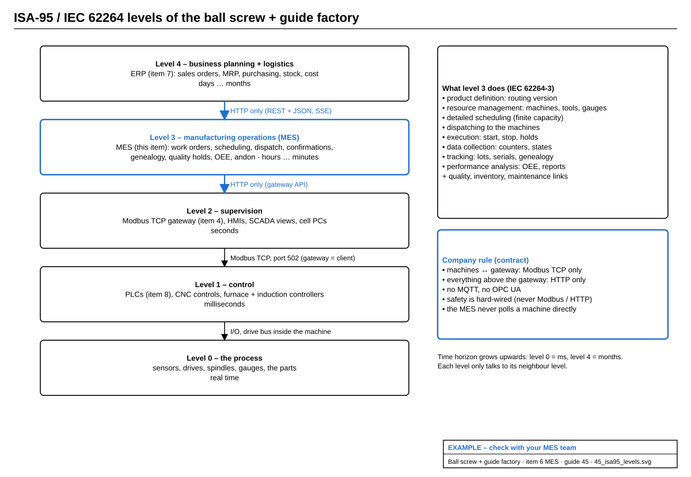

### 3.1 The five levels

IEC 62264 (= ANSI/ISA-95) splits a factory into levels by **time horizon**:

| Level | What | Time horizon | In this plant |
|---|---|---|---|
| 4 | business planning + logistics | months … days | ERP (item 7): sales orders, MRP, purchasing, cost |
| 3 | manufacturing operations management | days … minutes | **MES (this item)** |
| 2 | supervision | minutes … seconds | Modbus TCP gateway (item 4), HMIs |
| 1 | control | seconds … milliseconds | PLCs (item 8), CNC, furnace controllers |
| 0 | the process | real time | sensors, drives, the parts |

Each level talks to its neighbour. The ERP does not send an order to a grinder; the grinder does not post a bill.

**Our rule (contract):** between level 2 and level 1 only **Modbus TCP**; above the gateway only **HTTP** (REST + JSON,
Server-Sent Events). No MQTT, no OPC UA. Safety is hard-wired and never goes over Modbus or HTTP.

### 3.2 IEC 62264-3 – the activities of level 3

Part 3 of the standard describes 4 areas (production, quality, maintenance, inventory) with the same 8 activities. This
MES implements the production area and links to the other three:

| Activity (production) | What the MES does here | Page | HTTP |
|---|---|---|---|
| Product definition management | routing + routing version (item 2), control plan (item 5) | §1 | `GET /workorders/{id}` (operations) |
| Production resource management | machines, tools, gauges, operators, material readiness | §1, release | readiness in `POST …/release` |
| Detailed production scheduling | finite-capacity sequence per machine | §3 | `POST /schedule` |
| Production dispatching | dispatch list, order download | §3, §4 | `GET /dispatch`, `POST /machines/{id}/download` |
| Production execution management | start, stop, holds, terminal | §4, §6 | `POST /lots/{id}/hold` |
| Production data collection | counters + states from the gateway, confirmations, downtime | §4 | `POST /confirmations`, `/downtime`, `/sync` |
| Production tracking | lots, serials, genealogy | §9 | `GET /trace` |
| Production performance analysis | OEE, Pareto, shift report | §8 | `GET /oee`, `/report` |
| + quality operations (link) | gate results, holds, NCR, SPC | §6 | item 5 → MES |
| + inventory operations (link) | transport, kanban, FG | §7 | `POST /transport`, `/kanban/…`, `/fg` |
| + maintenance operations (link) | downtime reasons → maintenance requests | §4 | `POST /downtime` |

### 3.3 The MESA-11 functions

MESA International described 11 MES functions (1997, still the common checklist):

| # | Function | In this item |
|---|---|---|
| 1 | Resource allocation and status | machine states, tool sets, gauges, readiness |
| 2 | Operations / detail scheduling | finite-capacity scheduler |
| 3 | Dispatching production units | dispatch lists, order download |
| 4 | Document control | routing operation text, work instructions (link only) |
| 5 | Data collection / acquisition | gateway counters, twin feed, terminal |
| 6 | Labour management | operator badge in confirmations (no time sheets) |
| 7 | Quality management | holds, NCR block, SPC stop (item 5 does the QA) |
| 8 | Process management | routing control: a lot can only go to the machine type of its next op |
| 9 | Maintenance management | downtime + reason codes, andon calls (no work orders) |
| 10 | Product tracking and genealogy | lots, serials, heats, where-used |
| 11 | Performance analysis | OEE, Pareto, shift report, WIP / lead time |

### 3.4 MES vs ERP vs PLC – who decides what

| Question | ERP | MES | PLC / CNC |
|---|---|---|---|
| How many sets this week? | ✔ | | |
| Which raw material to order? | ✔ (MRP) | signals kanban | |
| Which lot on BS-TGR-03 next? | | ✔ | |
| Is the dresser for Ø40 × 10 there? | | ✔ | |
| Start the grinding cycle | | sends the order | ✔ |
| Stop the axis when the door opens | | | ✔ (hard-wired safety) |
| How many good parts did the night shift make? | gets the total | ✔ (counts) | counts pieces |
| Which heat is in serial X? | heat certificate | ✔ (genealogy) | |
| What did the set cost? | ✔ (from MES times) | delivers times | |

---

## 4. The data model

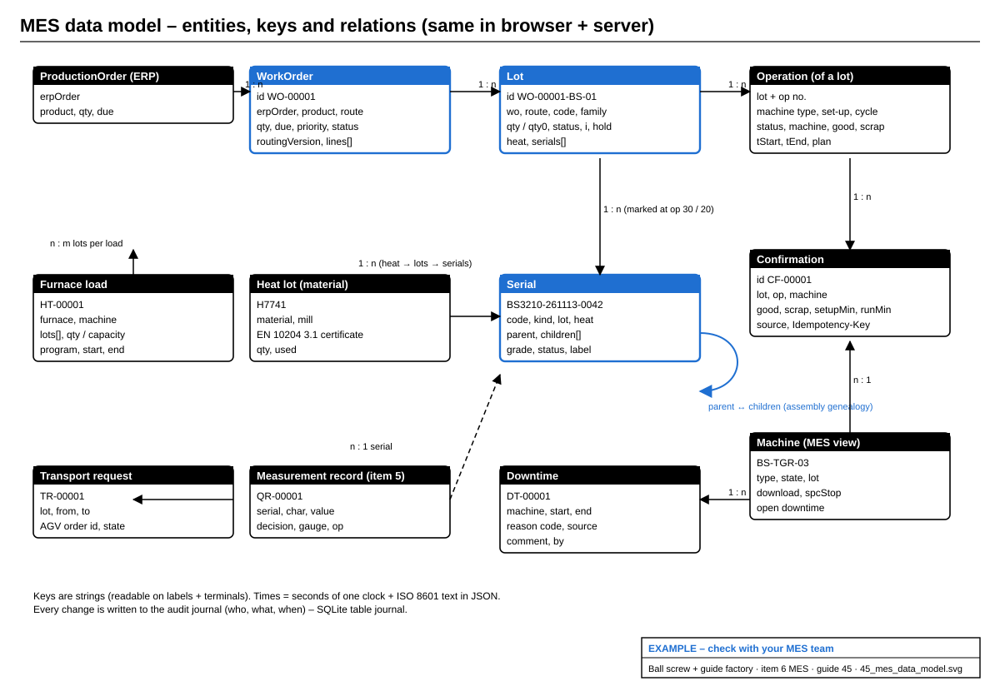

### 4.1 Entities

The same entities and field names are used in the browser core (`web/bsfmes_core.js`) and in the server
(`twin/bsf_mes.py`). Item 7 (ERP) imports `web/bsfmes_data.js` to use the same product codes and states.

| Entity | Key (example) | Main fields | Owner | ISA-95 object |
|---|---|---|---|---|
| ProductionOrder (ERP) | erpOrder `PO-260045` | product, qty, due | ERP | production request |
| WorkOrder | `WO-00012` | erpOrder, product, route, qty, due, priority, routingVersion, status, lines, lots | MES | job order |
| Lot | `WO-00012-BS-01` | wo, route, code, family, qty, qty0, status, i, hold, heat, ops[], serials[] | MES | material lot (WIP) |
| Operation (of a lot) | lot + op no. | machine type, set-up, cycle, status, machine, good, scrap, tStart, tEnd | MES (from item 2) | job order segment |
| Confirmation | `CF-00738` | wo, lot, op, machine, good, scrap, setupMin, runMin, source, key | MES | production performance |
| Serial | `BS3210-261113-0042` | code, kind, lot, wo, heat, status, parent, children, grade, label | MES (+ QA) | material sublot |
| Heat lot | `H7741` | material, mill, certificate EN 10204 3.1, qty, used | ERP goods receipt → MES | material lot |
| Furnace load | `HT-00001` | furnace, machine, lots[], qty / capacity, program, start | MES | batch job order |
| Downtime | `DT-00002` | machine, start, end, reason, source, comment, by | MES | equipment event |
| Machine (MES view) | `BS-TGR-03` | type, state, lot, download, spcStop, open downtime | MES ← gateway | equipment |
| Transport request | `TR-00001` | lot, from, to, priority, state, agvOrder | MES → AGV fleet | material movement |
| Kanban loop | `BALL-6.35-G5` | per product, D, LT, α, C, N, full | MES ↔ ERP | material definition |
| Measurement record | `QR-00001` | serial, char, value, decision, gauge | QA (item 5) | quality test result |
| NCR | `NCR-00001` | serial, char, text, 8D steps | QA (item 5) | quality operations |

### 4.2 Keys – why readable strings

A key is printed on a lot card, read on a terminal, typed by a supervisor and written on a label. So keys are short
readable strings with a fixed pattern, not database numbers:

| Key | Pattern | Example |
|---|---|---|
| work order | `WO-` + 5 digits (twin orders `WO-T` + 4) | WO-00012, WO-T0011 |
| lot | work order + route + 2 digits (twin lots `L` + 5 digits) | WO-00012-BS-01, L00124 |
| serial | prefix + YYMMDD + running number per day and prefix | BS3210-261113-0042, A-BS-261114-0005 |
| confirmation / downtime / transport | `CF-` / `DT-` / `TR-` + 5 digits | CF-00738 |

The lot key is ≤ 20 characters because it goes into the 20-character ASCII field `order` of the Modbus command block
(registers 203 – 212, chapter 8).

### 4.3 From the ERP order to the lots – worked example

Work order: **40 × BS-3210-1000-C5**, due in 5 days.

1. **Route yield** of BS (variant G, 12 own operations), scrap % from item 2: 0.2, 0.3, 0.1, 0.5, 1.0, 0.2, 1.5, 0.1,
   0.5, 1.5, 0.5, 0:

   Y = Π (1 − s_i / 100) = 0.998 × 0.997 × 0.999 × 0.995 × 0.990 × 0.998 × 0.985 × 0.999 × 0.995 × 0.985 × 0.995 × 1
   = **0.9377**

2. **Start quantity** = ceil(need / Y) = ceil(40 / 0.9377) = ceil(42.66) = **43**.
3. **Lots** of the transfer lot size 20: 20 + 20 + 3 → `WO-00009-BS-01 … -03`.
4. Each lot gets the 12 operations of the route with set-up, cycle × k, batch, gate, family.

For a set (FABS) the work order has three lines: BS (need 40, start 43), BN (need 40, start 43), FABS (need 40,
start 40 → 2 lots of 20). Route yields of the example: BS 0.938, BN 0.948, LG 0.956, LB 0.960, FABS 0.992, FALG 0.998.

### 4.4 Readiness check before release

| Check | Rule (example) | Data |
|---|---|---|
| Material | free quantity of the heat lots of the route ≥ start quantity | heat lots from ERP goods receipt (EN 10204 3.1) |
| Tools | wheel + dresser set of the product family exists on the family grinders (BS-TGR, BN-ITG, LG-PGR, LB-RGR) | tool store list `TOOLSETS` |
| Gauges | calibration due date of every gauge used by the route is after today | gauge list `GAUGES6` (item 5 calibration system) |

If one check fails, `POST /workorders/{id}/release` answers **422** with the list (`readiness.items`). The planner can
release with `{"force": true}` – the audit journal keeps "FORCED, not ready: …".

### 4.5 One model, two places

| Function | Browser (demo) | Server |
|---|---|---|
| state | JavaScript object `S` | Python dict `S` + SQLite file |
| clock | twin time `B.t` (s since day 1 06:00) | Unix time |
| time text | `D9 08:15` | ISO 8601 `2026-11-13T08:15:00Z` |
| HTTP | local router `route(method, path, query, body, headers)` | `server.py` → `bsf_mes.handle(...)` |
| QA records | example values from the control plan (marked "example (demo)") | real records of `twin/bsf_qa.py` |
| AGV / ERP | local demo | item 4 demo APIs (in-process HTTP handler) |
| gateway | simulated handshake frames | real `Gateway.command()` of item 4 |

---

## 5. Order life cycle – work order, lot, operation

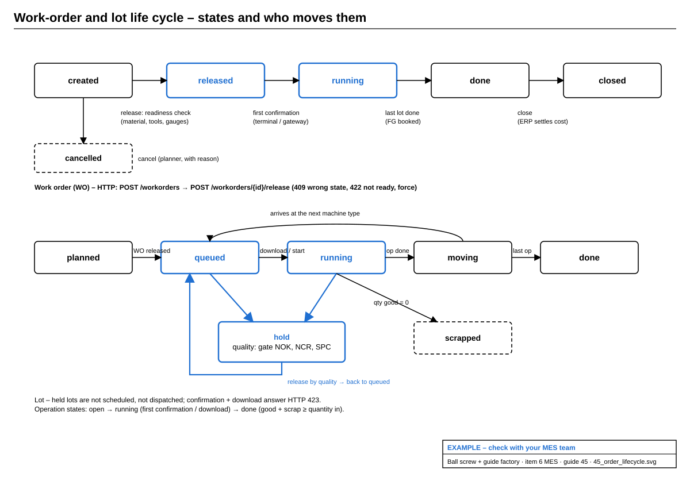

### 5.1 Work order states

| State | Meaning | Next step by |
|---|---|---|
| created | exists (ERP or planner), not on the shop floor | planner: release |
| released | readiness OK (or forced), lots queued, visible in dispatch lists | first confirmation |
| running | at least one operation confirmed | last lot done |
| done | all lots finished, good quantity booked | ERP close |
| closed | technically complete | – |
| cancelled | stopped before release (with reason) | – |

Rules: only `created` can be released (else **409 wrong state**), only `created` can be cancelled, a confirmation needs
`released` or `running` (else 409).

### 5.2 Lot states

| State | Meaning |
|---|---|
| planned | lot exists, work order not released |
| queued | waiting for the next machine type |
| running | on a machine (set-up or production) |
| moving | transport order to the next area |
| hold | blocked by quality – not scheduled, not dispatched, confirmation + download → **423** |
| done | all operations finished |
| scrapped | good quantity reached 0 |

### 5.3 Operation states

`open → running → done`. An operation is **done** when good + scrap ≥ the quantity that came in (qtyIn) or when the
confirmation says `final: true` (the twin and the gateway DONE toggle do that). Then the lot quantity becomes the good
quantity of that operation and the lot moves to the next open operation.

### 5.4 Who triggers what – event table

| Event | Source | MES reaction |
|---|---|---|
| ERP releases a production order | `POST /api/bsf/erp/productionorders/{id}/release` (item 4 → MES) | work order created + released |
| twin creates an order | twin feed | work order `WO-T…` released |
| operator presses "download" | terminal | gateway command, lot running |
| counter hs.lotDone rises | gateway pull | automatic confirmation |
| DONE toggle | gateway | operation done, next op, transport request |
| machine DOWN (alarm) | gateway / twin | open downtime with a reason guess, re-schedule |
| gate result NOK | QA (item 5) | lot hold |
| NCR opened | QA | lot hold with NCR number |
| 2 of the last 3 NOK on one machine | QA records | SPC stop of the machine |
| last op of a set lot done | MES | finished-goods booking → ERP goods receipt |

---

## 6. Scheduling theory with worked numbers

### 6.1 Infinite vs finite capacity

| | Infinite capacity (MRP style) | Finite capacity (this MES) |
|---|---|---|
| Question | "when must each operation be done?" (backward from the due date, lead-time offsets) | "when CAN each operation be done on the real machines?" |
| Machine load | any amount per day – overloads only shown as a load profile | one operation at a time per machine |
| Result | load chart, often > 100 % | sequence + start / end per machine, realistic completion dates |
| Used by | ERP (item 7): rough plan, material | MES: next shifts, dispatch lists |

The ERP plans with lead times ("a screw needs 5 days"); the MES plans with **minutes on machines**. When they disagree,
the MES shows the truth for the next days, the ERP keeps the long view.

### 6.2 The scheduler of this MES

* **Forward:** every lot starts as early as possible (from now, or from its release time).
* **Finite:** each machine runs one operation at a time; parallel machines of a type share the queue (8 × BS-TGR).
* **Non-delay (list scheduling):** repeat –
  1. for every lot take its next unscheduled operation; on each machine of the right type the earliest start is
     `est = nextWork(max(lot ready, machine free))`; keep the machine with the smallest est (tie: same family / same
     product first);
  2. `t* = min est` over all lots;
  3. all operations with est = t* are in conflict; the **priority rule** picks one;
  4. book it: start = t*, set-up (0 / minor / full), end = addWork(start, set-up + qty × cycle); the lot is ready for its next
     operation at end + transfer time (30 min example: AGV or cart).
* **Shift calendar:** 2 shifts × 7.5 h net from 06:00 (= working window 0 – 900 min of each day), heat-treatment machines
  3 shifts (0 – 1 350 min). An operation that does not fit pauses at the end of the shift and continues next morning.
* **Furnaces:** a tempering or carburising furnace takes a **load**: the chosen lot plus all other lots waiting for the
  same furnace type, as long as the pieces fit the batch size (60 screws, 300 nuts …). Load time = cycle × batch
  (tempering 2.5 h, carburising 10 h), no matter how full.
* **Running operations** stay fixed on their machine until (qty − done) × cycle.
* **Held lots and SPC-stopped machines** are left out (stopped machine = free time 10⁷ min).

Times are working minutes; the KPIs are calculated from the result.

Worked example of the calendar (self-check): now = 20:00 (tod0 = 840 min after 06:00), 2 shifts (window 0 – 900).
An operation of 120 min starts at t = 0 → works 60 min until 21:00, pauses, continues at 06:00 next day (t = 600) for
60 min → **end t = 660 min** (07:00).

### 6.3 Priority rules

| Rule | Key (smaller = first) | Good for | Weak point |
|---|---|---|---|
| FIFO | release time | fairness, simple | ignores due dates |
| EDD – earliest due date | due date | maximum tardiness small | ignores processing time |
| SPT – shortest processing time | set-up + qty × cycle of this op | mean flow time, WIP | long jobs wait → late |
| CR – critical ratio | (due − now) / remaining work | balances urgency and work | needs good remaining-work data |
| FAM – set-up family | same family as the machine had → 0, else 1; then due date | thread grinders, profile grinders (long set-ups) | can make one family late |

### 6.4 Worked example 1 – one machine, three lots

| Lot | Processing p (min) | Due d (min) |
|---|---|---|
| J1 | 300 | 360 |
| J2 | 180 | 540 |
| J3 | 480 | 600 |

**EDD:** J1 (0 – 300) → J2 (300 – 480) → J3 (480 – 960).
Tardiness: J1 0, J2 0, J3 960 − 600 = 360 → **Σ 360 min, max 360**.

**SPT:** J2 (0 – 180) → J1 (180 – 480) → J3 (480 – 960).
Tardiness: J2 0, J1 120, J3 360 → **Σ 480 min**; mean flow = (180 + 480 + 960) / 3 = **540 min** (smallest of the three).

**CR:** at t = 0: CR(J1) = 360 / 300 = 1.20, CR(J2) = 540 / 180 = 3.00, CR(J3) = 600 / 480 = 1.25 → J1 (0 – 300).
At t = 300: CR(J2) = (540 − 300) / 180 = 1.33, CR(J3) = (600 − 300) / 480 = 0.625 → J3 (300 – 780), then J2 (780 – 960).
Tardiness: 0 + 180 + 420 = **Σ 600 min**.

Lesson: no rule is best for everything. EDD wins on lateness, SPT on flow time, CR here protects the long job J3.

### 6.5 Worked example 2 – two machines in a row (flow shop)

Lots A (M1 180 min, then M2 120 min, due 360) and B (M1 60, M2 240, due 600).

**SPT:** t = 0: B on M1 (p 60 < 180) 0 – 60. t = 60: A on M1 (60 – 240) and B on M2 (60 – 300) both can start; SPT takes
A's 180 before B's 240 – different machines, both start at 60. A on M2: ready 240, M2 free 300 → 300 – 420.
**Makespan 420 min.**

**EDD:** A first on M1 (0 – 180), B on M1 (180 – 240); A on M2 (180 – 300); B on M2 ready 240, free 300 → 300 – 540.
**Makespan 540 min.**

Lesson: putting the short first operation first (SPT here = Johnson's idea for 2 machines) fills the second machine
earlier.

### 6.6 Set-up families on the thread grinders

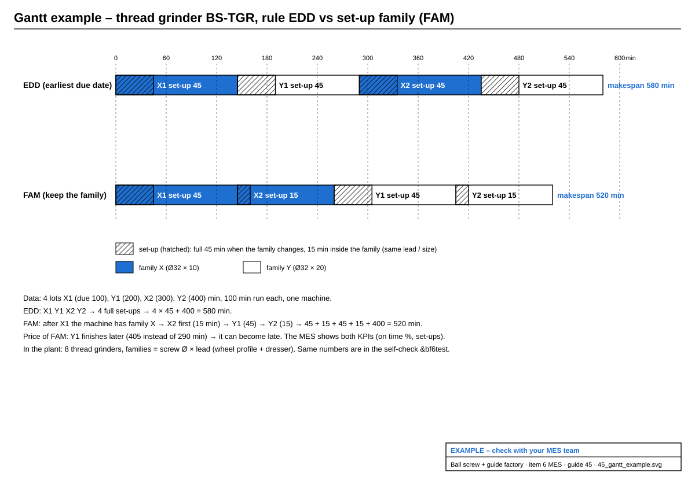

A thread grinder (BS-TGR) needs a full set-up of **45 min** when the wheel profile / dresser changes (other lead or
diameter), but only about **15 min** inside the same family (other length, same Ø × lead: centres, steady rest, program).
The MES stores the family per product (`Ø32×10`, `Ø40×10`, `size 25` …) and the minor set-up = 1/3 of the full set-up
(example) on the family machines BS-TGR, BN-ITG, LG-PGR, LB-RGR, BS-CGR.

Worked example 3 (one grinder, 4 lots of 100 min): X1 (due 100), Y1 (200), X2 (300), Y2 (400), families X and Y.

| Rule | Sequence | Set-ups | Makespan |
|---|---|---|---|
| EDD | X1 Y1 X2 Y2 | 4 full = 180 min | 180 + 400 = **580 min** |
| FAM | X1 X2 Y1 Y2 | 2 full + 2 minor = 120 min | 120 + 400 = **520 min** |

FAM saves 60 min (10 % capacity of the bottleneck!) but Y1 ends at 405 instead of 290 min – it may become late. That is
why the page shows on-time % and set-ups side by side.

Capacity effect at the plant level: BS-TGR effective time per piece = 40 + 45 / 20 = **42.25 min** (item 2,
effCycle). With families, half of the set-ups minor: 40 + (45 + 15) / 2 / 20 = **41.5 min** → 1.8 % more screws per day
on the drum.

### 6.7 Bottleneck first – drum-buffer-rope (DBR)

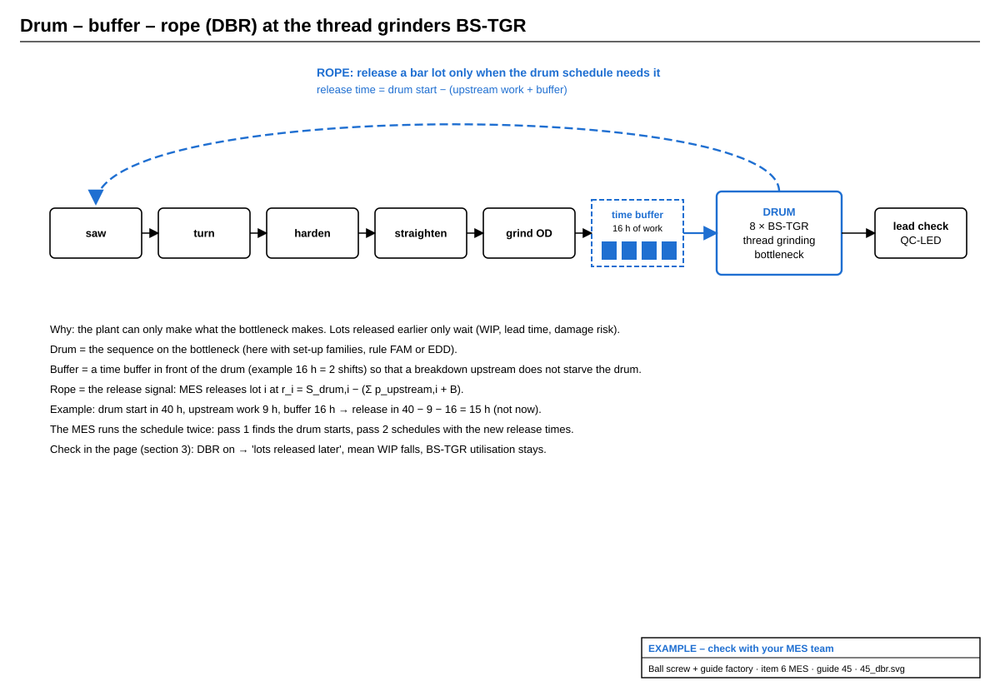

Theory of Constraints (Goldratt): the output of the plant = the output of the bottleneck. Item 2 shows that the thread
grinders BS-TGR are the bottleneck of the screw line (8 machines, start quantity 120 / 0.980 = 122.4 screws × 42.25 min = 5 173 min per day / (900 min × OEE 0.75) = 7.66 machines → 8 machines at ≈ 96 % load).

* **Drum** – the schedule of the bottleneck sets the pace.
* **Buffer** – a time buffer in front of the drum (example 16 h = 2 shifts) protects it from upstream breakdowns.
* **Rope** – a lot is released into the line only when the drum needs it:

  **r_i = S_drum,i − (Σ p_upstream,i + B)**

Worked example: drum start of a lot = 40 h from now, upstream work (saw … centre grinding) 9 h, buffer B = 16 h →
release r = 40 − 9 − 16 = **15 h from now** (not now). If released now, the lot would wait 15 h more in front of the
grinders – more WIP, longer lead time, more handling damage, no more output.

How the MES does it (`schedule(…, dbr)`): pass 1 schedules normally and records the drum start of every not-yet-started
lot; release times are moved by the formula; pass 2 schedules again. Live example of the page (twin state, EDD,
B = 16 h): **26 lots released later, mean WIP 85.0 → 78.8 lots**, BS-TGR utilisation unchanged.

### 6.8 KPIs of a plan

| KPI | Formula | Why |
|---|---|---|
| on time % | lots with end ≤ due / lots | customer service |
| Σ tardiness, max tardiness | Σ max(0, end − due) | how late |
| set-ups | number of full + minor set-ups, set-up hours | lost bottleneck time |
| utilisation of a type | Σ busy / Σ working minutes in [0, makespan] | is the drum busy? |
| makespan | end of the last operation | how long the plan is |
| mean flow time | mean (end − release) per lot | lead time |
| mean WIP | Σ (end − release) / makespan (Little: L = λ W) | stock in the hall |
| furnace loads | number of loads | energy, fill |

The rule comparison in section 3 runs all 5 rules with and without DBR on the same input. Example run (twin, day 9):

| Rule | DBR | On time | Set-ups | BS-TGR util. | Mean WIP (lots) |
|---|---|---|---|---|---|
| EDD | – | 40.7 % | 75 | 77.2 % | 93.9 |
| EDD | yes | 40.7 % | 78 | 77.5 % | 85.7 |
| SPT | – | 44.4 % | 64 | 68.8 % | 75.8 |
| FAM | – | 36.9 % | 32 | 60.6 % | 82.7 |

(The low on-time % comes from the twin itself: its orders are due 7 days after the order and the warm-up created a
backlog – the numbers show the method, not a target.)

### 6.9 Re-scheduling on a breakdown

When a machine goes DOWN (alarm from the gateway / twin), the MES:

1. opens a downtime record with a first reason from the alarm code (chapter 14),
2. sets the free time of that machine to the expected repair time (MTTR of item 3, at least 30 min),
3. re-runs the schedule with the same rule (checkbox "re-schedule on breakdown", reason "breakdown BS-TGR-03"),
4. writes the KPIs before / after into the log ("on time 40.7 % (before 40.8 %)").

The lots of the down machine move to the other 7 thread grinders; the dispatch lists change at once.

---

## 7. Dispatching – from the plan to the machine

### 7.1 The dispatch list

`GET /api/bsf/mes/dispatch?machine=BS-TGR-03` returns the next lots of one machine in the planned order:

| Field | Meaning |
|---|---|
| seq | position in the list |
| lot, wo, op, product, qty | what to make |
| setup, setupKind | minutes and full / minor |
| startIn_min | planned start in minutes from the schedule time |
| due | due date of the work order |
| held | lots of this machine type on hold (shown, not dispatched) |
| blocked | SPC stop of the machine: the list is empty |

If no schedule exists, the MES falls back to the queue of the machine type sorted by due date (EDD).

### 7.2 Rules on the shop floor

* The operator takes the **first** lot of the list. A supervisor may change the sequence (role supervisor).
* A lot can only be downloaded to a machine of the type of its **next** operation (process management, 422 otherwise).
* A held lot and an SPC-stopped machine cannot get an order (423).
* The plan is refreshed every 60 s (page) and on every breakdown – a dispatch list is valid for minutes, not days.

### 7.3 Furnace loads (heat-treatment batches)

Tempering furnace HT-TMP: batch 60 screws, 2.5 h at 170 °C; tempering must start within 1 h after induction hardening
(item 2, op 60). Carburising line HT-CAR: batch 300 nuts or 200 carriages, ≈ 10 h.

The MES builds a load from lots that wait for the same furnace and the same program (`POST /api/bsf/mes/htloads
{furnace, lots}`): capacity check (pieces ≤ batch, else 422), all lots must have this furnace as next op (else 422). The
twin builds loads itself (start when full or after max. 45 min / 10 h); the MES records them (`GET /htloads`, fill in %).
Each load is part of the genealogy: a hardness problem of one load → all lots of the load are suspect.

---

## 8. Machine integration – Modbus TCP gateway + HTTP

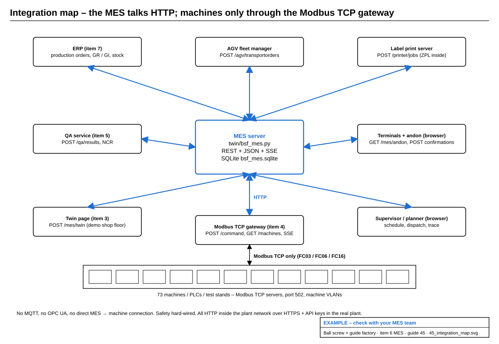

### 8.1 The rule again

* The MES never opens a Modbus connection. It talks HTTP to the **gateway** (item 4), the gateway is the only Modbus TCP
  client of the 73 machines (port 502, machine VLANs).
* Every other partner (ERP, AGV fleet manager, label print server, QA service, browsers on terminals and andon boards) is
  HTTP too. Live push = Server-Sent Events (also HTTP).

### 8.2 Order download – the toggle-bit handshake

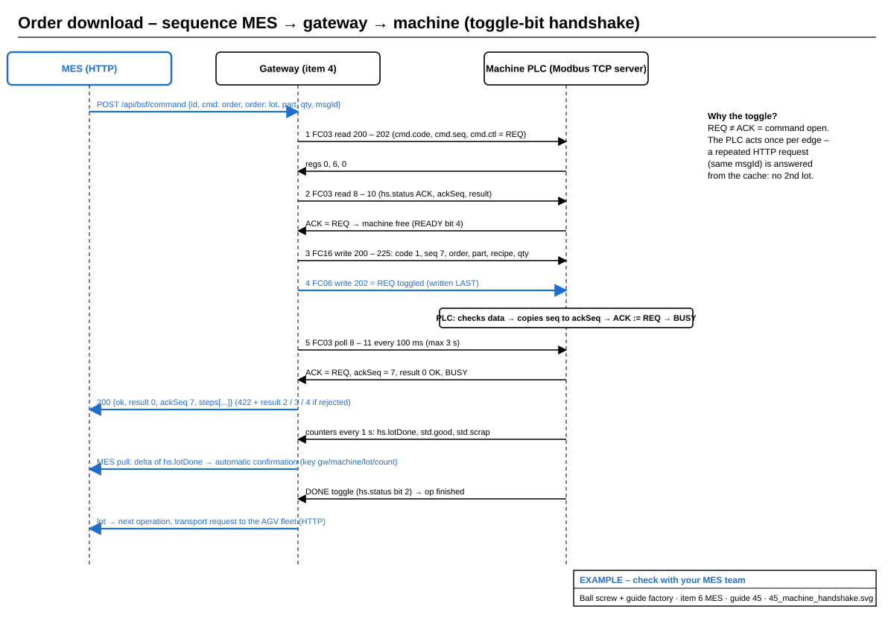

Command block of every machine (item 4 register map, holding registers, 0-based):

| Address | Name | Type | Meaning |
|---|---|---|---|
| 200 | cmd.code | UINT16 | 1 load order, 2 start, 3 stop, 4 ack alarm, 5 recipe |
| 201 | cmd.seq | UINT16 | message counter (+1 per command) |
| 202 | cmd.ctl | UINT16 | bit 0 = REQ toggle (written LAST) |
| 203 – 212 | order | ASCII20 | lot key (≤ 20 characters) |
| 213 – 222 | part | ASCII20 | product code |
| 223 | recipe | UINT16 | program / recipe no. (here the op number) |
| 224 – 225 | qty | UINT32 (2 registers, ABCD) | pieces |
| 8 | hs.status | UINT16 | bit0 ACK, bit1 BUSY, bit2 DONE toggle, bit3 REJECT, bit4 READY |
| 9 | hs.ackSeq | UINT16 | sequence of the last accepted / rejected command |
| 10 | hs.result | UINT16 | 0 OK, 1 unknown, 2 not ready, 3 bad data, 4 busy |
| 11 | hs.lotDone | UINT16 | pieces done of the MES lot |

Sequence (`POST /api/bsf/mes/machines/BS-TGR-03/download {"lot": "L00161"}` → MES → `POST /api/bsf/command` → gateway):

| Step | Frame | Purpose |
|---|---|---|
| 1 | FC03 read 200 – 202 | current seq and REQ |
| 2 | FC03 read 8 – 10 | ACK = REQ? (no command open), READY |
| 3 | FC16 write 200 – 225 | code, seq + 1, REQ unchanged, order, part, recipe, qty |
| 4 | FC06 write 202 | REQ toggled – **written last**, so the PLC never sees half a block |
| 5 | FC03 read 8 – 11 every 100 ms, max 3 s | until ACK = REQ and ackSeq = seq |
| 6 | – | result 0 → lot running (BUSY); result 2 / 3 / 4 → HTTP 422 with the result text |

Example frames (unit 15 = BS-TGR-03, from the simulated machine of the page):

```
1  req 01 9C 00 00 00 06 0F 03 00 C8 00 03          read 3 registers from 200
   rsp 01 9C 00 00 00 09 0F 03 06 00 00 00 06 00 00  code 0, seq 6, ctl 0
3  req … 0F 10 00 C8 00 1A 34 00 01 00 07 00 00 4C 30 30 31 36 31 …   write 26 registers from 200 (code 1, seq 7, "L00161" …)
4  req … 0F 06 00 CA 00 01                         register 202 = 1 (REQ toggled)
5  rsp … 0F 03 08 00 03 00 07 00 00 00 00          hs.status 3 = ACK 1 + BUSY, ackSeq 7, result 0
```

**Why a toggle and a sequence number?** A command is open while REQ ≠ ACK. The PLC acts once per edge. If the HTTP
request is repeated (network glitch, user double click) with the same `msgId`, the gateway answers from its cache – the
machine does not get a second lot. The MES uses `msgId = lot/op/machine` as default.

### 8.3 Counters back – automatic confirmations

The gateway polls the counters every 1 s (item 4: `std.good`, `std.scrap`, `hs.lotDone`, `std.order`). The MES pulls them
on read (at most once per second, no own thread): for each machine with a downloaded lot,

* if `std.order` = the lot key and `hs.lotDone` rose from 12 to 15 → confirmation **good 3** with the idempotency key
  `gw/BS-TGR-03/L00161/15` (a second pull with the same count books nothing);
* when `hs.lotDone` ≥ qty or BUSY falls (DONE toggle) → the operation is finished, the lot moves on, a transport request
  can be sent.

Good / scrap split at the machine: the scrap counter delta of the same interval is booked as scrap; reasons for scrap
come from the terminal or the gate result.

### 8.4 States back – downtime

`std.stateCode` (0 OFF, 1 IDLE, 2 RUN, 3 SETUP, 4 DOWN, 5 BLOCKED, 6 STARVED) and `std.alarm` arrive with every fast
poll (500 ms). A change to DOWN opens a downtime record with the reason guess of the alarm code (chapter 14); leaving
DOWN closes it. Set-up, starved, blocked times are counted for OEE (chapter 13).

### 8.5 HTTP conventions (same as item 4)

| Topic | Rule |
|---|---|
| Format | JSON (RFC 8259), UTF-8, camelCase, times ISO 8601 UTC in text fields + seconds in `t` fields |
| Create | `POST` → **201** + object |
| Idempotency | header `Idempotency-Key: <uuid>` (or body `msgId`) – the same key returns the first answer with **200** and `"replay": true` |
| Lists | `?page=1&size=20` → `{items, page, size, total, next}` |
| Errors | RFC 9457 problem+json `{type, title, status, detail}`; 400 bad request, 404 unknown, 409 wrong state, 422 business rule, 423 locked (hold / SPC), 500 internal, 503 not available |
| Versions | `/api/bsf/v1/mes/...` = `/api/bsf/mes/...` |
| Security | HTTPS + API key / login in the real plant (chapter 17) |

Error example:

```
HTTP/1.1 422 Unprocessable Entity
Content-Type: application/problem+json; charset=utf-8

{"type": "https://plant.example/problems/not-ready", "title": "not ready", "status": 422,
 "detail": "BS-TGR wheel + dresser set Ø40×10: NOT available – order the dresser / wheel set",
 "readiness": {"ok": false, "items": [{"kind": "material", "item": "BS raw material (heat lots)", "ok": true, "text": "need 11, free 716"},
   {"kind": "tool", "item": "BS-TGR wheel + dresser set Ø40×10", "ok": false, "text": "NOT available – order the dresser / wheel set"}, …]}}
```

### 8.6 Live push

Browsers get live data either by polling (`GET /api/bsf/mes/andon` every 2 s – what the page does) or by the gateway SSE
stream `GET /api/bsf/stream` (item 4). Both are HTTP. An andon board PC only needs a browser.

### 8.7 Timing budget (example)

| Step | Time |
|---|---|
| fast poll of all 73 machines (gateway) | 500 ms |
| counters poll | 1 s |
| MES pull of the gateway | ≤ 1 s (on read) |
| order download (6 frames + PLC scan) | 150 – 600 ms |
| twin feed / andon refresh | 2 s |
| schedule of ≈ 200 lots, 1 500 operations | < 1 s (Python and JavaScript) |

---

## 9. Serial numbers and labels (GS1 Data Matrix)

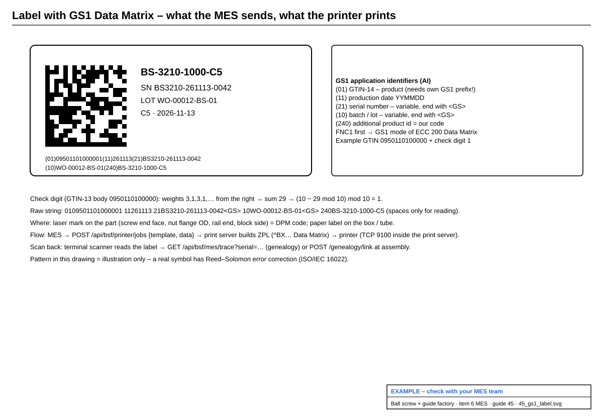

### 9.1 When a part gets its serial

Before the first operation that can carry a mark, the **lot number** travels on the lot card. The serial is created at the
first marking operation (same as item 5 `SERIAL.where`):

| Part | Op | Where the mark is | Prefix (format `<prefix>-YYMMDD-NNNN`) |
|---|---|---|---|
| Screw shaft | 30 (after centring) | end face, laser | BS3210 (from the code BS-3210-…) |
| Ball nut | 20 | flange OD | BN3210 |
| Rail | 30 | rail end + datum side | LG25 |
| Carriage | 20 | block side | LB25 |
| Ball screw set | FABS 10 (assembly) | label on the tube + nut | A-BS |
| Guide set | FALG 10 | label on the box | A-LG |

The running number counts per prefix and day. In the browser demo the day comes from the twin day (D1 = 2026-11-10).

### 9.2 What is in the code

GS1 element string with application identifiers (AI):

| AI | Content | Length | Example |
|---|---|---|---|
| (01) | GTIN-14 – the product | fixed 14 | 09501101000001 (example prefix!) |
| (11) | production date YYMMDD | fixed 6 | 261113 |
| (21) | serial number | variable ≤ 20, then GS | BS3210-261113-0042 |
| (10) | batch / lot | variable ≤ 20, then GS | WO-00012-BS-01 |
| (240) | additional product id = our code | variable ≤ 30 | BS-3210-1000-C5 |

Raw string (FNC1 first, `<GS>` = ASCII 29 after a variable field that is not the last):
`0109501101000001` `11261113` `21BS3210-261113-0042<GS>` `10WO-00012-BS-01<GS>` `240BS-3210-1000-C5`

**GTIN check digit (modulo 10):** body 0950110100000 → weights 3, 1, 3, 1 … from the right → 0·3 + 0·1 + 0·3 + 0·1 + 0·3 +
1·1 + 0·3 + 1·1 + 1·3 + 0·1 + 5·3 + 9·1 + 0·3 = 29 → check = (10 − 29 mod 10) mod 10 = **1** → GTIN **09501101000001**.

> A real GTIN needs your own GS1 company prefix (GS1 member organisation of your country). 950110 is used here only as
> an example prefix. Without GS1 membership use only internal codes (e.g. AI 240 / 241 or a plain text Data Matrix).

### 9.3 Data Matrix ECC 200

ISO/IEC 16022: square matrix with an L-shaped finder pattern (solid left and bottom edge) and a clock track (alternating
top and right edge), Reed–Solomon error correction (up to ≈ 30 % damage readable). GS1 mode = FNC1 as the first
character. For laser marks on steel (DPM = direct part marking) use a scanner that is made for DPM (dark / light, dot
peen, shiny round surfaces) and check the mark quality (ISO/IEC TR 29158 – AIM DPM grading).

The page draws only an **illustration** of the symbol (finder pattern + hash cells); the label printer (ZPL `^BX`) or the
laser marker builds the real symbol from the element string.

### 9.4 Print flow

1. MES creates the serials (`POST /api/bsf/mes/serials {lot, n}` or automatically at the marking operation).
2. MES sends a print job over HTTP to the print server: `POST /api/bsf/printer/jobs {printer, template, data}` (item 4 demo).
3. The print server merges the template, makes ZPL and sends it to the printer (raw TCP 9100 **inside** the print server –
   the MES only talks HTTP).
4. The operator scans the label back at the next station → `GET /api/bsf/mes/trace?serial=…`.

ZPL example made by `gs1Element()`:

```
^XA^FO30,30^BXN,6,200,0,0,1,_^FH^FD_1010950110100000111261113 21BS3210-261113-0042_1D10WO-00012-BS-01_1D240BS-3210-1000-C5^FS
^FO230,30^A0N,26,26^FDBS-3210-1000-C5^FS^FO230,64^A0N,24,24^FDSN BS3210-261113-0042^FS^FO230,96^A0N,24,24^FDLOT WO-00012-BS-01^FS^XZ
```

(`_1` = FNC1 via the hex escape `^FH_`, `_1D` = GS; spaces only for reading.)

---

## 10. Genealogy and traceability

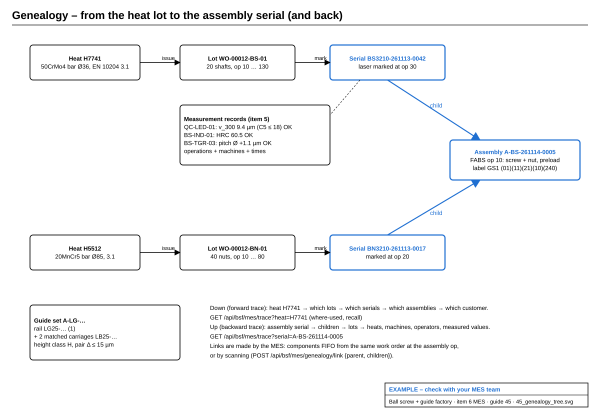

### 10.1 What is linked

| Link | When | How |
|---|---|---|
| heat lot → lot | release / first sight (material issue, FIFO) | `assignHeat` – the ERP keeps at least one heat lot per material in stock (demo goods receipt) |
| lot → serials | marking operation | serials carry lot, work order, heat |
| lot → furnace load | heat treatment | load record lists the lots |
| serials → assembly | assembly op (FABS 10, FALG 10) | MES takes free component serials of the same work order (FIFO); or a scan `POST /genealogy/link` |
| serial → operations | every confirmation | machine, good / scrap, start / end per op of the lot |
| serial → measurement records | QA posts results (item 5) | serial number in the record |

Guide sets: one rail + 2 **matched** carriages (height class H, pair variation ≤ 15 µm, item 5 QG-FA-3) – the match is
stored on the assembly serial.

### 10.2 Backward trace (from the customer to the steel)

`GET /api/bsf/mes/trace?serial=A-BS-261113-0119` returns a tree:

```
A-BS-261113-0119  FABS-3210-1000-C5  lot L00222  WO-T0007   op 10 AS-BSA-02 (QG-FA-1) …
├─ BS3210-261113-0119  screw  lot L00069  heat H7848 (50CrMo4 +QT bar Ø36, EN 10204 3.1)  ops 10 MS-SAW-01 → 20 BS-STR-01 → …
│    measurement records: BS-V300 9.4 µm (≤ 18) OK QC-LED-01 …
└─ BN3210-261113-0119  nut    lot L00073  heat H5590 (20MnCr5 bar Ø85, 3.1)  ops 10 MS-SAW-01 → 20 BN-TRN-03 → …
```

### 10.3 Forward trace (where-used, recall)

`GET /api/bsf/mes/trace?heat=H7741` → all lots of the heat, all serials, all assemblies that contain one of them. Example
question: "the mill reports wrong chemistry in heat H7741 – which customers?" → assemblies → shipments (ERP).

### 10.4 How long to keep the data

| Data | Keep (example) | Why |
|---|---|---|
| serial, genealogy, heats | product life + 10 years (≥ 15 years) | warranty, product liability, customer audits |
| measurement records + curves | same | proof of conformity |
| confirmations, downtime | 3 – 5 years | cost, OEE trends |
| audit journal | ≥ 5 years | who changed what |

Check your customer contracts and ISO 9001 §7.5 / §8.5.2 (identification + traceability) – the MES delivers the data,
the retention rule is a company decision.

### 10.5 Worked example – recall size with and without serials

A bad heat is found after 3 weeks. Without serials (only lots, lots mixed at assembly) the plant must block all screws of
3 weeks: 3 × 5 × 120 = 1 800 sets. With genealogy: heat H7741 = 400 bars → 20 lots of 20 → after scrap ≈ 375 screws →
375 sets. The recall is **4.8 × smaller** – and the 1 425 other customers are not bothered.

---

## 11. Quality integration – gate results, holds, NCR, SPC stop

### 11.1 Rules (examples)

| Trigger (from item 5) | MES reaction | Released by |
|---|---|---|
| gate result **NOK** (`POST /api/bsf/qa/results`, decision NOK) | lot of that serial on **hold** | quality: re-measure, disposition, `POST /lots/{id}/release` |
| open **NCR** with a serial | lot on hold with the NCR number | quality (NCR step contain / close) |
| **2 of the last 3** results of one characteristic on one machine NOK | **SPC stop** of the machine: empty dispatch list | quality: `POST /machines/{id}/spc {"alarm": false}` |
| SPC alarm from the SPC system (Western Electric rule) | `POST /machines/{id}/spc {"alarm": true, "char": …}` | quality |

Effects of a hold: not scheduled, not in the dispatch list (shown as "held"), confirmation and download answer **423
Locked**, the andon board lists it. The twin keeps producing in the demo (it does not know about holds) – in the real
plant the terminal would refuse the lot.

### 11.2 How the MES gets the results

* Server: in the same Python process the MES reads the QA store of `twin/bsf_qa.py` on every read of andon / lots /
  dispatch (at most every 2 s) – only new records are evaluated.
* Real plant: the QA service calls the MES (`POST /lots/{id}/hold`) or the MES polls `GET /api/bsf/qa/results?n=…` –
  both HTTP.

### 11.3 Worked example – the night-shift v_300 case of item 5

NCR example of item 5: 12 of 40 screws ground on BS-TGR-03 at night had v_300 = 19 – 23 µm (limit 18 µm), root cause
the grinding-oil chiller (alarm 213). With the MES:

1. first NOK at QC-LED-01 → lot hold (no more operations, no shipping),
2. second NOK of BS-V300 from the same grinder → SPC stop of BS-TGR-03 → its dispatch list is empty, the scheduler moves
   the screws to the other 7 grinders,
3. the downtime record of alarm 213 has the reason guess 130 "grinding-oil temperature / chiller",
4. trace: all serials ground on BS-TGR-03 between 22:00 and 02:00 → the 40 screws to re-measure.

---

## 12. Logistics – AGV transport, kanban, finished goods

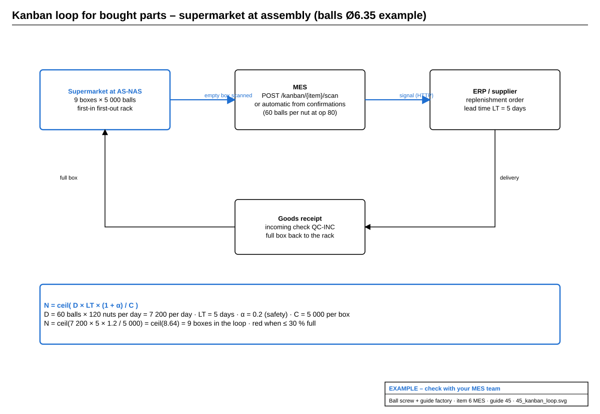

### 12.1 Transport requests to the AGV fleet

`POST /api/bsf/mes/transport {"lot": "WO-00001-BS-01", "from": "SAW", "to": "SOFT", "priority": 5}` → MES stores `TR-00001`
and calls the fleet manager `POST /api/bsf/agv/transportorders {from, to, load, priority}` (item 4 demo, VDA 5050 ideas
mapped to HTTP). The state comes back from `GET /api/bsf/agv/transportorders/{id}`: CREATED → ASSIGNED → PICKING →
DELIVERING → FINISHED. Zones = the areas of item 3 (RAW, SAW, SOFT, HT, GRIND, METRO, ASSY, PACK).

### 12.2 Kanban / supermarket for bought parts

Bought parts of the BOM (item 1): balls, deflectors, seals, snap rings, end caps, hole caps. They sit in a supermarket at
the assembly benches; every empty box is a signal.

**N = ceil( D × LT × (1 + α) / C )**  (D demand per day, LT replenishment time in days, α safety factor, C pieces per box)

| Item | per product | D / day | LT (d) | α | C | N |
|---|---|---|---|---|---|---|
| Balls Ø6.35 G5 (nut) | 60 | 60 × 120 = 7 200 | 5 | 0.2 | 5 000 | ceil(8.64) = **9** |
| Deflector MIM | 4 | 480 | 10 | 0.2 | 500 | ceil(11.52) = 12 |
| Wiper seal | 2 | 240 | 10 | 0.2 | 200 | ceil(14.4) = 15 |
| Balls Ø4.763 G10 (carriage) | 120 | 48 000 | 5 | 0.2 | 20 000 | ceil(14.4) = 15 |
| End cap POM | 2 | 800 | 15 | 0.25 | 500 | ceil(30) = 30 |
| Rail hole cap Ø11 | 17 | 3 400 | 10 | 0.2 | 2 000 | ceil(20.4) = 21 |

The MES counts the use from the confirmations of the consuming operation (nut op 80, carriage op 80, rail op 100):
every C pieces used → one box empty → replenishment signal with due date = now + LT. An operator can also scan an empty
box (`POST /kanban/{item}/scan`). A loop is red when ≤ 30 % of the boxes are full.

### 12.3 Finished goods

When the last operation of a set lot (or a part lot of a part order) is done, the MES books the good quantity to
finished goods and sends a goods receipt to the ERP (`POST /api/bsf/erp/goodsmovements {"type": "GR", …}`). Manual
booking: `POST /api/bsf/mes/fg {lot, qty}` (409 if the lot is not done, 422 if qty > lot qty).

---

## 13. OEE (ISO 22400) and the other KPIs

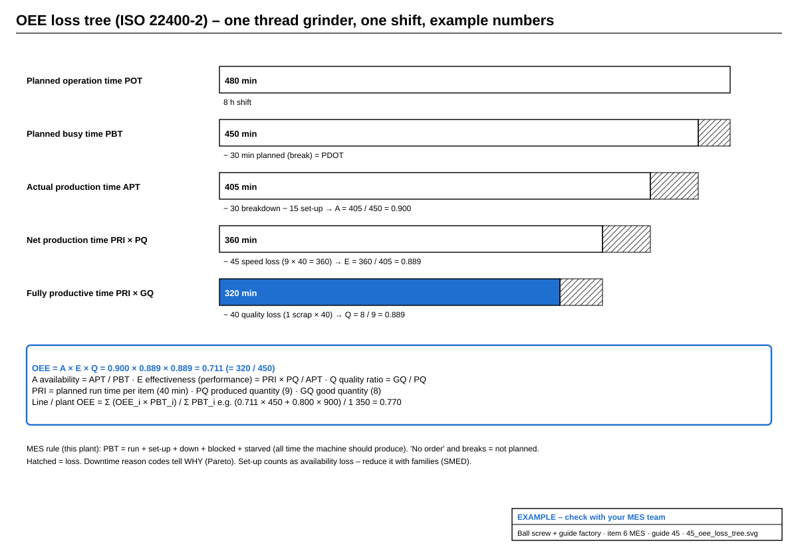

### 13.1 The ISO 22400-2 time model

| Symbol | Name | Example (one shift) |
|---|---|---|
| POT | planned operation time | 480 min |
| PDOT | planned down time (break, planned maintenance) | 30 min |
| PBT | planned busy time = POT − PDOT | **450 min** |
| ADOT | actual unit down time (breakdowns) | 30 min |
| ASUT | actual set-up time | 15 min |
| APT | actual production time = PBT − ADOT − ASUT | **405 min** |
| PRI | planned run time per item | 40 min |
| PQ | produced quantity | 9 |
| GQ | good quantity | 8 |

### 13.2 Formulas with the example

* Availability **A = APT / PBT = 405 / 450 = 0.900**
* Effectiveness (performance) **E = PRI × PQ / APT = 40 × 9 / 405 = 360 / 405 = 0.889**
* Quality ratio **Q = GQ / PQ = 8 / 9 = 0.889**
* **OEE = A × E × Q = 0.900 × 0.889 × 0.889 = 0.711**
* Check: OEE = GQ × PRI / PBT = 8 × 40 / 450 = 320 / 450 = **0.711** ✔

Losses in minutes: breakdown 30 + set-up 15 = 45 (availability) · speed 405 − 360 = 45 · quality 1 × 40 = 40 · fully
productive 320 min.

### 13.3 Line and plant OEE

Exact rule (ISO 22400 idea): **OEE_plant = Σ (OEE_i × PBT_i) / Σ PBT_i = Σ (GQ_i × PRI_i) / Σ PBT_i**.
Example: machine 1 OEE 0.711, PBT 450; machine 2 OEE 0.800, PBT 900 → (320 + 720) / 1 350 = **0.770**.

The live page aggregates the factors: A = Σ APT / Σ PBT; E and Q weighted by APT over the machines that finished parts in
the window (a machine that has not finished a part yet in a short window would otherwise count with OEE 0). Over a full
shift both give nearly the same number.

### 13.4 Which times count – rule of this MES

**PBT = run + set-up + down + blocked + starved** – all the time the machine should produce. "No order" (IDLE) and "no
shift" (OFF) are outside. So starved (waiting for parts) and blocked (out-buffer full) lower A. The twin's own OEE
(item 3) counts only run + set-up + down; the MES number is therefore lower – and more honest about the flow.

### 13.5 Other KPIs (ISO 22400-2 has 34; we use these)

| KPI | Formula | Example |
|---|---|---|
| Utilisation | (run + set-up) / on time | from the twin |
| Scrap ratio | scrap / produced | 1 / 9 = 11 % (example shift) |
| Set-up ratio | set-up / PBT | 15 / 450 = 3.3 % |
| MTBF, MTTR | run time / number of failures, repair time / failures | item 3 (BS-TGR 80 h / 2.5 h) |
| Throughput | good per day | target 120 sets |
| WIP (Little) | L = λ × W | 120 sets/day × 5 days = **600 sets** |
| Lead time | W = L / λ | 600 / 120 = 5 days |
| Energy per part | kWh per set (machines + infrastructure) | twin KPI `kWhPerSet` |
| Downtime Pareto | minutes per reason code, cumulative % | chapter 14 |

Little's law in the page: the shift report shows L (lots in the hall), λ (lots per hour finishing) and W (hours per
lot) from the twin and checks λ × W ≈ L.

---

## 14. The machine terminal and downtime reasons

### 14.1 The terminal page

One panel PC per 2 – 4 machines runs only a browser (kiosk mode). The terminal page (section 4 of the item) shows:

| Area | Content | HTTP |
|---|---|---|
| header | machine, state, alarm, IP + Modbus unit id | `GET /andon` |
| now / next | lot on the machine, first lot of the dispatch list | `GET /dispatch?machine=` |
| download | send the next lot to the machine | `POST /machines/{id}/download` |
| confirm | good / scrap (manual stations or corrections) | `POST /confirmations` + Idempotency-Key |
| scan | serial → trace | `GET /trace?serial=` |
| downtime | reason + minutes + comment, or confirm the automatic reason | `POST /downtime`, `POST /downtime/{id}/reason` |
| andon call | supervisor / maintenance / quality / logistics | `POST /andon/call` |

Every POST from the terminal carries a fresh Idempotency-Key – a double tap books once.

### 14.2 Reason codes

| Code | Reason | Category | OEE |
|---|---|---|---|
| 100 | Breakdown – mechanical (spindle, axis, bearing) | breakdown | A |
| 110 | Breakdown – electrical / control / drive | breakdown | A |
| 120 | Breakdown – hydraulics / pneumatics / coolant | breakdown | A |
| 130 | Grinding-oil temperature / chiller | breakdown | A |
| 140 | Heat-treatment process out of window | breakdown | A |
| 200 | Set-up / change-over | set-up | A |
| 210 | Wheel dressing outside the cycle | set-up | A |
| 220 | Tool change / tool breakage | tooling | A |
| 300 | No material / parts (starved) | logistics | A |
| 310 | Waiting for AGV / transport | logistics | A |
| 320 | No operator | organisation | A |
| 330 | Waiting for first-part release (quality) | quality | A |
| 400 | Blocked – out-buffer full | logistics | A |
| 500 | Planned maintenance | planned | PDOT (outside OEE) |
| 510 | Cleaning / 5S (planned) | planned | PDOT |
| 520 | Break / meeting (planned) | planned | PDOT |
| 600 | Quality problem – adjust / re-measure | quality | A |
| 700 | No order (idle) | no demand | not planned |
| 900 | Manual stop – reason not given yet | unknown | A |

Rules for a good code list: ≤ 20 codes, each one leads to a different action, "unknown" (900) is visible on the andon
board until the operator classifies it.

### 14.3 Automatic first guess from the alarm code

| Machine alarm (item 3 / 4 `std.alarm`) | Reason guess |
|---|---|
| 213 oil temperature drift | 130 |
| 211 dressing fault, 202 wheel balance | 210 |
| 102 tool broken, 151 band change | 220 |
| 401 – 403 furnace | 140 |
| 302 quench flow, 203 coolant, 103 chip conveyor, 801 bath | 120 |
| 301, 104, 201, 212, 502, 601, 701, 802, 153 (drive, sensor, control) | 110 |
| 602 material temperature | 600 |
| 702 ball feeder empty | 300 |
| 900 manual | 900 |
| other | 100 |

The record shows "automatic guess, please confirm" until the operator presses "set reason from the list".

---

## 15. Andon

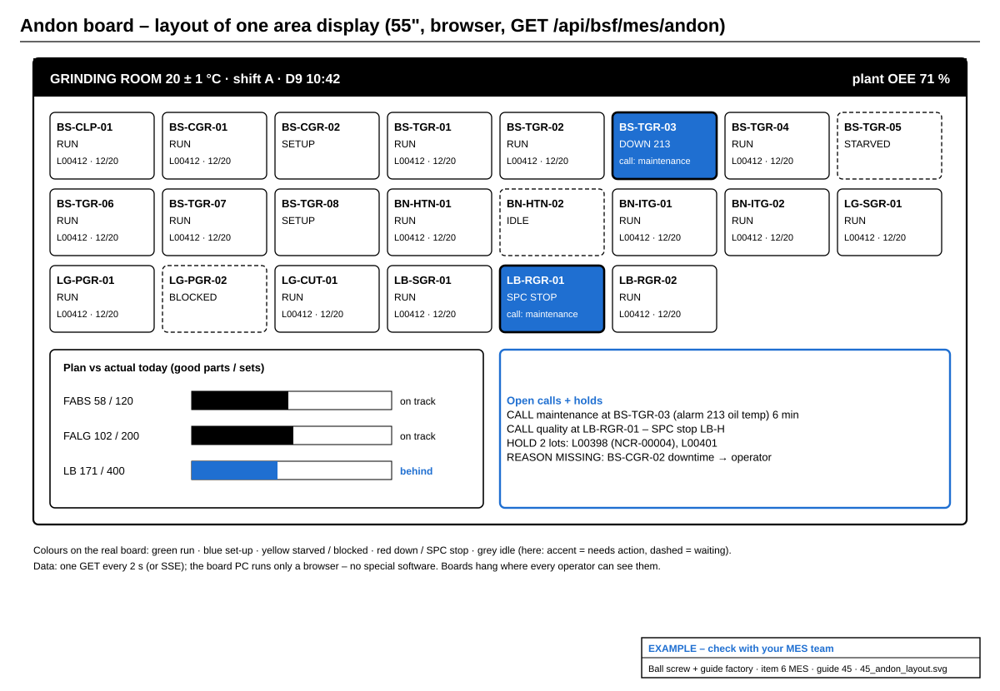

* **What:** one tile per machine in 5 area groups (soft machining, heat treatment, grinding room, metrology, assembly).
  Colour = state: green run, blue set-up, yellow starved / blocked, red down or SPC stop, grey idle / no shift. Small
  marks: open call, downtime reason missing, progress bar of the lot.
* **Below:** plan vs actual today per product (target from the twin: FABS 120, FALG 200 …, bar green when on track for
  the time of the day), open calls (with "done" button), lots on hold, SPC stops.
* **Data:** `GET /api/bsf/mes/andon` every 2 s (one JSON with 73 machines ≈ 25 kB).
* **Where:** one 55" display per area at the main aisle, readable from 10 – 15 m (tile text ≥ 40 mm high on the real board).
* **Calls:** a call stays until someone presses "done" (`POST /andon/ack`) – the time to react is a KPI for supervisors.
* **Stack lights on the machines** are driven by the machine PLC (item 8) – not by the MES.

---

## 16. Shift report

`GET /api/bsf/mes/report?hours=7.5` (or `?from=<t>`) – the page shows it as plain text to copy into the shift book:

| Block | Content |
|---|---|
| output | good parts of the last operation per route in the window |
| confirmations | count |
| holds, SPC stops | count / machines |
| OEE plant | A × E × Q |
| scrap by cause | pieces per route + operation (e.g. "BS 70 straightening after hardening 3") |
| top downtime | 3 reason codes with minutes |
| WIP, Little | lots / pieces, L = λ × W |
| lead time, energy | order lead time (h), kWh per set, kWh per day |
| events | last 30 journal lines of the shift |

Shift hand-over routine (example): outgoing supervisor reads the report, classifies all "900 unknown" downtimes, checks
open holds and calls, signs (role supervisor) – incoming supervisor reads it at the andon board.

---

## 17. Users, roles and security

### 17.1 Roles

| Role | May do | Screen |
|---|---|---|
| operator | start lot, scan, confirm good / scrap, downtime reason | terminal |
| setter | + set-up confirmation, first-part request, recipe download | terminal |
| supervisor | + re-sequence dispatch list, reclassify downtime, sign shift report | supervisor page |
| quality | hold / release lots, NCR link, SPC stop / release | quality page |
| logistics | transport requests, kanban scan, FG booking | logistics page |
| planner | create / release work orders, run the scheduler, priorities | planning page |
| maintenance | downtime reasons, maintenance requests, release after repair | maintenance page |
| admin | users, API keys, master data, backup / restore | admin page |

### 17.2 Security (real plant – the demo does not enforce it)

* **Zones (IEC 62443 idea, item 4):** MES in the level-3 zone; the only path to the machines is the gateway; ERP in the
  office zone through the firewall (only the MES HTTP port).
* **HTTPS** with certificates of the plant CA; HTTP inside one host only.
* **Authentication:** users log in with badge + PIN on terminals (session), systems use API keys (`Authorization: Bearer …`).
* **Authorisation:** every route checks the role (e.g. `POST /lots/{id}/release` = quality only).
* **Audit trail:** every state change is written to the journal (who, what, when) – SQLite table `journal`.
* **Input checks:** quantities 0 … 5 000, known product codes, reason codes from the list, body ≤ 2 MB (server.py).
* **Availability:** UPS, second server, daily backup (chapter 18), the machines can keep running on their last order if the
  MES is down (they only miss the next download).

---

## 18. Persistence, backup and restore

| Topic | This MES |
|---|---|
| Store | in memory while running; **SQLite file `bsf_mes.sqlite`** next to the server's `--db` file (env `BSF_MES_DB` overrides) |
| When written | only after the first state-changing request (POST) – opening the page or a GET never creates the file |
| What | table `state (k, v, t)` = whole MES state as JSON (at most every 5 s for the twin feed, at once for planner / quality / terminal actions); table `journal (seq, t, kind, text)` = audit trail |
| Start | the file is loaded if it exists (`persist.loaded = true` in `GET /health`) |
| Switch off | `POST /api/bsf/mes/control {"action": "persist", "on": false}` |
| Reset | `POST /api/bsf/mes/control {"action": "reset"}` (seed: WO-00001 BS 20 released, WO-00002 LG 50 released, WO-00003 LB 100 created) |

Backup (real plant, example): SQLite online backup API (`sqlite3 bsf_mes.sqlite ".backup 'nas/bsf_mes_YYYYMMDD.sqlite'"`)
every night + before every update, 30 days on the NAS + a monthly offline copy. **Test the restore** every quarter on the
standby server. For more than a few writers or very long history change to PostgreSQL (same JSON documents, one table per
entity).

---

## 19. IT hardware for the MES

| Item | Example spec | Qty (example plant) |
|---|---|---|
| MES server | 2 × 16 cores, 64 GB RAM, 2 × 1.9 TB SSD RAID 1 | 2 (active + standby) |
| UPS | 3 kVA online, ≥ 15 min, network shutdown | 2 |
| Backup NAS | 4 bays, snapshots | 1 |
| Machine terminals | panel PC 15 – 22", IP65 front, browser kiosk | 25 (1 per 2 – 4 machines) |
| Scanners | 2D, DPM capable | 30 handheld + 4 fixed |
| Label printers | 300 dpi thermal transfer, ZPL, HTTP job API via print server | 6 |
| Andon displays | 55" 24/7 + mini PC | 5 |
| Network | managed switches, VLANs, firewall (item 4) | item 4 |

Load estimate: 73 machines × (fast poll 2 / s + counters 1 / s) at the gateway; the MES itself sees ≈ 1 – 5 HTTP requests
per second (terminals, boards, twin feed) and schedules ≈ 200 lots in < 1 s – one mid-range server is plenty; the second
server is for availability.

---

## 20. Roll-out plan

| Phase | Weeks (example) | Content | Done when |
|---|---|---|---|
| 0 Prepare | 1 – 4 | master data (routings item 2, products, machines, reason codes), roles, network zone | data checked by production + quality |
| 1 Pilot – screw line | 5 – 12 | work orders, dispatch, terminals on BS-TGR + QC-LED, counters via gateway, downtime reasons | 4 weeks: ≥ 95 % of the lots confirmed in the MES, reasons for ≥ 90 % of the downtime |
| 2 Traceability | 13 – 18 | serials + labels, genealogy at assembly, QA link (holds) | trace of 20 random sets complete (heat → customer) |
| 3 Whole plant | 19 – 30 | all 73 machines, andon boards, kanban, AGV link, OEE + shift report | OEE report accepted by management, paper lot cards gone |
| 4 Scheduling | 31 – 40 | finite scheduling with FAM + DBR on the drum, rule review | on-time % and WIP better than before (baseline!) |
| 5 Improve | ongoing | SMED on the grinders, Pareto actions, ERP coupling (item 7) | – |

Measure a **baseline** before phase 1 (OEE by hand for 2 weeks, WIP count, lead time of 20 orders) – otherwise nobody can
prove the benefit.

---

## 21. Tests and the self-check

`/?bfitem=6&bf6test#bsf` runs 50 checks and prints `BF6TEST PASS/FAIL …` to the console and to a box at the end of the
page. Hand-checkable values:

| Check | Expected |
|---|---|
| OEE example A, E, Q, OEE | 0.900, 0.889, 0.889, 0.711 (= 320 / 450) |
| plant OEE weighted by PBT | 0.7704 |
| kanban balls Ø6.35 | 9 boxes |
| Little WIP | 600 sets |
| shift calendar 20:00 + 120 min | t = 660 min |
| one machine EDD / SPT / CR | J1 J2 J3 Σ 360 · J2 J1 J3 Σ 480, flow 540 · J1 J3 J2 Σ 600 |
| flow shop SPT / EDD | makespan 420 / 540 |
| thread grinder EDD / FAM | 580 / 520 min, set-ups 4 / 2 + 2 |
| twin → MES | work orders, confirmations, serials, assemblies with real children |
| live schedule + DBR | all lots planned, no unscheduled op, WIP with DBR ≤ without |
| genealogy | assembly ← shaft (heat H7741) + nut (heat H5512), where-used of H7741 finds the assembly |
| idempotent confirmation | same key → replay, good counted once |
| hold, SPC stop, readiness | 423, empty dispatch, 422 → force 200 |
| problem+json | 404 / 400 / 422 |
| GS1 | GTIN check digit 1 |
| server round trip (if running) | WO 201 + replay, release 200 / 409, **Python = JavaScript** scheduler on 6 hand cases + 40 live lots (same lot, machine, start), OEE equal, confirmation replay, 404, v1 alias, 43 routes, twin feed, live trace, SQLite file in the scratch data folder |
| page | card with 12 drawings, Gantt 73 rows, andon 73 tiles |

Run it in both modes: with the server and with `&bf6demo`. Also run the self-checks of items 1 – 5 (`&bf1test` …
`&bf5test`) – item 4 and 5 call the MES routes (`POST /workorders`, `POST /confirmations`).

---

## 22. Build or buy?

| Point | Own MES (like this item) | Bought MES product |
|---|---|---|
| Fit to our rule (only Ethernet + Modbus TCP + HTTP) | exact – built for it | check every product: many expect OPC UA / MQTT / own data-collection boxes → extra connector project |
| Functions on day 1 | what we write (this demo = proof of concept) | very wide (APS, labour, maintenance, documents, CAPA, e-signatures) |
| Time to production | ≈ 12 – 24 months, 2 – 3 developers + tests | ≈ 6 – 18 months (project, configuration, interfaces, training) |
| Cost, 5 years (example plant) | ≈ 1.5 – 3 developer-years + hardware + own support 0.5 – 1 FTE / year | licence ≈ 150 – 600 k€ + 15 – 22 % / year + project + hardware |
| Change speed | fast – own code | configuration fast; real changes = change requests |
| Risk | key persons; security, backup, audit trail are our job | vendor lock-in, upgrade projects, licence changes, cloud dependence |
| Customer audits | we document + test | vendor documents help; still our process |

**Recommendation (example):** use this MES for the pilot line to learn the data model and the interfaces; write the HTTP
contract (guides 43 + 45, Appendix A) into the tender as a must-have; decide after the pilot with real numbers (OEE
baseline, number of confirmations, change requests per month).

---

## 23. Buy list – catalogue examples

Prices = rough estimates 2026 – **ask for a quote**. MES products are references only: **needs HTTP REST + Modbus gateway
support; check**. Makers marked (check) – confirm model, interface and local service.

| Group | Item | Example makers / products | Price class (estimate) | Ask |
|---|---|---|---|---|
| MES software | MES suite discrete | Siemens Opcenter Execution Discrete (check) | ≈ 150 – 600 k€ + yearly | REST API, Modbus via gateway, offline operation |
| MES software | MES + ERP | Rockwell Plex MES · FactoryTalk ProductionCentre (check) | ≈ 100 – 500 k€ + yearly | cloud vs on-premise |
| MES software | modular MES | Critical Manufacturing MES (check) | ≈ 150 – 500 k€ | serial genealogy for assemblies |
| MES software | MES / MDC / PDC | MPDV HYDRA X (check) | ≈ 80 – 400 k€ | Modbus TCP data collection? |
| MES software | assembly MES | iTAC.MES.Suite (check) | ≈ 80 – 300 k€ | traceability, routing control |
| MES software | MES | AVEVA MES (check) | ≈ 100 – 400 k€ | – |
| MES software | others | DELMIA Apriso · SAP Digital Manufacturing · GE Proficy · Epicor (check) | ≈ 100 – 800 k€ | ERP coupling |
| Terminals | industrial panel PC 15 – 22" | Siemens SIMATIC IPC / ITP · Beckhoff CP · B&R · Advantech TPC (check) | ≈ 1.5 – 4 k€ | browser kiosk, glove touch |
| Terminals | rugged tablet / handheld | Zebra TC / ET · Honeywell CT · Datalogic Memor (check) | ≈ 1 – 2.5 k€ | Wi-Fi coverage |
| Scanners | handheld 2D, DPM | Zebra DS3600 / DS8100 · Cognex DataMan 8700 · Datalogic PowerScan · Honeywell Granit (check) | ≈ 0.3 – 1.2 k€ | laser marks on round steel |
| Scanners | fixed reader | Cognex DataMan 370 · Keyence SR-X · Datalogic Matrix · SICK Lector (check) | ≈ 1.5 – 4 k€ | HTTP / TCP output |
| Labels | label printer 300 dpi | Zebra ZT411 / ZT610 · SATO CL4NX Plus · Honeywell PM45 (check) | ≈ 1.5 – 4 k€ | HTTP job API via print server, ^BX |
| Labels | print server software | Zebra · NiceLabel (Loftware) · BarTender (check) | ≈ 2 – 20 k€ | REST job API |
| Andon | 55" display + mini PC | Samsung / LG / Philips commercial (check) | ≈ 1 – 2.5 k€ | 24/7 rating |
| Andon | network stack light | Patlite LA6 / NHL · Werma · Banner (check) | ≈ 0.25 – 0.7 k€ | HTTP or Modbus TCP control |
| IT | server | Dell PowerEdge R660 · HPE ProLiant DL360 · Lenovo SR630 (check) | ≈ 8 – 15 k€ | 5-year spares |
| IT | UPS 3 kVA online | APC Smart-UPS SRT · Eaton 9PX · Socomec (check) | ≈ 2 – 4 k€ | network shutdown |
| IT | backup NAS | Synology · QNAP (check) | ≈ 1.5 – 4 k€ | snapshots |

The catalogue card of the page has 25 rows with more detail.

---

## 24. Shopping list – MES roll-out

| Pos | Qty | Item | Spec | Price class (estimate – ask for a quote) |
|---|---|---|---|---|
| 1 | 2 | MES servers | 16 cores, 64 GB, SSD RAID 1 | ≈ 16 – 30 k€ |
| 2 | 2 | UPS 3 kVA online | ≥ 15 min | ≈ 4 – 8 k€ |
| 3 | 1 | Backup NAS + offline disks | snapshots, 30 days | ≈ 2 – 5 k€ |
| 4 | 25 | Machine terminals | IP65, browser kiosk | ≈ 40 – 100 k€ |
| 5 | 30 | 2D scanners (DPM) | Data Matrix on steel | ≈ 15 – 35 k€ |
| 6 | 4 | Fixed code readers | marker, assembly, packing | ≈ 6 – 16 k€ |
| 7 | 6 | Label printers + print server software | ZPL, HTTP job API | ≈ 12 – 30 k€ |
| 8 | 5 | Andon displays 55" + mini PCs | 24/7 | ≈ 6 – 12 k€ |
| 9 | 73 | Network stack lights (or PLC lamps) | LAN | ≈ 20 – 50 k€ |
| 10 | 60 | Badge readers + badges | RFID | ≈ 8 – 15 k€ |
| 11 | 1 | MES software: own (finish this item) **or** bought licence + project | chapter 22 | own ≈ 1.5 – 3 developer-years · bought ≈ 150 – 600 k€ + 15 – 22 % / year |
| 12 | 1 | Training + roll-out support | 3 – 5 days per role | ≈ 15 – 40 k€ |

Not included: machines + gateway (items 2 + 4), cabling, building work.

---

## 25. Standards register

All titles + editions: **check the current edition** before you use them.

| Standard | Title (short) | Used for |
|---|---|---|
| IEC 62264-1 … -5 (= ANSI/ISA-95) | Enterprise-control system integration | levels, level-3 activities, object model (chapter 3, 4) |
| IEC 62264-3 | Activity models of manufacturing operations management | production / quality / maintenance / inventory activities |
| ISO 22400-1 / -2 | Automation systems – KPIs for manufacturing operations management | OEE time model and formulas (chapter 13) |
| ISO 9001 §7.5, §8.5.2 | Quality management – documented information, identification and traceability | genealogy, retention (chapter 10) |
| IATF 16949 (ideas only) | automotive QMS – traceability, first-part release | rules of chapters 10, 11 (check) |
| GS1 General Specifications | GTIN, application identifiers, GS1 DataMatrix | labels (chapter 9) |
| ISO/IEC 16022 | Data Matrix bar code symbology | symbol |
| ISO/IEC 15415, ISO/IEC TR 29158 (AIM DPM) | print quality / direct part mark quality | label + laser mark grading (check) |
| ISO/IEC 15418, ANSI MH10.8.2 | data identifiers / application identifiers | AI syntax (check) |
| IEC 61131-3 (item 8) | PLC languages | machine side of the handshake |
| Modbus Application Protocol V1.1b3 + Modbus Messaging on TCP/IP V1.0b | Modbus TCP | gateway ↔ machines (item 4) |
| RFC 9110 | HTTP semantics (methods, status codes 409 / 422 / 423) | API (check: 422 and 423 come from WebDAV RFC 4918 / now RFC 9110 for 422) |
| RFC 9457 | Problem details for HTTP APIs | error bodies |
| RFC 8259 | JSON | bodies |
| draft "Idempotency-Key" HTTP header (IETF httpapi WG) | idempotent POST | create + confirmations (check status of the draft) |
| WHATWG HTML – Server-sent events | live push over HTTP | streams |
| ISO 8601 / RFC 3339 | date and time format | JSON times |
| IEC 62443-3-3 | industrial security – system requirements | zones, roles (chapter 17) |
| VDA 5050 (ideas, mapped to HTTP) | AGV ↔ master control interface | transport orders (chapter 12) |
| EN 10204 | metallic products – types of inspection documents (3.1) | heat certificates |
| MESA International – MESA-11 model | MES functions | chapter 3.3 (not a standard – a reference model) |

---

## 26. Glossary

| Term | Meaning |
|---|---|
| andon | board / light that shows the state of the line and calls for help |
| APT | actual production time (ISO 22400) |
| bottleneck | the resource with the highest load – it sets the output (here BS-TGR) |
| CR | critical ratio = (due − now) / remaining work |
| confirmation | message "op X of lot Y: n good, m scrap, time" |
| DBR | drum-buffer-rope – release work by the schedule of the bottleneck |
| dispatch list | ordered list of the next lots for one machine |
| DPM | direct part marking (laser mark on the part) |
| EDD | earliest due date rule |
| FAM | set-up family rule (keep the same family on the machine) |
| finite capacity | planning that respects that a machine does one job at a time |
| FNC1 | special first character that marks GS1 data in a Data Matrix |
| genealogy | parent / child links between serials, lots, heats |
| GTIN | Global Trade Item Number (GS1) |
| heat lot | one melt of steel with one certificate (EN 10204 3.1) |
| hold | quality block of a lot |
| idempotent | doing it twice has the same effect as once |
| ISA-95 / IEC 62264 | standard for the integration of enterprise and control systems |
| kanban | card / box signal that triggers replenishment |
| Little's law | L = λ × W (WIP = throughput × lead time) |
| lot | quantity that moves together through the routing |
| makespan | time from start to the end of the last operation |
| MES | manufacturing execution system (level 3) |
| non-delay schedule | no machine waits if an operation could start |
| OEE | overall equipment effectiveness = A × E × Q |
| PBT | planned busy time (ISO 22400) |
| PRI | planned run time per item |
| problem+json | standard JSON error body (RFC 9457) |
| readiness check | material, tools and gauges checked before release |
| routing | sequence of operations of a part (item 2) |
| SPC stop | machine blocked because the process is out of control |
| SPT | shortest processing time rule |
| SSE | Server-Sent Events – live push over HTTP |
| toggle bit | REQ / ACK bit that changes state once per command |
| transfer lot | quantity moved from one machine to the next (item 3) |
| WIP | work in progress |
| work order | MES order for one product, quantity and due date, split into lots |

---

## 27. Questions for the MES supplier

1. Can your MES talk to machines **only through our Modbus TCP gateway over HTTP** (no OPC UA, no MQTT, no own boxes)?
   Show an example connector.
2. Which REST API do you offer (OpenAPI file)? Idempotency for create + confirmations? Problem+json errors?
3. Can the shop floor run on **browsers only** (terminals, andon) – no client installation?
4. How does finite scheduling work: rules, set-up families / matrices, drum-buffer-rope, re-scheduling on breakdown, how
   long for 200 lots × 10 operations?
5. Genealogy for **assemblies** (screw + nut → set, rail + 2 matched blocks): scan at assembly, FIFO proposal, where-used
   in < 1 s for 10 years of data?
6. GS1 labels: do you build the element string (AI 01 / 11 / 21 / 10 / 240) and send print jobs over HTTP?
7. OEE exactly per ISO 22400 – can we define our own reason codes and PBT rule? Pareto and shift report included?
8. Quality link: lot hold from an external QA service, NCR link, SPC stop of a machine – standard or project?
9. Offline: what happens on the shop floor if the MES server is down for 1 h? Buffering of confirmations?
10. Data ownership: can we export everything (SQL / JSON) at any time? Retention 15 years – cost?
11. Licence model: per user, per machine, per site? Price for 73 machines, 25 terminals, 60 users? Yearly maintenance %?
12. Upgrade policy: how often, who tests, can we skip versions?
13. Security: roles, audit trail, IEC 62443 certification, update process for vulnerabilities?
14. References in precision mechanical parts (bearings, ball screws, guides) in our country – can we visit one?
15. Project: time plan, our effort, training per role, local support hours?

---

## 28. Next to read

* **Guide 43** – communication: register maps, the gateway, the handshake in detail, HTTP API catalogue.
* **Guide 44** – quality: control plan, gates, SPC, NCR – the source of the holds of chapter 11.
* **Guide 42** – the live twin that feeds this MES (orders, lots, machine states, KPIs).
* **Guide 41** – routings, cycle times, capacity, the bottleneck.
* **Guide 46 (item 7, next)** – ERP: BOM, MRP, purchasing, cost; it imports `web/bsfmes_data.js` and calls
  `POST /api/bsf/mes/workorders`.
* **Guide 47 (item 8)** – PLC programs: the machine side of the toggle-bit handshake and the counters.
* Books (examples): Kletti – *Manufacturing Execution Systems – MES* (Springer); Pinedo – *Scheduling: Theory, Algorithms,
  and Systems*; Goldratt – *The Goal*; Hopp + Spearman – *Factory Physics* (Little's law, WIP).

---

## Appendix A – HTTP API reference with JSON for every endpoint

Base path `/api/bsf/mes` (also `/api/bsf/v1/mes`). Server: `twin/bsf_mes.py` via `server.py`; browser demo: the same router
in `web/bsfmes_core.js`. JSON shortened with `…`. Times: `…At` / `due` = ISO 8601 text, `t` / `dueT` = seconds. All values
are examples (shapes from the test server on port 8087, numbers shortened).

### A.1 Health and catalogue

`GET /api/bsf/mes/health` → 200

```json
{"ok": true, "version": "bsf_mes 1.0", "mode": "server", "workorders": 28, "lots": 271, "serials": 3454, "confirmations": 738,
 "persist": {"on": true, "path": "…/bsf_mes.sqlite", "exists": true, "loaded": false, "savedAt": "2026-11-13T09:10:16Z", "error": ""},
 "gateway": false, "t": "2026-11-13T09:10:16Z"}
```

The browser demo answers `"mode": "browser demo"` and `"persist": null`.

`GET /api/bsf/mes/api` → 200 `{"version": "bsf_mes 1.0", "routes": [["GET", "/api/bsf/mes/health", "…"], …]}` (43 routes).

### A.2 Work orders

`POST /api/bsf/mes/workorders` with `Idempotency-Key: 7b1f-guide-1`

```json
{"product": "BS-3210-1000-C5", "qty": 40, "dueDays": 5, "erpOrder": "PO-260045"}
```

→ **201**

```json
{"id": "WO-00009", "erpOrder": "PO-260045", "product": "BS-3210-1000-C5", "route": "BS", "material": "BS-3210-1000-C5", "qty": 40,
 "due": "2026-11-18T09:10:15Z", "dueT": 1794993015.28, "priority": 5, "routingVersion": "R-BS-01", "status": "created",
 "created": "2026-11-13T09:10:15Z", "released": null, "good": 0,
 "lines": [{"route": "BS", "code": "BS-3210-1000-C5", "need": 40, "start": 43, "lots": ["WO-00009-BS-01", "WO-00009-BS-02", "WO-00009-BS-03"]}],
 "lots": ["WO-00009-BS-01", "WO-00009-BS-02", "WO-00009-BS-03"],
 "operations": [{"op": "10", "machineType": "MS-SAW", "route": "BS", "name": "Saw the bar to length 1 010 mm", "status": "open", "good": 0, "scrap": 0}, …],
 "holds": [], "source": "api"}
```

Body fields: `product` (code of PRODUCTS6 or BS / BN / LG / LB / FABS / FALG), `qty` 1 … 5 000, `due` (ISO) or `dueDays`,
`erpOrder`, `priority`, `release: true` (create + release), `lots: [{id, route, qty}]` (lots given by the caller, e.g. the
twin). Same key again → **200** with the same body + `"replay": true`. Errors: 400 unknown product, 422 qty out of range.

`GET /api/bsf/mes/workorders?status=released&page=1&size=20` → 200

```json
{"items": [{"id": "WO-00009", "erpOrder": "PO-260045", "product": "BS-3210-1000-C5", "route": "BS", "qty": 40, "due": "…", "status": "created",
            "good": 0, "lots": 3, "source": "api", "holds": 0}, …], "page": 1, "size": 20, "total": 28, "next": "/api/bsf/mes/workorders?page=2&size=20"}
```

`GET /api/bsf/mes/workorders/WO-00009` → 200 (same shape as the 201 answer) · unknown → 404 problem+json.

`POST /api/bsf/mes/workorders/WO-00009/release` `{}` → 200 (work order + `readiness`) · wrong state → **409**:

```json
{"type": "https://plant.example/problems/wrong-state", "title": "wrong state", "status": 409, "detail": "WO-00001 is 'released', only 'created' can be released"}
```

not ready → **422** (see 8.5) · `{"force": true}` releases anyway (journal: "FORCED").

`POST /api/bsf/mes/workorders/WO-00009/cancel` `{"reason": "customer cancelled"}` → 200 · not `created` → 409.

### A.3 Lots

`GET /api/bsf/mes/lots?wo=WO-00009&status=queued` → 200
`{"items": [{"id": "WO-00009-BS-01", "wo": "WO-00009", "route": "BS", "code": "BS-3210-1000-C5", "qty": 20, "status": "queued", "op": "10", "m": "MS-SAW", "hold": null, "heat": "H7741"}, …]}`

`GET /api/bsf/mes/lots/WO-00009-BS-01` → 200

```json
{"id": "WO-00009-BS-01", "wo": "WO-00009", "route": "BS", "code": "BS-3210-1000-C5", "fam": "Ø32×10", "qty": 20, "qty0": 20, "status": "queued",
 "i": 0, "hold": null, "heat": "H7741", "serials": [], "machine": "", "started": false, "due": "2026-11-18T09:10:15Z", "opNow": "10", "mNow": "MS-SAW",
 "ops": [{"no": "10", "m": "MS-SAW", "n": "Saw the bar to length 1 010 mm", "setup": 10, "setupMinor": 10, "cyc": 1.0, "batch": 60, "furnace": false,
          "gate": "", "fam": "", "status": "open", "machine": "", "good": 0, "scrap": 0, "qtyIn": 20, "tStart": null, "tEnd": null}, …]}
```

`POST /api/bsf/mes/lots/WO-00009-BS-01/hold` `{"reason": "QA NOK BS-V300 = 21.4 µm", "by": "QA (item 5)", "ncr": ""}` → 200 (lot,
status `hold`) · done / scrapped → 409.

`POST /api/bsf/mes/lots/WO-00009-BS-01/release` `{"by": "quality", "text": "re-measured OK"}` → 200 · not on hold → 409.

### A.4 Dispatch

`GET /api/bsf/mes/dispatch?machine=BS-TGR-03` → 200

```json
{"machine": "BS-TGR-03", "machineType": "BS-TGR",
 "items": [{"seq": 1, "wo": "WO-T0011", "lot": "L00124", "op": "100", "product": "BS-3210-1000-C5", "qty": 19, "setup": 0, "setupKind": "", "startIn_min": 0, "due": "2026-11-17T09:00:32Z", "load": ""},
           {"seq": 2, "wo": "WO-T0013", "lot": "L00161", "op": "100", "product": "BS-3210-1000-C5", "qty": 8, "setup": 0, "setupKind": "", "startIn_min": 160, "due": "2026-11-18T09:00:32Z", "load": ""}],
 "held": [], "from": "schedule 2026-11-13T09:04:09Z", "generated": "2026-11-13T09:10:15Z"}
```

SPC-stopped machine: `"blocked": {"char": "BS-PD", "text": "2 of the last 3 BS-PD NOK", …}, "items": []`.

### A.5 Confirmations

`POST /api/bsf/mes/confirmations` with `Idempotency-Key: cf-guide-1`

```json
{"lot": "WO-00001-BS-01", "op": "20", "machine": "BS-STR-01", "good": 20, "scrap": 0, "runMin": 52}
```

→ **201**

```json
{"id": "CF-00738", "wo": "WO-00001", "lot": "WO-00001-BS-01", "op": "20", "machine": "BS-STR-01", "good": 20, "scrap": 0, "setupMin": 0.0, "runMin": 52.0,
 "source": "api", "serial": "", "grade": "", "t": 1794561015.53, "at": "2026-11-13T09:10:15Z"}
```

Instead of `lot` the caller may send `wo` (+ `op` + `machine`): the MES picks the lot of that work order whose open
operation matches (item 4 / 5 compatibility). Optional: `setupMin`, `serial`, `grade`, `final: true` (operation finished
even if the count is lower), `tStart`, `tEnd`. Errors: 404 unknown lot / work order, 409 work order not released, 400
negative quantity, 422 unknown operation, **423 lot on hold**.

`GET /api/bsf/mes/confirmations?lot=WO-00001-BS-01&n=50` → `{"items": [ … ]}`.

### A.6 Schedule

`POST /api/bsf/mes/schedule` `{"rule": "FAM", "dbr": false, "bufferH": 16, "compare": true}` → 200

```json
{"t": 1794561016.1, "at": "2026-11-13T09:10:16Z", "rule": "FAM", "dbr": false, "reason": "manual",
 "kpi": {"lots": 216, "onTimePct": 36.57, "tardSum": 532483.7, "tardMax": 8726.5, "flowMean": 4453.9, "wipMean": 83.9, "makespan": 11464.75,
         "majors": 30, "minors": 0, "setupMin": 805.0, "loads": 56, "unscheduled": 0, "util": {"BS-TGR": 0.6166, …}, "dbr": null},
 "ops": [{"lot": "L00108", "wo": "WO-T0010", "code": "LB-25-FL", "route": "LB", "k": 0, "no": "90", "m": "QC-MAT", "machine": "QC-MAT-02",
          "start": 0, "end": 122.0, "setup": 0, "setupKind": "", "qty": 95, "load": "", "due": 4310.3, "fixed": true}, …],
 "compare": [{"rule": "EDD", "dbr": false, "kpi": {…}}, {"rule": "EDD", "dbr": true, "kpi": {…}}, …], "prev": {…}}
```

Times in the schedule = minutes from `t`. With `"case": {…}` the scheduler runs on the given input (no state change) – the
self-check uses it to compare Python with JavaScript:

```json
{"case": {"rule": "EDD", "calendar": "247", "machines": {"M1": [{"id": "M1-01"}]},
          "lots": [{"id": "J1", "qty": 1, "due": 360, "ops": [{"no": "10", "m": "M1", "setup": 0, "setupMinor": 0, "cyc": 300, "batch": 1, "furnace": false, "key": "J1", "fam": ""}]}, …]}}
```

`GET /api/bsf/mes/schedule` → the last schedule · none yet → 404.

### A.7 Machines

`GET /api/bsf/mes/machines` → `{"items": [{"id": "BS-TGR-03", "type": "BS-TGR", "state": "RUN", "lot": "L00124", "download": null, "spcStop": null, "dtOpen": null, "gw": null}, …]}` (73)

`POST /api/bsf/mes/machines/BS-TGR-03/download` `{"lot": "L00161"}` → 200

```json
{"machine": "BS-TGR-03", "lot": "L00161", "op": "100",
 "command": {"id": "BS-TGR-03", "cmd": "order", "order": "L00161", "part": "BS-3210-1000-C5", "qty": 8, "recipe": 100, "msgId": "L00161/100/BS-TGR-03"},
 "gateway": {"ok": true, "result": 0, "resultText": "OK", "ackSeq": 7, "busy": true, "steps": [{"ms": 3.1, "text": "1 read cmd.code / cmd.seq / cmd.ctl (200 - 202)", "req": "…", "resp": "…"}, …]},
 "simulated": false}
```

Errors: 404 unknown machine / lot, **409 gateway not running** (start it: `POST /api/bsf/control {"action": "start"}`), 422
wrong machine type (`"WO-00002-LG-01 next op 10 needs LG-SAW, machine is MS-SAW"`) or machine rejected (result 2 / 3 / 4),
423 SPC stop or lot on hold. Browser demo: `"gateway": null, "simulated": true` and the page shows simulated frames.

`POST /api/bsf/mes/machines/BS-TGR-03/spc` `{"alarm": true, "char": "BS-PD", "text": "2 of the last 3 NOK"}` → 200
`{"id": "BS-TGR-03", "spcStop": {"char": "BS-PD", "at": "…", "text": "…"}}` · `{"alarm": false}` releases.

### A.8 Downtime and reasons

`POST /api/bsf/mes/downtime` `{"machine": "BS-TGR-03", "reason": "210", "minutes": 12, "comment": "wheel dressed outside the cycle", "by": "badge 1043"}` → **201**

```json
{"id": "DT-00002", "machine": "BS-TGR-03", "type": "BS-TGR", "start": 1794560295.6, "end": 1794561015.6, "min": 12.0, "reason": "210",
 "reasonText": "Wheel dressing outside the cycle", "cat": "set-up", "oee": "A", "source": "terminal", "comment": "wheel dressed outside the cycle",
 "by": "badge 1043", "startAt": "2026-11-13T08:58:15Z", "endAt": "2026-11-13T09:10:15Z"}
```

Errors: 404 machine, 400 unknown reason / end before start. `start` + `end` (seconds) instead of `minutes` are allowed.

`POST /api/bsf/mes/downtime/DT-00002/reason` `{"reason": "130", "by": "supervisor"}` → 200 (record with `classified: true`).

`GET /api/bsf/mes/downtime?machine=BS-TGR-03&open=1` → `{"items": [ … ]}` (open = records without end).

`GET /api/bsf/mes/reasons` → `{"items": [{"code": "100", "text": "Breakdown – mechanical (spindle, axis, bearing)", "cat": "breakdown", "oee": "A"}, …]}` (19).

`GET /api/bsf/mes/pareto` → `{"items": [{"reason": "130", "text": "…", "min": 142.5, "n": 3, "pct": 38.2, "cum": 38.2}, …]}`.

### A.9 Andon

`GET /api/bsf/mes/andon` → 200

```json
{"t": 1794561015.8, "at": "2026-11-13T09:10:15Z",
 "machines": [{"id": "MS-SAW-01", "type": "MS-SAW", "state": "RUN", "color": "green", "lot": "L00230", "op": "10", "pcs": "1/20", "progress": 0.619,
               "alarm": 0, "alarmText": "", "since": 692154.1, "spcStop": null, "dt": null, "call": [], "oee": 0}, …],
 "count": {"green": 45, "yellow": 21, "blue": 5, "grey": 2}, "calls": [], "holds": [],
 "targets": {"today": {"FABS": 0, "FALG": 0, …}, "target": {"FABS": 120, "FALG": 200, "BS": 120, "BN": 120, "LG": 200, "LB": 400}}, "spcStops": []}
```

`POST /api/bsf/mes/andon/call` `{"machine": "BS-TGR-03", "kind": "maintenance"}` → 201 `{"id": "AC-00001", "machine": "BS-TGR-03", "kind": "maintenance", "at": "…", "done": false}`
`POST /api/bsf/mes/andon/ack` `{"id": "AC-00001"}` → 200 (`done: true`).

### A.10 OEE and report

`GET /api/bsf/mes/oee?type=BS-TGR` → 200

```json
{"machines": [{"id": "BS-TGR-01", "type": "BS-TGR", "PBT": 18.0, "run": 18.0, "setup": 0.0, "down": 0.0, "starved": 0.0, "blocked": 0.0,
               "A": 1.0, "E": 1, "Q": 1, "OEE": 1.0, "speedLoss": 0.0, "qualityLoss": 0.0, "good": 92, "scrap": 1, "energy": 1520.7}, …],
 "types": {"BS-TGR": {"PBT": …, "A": …, "E": …, "Q": …, "OEE": …, "n": 8, "nEQ": 8}, …},
 "plant": {"PBT": 1276.0, "A": 0.61, "E": …, "Q": …, "OEE": …, "n": 71, "nEQ": …},
 "formula": "OEE = A × E × Q (ISO 22400-2): …"}
```

Times in minutes. Without twin / gateway data: `"note": "machine times come from the twin page …"`.

`GET /api/bsf/mes/report?hours=7.5` → `{"from": "…", "to": "…", "hours": 7.5, "output": {"BS": 40, "FALG": 50, …}, "confirmations": 212,
"scrapByCause": [{"cause": "BS 70 Straightening after hardening", "pcs": 3}, …], "downtime": [ …pareto… ], "oee": {…}, "wip": {"lots": 93, "pcs": 4100, …},
"little": {"L": 93.2, "lambda_h": 1.7, "W_h": 54.8, "LW": 93.2}, "leadTime_h": 118.0, "kWhPerSet": 61.2, "energyPerDay_kWh": 19500, "holds": 1, "spcStops": [], "events": […]}`

### A.11 Serials, genealogy, trace

`POST /api/bsf/mes/serials` `{"lot": "WO-00009-BS-01", "n": 2}` → 201
`{"lot": "…", "items": [{"sn": "BS3210-261113-0042", "code": "BS-3210-1000-C5", "kind": "screw", "lot": "…", "heat": "H7741", "parent": "", "children": [], "label": "(01)09501101000001(11)261113(21)BS3210-261113-0042(10)…(240)BS-3210-1000-C5",
"gs1": {"gtin": "09501101000001", "hr": "…", "raw": "…"}}, …]}` (maximum 2 × lot size per lot).

`GET /api/bsf/mes/serials?lot=WO-00009-BS-01&n=200` → `{"items": [ … ]}`.

`POST /api/bsf/mes/genealogy/link` `{"parent": "A-BS-261113-0119", "children": ["BS3210-261113-0119", "BN3210-261113-0119"]}` → 200 (trace of the
parent) · unknown serial → 404 · child already in another assembly → **409** `"BS3210-… -> A-BS-…"`.

`GET /api/bsf/mes/trace?serial=A-BS-261113-0119` → 200

```json
{"serial": "A-BS-261113-0119", "parent": "", "root": "A-BS-261113-0119",
 "tree": {"sn": "A-BS-261113-0119", "code": "FABS-3210-1000-C5", "kind": "assembly", "lot": "L00222", "wo": "WO-T0007", "heat": "", "status": "ok",
          "label": "(01)09501101000001(11)261113(21)A-BS-261113-0119(10)L00222(240)FABS-3210-1000-C5", "lotStatus": "running",
          "ops": [{"op": "10", "name": "Ball loading of the nut onto the screw + p", "machine": "AS-BSA-02", "good": 20, "scrap": 0, "start": "…", "end": "…", "gate": "QG-FA-1"}],
          "qa": [],
          "children": [{"sn": "BS3210-261113-0119", "kind": "screw", "lot": "L00069", "heat": "H7848", "heatInfo": {"mat": "50CrMo4 +QT bar Ø36", "cert": "EN 10204 3.1"},
                        "ops": [{"op": "10", "machine": "MS-SAW-01", …}, …], "qa": [{"char": "BS-V300", "value": 9.4, "unit": "µm", "usl": 18, "decision": "OK", …}], "children": []},
                       {"sn": "BN3210-261113-0119", "kind": "nut", "lot": "L00073", "heat": "H5590", …}]},
 "self": {…}}
```

`GET /api/bsf/mes/trace?heat=H7741` → `{"heat": "H7741", "info": {"heat": "H7741", "mat": "50CrMo4 +QT bar Ø36", "qty": 400, "used": 400, …}, "lots": […], "serials": […],
"assemblies": ["A-BS-…"], "count": 375, "lotsAll": […]}` · unknown serial → 404.

### A.12 Furnace loads

`POST /api/bsf/mes/htloads` `{"furnace": "HT-TMP", "lots": ["L00230", "L00231"]}` → 201
`{"id": "HT-00001", "furnace": "HT-TMP", "machine": "HT-TMP-01", "lots": ["L00230", "L00231"], "qty": 40, "cap": 60, "fill": 0.667, "program": "temper 170 °C 2 h", "status": "built", …}`
Errors: 400 furnace not HT-TMP / HT-CAR, 404 lot, 422 lot not at this furnace / load too big.
`GET /api/bsf/mes/htloads` → `{"items": [ … ]}` (also the loads started by the twin).

### A.13 Logistics

`POST /api/bsf/mes/transport` `{"lot": "WO-00001-BS-01", "from": "SAW", "to": "SOFT", "priority": 5}` → **201**
`{"id": "TR-00001", "lot": "WO-00001-BS-01", "from": "SAW", "to": "SOFT", "priority": 5, "state": "CREATED", "at": "…", "agvOrder": "TO-00001"}`
· from = to → 400. `GET /api/bsf/mes/transport` → `{"items": [{…, "state": "DELIVERING", "vehicle": "AGV-01"}]}` (state read from the fleet).

`GET /api/bsf/mes/kanban` → `{"items": [{"item": "BALL-6.35-G5", "n": "Balls Ø6.35 G5 (nut)", "per": 60, "use": "BN", "D": 7200, "LT": 5, "a": 0.2, "C": 5000, "N": 9,
"full": 7, "signals": 2, "empty": 2, "open": 2, "red": false, "formula": "N = ceil(7200 × 5 × 1.2 / 5000) = 9"}, …]}`

`POST /api/bsf/mes/kanban/BALL-6.35-G5/scan` `{}` → 200 (loop) · no full box → 409 · unknown item → 404.

`POST /api/bsf/mes/fg` `{"lot": "L00222", "qty": 20}` → 201 `{"id": "FG-00012", "lot": "L00222", "code": "FABS-3210-1000-C5", "qty": 20, "erp": {"status": 201 | 404, …}}`
· lot not done → 409 · qty > lot → 422. `GET /api/bsf/mes/fg` → last 60 bookings.

### A.14 Shop floor feeds

`POST /api/bsf/mes/twin` (page, every 2 s, only changes)

```json
{"t": 692160, "clock": "D9 10:16",
 "orders": [{"id": "SO-0012", "product": "FABS", "qty": 120, "due": 1209600, "state": "open"}],
 "lots": [{"id": "L00161", "order": "SO-0013", "route": "BS", "qty": 8, "qty0": 20, "i": 9, "state": "queue", "machine": "", "op": "100",
           "h": [["10", "MS-SAW-01", 650100, 651300, 20, 0], …]}],
 "machines": [{"id": "BS-TGR-03", "type": "BS-TGR", "state": "RUN", "alarm": 0, "lot": "L00124", "pcsLot": 19, "pcsDone": 16, "progress": 0.4,
               "t": {"on": …, "run": …, "setup": …, "down": …, "blocked": …, "starved": …, "idle": …, "off": …}, "oee": {"A": …, "P": …, "Q": …, "OEE": …}, "mttr_h": 2.5, …}],
 "kpi": {"wip": {…}, "little": {…}, "leadTime_h": …, "kWhPerSet": …, "target": {…}, "outToday": {…}}}
```

→ 200 `{"orders": 0, "confirmations": 4, "downtime": 0}` (what was created).

`POST /api/bsf/mes/sync` `{}` → 200 `{"gateway": true, "confirmations": 2, "downtime": 0, "qaHolds": 0}` (pull now; also done on read).

### A.15 Calculation cross-check, journal, control

`POST /api/bsf/mes/eval` – `{"kind": "oee", "PBT": 450, "down": 30, "setup": 15, "PRI": 40, "PQ": 9, "GQ": 8}` →
`{"APT": 405, "A": 0.9, "E": 0.8889, "Q": 0.8889, "OEE": 0.7111}` · `{"kind": "schedule", "case": {…}}` → schedule ·
`{"kind": "kanban", "D": 7200, "LT": 5, "a": 0.2, "C": 5000}` → `{"N": 9}` · `{"kind": "little", "TH": 120, "LT": 5}` → `{"WIP": 600}`.

`GET /api/bsf/mes/events?since=0` → `{"items": [{"seq": 1, "at": "…", "kind": "wo", "text": "WO-00001 created: 20 × BS-3210-1000-C5, due …"}, …]}` (last 200).

`POST /api/bsf/mes/control` `{"action": "reset"}` → `{"reset": true}` · `{"action": "persist", "on": false}` → `{"persist": false, "path": "…"}`.

### A.16 Status codes used

| Code | When |
|---|---|
| 200 | read, release, hold, replay of an idempotent POST (`"replay": true`) |
| 201 | created: work order, confirmation, downtime, serials, load, transport, FG, andon call |
| 400 | bad body: unknown product / reason / furnace, negative quantity, from = to |
| 404 | unknown work order, lot, serial, machine, downtime, kanban item, route |
| 409 | wrong state: release twice, cancel after release, confirmation on a created WO, lot not done for FG, gateway not running, part already built in |
| 422 | business rule: quantity range, not ready, unknown operation, wrong machine type, load too big, machine rejected the order |
| 423 | locked: lot on hold, machine stopped by SPC |
| 500 | internal error (the main server keeps running) |

### A.17 Item 4 compatibility

The former demo MES routes of item 4 (`twin/bsf_comm_api.py`) are now served by this MES with the same paths and the
fields item 4 / 5 use: `POST /workorders {product: "BS", qty}` → 201 with `id`, `lots`, `operations[].op/machineType`;
`POST /workorders/{id}/release` → 409 when not `created`; `GET /dispatch?machine=`; `POST /confirmations {wo, op, machine,
good, scrap}` → 201; `GET /trace?serial=`; unknown → 404 problem+json. `POST /api/bsf/erp/productionorders/{id}/release`
(item 4 ERP demo) now creates + releases a real MES work order (`mesWorkOrder`, `lots`). Self-checks `&bf4test` (48
checks) and `&bf5test` (79 checks) pass.

---

## Appendix B – File map and how the code is built

| File | Lines (≈) | Content |
|---|---|---|
| `web/bsfmes_data.js` | 280 | shared data model: PRODUCTS6, prodInfo, LOT6, FAMILY_TYPES, MARK_OP, TOOLSETS, GAUGES6, WO / LOT states, ENTITIES, REASONS + alarmReason, ISA95, MESA11, ROLES, KANBAN + kanbanBins, SERIAL6 + gtinCheck + gs1Element, HEATS, GATEWAY6, API6, CHECK6 |
| `web/bsfmes_core.js` | 640 | calendar(), schedule() (+ DBR), oeeISO(), routeOps(), routeYield(), createMES() = state + local router |
| `web/bsfmes_view.js` | 150 | gantt(), pareto(), lossBars(), bars(), tree(), dmPattern(), labelSvg() |
| `web/bsfmes.js` | 560 | page: mes() helper (server or local), twin feed, 11 sections, handshake simulation, self-check |
| `web/bsfmes_card.js` | 120 | CARD6 (12 drawings, 25 buy rows, 12 shopping rows) + BUILD_BUY |
| `web/bsfmes.css` | 110 | styles (light + dark theme variables) |
| `twin/bsf_mes_core.py` | 440 | master data (routings parsed from `web/bsfmfg_data.js`), Calendar, schedule(), oee_iso(), kanban_bins() – independent Python version of the JS core |
| `twin/bsf_mes.py` | 1 400 | MES service: state, SQLite persistence, work orders, confirmations, genealogy, holds, QA / gateway / AGV / ERP links, twin feed, router |
| `server.py` | +5 | lazy route `/api/bsf/mes/…` and `/api/bsf/v1/mes/…` → `bsf_mes.handle()` |
| `twin/bsf_comm_api.py` | changed | demo MES routes removed → delegated to `bsf_mes`; ERP production-order release creates a real MES work order |
| `docs/img/45_*.svg` + `web/img/45_*.svg` | 12 files | drawings of this guide |

**One source of truth for the routings:** the Python core reads `web/bsfmfg_data.js` (item 2) with a small parser at
import time, so a changed cycle time in item 2 is used by the browser and the server alike. Product family, reasons,
heats and kanban loops are copied in both cores – keep them equal (the self-check compares the scheduler results).

*End of guide 45 – all values are examples; check with your MES team.*
