# 46 – ERP: master data, sales with ATP / CTP, MRP, purchasing, inventory, production orders ↔ MES, costing + simple finance (HTTP only)

Ball screw + profiled linear guide factory · item 7 · page: tab **Ball screw + guide factory → 7 · ERP** (deep link `/?bfitem=7#bsf`)

This guide is a small textbook for a mechanical engineer who plans the factory and has to talk with the ERP team, the controller,
the buyers and the MES team. It explains:

* What an ERP is, what it does that the MES and the machines do not do, and where it sits (ISA-95 / IEC 62264 level 4).
* How master data are built: customers, suppliers (steel bar mills, ball makers, seal makers, grinding wheels, packaging),
  materials (raw, semi-finished per routing step, finished, purchased), multi-level BOMs, routings, work centres and their rates.
* How a configured ball screw or guide gets a part number and a price.
* How sales works from the quotation to the payment, and how the promise date is found with **ATP / CTP** and the
  thread-grinder bottleneck.
* **MRP**: gross requirements, BOM explosion level by level, net requirements, lot sizing (lot-for-lot, EOQ, fixed lot, POQ),
  lead-time offset, planned orders, exception messages – with full worked numbers.
* Purchasing and inventory: purchase orders over the supplier portal (HTTP), goods receipt with incoming inspection (item 5),
  stock per location and batch (heat lot), backflush, valuation (moving average / standard), turns, ABC / XYZ, reorder point.
* The **ERP ↔ MES interface over HTTP**: every message as JSON, sequence, errors, idempotency, reconciliation.
* **Costing**: machine hour rate, standard cost roll-up of BS-3210-1000-C5, BN-3210-FL, LG-25-1000, LB-25-FL and the two sets,
  actual cost from MES confirmations, variances, a simple P&L, cash view and break-even.
* KPIs, roles, data migration, roll-out, build vs buy, buy list, shopping list, standards, glossary, supplier questions.

> **All numbers are examples.** They show the method. Check every value with your ERP team, your controller, your suppliers and
> your own data. Prices are "estimate – ask for a quote". The finance part of this demo is a **planning and training model**, not
> a legal bookkeeping system (check the local law: e.g. GoBD in Germany, e-invoicing rules).

The communication rule of the plant applies (guide 43): **Ethernet + Modbus TCP + HTTP only**. The ERP talks **HTTP** (REST + JSON)
to the MES, to supplier portals, to customer order APIs and to the browsers. It never talks to a PLC. No MQTT, no OPC UA.

---

## Contents

1. Purpose and scope
2. How to use the page
3. What an ERP does – modules and the place in ISA-95
4. The data model and the keys
5. Master data design
6. Product configurator and part numbers
7. Sales – order to cash
8. MRP – theory and full worked example
9. Lot sizing – L4L, fixed lot, EOQ, POQ
10. Available to promise (ATP) and capable to promise (CTP)
11. Purchasing – procure to pay
12. Inventory and valuation
13. ERP ↔ MES integration over HTTP
14. Costing theory
15. Machine hour rate – worked example per machine type
16. Standard cost roll-up – full worked examples
17. Actual cost and variances
18. Simple finance – P&L, cash view, break-even
19. KPIs and the dashboard
20. Roles and authorisations
21. IT architecture, security, backup
22. Data migration and roll-out
23. Typical mistakes
24. Build or buy the ERP?
25. Buy list – catalogue examples
26. Shopping list – ERP roll-out
27. Standards register
28. Glossary
29. Questions for ERP vendors and suppliers
30. Next to read
* Appendix A – HTTP API reference with JSON for every endpoint
* Appendix B – File map and how the code is built
* Appendix C – Self-check `&bf7test` (what is checked)

---

## 1. Purpose and scope

### 1.1 What this guide is for

The MES (item 6) knows **which machine** does **which lot** in **which minute**. The ERP knows **what** the customers want,
**when**, **at what price**, **what material** must be bought, and **what it all costs**. The two talk only through HTTP, and the
production order is the hand-over object.

For the example plant the ERP must handle (examples):

| Item | Value (example) |
|---|---|
| Products | ball screw sets FABS (screw + nut), guide sets FALG (rail + 2 carriages), single parts BS, BN, LG, LB, family variants |
| Plan volume | 120 screw sets + 200 guide sets per working day (= the twin of item 3) |
| Revenue plan | ≈ 30.6 M€ per year (plan year, 243 working days) |
| Materials | 45 master materials + 12 family variants = 57 |
| Customers / suppliers | 7 / 9 |
| ERP users | ≈ 60 (sales, planning, purchasing, stores, quality, finance, management) |

### 1.2 What item 7 builds

| Part | File | What |
|---|---|---|
| Master + sample data | `web/bsferp_data.js` | JSON block `MD` (plant parameters, customers, suppliers, 45 materials, BOMs, work-centre prices, stock, prices, configurator rules, forecast, finance plan, hand-check values) – **read by the browser and by Python** |
| Browser core | `web/bsferp_core.js` | machine hour rate, cost roll-up, MRP, lot sizing, EOQ, SS / ROP, ATP / CTP, configurator, finance + `createERP()` = state + local router |
| Page | `web/bsferp.js`, `bsferp_view.js`, `bsferp_card.js`, `bsferp.css` | 10 sections, charts, MRP table, live HTTP log, card `bfCard7`, self-check |
| Server | `twin/bsf_erp_core.py`, `twin/bsf_erp.py` | the same model in stdlib Python, routes `/api/bsf/erp/…` (+ `/api/bsf/v1/erp/…`), SQLite after the first change |
| Hand-over | `twin/bsf_comm_api.py` | the former item-4 demo ERP routes are now served by `bsf_erp` (same paths + fields) |

### 1.3 Reference products

| Code | Product | Route (item 2) | List price (example) | Standard cost (this guide) |
|---|---|---|---|---|
| `BS-3210-1000-C5` | ground ball screw Ø32 × 10, 1 000 mm, C5 | BS, 12 ops | 420 € | 230.07 € |
| `BN-3210-FL` | flanged ball nut, preload P1 | BN, 8 ops | 190 € | 104.71 € |
| `LG-25-1000` | profiled rail size 25, 1 000 mm | LG, 10 ops | 110 € | 58.12 € |
| `LB-25-FL` | carriage size 25, flange, Z1 | LB, 9 ops (+ incoming check) | 68 € | 49.04 € |
| `FABS-3210-1000-C5` | ball screw set = screw + nut | FABS, 5 ops | 640 € | 374.41 € |
| `FALG-25-1000` | guide set = rail + 2 carriages | FALG, 3 ops | 246 € | 168.63 € |

### 1.4 Who reads what

| Reader | Chapters |
|---|---|
| Plant manager | 1, 3, 10, 18, 19, 24 |
| Planner | 5, 8, 9, 10, 13 |
| Buyer / stores | 11, 12, 25, 26, 29 |
| Controller | 14 – 18 |
| IT / MES team | 4, 13, 21, Appendix A |
| Project lead ERP roll-out | 20 – 24, 26 |

---

## 2. How to use the page

### 2.1 The sections

| # | Section | What you can do |
|---|---|---|
| 1 | What the ERP does | modules map, data model, roles |
| 2 | Master data | materials (filter by type), BOM explosion, routing with times + cost per op, machine hour rates (all work centres + worked example BS-TGR), configurator, customers + suppliers |
| 3 | Sales | quotation (configured or standard), accept → sales order, ATP / CTP check, confirm, deliver, invoice, pay |
| 4 | MRP | run MRP (6 / 8 / 12 weeks), MRP table of any item, planned orders → convert, exception messages, lot-sizing comparison, EOQ + ROP calculators |
| 5 | Purchasing + inventory | requisition → PO → send (HTTP) → goods receipt → inspection decision, stock per location / batch, valuation + turns, ABC / XYZ |
| 6 | Production orders ↔ MES | create, release → MES work order, sync (confirmations + backflush), settle; live log of all HTTP JSON messages |
| 7 | Costing + finance | cost roll-up + waterfall per product, all products, variances, P&L per month, EBIT + cash chart, break-even |
| 8 | Dashboard | KPI tiles, intake vs delivered, on-time delivery, inventory, bottleneck load |
| 9 | API "try it" | 25 prepared requests, free path + body, Idempotency-Key, request + response text |
| 10 | Build or buy | honest comparison |
| card | Real components + drawings | 12 drawings, buy list (ERP products, servers, printers, services), shopping list |

### 2.2 Two modes – server ERP or browser demo

* **Server ERP** (`python server.py`): the page talks to `/api/bsf/erp/…`; the ERP state lives in Python, is saved in
  `bsf_erp.sqlite` next to the server's `--db` file after the first change (env `BSF_ERP_DB` overrides), and the ERP calls the
  **real MES** of item 6 (`twin/bsf_mes.py`) for releases and syncs.
* **Browser demo** (page opened without the server, or `&bf7demo`): the same ERP runs in the page (`web/bsferp_core.js`)
  together with its own browser MES (`web/bsfmes_core.js`). Same paths, same JSON, same numbers. Nothing is saved.

The badge at the top shows the mode; a button switches when the server is online.

### 2.3 Live data from the twin

Every 5 s the page sends the twin orders of item 3 (one FABS + one FALG order per day at 06:00) to `POST /api/bsf/erp/twin`.
They become sales orders `SO-T0012 …` of customer `C-1000` ("daily plant demand"); their state follows the twin
(in production → ready → delivered) and the on-time flag feeds the OTD KPI. They do **not** consume ATP – they *are* the
forecast (MPS) realised.

### 2.4 URL parameters

| Parameter | Effect |
|---|---|
| `/?bfitem=7#bsf` | open item 7 |
| `&bf7card=model\|master\|sales\|mrp\|buy\|mes\|cost\|kpi\|api\|bb` | scroll to a section |
| `&bf7only=<same>\|card` | test only: show one section (or the catalogue card) |
| `&bf7mat=<material>` | preselect the BOM material |
| `&bf7demo` | force the browser demo |
| `&bf7test` | self-check (console `BF7TEST …`, debug box at the end) |
| `&bf7hold` | test only: keep the page loading (headless screenshots) and open the tab |
| `&bf7tab=draw\|buy\|shop` | card tab (handled by `makeCard`) |

### 2.5 A 12-step walk-through

1. Section 2 → tab *BOM*: choose FABS – see 5 levels, phantoms, low-level codes.
2. Tab *Routing*: BS-3210-1000-C5 – 12 operations, op 100 thread grinding 42.25 min per piece = 54.35 € machine + 19.72 € labour.
3. Tab *Machine hour rate*: BS-TGR 57.89 €/h – check the five elements by hand (§15).
4. Tab *Configurator*: Ø25, lead 5, 600 mm, C7 → `FABS-2505-600-C7`, 325.51 €.
5. Section 3: customer C-1001, product FABS, qty 40 → *POST quotation* → *accept* → sales order.
6. *ATP / CTP check* with qty 400 and 2 000 – read the steps.
7. In the sales list: *confirm* → *deliver* → *invoice* → (deliveries + invoices) *pay*.
8. Section 4: *run MRP*; choose BN-3210-FL – read gross, receipts, POH, net, planned receipts and releases.
9. Convert a planned purchase order → section 5: *→ PO* → *send (HTTP)* → *goods receipt* → *accept* the inspection lot.
10. Section 6: new production order LG-25-1000 × 50 → *release → MES* (see the JSON in the log) → later *sync* → *settle*.
11. Section 7: cost roll-up of each product, P&L, break-even.
12. Section 9: try the error examples (404, 400, 409) and the idempotent POST.

---

## 3. What an ERP does – modules and the place in ISA-95

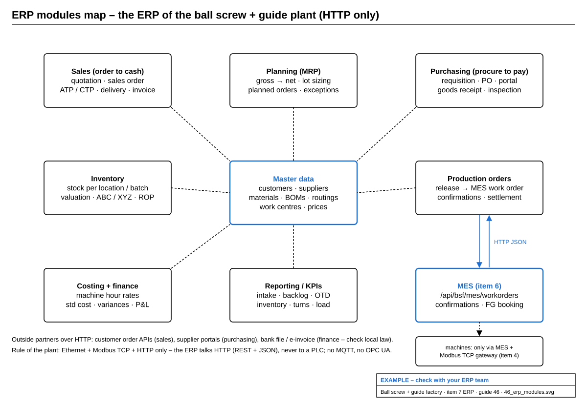

### 3.1 ISA-95 levels

| Level | Name | Time scale | System in this plant |
|---|---|---|---|
| 4 | business planning + logistics | months … days | **ERP (this item)** |
| 3 | manufacturing operations | days … minutes | MES (item 6) |
| 2 | supervisory control | minutes … seconds | gateway, HMI (item 4) |
| 1 | control | seconds … ms | PLC, CNC (item 8) |
| 0 | process | – | sensors, actuators |

IEC 62264-3 defines the level-3 activities; the **interface between level 4 and level 3** is described in IEC 62264-2 / -5
(the object model behind B2MML: production schedule, production performance, material, personnel, equipment). We use the
ideas, not the XML: our messages are JSON over HTTP (§13).

### 3.2 The modules of this ERP

| Module | Main objects | Owner (role) |
|---|---|---|
| Master data | customer, supplier, material, BOM, routing, work centre, price | admin + engineering + controlling |
| Sales | quotation, sales order, delivery, invoice | sales |
| Planning | forecast (MPS), MRP run, planned order | planner |
| Purchasing | requisition, purchase order, goods receipt, inspection lot | buyer, stores, quality |
| Inventory | stock row (material, location, batch, status), movement | stores |
| Production orders | production order, confirmation, settlement | planner, controller |
| Costing + finance | machine hour rate, standard cost, variance, P&L, cash | controller |
| Reporting | KPIs | management |

### 3.3 ERP vs MES vs PLC – who decides what

| Question | ERP | MES | PLC / CNC |
|---|---|---|---|
| What do we sell, at which price? | yes | – | – |
| When can we deliver? | yes (ATP / CTP, rough) | detailed schedule | – |
| How much material to buy? | yes (MRP) | kanban signals for small parts | – |
| Which lot on which machine now? | – | yes | – |
| How do the axes move? | – | – | yes |
| What did the order cost? | yes (from MES data) | times + quantities | counters |

The ERP plans with **lead times** (a screw needs 10 working days) and **rough capacity** (bottleneck minutes); the MES plans
with **minutes on machines**. When they disagree, the MES shows the truth for the next days; the ERP keeps the long view.

---

## 4. The data model and the keys

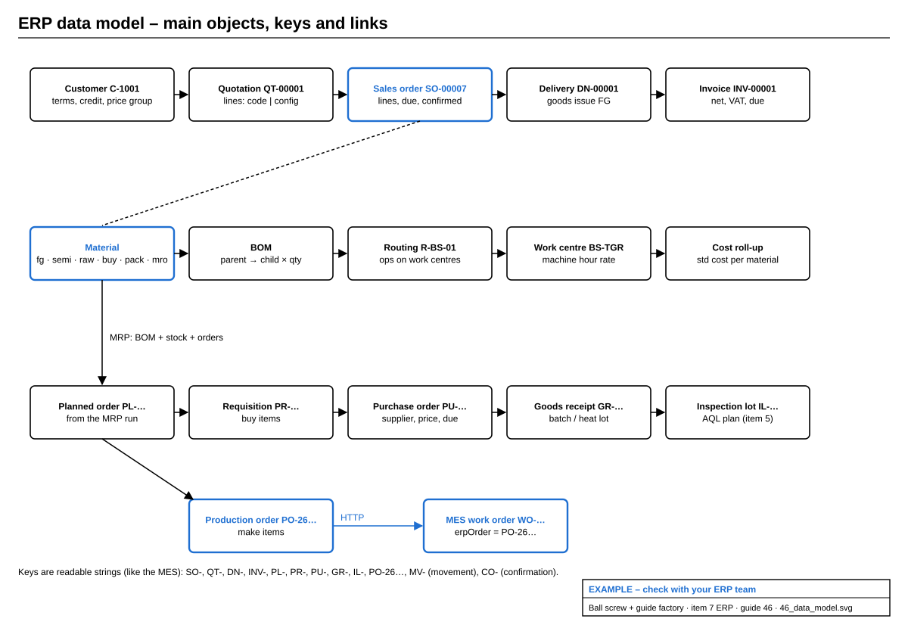

### 4.1 Entities

| Entity | Key (example) | Main fields | ISA-95 / B2MML idea |
|---|---|---|---|
| Customer | `C-1001` | name, country, terms (days), credit limit, incoterm, channel, price group | – (business) |
| Supplier | `S-2001` | name, supplies, lead time, terms, rating, channel (portal / e-mail), certificate | – |
| Material | `BS-3210-1000-C5` | name, type (fg, semi, raw, buy, pack, mro), UoM, procurement (make, buy, phantom), LT, lot rule, lot qty, SS, price, supplier, route | material definition |
| BOM line | parent → child | qty, position | bill of material |
| Routing | `R-BS-01` | ops: work centre, set-up, cycle, batch, scrap % (item 2) | product segment / operations definition |
| Work centre | `BS-TGR` | machines n, price, kW, area, hours → machine hour rate, crew | equipment class |
| Quotation | `QT-00001` | customer, lines (code or configuration), price, valid to | – |
| Sales order | `SO-00007` | customer, lines, due, confirmed date per line + method (ATP / CTP) | – |
| Delivery / invoice | `DN-00001` / `INV-00001` | lines, on time / net, VAT, gross, due | – |
| Planned order | `PL-00012` | item, qty, release week, due week, kind (production / purchase) | – |
| Requisition / PO | `PR-00001` / `PU-00005` | material, qty, need / supplier, lines, price, due, sent | – |
| Goods receipt / inspection lot | `GR-00001` / `IL-00001` | PO, batch (heat lot), qty / AQL plan, decision | material lot |
| Stock row | (material, location, batch, status) | qty, status free / blocked | material lot + location |
| Movement | `MV-00004` | type GI / GR / TR / RET, material, qty, order, batch | material actual |
| Production order | `PO-260004` | material, qty, due, status, MES work order, ops, issued, good, scrap, settlement | production request |
| Confirmation (push) | `CO-00001` | order, op, good, scrap, setup / run minutes, serials | production performance |

### 4.2 Keys – readable strings

Like the MES (guide 45 §4.2) all keys are readable strings with a prefix and a running number. A person can say them on the
phone, and every log line can be searched. The production order number (`PO-260004`) is written into the MES work order as
`erpOrder` – this is the link between both systems (§13).

> Note: `PO-…` is the **production** order (the MES already uses `erpOrder: "PO-260045"`). Purchase orders use `PU-…`.

### 4.3 States

| Object | States |
|---|---|
| Quotation | open → accepted (→ SO) |
| Sales order | open → confirmed → delivered → invoiced → paid (cancelled); twin orders: in production → ready → delivered |
| Planned order | planned → converted |
| Requisition | open → ordered |
| Purchase order | created → sent → partly received → received |
| Inspection lot | open → done (accept / reject) |
| Production order | created → released → running → done → settled |

---

## 5. Master data design

Good master data are 80 % of a working ERP. Wrong BOMs give wrong purchases; wrong routings give wrong costs and dates.

### 5.1 Customers

| Customer | Name (example) | Country | Terms d | Credit k€ | Incoterm | Order channel | Price group |
|---|---|---|---|---|---|---|---|
| C-1000 | Daily plant demand (twin orders) | – | 0 | 0 | – | internal | – |
| C-1001 | Machine-tool builder A | DE | 60 | 800 | FCA works | HTTP order API | OEM-1 (0.92) |
| C-1002 | Automation integrator B | IT | 45 | 250 | DAP | e-mail PDF | OEM-2 (1.00) |
| C-1003 | Robot + gantry maker C | CZ | 60 | 400 | FCA works | HTTP order API | OEM-1 |
| C-1004 | Packaging-machine maker D | DE | 30 | 150 | DAP | web shop | OEM-2 |
| C-1005 | Distributor E – spare parts | PL | 30 | 300 | EXW | HTTP order API | DIST (0.80) |
| C-1006 | Semiconductor equipment F | NL | 60 | 600 | DDP | HTTP order API | OEM-1 |

Price group factor × list price = customer price (example: 640 € × 0.92 = 588.80 € for a FABS set to C-1001).

### 5.2 Suppliers

| Supplier | Supplies (example) | LT d | Terms d | Rating | Channel | Certificate |
|---|---|---|---|---|---|---|
| S-2001 Steel bar mill A | 50CrMo4 +QT Ø36, 20MnCr5 Ø85 bars, heat lots | 30 | 60 | A | supplier portal (HTTP JSON) + PDF | IATF 16949, EN 10204 3.1 |
| S-2002 Steel bar mill B | 100Cr6 bars (spacers) | 25 | 60 | B | e-mail PDF | ISO 9001 |
| S-2003 Profile mill C | drawn rail profile C55, carriage profile 20CrMo4 | 35 | 45 | A | supplier portal (HTTP) | IATF 16949 |
| S-2004 Ball maker D | balls Ø4.763 G10, Ø6.35 G5, size classes | 5 | 30 | A | kanban signal over HTTP | ISO 9001 |
| S-2005 Seal maker E | wiper, end and bottom seals | 10 | 30 | B | kanban signal over HTTP | ISO 9001 |
| S-2006 Moulder F | POM end caps, pipes, MIM deflectors, hole caps | 15 | 30 | B | e-mail PDF | ISO 9001 |
| S-2007 Grinding wheel maker G | CBN thread wheels, corundum wheels, diamond rolls | 40 | 30 | A | e-mail PDF | ISO 9001 |
| S-2008 Packaging H | VCI tubes, cartons, wood profiles, dummy rails | 10 | 30 | C | web shop (HTTP) | – |
| S-2009 Standard parts I | rings, nipples, keys, screws, lock nuts, oils | 5 | 30 | B | web shop (HTTP) | ISO 9001 |

Supplier rating (example rule): A = on time ≥ 95 % and ppm ≤ 200, B = ≥ 90 % / ≤ 1 000, C = below. The rating comes from
goods receipts (date vs PO due) and inspection decisions (§11).

### 5.3 Material types

| Type | Meaning | Procurement | Planned by | Example |
|---|---|---|---|---|
| fg | finished / saleable | make | MRP (forecast + orders) | FABS-3210-1000-C5, LB-25-FL |
| semi | semi-finished = state after a routing step | **phantom** | passes through MRP | SF-BS3210-HARD (after op 80) |
| raw | raw material with heat lot | buy | MRP | RAW-50CRMO4-D36 (m) |
| buy | purchased component | buy | MRP (kanban for small parts in the MES) | BALL-6.35-G5 |
| pack | packaging | buy | MRP | PACK-TUBE-1000 |
| mro | maintenance, repair, operations (wheels, oils) | buy | reorder point (consumption) | WHEEL-CBN-TGR |

**Why phantom semis?** The MES runs one work order per route (screw shaft from saw to wash, guide guide 45). The steps
"soft shaft" and "hardened shaft" are not stocked and not ordered separately – but the controller wants their value for the
work in progress, and the planner wants to see the structure. A phantom item is in the BOM, the MRP passes its requirement
through to its children (LT 0, no planned order), and the cost roll-up gives its value: raw + MOH + conversion up to that op.

| Semi-finished (phantom) | After op | Value (example) |
|---|---|---|
| SF-BS3210-SOFT | BS 40 (turned) | 31.49 € |
| SF-BS3210-HARD | BS 80 (hardened, straightened, re-centred) | 48.54 € |
| SF-BN3210-SOFT | BN 30 (turned + milled) | 38.54 € |
| SF-BN3210-HARD | BN 40 (carburised) | 44.68 € |
| SF-LG25-HARD | LG 60 (induction hardened + straightened) | 28.31 € |
| SF-LB25-HARD | LB 40 (carburised) | 22.55 € |

### 5.4 Material master fields (example rows)

| Material | Type | UoM | Proc. | LT d | Lot rule | Lot q | SS | Std price € | Supplier |
|---|---|---|---|---|---|---|---|---|---|
| FABS-3210-1000-C5 | fg | pc | make | 2 | L4L | – | 60 | 374.41 (roll-up) | – |
| BS-3210-1000-C5 | fg | pc | make | 10 | FOQ | 120 | 40 | 230.07 | – |
| BN-3210-FL | fg | pc | make | 8 | FOQ | 120 | 40 | 104.71 | – |
| LG-25-1000 | fg | pc | make | 8 | FOQ | 200 | 60 | 58.12 | – |
| LB-25-FL | fg | pc | make | 8 | POQ | – | 120 | 49.04 | – |
| RAW-50CRMO4-D36 | raw | m | buy | 30 | FOQ | 400 | 150 | 14.40 | S-2001 |
| RAW-20MNCR5-D85 | raw | m | buy | 30 | FOQ | 120 | 20 | 75.60 | S-2001 |
| RAW-C55-PROF25 | raw | m | buy | 35 | FOQ | 800 | 250 | 9.80 | S-2003 |
| RAW-20CRMO4-BLK25 | raw | m | buy | 35 | FOQ | 160 | 30 | 32.00 | S-2003 |
| BALL-6.35-G5 | buy | pc | buy | 5 | EOQ | – | 8 000 | 0.045 | S-2004 |
| SEAL-3210 | buy | pc | buy | 10 | EOQ | – | 100 | 0.90 | S-2005 |
| DEFL-3210 | buy | pc | buy | 10 | POQ | – | 200 | 1.20 | S-2006 |
| WHEEL-CBN-TGR | mro | pc | buy | 40 | ROP | – | 2 | 2 400 | S-2007 |

Steel prices (example): bar Ø36 = 7.99 kg/m × ≈ 1.80 €/kg = 14.40 €/m; Ø85 = 44.5 kg/m × 1.70 €/kg = 75.60 €/m. Ask the mill
for a quote (alloy surcharge, scrap surcharge and peeling are separate positions on real steel invoices).

### 5.5 Multi-level BOMs

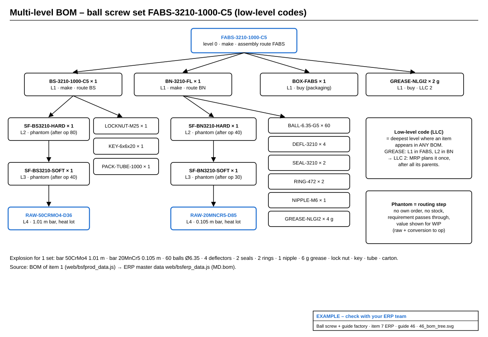

The BOMs come from item 1 (`BOM` in `web/bsfprod_data.js`) and are completed with packaging and the phantom stages.

**FABS-3210-1000-C5** (exploded, quantities per 1 set):

| Level | Material | Qty | UoM | Proc. | LLC |
|---|---|---|---|---|---|
| 0 | FABS-3210-1000-C5 | 1 | pc | make | 0 |
| 1 | BS-3210-1000-C5 | 1 | pc | make | 1 |
| 2 | SF-BS3210-HARD | 1 | pc | phantom | 2 |
| 3 | SF-BS3210-SOFT | 1 | pc | phantom | 3 |
| 4 | RAW-50CRMO4-D36 | 1.01 | m | buy | 4 |
| 2 | LOCKNUT-M25 · KEY-6x6x20 · PACK-TUBE-1000 | 1 each | pc | buy | 2 |
| 1 | BN-3210-FL | 1 | pc | make | 1 |
| 2 | SF-BN3210-HARD → 3 SF-BN3210-SOFT → 4 RAW-20MNCR5-D85 | 1 / 1 / 0.105 | pc / pc / m | phantom / buy | 2 / 3 / 4 |
| 2 | BALL-6.35-G5 60 · DEFL-3210 4 · SEAL-3210 2 · RING-472 2 · NIPPLE-M6 1 · GREASE-NLGI2 4 g | | | buy | 2 |
| 1 | BOX-FABS 1 · GREASE-NLGI2 2 g | | | buy | 1 / 2 |

**FALG-25-1000**: LG-25-1000 × 1 (→ SF-LG25-HARD → RAW-C55-PROF25 1.02 m; CAPH-11 × 17; PACK-RAIL-1000), LB-25-FL × 2
(→ SF-LB25-HARD → RAW-20CRMO4-BLK25 0.085 m; balls Ø4.763 × 120; end caps × 2; pipes × 4; end seals × 2; bottom seals × 2;
retainers × 4; nipple; screws × 4; dummy rail), BOX-FALG × 1.

**Low-level code (LLC)** = the deepest level at which a material appears in *any* BOM. Grease is level 1 in FABS and level 2 in
BN → LLC 2. The MRP plans level by level (LLC 0 first), so a material is planned only once, after all its parents
(§8.3).

**Family variants** (`BS-2505-600-C7`, `LB-35-FL`, …): the ERP uses the reference BOM of the route with a length factor `k`
on the raw material (k = 0.6 for 600 mm). A real ERP has one raw material per bar diameter / profile size – check with the
ERP team how variants are modelled (configurable material with characteristics vs one material per variant).

### 5.6 Routings and work centres

Routings are read from item 2 (`ROUTES` in `web/bsfmfg_data.js`, variant G = ground from solid). Each operation has a work
centre (= machine type), set-up time, cycle time, batch and scrap %. The ERP needs **time per piece**:

t = cycle + set-up / batch (min per piece)

Example op 100 thread grinding of BS-3210: t = 40 + 45 / 20 = **42.25 min**.

Routing BS-3210-1000-C5 with the cost per operation (rate from §15, OEE 0.75, labour 42 €/h × crew):

| Op | Work centre | t min | Rate €/h | Crew | Machine € | Labour € |
|---|---|---|---|---|---|---|
| 10 | MS-SAW | 1.167 | 3.79 | 0.33 | 0.10 | 0.36 |
| 20 | BS-STR | 2.583 | 5.76 | 0.5 | 0.33 | 1.21 |
| 30 | BS-CTR | 1.450 | 7.35 | 0.33 | 0.24 | 0.45 |
| 40 | BS-TRN | 9.750 | 13.00 | 0.5 | 2.82 | 4.55 |
| 50 | BS-IND | 5.333 | 20.10 | 0.33 | 2.38 | 1.64 |
| 60 | HT-TMP | 2.500 | 8.48 | 0.2 | 0.47 | 0.47 |
| 70 | BS-STH | 6.167 | 15.92 | 0.5 | 2.18 | 2.88 |
| 80 | BS-CLP | 1.667 | 3.18 | 0.33 | 0.12 | 0.51 |
| 90 | BS-CGR | 9.625 | 29.41 | 0.5 | 6.29 | 4.49 |
| 100 | BS-TGR | 42.250 | 57.89 | 0.5 | **54.35** | **19.72** |
| 120 | QC-LED | 12.250 | 9.78 | 1.0 | 2.66 | 11.43 |
| 130 | AS-WSH | 1.500 | 9.19 | 0.2 | 0.31 | 0.28 |
| | **Sum** | | | | **72.25** | **47.98** |

Cost per op = t / 60 / OEE × rate. Example op 100: 42.25 / 60 / 0.75 × 57.888 = **54.35 €**; labour 42.25 / 60 / 0.75 × 0.5 × 42 = **19.72 €**.

Why divide by OEE? The routing time is the time when the machine runs well. The machine is also down, set up and slow
sometimes (OEE 0.75 → per good hour we need 1.33 machine hours). Item 2 uses the same rule (`costPerPart = rate × cyc / 60 / oee`).

---

## 6. Product configurator and part numbers

### 6.1 Part numbers (item 1 rules)

| Product | Rule | Example |
|---|---|---|
| Screw | `BS-{d}{lead 2 digits}-{length}-{grade}` | BS-3210-1000-C5 |
| Nut | `BN-{d}{lead}-{type}` | BN-3210-FL |
| Screw set | `FABS-{d}{lead}-{length}-{grade}` | FABS-3210-1000-C5 |
| Rail | `LG-{size}-{length}` | LG-25-1000 |
| Carriage | `LB-{size}-{FL \| NA}` | LB-25-FL |
| Guide set | `FALG-{size}-{length}` | FALG-25-1000 |

Preload (P0 / P1 / P2, Z0 / Z1 / Z2) and class (N / H / P) are **characteristics** of the order line (shown in the variant text,
e.g. `BS-2505-600-C7 / BN-2505-FL P1`), not part of the short code. Check with the ERP team: some plants put every
characteristic into the code ("smart number"), others use a running number + characteristics. Rule of thumb: keep the code
short and readable, put the rest into characteristics.

### 6.2 Validity rules (examples)

| Rule | Why |
|---|---|
| lead per diameter from the family table (Ø16: 5 / 10 only) | catalogue family (item 1 FAMILY_BS) |
| 300 mm ≤ L ≤ min(2 000, 60 × d) | slenderness for turning + grinding + straightening |
| C3 only up to 1 500 mm | lead measuring bench + thread grinder limit |
| rail 300 … 4 000 mm; longer = butt-jointed, matched rails | profile grinder table 4.5 m |
| hole pitch 60 / 80 mm – other lengths give end distance E | check E ≥ minimum of the catalogue |
| 1 … 6 carriages per rail | assembly + packaging |

### 6.3 Price rules (example list prices)

Screw = (base(d) × lead factor + price per metre(d) × L / 1 000) × grade factor
Nut = nut price(d) × preload factor · Set = screw + nut + 30 € (assembly + run-in)

| d | base € | per metre € | nut € |
|---|---|---|---|
| 16 | 80 | 100 | 80 |
| 20 | 100 | 135 | 100 |
| 25 | 135 | 185 | 140 |
| 32 | 180 | 240 | 190 |
| 40 | 230 | 325 | 250 |

Lead factor 5 → 0.95, 10 → 1.00, 20 → 1.15 · grade C3 1.8, C5 1.0, C7 0.65 · preload P0 0.97, P1 1.00, P2 1.12.

**Worked example 1** – reference: (180 × 1.0 + 240 × 1.0) × 1.0 = 420 € screw + 190 € nut + 30 € = **640 €** = list price of FABS-3210-1000-C5.

**Worked example 2** – Ø25, lead 5, 600 mm, C7, P1: screw = (135 × 0.95 + 185 × 0.6) × 0.65 = (128.25 + 111) × 0.65 = 155.51 €;
nut = 140 × 1.0 = 140 €; set = 155.51 + 140 + 30 = **325.51 €** → code `FABS-2505-600-C7`.

Guide: rail = rail price(size) × L / 1 000 × class factor; carriage = block price(size) × type × preload × class; set = rail + n × carriage.

| size | rail € per m | carriage € |
|---|---|---|
| 15 | 60 | 44 |
| 20 | 80 | 54 |
| 25 | 110 | 68 |
| 30 | 145 | 92 |
| 35 | 190 | 118 |

Class N 0.85, H 1.00, P 1.35 · type FL 1.00, NA 0.95 · preload Z0 0.95, Z1 1.00, Z2 1.08.

**Worked example 3** – size 35, rail 1 520 mm, 3 × NA, Z2, class P: rail = 190 × 1.52 × 1.35 = 389.88 €; carriage =
118 × 0.95 × 1.08 × 1.35 = 163.44 €; set = 389.88 + 3 × 163.44 = **880.21 €**; note: 1 520 is not a multiple of 80 → E = 0 / 2 + 40 = 40 mm.

A price from a formula is a **list price**. The real price needs the cost (§16) and the market: a C3 screw costs much more in
grinding and measuring time than the factor 1.8 may cover – check every factor against the standard cost of a real variant.

### 6.4 The configurator on the page and the API

`POST /api/bsf/erp/configure {"kind": "screw", "d": 25, "lead": 5, "length": 600, "grade": "C7", "preload": "P1"}` →

```json
{"ok": true, "kind": "screw", "code": "FABS-2505-600-C7", "codes": {"set": "FABS-2505-600-C7", "screw": "BS-2505-600-C7", "nut": "BN-2505-FL"},
 "variant": "BS-2505-600-C7 / BN-2505-FL P1", "price": 325.5125, "parts": {"screw": 155.5125, "nut": 140.0, "assembly": 30}, "k": 0.6, "known": true,
 "rules": ["screw = (135 × 0.95 + 185 × 0.6) × 0.65 = 155.51 €", "nut = 140 × 1.0 = 140.00 € · set = screw + nut + 30 € assembly / run-in"]}
```

`"known": true` means the MES knows this product (it is in `PRODUCTS6` of item 6) – it can be produced without new master data.

---

## 7. Sales – order to cash

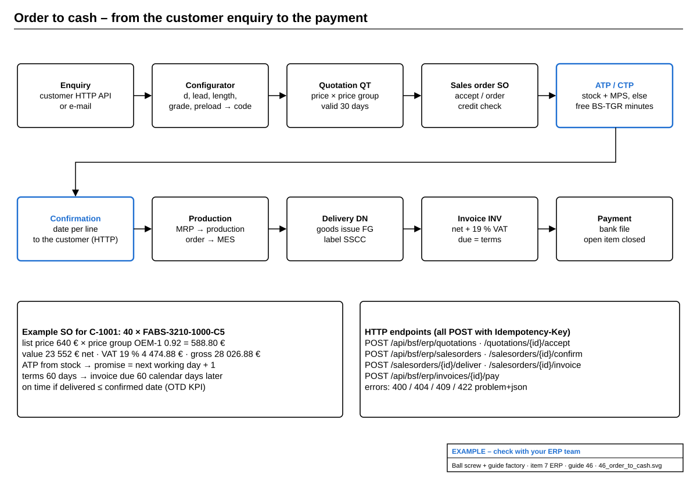

### 7.1 The steps

| Step | ERP object | HTTP | Notes |
|---|---|---|---|
| enquiry | – | customer order API / e-mail | the customer's system may POST directly |
| configure | variant | `POST /configure` | rules + price |
| quotation | QT | `POST /quotations` | valid 30 days, price group applied |
| order | SO | `POST /quotations/{id}/accept` or `POST /salesorders` | credit check (limit vs open items – check) |
| promise date | – | `POST /atp` | §10 |
| confirmation | SO confirmed | `POST /salesorders/{id}/confirm` | date per line + method, confirmation text |
| production | production order | MRP → `POST /productionorders/{id}/release` | §8, §13 |
| delivery | DN + goods issue | `POST /salesorders/{id}/deliver` | 409 if the free stock is too small |
| invoice | INV | `POST /salesorders/{id}/invoice` | net + 19 % VAT (example), due = terms |
| payment | – | `POST /invoices/{id}/pay` | bank file in reality |

### 7.2 Worked example

Customer C-1001 orders 40 × FABS-3210-1000-C5:

* price = 640 € × 0.92 (OEM-1) = **588.80 €**, value = 40 × 588.80 = **23 552 €** net
* ATP: free stock 420 sets → enough → promise = next working day + 1 day shipping
* confirmation text: "Order confirmation SO-00007: we deliver 40 × FABS-3210-1000-C5 on 2026-11-16 (ATP). Total 23552.00 € net, terms 60 days."
* delivery: goods issue 40 sets from FG-01 → DN-00001, on time (delivered ≤ confirmed date)
* invoice: net 23 552.00 €, VAT 19 % = 4 474.88 €, gross **28 026.88 €**, due 2026-11-13 + 60 days = 2027-01-12

### 7.3 Rules of thumb

* Confirm only dates you can keep – a date from ATP / CTP, not from hope.
* A late confirmed order is worse than a later confirmed date: OTD (on-time delivery) is measured against the **confirmed** date.
* The twin orders (C-1000) are the plan itself – they are shown, but they do not take ATP away from customer orders.

---

## 8. MRP – theory and full worked example

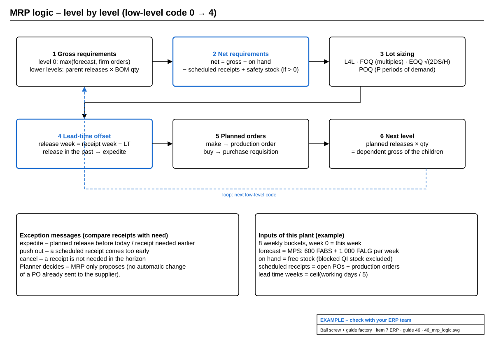

### 8.1 Independent and dependent demand

* **Independent demand**: comes from outside – customer orders and the forecast of saleable items (FABS, FALG, spare BS / BN / LG / LB).
* **Dependent demand**: is *calculated* from the parents through the BOM – e.g. 60 balls per nut. Never forecast dependent demand.

Gross requirement of a saleable item per week (this ERP): **gross = max(forecast, firm orders)**. The orders "consume" the
forecast: as long as the orders are below the forecast, the plan does not change. (Other ERPs use "forecast consumption"
with forward / backward windows – check the vendor's options.)

Week 0 is the current week: only the remaining working days count (on a Friday 1 / 5 of the weekly forecast), because the past
part of the week is already produced.

### 8.2 Net requirements

For every week t:

available(t) = POH(t − 1) + scheduled receipts(t) − gross(t)

If available(t) < safety stock: **net(t) = SS − available(t)** = gross − on hand − scheduled receipts + SS

Then: planned receipt(t) = lot size(net(t)), POH(t) = available(t) + planned receipt(t),
planned release = planned receipt shifted back by the lead time (in weeks = ceil(working days / 5)).

* **On hand** = free stock (stock in incoming inspection is blocked and does not count).
* **Scheduled receipts** = open purchase orders + open production orders (quantity not yet received).
* **Safety stock** protects against forecast errors and supplier delays (§12.6).

### 8.3 BOM explosion level by level

1. Compute the low-level codes.
2. Plan all items with LLC 0 (FABS, FALG) → planned releases.
3. Dependent gross of every child += parent release(t) × BOM qty (same week – the parent needs the child when it starts).
4. Plan LLC 1 (BS, BN, LG, LB, cartons) → releases → children.
5. … down to LLC 4 (bars).

Phantoms: LT 0, lot-for-lot, no planned order – their requirement goes straight to their children.

### 8.4 Hand example – A and B

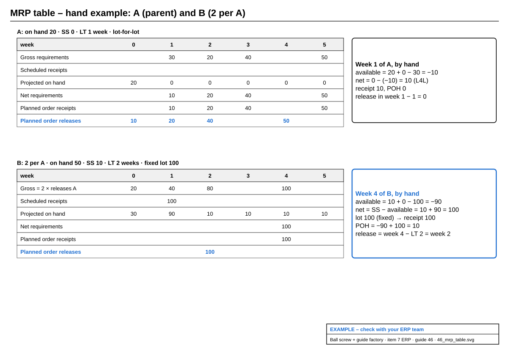

Parent **A**: on hand 20, SS 0, LT 1 week, lot-for-lot. Gross requirements weeks 0 … 5: 0 · 30 · 20 · 40 · 0 · 50.
Component **B**: 2 per A, on hand 50, SS 10, LT 2 weeks, fixed lot 100, scheduled receipt 100 in week 1.

| A | W0 | W1 | W2 | W3 | W4 | W5 |
|---|---|---|---|---|---|---|
| Gross | 0 | 30 | 20 | 40 | 0 | 50 |
| Scheduled receipts | | | | | | |
| Projected on hand | 20 | 0 | 0 | 0 | 0 | 0 |
| Net | | 10 | 20 | 40 | | 50 |
| Planned receipts | | 10 | 20 | 40 | | 50 |
| **Planned releases** (− 1 week) | **10** | **20** | **40** | | **50** | |

| B (2 per A) | W0 | W1 | W2 | W3 | W4 | W5 |
|---|---|---|---|---|---|---|
| Gross = 2 × releases A | 20 | 40 | 80 | 0 | 100 | 0 |
| Scheduled receipts | | 100 | | | | |
| Projected on hand | 30 | 90 | 10 | 10 | 10 | 10 |
| Net | | | | | 100 | |
| Planned receipts | | | | | 100 | |
| **Planned releases** (− 2 weeks) | | | **100** | | | |

By hand, B week 4: available = 10 + 0 − 100 = −90 < SS 10 → net = 10 − (−90) = 100 → fixed lot 100 → POH = −90 + 100 = 10;
release = week 4 − 2 = week 2. Week 2: available = 90 − 80 = 10 = SS → no net requirement (the SS is just kept).

These numbers are checked by `&bf7test` and in Python = JavaScript (`POST /api/bsf/erp/eval {"kind": "mrp"}`).

### 8.5 Exception messages

| Message | Meaning | Hand example |
|---|---|---|
| expedite (planned) | a planned order would have to be released in the past | D: 30 needed in week 0, LT 2 → release in week −2 |
| expedite (receipt) | a scheduled receipt comes later than needed | receipt in week 2, needed in week 0 |
| push out | a scheduled receipt comes earlier than needed | C: receipt 50 in week 1, needed only in week 3 |
| cancel | a scheduled receipt is not needed in the horizon | open PO of 800 m profile in week 7 |

How the ERP finds them: for each scheduled receipt (oldest first) it calculates the projected stock *without* this and the later
receipts; the first week below the safety stock is the "need date". Compare it with the receipt week.

The MRP **proposes**; the planner / buyer decides. A PO that is already confirmed by the supplier is changed only after a call.

### 8.6 The plant run (example, 8 weeks)

At start-up the ERP seeds the **order pipeline**: a running plant already has open orders for the cumulative lead time (bars
6 weeks + shaft 2 weeks + set 1 week …). Every planned order whose release would lie in the past becomes an open production or
purchase order (`source: "pipeline (seed)"`), level by level. After that the plan is healthy: ≈ 90 planned orders, only two
exception messages (the push-out of a ball PO and the cancellation proposal of a profile PO in week 7 – both from the
hand-entered open orders).

Example record BN-3210-FL (run on Friday 2026-11-13; on hand 420, SS 40, LT 2 weeks, fixed lot 120 (multiples), forecast 5 spare
nuts per week + the planned releases of the FABS sets):

| BN-3210-FL | W0 | W1 | W2 | W3 | W4 | W5 | W6 | W7 |
|---|---|---|---|---|---|---|---|---|
| Gross (= FABS releases + spares) | 361 | 605 | 605 | 605 | 605 | 605 | 605 | 5 |
| Scheduled receipts | | 600 | | | | | | |
| Projected on hand | 59 | 54 | 49 | 44 | 159 | 154 | 149 | 144 |
| Net requirements | | | 591 | 596 | 601 | 486 | 491 | |
| Planned receipts | | | 600 | 600 | 720 | 600 | 600 | |
| **Planned releases** | **600** | **600** | **720** | **600** | **600** | | | |

Read it like this: week 0 gross = 1 / 5 of a week (Friday) of FABS releases + spares; the scheduled receipt of 600 in week 1 is the
seeded open production order; week 2: available = 54 − 605 = −551 → net = 40 + 551 = 591 → rounded up to a multiple of 120 →
600 → POH 49 → released in week 0. Week 4 needs 601 → 6 × 120 = 720. Week 7 shows the **horizon end effect**: the FABS planned
orders stop at the end of the horizon, so the nut gross drops to the spares only – always plan a horizon longer than the
cumulative lead time (here 8 weeks ≥ 6 weeks of bars + 2 + 1). Exact numbers depend on the day of the run.

---

## 9. Lot sizing – L4L, fixed lot, EOQ, POQ

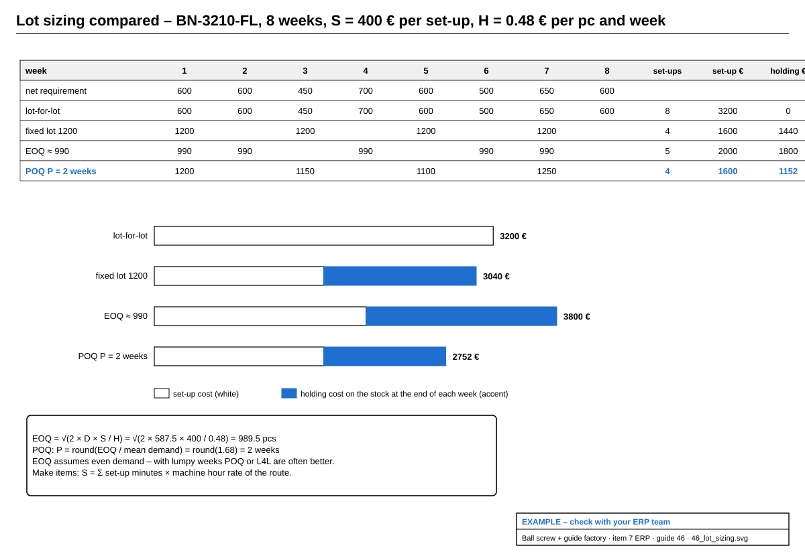

### 9.1 The four rules

| Rule | Order quantity | Good for |
|---|---|---|
| L4L lot-for-lot | exactly the net requirement | expensive items, sets, phantoms, make-to-order |
| FOQ fixed lot (multiples) | ceil(net / Q) × Q | technical lots: heat lot, furnace load, MES transfer lot, pallet, box |
| EOQ economic order quantity | max(EOQ, net) | even demand, cheap items, high order cost |
| POQ period order quantity | demand of the next P periods | lumpy demand, EOQ idea with real periods |

### 9.2 EOQ formula

Total cost per year = order cost + holding cost = D / Q × S + Q / 2 × H → minimum where both are equal:

**EOQ = √(2 · D · S / H)**

D = demand per period, S = cost per order or set-up (€), H = holding cost per piece and period (€) = holding rate × price.

**Worked example 1 – wiper seal SEAL-3210:** D = 2 seals × 120 nuts × 250 days = 60 000 pcs / year; S = 80 € per order;
H = 20 % × 0.90 € = 0.18 € per pc and year.
EOQ = √(2 × 60 000 × 80 / 0.18) = √53 333 333 = **7 303 pcs** → 60 000 / 7 303 = 8.2 orders per year.
Check: order cost 8.2 × 80 = 657 €; holding 7 303 / 2 × 0.18 = 657 € – equal, as the formula says.

The holding rate (20 % per year, example) contains interest on capital, storage space, insurance, obsolescence and handling.

### 9.3 POQ

P = round(EOQ / mean demand per period) periods; each order covers the net requirements of the next P periods.

### 9.4 Worked comparison – BN-3210-FL production lots

Net requirements of 8 weeks: 600 · 600 · 450 · 700 · 600 · 500 · 650 · 600 (mean 587.5). Set-up cost S = 400 € per lot
(all set-ups of the nut route × machine hour rate, example), H = 20 % × 120 € / 50 weeks = 0.48 € per pc and week.
Holding cost is counted on the stock at the end of each week.

EOQ = √(2 × 587.5 × 400 / 0.48) = **989.5** · POQ: P = round(989.5 / 587.5) = round(1.68) = **2 weeks** · fixed lot 1 200.

| Rule | W1 | W2 | W3 | W4 | W5 | W6 | W7 | W8 | Set-ups | Set-up € | Holding € | **Total €** |
|---|---|---|---|---|---|---|---|---|---|---|---|---|
| L4L | 600 | 600 | 450 | 700 | 600 | 500 | 650 | 600 | 8 | 3 200 | 0 | **3 200** |
| FOQ 1 200 | 1 200 | | 1 200 | | 1 200 | | 1 200 | | 4 | 1 600 | 1 440 | **3 040** |
| EOQ 990 | 990 | 990 | | 990 | | 990 | 990 | | 5 | 2 000 | 1 800 | **3 800** |
| POQ 2 weeks | 1 200 | | 1 150 | | 1 100 | | 1 250 | | 4 | 1 600 | 1 152 | **2 752** |

End stock POQ: 600 · 0 · 700 · 0 · 500 · 0 · 600 · 0 → Σ 2 400 × 0.48 = 1 152 €.
End stock EOQ: 390 · 780 · 330 · 620 · 20 · 510 · 850 · 250 → Σ 3 750 × 0.48 = 1 800 €.

**Lesson:** EOQ assumes smooth demand. With weekly buckets the order of 990 does not fit the real weeks, and stock is carried
in the wrong weeks. POQ keeps the EOQ idea (≈ 2 weeks of demand per lot) but follows the real demand → lowest cost here.

### 9.5 Which rule in this plant (example)

| Items | Rule | Why |
|---|---|---|
| sets FABS, FALG | L4L | made for orders + forecast, short assembly LT |
| BS, BN, LG | FOQ 120 / 120 / 200 | one day of production = multiple of the MES transfer lots (20 / 40 / 50) |
| LB | POQ | high volume, lumpy dependent demand |
| bars, profiles | FOQ (≈ one heat lot) | mill minimum quantity, heat-lot traceability |
| balls, seals, lock nuts | EOQ | cheap, steady |
| deflectors, end caps | POQ | moulded in campaigns |
| wheels, oils (MRO) | reorder point | consumption based, not in a BOM |

---

## 10. Available to promise (ATP) and capable to promise (CTP)

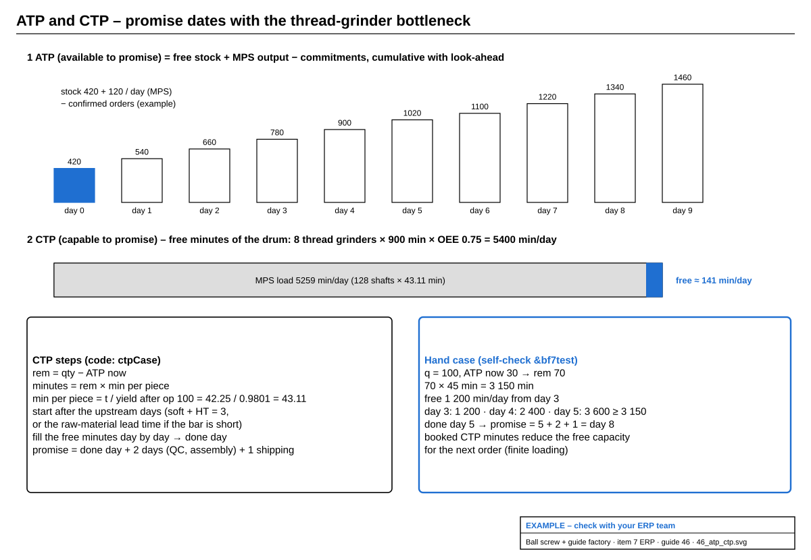

### 10.1 ATP

ATP answers: *how many can I promise from stock and from what is already planned?*

* supply(day 0) = free stock; supply(day d ≥ 1) = MPS output per working day (= weekly forecast / 5)
* commitments = confirmed customer order lines (not the twin orders) on their confirmed day
* cumulative ATP(d) = Σ supply − Σ commitments up to day d
* **ATP with look-ahead**: available(d) = min over all later days of cumulative ATP – so a later commitment is protected.

Earliest promise from ATP = first day with available(d) ≥ qty, + 1 day shipping.

**Example** (FABS, free stock 420, MPS 120 / day, confirmed orders 65): cumulative ATP day 0 … 10 =
420 · 540 · 660 · 780 · 900 · 1 020 · 1 140 · 1 260 · 1 340 · 1 460 · 1 580 (the drop of 40 + 25 sets on their day is visible) →
400 sets: from stock today → promise **day +1**; 2 000 sets: ATP reaches 2 000 on day 14 → promise **day +15**.

### 10.2 CTP

CTP answers: *if ATP is not enough, when can the plant make the rest?* It looks at the **bottleneck** (item 2 / 6: the
8 thread grinders BS-TGR):

* capacity = 8 machines × 2 shifts × 7.5 h × 60 min × OEE 0.75 = **5 400 min per day**
* MPS load = (120 sets + 2 spare screws) per day × 43.11 min = **5 259 min per day** (97.4 %)
* min per good screw = t / yield after op 100 = 42.25 / 0.9801 = **43.11 min**
* free ≈ 5 400 − 5 259 = **141 min per day** (minus minutes already booked by earlier CTP confirmations)

Steps (`ctpCase` in both cores):

1. rem = qty − ATP now
2. need = rem × min per piece
3. start after the upstream days (soft machining + heat treatment = 3 days), or after the raw-material lead time if the bar
   stock is too small
4. add the free minutes day by day → the day where the sum ≥ need = done day
5. promise = done day + 2 days (QC, washing, assembly) + 1 day shipping

**Hand case (self-check):** qty 100, ATP now 30 → rem 70; 70 × 45 min = 3 150 min; 1 200 free minutes per day from day 3 →
day 3: 1 200, day 4: 2 400, day 5: 3 600 ≥ 3 150 → done day 5 → promise = 5 + 2 + 1 = **day 8**.

The promise is the earlier of ATP and CTP. For 2 000 sets the CTP would need 1 580 × 43.11 = 68 112 min on the grinders –
with only 141 free minutes per day impossible in 40 days (and the bar stock 808 m is short of 1 596 m → 30 days), so ATP day +15
wins. This is the real message of the bottleneck: **extra demand for screws can only be promised from the MPS, not from free
grinder capacity**. More screws = a 9th thread grinder, a third shift on the grinders or a hard-whirling variant (item 2).

### 10.3 Finite loading of CTP

When an order is confirmed by CTP, its minutes are **booked** on the bottleneck days (`S.ctp[type][day]`). The next CTP sees
less free capacity. This is a simple finite-capacity check – the detailed sequence is the MES scheduler's job (guide 45 §6).

---

## 11. Purchasing – procure to pay

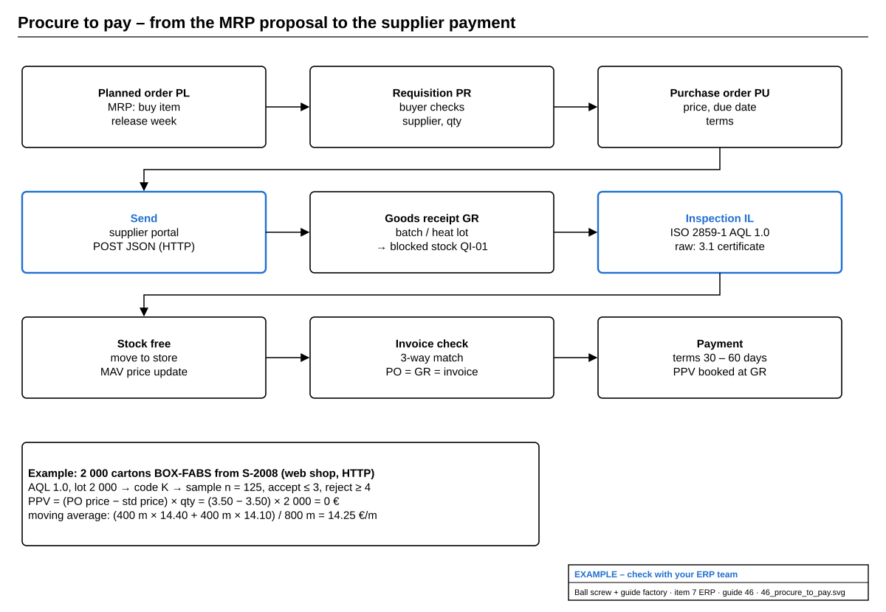

### 11.1 The steps

| Step | Object | HTTP (this ERP) | Note |
|---|---|---|---|
| planned order (buy) | PL | `POST /mrp/run` | MRP proposal |
| requisition | PR | `POST /plannedorders/{id}/convert` | buyer checks |
| purchase order | PU | `POST /purchaseorders {requisition}` or `{supplier, lines}` | price from the master (or contract) |
| send | – | `POST /purchaseorders/{id}/send` | supplier portal (HTTP JSON) – e-mail PDF as fallback |
| goods receipt | GR | `POST /goodsreceipts {po, qty, batch}` | stock to **blocked** QI-01, PPV booked |
| incoming inspection | IL | `POST /inspections/{id}/decision` | accept → free stock at the default location; reject → return |
| invoice check | – | (not in the demo) | 3-way match: PO = GR = invoice |
| payment | – | (bank file) | terms 30 – 60 days |

### 11.2 The supplier portal over HTTP – inside the communication rule

The ERP sends the PO as JSON:

```json
POST https://portal.supplier.example/api/orders
{"orderNumber": "PU-00005", "buyer": "Ball screw + guide factory (example)", "supplier": "S-2008", "currency": "EUR", "incoterm": "FCA",
 "lines": [{"pos": 10, "material": "BOX-FABS", "text": "Carton + foam for one ball screw set", "qty": 2000, "uom": "pc", "price": 3.5, "due": "2026-11-27"}],
 "certificate": "", "deliveryAddress": "Goods-in gate 1 (example)"}
→ 202 {"accepted": true, "supplierRef": "SR-00005"}
```

Suppliers without a portal get a PDF by e-mail (the ERP keeps the JSON). Steel orders ask for **EN 10204 3.1** certificates.
The page logs every send in section 6 ("ERP → supplier").

### 11.3 Goods receipt with incoming inspection (item 5 sampling)

* **Raw material** (bars, profiles): check the 3.1 certificate (chemistry, heat number) + 1 hardness / chemistry sample per heat;
  the heat number becomes the **batch** – the MES uses it for genealogy (guide 45 §10).
* **Bought parts**: ISO 2859-1, normal inspection, level II, AQL 1.0 (example; item 5 `aqlPlan`).

Example: 2 000 cartons → lot range 1 201 – 3 200 → code letter **K** → sample **n = 125**, accept ≤ **3** defects, reject ≥ **4**.

Until the decision the stock is **blocked** (location QI-01) and does not count in MRP or ATP.

### 11.4 Purchase price variance (PPV)

PPV = (PO price − standard price) × quantity, booked at goods receipt.
Example: bars bought at 14.10 €/m against a standard of 14.40 €/m, 400 m → PPV = (14.10 − 14.40) × 400 = **−120 €** (favourable).

---

## 12. Inventory and valuation

### 12.1 Stock rows

Stock is kept per **material + location + batch + status**:

| Location | Meaning |
|---|---|
| FG-01 | finished-goods store (sets) |
| SM-01 | supermarket own parts (BS, BN, LG, LB) |
| SM-02 | supermarket bought parts |
| RM-01 / RM-02 | bar store / profile store |
| PK-01 | packing material |
| TS-01 | tool store (wheels, dressers) |
| QI-01 | incoming inspection – **blocked** |

The batch of steel is the **heat lot** (H7741, P3307 …) – the same numbers as the MES heat lots (guide 45 HEATS).

### 12.2 Goods movements

| Type | Meaning | Trigger |
|---|---|---|
| GR | goods receipt | purchase GR, MES finished-goods booking (`POST /goodsmovements {type: GR, order: WO-…}`) |
| GI | goods issue | delivery, backflush, manual issue |
| TR | transfer (QI → store) | inspection accepted |
| RET | return to supplier | inspection rejected |

### 12.3 Backflush vs manual issue

* **Manual issue**: the stores person books every issue to the order. Exact, but much work and often late.
* **Backflush**: the ERP books the issue automatically from the MES confirmations. In this ERP (`POST /productionorders/{id}/sync`):
  * raw material = pieces **started** at the first operation of the route × BOM quantity (scrapped pieces used bar too)
  * other bought parts = **good** pieces × BOM quantity (they are put in at assembly)
* The difference between issued and standard quantity is the **quantity variance** (§17).
* If stock is missing, the backflush books what is there and reports "short" – a stock error to clear (cycle count).

### 12.4 Valuation – moving average vs standard price

**Moving average price (MAV)** – recalculated at every receipt:

MAV new = (Q old × MAV old + q × p) / (Q old + q)

Example: 400 m at 14.40 €/m in stock, receipt 400 m at 14.10 €/m → (400 × 14.40 + 400 × 14.10) / 800 = **14.25 €/m**.

**Standard price** – fixed for the year (from the cost roll-up for make items, from the master for bought items); the difference
goes to variances (PPV, §11.4). Typical rule: bought parts at MAV or standard, own products at **standard** (the controller
wants stable product costs). IAS 2 (check) allows standard cost if it is close to actual cost and is reviewed regularly.

### 12.5 Turns and days of supply

Turns = cost of goods sold per year / average stock value · days of supply = stock value / (COGS per working day)

Example (start values): stock 589 282 € (MAV), plan COGS ≈ 20.3 M€ per year → turns ≈ **34**, days of supply ≈ **7**.
This is high because the **work in progress sits in the MES lots and is not valued here**. With WIP (≈ 5 days of lead time ×
half the value) real plants of this type reach ≈ 6 – 15 turns – check with the controller.

### 12.6 Safety stock and reorder point

For consumption-based items (MRO, or as a check for bought parts):

**SS = z · σ_d · √LT** · **ROP = d · LT + SS**

z = service factor (1.65 ≈ 95 % cycle service level, 2.33 ≈ 99 %), σ_d = standard deviation of the daily demand, LT = lead time in days, d = mean daily demand.

**Worked example (hand check):** z = 1.65, σ = 30 pcs/day, LT = 9 days, d = 240 pcs/day →
SS = 1.65 × 30 × √9 = 1.65 × 30 × 3 = **148.5 pcs**; ROP = 240 × 9 + 148.5 = **2 308.5 pcs**.

**CBN thread-grinding wheel** (example): usage 0.3 per day (8 grinders), σ = 0.12 per day, LT 40 days →
SS = 1.65 × 0.12 × √40 = 1.25 → 1.3 wheels; ROP = 0.3 × 40 + 1.3 = **13.3 wheels** (at 2 400 € each = 32 k€ of wheels to keep
the drum running – worth it: one lost grinder day costs ≈ 15 screws of output).

### 12.7 ABC / XYZ analysis

* **ABC** by annual consumption value: A = first 80 % of the value, B = next 15 %, C = last 5 %.
* **XYZ** by the variation of the demand: coefficient of variation CV = σ / mean; X < 0.25 (steady), Y < 0.5, Z ≥ 0.5 (lumpy).

Example top of the list (annual value from the forecast exploded through the BOMs, plus MRO usage):

| Material | Value / year | ABC | XYZ | Policy (example) |
|---|---|---|---|---|
| RAW-C55-PROF25 | ≈ 525 k€ | A | X | MRP, frame contract, weekly call-offs |
| RAW-50CRMO4-D36 | ≈ 444 k€ | A | X | MRP, heat-lot FOQ, 2 mills |
| RAW-20CRMO4-BLK25 | ≈ 292 k€ | A | X | MRP |
| RAW-20MNCR5-D85 | ≈ 262 k€ | A | X | MRP |
| BALL-4.763-G10 | ≈ 258 k€ | A | X | kanban (MES) + EOQ |
| WHEEL-CBN-TGR | 180 k€ | A | Y | ROP, safety stock, consignment? |
| DEFL-3210 | ≈ 158 k€ | A | X | MRP + POQ |
| … C items (screws, rings, nipples) | small | C | X | two-bin kanban, big lots |

AX items: tight control, frequent orders, low stock. CZ items: simple rules, more stock is cheap.

---

## 13. ERP ↔ MES integration over HTTP

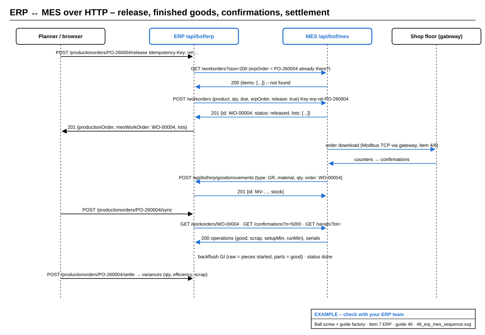

### 13.1 The interface in one table

| Direction | Message | HTTP | Trigger |
|---|---|---|---|
| ERP → MES | look up a work order for this production order | `GET /api/bsf/mes/workorders?size=200` (field `erpOrder`) | release |
| ERP → MES | create + release the work order | `POST /api/bsf/mes/workorders {product, qty, due, erpOrder, priority, release: true}` + `Idempotency-Key: erp-rel-<PO>` | release |
| ERP → MES | release an existing created work order | `POST /api/bsf/mes/workorders/{id}/release {force: true}` | release (WO already created by the MES planner) |
| MES → ERP | finished-goods booking | `POST /api/bsf/erp/goodsmovements {type: "GR", material, qty, order: "WO-…"}` | MES: lot of the main route done / FG booking |
| ERP → MES | pull the work order state | `GET /api/bsf/mes/workorders/{id}` | sync |
| ERP → MES | pull confirmations | `GET /api/bsf/mes/confirmations?n=5000` (filter `wo`) | sync |
| ERP → MES | pull serial numbers | `GET /api/bsf/mes/serials?lot=…` | sync |
| MES → ERP | push a confirmation (future / real MES) | `POST /api/bsf/erp/confirmations {erpOrder, op, good, scrap, setupMin, runMin, serials, final}` + Idempotency-Key | MES event |

Today the MES of item 6 books finished goods into the ERP by itself; confirmations are **pulled** by the ERP (sync). The push
endpoint exists so that a real MES (or the MES of item 6 later) can push events without polling.

### 13.2 Release – JSON

Planner → ERP:

```http
POST /api/bsf/erp/productionorders/PO-260004/release HTTP/1.1
Content-Type: application/json
Idempotency-Key: rel-PO-260004-1763030000

{}
```

ERP → MES (look-up, then create):

```json
POST /api/bsf/mes/workorders
Idempotency-Key: erp-rel-PO-260004
{"product": "FABS-3210-1000-C5", "qty": 1120, "due": "2026-11-20T14:00:00Z", "erpOrder": "PO-260004", "priority": 5, "release": true}
→ 201 {"id": "WO-00004", "erpOrder": "PO-260004", "product": "FABS-3210-1000-C5", "route": "FABS", "status": "released",
       "lines": [{"route": "BS", "need": 1120, "start": 1195, "lots": ["WO-00004-BS-01", …]}, {"route": "BN", …}, {"route": "FABS", …}], "lots": [...]}
```

ERP → planner:

```json
201 {"productionOrder": "PO-260004", "status": "released", "mesWorkOrder": "WO-00004", "lots": ["WO-00004-BS-01", "…"],
     "order": {"id": "PO-260004", "material": "FABS-3210-1000-C5", "qty": 1120.0, "due": "2026-11-20", "status": "released", "mesWorkOrder": "WO-00004", "stdCost": 374.41, "stdTotal": 419339.2, …}}
```

The same planner key again → **200** with the same body + `"replay": true`. Release again with a new key → **409**:

```json
{"type": "https://plant.example/problems/wrong-state", "title": "wrong state", "status": 409,
 "detail": "PO-260004 is 'released', only 'created' can be released (MES work order WO-00004)"}
```

### 13.3 Why two idempotency keys?

* The **planner key** protects the ERP call (double click, browser retry).
* The **ERP → MES key** `erp-rel-<production order>` is derived from the order number: if the ERP crashes after the MES created
  the work order but before the ERP saved the answer, the retry gets the **same** work order back (the MES replays it) –
  never a second work order. And before creating, the ERP first **looks up** a work order with `erpOrder = PO-…` (a planner may
  have created it in the MES already) and only releases it.

### 13.4 Finished goods – MES → ERP

```json
POST /api/bsf/erp/goodsmovements
{"type": "GR", "material": "LG-25-1000", "qty": 50, "order": "WO-00005"}
→ 201 {"id": "MV-00012", "type": "GR", "material": "LG-25-1000", "qty": 50.0, "order": "WO-00005", "loc": "SM-01", "batch": "WO-00005", "stock": 570.0,
       "t": "2026-11-13T10:40:00Z", "value": 2906.0, "text": "", "productionOrder": "PO-4711"}
```

The ERP finds the production order whose `mesWorkOrder` is `WO-00005` and adds the quantity to `grQty`. The receipt is valued at
the standard price (own product). Unknown material → 404 (the MES stores the answer in its FG record and the
reconciliation list shows it).

### 13.5 Sync – confirmations back

`POST /api/bsf/erp/productionorders/PO-4711/sync` → ERP pulls the work order, the confirmations and the serials (§13.1) and
answers with the production order:

```json
200 {"id": "PO-4711", "material": "LG-25-1000", "qty": 50.0, "status": "running", "mesWorkOrder": "WO-00005",
     "ops": [{"op": "10", "machineType": "LG-SAW", "route": "LG", "name": "Saw …", "status": "done", "good": 54, "scrap": 0, "stdMin": 64.8, "actMin": 70.0, "actualFromMes": true}, …],
     "good": 0.0, "scrap": 0.0, "issued": {"RAW-C55-PROF25": 55.08}, "serials": ["LG25-261113-0001", …],
     "backflush": [["RAW-C55-PROF25", 55.08]], "syncedAt": "2026-11-13T10:41:00Z", …}
```

* stdMin = t × (good + scrap) / OEE – the standard time for what the op really processed
* actMin = Σ (setupMin + runMin) of the MES confirmations, or stdMin if the MES did not send times
* backflush: 54 pieces started × 1.02 m = 55.08 m of profile issued (§12.3)
* when the MES reports `status: done` → production order `done` → ready for settlement

### 13.6 Errors and what the ERP does

| Case | MES answer | ERP answer | Next step |
|---|---|---|---|
| MES down / timeout | – (503) | **503** problem "MES not reachable – the production order stays 'created'" | retry with the same key (idempotent) |
| unknown product in the MES | 400 | 400 + `productionOrder` | create the product in the MES master data |
| quantity out of range | 422 | 422 | split the order |
| work order already released | 409 (MES) | ERP links the existing WO (look-up first) | – |
| ERP busy (lock) | – | 503 "ERP busy, retry" | the MES retries the FG booking later |
| unknown production order (sync) | – | 404 | – |
| not yet released (sync) | – | 409 "not released" | release first |

All errors are RFC 9457 problem+json (`type`, `title`, `status`, `detail`), like items 4 – 6.

### 13.7 No deadlock between ERP and MES

The ERP calls the MES during release / sync; the MES calls the ERP when it books finished goods. If both held their lock while
waiting for the other, they could block each other forever. Rule in `twin/bsf_erp.py`: **the ERP releases its lock while the
MES works** (phase 1 check under the lock → phase 2 MES call without the lock → phase 3 store the answer under the lock), and an
FG booking from the MES waits at most 1 s for the ERP lock (else 503, the MES retries).

### 13.8 Reconciliation

Once per shift (or per day) compare (example list):

| Check | ERP | MES | Action if different |
|---|---|---|---|
| released orders | production orders `released / running` | work orders with `erpOrder` | missing WO → re-release; WO without order → ask the planner |
| finished quantity | `grQty` of the order | `good` of the WO | missing GR → book (idempotent) |
| material | issued (backflush) | heat lots used | stock count, correct the BOM |
| scrap | scrap of the order | scrap per op | NCR (item 5) |

The message log (`GET /api/bsf/erp/log`) keeps the last 400 HTTP messages with request + answer – the first place to look.

### 13.9 Timing (example)

| Message | Frequency | Size |
|---|---|---|
| release | ≈ 10 – 30 per day | 1 – 10 kB |
| FG booking (MES → ERP) | per finished lot: ≈ 20 – 40 per day | < 1 kB |
| sync | per order per shift or on demand | 10 – 500 kB (confirmations list) |
| twin feed (demo) | every 5 s | ≈ 10 kB |

HTTP on the plant network handles this easily; the ERP is not a real-time system.

---

## 14. Costing theory

### 14.1 Cost elements

| Element | Contains | Basis |
|---|---|---|
| Direct material | raw + bought parts from the BOM at standard price | BOM × price |
| Material overhead (MOH) | purchasing, stores, incoming inspection | % of bought material (6 %) |
| Machine cost | depreciation, interest, space, energy, maintenance | machine hours × machine hour rate |
| Direct labour | operators | hours × crew × labour rate (42 €/h) |
| Production overhead (POH) | supervision, planning, quality, maintenance staff, tools (CBN wheels!), IT | % of conversion (60 %) |
| Scrap allowance | material + conversion of the pieces scrapped on the way | base × (1 / route yield − 1) |
| = **Standard (manufacturing) cost** | | |
| SG&A | sales, administration, R&D | % of manufacturing cost (15 %) |
| = **Full cost** | | |

### 14.2 Variable and fixed

For decisions (break-even, extra order) the costs are split:

* **variable**: material + MOH + labour + energy (they grow with every piece)
* **fixed**: depreciation, interest, space, maintenance, production overhead, SG&A (they stay per month)

Labour is treated as variable here (simple). In the short term it is often fixed (people are there anyway) – check.

### 14.3 Standard, actual, variance

* **Standard cost** = planned cost per piece (fixed for the year, used for valuation and prices).
* **Actual cost** = what an order really used (material issued, machine and labour time from the MES).
* **Variance** = actual − standard. Positive = unfavourable.

---

## 15. Machine hour rate – worked example per machine type

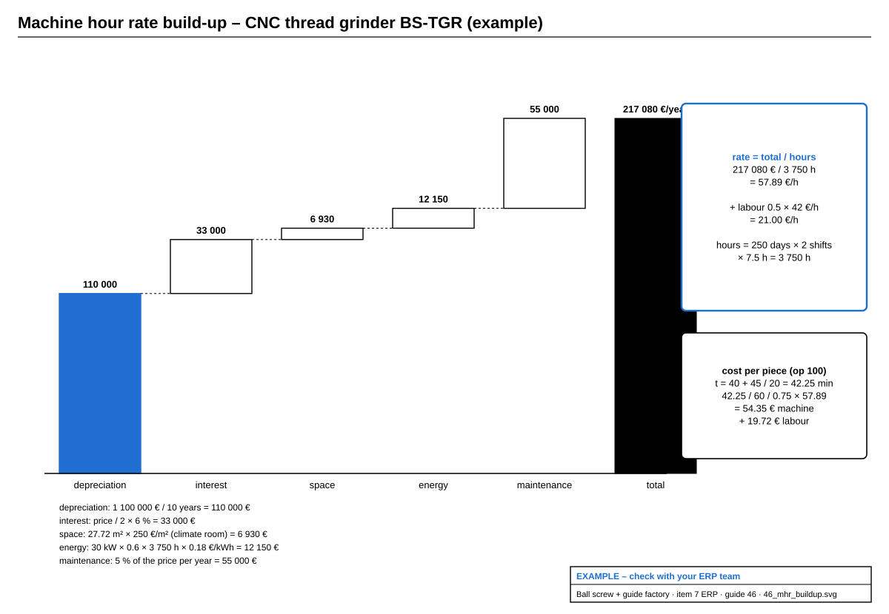

### 15.1 Formula

**machine hour rate = (depreciation + interest + space + energy + maintenance) / planned hours per year**

| Element | Formula (example parameters) |
|---|---|
| Depreciation | price / life (10 years) |
| Interest (calculatory) | price / 2 × 6 % (average capital tied up) |
| Space | footprint × 1.8 (access) × room rate (soft 90, heat treatment 110, grinding room 250, metrology 300, assembly 100 €/m² per year) |
| Energy | kW (MTYPES of item 2) × load factor 0.6 × hours × 0.18 €/kWh |
| Maintenance | % of the price per year (soft 4 %, heat treatment + grinding 5 %, QC + assembly 3 %) |
| Planned hours | 250 days × shifts × 7.5 h (2 shifts = 3 750 h; heat treatment 3 shifts = 5 625 h) |

### 15.2 Worked example – thread grinder BS-TGR (price 1.1 M€, 30 kW, footprint 5.5 × 2.8 m)

| Element | Calculation | € per year |
|---|---|---|
| Depreciation | 1 100 000 / 10 | 110 000 |
| Interest | 1 100 000 / 2 × 0.06 | 33 000 |
| Space | 5.5 × 2.8 × 1.8 = 27.72 m² × 250 | 6 930 |
| Energy | 30 × 0.6 × 3 750 × 0.18 | 12 150 |
| Maintenance | 0.05 × 1 100 000 | 55 000 |
| **Total** | | **217 080** |
| Planned hours | 250 × 2 × 7.5 | 3 750 |
| **Machine hour rate** | 217 080 / 3 750 | **57.89 €/h** |
| + labour | 0.5 operator × 42 €/h | 21.00 €/h |

Depreciation + interest = 143 000 € of 217 080 € (66 %) – a bottleneck machine is mostly **capital**. Every hour it stands
still costs ≈ 58 € of machine cost plus the lost output (≈ 1.4 screws × 155 € margin).

### 15.3 All work centres (example prices = middle of the cost range of item 2)

| Work centre | n | Price k€ | kW | Hours / year | Total € / year | **Rate €/h** | Crew |
|---|---|---|---|---|---|---|---|
| MS-SAW | 1 | 65 | 5 | 3 750 | 14 209 | 3.79 | 0.33 |
| BS-STR | 1 | 105 | 7.5 | 3 750 | 21 616 | 5.76 | 0.5 |
| BS-CTR | 1 | 130 | 11 | 3 750 | 27 576 | 7.35 | 0.33 |
| BS-TRN | 2 | 225 | 22 | 3 750 | 48 764 | 13.00 | 0.5 |
| BS-IND | 1 | 350 | 80 | 5 625 | 113 085 | 20.10 | 0.33 |
| HT-TMP | 1 | 105 | 45 | 5 625 | 47 722 | 8.48 | 0.2 |
| BS-STH | 2 | 300 | 11 | 3 750 | 59 702 | 15.92 | 0.5 |
| BS-CLP | 1 | 55 | 3 | 3 750 | 11 925 | 3.18 | 0.33 |
| BS-CGR | 2 | 525 | 25 | 3 750 | 110 295 | 29.41 | 0.5 |
| **BS-TGR** | **8** | **1 100** | 30 | 3 750 | 217 080 | **57.89** | 0.5 |
| QC-LED | 3 | 210 | 2 | 3 750 | 36 678 | 9.78 | 1.0 |
| AS-WSH | 1 | 140 | 25 | 3 750 | 34 469 | 9.19 | 0.2 |
| BN-TRN | 3 | 265 | 18.5 | 3 750 | 53 774 | 14.34 | 0.5 |
| BN-MC | 3 | 175 | 15 | 3 750 | 37 040 | 9.88 | 0.5 |
| HT-CAR | 2 | 1 500 | 250 | 5 625 | 438 507 | 77.96 | 0.2 |
| BN-HTN | 2 | 300 | 15 | 3 750 | 62 775 | 16.74 | 0.5 |
| BN-ITG | 2 | 900 | 18 | 3 750 | 173 790 | 46.34 | 0.5 |
| AS-NAS | 2 | 55 | 1 | 3 750 | 9 637 | 2.57 | 1.0 |
| LG-SAW | 1 | 105 | 7.5 | 3 750 | 22 508 | 6.00 | 0.33 |
| LG-STR | 1 | 120 | 7.5 | 3 750 | 24 652 | 6.57 | 0.5 |
| LG-DRL | 1 | 225 | 15 | 3 750 | 47 160 | 12.58 | 0.33 |
| LG-IND | 1 | 550 | 120 | 5 625 | 176 850 | 31.44 | 0.33 |
| LG-STH | 2 | 400 | 15 | 3 750 | 81 243 | 21.66 | 0.5 |
| LG-SGR | 1 | 375 | 15 | 3 750 | 81 675 | 21.78 | 0.5 |
| LG-PGR | 2 | 1 500 | 60 | 3 750 | 315 900 | 84.24 | 0.5 |
| LG-CUT | 1 | 105 | 7.5 | 3 750 | 25 312 | 6.75 | 0.33 |
| QC-RAL | 1 | 140 | 1 | 3 750 | 26 045 | 6.95 | 1.0 |
| LB-MC | 5 | 475 | 26 | 3 750 | 95 168 | 25.38 | 0.33 |
| LB-SGR | 1 | 225 | 11 | 3 750 | 49 455 | 13.19 | 0.5 |
| LB-RGR | 2 | 900 | 30 | 3 750 | 182 250 | 48.60 | 0.5 |
| QC-INC | 1 | 20 | 0.5 | 3 750 | 4 482 | 1.20 | 1.0 |
| AS-BAS | 3 | 40 | 1 | 3 750 | 7 237 | 1.93 | 1.0 |
| QC-MAT | 2 | 70 | 1 | 3 750 | 12 901 | 3.44 | 1.0 |
| AS-BSA | 3 | 105 | 2 | 3 750 | 18 366 | 4.90 | 1.0 |
| AS-RUN | 2 | 70 | 3 | 3 750 | 12 955 | 3.45 | 0.5 |
| AS-GAS | 1 | 40 | 0.5 | 3 750 | 7 682 | 2.05 | 1.0 |
| AS-MRK | 1 | 35 | 1 | 3 750 | 6 329 | 1.69 | 0.33 |
| AS-PCK | 2 | 25 | 1 | 3 750 | 5 845 | 1.56 | 1.0 |
| QC-LAB | 1 | 450 | 5 | 3 750 | 99 945 | 26.65 | 1.0 |

(BS-ROL and BS-WHL – rolled / whirled variants – have rates 20.56 / 41.04 €/h but no machine in the default plant.)

**HT-CAR** (carburising line, 1.5 M€, 250 kW, 3 shifts): energy 250 × 0.6 × 5 625 × 0.18 = 151 875 € per year = 35 % of the
total – for furnaces the energy price matters more than for grinders. Check the real load factor with an energy meter.

### 15.4 What the rate is not

* It is a **planning** number. If the machine runs fewer hours than planned, the real cost per hour is higher (idle capacity, §18).
* It contains no labour (separate, so that a 2-machine operator is counted right) and no tools (in POH here; the CBN wheel of the
  thread grinder ≈ 2 400 € / ≈ 400 shafts ≈ 6 € per screw could also be a direct cost per op – check with the controller).


---

## 16. Standard cost roll-up – full worked examples

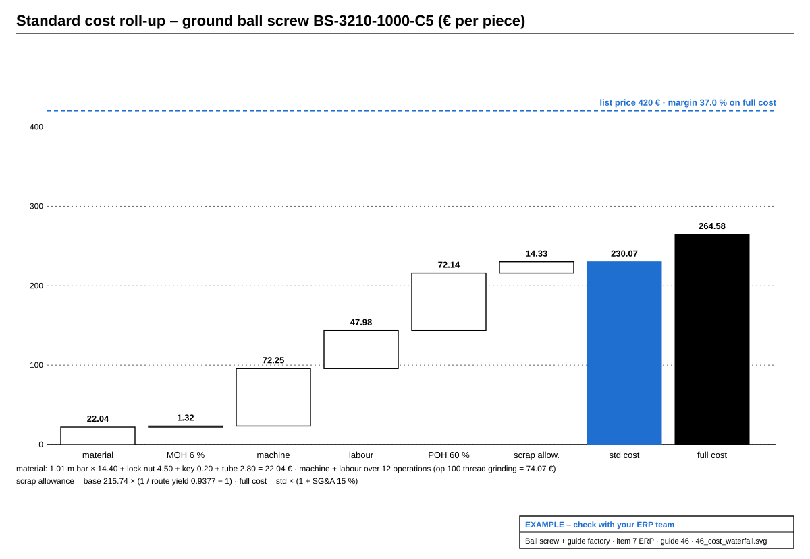

### 16.1 The rule

1. Material = Σ BOM child × standard price (make children at their own standard cost; phantoms pass through; raw × k for variants)
2. MOH = 6 % × bought material
3. Machine = Σ ops t / 60 / OEE × machine hour rate · Labour = Σ ops t / 60 / OEE × crew × 42 €/h
4. POH = 60 % × (machine + labour)
5. Base = 1 + 2 + 3 + 4 · Scrap allowance = base × (1 / route yield − 1) · **Standard cost = base / route yield**
6. Full cost = standard × 1.15 (SG&A) · Margin = (price − full cost) / price

Route yield = Π (1 − scrap %) over the operations (item 2 scrap rates). It is applied once at the end ("conservative": as if all
scrap happened at the last op; a finer model applies the yield per op – the scrap variance of §17 does that for actual orders).

### 16.2 BS-3210-1000-C5 (ground ball screw)

| Element | Calculation | € / pc |
|---|---|---|
| Bar 50CrMo4 Ø36 | 1.01 m × 14.40 | 14.54 |
| Lock nut M25 · key · VCI tube | 4.50 + 0.20 + 2.80 | 7.50 |
| **Material** | | **22.04** |
| MOH | 6 % × 22.04 | 1.32 |
| Machine | 12 ops (table §5.6) | 72.25 |
| Labour | 12 ops | 47.98 |
| POH | 60 % × (72.25 + 47.98) | 72.14 |
| Base | 22.04 + 1.32 + 72.25 + 47.98 + 72.14 | 215.74 |
| Route yield | 0.998 × 0.997 × 0.999 × 0.995 × 0.99 × 0.998 × 0.985 × 0.999 × 0.995 × 0.985 × 0.995 × 1 | 0.9377 |
| Scrap allowance | 215.74 × (1 / 0.9377 − 1) | 14.33 |
| **Standard cost** | 215.74 / 0.9377 | **230.07** |
| SG&A 15 % | | 34.51 |
| **Full cost** | | **264.58** |
| List price | | 420.00 |
| **Margin** | (420 − 264.58) / 420 | **37.0 %** |

Op 100 thread grinding alone = 54.35 + 19.72 = 74.07 € (+ 60 % POH = 118.5 €) – **half of the screw's cost is the thread
grinder**. Every minute saved there (fewer passes, hard whirling + finish grinding = item 2 variant W) is worth ≈ 2.8 € per screw.

### 16.3 BN-3210-FL (flanged ball nut)

| Element | € / pc |
|---|---|
| Bar 20MnCr5 Ø85: 0.105 m × 75.60 | 7.94 |
| 60 balls × 0.045 · 4 deflectors × 1.20 · 2 seals × 0.90 · 2 rings × 0.06 · nipple 0.15 · grease 4 g × 0.03 | 2.70 + 4.80 + 1.80 + 0.12 + 0.15 + 0.12 = 9.69 |
| **Material** | **17.63** |
| MOH 6 % | 1.06 |
| Machine (8 ops; biggest: BN-ITG internal thread grinding 10.64 €, BN-TRN 4.18 €, HT-CAR 3.46 €) | 23.98 |
| Labour | 26.39 |
| POH 60 % | 30.22 |
| Base | 99.28 |
| Scrap allowance (yield 0.9481) | 5.43 |
| **Standard cost** | **104.71** |
| Full cost (× 1.15) | 120.42 |
| List price · margin | 190 € · **36.6 %** |

### 16.4 LG-25-1000 (rail)

| Element | € / pc |
|---|---|
| Profile C55: 1.02 m × 9.80 | 10.00 |
| 17 hole caps × 0.05 · packing 1.90 | 0.85 + 1.90 |
| **Material** | **12.75** |
| MOH | 0.76 |
| Machine (10 ops; LG-PGR profile grinding 7.68 €, LG-IND 2.31 €, LG-STH 1.97 €) | 14.95 |
| Labour | 11.33 |
| POH | 15.77 |
| Base | 55.56 |
| Scrap allowance (yield 0.9559) | 2.57 |
| **Standard cost** | **58.12** |
| Full cost | 66.84 |
| List price · margin | 110 € · **39.2 %** |

### 16.5 LB-25-FL (carriage)

| Element | € / pc |
|---|---|
| Block profile 20CrMo4: 0.085 m × 32.00 | 2.72 |
| 120 balls × 0.020 · 2 end caps × 0.45 · 4 pipes × 0.08 · 2 end seals × 0.70 · 2 bottom seals × 0.30 · 4 retainers × 0.12 · nipple 0.15 · 4 screws × 0.03 · dummy rail 0.40 | 2.40 + 0.90 + 0.32 + 1.40 + 0.60 + 0.48 + 0.15 + 0.12 + 0.40 = 6.77 |
| **Material** | **9.49** |
| MOH | 0.57 |
| Machine (9 ops; HT-CAR 5.20 €, LB-RGR 2.62 €, LB-MC 2.26 + 1.79 €) | 12.69 |
| Labour | 10.43 |
| POH | 13.88 |
| Base | 47.06 |
| Scrap allowance (yield 0.9597) | 1.98 |
| **Standard cost** | **49.04** |
| Full cost | 56.40 |
| List price · margin | 68 € · **17.1 %** |

The carriage has the lowest margin: many bought parts, a long carburising cycle share (HT-CAR 77.96 €/h) and assembly by hand
(AS-BAS 4.1 min, crew 1). Actions (examples): bigger furnace loads (lower set-up share), automatic ball filling, price review.

### 16.6 The sets

| Element | FABS-3210-1000-C5 | FALG-25-1000 |
|---|---|---|
| Made parts (standard) | BS 230.07 + BN 104.71 = 334.78 | LG 58.12 + 2 × LB 49.04 = 156.20 |
| Bought (carton, grease) | 3.50 + 0.06 = 3.56 | 2.60 |
| MOH | 0.21 | 0.16 |
| Machine (assembly ops) | 2.07 | 0.27 |
| Labour (assembly, run-in, marking, packing) | 18.47 | 5.57 |
| POH | 12.33 | 3.50 |
| Base | 371.42 | 168.29 |
| Scrap allowance (yield 0.992 / 0.998) | 2.99 | 0.34 |
| **Standard cost** | **374.41** | **168.63** |
| Full cost | 430.58 | 193.93 |
| List price · margin | 640 € · **32.7 %** | 246 € · **21.2 %** |

Rolled through all levels, the FABS standard cost of 374.41 € consists of: material 46.03 + MOH 2.76 + labour 98.26 +
energy 9.57 + machine fixed cash cost 28.28 + machine depreciation / interest 67.40 + POH 122.11 (every element ÷ the yields).
This split feeds the variable / fixed view (§18.3).

### 16.7 Semi-finished values (WIP)

Value of a phantom stage = raw material × (1 + MOH) + conversion incl. POH up to its operation (no scrap allowance):
SF-BS3210-SOFT (after op 40) = 14.54 × 1.06 + (0.10 + 0.36 + 0.33 + 1.21 + 0.24 + 0.45 + 2.82 + 4.55) × 1.6 = **31.49 €**;
SF-BS3210-HARD (after op 80) = **48.54 €**. MES lot position (current op) × these values = the WIP value for the ERP.

---

## 17. Actual cost and variances

### 17.1 Where the actual data come from

| Data | Source | ERP field |
|---|---|---|
| good quantity | MES work order `good` | `good` |
| scrap per op | MES operations | `ops[].scrap` |
| machine + labour minutes | MES confirmations `setupMin + runMin` (standard if missing) | `ops[].actMin` |
| material | backflush (§12.3) | `issued` |
| purchase prices | goods receipts | PPV list |

### 17.2 The variances of this ERP

| Variance | Formula | Meaning |
|---|---|---|
| Purchase price (PPV) | (PO price − std price) × qty, at goods receipt | buyer / market |
| Material quantity (usage) | (issued qty − std qty for the good output) × std price | scrap, wrong BOM, set-up pieces |
| Efficiency (hours) | (actual min − std min for the processed qty) / 60 × (machine rate + labour rate) | slow machine, extra set-ups, re-work |
| Scrap | Σ scrap pieces per op × cumulative std value at that op | quality cost |

(Textbooks add rate and volume variances; the volume variance is shown in the P&L, §18.)

### 17.3 Worked example – rail order, 50 good of 54 started (example numbers)

| Item | Standard | Actual | Variance |
|---|---|---|---|
| Profile | 50 × 1.02 = 51.0 m | 54 × 1.02 = 55.08 m | (55.08 − 51.0) × 9.80 = **+39.98 €** |
| Op 10 saw | 54 pcs × 0.9 min / 0.75 = 64.8 min | 70.0 min (MES) | (70.0 − 64.8) / 60 × (6.00 + 0.33 × 42) = **+1.72 €** |
| Scrap at op 80 (4 pcs) | – | 4 × cumulative conversion to op 80 | 4 × ≈ 13.4 € ≈ **+53.6 €** |

Settlement books standard cost × good to finished goods and the variances to the P&L:
`POST /api/bsf/erp/productionorders/{id}/settle` →

```json
{"order": "PO-4711", "material": "LG-25-1000", "good": 50.0, "stdCost": 58.12, "stdTotal": 2906.02, "qtyVariance": 39.98, "efficiencyVariance": 1.72,
 "scrapVariance": 53.6, "totalVariance": 95.3, "actualTotal": 3001.32, "actualPerPc": 60.03,
 "materialLines": [{"material": "RAW-C55-PROF25", "stdQty": 51.0, "actQty": 55.08, "variance": 39.98}], "note": "material at standard price …"}
```

(Values of a real run differ; the page shows them in section 7.)

Note: the scrap allowance of the standard (§16) already *expects* the normal scrap. In a strict system the scrap variance counts
only scrap above the planned yield – agree the convention with the controller.

---

## 18. Simple finance – P&L, cash view, break-even

### 18.1 Plan year (example)

Volume per month = working days × (120 FABS + 200 FALG) × demand index (0.90 … 1.08). Working days 21 · 20 · 22 · 21 · 20 · 21
· 22 · 15 (summer) · 21 · 22 · 21 · 17 = 243.

| Month | Days | Revenue | COGS (std) | Volume var. | Idle capacity | SG&A | **EBIT** | EBIT % |
|---|---|---|---|---|---|---|---|---|
| Jan | 21 | 2.51 M€ | 1.57 M€ | +45 k€ | 99 k€ | 600 k€ | **200 k€** | 8.0 % |
| Feb | 20 | 2.52 M€ | 1.57 M€ | 0 | 99 k€ | 600 k€ | **248 k€** | 9.8 % |
| Mar | 22 | 2.91 M€ | 1.82 M€ | −47 k€ | 99 k€ | 600 k€ | **442 k€** | 15.2 % |
| Apr | 21 | 2.65 M€ | 1.65 M€ | 0 | 99 k€ | 600 k€ | **295 k€** | 11.2 % |
| May | 20 | 2.47 M€ | 1.54 M€ | +17 k€ | 99 k€ | 600 k€ | **212 k€** | 8.6 % |
| Jun | 21 | 2.70 M€ | 1.68 M€ | −18 k€ | 99 k€ | 600 k€ | **333 k€** | 12.3 % |
| Jul | 22 | 2.77 M€ | 1.73 M€ | 0 | 99 k€ | 600 k€ | **342 k€** | 12.4 % |
| Aug | 15 | 1.70 M€ | 1.06 M€ | +64 k€ | 99 k€ | 600 k€ | **−124 k€** | −7.3 % |
| Sep | 21 | 2.78 M€ | 1.73 M€ | −45 k€ | 99 k€ | 600 k€ | **390 k€** | 14.0 % |
| Oct | 22 | 2.99 M€ | 1.87 M€ | −76 k€ | 99 k€ | 600 k€ | **501 k€** | 16.7 % |
| Nov | 21 | 2.65 M€ | 1.65 M€ | 0 | 99 k€ | 600 k€ | **295 k€** | 11.2 % |
| Dec | 17 | 1.97 M€ | 1.23 M€ | +58 k€ | 99 k€ | 600 k€ | **−17 k€** | −0.9 % |
| **Year** | 243 | **30.62 M€** | **19.12 M€** | −1 k€ | **1.19 M€** | **7.20 M€** | **3.12 M€** | **10.2 %** |

* **COGS (std)** = units × standard cost (contains the planned machine, labour and overhead cost).
* **Volume variance** = (normal units − actual units) × fixed cost per unit: months below the normal demand under-absorb the
  fixed costs (+), months above over-absorb (−).
* **Idle capacity** = machine fixed cost of *all* 73 machines (473 k€ per month: depreciation, interest, space, maintenance) −
  the part the products absorb at normal volume (374 k€) = **99 k€ per month**. Machines that are not fully used (the 3 lead
  benches, the lab, …) cost money that no product carries.
* August (15 days, summer break) and December are loss months – the fixed costs run on.

### 18.2 Cash view

Receipts = revenue of 2 months earlier (customer terms ≈ 60 days); material payments = material of 1 month earlier (30 days);
other payments = COGS + volume variance + idle + SG&A − material − non-cash costs (depreciation + calculatory interest
≈ 330 k€ per month); capex = 350 k€ in March (tools), 1.2 M€ in September (a 9th thread grinder, example).

| Month | Receipts | Material paid | Other paid | Capex | **Net cash** | Cash end |
|---|---|---|---|---|---|---|
| Jan | 2.51 M€ | 240 k€ | 1.74 M€ | – | +530 k€ | 2.53 M€ |
| Mar | 2.51 M€ | 241 k€ | 1.86 M€ | 350 k€ | +62 k€ | 3.17 M€ |
| Aug | 2.70 M€ | 265 k€ | 1.33 M€ | – | **+1.10 M€** | 6.72 M€ |
| Sep | 2.77 M€ | 163 k€ | 1.79 M€ | 1.2 M€ | **−384 k€** | 6.33 M€ |
| Oct | 1.70 M€ | 266 k€ | 1.88 M€ | – | **−441 k€** | 5.89 M€ |
| Year | | | | 1.55 M€ | **+5.89 M€** | 7.89 M€ (opening 2.0 M€) |

**Lesson:** August is the worst month for profit but the best for cash (the strong June / July sales are paid in August);
October is a good profit month with negative cash (the weak August sales are paid then). Profit ≠ cash – the 60-day terms move
every month by two.

### 18.3 Break-even

Contribution margin per unit = price − variable cost (material + MOH + labour + energy, rolled through all levels):

| Product | Per day | Price € | Variable € | Contribution € | CM % |
|---|---|---|---|---|---|
| FABS-3210-1000-C5 | 120 | 640.00 | 156.62 | **483.38** | 75.5 % |
| FALG-25-1000 | 200 | 246.00 | 84.62 | **161.38** | 65.6 % |
| **Mix per production day** | | 126 000 | | **90 282** | |

Fixed costs per month = machines 473 412 € + production overhead 495 229 € + SG&A 600 000 € = **1 568 640 €**

**Break-even = 1 568 640 / 90 282 = 17.4 production days per month** of 20.25 on average (85.8 %) → safety margin **14.2 %**.

Revenue at break-even ≈ 17.4 × 126 000 = 2.19 M€ per month. The plant earns money only above ≈ 86 % of the plan volume –
typical for capital-intensive precision manufacturing: a 10 % sales drop takes away about two thirds of the profit.

### 18.4 What this finance part is not

No legal accounting (journal, ledger, tax, payroll, e-invoice, audit trail per GoBD / local law), no currencies, no asset
register, no consolidation. These come from a certified ERP or accounting system (§24). The numbers here serve planning,
training and the interface test.

---

## 19. KPIs and the dashboard

| KPI | Formula (this ERP) | Example | Target (example) |
|---|---|---|---|
| Order intake | Σ value of customer orders created in the last 30 days (not the twin) | live | plan revenue / 12 |
| Backlog | Σ value of open + confirmed + in-production orders | live | 2 – 4 weeks of revenue |
| On-time delivery (OTD) | deliveries on or before the **confirmed** date / all deliveries (incl. twin orders) | live | ≥ 95 % |
| Inventory value | Σ stock × moving average price | ≈ 590 k€ | – |
| Inventory turns | plan COGS / inventory value | ≈ 34 (no WIP) | ≥ 10 incl. WIP |
| Plan margin | (revenue − full cost) / revenue of the forecast mix | ≈ 28 % | – |
| Capacity load | (MPS load + CTP bookings) / capacity per type | BS-TGR 97 %, BN-ITG 95 %, LB-RGR 78 %, LG-PGR 65 % | drum < 95 % (keep a buffer) |

The charts follow the chart rules of the plant pages: thin marks, **one y-axis per chart**, a legend when there are two series
(the second series is also dashed – not colour alone), text in the text colours of the theme, a hover title on every mark. The
12-week trends are generated from a fixed seed around the plan values (the last week is live) – a real ERP reads them from its
history tables.

---

## 20. Roles and authorisations

| Role | May | Must not |
|---|---|---|
| sales | quotations, sales orders, ATP / CTP, confirm, deliver, invoice | change prices in the master, release production orders |
| planner | forecast, MRP run, convert planned orders, create + release production orders | send POs, change standard costs |
| buyer | requisitions → POs, send, expedite, supplier rating | book goods receipts (four-eyes principle) |
| stores | goods receipt, issue, transfer, count | inspection decision |
| quality (item 5) | inspection decision, blocked stock | change POs |
| controller | machine hour rates, standard costs, settlement, P&L | sales orders |
| admin | users, API keys, master-data release, backup | daily transactions |

**Segregation of duties**: the person who orders does not book the goods receipt and does not pay the invoice. HTTP API keys are
per partner system with only the routes it needs – e.g. the MES key may call only `POST /goodsmovements` and `POST /confirmations`.

---

## 21. IT architecture, security, backup

* **Zones**: ERP in the office / level-4 zone; MES in the level-3 zone; only HTTP(S) between them through the firewall (guide 43,
  IEC 62443 idea). The ERP has **no route** to the machine VLAN.
* **HTTPS** with plant certificates, **API keys** (`Authorization: Bearer …`) per partner system, rate limits at a reverse proxy.
* **Idempotency** for every creating POST (header `Idempotency-Key` or body `msgId`); the server keeps the last 3 000 keys and
  answers a repeat with the first answer + `"replay": true`.
* **Versioning**: `/api/bsf/v1/erp/…` = alias of `/api/bsf/erp/…`; a breaking change goes to `/v2/`.
* **Persistence of this demo**: one SQLite file (`bsf_erp.sqlite`) written only after the first state-changing request: table
  `state` (whole state as JSON) + table `journal` (audit trail). A real ERP: a database server with transaction log.
* **Backup**: daily full + log backup, 30 days, one copy offline (3-2-1 rule), **restore test every quarter**.
* **Offline**: the plant must run when the internet is down. A cloud ERP needs a plan for that (the local MES keeps working,
  bookings are queued) – check before buying.

---

## 22. Data migration and roll-out

### 22.1 Data migration

| Data | Source | Cleaning | Check |
|---|---|---|---|
| customers, suppliers | old system / Excel | duplicates, addresses, terms | sample of 20 |
| materials | item 1 + 2 data, drawings | one ID per material, UoM, type, procurement | every make item has a BOM + routing |
| BOMs | item 1 BOM + engineering | quantities, scrap, phantoms | explosion of every product = the expected bought list |
| routings | item 2 | times from trials, not from catalogues | standard cost plausible (§16) |
| stock | physical count on the cut-over day | batches (heat lots!) | value = book value ± 0.5 % |
| open orders | sales + purchasing | only open quantities | sum per customer / supplier |

Do **two or three test loads** before go-live and compare the MRP result of the new system with the planner's expectation.

### 22.2 Roll-out phases (example)

| Phase | Months | Content |
|---|---|---|
| 0 Blueprint | 1 – 2 | processes, data model, interfaces (guides 43 + 45 + 46 as the specification) |
| 1 Master data + finance | 2 – 4 | customers, suppliers, materials, BOMs, routings, chart of accounts |
| 2 Sales + purchasing + inventory | 3 – 6 | order to cash, procure to pay, stock |
| 3 MRP + production orders + MES interface | 5 – 8 | HTTP interface tests with the MES (all cases of §13.6) |
| 4 Costing | 6 – 9 | machine hour rates, standard costs, settlement |
| 5 Go-live + hypercare | 9 – 10 | cut-over weekend, 4 weeks of support |
| 6 Improve | ongoing | KPIs, ABC / XYZ policies, more suppliers on the portal |

---

## 23. Typical mistakes

| Mistake | Effect | Better |
|---|---|---|
| forecast for dependent items (balls, bars) | double planning, too much stock | forecast only saleable items; the MRP explodes the rest |
| lead times "to be safe" much longer than real | high stock, slow reaction | measured lead times + safety stock for the risk |
| routing times from the catalogue | wrong costs, wrong CTP | times from trials and from the MES (actual vs standard) |
| MRP proposals released without a check | rush orders, wrong lots | the planner reviews the exception messages daily |
| confirmed dates without ATP / CTP | OTD falls, customer trust lost | promise only from ATP / CTP |
| goods receipt without batch | no traceability heat → part | batch = heat number, scanned at the receipt |
| ERP and MES both create work orders without a key | duplicate orders | `erpOrder` + Idempotency-Key (§13.3) |
| standard cost never updated | prices on wrong costs | yearly roll-up + variance review |

---

## 24. Build or buy the ERP?

| Point | Own ERP core (like this item) | Bought ERP product |
|---|---|---|
| Fit to the rule (Ethernet + Modbus TCP + HTTP) | exact – REST + JSON with the conventions of items 4 – 6 | most modern ERPs offer REST / OData – check the MES interface and the offline behaviour of cloud products |
| Legal accounting, tax, payroll, e-invoicing | **not** covered – planning / training model only | covered and certified (country versions, audits) – the main reason to buy |
| Planning functions (MRP, ATP / CTP, configurator) | transparent, exactly our model | wide and tested; configurator + APS often extra modules |
| Time to production | planning core: months; a full ERP incl. finance: years (not recommended) | ≈ 6 – 18 months project |
| Cost (5 years, example) | 1 – 2 developer-years for the planning core + support | licences ≈ 60 – 600 k€ (or subscription) + project 1 – 3 × licence + 15 – 22 % maintenance per year |
| Risk | key-person risk; audits, security, backup are our job | vendor lock-in, upgrade projects, licence changes, cloud dependence |
| **Recommendation (example)** | keep this core as the **specification, training model and test partner** of the MES interface | **buy** a standard ERP for finance / sales / purchasing; put the HTTP contract of guides 43 / 45 / 46 into the tender; keep the MRP rules and the bottleneck CTP as requirements |

---

## 25. Buy list – catalogue examples

Prices: rough estimates 2026 – **estimate – ask for a quote**. ERP products are **references only – needs HTTP REST API; check**.
The same rows are in the card (tab *Buy list*).

| Item | Function | Examples (check) | Price class | Check |
|---|---|---|---|---|
| ERP suite – large | finance, sales, MRP, purchasing, production, controlling | SAP S/4HANA (check) | ≈ 300 k€ – 2 M€ + yearly | needs HTTP REST API (OData); partner for discrete manufacturing |
| ERP mid / large | finance, supply chain, manufacturing | Microsoft Dynamics 365 Business Central / Finance + Supply Chain (check) | ≈ 80 – 600 k€ + subscription | needs HTTP REST API; mostly cloud – offline? |
| ERP discrete manufacturing | MRP, configurator, shop floor | Infor CloudSuite Industrial (SyteLine) / LN (check) | ≈ 150 – 800 k€ | needs HTTP REST API; configurator |
| ERP make-to-order | quoting, configurator, job costing | Epicor Kinetic (check) | ≈ 100 – 500 k€ | needs HTTP REST API (REST v2) |
| ERP open source / modular | sales, MRP, purchasing, inventory, accounting | Odoo Community / Enterprise (check) | ≈ 20 – 200 k€ + partner | needs HTTP REST API (JSON-RPC / REST); self-hosted possible |
| ERP German Mittelstand | variant manufacturing, MRP | proALPHA (check) | ≈ 150 – 600 k€ | needs HTTP REST API; mechanical-engineering references |
| ERP German Mittelstand | manufacturing, MRP, web UI | abas ERP (check) | ≈ 100 – 500 k€ | needs HTTP REST API |
| ERP + DB servers (HA pair) | 16 – 24 cores, 128 GB, SSD RAID 10 | Dell PowerEdge R760 · HPE ProLiant DL380 · Lenovo ThinkSystem SR650 (check) | ≈ 12 – 25 k€ each | sizing from the vendor |
| Database licence | if required | Microsoft SQL Server · SAP HANA · PostgreSQL (check) | 0 – 100 k€ | licence per core |
| Backup appliance + offline copy | 30 days, LTO / RDX | Synology · QNAP · Veeam · LTO-9 (check) | ≈ 3 – 15 k€ | quarterly restore test |
| UPS 5 – 10 kVA | server room | APC Smart-UPS · Eaton 9PX · Socomec (check) | ≈ 3 – 8 k€ | ≥ 15 min, clean shutdown |
| Reverse proxy / API gateway | HTTPS, API keys, rate limits | nginx · Kong · Caddy (open source) | internal effort | only HTTP to MES / portals |
| Office laser printers | delivery notes, invoices, POs | HP LaserJet Enterprise · Kyocera ECOSYS · Brother (check) | ≈ 0.5 – 1.5 k€ | network printing (IPP) |
| Shipping label printer | SSCC / GS1-128 | Zebra ZT231 / ZT411 · SATO · Honeywell (check) | ≈ 1 – 3 k€ | pallet labels |
| Stores handheld | goods receipt / issue / count | Zebra TC22 / MC3300 · Honeywell CT40 · Datalogic (check) | ≈ 0.8 – 2 k€ | browser app on the REST API |
| Counting scale | balls, small parts | Mettler-Toledo · Bizerba (check) | ≈ 2 – 5 k€ | count 40 000 balls by weight |
| Implementation partner | blueprint → go-live | vendor partners (check) | ≈ 1 – 3 × licence | fixed price per phase |
| Training | key users 5 – 10 days | partner / internal | ≈ 15 – 50 k€ | on our own data |

---

## 26. Shopping list – ERP roll-out (example plant, ≈ 60 users)

| Pos | Qty | Item | Spec | Example | Price class (estimate – ask for a quote) |
|---|---|---|---|---|---|
| 1 | 2 | ERP + database servers (HA pair) | 16 – 24 cores, 128 GB, SSD RAID 10 | Dell · HPE · Lenovo | ≈ 25 – 50 k€ |
| 2 | 1 | Backup appliance + offline media | 30 days, restore test | Synology / Veeam / LTO | ≈ 5 – 15 k€ |
| 3 | 1 | UPS 5 – 10 kVA | ≥ 15 min | APC · Eaton | ≈ 3 – 8 k€ |
| 4 | 6 | Office laser printers | delivery notes, invoices | HP · Kyocera · Brother | ≈ 3 – 9 k€ |
| 5 | 2 | Shipping label printers | SSCC / GS1-128 | Zebra · SATO | ≈ 2 – 6 k€ |
| 6 | 8 | Stores handheld scanners | GR / GI / counting | Zebra · Honeywell | ≈ 7 – 16 k€ |
| 7 | 1 | Counting scale | balls, small parts | Mettler-Toledo · Bizerba | ≈ 2 – 5 k€ |
| 8 | 60 | ERP user licences | per module | SAP · Microsoft · Infor · Epicor · Odoo · proALPHA · abas | ≈ 60 – 600 k€ or subscription |
| 9 | 1 | Implementation partner | 6 – 12 months | vendor partner | ≈ 150 – 900 k€ |
| 10 | 1 | Data migration + cleaning | 2 – 3 test loads | internal + partner | ≈ 20 – 80 k€ |
| 11 | 1 | Interfaces ERP ↔ MES (this guide), supplier portal, customer API, bank file | HTTP only | internal + partner | ≈ 30 – 120 k€ |
| 12 | 1 | Training + hypercare (4 weeks) | key + end users | partner / internal | ≈ 15 – 50 k€ |

---

## 27. Standards register

| Standard | Title | Used for | Status |
|---|---|---|---|
| IEC 62264-1 … -5 (ANSI/ISA-95) | Enterprise-control system integration | levels, ERP ↔ MES objects (§3, §13) | check edition |
| B2MML (MESA) | XML implementation of ISA-95 | ideas for the message content (we use JSON) | check |
| ISO 2859-1 | Sampling procedures for inspection by attributes | incoming inspection plans (§11.3, item 5) | check edition |
| EN 10204 | Metallic products – types of inspection documents | 3.1 certificates of bars and profiles | check |
| IAS 2 (IFRS) | Inventories | valuation at cost / standard cost / lower of cost and net realisable value (§12.4) | **check with the controller** |
| GS1 General Specifications | GTIN, SSCC, GS1-128, Data Matrix | shipping labels, product IDs (with item 6) | check |
| ISO 8601 | Date and time | all times in the API | – |
| RFC 9110 / RFC 9457 | HTTP semantics / problem details | API conventions, errors | – |
| RFC 8259 | JSON | message format | – |
| IEC 62443 | Industrial cybersecurity | zones and conduits (§21) | check |
| ISO 3408-3 · ISO 3290 · DIN 69051-5 | ball screws · balls · nut flange | product data (items 1, 5) | check |
| GoBD (DE) / local law | proper bookkeeping, archiving | why a certified accounting system is needed (§18.4) | **check** |
| EN 16931 | Electronic invoicing – semantic model | e-invoices (future) | check the local rules |

---

## 28. Glossary

| Term | Meaning |
|---|---|
| ABC analysis | ranking of materials by annual consumption value (A = 80 % of the value) |
| ATP | available to promise: stock + planned output − commitments |
| Backflush | automatic goods issue from production confirmations |
| Backlog | value of the open customer orders |
| Batch / heat lot | quantity of material from one production run (steel: one melt), traceable |
| BOM | bill of material: parent – child – quantity |
| Break-even | volume where the contribution equals the fixed costs |
| COGS | cost of goods sold (units × standard cost) |
| Contribution margin | price − variable cost |
| CTP | capable to promise: date from the free capacity of the bottleneck |
| CV | coefficient of variation σ / mean (XYZ analysis) |
| EOQ | economic order quantity √(2DS/H) |
| Exception message | MRP advice: expedite, push out, cancel |
| FOQ | fixed order quantity (here: multiples of Q) |
| Full cost | standard cost + SG&A |
| Gross / net requirement | demand before / after stock, receipts and safety stock |
| Idempotency key | header value that makes a repeated POST harmless |
| Lead-time offset | release date = need date − lead time |
| LLC | low-level code: deepest BOM level of a material |
| L4L | lot-for-lot: order exactly the net requirement |
| Machine hour rate | machine cost per planned hour |
| MAV | moving average price |
| MOH / POH | material / production overhead |
| MPS | master production schedule (here = the forecast per day) |
| MRO | maintenance, repair and operations material |
| MRP | material requirements planning |
| OTD | on-time delivery rate |
| Phantom | BOM item without its own order or stock; the requirement passes through |
| Planned order | MRP proposal (not yet an order) |
| POQ | period order quantity (covers P periods) |
| PPV | purchase price variance |
| problem+json | RFC 9457 error format |
| ROP | reorder point d × LT + SS |
| Routing | operations with work centres and times |
| Scheduled receipt | open purchase or production order |
| SG&A | selling, general and administrative costs |
| Safety stock (SS) | buffer z·σ·√LT |
| Standard cost | planned cost per piece |
| Turns | COGS / inventory value |
| Variance | actual − standard |
| Work centre | group of equal machines with one rate (here = one machine type) |
| XYZ analysis | ranking by demand variation |

---

## 29. Questions for ERP vendors and suppliers

**ERP vendor**

1. Which REST / OData endpoints exist for production orders, confirmations, goods movements and stock? Is there an OpenAPI file?
2. Does every create endpoint support an idempotency key (or a client reference that prevents duplicates)?
3. How are errors returned (RFC 9457 problem+json?) – please show examples.
4. Can the ERP run **on-premise / offline**? What happens to the plant when the internet is down?
5. How are product variants modelled (characteristics, configurable material, one material per variant)? Can it create
   `FABS-2505-600-C7` automatically from the configuration?
6. MRP: lot-sizing rules (L4L, FOQ, EOQ, POQ), phantom items, low-level codes, exception messages – all standard?
7. Can ATP be extended with a bottleneck CTP (or is an APS module needed)?
8. Backflush from external confirmations – per operation or only at the end? Batch (heat lot) traceability?
9. Costing: machine hour rates per work centre, standard cost roll-up, settlement with quantity / efficiency / price variances?
10. Licence model (named / concurrent / module), yearly maintenance %, price-increase cap, exit (data export) terms?
11. References in ball screw / linear guide / bearing / precision machining plants?

**Steel bar mill / profile mill**

1. Minimum quantity per heat / per order, quantity tolerance (± 10 %?), fixed lengths?
2. EN 10204 3.1 for every heat, sent electronically (PDF + JSON / CSV)?
3. Alloy and scrap surcharge rules, price index?
4. Can you receive our PO through an HTTP portal / API and confirm the delivery date the same way?

**Ball / seal / moulded-part suppliers**

1. Kanban over HTTP (empty-bin signal) – lead time per signal, box size?
2. Size-class sorting of balls (1 µm steps) per box with a label?
3. Which AQL do you guarantee, 8D reaction time?

---

## 30. Next to read

* **Guide 45** – MES: work orders, lots, confirmations, genealogy, finished-goods booking; its Appendix A is the MES side of §13.
* **Guide 43** – communication: HTTP conventions (problem+json, Idempotency-Key, paging, versioning), firewall zones.
* **Guide 44** – quality: AQL plans, incoming inspection, NCR cost.
* **Guide 41** – routings, cycle times, capacity, the thread-grinder bottleneck.
* **Guide 40** – the products and their BOMs.
* **Guide 42** – the live twin whose daily orders appear here as sales orders.
* **Guide 47 (item 8, next)** – PLC programs.
* Books (examples): Hopp + Spearman – *Factory Physics*; Vollmann, Berry, Whybark, Jacobs – *Manufacturing Planning and Control
  for Supply Chain Management*; Orlicky – *Material Requirements Planning*; Horngren – *Cost Accounting*; Silver, Pyke, Thomas –
  *Inventory and Production Management in Supply Chains*.

---

## Appendix A – HTTP API reference with JSON for every endpoint

Base path `/api/bsf/erp` (also `/api/bsf/v1/erp`). Server: `twin/bsf_erp.py` via `server.py`; browser demo: the same router in
`web/bsferp_core.js`. JSON is shortened with `…`. Times: ISO 8601 UTC text (`"2026-11-13T10:33:05Z"`), dates `"2026-11-16"`.
All values are examples (shapes from the test server on port 8088). Every POST that creates something accepts
`Idempotency-Key` (or body `msgId`): the same key again → **200** with the same body + `"replay": true`.

### A.1 Health and catalogue

`GET /api/bsf/erp/health` → 200

```json
{"ok": true, "version": "bsf_erp 1.0", "mode": "server", "materials": 57, "salesOrders": 6, "purchaseOrders": 42, "productionOrders": 10, "movements": 0,
 "persist": {"on": true, "path": "…/bsf_erp.sqlite", "exists": false, "loaded": false, "savedAt": null, "error": ""}, "mes": true, "t": "2026-11-13T10:33:05Z"}
```

The browser demo answers `"mode": "browser demo"`, `"persist": null`. `"mes"` = the MES health answered 200.

`GET /api/bsf/erp/api` → `{"version": "bsf_erp 1.0", "routes": [["GET", "/api/bsf/erp/health", "…"], …]}` (58 routes).

### A.2 Master data

`GET /api/bsf/erp/customers` → `{"items": [{"id": "C-1001", "n": "Machine-tool builder A (example)", "country": "DE", "terms": 60, "creditK": 800, "inco": "FCA works", "channel": "HTTP order API (EDI-like JSON)", "group": "OEM-1"}, …]}`

`GET /api/bsf/erp/suppliers` → `{"items": [{"id": "S-2001", "n": "Steel bar mill A – 50CrMo4 +QT, 20MnCr5 bars (example)", "supplies": "…", "lt": 30, "terms": 60, "rating": "A", "channel": "supplier portal (HTTP JSON) + e-mail PDF", "cert": "IATF 16949"}, …]}`

`GET /api/bsf/erp/materials?type=raw` →

```json
{"items": [{"id": "RAW-50CRMO4-D36", "n": "Round bar 50CrMo4 +QT Ø36 peeled (heat lot, EN 10204 3.1)", "type": "raw", "uom": "m", "proc": "buy", "lt": 30,
            "lot": "FOQ", "lotQ": 400, "ss": 150, "price": 14.4, "sup": "S-2001", "route": "", "stock": 808.0, "free": 808.0, "std": 14.4}, …]}
```

`GET /api/bsf/erp/materials/BN-3210-FL` → material + `stock` rows, `free`, `std`, `mav`, `usedIn: ["FABS-3210-1000-C5"]`, `bom: [[child, qty, pos], …]` · unknown → 404.

`GET /api/bsf/erp/boms/FABS-3210-1000-C5` →

```json
{"material": "FABS-3210-1000-C5", "levels": 4, "rows": [
  {"level": 0, "material": "FABS-3210-1000-C5", "qty": 1.0, "uom": "pc", "proc": "make", "type": "fg", "name": "…", "pos": "", "llc": 0},
  {"level": 1, "material": "BS-3210-1000-C5", "qty": 1.0, "uom": "pc", "proc": "make", "type": "fg", "pos": "10", "price": null, "llc": 1},
  {"level": 2, "material": "SF-BS3210-HARD", "qty": 1.0, "proc": "phantom", "llc": 2}, {"level": 3, "material": "SF-BS3210-SOFT", "llc": 3},
  {"level": 4, "material": "RAW-50CRMO4-D36", "qty": 1.01, "uom": "m", "proc": "buy", "type": "raw", "price": 14.4, "llc": 4}, …]}
```

`GET /api/bsf/erp/routings/BS-3210-1000-C5` →

```json
{"material": "BS-3210-1000-C5", "route": "BS", "k": 1.0, "version": "R-BS-01", "yield": 0.9377,
 "ops": [{"no": "10", "workCenter": "MS-SAW", "name": "Saw the bar to length 1 010 mm", "setup": 10.0, "cycle": 1.0, "batch": 60, "effMin": 1.1667, "scrapPct": 0.2, "rate": 3.789}, …,
         {"no": "100", "workCenter": "BS-TGR", "name": "…", "setup": 45.0, "cycle": 40.0, "batch": 20, "effMin": 42.25, "scrapPct": 1.5, "rate": 57.888}, …]}
```

Not a make item → 404 "no routing".

`GET /api/bsf/erp/workcenters` →

```json
{"formula": "rate = (depreciation + interest + space + energy + maintenance) / planned hours",
 "items": [{"type": "BS-TGR", "name": "CNC external thread grinder (ball screws ≤ 1.5 m)", "area": "grind", "kW": 30.0, "price": 1100000.0, "life": 10, "hours": 3750.0,
            "areaM2": 27.72, "dep": 110000.0, "int": 33000.0, "space": 6930.0, "energy": 12150.0, "maint": 55000.0, "total": 217080.0, "rate": 57.888,
            "energyRate": 3.24, "nonCashRate": 38.133, "crew": 0.5, "labourRate": 21.0, "n": 8}, …]}
```

`POST /api/bsf/erp/configure` – see §6.4. Guide example `{"kind": "guide", "size": 35, "length": 1520, "block": "NA", "preload": "Z2", "cls": "P", "blocks": 3}` →
`{"ok": true, "code": "FALG-35-1520", "codes": {"set": "FALG-35-1520", "rail": "LG-35-1520", "block": "LB-35-NA"}, "variant": "LG-35-1520 + 3 × LB-35-NA Z2 P", "price": 880.2054, "parts": {"rail": 389.88, "block": 163.4418, "blocks": 3}, "k": 1.52, "known": false, "rules": ["rail = 190 × 1.52 × 1.35 = 389.88 € · carriage = 118 × 0.95 × 1.08 × 1.35 = 163.44 €"]}`
· invalid (Ø16 lead 20) → `"ok": false` with the rule text (status 200 – the configurator answers, the quotation then refuses with 422).

### A.3 Sales

`POST /api/bsf/erp/quotations` (Idempotency-Key)

```json
{"customer": "C-1003", "lines": [{"config": {"kind": "screw", "d": 25, "lead": 5, "length": 600, "grade": "C7"}, "qty": 10}], "dueDays": 15}
→ 201 {"id": "QT-00001", "customer": "C-1003", "lines": [{"code": "FABS-2505-600-C7", "qty": 10.0, "price": 299.47, "config": {…}, "text": "BS-2505-600-C7 / BN-2505-FL P1", "value": 2994.7}],
       "value": 2994.7, "validTo": "2026-12-13", "status": "open", "created": "…", "dueDays": 15}
```

(price = 325.51 × price group OEM-1 0.92 = 299.47 €.) Errors: unknown customer 400, unknown product 400, invalid configuration 422, qty ≤ 0 422.
`GET /api/bsf/erp/quotations` → newest first. `POST /api/bsf/erp/quotations/QT-00001/accept` `{}` → 201 sales order · not open → 409.

`POST /api/bsf/erp/salesorders` (item-4 compatible body)

```json
{"customer": "C-1001", "product": "FABS", "qty": 40}
→ 201 {"id": "SO-00007", "customer": "C-1001", "customerName": "Machine-tool builder A (example)",
       "lines": [{"pos": 10, "code": "FABS-3210-1000-C5", "qty": 40.0, "price": 588.8, "value": 23552.0, "config": null, "confirmed": null, "method": "", "delivered": 0.0}],
       "product": "FABS-3210-1000-C5", "qty": 40.0, "due": "2026-12-03", "status": "open", "created": "2026-11-13T10:33:05Z", "value": 23552.0, "confirmed": null,
       "source": "api", "deliveries": [], "invoices": []}
```

`product` may be a short key (FABS, FALG, BS, BN, LG, LB) or a code; or `lines: [{code, qty, price?}]`; `due` (ISO) or `dueDays`.
Errors: unknown product 400 (`{"product": "XX-1"}`), qty ≤ 0 422.

`GET /api/bsf/erp/salesorders?page=1&size=20&status=confirmed` → `{"items": [...], "page": 1, "size": 20, "total": 7, "next": "…"}` · `GET /salesorders/{id}` · unknown → 404:

```json
{"type": "https://plant.example/problems/unknown-sales-order", "title": "unknown sales order", "status": 404, "detail": "SO-99999"}
```

`POST /api/bsf/erp/salesorders/SO-00007/confirm` `{}` → 200 sales order with `status: "confirmed"`, `confirmed`, per line `confirmed` + `method`,
`ack.text` (order confirmation) and `atp: [ … ATP result per line … ]` · no date in 40 working days → 422 "no delivery date" · wrong state → 409.

`POST /api/bsf/erp/salesorders/SO-00007/deliver` `{}` → 201 `{"id": "DN-00001", "so": "SO-00007", "customer": "C-1001", "lines": [{"code": "FABS-3210-1000-C5", "qty": 40.0}], "at": "…", "day": 20770, "onTime": true}`
· free stock too small → 409 "not enough stock" · wrong state → 409.

`POST /api/bsf/erp/salesorders/SO-00007/invoice` `{}` → 201 `{"id": "INV-00001", "so": "SO-00007", "customer": "C-1001", "net": 23552.0, "vatRate": 0.19, "vat": 4474.88, "gross": 28026.88, "date": "2026-11-13", "due": "2027-01-12", "status": "open"}`
· not delivered → 409. `POST /salesorders/{id}/cancel` → 200 (not after delivery: 409).

`GET /api/bsf/erp/deliveries` · `GET /api/bsf/erp/invoices` · `POST /api/bsf/erp/invoices/INV-00001/pay` `{}` → 200 `{…, "status": "paid", "paidAt": "…"}` · twice → 409 "already paid".

`POST /api/bsf/erp/atp` `{"product": "FABS-3210-1000-C5", "qty": 400}` →

```json
{"product": "FABS-3210-1000-C5", "qty": 400.0, "today": "2026-11-13", "freeStock": 420.0, "mps": 120.0, "atpNow": 420.0,
 "atpDays": [420.0, 540.0, 660.0, 780.0, 900.0, 1020.0, 1140.0, 1260.0, 1340.0, 1460.0, 1580.0], "atpDay": 0, "ok": true,
 "ctp": {"rem": 0, "need": 0, "doneDay": 0, "promiseDay": 1, "used": [], "bottleneck": "BS-TGR", "machines": 8, "capMin": 5400.0, "mpsLoadMin": 5259.29, "freeMinDay0": 140.71, "upstream": 3, …},
 "promiseDay": 1, "promiseDate": "2026-11-16", "method": "ATP",
 "steps": ["free stock 420, MPS 120 per working day (forecast / 5), committed 65 → ATP now 420", "CTP: 0 pcs × 43.11 min = 0 min on BS-TGR (…)", "promise = working day +1 (ATP) = 2026-11-16"]}
```

### A.4 MRP

`POST /api/bsf/erp/mrp/run` `{"horizon": 8}` →

```json
{"at": "2026-11-13T10:53:09Z", "H": 8, "weekStart": "2026-11-09", "items": 39,
 "planned": [{"id": "PL-00001", "item": "FABS-3210-1000-C5", "qty": 600.0, "release": 1, "due": 2, "releaseDate": "2026-11-16", "dueDate": "2026-11-27", "kind": "production", "status": "planned"}, …],
 "exceptions": [{"item": "BALL-6.35-G5", "kind": "push out", "bucket": 1, "text": "receipt of 40000 in week 1 is needed only in week 4 - push out"}, …],
 "summary": {"FABS-3210-1000-C5": {"llc": 0, "gross": […], "sr": […], "poh": […], "net": […], "prc": […], "prl": […]}, …}}
```

`GET /api/bsf/erp/mrp` → last run with all item records · `GET /api/bsf/erp/mrp?item=BN-3210-FL` →
`{"item": "BN-3210-FL", "weekStart": "2026-11-09", "gross": […], "sr": […], "poh": […], "net": […], "prc": […], "prl": […], "exceptions": […], "EOQ": 0, "P": 1, "llc": 1, "name": "…", "oh": 420.0, "ss": 40, "lt": 2, "lot": "FOQ", "q": 120, "indep": […]}`
· no run yet → 404 · item not planned → 404.

`GET /api/bsf/erp/plannedorders` → `{"items": [planned orders]}` · `POST /api/bsf/erp/plannedorders/PL-00020/convert` `{}` →
purchase: 201 `{"id": "PR-00001", "material": "BOX-FABS", "qty": 2000.0, "need": "2026-11-27", "supplier": "S-2008", "from": "PL-00020", "status": "open", …}`;
production: 201 production order `PO-26xxxx` · already converted → 409.

### A.5 Purchasing + inventory

`GET /api/bsf/erp/purchaserequisitions` → `{"items": [...]}`.

`POST /api/bsf/erp/purchaseorders` (Idempotency-Key) `{"requisition": "PR-00001"}` or `{"supplier": "S-2004", "lines": [{"material": "BALL-6.35-G5", "qty": 40000}]}` →

```json
201 {"id": "PU-00043", "supplier": "S-2008", "status": "created", "created": "…", "lines": [{"pos": 10, "material": "BOX-FABS", "qty": 2000.0, "price": 3.5, "due": "2026-11-27", "received": 0.0}],
     "sent": null, "source": "PR-00001", "value": 7000.0}
```

Errors: unknown supplier 400, not a purchased material 400, qty ≤ 0 422, requisition not open 409.

`POST /api/bsf/erp/purchaseorders/PU-00043/send` `{}` → 200 PO with `sent: {"via": "web shop (HTTP)", "http": true, "message": {…JSON of §11.2…}, "note": "POST https://portal.supplier.example/api/orders (JSON over HTTPS)"}` · already received → 409.

`POST /api/bsf/erp/goodsreceipts` `{"po": "PU-00043", "qty": 2000, "batch": "L8001"}` →

```json
201 {"id": "GR-00001", "po": "PU-00043", "pos": 10, "material": "BOX-FABS", "qty": 2000.0, "batch": "L8001", "at": "…", "inspection": "IL-00001", "movement": "MV-00002", "ppv": 0.0}
```

Errors: unknown PO 404, nothing open 409, qty > open + 10 % → 422.

`GET /api/bsf/erp/inspections` · `POST /api/bsf/erp/inspections/IL-00001/decision` `{"decision": "accept", "defects": 0, "by": "quality"}` →
`{"id": "IL-00001", "material": "BOX-FABS", "qty": 2000.0, "batch": "L8001", "plan": {"letter": "K", "useLetter": "K", "n": 125, "ac": 3, "re": 4, "aql": "1.0", "text": "ISO 2859-1 normal, level II, AQL 1.0: lot 2000 → code K → sample n = 125, accept ≤ 3, reject ≥ 4 (item 5 sampling)"}, "status": "done", "decision": "accept", "defects": 0, …}`
· without `decision`: defects ≤ Ac → accept, else reject · decided twice → 409.

`POST /api/bsf/erp/goodsmovements` (item-4 compatible; used by the MES)

```json
{"type": "GR", "material": "BS-3210-1000-C5", "qty": 5, "order": "WO-00001"}
→ 201 {"id": "MV-00004", "type": "GR", "material": "BS-3210-1000-C5", "qty": 5.0, "order": "WO-00001", "loc": "SM-01", "batch": "WO-00001", "stock": 305.0,
       "t": "…", "value": 1150.35, "text": "", "productionOrder": "PO-260001"}
```

Errors: type not GI / GR → 400 · unknown material → 404 · qty ≤ 0 → 422 · GI larger than the free stock → **409**:

```json
{"type": "https://plant.example/problems/not-enough-stock", "title": "not enough stock", "status": 409, "detail": "LB-25-FL: 1300 < 99999"}
```

`GET /api/bsf/erp/goodsmovements?n=50` → last movements (newest first).

`GET /api/bsf/erp/stock?material=RAW-50CrMo4-D36` (id case-insensitive) →
`{"material": "RAW-50CRMO4-D36", "qty": 808.0, "onHand": 808.0, "unit": "m", "rows": [{"mat": "RAW-50CRMO4-D36", "loc": "RM-01", "batch": "H7741", "qty": 404.0, "status": "free"}, …], "t": "…"}`
· `GET /api/bsf/erp/stock` → `{"items": [{"material": "…", "qty": …, "unit": "…"}, …], "rows": [all stock rows], "t": "…"}`.

`GET /api/bsf/erp/inventory/valuation` → `{"items": [{"material", "type", "qty", "mav", "std", "valueMav", "valueStd"}, …], "totalMav": 589282.33, "totalStd": …, "byType": {"fg": 482273.93, "raw": 48409.4, …}, "cogsYear": …, "turns": …, "daysOfSupply": …}`

`GET /api/bsf/erp/analysis/abc` → `{"items": [{"material": "RAW-C55-PROF25", "annualQty": 53550.0, "price": 9.8, "value": 524790.0, "cumPct": 0.15, "abc": "A", "cv": 0.15, "xyz": "X"}, {"material": "RAW-50CRMO4-D36", …, "dDay": …, "sigmaDay": 14, "LT": 30, "SS": …, "ROP": …}, …], "total": …, "rule": "…"}`

### A.6 Production orders ↔ MES

`GET /api/bsf/erp/productionorders` → `{"items": [production orders with stdCost, stdTotal]}`.

`POST /api/bsf/erp/productionorders` (Idempotency-Key) `{"material": "LB-25-FL", "qty": 200, "dueDays": 8}` →
201 `{"id": "PO-260014", "material": "LB-25-FL", "qty": 200.0, "due": "2026-11-25", "status": "created", "mesWorkOrder": "", "lots": [], "good": 0.0, "scrap": 0.0, "grQty": 0.0, "ops": [], "issued": {}, "stdCost": 49.04, "stdTotal": 9808.32, …}`
· not a make item 400 · qty ≤ 0 422.

`GET /api/bsf/erp/productionorders/PO-260014` → the order (after sync with `ops`, `conf`, `serials`, `issued`, after settlement with `settlement`).

`POST /api/bsf/erp/productionorders/{id}/release` – §13.2. Item-4 compatible: unknown id + body `{"product": "LG", "qty": 50}` → creates
the production order and releases it → 201 `{"productionOrder": "PO-4711", "status": "released", "mesWorkOrder": "WO-00005", "lots": ["WO-00005-LG-01", "WO-00005-LG-02"], "order": {…}}`.
Errors: 409 not 'created' · 400 unknown product · 503 MES not reachable · MES 400 / 422 passed on.

`POST /api/bsf/erp/productionorders/{id}/sync` `{}` – §13.5 · not released → 409 · MES answer ≠ 200 → 503 / status of the MES.

`POST /api/bsf/erp/productionorders/{id}/settle` `{}` (or `{"force": true}` before `done`) – §17.3 · not done → 409.

`POST /api/bsf/erp/confirmations` (MES → ERP push, Idempotency-Key)

```json
{"erpOrder": "PO-260002", "op": "10", "good": 50, "scrap": 0, "setupMin": 10, "runMin": 41, "serials": [], "final": false, "msgId": "conf-demo-1"}
→ 201 {"id": "CO-00001", "order": "PO-260002", "op": "10", "good": 50.0, "scrap": 0.0, "setupMin": 10.0, "runMin": 41.0, "serials": [], "final": false, "at": "…"}
```

`erpOrder` or `mesWorkOrder` identify the order; `final: true` adds good / scrap / serials to the order totals. Unknown order → 404,
negative quantity → 400. `GET /api/bsf/erp/confirmations` → last 100.

### A.7 Costing, finance, KPIs, logs

`GET /api/bsf/erp/costing/BS-3210-1000-C5` →

```json
{"code": "BS-3210-1000-C5", "route": "BS", "k": 1.0,
 "material": [{"pos": "10", "child": "RAW-50CRMO4-D36", "qty": 1.01, "price": 14.4, "kind": "buy", "type": "raw", "uom": "m", "value": 14.544}, …],
 "matBuy": 22.044, "matMake": 0.0, "moh": 1.3226, "ops": [{"no": "100", "m": "BS-TGR", "name": "…", "t": 42.25, "rate": 57.888, "crew": 0.5, "machine": 54.35, "labour": 19.72, "scrap": 1.5, "cumConv": …}, …],
 "machine": 72.25, "labour": 47.98, "poh": 72.14, "base": 215.74, "yield": 0.9377, "scrap": 14.33, "std": 230.07, "sga": 34.51, "full": 264.58, "price": 420.0,
 "margin": 155.42, "marginPct": 0.37, "semi": {"SF-BS3210-HARD": 48.54, "SF-BS3210-SOFT": 31.49}, "variable": 82.33, "fixed": 147.74,
 "roll": {"mat": 23.51, "moh": 1.41, "labour": 51.17, "energy": 6.24, "fixCash": 21.19, "fixNonCash": 49.62, "poh": 76.93}}
```

Not a make item → 404.

`GET /api/bsf/erp/variances` → `{"settled": [settlements], "ppv": [{"gr", "po", "material", "qty", "price", "std", "ppv"}], "ppvTotal": …}`

`GET /api/bsf/erp/finance/pnl` (= `/finance/cash`) → `{"rows": [{"month": "Jan", "days": 21, "units": {…}, "revenue": 2513700.0, "cogs": 1569190.15, "volVar": 45085.05, "gross": …, "idle": 99143.07, "sga": 600000, "ebit": 200281.73, "ebitPct": 0.0797, "material": …, "receipts": …, "payMaterial": …, "payOther": …, "nonCash": …, "capex": 0, "netCash": …, "cash": …}, …], "year": {"revenue": 30620520.0, "ebit": 3116645.0, …}, "fixedMachMonth": 473411.8, "absorbedMonth": 374269.0}`

`GET /api/bsf/erp/finance/breakeven` → `{"lines": [{"code": "FABS-3210-1000-C5", "perDay": 120, "price": 640.0, "variable": 156.62, "contribution": 483.38, "cmPct": 0.755}, …], "contribPerDay": 90281.99, "fixedMonth": 1568640.41, "beDays": 17.37, "planDays": 20.25, "bePct": 0.858, "safetyMargin": 0.142, …}`

`GET /api/bsf/erp/kpi` → `{"intake30": …, "backlog": …, "otd": 0.96, "otdCount": [24, 25], "inventory": 589282.33, "turns": …, "marginPlan": 0.28, "revenuePlan": …, "load": {"BS-TGR": 0.974, "BN-ITG": 0.945, "LG-PGR": 0.648, "LB-RGR": 0.785}, "trend": [{"week": -11, "intake": …, "delivered": …, "otd": …, "inventory": …, "loadTGR": …}, …], "openSO": 6, "openPO": 42, "prodOpen": 10}`

`GET /api/bsf/erp/log?since=0` → last 200 messages `{"seq", "at", "dir": "ERP → MES" | "MES → ERP" | "ERP → supplier", "method", "path", "req", "status", "resp", "ms"}`.
`GET /api/bsf/erp/events?since=0` → audit journal `{"seq", "at", "kind", "text"}`.

### A.8 Twin feed, cross-check, control

`POST /api/bsf/erp/twin` `{"orders": [{"id": "SO-0012", "product": "FABS", "qty": 120, "due": 1209600, "state": "shipped", "done": 120, "tDone": 1190000, "tShip": 1195000}], "stores": {…}, "clock": "D9 10:16"}` →
`{"new": 1, "twinOrders": 23}` (the page sends it every 5 s).

`POST /api/bsf/erp/eval` – calculation cross-check (Python = JavaScript):

| Body | Answer |
|---|---|
| `{"kind": "eoq", "D": 60000, "S": 80, "H": 0.18}` | `{"Q": 7302.967…}` |
| `{"kind": "rop", "z": 1.65, "sigma": 30, "LT": 9, "d": 240}` | `{"SS": 148.5, "ROP": 2308.5}` |
| `{"kind": "mrp"}` | hand case A / B / C / D of §8.4 – §8.5 |
| `{"kind": "mhr", "type": "BS-TGR"}` | machine hour rate build-up |
| `{"kind": "stdcost", "code": "LB-25-FL"}` | cost roll-up |
| `{"kind": "atp", "case": {"q": 100, "free": 30, "minPerPc": 45, "freeMin": [1200, …], "upstream": 3, "after": 2, "ship": 1}}` | `{"rem": 70, "need": 3150, "doneDay": 5, "promiseDay": 8, …}` |
| `{"kind": "lot"}` | lot-sizing comparison of §9.4 |
| `{"kind": "config", "config": {…}}` | configurator |
| `{"kind": "mav", "q0": 400, "p0": 14.4, "q1": 400, "p1": 14.1}` | `{"avg": 14.25}` |
| `{"kind": "finance"}` | P&L + break-even |
| `{"kind": "aql", "lot": 2000, "aql": "1.0"}` | `{"letter": "K", "n": 125, "ac": 3, "re": 4}` |

Unknown kind → 400.

`POST /api/bsf/erp/control` `{"action": "reset"}` → `{"reset": true}` (fresh example state) · `{"action": "persist", "on": false}` → `{"persist": false, "path": "…"}`.

### A.9 Status codes used

| Code | When |
|---|---|
| 200 | read, confirm, send, decision, sync, settle, replay of an idempotent POST (`"replay": true`) |
| 201 | created: quotation, sales order, delivery, invoice, requisition, PO, goods receipt, movement, production order, release, confirmation |
| 202 | (supplier portal, in the log) order accepted by the supplier |
| 400 | bad body: unknown customer / supplier / product / material type, negative quantity, unknown eval kind |
| 404 | unknown sales order, PO, inspection lot, production order, material, planned order, no MRP run yet |
| 409 | wrong state (release twice, deliver before confirm, invoice before delivery, pay twice), not enough stock, nothing open, not released |
| 422 | business rule: quantity ≤ 0, invalid configuration, no delivery date in the horizon, quantity above the open PO quantity |
| 500 | internal error (the main server keeps running) |
| 503 | MES not reachable (production order stays 'created'), ERP busy (retry) |

### A.10 Item 4 compatibility

The former demo ERP routes of item 4 (`twin/bsf_comm_api.py`) are now served by this ERP with the same paths and fields:
`GET /salesorders` (paged), `POST /salesorders {customer, product, qty, due}` → 201 with `id`, `status: "open"`;
`POST /productionorders/{id}/release {product, qty}` → 201 `{productionOrder, status, mesWorkOrder, lots}`;
`POST /goodsmovements {type, material, qty, order}` → 201 `{id, …, stock}` / 409 not enough stock / 404 unknown material / 422 qty;
`GET /stock?material=` → `{material, qty, unit, t}`. The MES (item 6) books finished goods through the same goods-movement
route. Self-checks `&bf4test` (48), `&bf5test` (79) and `&bf6test` (50) pass with the real ERP.

---

## Appendix B – File map and how the code is built

| File | Lines (≈) | Content |
|---|---|---|
| `web/bsferp_data.js` | 240 | `MD` JSON block (plant, customers, suppliers, materials, BOMs, work-centre prices, stock, prices, configurator, forecast, finance plan, hand checks) + views (MAT7, CUST7, SUPP7), MODULES7, ROLES7, API7, CHECK7 |
| `web/bsferp_core.js` | 880 | mhr, costRollup, lotCompare, mrpItem / mrp / mrpCheck, ctpCase, bottleneck, mpsLoad, configure, listPrice, finance, breakeven, explodeBuy, bomTree, evaluate, `createERP()` = state + local router |
| `web/bsferp_view.js` | 90 | lineChart, barChart, hbars, waterfall, mrpTable |
| `web/bsferp.js` | 540 | page: erp() helper (server or local), twin feed, 10 sections, self-check |
| `web/bsferp_card.js` | 80 | CARD7 (12 drawings, 26 buy rows, 12 shopping rows) + BUILD_BUY7 |
| `web/bsferp.css` | 55 | styles (light + dark theme variables) |
| `twin/bsf_erp_core.py` | 680 | the same calculations in Python; reads `MD` from `web/bsferp_data.js`, MTYPES (kW, footprint) from `web/bsfmfg_data.js`, routings via `twin/bsf_mes_core.py`, machine counts from `twin/bsf_comm_map.py` |
| `twin/bsf_erp.py` | 1 430 | class ERP (state + router, MES link, idempotency), SQLite persistence, lock handling (no ERP lock while the MES works), handle() |
| `server.py` | +5 | lazy route `/api/bsf/erp/…` and `/api/bsf/v1/erp/…` → `bsf_erp.handle()` |
| `twin/bsf_comm_api.py` | changed | demo ERP routes removed → delegated to `bsf_erp` (same paths + fields) |
| `docs/img/46_*.svg` + `web/img/46_*.svg` | 12 files | drawings of this guide |

**One source of truth:** the master data exist once (the JSON block in `web/bsferp_data.js`); the routings once (item 2);
the machine data once (item 2 MTYPES). The two cores are two implementations of the same model – `&bf7test` compares them
(MRP, standard costs of 7 products, machine hour rates, lot sizing, finance, configurator, CTP).

**Start-up state:** stock of `MD.stock0`, the open orders of `MD.openPurchase` / `MD.openProduction` (PO-260001 … 003 = the
work orders WO-00001 … 003 of the MES seed), six customer orders, and the **seeded order pipeline** (§8.6).

---

## Appendix C – Self-check `&bf7test` (what is checked)

`/?bfitem=7&bf7test#bsf` (headless: add `&bf7hold`). Console lines `BF7TEST PASS|FAIL …`, summary `BF7TEST DONE pass=61 fail=0`.

| Group | Checks |
|---|---|
| MRP hand case | A releases 10 / 20 / 40 / 0 / 50 / 0; B gross = 2 × A; B POH 30 / 90 / 10 / 10 / 10 / 10, net 100 in week 4; B release 100 in week 2; push-out and expedite messages |
| Formulas | EOQ 7 302.97; SS 148.5; ROP 2 308.5; moving average 14.25 |
| Machine hour rate BS-TGR | depreciation, interest, space, energy, maintenance, rate 217 080 / 3 750 |
| Cost roll-up | op 100 t = 42.25 min and 54.35 €; BS material 22.04; BS std = (M + MOH + machine + labour + POH) / yield; FABS and FALG material = their children; all margins > 0 |
| Lot sizing | L4L 3 200 €; POQ cheaper |
| ATP / CTP | hand case done day 5, promise day 8; BS-TGR capacity 5 400 min; MPS load below capacity |
| Configurator | reference screw set 640 € + code; reference guide set 246 €; Ø16 lead 20 rejected |
| AQL | lot 2 000 → K, n 125, Ac 3 |
| Finance | EBIT > 0, break-even < plan days |
| Browser ERP + browser MES | order to cash; ATP for 2 000 sets; MRP run on plant data; procure to pay; release → MES work order + replay + 409; MES confirmations → FG goods receipt in the ERP, sync done + backflush, settle; problem+json 404 / 400 / 409 |
| Server (if reachable) | Python = JavaScript for MRP, 7 standard costs, 5 machine hour rates, lot sizing, P&L + break-even, configurator, CTP; production order → release 201 → replay → 409; MES has the work order with `erpOrder`; sync with actual minutes + backflush; item-4 compatible release; GI 409; stock id case-insensitive; v1 alias + MES reachable; route catalogue ≥ 55; message log; SQLite file exists |
| Page | card `bfCard7`, 12 drawings loaded, page images loaded, ≥ 7 charts, MRP table + sales list |

*End of guide 46 – all values are examples; check with your ERP team.*
