# 47 – PLC control programs of the ball screw + guide factory: standard machine interface, induction line, straightening press, thread-grinder auxiliaries, torque test stand, run-in + AGV port (Delta + Siemens, Modbus TCP)

Ball screw + profiled linear guide factory · item 8 · page: tab **Ball screw + guide factory → 8 · PLC control programs** (deep link `/?bfitem=8#bsf`)

This guide is a small textbook for a mechanical engineer who plans the factory and must talk with PLC programmers, machine
makers and the MES team. It explains:

* Which machine gets which PLC – the maker's CNC / PLC or **our PLC** (Delta AS332T-A or Siemens S7-1200, S7-1500 F for the
  induction lines) – and what the PLCs of the whole plant cost.
* The **standard machine interface** that every PLC of the plant carries: status word, counters, cycle time, alarm code,
  heartbeat, gateway watchdog, energy, the **MES order handshake with toggle bits** and the filling of the **Modbus TCP holding
  registers** of item 4's register map V1.1 (227 registers 0 – 226, incl. the gateway heartbeat 226).
* How the **Modbus TCP server** works inside a Delta AS and inside a Siemens S7 (`MB_SERVER`): address mapping, word order,
  bit numbering, connection resources.
* Six complete ladder programs (LAD) for **both PLC families**, with plant models, I/O lists, wiring notes, timing calculations
  and the generated Delta instruction list (IL) and Siemens SCL.
* Commissioning, test plan, typical mistakes, buy list, shopping list, standards, glossary and supplier questions.

> **All addresses, times, limits and prices are examples.** They show the method. Check every value with your PLC
> configuration (HWCONFIG in ISPSoft, device configuration in TIA Portal), the PLC manuals, the machine makers and your
> suppliers. Prices are "estimate – ask for a quote".

The communication rule of the plant applies (guide 43): **Ethernet + Modbus TCP + HTTP only**. Every machine is a **Modbus TCP
server**; only the gateway talks Modbus to the machines; everything above the gateway talks **HTTP**. **Safety is hard-wired**
(safety relay / F-CPU) and never goes over Modbus or HTTP.

---

## Contents

1. Purpose and scope
2. How to use the page
3. PLC architecture of the factory
4. The standard machine interface – register image, status word, counters, alarms, energy
5. The MES order handshake – toggle bits, state machine, timing
6. Heartbeat and gateway watchdog – error handling
7. Delta AS – Modbus TCP server setup and address mapping
8. Siemens S7-1200 / S7-1500 – MB_SERVER setup
9. Filling the register block – bits, 32-bit word order, ASCII, versioning
10. Program 1 – standard interface template (bandsaw MS-SAW-01)
11. Program 2 – induction scan hardening BS-IND-01
12. Program 3 – straightening press BS-STR-01
13. Program 4 – thread-grinder auxiliaries BS-TGR-03
14. Program 5 – preload torque test stand AS-BSA-01
15. Program 6 – run-in station + AGV transfer port AS-RUN-01
16. Commissioning and test plan
17. Timing calculations
18. Typical mistakes
19. Buy list – catalogue examples
20. Shopping list – PLCs of the plant
21. Standards register
22. Glossary
23. Questions for suppliers and machine makers
24. Next to read
* Appendix A – standard interface networks I1 – I14: Delta IL + Siemens SCL
* Appendix B – G – machine networks of programs 1 – 6: Delta IL + Siemens SCL
* Appendix H – I/O and tag lists of all programs

---

## 1. Purpose and scope

### 1.1 Why an item about PLC programs?

Items 1 – 7 designed the products, the processes, the layout, the network, the quality system, the MES and the ERP. All of
them assume that the machines **deliver data** (state, counters, process values) and **accept orders** (load lot, start,
stop). That happens in the PLC. If the PLC side is not specified, every machine maker invents his own interface, and the
gateway of item 4 needs 41 different drivers.

Item 8 therefore defines:

| Part | Content | Where |
|---|---|---|
| Standard interface | one function block "FB_BsfIf" with the same behaviour in every PLC | networks I1 – I14, §4 – §9 |
| Machine programs | 6 example programs that use the interface | §10 – §15 |
| PLC selection | which PLC for each of the 41 machine types | §3 |
| Commissioning | checklist for the Modbus interface | §16 |

### 1.2 What a PLC program here is – and is not

| Is | Is not |
|---|---|
| the **standard** program (IEC 61131-3 LAD) of a machine: step chain, interlocks, analog values, alarms, interface | the **safety** program – e-stop, guard locking, STO, safe generator off are done by a safety relay or an F-program |
| a template a machine maker or integrator can copy | a finished, certified machine program |
| written for Delta AS (ISPSoft) **and** Siemens S7 (TIA Portal) | tied to one vendor |

**Rule written on every page and in every guide:** the standard ladder program never does the safety function itself
(e-stop, guard locking, STO, safe generator off). That is the job of the hard-wired safety relay (e.g. Pilz PNOZ s4,
Schmersal SRB-E, Phoenix Contact PSRmini) or of the F-program of a fail-safe CPU (S7-1500F, S7-1200 F) – ISO 13849-1,
IEC 62061, IEC 60204-1 §9.4. The programs here only **read** the safety status.

### 1.3 Reference data used

| Data | Source | Used in |
|---|---|---|
| register map V1.1 (227 holding registers 0 – 226, REAL ABCD, toggle-bit handshake, gateway heartbeat 226 – decided 2026-11-13) | item 4, `twin/bsf_comm_map.py`, `web/bsfcomm_map.js`, guide 43 §7 – §8 | every program |
| machine states OFF / IDLE / RUN / SETUP / DOWN / BLOCKED / STARVED, alarm codes | item 3, `web/bsfsim.js` | status word, alarm code |
| induction data 30 kHz, 35 kW, 4 mm/s, 150 min⁻¹, polymer 10 % | item 2 route BS op 50 | program 2 |
| straightening 0.6 → ≤ 0.10 mm, 30 – 50 kN, span 400 mm | item 2 route BS op 20, QG-BS-3 | program 3 |
| NCR "oil-chiller trip BS-TGR-03", alarm 213 | item 5 | program 4 |
| preload torque Tp 0.29 N·m ± 40 % (P1 example) | item 5 QG-FA-1 | program 5 |
| AGV transport over the fleet manager (HTTP) | item 3, guide 43 §11.3 | program 6 |
| MES work order, lot, confirmation | item 6 | handshake |

---

## 2. How to use the page

### 2.1 The parts of the page

| Card | What it shows |
|---|---|
| Header | what you see, how to read LAD, how to use it, safety rule, the six program buttons, "What to try" |
| Live ladder + Modbus holding registers | plant gauges (machine, MES lot, counters), the ladder with Run / Stop / 1 scan / Reset, Delta / Siemens / Both view, the input panel; on the right: status word bits, hs.status bits, the **simulated gateway** (auto MES orders, "gateway lost", "no heartbeat 226 (V1.0 gateway)", gateway heartbeat FC06 226 every 1 s, command buttons 1 – 5 and 9, frame log, FC03 response frame) and the **register table** 0 – 226 (map V1.1) with raw hex and decoded values (changed registers flash) |
| Program details | I/O list with Delta + Siemens addresses and wiring, timing table, wiring notes, safety note, PLC choice |
| Modbus TCP server in the PLC | Delta AS setup and mapping, Siemens MB_SERVER setup, REAL ABCD worked example |
| PLC selection for all 41 machine types | control type, PLC, I/O estimate, Modbus server type, link to the matching program; PLC bill of materials (option A Delta, option B Siemens); "how one machine is connected" drawing; architecture table |
| Commissioning checklist | 15 tests for the Modbus interface of one machine (tick boxes kept in this browser only) |
| Real components + drawings | 11 drawings, buy list (37 rows), shopping list |

### 2.2 First steps

1. Open `/?bfitem=8#bsf`. Program 1 starts at once.
2. After ≈ 2 s the simulated gateway sees **READY** (hs.status bit 4), writes an order (FC16 200 – 225) and toggles **REQ**
   (FC06 202). Watch hs.status: ACK follows REQ, BUSY = 1. The gateway then sends command 2 "start".
3. The machine runs its cycle. At every part-done pulse `std.good` or `std.scrap` counts, `hs.lotDone` grows.
4. At the end of the lot **DONE toggles** and BUSY drops; the gateway log shows "DONE toggled – lot finished → MES
   confirmation". Two seconds later the next order comes.
5. Click inputs (push buttons, switches) and sensors (a click **forces** a sensor – marker F), tick **gateway lost**, send
   commands by hand with wrong data (quantity 0, command while busy, code 9) and watch the result codes.

### 2.3 URL parameters

| Parameter | Effect |
|---|---|
| `&bf8prog=std|ind|str|tgr|trq|run` | start with program 1 … 6 |
| `&ladview=delta|siemens|both` | ladder view (core parameter) |
| `&bf8test` | self-check: console lines `BF8TEST PASS/FAIL …`, `BF8TEST DONE pass=… fail=…`, plus a debug box on the page |
| `&bf8hold` | test only: keeps the page load pending (an SSE iframe) and opens the item – for headless screenshots |
| `&bf8dump` | test only: builds the IL / SCL listings for this guide (`window.bf8DumpText`) |
| `&bf8tab=draw|buy|shop` | opens a tab of the catalogue card |
| `&ladtest` | self-test of the shared ladder core (`LADTEST …`) |

### 2.4 The self-check `&bf8test` (69 hand-checkable lines)

The self-check runs every program **headless** (own engine, own plant, own gateway) and compares with hand values:

| Check | Hand value | Simulated (example run) |
|---|---|---|
| REAL 212.5 → registers | 0x4354 0x8000 (ABCD) | 0x4354 0x8000 |
| status word RUN / STARVED / ALARM + E-STOP | 1 / 64 / 24 | 1 / 64 / 24 |
| heartbeat in 5 s | + 5 | + 5 |
| map V1.1: version, image size, register 226 | 0x0101, 227 registers, D226 / "MB_HR".cmd_gwHeartbeat | 0x0101, 227, ✓ |
| gateway heartbeat 226 in 5 s (FC06 every 1 s) | + 5, watchdog OK | + 5, M_GWOK = 1 |
| handshake REQ → ACK seen by the gateway | next 100 ms poll | 100 ms |
| results: busy · unknown code · qty 0 | 4 · 1 · 3 | 4 · 1 · 3 |
| saw cycle | 0.6 + 25 + 3 + 0.4 ≈ 29 s | 28.9 s |
| gateway lost → lamp | 5 s after the last change of 226 (+ 1 scan) | 5.02 s |
| V1.0 gateway (polls, no 226) → lamp | 5 s, although polls go on | 5.02 s, 9 polls meanwhile |
| 226 wraps 65 535 → 0 | still a change, watchdog OK | 0, M_GWOK = 1 |
| induction scan time | 850 / 4 = 212.5 s | 212.50 s |
| induction energy per part | 35 kW × 213.5 s = 7472.5 kJ | 7466.6 kJ (ramp of the generator) |
| induction cycle | ≈ 235 s | 235.26 s |
| quench lost → generator off / alarm 302 | same scan / 0.2 s | 20 ms / 220 ms |
| straightening stroke for TIR 600 µm, K 6 | 1.80 mm | 1.800 mm |
| TIR after bend 1 (k_true 8, penetration 2.00 mm) | \|600 − 2000 × 2.0 / 8\| + 2 = 102 µm | 102.0 µm |
| thread-grinder cycle | ≈ 77 s | 76.0 s |
| chiller trip: warning 0.5 K / hold | ≈ 25 s / ≈ 60 s | 24.6 s / 59.4 s |
| torque stand: mean, samples, band | 0.300 N·m, 360, 20 % | 0.3000, 360, 20.0 % |
| drag force 2π × 0.30 / 0.010 | 188.5 N | 188.5 N |
| E84: READY after TR_REQ, transfer | ≤ 1 scan, 3 s | 0 ms, 3.00 s |
| run-in cycle | ≈ 69 s | 68.9 s |

---

## 3. PLC architecture of the factory

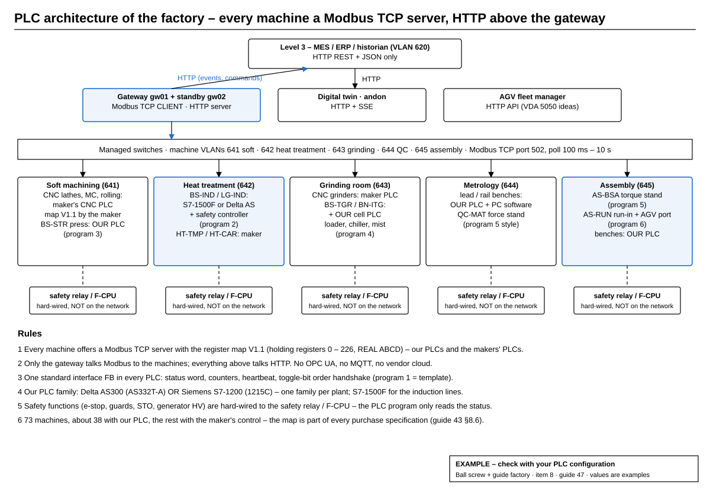

### 3.1 Three kinds of control

| Kind | Machines (examples) | Who programs the interface |
|---|---|---|
| **Maker's CNC + PLC** | lathes, machining centres, whirling, rolling, all grinders | the machine maker, in the CNC's PLC (Fanuc PMC, SINUMERIK PLC …) – the map V1.1 is part of the purchase specification (guide 43 §8.6) |
| **Maker's PLC** (non-CNC) | saws, furnaces, washer, laser marker, cut-off | the machine maker (often an S7-1200 / S7-1500 or a Delta) |
| **Our PLC** | presses, induction lines, benches, test stands, assembly, packing, cell PLCs of the thread grinders | we (or our integrator) – with the programs of this item |

The page lists all 41 machine types with their control, PLC, I/O estimate and server type. Summary (example plant, 73 machines):

| | Machines | Types |
|---|---|---|
| with our PLC (incl. the 10 cell PLCs next to the thread-grinder CNCs) | 38 | 18 |
| CNC machines with the maker's control only | 25 | 14 |
| maker's PLC (non-CNC) | 9 | 8 |
| not connected by Modbus (laboratory, HTTP from the lab software) | 1 | 1 |
| **total** | **73** | **41** |

### 3.2 Which PLC family?

| Point | Delta AS300 (AS332T-A) | Siemens S7-1200 (CPU 1215C) |
|---|---|---|
| price (CPU, estimate) | ≈ 0.45 k€ | ≈ 0.65 k€ |
| software | ISPSoft / DIADesigner – free | TIA Portal STEP 7 Basic ≈ 0.6 k€, Professional ≈ 2.5 k€ |
| on-board I/O | 16 DI / 16 DO | 14 DI / 10 DQ / 2 AI / 2 AQ |
| Modbus TCP server | built in (parameter) | `MB_SERVER` instruction (free) |
| 32-bit word order in memory | low word first (needs a swap for ABCD) | big-endian (ABCD natively) |
| service network | good in Asia, growing in Europe | worldwide, many integrators |
| safety | external safety relay / Pilz PNOZmulti | safety relay or F-CPU (1215FC, S7-1500F) |

**Recommendation (example):** choose **one** family for all "our PLC" machines – spare parts, training and program libraries
are then shared. The induction lines get an **S7-1500 CPU 1513F-1 PN** (integrated safety for door + generator HV + servo STO,
motion technology objects, more memory for recipes and the energy trace) – or a Delta AS + a safety controller.

### 3.3 How one machine is connected

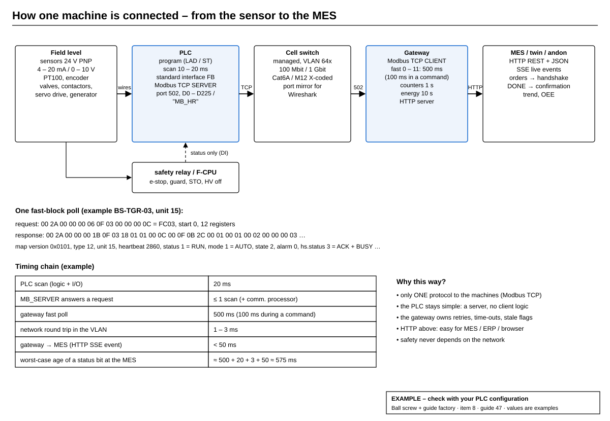

| Level | What | Who talks | Protocol |
|---|---|---|---|
| 0 process | sensors, valves, motors, servo drives, generator, chiller | 24 V DC, 4 – 20 mA / 0 – 10 V, PT100, encoder | hard-wired |
| 1 control | machine PLC (program + Modbus TCP server, port 502) · safety relay / F-CPU | PLC ↔ gateway | Modbus TCP |
| 1 network | managed switch per cell, machine VLAN 641 … 645 | Ethernet | – |
| 2 supervisory | gateway (Modbus TCP client, 100 ms … 10 s polls), twin, AGV fleet manager | gateway ↔ MES / twin | HTTP REST + JSON, SSE |
| 3 operations | MES, historian, label print server | MES ↔ ERP | HTTP |
| safety | e-stop, guards, light curtains, STO, generator HV | never over the network | hard-wired |

### 3.4 PLC bill of materials (example)

Counted only for our PLCs (CNC machines and bought machines bring their own control):

| Option | PLCs | CPUs | I/O modules | Total (estimate) |
|---|---|---|---|---|
| A · Delta AS300 | 38 | 38 × AS332T-A (2 induction: + safety controller) | 47 | ≈ 68.5 k€ |
| B · Siemens S7-1200 / 1500 | 38 | 38 × CPU 1215C (2 induction: S7-1500F) | 27 | ≈ 96.3 k€ |

Both include per PLC: 24 V power supply, safety relay, 7" HMI. The Siemens option needs fewer modules (on-board analog) but
the CPUs and the HMIs cost more. Software: ISPSoft + DOPSoft free; TIA Portal STEP 7 Basic / Professional + Safety per seat.
The difference (≈ 28 k€) is small compared with one thread grinder (≈ 1 M€) – service and know-how decide.

---

## 4. The standard machine interface – register image, status word, counters, alarms, energy

The standard interface is one block of networks (I1 – I14 + process MOVEs) that is the same in **every** PLC. In TIA Portal it is
an FB "FB_BsfIf" with an instance DB "BsfIf"; in ISPSoft a function block / POU "BsfIf". The machine program only gives it
seven signals ("hooks"):

| Hook | Meaning | Example (program 2) |
|---|---|---|
| `inCycle` | machine is in its cycle (status RUN, stopwatch) | M_INCYC = any step 1 – 7 |
| `partDone` | ONE scan pulse per finished piece | M_PDONE (step 7 end) |
| `partOk` | piece is good (else scrap) | M_POK = NOT reject |
| `alarm` | any machine alarm | M_ALM |
| `alarmCode` | alarm code word (0 = none) | ALM_CODE 301 / 302 / 303 / 153 |
| `partPresent` | a part is available (else STARVED) | B_PART |
| `power` | electrical power kW (REAL) | P_KW |

and gets back:

| Output of the interface | Meaning |
|---|---|
| `M_ENABLE` | a NEW cycle may start: run request AND MES lot loaded (BUSY) AND no stop request |
| `M_ACKP` | acknowledge pulse (local button OR MES command 4) – resets the machine alarms |
| `M_RUNREQ`, `M_GWOK`, `M_DOWN` | run request, gateway alive, machine down |

### 4.1 The register image

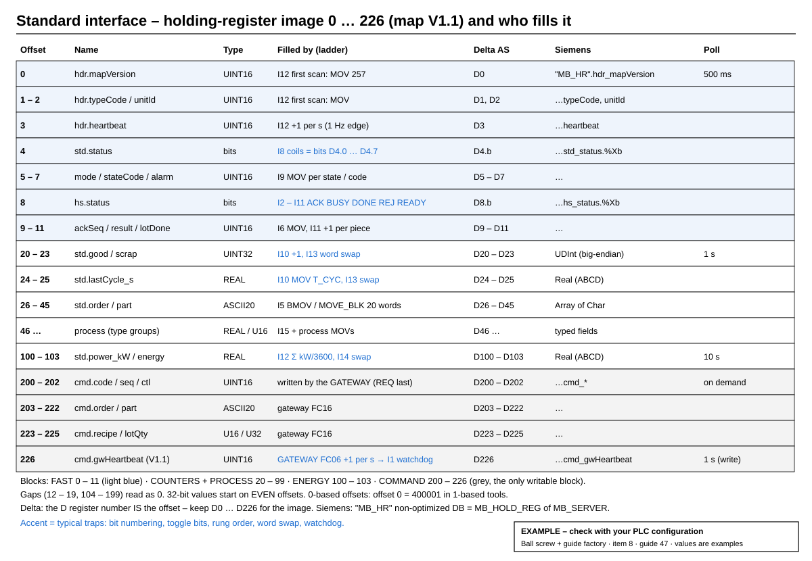

| Block | Offsets | Content | Poll (gateway) | Filled by |
|---|---|---|---|---|
| FAST | 0 – 11 | map version, type code, unit id, heartbeat, status, mode, state, alarm, hs.status, ackSeq, result, lotDone | 500 ms (100 ms in a command) | I2 – I12 |
| COUNTERS + PROCESS | 20 – 99 | good, scrap (UINT32), last cycle (REAL), order, part (ASCII20), process values from 46 | 1 s | I5, I10, I13, I15 … |
| ENERGY | 100 – 103 | power kW, energy kWh (REAL) | 10 s | I12, I14 |
| COMMAND | 200 – 226 | code, seq, ctl (REQ), order, part, recipe, lotQty (200 – 225); gateway heartbeat (226) | written on demand; 226 every 1 s | the gateway |

Rules of the map (guide 43 §8.1): holding registers, 0-based, UINT32 high word first, REAL IEEE 754 **ABCD**, ASCII 2
characters per register (high byte first), 32-bit values on **even** offsets, writes only 200 – 226.

### 4.2 Header and heartbeat (I12)

* First scan (Delta SM402 / Siemens FirstScan): `MOV 257 → D0` (map version 0x0101 = 1.1), `MOV type code → D1`,
  `MOV unit id → D2`.
* Heartbeat: rising edge of the 1 Hz clock → `D3 := D3 + 1`; above 65535 → 0. On a real 16-bit PLC word the wrap happens by
  itself (Delta INC, Siemens `INC` on a UInt).

Why a heartbeat? A PLC in STOP can still answer Modbus with the **last values** (the communication processor runs on). The
frames look fine – the data is frozen. The gateway marks the machine "stale" when the heartbeat does not change for 3 s.

### 4.3 Status word, state code, mode (I8, I9)

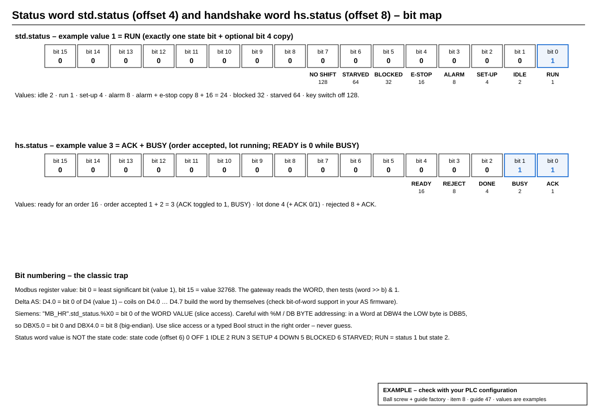

| Bit | Value | State | Ladder condition (priority from top) |
|---|---|---|---|
| 7 | 128 | NO SHIFT | key switch S_ON off |
| 3 | 8 | ALARM | machine alarm OR e-stop chain open |
| 4 | 16 | E-STOP (copy) | e-stop chain open (display only – the relay does the safety) |
| 2 | 4 | SET-UP | mode selector SET-UP |
| 0 | 1 | RUN | machine in its cycle |
| 5 | 32 | BLOCKED | not in cycle, out-buffer full |
| 6 | 64 | STARVED | not in cycle, enabled, no part |
| 1 | 2 | IDLE | none of the above |

Worked values: idle 2, run 1, alarm 8, alarm with the e-stop pressed 8 + 16 = 24, blocked 32, starved 64, key off 128.
The **state code** (offset 6) gives the same as a number: 0 OFF, 1 IDLE, 2 RUN, 3 SETUP, 4 DOWN, 5 BLOCKED, 6 STARVED.
Careful: RUN is status **1** but state code **2**.

The status bits are coils whose addresses **are** the bits of register 4: Delta `D4.0 … D4.7`, Siemens
`"MB_HR".std_status.%X0 … %X7` (slice access). The word is therefore "packed" by the memory itself – no calculation.

Mode (offset 5): 0 manual, 1 auto, 2 set-up, 3 maintenance – from the 3-position selector (S_AUTO / S_SETUP).

### 4.4 Counters and cycle time (I10, I13)

* At the part-done pulse: good OR scrap + 1 (32-bit, retentive – Delta latched D range, Siemens retain in the DB).
* Cycle time: a TON "stopwatch" (PT 3000 s – longer than any cycle) runs while `inCycle`; at the part-done pulse its elapsed
  time is copied to `LASTCYC`. **Rung order matters:** the copy rung stands **before** the timer rung, because the timer resets
  in the scan in which the cycle bit drops. Delta: T100 counts 100 ms ticks → `FLT T100 D… / DEDIV … F10` for seconds
  (the simulation shows seconds directly).

### 4.5 Alarm word and acknowledge (I9, machine networks)

* Every machine alarm is a latched bit (SET), the summary bit `M_ALM` is the OR of all alarms.
* The alarm code word is written by MOVEs in **rising priority** – the last true MOVE wins (e.g. 153 < 303 < 302 < 301).
* Acknowledge = rising edge of the local push button **or** MES command 4; an alarm resets only when its **cause is gone**.
* With an alarm the run request drops (seal-in broken) – after the acknowledge the operator or the MES must **start again**
  (command 2 or S_START). This is deliberate: a machine never restarts by itself after an alarm.

### 4.6 Energy (I12, I14)

Every second: `E_KWH := E_KWH + P_KW / 3600`. With 4.6 kW sawing for 25 s: 4.6 × 25 / 3600 = 0.032 kWh per cut. The power
comes from the machine program (computed from the running loads in the examples) – a Modbus energy meter (Janitza, Siemens
PAC, Schneider PM) in the machine cabinet is better; the PLC then reads it as a Modbus client or the gateway reads the meter
directly.

### 4.7 Modes and run request (I7)

```text
RUNREQ := (S_START OR CmdStart OR RUNREQ) AND S_STOP(NC) AND S_AUTO AND NOT S_SETUP AND S_ON AND NOT DOWN AND NOT StopNow
StopNow := StopEoc AND NOT inCycle          // command 3 = stop at the END of the cycle
ENABLE  := RUNREQ AND BUSY AND NOT StopEoc   // a NEW cycle needs a loaded MES lot
READY   := S_ON AND S_AUTO AND NOT S_SETUP AND NOT DOWN AND NOT BUSY AND GwOk
```

The machine program starts a **new** cycle only with `ENABLE`; a running cycle always finishes (no `ENABLE` needed inside the
step chain). So "stop" (local button or command 3) is always a clean stop at the end of the cycle.

---

## 5. The MES order handshake – toggle bits, state machine, timing

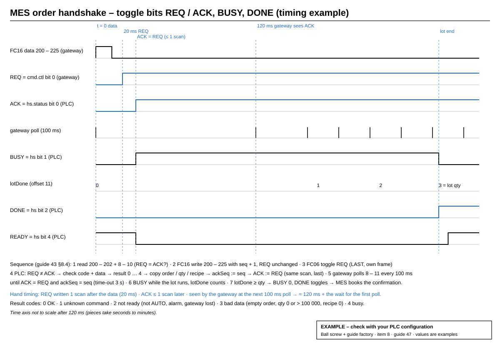

### 5.1 Why toggle bits?

The gateway writes 26 registers; the PLC reads them in its scan. Three dangers: (1) the PLC sees half old, half new data,
(2) the gateway repeats a write after a network hiccup and the order is loaded twice, (3) the PLC misses a short pulse.
A **toggle bit** solves all three: "a new command exists" = REQ **differs** from ACK. The gateway writes the data first and
REQ **last** in its own frame; the PLC handles the command once and answers ACK = REQ. A repeated frame with the same REQ
does nothing. Levels are never missed, however slow the poll.

### 5.2 Registers involved

| Offset | Name | Written by | Meaning |
|---|---|---|---|
| 200 | cmd.code | gateway | 1 load order, 2 start, 3 stop (end of cycle), 4 acknowledge alarm, 5 select recipe |
| 201 | cmd.seq | gateway | message counter + 1 per command |
| 202 bit 0 | REQ | gateway | toggled LAST |
| 203 – 222 | cmd.order / cmd.part | gateway | ASCII20 each |
| 223 | cmd.recipe | gateway | recipe / NC program no. |
| 224 – 225 | cmd.lotQty | gateway | UINT32, high word first |
| 226 | cmd.gwHeartbeat | gateway | map V1.1: + 1 every second (own FC06, not part of the command) – watched by network I1 |
| 8 bit 0 | ACK | PLC | := REQ when the command is handled |
| 8 bit 1 | BUSY | PLC | MES lot running |
| 8 bit 2 | DONE | PLC | toggles at the end of a lot |
| 8 bit 3 | REJECT | PLC | result ≠ 0 |
| 8 bit 4 | READY | PLC | may receive an order |
| 9 | hs.ackSeq | PLC | copy of cmd.seq |
| 10 | hs.result | PLC | 0 … 4 |
| 11 | hs.lotDone | PLC | pieces done of the lot |

### 5.3 The PLC side as a state machine

| Network | What happens in the ONE scan of a new command |
|---|---|
| I2 | `M_NEW := REQ XOR ACK`; lot quantity = high × 65536 + low; default result 1 (unknown command) |
| I3 | code 1: result 0 → 2 (not AUTO / alarm / key off) → 4 (busy) → 3 (empty order, quantity 0 or > 100 000) – the last true MOVE wins |
| I4 | codes 2 – 5: result 0; start without a lot or not in AUTO → 2; recipe during a lot → 4; recipe 0 → 3 |
| I5 | with result 0: load order (BMOV 20 words order + part, recipe, quantity, lotDone := 0, BUSY := 1) · start pulse · stop pulse (BUSY := 0) · acknowledge pulse · recipe |
| I6 | ackSeq := seq, result → register 10, REJECT := (result ≠ 0), **ACK := REQ (last)** |
| I11 | every piece of the lot: lotDone + 1; lotDone ≥ quantity → BUSY := 0, **DONE := NOT DONE** |

All of I2 – I6 runs in the **same scan**. In the next scan `REQ = ACK` again → `M_NEW = 0`.

### 5.4 The gateway side (item 4)

| Step | Frame | Purpose |
|---|---|---|
| 1 | FC03 read 200 – 202 and 8 – 10 | REQ = ACK? (else a previous command is open → error, do not write) |
| 2 | FC16 write 200 – 225 | code, seq + 1, REQ unchanged, order, part, recipe, quantity |
| 3 | FC06 write 202 | toggle REQ – own frame, after the data (here: ≥ 1 PLC scan later) |
| 4 | FC03 read 8 – 11 every 100 ms | until ACK = REQ and ackSeq = seq, time-out 3 s |
| 5 | – | HTTP answer to the MES: result 0 → OK, else 422 with the reason |

### 5.5 Timing (hand calculation, matches the self-check)

| Event | Time |
|---|---|
| gateway takes the command from its queue | at its next poll (≤ 500 ms idle poll) |
| FC16 data written | t = 0 |
| FC06 REQ toggled | t = 20 ms (next scan) |
| PLC: REQ ≠ ACK seen, ACK := REQ | same scan as the REQ arrives (≤ 1 scan = 20 ms) |
| gateway sees ACK = REQ, ackSeq = seq | next fast poll: t = 20 + 100 = 120 ms |
| MES gets the HTTP answer | ≈ 150 ms + the wait for the first poll |

Self-check result: "REQ → ACK seen 100 ms", total 140 … 620 ms depending on the poll phase.

### 5.6 Result codes

| Code | Text | Typical cause | PLC network |
|---|---|---|---|
| 0 | OK | command taken | I3 / I4 |
| 1 | unknown command | code not 1 … 5 | I2 default |
| 2 | not ready | not AUTO, alarm, key switch off, start without a lot | I3 / I4 |
| 3 | bad data | empty order, quantity 0 or > 100 000, recipe 0 | I3 / I4 |
| 4 | busy | load order or recipe change while a lot runs | I3 / I4 |

### 5.7 DONE → confirmation

At the end of the lot the PLC clears BUSY and toggles DONE. The gateway sees a **change** of hs.status bit 2 in the fast block
(report-by-exception event), the MES books the confirmation over HTTP (`POST /api/bsf/mes/confirmations`, item 6) with the
counters read in the same poll cycle. Because DONE is a toggle, a lost poll or a gateway restart never loses the event:
the gateway compares the bit with the last value it stored.

---

## 6. Heartbeat and gateway watchdog – error handling

### 6.1 Two directions

| Direction | Signal | Detected by | Reaction |
|---|---|---|---|
| PLC → gateway | heartbeat (offset 3, + 1 per s) | gateway: no change for 3 s | machine "stale / unknown" in MES and twin, alarm to the andon |
| gateway → PLC | **gateway heartbeat** (offset 226, + 1 per s, FC06 – map V1.1) | PLC network I1: 226 unchanged for 5 s (TOF) | lamp / HMI message "gateway lost", READY = 0 (no new order), the machine **finishes its lot** |

### 6.2 How does the PLC see the gateway? – map V1.1 gateway heartbeat (decided 2026-11-13)

* **Siemens:** `MB_SERVER` gives `DR` (data read) and `NDR` (new data written) as one-scan pulses for every request.
* **Delta AS:** the program does **not** see single Modbus requests (the built-in server works between the scans; the
  Ethernet status bits in the SM / SR area only show the link, not the gateway).
* **Decision:** the item-8 proposal was approved by the user on 2026-11-13 and is now **register map V1.1** (guide 43
  §8.5): the gateway writes **offset 226 `cmd.gwHeartbeat`** with FC06 **once per second**, + 1 per write, wraps
  65 535 → 0. The PLC watches it like the gateway watches offset 3. Offset 0 now reads 0x0101 (257).

**Watchdog rule (both PLC families): gateway OK = register 226 changed within the last 5 s.**

Network I1 (template, same on the page for Delta and Siemens):

| Rung | Delta AS (IL) | Siemens (SCL) | Meaning |
|---|---|---|---|
| 1 | `LD<> D226 D1036` · `OUT M213` · `MOV D226 D1036` | `#rlo := "MB_HR".cmd_gwHeartbeat <> "BsfIf".GwHbOld; "BsfIf".GwHbChg := #rlo; IF #rlo THEN "BsfIf".GwHbOld := "MB_HR".cmd_gwHeartbeat; END_IF;` | 226 differs from the value seen last scan → one-scan pulse M_GWHB, remember the value |
| 2 | `LD M213` · `TOF T101 K50` · `LD T101` · `OUT M211` | `"IDB_T_Gw".TOF(IN := "BsfIf".GwHbChg, PT := T#5S); "BsfIf".GwOk := "IDB_T_Gw".Q;` | GwOk stays TRUE 5 s after the last change |
| 3 | `LDI M211` · `OUT Y1.2` | `"H_GW" := NOT "BsfIf".GwOk;` | lamp -PF3 / HMI message "gateway lost" |

Why "changed" and not "> old value"? The counter wraps 65 535 → 0 – a "greater than" test would trip once every 18 h.
Why 5 s? With one write per second the PLC tolerates 4 missed writes (gateway restart, switch-over gw01 → gw02).
Timing check (self-check): last write at t₀ → change seen in the same scan → TOF runs out at t₀ + 5 s + 1 scan (20 ms)
= **5.02 s** – exactly the simulated value.

**Siemens option:** the `MB_SERVER` outputs can stay as a second source – put `"MB_SERVER_DB".DR OR .NDR` (tag `GW_POLL`)
in parallel to M_GWHB in rung 2. Then the PLC also sees an old V1.0 gateway, but it can no longer tell "the gateway polls"
from "the gateway program is alive and writes". The template uses 226 only, so both PLC families behave the same and the
commissioning test is the same.

Tags (I/O list, Appendix H): `GW_HB` = D226 / `"MB_HR".cmd_gwHeartbeat` (WORD), `GW_HBOLD` = D1036 / `"BsfIf".GwHbOld`,
`M_GWHB` = M213 / `"BsfIf".GwHbChg`, `M_GWOK` = M211, `T_GW` = T101 / `"IDB_T_Gw"` (TOF 5 s), `H_GW` = Y1.2 / %Q8.2.
On the page: tick **gateway lost** (no frames at all) or **no heartbeat 226 (V1.0 gateway)** (polls go on, 226 stops) –
both light H_GW after 5 s.

### 6.3 What the machine does when the gateway is lost

| Situation | Reaction (this template) | Why |
|---|---|---|
| lot running | continue to the end of the lot, count, toggle DONE | parts are not lost; the MES books them when the gateway is back (DONE is a toggle) |
| no lot | READY = 0, no new order possible | the MES cannot send one anyway |
| operator wants to run | local operation needs a local lot (HMI) – not in this template | decide per machine type |
| gateway back | READY = 1 again, the gateway sees the changed DONE bit | no manual action |

### 6.4 Other errors

| Error | Detection | Reaction |
|---|---|---|
| map version wrong (old program) | gateway reads offset 0 at connect | do not decode, alarm "map version" |
| wrong machine on an IP | type code / unit id plausibility (offsets 1 – 2) | gateway alarm |
| handshake time-out (no ACK in 3 s) | gateway | HTTP 422 "handshake time-out" – PLC in STOP? |
| previous command open (REQ ≠ ACK) | gateway step 1 | do not write – wait / alarm |
| connection refused (MB_SERVER resources) | gateway TCP error, `MB_SERVER.STATUS` | check the number of connections (§8.5) |

---

## 7. Delta AS – Modbus TCP server setup and address mapping

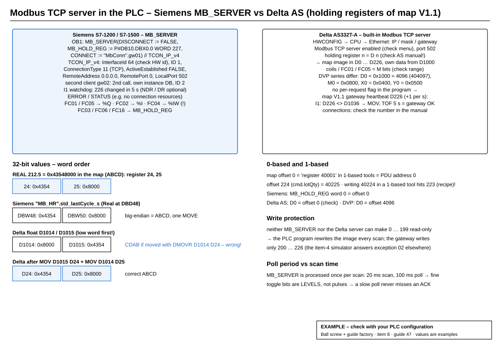

### 7.1 Setup steps (ISPSoft / HWCONFIG – check the AS manual for the exact menus)

1. HWCONFIG → CPU AS332T-A → Ethernet: fixed IP from the item-4 IP plan (e.g. BS-STR-01 in VLAN 641), mask, gateway address.
2. Enable the **Modbus TCP server** (slave) function of the built-in port (default port 502).
3. Set the analog modules (AS04AD-A, AS04DA-A, AS04RTD-A) so that their **D registers do not fall into D0 … D226**
   (e.g. D300 …), and the latched (retentive) range so that the counters D1010 … D1019 are kept at power off.
4. Download, then test with a Modbus client (commissioning checklist §16): read offset 0 → 257 (map V1.1); with the
   gateway running, offset 226 counts + 1 per second.

### 7.2 Device ↔ Modbus address mapping

| Device | Modbus table | Function codes | AS series (check AS manual!) | DVP series (for comparison) |
|---|---|---|---|---|
| D register | holding register | 03 / 06 / 16 | offset n = D n (D0 = 400001 in 1-based tools) | D0 = 0x1000 = 4096 (404097) |
| M relay | coil | 01 / 05 / 15 | M n = coil n (check range) | M0 = 0x0800 |
| X input | discrete input / coil | 02 | separate range (check) | X0 = 0x0400 |
| Y output | coil | 01 / 05 | separate range (check) | Y0 = 0x0500 |

Consequence for our map: the image **is** D0 … D226 (D226 = gateway heartbeat, written by the gateway). The program's own
data starts at D1000; scratch registers of the generated IL calculations are D900 …; analog values D300 …. Never use
D0 … D226 for anything else.

### 7.3 Bits of a word

The AS series can use a bit of a D register as a device (`D4.0`, `D8.3`) in contacts and coils (check the instruction set of
your firmware). The status coils `OUT D4.0 … OUT D4.7` build the status word by themselves. If your firmware does not support
it: use M bits and pack them with `MOV K0 D4` + `OR`-style instructions (WOR) or the bit-to-word instruction of the AS
(check), once per scan.

### 7.4 32-bit values on Delta

Delta stores a DINT or a REAL with the **low word in the lower register**: the float `D1014` has bytes C D in D1014 and
A B in D1015. The map wants A B first → swap with two 16-bit moves:

```text
MOV  D1015  D24     // high word ("AB") → register 24
MOV  D1014  D25     // low word ("CD")  → register 25
```

Writing `DMOVR D1014 D24` instead gives **CDAB** – the gateway then reads nonsense numbers (e.g. 212.5 s becomes −2.4 × 10⁻⁴¹).

### 7.5 Limits to check

| Point | Why |
|---|---|
| number of simultaneous Modbus TCP connections | gw01 + gw02 + engineering laptop = 3 |
| maximum registers per request (125 by the Modbus spec) | the gateway reads ≤ 48 at once |
| response time | the comm. task runs between scans – check with a 100 ms poll under full load |
| behaviour in STOP | does the server still answer? (yes on most PLCs → heartbeat needed) |
| 16-bit constants | `K100000` does not fit a 16-bit word → 32-bit instructions `DMOV`, `DCMP`, `DLD>` for DINT values (the generated IL of this page shows 16-bit mnemonics – see §18) |

---

## 8. Siemens S7-1200 / S7-1500 – MB_SERVER setup

### 8.1 The data block "MB_HR"

A **non-optimized** global DB (DB10, attribute "Optimized block access" OFF) with a struct laid out exactly like the map V1.1 –
227 words:

```text
DB10 "MB_HR"  (non-optimized, 454 bytes, map V1.1)
  hdr_mapVersion  Word      // DBW0   = register 0
  hdr_typeCode    Word      // DBW2   = register 1
  hdr_unitId      Word      // DBW4   = register 2
  hdr_heartbeat   Word      // DBW6   = register 3
  std_status      Word      // DBW8   = register 4   (bits via slice .%X0 … .%X7)
  std_mode        Word      // DBW10  = 5
  std_stateCode   Word      // DBW12  = 6
  std_alarm       Word      // DBW14  = 7
  hs_status       Word      // DBW16  = 8   (.%X0 ACK … .%X4 READY)
  hs_ackSeq       Word      // DBW18  = 9
  hs_result       Word      // DBW20  = 10
  hs_lotDone      Word      // DBW22  = 11
  res12_19        Array[12..19] of Word
  std_good        UDInt     // DBD40  = 20 – 21 (big-endian = high word first)
  std_scrap       UDInt     // DBD44  = 22 – 23
  std_lastCycle_s Real      // DBD48  = 24 – 25 (ABCD)
  std_order       Array[0..19] of Char   // 26 – 35
  std_part        Array[0..19] of Char   // 36 – 45
  proc            Array[46..99] of Word  // process values of the type (typed fields per type in practice)
  std_power_kW    Real      // DBD200 = 100 – 101
  std_energy_kWh  Real      // DBD204 = 102 – 103
  res104_199      Array[104..199] of Word
  cmd_code        Word      // DBW400 = 200
  cmd_seq         Word      // 201
  cmd_ctl         Word      // 202 (.%X0 = REQ)
  cmd_order       Array[0..19] of Char   // 203 – 212
  cmd_part        Array[0..19] of Char   // 213 – 222
  cmd_recipe      Word      // 223
  cmd_lotQty      UDInt     // 224 – 225
  cmd_gwHeartbeat Word      // DBW452 = 226 (map V1.1, written by the gateway every 1 s)
```

Register n = byte offset 2 × n. Because the S7 stores multi-byte values **big-endian**, a Real or UDInt in this DB is already
in the map's word order (ABCD, high word first) – **one MOVE per value**, no swap. (On the page the I13 / I14 networks show the
two word moves of the Delta; on Siemens they collapse to one MOVE each.)

### 8.2 The call (OB1, every scan)

```text
"MB_SERVER_DB"(DISCONNECT := FALSE,
               MB_HOLD_REG := P#DB10.DBX0.0 WORD 227,   // map V1.1 – or "MB_HR" (whole DB) with MB_SERVER ≥ V4
               CONNECT     := "MbConn".gw01,             // TCON_IP_v4
               NDR => "BsfIf".Ndr, DR => "BsfIf".Dr,
               ERROR => "BsfIf".MbErr, STATUS => "BsfIf".MbStatus);
"GW_POLL" := "BsfIf".Ndr OR "BsfIf".Dr;                 // optional 2nd source for I1 (the template watches register 226)
```

### 8.3 Connection parameters (TCON_IP_v4)

| Field | Value | Note |
|---|---|---|
| InterfaceId | 64 | hardware identifier of the PROFINET interface – check in the device view (system constants) |
| ID | 1 (gw01), 2 (gw02) | unique per connection in the CPU |
| ConnectionType | 11 (16#0B) | TCP |
| ActiveEstablished | FALSE | the PLC is the **server** (passive) |
| RemoteAddress | 0.0.0.0 | accept any client (or the gateway IP for a little more protection) |
| RemotePort | 0 | any |
| LocalPort | 502 | Modbus TCP |

### 8.4 Function code mapping of MB_SERVER (check the TIA help for your version)

| FC | Area | Note |
|---|---|---|
| 03 / 06 / 16 | MB_HOLD_REG (our DB) | the gateway uses only these |
| 01 / 05 / 15 | process image outputs %Q | not used |
| 02 | process image inputs %I | not used |
| 04 | process image input words %IW | **not** our DB! Item 4's simulator answers FC04 with the same data – a real S7 does not (MB_SERVER V5: Data_Area_Array can map areas to DBs – check) |

### 8.5 Connection resources

* One `MB_SERVER` instance serves **one** client connection. Two gateways (gw01 + gw02) → two calls with two instance DBs and
  two CONNECT structs (ID 1 and 2) on the same port 502 (allowed with current firmware – check).
* The S7-1200 has a limited number of open user communication connections (e.g. 8 – check the data sheet of your CPU and
  firmware); the HMI, the programming device and an `MB_CLIENT` (e.g. the RFID reader of program 6) also use resources.
* `STATUS` codes tell why a connection fails (e.g. "no resources", "port in use") – show them on the HMI.

### 8.6 What MB_SERVER cannot do

| Wish | Reality | Our answer |
|---|---|---|
| make registers 0 … 199 read-only | not possible per range | the program rewrites the image every scan; only the gateway is allowed on the machine VLAN |
| exception 02 for writes outside 200 … 226 | writes are accepted | item 4's simulator answers 02 – a real PLC does not; the gateway never writes there |
| more than 1 client per instance | no | one instance per client |

---

## 9. Filling the register block – bits, 32-bit word order, ASCII, versioning

### 9.1 Status bits

Coils on the bits of register 4 and 8 (Delta `D4.b`, Siemens `"MB_HR".std_status.%Xb`). Bit numbering of the **Modbus
register value**: bit 0 = value 1 (least significant), bit 15 = value 32768. Siemens byte addressing is a trap: in the word
DBW8 the **low** byte is DBB9 → DBX9.0 = bit 0 and DBX8.0 = bit 8. Use slice access (`.%X0`) or a typed Bool struct in the
right order – never guess; test every bit during commissioning (§16).

### 9.2 32-bit values (UINT32 and REAL)

| PLC | Memory order | What to do for ABCD |
|---|---|---|
| Siemens S7 | big-endian | one MOVE into the DB field |
| Delta AS / DVP | low word first | MOV high word → n, MOV low word → n + 1 (I13, I14) |
| Mitsubishi iQ-R / FX5 (for comparison) | low word first (CDAB) | swap or configure |

**Worked example:** last cycle time 212.5 s = IEEE 754 single 0x43548000 → register 24 = 0x4354, register 25 = 0x8000.
UINT32 good counter 70 000 = 0x00011170 → register 20 = 0x0001, register 21 = 0x1170.

### 9.3 ASCII strings (order, part)

20 characters = 10 registers, 2 characters per register, high byte first, 0x00 padded. "WO-00001-L01" → 0x574F 0x2D30
0x3030 0x3031 0x2D4C 0x3031 0x0000 …. The PLC does not need to understand the text: network I5 copies the 20 command words
203 – 222 to 26 – 45 with one block move (Delta `BMOV D203 D26 K20`, Siemens `MOVE_BLK` or a Char-array assignment). On
Siemens use `Array of Char` (not `String`: a String has 2 header bytes that shift every character).

### 9.4 Process values

From offset 46 in the order of the type's signal groups (item 4 `typeMap`): e.g. BS-IND 46 power kW, 48 frequency kHz,
50 scan speed, 52 quench flow, 54 quench temperature, 56 polymer %, 58 energy per part kJ, 60 energyOK. The interface copies the
scaled REAL tags of the machine program into these registers (one MOVE on Siemens, two word moves on Delta).

### 9.5 Versioning of the map

| Rule | How |
|---|---|
| version in the device | `hdr.mapVersion` (offset 0) = 0x0101 → major byte 1 (incompatible changes), minor byte 1 (additions) |
| additions only at the end of a block or in reserved space | never move a field; V1.1 (decided 2026-11-13) added the gateway heartbeat at 226 – history in guide 43 §8.5 |
| PLC program and map file under revision control | the FB "FB_BsfIf" carries the same version as `twin/bsf_comm_map.py` |
| the gateway checks the version at connect | mismatch → do not decode, alarm |
| acceptance test per machine | checklist §16 with the gateway tools |

---

## 10. Program 1 – standard interface template (bandsaw MS-SAW-01)

The template uses a simple machine so that the interface is easy to see: the automatic bandsaw MS-SAW-01 (type code 1, unit 1).
23 networks: 9 machine networks + 14 interface networks.

### 10.1 Sequence

| Step | Action | Transition | Time-out / alarm |
|---|---|---|---|
| 0 wait | – | Enable ∧ bar present ∧ saw up ∧ guard closed ∧ no alarm | – |
| 1 clamp | vice valve ON | pressure switch | 3 s → alarm 153 |
| 2 cut | band motor + feed down | saw frame at the bottom | 60 s → 153 |
| 3 up | saw frame up | at the top | 10 s → 153 |
| 4 unclamp | vice OFF | vice open → part done (1 scan) | – |

Alarms: 151 blade broken (blade monitor 1 s after the motor start), 152 guard opened during the cycle, 153 time-out.
Power: 0.8 kW (hydraulics) / 4.6 kW (sawing).

### 10.2 Timing

clamp 0.6 s + cut 25 s + up 3 s + unclamp 0.4 s ≈ 29 s (simulated 28.9 s, the last-cycle register shows 28.96 s). With a lot
of 4 pieces: 4 × 29 s ≈ 2 min until DONE.

### 10.3 I/O (machine part; the operator panel of the interface is common to all programs)

| Tag | Delta | Siemens | Device |
|---|---|---|---|
| B_PART | X0.0 | %I0.0 | photo sensor -BG1 |
| B_CLAMPED | X0.1 | %I0.1 | pressure switch -BP1 |
| B_SAW_UP / B_SAW_DN | X0.2 / X0.3 | %I0.2 / %I0.3 | inductive -BG2 / -BG3 |
| B_BLADE | X0.4 | %I0.4 | blade speed monitor -BS1 |
| B_DOOR | X0.5 | %I0.5 | guard status (from the safety relay) |
| B_LENOK | X0.6 | %I0.6 | length gauge -BG5 |
| Y_CLAMP / Y_SAW / Y_DOWN / Y_UP | Y0.0 … Y0.3 | %Q0.0 … %Q0.3 | valves, contactor -QA1 |
| S_ON, S_AUTO, S_SETUP, S_START, S_STOP (NC), S_ACK | X1.0 … X1.5 | %I8.0 … %I8.5 | operator panel |
| ESTOP_OK, B_OUTFULL | X1.6, X1.7 | %I8.6, %I8.7 | safety relay status, out-buffer full |
| H_RUN, H_ALM, H_GW, H_RDY | Y1.0 … Y1.3 | %Q8.0 … %Q8.3 | lamps green / red / amber / blue |

Full tag list: Appendix H. Full program: Appendix A (interface) and Appendix B (machine).

### 10.4 How to reuse the template for a new machine

1. Copy the interface networks I1 – I14 (FB "FB_BsfIf") unchanged.
2. Write the machine step chain; provide the seven hooks (§4).
3. Start new cycles only with `M_ENABLE`; reset alarms with `M_ACKP`.
4. Set the type code and the unit id (item 4 IP plan) in I12.
5. Add the process-value MOVEs for the type's signal groups (offset 46 …).
6. Run the commissioning checklist §16 with the gateway.

---

## 11. Program 2 – induction scan hardening BS-IND-01

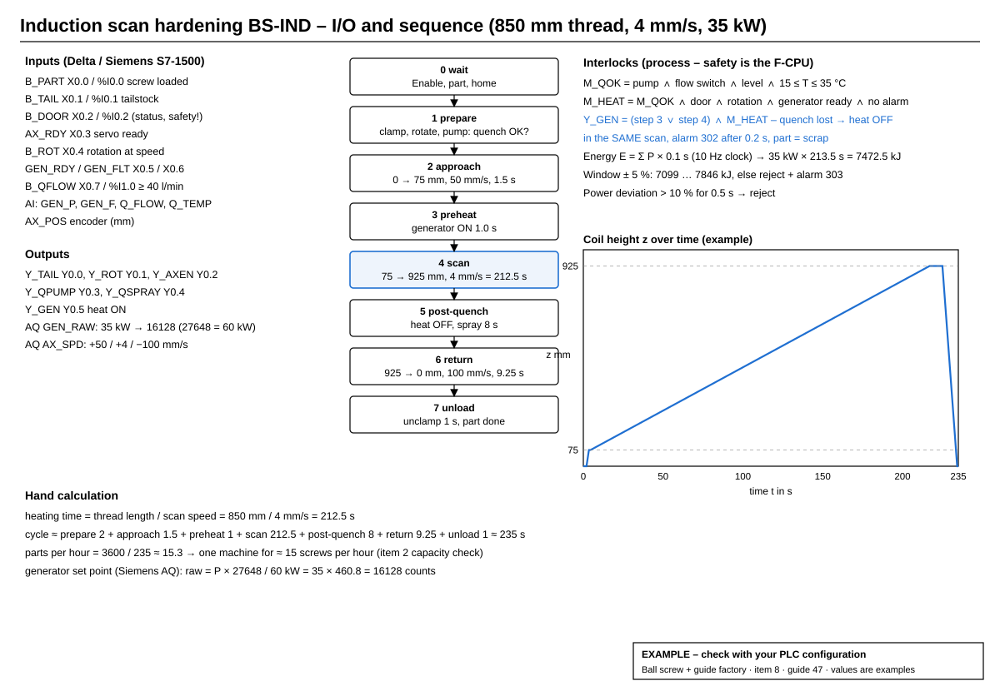

### 11.1 Process (item 2, route BS op 50)

Vertical scanning hardening of the thread zone of BS-3210-1000-C5: one-turn coil Ø46 with integral spray ring, the screw
rotates at 150 min⁻¹ between centres, the coil moves **up** with a servo axis. Generator 60 kW / 30 kHz, used 35 kW; polymer
quench 10 % at 25 °C; case 2 – 3 mm, 58 – 62 HRC; journals not hardened. Tempering follows in HT-TMP within 1 h.

### 11.2 Sequence and timing

| Step | Action | Transition | Time |
|---|---|---|---|
| 0 | wait | Enable ∧ part ∧ coil at home ∧ no alarm | – |
| 1 prepare | tailstock, rotation, quench pump | tailstock ∧ rotation at speed ∧ quench ready | ≈ 2 s (time-out 10 s) |
| 2 approach | axis + 50 mm/s | z ≥ 75 mm | 75 / 50 = 1.5 s |
| 3 preheat | generator ON at the start position | TON 1.0 s | 1.0 s |
| 4 scan | axis + 4 mm/s, heat + spray | z ≥ 925 mm | 850 / 4 = **212.5 s** |
| 5 post-quench | heat OFF, spray on | TON 8 s | 8 s |
| 6 return | axis − 100 mm/s | z ≤ 0.5 mm | 925 / 100 = 9.25 s |
| 7 unload | tailstock open | TON 1 s → part done | 1 s |

Cycle ≈ 2 + 1.5 + 1 + 212.5 + 8 + 9.25 + 1 ≈ 235 s → ≈ 15.3 screws per hour (simulated 235.26 s).

### 11.3 Interlocks (process – the safety is the F-CPU)

```text
M_QOK  := Y_QPUMP AND B_QFLOW AND B_QLVL AND Q_TEMP >= 15 AND Q_TEMP <= 35
M_HEAT := M_QOK AND B_DOOR AND B_ROT AND GEN_RDY AND NOT GEN_FLT AND NOT M_ALM
Y_GEN  := (ST3 OR ST4) AND M_HEAT          // heat only with quench – OFF in the same scan when quench is lost
```

If the quench flow switch opens during the scan, `M_HEAT` drops and the generator goes off **in the same scan** (20 ms);
after the 0.2 s debounce alarm 302 is set, the part is marked as reject and the chain jumps to post-quench → return → unload,
so the scrap screw leaves the machine. Generator fault → alarm 301. The door and the generator HV contactor / pulse block are in
the **safety circuit** (F-DI with guard locking, F-DQ) – the ladder only reads `B_DOOR` and `GEN_RDY`.

### 11.4 Energy monitor (QG-BS-2)

Every 100 ms while heating: `E := E + P × 0.1 s` (kW × s = kJ). Nominal 35 kW × (1.0 + 212.5) s = **7472.5 kJ**; window ± 5 %
= 7099 … 7846 kJ. The check happens at the rising edge of step 6 (step 5 is already reset in that scan – rung order!).
Out of window → reject + alarm 303 (stop, check the coil gap and the energy monitor). Power deviation > 10 % from the set point
for 0.5 s → reject. Simulated energy: 7466.6 kJ (the generator ramps with τ 0.15 s → ≈ 6 kJ less).

### 11.5 Analog scaling

| Signal | Range | Siemens | Delta |
|---|---|---|---|
| generator set point | 0 – 60 kW = 0 – 10 V | raw = P × 27648 / 60 → 35 kW = **16128** | AS04DA-A 0 … 32000 → 18667 (check the module range) |
| generator actual power | 0 – 10 V = 0 – 60 kW | NORM_X + SCALE_X | AS04AD-A, scaled in HWCONFIG or with DEMUL |
| quench flow / temperature | 4 – 20 mA | SM / AI module, wire-break diagnosis | AS04AD-A 4 – 20 mA range |
| scan axis | encoder | TO "AxScan" ActualPosition | ASDA-B3 feedback (pulse counter or EtherCAT / RS-485 – check) |

### 11.6 Registers (ind group, offsets 46 – 61)

power_kW · freq_kHz · scan_mm_s (4.000 during the scan) · quenchFlow_l_min · quenchTemp_C · polymer_pct · energyPart_kJ
(of the last part) · energyOK (1 pass, 2 fail).

### 11.7 Why S7-1500 F here

Integrated safety for door + generator HV + servo STO in one F-program (PROFIsafe), motion technology objects for the scan
axis, more memory for recipes and the energy trace, 3-shift heat treatment (availability). An S7-1200 1215FC also works for a
single machine (check safety + motion load). Delta alternative: AS332T-A + ASDA-B3 + Pilz PNOZmulti 2.

---

## 12. Program 3 – straightening press BS-STR-01

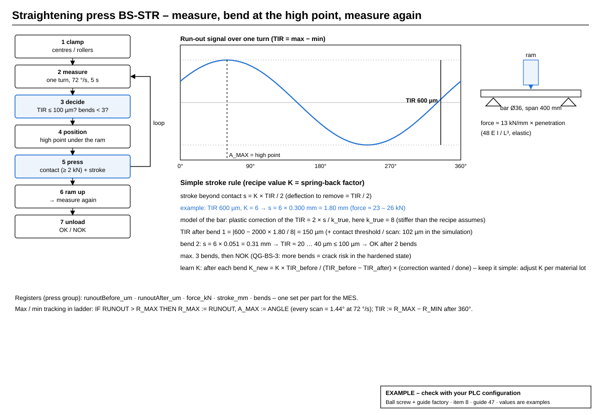

### 12.1 Sequence

| Step | Action | Transition |
|---|---|---|
| 1 clamp | centres / rollers close | clamped → store A0, first sample as max / min |
| 2 measure | rotate 72 °/s, track max / min every scan | turned 360° → TIR = max − min, A_TGT = A_MAX + 360° |
| 3 decide | first turn → run-out before; every turn → run-out after | TIR ≤ 100 µm or bends = 3 → unload; else compute the stroke → step 4 |
| 4 position | rotate on | angle ≥ A_TGT (high point under the ram) |
| 5 press | ram down 4 mm/s; force ≥ 2 kN = contact → target = contact + stroke | ram ≥ target → bends + 1 |
| 6 ram up | – | ram at the top → back to step 2 |
| 7 unload | open | 0.6 s → part done; OK = last TIR ≤ tolerance |

### 12.2 The simple stroke rule

The bar is bent beyond the elastic limit; after unloading it springs back. A spring-back factor K (recipe) gives the stroke
beyond the contact point:

```text
stroke s = K × TIR / 2          (TIR / 2 = deflection to remove)
example:  TIR 600 µm, K = 6  →  s = 6 × 0.300 mm = 1.80 mm
```

The plant model of the page corrects the TIR by `2 × penetration / k_true` with k_true = 8 for the known test part (the bar is
"stiffer" than the recipe assumes). Hand check of the self-test: contact detected at 20.16 mm (2 kN threshold = 0.15 mm + one
scan), target 21.96 mm, penetration 2.00 mm, force 13 kN/mm × 2.0 mm = 26 kN, TIR after bend 1 = |600 − 2000 × 2.0 / 8| + 2 =
**102 µm**; bend 2 → 20 µm ≤ 100 µm → OK after 2 bends. A real press learns K per material lot (the maker's software often does
this automatically); max. 3 bends (QG-BS-3: more bends = crack risk in the hardened state).

### 12.3 Timing

measuring turn 360° / 72 °/s = 5 s · turn to the high point 0 … 5 s · ram 20 mm at 4 mm/s ≈ 5 s + stroke · ram up ≈ 1.5 s →
one bend ≈ 15 s, a part with 2 bends ≈ 40 s.

### 12.4 Max / min tracking in ladder

```text
IF ST2 AND RUNOUT > R_MAX THEN R_MAX := RUNOUT; A_MAX := ANGLE; END_IF     // every scan = 1.44° at 72 °/s
IF ST2 AND RUNOUT < R_MIN THEN R_MIN := RUNOUT; END_IF
IF ST2 AND ANGLE − A0 >= 360 THEN TIR := R_MAX − R_MIN; A_TGT := A_MAX + 360; … step 3
```

Sampling error: with 1.44° per sample the maximum of a sine is missed by at most (1 − cos 0.72°) × 300 µm = 0.02 µm.

### 12.5 Registers (press group, 46 – 55)

runoutBefore_um · runoutAfter_um · force_kN (maximum of the part) · stroke_mm (last bend) · bends.

---

## 13. Program 4 – thread-grinder auxiliaries BS-TGR-03

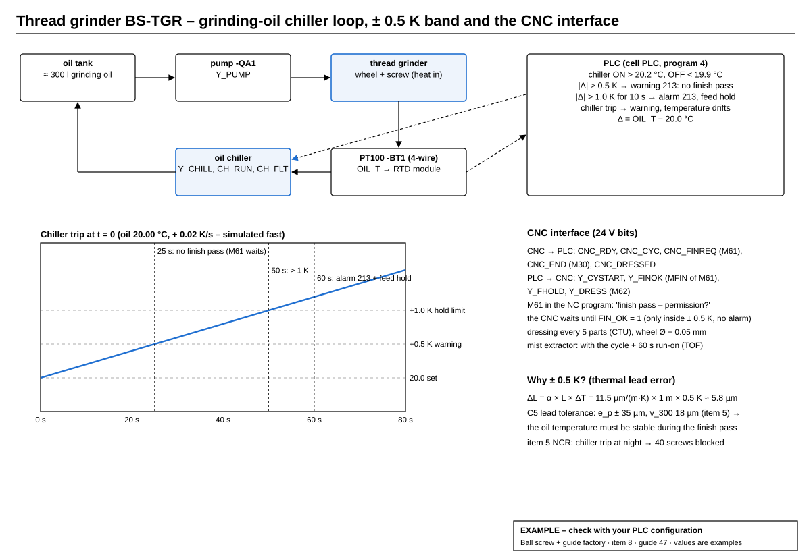

### 13.1 What the cell PLC does next to the CNC

| Function | Ladder |
|---|---|
| door open / close (time-outs) | steps 1, 3 |
| loader exchange (own controller, REQ / DONE) | step 2 |
| tailstock clamping | step 3 |
| dressing every 5 parts (CTU, dressCount, wheel Ø − 0.05 mm) | step 4, network 9 |
| CNC cycle start, M61 finish-pass permission, feed hold, dress request | steps 5 – 6, network 8 |
| oil chiller on / off with hysteresis 19.9 … 20.2 °C | network 6 |
| ± 0.5 K warning (no finish pass), ± 1 K for 10 s hold + alarm 213 | network 7 |
| mist extraction with 60 s run-on, Δp monitoring | network 11 |

### 13.2 The NCR action of item 5

Item 5 found: "the oil chiller of BS-TGR-03 tripped (alarm 213 'oil temperature drift') – alarm 213 was a warning only".
Action: "alarm 213 → interlock: no finish pass when |oil − 20 °C| > 0.5 K (PLC, item 8)". Program 4 implements it:

```text
DEV    := OIL_T − 20.0
W_OIL  := |DEV| > 0.5 K                       // warning 213: M61 is NOT answered → the CNC waits before the finish pass
Y_FINOK := CNC_FINREQ AND NOT W_OIL AND NOT M_ALM
AL_OIL := |DEV| > 1.0 K for 10 s              // alarm 213 → feed hold, part to inspection (NOK)
```

Why 0.5 K? Thermal lead error ΔL = α × L × ΔT = 11.5 µm/(m·K) × 1 m × 0.5 K ≈ 5.8 µm – a large part of the C5 tolerances
(e_p ± 35 µm, v_300 18 µm).

### 13.3 Chiller trip – timing (simulated, faster than reality)

The plant adds 0.02 K/s while the pump runs (a real 300 l tank warms much slower – minutes). Trip at 20.00 °C:

| Event | Hand | Simulated |
|---|---|---|
| warning > 0.5 K (no finish pass) | 0.5 / 0.02 = 25 s | 24.6 s (small ambient term) |
| > 1.0 K | 50 s | – |
| alarm 213 + feed hold (+ 10 s) | 60 s | 59.4 s |

### 13.4 CNC interface (24 V bits – agree the M-codes with the maker)

| Signal | Direction | Meaning |
|---|---|---|
| CNC_RDY | CNC → PLC | auto, no alarm |
| CNC_CYC | CNC → PLC | cycle running |
| CNC_FINREQ | CNC → PLC | M61 "finish pass – permission?" (the CNC waits) |
| CNC_END | CNC → PLC | M30 (pulse ≥ 200 ms) |
| CNC_DRESSED | CNC → PLC | dressing sub-program finished |
| Y_CYSTART | PLC → CNC | cycle start (pulse until CNC_CYC) |
| Y_FINOK | PLC → CNC | answer to M61 (MFIN) |
| Y_FHOLD | PLC → CNC | feed hold |
| Y_DRESS | PLC → CNC | dress before the next part (M62) |

Process values of the grind and tgr groups (wheel speed, spindle power, gauge, pass, work speed, lead compensation, screw
temperature, wheel tilt) come from the CNC through its PLC interface (Fanuc PMC D / R registers, SINUMERIK interface DB – check
with the maker) into the cell PLC, which copies them to registers 46 – 75.

### 13.5 Timing of one part (example)

door 2 s + loader 12 s + clamp 1 s + door 2 s + rough 40 s + finish 20 s ≈ 77 s (simulated last cycle 76.0 s); dressing 8 s
every 5 parts. Real thread grinding of a C5 screw takes many minutes – the times are shortened for the page.

---

## 14. Program 5 – preload torque test stand AS-BSA-01

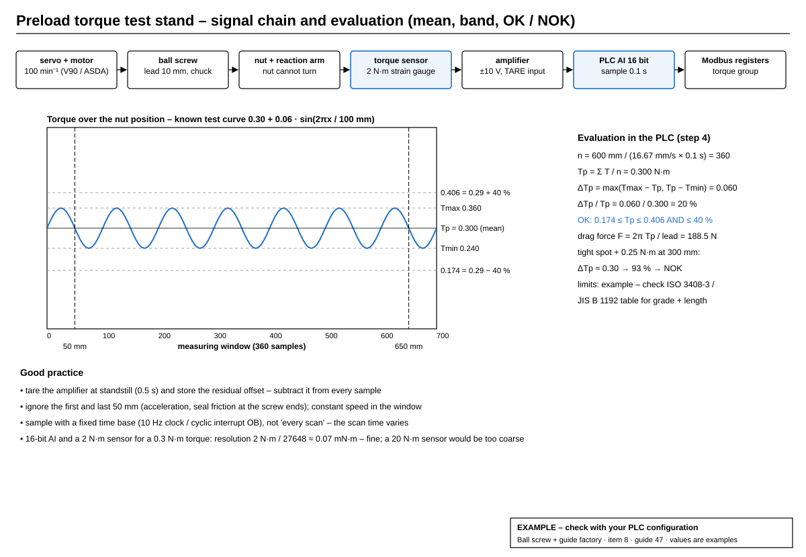

### 14.1 Test principle

The servo turns the screw at 100 min⁻¹ (lead 10 mm → nut travel 16.7 mm/s); the nut is held by a reaction arm on a torque
sensor (2 N·m, strain gauge, amplifier ±10 V). The drag torque of the preloaded nut is the **preload torque Tp**. It is measured
over the stroke; the first and last 50 mm are ignored (acceleration, seal friction).

### 14.2 Sequence

clamp + arm (≈ 1 s) → tare at standstill 0.5 s (store the residual offset) → run 0 → 700 mm (42 s) with sampling in
50 … 650 mm → evaluate → return at 300 min⁻¹ (14 s) → unload. Cycle ≈ 58 s.

### 14.3 Evaluation (network 6, 7)

```text
n      = 600 mm / (16.67 mm/s × 0.1 s) = 360 samples
Tp     = Σ T / n
ΔTp    = max(Tmax − Tp, Tp − Tmin)
ratio  = ΔTp / Tp × 100 %
OK     = 0.174 ≤ Tp ≤ 0.406 N·m (0.29 ± 40 %, QG-FA-1 P1 example) AND ratio ≤ 40 % (example – check ISO 3408-3 / JIS B 1192)
F      = 2π · Tp / lead   (torque as an axial force, 0.30 N·m → 188.5 N)
```

Known test curve T(x) = 0.30 + 0.06 · sin(2πx / 100 mm): Tp = 0.300, ΔTp = 0.060, ratio 20 % → OK (simulated 0.3000 N·m,
360 samples, 20.0 %). With a tight spot of + 0.25 N·m at 300 … 320 mm: ΔTp ≈ 0.30 N·m → ≈ 97 % → NOK.

### 14.4 Measurement rules

* Sample with a fixed time base (10 Hz clock or a cyclic interrupt OB), never "every scan" – the scan time varies.
* Use a 16-bit analog input and a sensor range close to the measured value (2 N·m for 0.3 N·m).
* Tare at standstill; check the residual offset (> 0.05 N·m = sensor fault 701).
* Shielded twisted pair, shield on the amplifier side; keep the servo cable away.

### 14.5 Registers (torque group)

torqueMean_Nm · torqueVar_Nm · drag_N · result (1 OK, 2 NOK) · cls (preload class from the recipe) – the MES stores them per
serial number (item 6 traceability).

---

## 15. Program 6 – run-in station + AGV transfer port AS-RUN-01

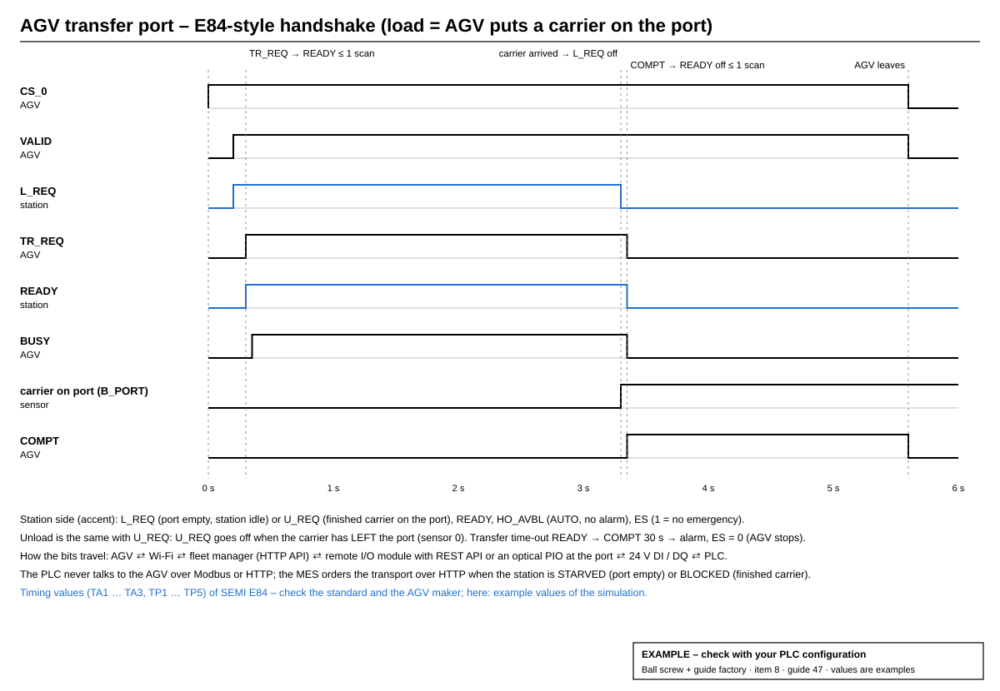

### 15.1 How the AGV bits reach the PLC (only Ethernet + Modbus TCP + HTTP)

The AGV talks Wi-Fi + **HTTP** to its fleet manager (item 3, VDA 5050 ideas over REST). At the port the handshake bits come from
an **optical PIO** (E84-style 8 + 8 bits) or from a **remote I/O module with a REST API** that the fleet manager switches. On the
PLC side they are plain 24 V digital inputs / outputs. The PLC never talks to the AGV over Modbus or HTTP. The MES orders the
transport over HTTP when the station is STARVED (port empty) or BLOCKED (finished carrier waiting).

### 15.2 E84 signals

| AGV → station (inputs) | Station → AGV (outputs) |
|---|---|
| CS_0 carrier stage selected | L_REQ port ready to be **loaded** |
| VALID transfer request valid | U_REQ port ready to be **unloaded** |
| TR_REQ transfer request | READY station ready for the transfer |
| BUSY transfer in progress | HO_AVBL hand-off available (AUTO, no alarm) |
| COMPT transfer complete | ES 1 = no emergency (0 → the AGV stops) |

### 15.3 Load sequence (verified by the self-check)

`+CS0 +VALID +LREQ +TRREQ +READY +BUSY` → rollers run 3 s → carrier on the port → `−LREQ` → `−TRREQ −BUSY +COMPT −READY`
(READY drops in the same scan) → `−CS0 −VALID −COMPT`, the AGV leaves. Unload is the same with U_REQ, which drops when the carrier
has **left** the port. Station reaction times ≤ 1 scan; transfer time-out READY → COMPT 30 s → alarm, ES = 0 (example – check
TA / TP values of SEMI E84 and the AGV maker).

### 15.4 Station sequence

| Step | Action | Time |
|---|---|---|
| 0 | raw carrier on the port, no E84 transfer, Enable | – |
| 1 | rollers in | 2.5 s |
| 2 | lift up | 1.5 s |
| 3 | RFID read (MB_CLIENT FC03 to the reader) | ≈ 0.3 s |
| 4 | clamp + run-in ± 300 min⁻¹, direction every 10 s, torque sampling after 5 s | 60 s (+ 0.6 s clamp) |
| 5 | result, unclamp, lift down | 1.5 s |
| 6 | rollers out → part done, finished carrier waits (BLOCKED) | 2.5 s |

Cycle without AGV waiting ≈ 2.5 + 1.5 + 0.3 + 0.6 + 60 + 1.5 + 2.5 ≈ 69 s (simulated 68.9 s). One port and one carrier: the
station waits for the AGV twice per part (unload + load) – a double port or a buffer raises the output.

### 15.5 RFID via Modbus TCP – the PLC as a client

The RFID reader is a small Modbus TCP server. The PLC reads 2 registers (serial number) with `MB_CLIENT` (Siemens, own
connection ID, uses a connection resource) / the Delta Modbus TCP client function (check the AS manual). This is the only place
where a PLC of this plant is a Modbus **client** – still Modbus TCP, still on the machine VLAN.

### 15.6 Result

OK = mean run-in torque 0.17 … 0.41 N·m AND maximum ≤ 0.8 N·m (no tight spot after running in – example limits). Registers of the
torque group as in program 5.

---

## 16. Commissioning and test plan

### 16.1 Order of the work

1. **I/O check** with the machine powered, program in STOP / forced outputs off: every input from the device to the PLC address,
   every output to the device (I/O lists, Appendix H). Analog: 4 mA, 12 mA, 20 mA → 0 %, 50 %, 100 %.
2. **Safety validation** (independent of the PLC program!): e-stop, guards, light curtain, STO, generator HV – with the
   safety relay / F-program, documented per ISO 13849-2.
3. **Step chain** in manual / single step, then automatic with dummy parts.
4. **Modbus interface** with the gateway (checklist below), then the MES handshake with a test work order.
5. **Run-off** at the maker and in the plant: 1 shift with real lots, compare counters with the MES.

### 16.2 Commissioning checklist – Modbus interface (also on the page, tick boxes)

| # | Test | How | Expected (example) |
|---|---|---|---|
| 1 | Ping + port | ping the PLC IP, open TCP 502 from the gateway | reply < 5 ms in the machine VLAN, port open |
| 2 | Map version | FC03 read offset 0, quantity 1 | 0x0101 (257) = map V1.1 |
| 3 | Type code + unit id | FC03 read 1 – 2 | type code of the IP plan (e.g. 12 = BS-TGR), unit id (e.g. 15) |
| 4 | Heartbeat | read offset 3 for 10 s | + 10 ± 1; PLC in STOP → frozen → gateway "stale" after 3 s |
| 5 | Word order REAL | test mode: last cycle = 212.5 s, read 24 – 25 | 0x4354 0x8000 (ABCD) – NOT 0x8000 0x4354 |
| 6 | Word order UINT32 | good counter = 70 000, read 20 – 21 | 0x0001 0x1170 |
| 7 | Status word bits | force each state | 2, 1, 4, 8, 24, 32, 64, 128 |
| 8 | Order handshake OK | command 1 (order, part, qty 3, recipe 12) | ACK = REQ ≤ 1 scan, ackSeq = seq, result 0, BUSY, order + part in 26 – 45 |
| 9 | Handshake rejections | qty 0 · load while busy · start not in AUTO · code 9 | results 3 · 4 · 2 · 1, REJECT bit |
| 10 | REQ discipline | write the data block, do NOT toggle REQ | nothing happens |
| 11 | Lot end + DONE | run a lot of 3 | lotDone 1 → 2 → 3, DONE toggles, BUSY 0, MES confirmation |
| 12 | Gateway heartbeat (map V1.1) | gateway running: read offset 226 for 10 s | + 10 ± 1 (FC06 + 1 per s by the gateway), M_GWOK = 1, no H_GW |
| 13 | Gateway lost | stop the gateway / pull the cable (or a V1.0 gateway without 226) | 226 stops counting → after 5 s lamp + HMI, READY 0, the lot finishes; reconnect → READY 1, DONE seen |
| 14 | Two clients | gw01 + gw02 poll together | both answered, no MB_SERVER error |
| 15 | Poll vs scan | fast block every 100 ms during a command | no missed ACK, response < 20 ms |
| 16 | Safety independence | e-stop / guard with the Ethernet cable unplugged | the machine stops anyway; bit 4 shows it when the network is back |

### 16.3 Test plan per program (from the self-check, repeat on the real machine)

| Program | Test | Expected |
|---|---|---|
| 1 | lot of 4, guard opened in a cut, e-stop, key off | 4 parts, alarm 152, status 24, status 128 |
| 2 | one part, quench flow switch forced off in the scan | 212.5 s scan, ≈ 7470 kJ, heat off same scan, alarm 302, scrap |
| 3 | master bar with known run-out | TIR = master value ± 2 µm, stroke = K × TIR / 2 |
| 4 | chiller release off during a part | warning at + 0.5 K (no finish), hold at + 1 K + 10 s |
| 5 | reference screw / torque calibration lever | Tp of the reference ± 2 %, 360 samples |
| 6 | AGV load + unload, E84 cable pulled during BUSY | sequence correct, time-out → ES 0 |

### 16.4 Documents to hand over

I/O list with wiring, program printout (LAD + IL / SCL), register map of the machine (CSV), commissioning checklist signed,
safety validation report, parameter list (recipes, time-outs, limits), spare parts list, backup of the PLC project.

---

## 17. Timing calculations

### 17.1 Scan time, timers, edges

| Quantity | Formula / value | Example |
|---|---|---|
| scan time | logic + I/O + communication | 20 ms (simulation) – S7-1200 small programs 1 – 5 ms, Delta AS 1 – 3 ms |
| TON accuracy | ± 1 scan | 0.2 s debounce → 0.20 … 0.22 s |
| Delta TMR 100 ms base | K = seconds × 10 | 3 s → TMR T0 K30; 3000 s → K30000 (≤ 32767) |
| edge (P / N) | TRUE for exactly one scan | part-done pulse, acknowledge |
| fastest signal the PLC sees | > 1 scan + input filter | input filter 3 – 10 ms + 20 ms scan |

### 17.2 Scan time vs poll period

* The PLC updates the image every scan (20 ms); the gateway polls the fast block every 500 ms (100 ms during a command).
  The **age** of a status bit at the MES: ≤ 500 + 20 + 3 + 50 ≈ 575 ms (poll + scan + network + HTTP / SSE).
* Toggle bits are **levels**: ACK stays until the next command, DONE stays until the next lot – a slow poll never misses them.
  A one-scan pulse in a register would be missed (20 ms ≪ 500 ms) – never signal events as pulses over Modbus.
* `MB_SERVER` handles at most one request per call (per scan) and connection: 2 gateways × (fast + counters + energy) ≈ 5
  requests / s ≪ 50 scans / s.

### 17.3 Cycle times of the six programs

| Program | Hand | Simulated |
|---|---|---|
| 1 bandsaw | 0.6 + 25 + 3 + 0.4 ≈ 29 s | 28.9 s |
| 2 induction | 2 + 1.5 + 1 + 212.5 + 8 + 9.25 + 1 ≈ 235 s | 235.3 s |
| 3 straightening (2 bends) | ≈ 40 s | ≈ 40 s |
| 4 thread grinder (shortened) | 2 + 12 + 1 + 2 + 40 + 20 ≈ 77 s | 76.0 s |
| 5 torque stand | 1 + 0.5 + 42 + 14 + 0.5 ≈ 58 s | ≈ 58 s |
| 6 run-in | 2.5 + 1.5 + 0.3 + 0.6 + 60 + 1.5 + 2.5 ≈ 69 s | 68.9 s |

### 17.4 Energy per induction part

E = P × t = 35 kW × 213.5 s = 7472.5 kJ = 2.08 kWh at the coil; electrical input ≈ 7472.5 / 0.85 ≈ 8790 kJ ≈ 2.44 kWh + quench
pump 4.5 kW × 235 s ≈ 0.29 kWh → ≈ 2.7 kWh per screw.

---

## 18. Typical mistakes

| Mistake | What happens | Prevention |
|---|---|---|
| 0-based vs 1-based offsets | the gateway reads register 40225 as offset 225 instead of 224 – quantity and recipe are swapped | the map uses 0-based offsets; write "offset 0 = 40001" on every table |
| wrong word order (CDAB) | 212.5 s is read as −2.4 × 10⁻⁴¹; counters jump by 65536 | Delta: swap words (MOV high → n, low → n+1); test with a known REAL (§16 #5) |
| bit numbering Modbus vs PLC byte | status bit 0 appears as bit 8 (Siemens DBX8.0 is the HIGH byte of DBW8) | slice access `.%X0` or typed struct; test every state |
| Siemens `String` for ASCII | 2 header bytes shift every character | `Array of Char` |
| FC04 expected to return the DB | S7 answers with the process image %IW | the gateway uses FC03 only |
| MB_SERVER not called every scan | connection drops, time-outs | call it unconditionally in OB1 |
| one MB_SERVER for two gateways | the second client is refused / connections flip | one instance + one CONNECT ID per client |
| connection limit reached | new connections refused (STATUS code) | count HMI + PG + MB_SERVER + MB_CLIENT against the CPU data sheet |
| poll slower than an event pulse | the MES never sees a 1-scan "part done" pulse | counters and toggle bits (levels), never pulses |
| heartbeat missing or driven by the comm. task | frozen data looks valid | heartbeat from the PLC program (1 Hz clock edge), the gateway checks it |
| REQ written in the same frame as the data | the PLC may see REQ before the data | data FC16 first, REQ FC06 last (own frame) |
| ACK set before the result / data are written | the gateway reads an old result | ACK := REQ as the LAST action in the scan (I6) |
| DONE as a pulse | lost when the gateway is offline | DONE toggles (XOR) |
| copy rung after the timer rung (cycle time) | last cycle time = 0 | copy first, then the timer (I10) |
| reading a step bit that is set and reset in the same scan | the check never runs (program 2 energy check, program 5 test) | use the rising edge of the next step |
| 16-bit IL for 32-bit values | Delta `K100000`, `MUL D224 K65536` overflow | Delta 32-bit instructions DMOV / DMUL / DCMP / DLD>; the core of this page prints 16-bit mnemonics for DINT tags – correct them in ISPSoft |
| analog D registers inside D0 … D226 | AS04AD-A values appear as status words | map analog modules to D300 … |
| restart after an alarm without a new start | machine restarts by itself after the acknowledge | the run request seal-in drops with the alarm (I7) |
| safety in the standard program | a software fault defeats the e-stop | safety relay / F-program only; the PLC reads status |
| map version not checked | after a machine software update the gateway decodes wrong fields | check offset 0 at connect (gateway) |
| writing 0 … 199 from a tool | the PLC overwrites it next scan – confusing tests | only write 200 … 226 |

---

## 19. Buy list – catalogue examples

Price classes: € < 0.5 k€, €€ 0.5 – 2 k€, €€€ 2 – 10 k€ (estimate – ask for a quote). Models change – check the current
catalogue and the firmware / software version. The page card has the same rows with a filter.

### 19.1 PLC CPUs

| Item | Example (catalogue) | Key data | Price class | Check |
|---|---|---|---|---|
| PLC CPU – Delta | Delta AS332T-A (NPN) / AS332P-A (PNP) | 16 DI + 16 DO, Ethernet Modbus TCP server, 2 × RS-485, ISPSoft free | € | output type, server connections, Dn.b support |
| PLC CPU – Delta small | Delta AS228T-A | 8 DI + 8 DO + Ethernet | € | same family |
| PLC CPU – Siemens | S7-1200 CPU 1215C DC/DC/DC (6ES7215-1AG40-0XB0) | 14 DI, 10 DQ, 2 AI, 2 AQ, 2 × PROFINET | €€ | firmware for TIA V19 |
| PLC CPU – Siemens F | S7-1500 CPU 1513F-1 PN (6ES7513-1FM03-0AB0) | F-CPU SIL 3 / PL e, technology objects | €€€ | STEP 7 Safety Advanced |
| PLC CPU – Siemens F compact | S7-1200 CPU 1215FC DC/DC/DC | F-CPU with SM 1226 | €€ | Safety Basic |

### 19.2 I/O, analog, RTD

| Item | Example | Key data | Price class | Check |
|---|---|---|---|---|
| DI / DO – Delta | AS16AM10N-A / AS16AN01T-A | 16 DI / 16 DO 24 V | € | slot addresses X1.0 / Y1.0 |
| Analog in – Delta | AS04AD-A | 4 ch, 16 bit, 0 … 32000 | € | D mapping outside D0 … D226 |
| Analog out – Delta | AS04DA-A | 4 ch 0 – 10 V / 4 – 20 mA | € | range |
| RTD – Delta | AS04RTD-A | 4 ch PT100 | € | resolution / filter |
| DI / DQ – Siemens | SM 1223 DI 8 / DQ 8 | %I8.0 / %Q8.0 | € | slot |
| Analog in – Siemens | SM 1231 AI 4 × 16 bit | 0 … 27648 | €€ | 16 bit for the torque stand |
| RTD – Siemens | SM 1231 RTD 4 × 16 bit | PT100 4-wire | €€ | range |
| ET 200MP – Siemens | DI 32, DQ 32, AI 8, AQ 4, F-DI / F-DQ | for the S7-1500F | €€€ | power budget |

### 19.3 Power supplies and safety

| Item | Example | Key data | Price class | Check |
|---|---|---|---|---|
| 24 V power supply | PULS CS5.244 / Siemens SITOP PSU6200 / Phoenix QUINT4 / Delta DRP024V | 5 – 10 A | € | derating |
| Safety relay | Pilz PNOZ s4 / Schmersal SRB-E-301ST / Phoenix PSRmini | PL d / Cat 3, status output | € | contact rating |
| Safety controller | Pilz PNOZmulti 2 / Schmersal PSC1 / Phoenix PSR-TRISAFE | several functions | €€ | status to the PLC as I/O only |
| Light curtain | SICK deTec4 / Pilz PSENopt / Keyence GL-R | type 4 | €€ | safety distance EN ISO 13855 |
| Door switch with guard locking | Pilz PSENmlock / Schmersal AZM400 / Euchner CTP | PL e | € | locking principle |

### 19.4 Drives and process interfaces

| Item | Example | Key data | Price class | Check |
|---|---|---|---|---|
| Servo – Delta | ASDA-B3 + ECM-B3 | speed / position mode, STO | €€ | control mode |
| Servo – Siemens | SINAMICS V90 PN + 1FL6 | telegram 1 / 3, TO | €€ | firmware |
| Induction generator I/O | maker option (EFD / EMA Indutec / eldec / SMS Elotherm – check) | heat on, ready, fault, P set / actual | €€ | HV in the safety circuit |
| Quench flow meter + switch | ifm SM / E+H Promag / SITRANS FM + ifm SI | 4 – 20 mA + switch | €€ | conductivity |
| Oil chiller | Hyfra / Technotrans / Daikin / Riello (check) | ± 0.1 K, contacts, optional Modbus TCP | €€€ | condenser cleaning plan |
| Mist extractor | Absolent / Filtermist / Losma (check) | Δp switch | €€ | fire protection |

### 19.5 Sensors

| Item | Example | Key data | Price class | Check |
|---|---|---|---|---|
| Reaction torque sensor | HBM (HBK) T20WN / Kistler 4502A / Lorenz DR-2112 (check models) | 2 N·m | €€ | range vs Tp |
| Measuring amplifier | HBM ClipX / Kistler 5073 / Lorenz LCV | ±10 V, tare input | €€ | filter |
| Load cell | HBM C9C / Kistler 9351 / Lorenz K-1800 | 100 kN | €€ | side load |
| Run-out sensor | Keyence IL-S / Micro-Epsilon optoNCDT 1420 / Solartron LVDT | ±10 V | €€ | surface |
| RFID reader (Modbus TCP) | Balluff BIS M / Pepperl+Fuchs IDENTControl / Siemens RF200 (check protocol) | HF 13.56 MHz | €€ | protocol option |
| E84 PIO / remote I/O | Hokuyo DMS (optical PIO) / Moxa ioLogik E1212 (REST API) – check with the AGV maker | 8 + 8 bits | € | timing, ES wiring |

### 19.6 HMI, network, software

| Item | Example | Key data | Price class | Check |
|---|---|---|---|---|
| HMI – Delta | DOP-107EV / DOP-107BV | 7", DOPSoft free | € | Ethernet to the AS |
| HMI – Siemens | KTP700 Basic / TP700 Comfort | WinCC | €€ | version = TIA |
| Managed switch | SCALANCE XC208 / Phoenix FL SWITCH 2000 / Moxa EDS-G508E / Hirschmann BOBCAT | VLAN, ring | €€ | port mirroring |
| Software – Delta | ISPSoft 3.x / DIADesigner | free | – | firmware |
| Software – Siemens | STEP 7 Basic / Professional + Safety | licence | €€ / €€€ | S7-1500F needs Professional |
| Modbus test tool | `tools/spst_gateway.py` / Modbus Poll (check licence) / Wireshark | FC03 / 06 / 16 | – / € | offline installers |

---

## 20. Shopping list – PLCs of the plant

38 machines with our PLC (option A Delta **or** option B Siemens – choose one family), plus spares (+ 10 %):

| Pos | Qty | Item | Option A – Delta | Option B – Siemens | Price class |
|---|---|---|---|---|---|
| 1 | 38 | PLC CPU | AS332T-A / AS228T-A | CPU 1215C (2 × CPU 1513F-1 PN for induction) | A ≈ 0.45 k€ · B ≈ 0.65 k€ each |
| 2 | 47 / 27 | I/O modules | AS16AM10N-A, AS16AN01T-A, AS04AD-A, AS04DA-A, AS04RTD-A | SM 1221 / 1222 / 1223 / 1231 / 1232, ET 200MP | € each |
| 3 | 38 | 24 V power supply | Delta DRP024V / PULS | SITOP / PULS | € |
| 4 | 38 | safety relay / controller | Pilz PNOZ s4 / PNOZmulti 2 | Pilz / Schmersal / F-CPU | € – €€ |
| 5 | 38 | HMI 7" | DOP-107EV | KTP700 Basic | € – €€ |
| 6 | 6 | servo drive + motor | ASDA-B3 + ECM-B3 | V90 PN + 1FL6 | €€ each |
| 7 | 3 | torque sensor + amplifier | HBM / Kistler / Lorenz | same | €€ each |
| 8 | 4 | load cell + run-out sensor | HBM / Kistler + Keyence / Micro-Epsilon | same | €€ each |
| 9 | 2 | induction generator interface option | generator maker | generator maker | €€ |
| 10 | 8 | cell switch (managed) | Moxa / Phoenix / Hirschmann | SCALANCE XC208 | €€ each |
| 11 | 2 | RFID reader + E84 PIO | Balluff / P+F + Hokuyo / Moxa | RF200 / same | €€ |
| 12 | 1 set | software + spare parts | ISPSoft / DOPSoft + 1 of each | TIA Portal + Safety + spares | – / €€€ |
| Σ | | total PLC hardware (BOM) | ≈ 68.5 k€ | ≈ 96.3 k€ | estimate – ask for a quote |

---

## 21. Standards register

| Standard | Title (short) | Used for | Note |
|---|---|---|---|
| IEC 61131-1 / -2 / -3 | PLCs: general, equipment requirements and tests (I/O types, 24 V levels), programming languages (LAD, ST, FBD, SFC, IL) | PLC hardware, ladder, SCL | IL is deprecated in IEC 61131-3 ed. 3 (2013) – still used in ISPSoft |
| IEC 60204-1 | Safety of machinery – electrical equipment of machines | control circuits, stop categories, §9.4 control functions in case of failure | – |
| ISO 13849-1 / -2 | Safety-related parts of control systems – design (PL) / validation | safety relay, F-program | – |
| IEC 62061 | Functional safety of machinery (SIL) | F-CPU alternative to ISO 13849 | – |
| ISO 13855 | Positioning of safeguards (approach speeds) | light curtain distance (press) | – |
| IEC 61496-1 / -2 | Electro-sensitive protective equipment (light curtains) | press, run-in station | – |
| EN ISO 16092-3 | Machine tools – presses – hydraulic presses | straightening press | check applicability |
| ISO 3691-4 | Industrial trucks – driverless trucks | AGV safety | – |
| SEMI E84 | Parallel I/O for carrier hand-off (load port) | E84-style AGV handshake | semiconductor standard – the idea is used here, check |
| Modbus Application Protocol Specification V1.1b3 | function codes, exception codes | register map | modbus.org |
| Modbus Messaging on TCP/IP Implementation Guide V1.0b | MBAP header, port 502 | gateway, MB_SERVER | modbus.org |
| IEEE 754 | floating-point format | REAL in 2 registers | – |
| IEC 62443-3-3 | industrial network security | VLANs, zones, access | see guide 43 |
| ISO 3408-3 / JIS B 1192 | ball screws – acceptance conditions (preload torque, lead) | torque stand limits | check the tables |
| EN 50519 / 2013/35/EU | electromagnetic fields at induction installations / workers' EMF directive | induction line | check |
| VDA 5050 | AGV – fleet manager interface | AGV transport over HTTP (ideas) | MQTT in the original – mapped to HTTP here |

---

## 22. Glossary

| Term | Meaning |
|---|---|
| ABCD | word order of a 32-bit value: high word first (big-endian), the map's rule |
| ACK / REQ | handshake toggle bits: REQ written by the gateway, ACK answered by the PLC |
| BMOV / MOVE_BLK | block move of several words (order + part copy) |
| BUSY / DONE | handshake bits: MES lot running / lot finished (toggles) |
| CDAB | swapped word order (low word first) – the typical wrong reading |
| coil | Modbus bit table (FC01 / 05); in LAD the output element –( )– |
| DR / NDR | MB_SERVER outputs: data read / new data written (1-scan pulses) |
| E84 | parallel-I/O hand-off handshake for carriers (VALID, CS_0, L_REQ, U_REQ, TR_REQ, READY, BUSY, COMPT, HO_AVBL, ES) |
| F-CPU / F-program | fail-safe PLC / safety program (PROFIsafe, SIL / PL) |
| FB / instance DB | function block with its own memory (Siemens) |
| FC03 / FC06 / FC16 | read holding registers / write single / write multiple |
| gateway | the Modbus TCP client of item 4 that polls all machines and offers HTTP |
| heartbeat | counter + 1 per second in register 3 – shows that the PLC program runs |
| gateway heartbeat | register 226 (map V1.1): the gateway writes + 1 every second; the PLC watchdog trips when it does not change for 5 s |
| holding register | 16-bit Modbus register (4xxxx), here offsets 0 – 226 (map V1.1) |
| HSC | high-speed counter (encoder input) |
| IL | instruction list (Delta mnemonics LD / AND / OUT …) |
| LAD | ladder diagram |
| MB_HOLD_REG | parameter of MB_SERVER: the memory area that the holding registers map to |
| MB_SERVER / MB_CLIENT | Siemens Modbus TCP server / client instructions |
| MBAP | Modbus TCP header (transaction id, protocol id, length, unit id) |
| M61 / MFIN | M-code that waits for an answer from the PLC / the answer "M-function finished" |
| PIO | parallel I/O (handshake bits) |
| process image | copy of the I/O in the CPU at the start / end of the scan |
| READY | handshake bit 4: machine may receive an order |
| result code | 0 OK, 1 unknown, 2 not ready, 3 bad data, 4 busy |
| run request | seal-in bit: machine started and allowed to run |
| scan | one cycle of the PLC program (read inputs, logic, write outputs, communication) |
| SCL | Structured Control Language (Siemens ST) |
| slice access | Siemens `.%X0`, `.%W1` access to bits / words of a variable |
| status word | 16 status bits packed into register 4 |
| STO | Safe Torque Off of a drive |
| TCON_IP_v4 | Siemens connection description for MB_SERVER / MB_CLIENT |
| TIR | total indicated run-out (max − min over one turn) |
| toggle bit | a bit whose CHANGE (not its value) means "new event" |
| Tp | preload (drag) torque of a ball nut |
| unit id | Modbus unit identifier (here the machine number of the IP plan) |

---

## 23. Questions for suppliers and machine makers

**PLC suppliers (Delta / Siemens):**

1. How many Modbus TCP server connections can the CPU hold at the same time, together with the HMI and the programming device?
2. Delta: is holding register n = D n on the AS332T-A firmware we buy? Which flags show the Modbus TCP connection status?
3. Delta: are bit-of-word devices (D4.0) allowed in contacts and coils? Which 32-bit instructions for DINT compare / multiply?
4. Siemens: MB_SERVER version for our firmware; can one MB_HOLD_REG serve two instances; FC04 behaviour; Data_Area_Array?
5. Does the server still answer when the CPU is in STOP? With which values?
6. Response time of the server under full load (48 registers, 100 ms poll)?

**Machine makers (CNC and PLC machines):**

1. Can you implement our register map V1.1 (guide 43 §8.6, incl. the gateway heartbeat watchdog on offset 226) in your PLC / CNC-PLC – standard, option or not possible? Price?
2. Which values of the type's signal groups can you deliver (e.g. thread grinder: oil temperature, pass, lead compensation)?
3. Do you implement the toggle-bit handshake exactly (REQ / ACK, BUSY, DONE, result codes 0 – 4) and the heartbeat?
4. Which M-codes / interface bits do you offer for a cell PLC (cycle start, finish-pass permission, feed hold, dress request)?
5. Is the safety (doors, e-stop, STO, generator HV) fully hard-wired / F-programmed and independent of the network?
6. Do you deliver the implemented map as CSV and support the register-map test at acceptance?

**Induction generator, chiller, sensors:**

1. Generator: analog set point / actual power / frequency ranges, ready / fault contacts, HV safety interface?
2. Chiller: control accuracy (± 0.1 K?), release / run / fault contacts, Modbus TCP server option, cleaning interval?
3. Torque sensor: range, accuracy class, amplifier bandwidth, tare input, calibration certificate?
4. RFID reader / E84 PIO / remote I/O: Modbus TCP or REST option, number of connections, timing values?

---

## 24. Next to read

| Guide | Why |
|---|---|
| 43 – communication (Modbus TCP + HTTP) | the register map, the gateway, polling, the handshake from the gateway side |
| 35 – PLC ladder basics (AS/RS) | the ladder textbook: scan cycle, contacts, seal-in, timers, counters, step chains, Delta vs Siemens |
| 36 / 37 – PLC ladder APC / hydraulics | more ladder examples with the same core |
| 45 – MES | work orders, dispatch, confirmations – the other end of the handshake |
| 44 – quality | NCR of the oil chiller, quality gates QG-BS-2 / -3, QG-FA-1 |
| 41 – manufacturing | process data of induction hardening, straightening, thread grinding |
| 42 – layout + twin | where the machines stand, AGV routes |

---

## Appendix A – standard interface networks I1 – I14 (identical in every program)
Generated by the shared ladder core (`web/ladder.js` genIL / genSCL) from the program on the page. The Delta IL is printed
compactly – one line per rung, instructions separated by " · " (the page shows one instruction per line with the symbol as comment) – the same text as in the page's
"Delta instruction list" and "Siemens SCL" boxes. Tag names are the symbols of the I/O list (Appendix H); addresses are examples.
Notes: (1) Delta 32-bit values (CMD_QTY, LOT_QTY, GOOD …) need the 32-bit instructions (DMOV, DMUL, DLD>, DADD) in ISPSoft – the
generator prints 16-bit mnemonics; (2) Siemens: the word moves of I13 / I14 / process are one MOVE of the UDInt / Real into "MB_HR";
(3) `#rlo` / `#edge<n>` are temporary variables of the FB, `"EdgeMem".M<n>` edge memory bits.
### A.1 Network list

```text
10. I1 – Gateway watchdog (gateway heartbeat 226 changed within 5 s?)
11. I2 – New command? (toggle bit REQ ≠ ACK)
12. I3 – Check command 1 'load order' (result 0 / 2 / 4 / 3)
13. I4 – Check commands 2 start · 3 stop · 4 ack alarm · 5 recipe
14. I5 – Execute the accepted command
15. I6 – Answer: ackSeq, result, REJECT, then ACK := REQ (LAST)
16. I7 – Modes, acknowledge, run request (seal-in), stop at end of cycle
17. I8 – Machine state → status word bits (holding register 4) + READY
18. I9 – State code, mode, alarm code → registers 5 / 6 / 7
19. I10 – Part counters + cycle time
20. I11 – MES lot: lotDone, end of lot, DONE toggle
21. I12 – Header + heartbeat (registers 0 – 3) + energy
22. I13 – Counters + cycle time → registers 20 – 25 (32 bit, high word first)
23. I14 – Power + energy → registers 100 – 103 (REAL, ABCD)
```
### A.2 Delta instruction list (ISPSoft)

```text
// I1 – Gateway watchdog (gateway heartbeat 226 changed within 5 s?)
  LD<> D226 D1036 · OUT M213 · MOV D226 D1036
  LD M213 · TOF T101 K50
  LD T101 · OUT M211
  LDI M211 · OUT Y1.2

// I2 – New command? (toggle bit REQ ≠ ACK)
  LD D202.0 · ANI D8.0 · LDI D202.0 · AND D8.0 · ORB · OUT M200 · MUL D224 K65536 D900 · ADD D900 D225 D1030 · MOV K1 D1032

// I3 – Check command 1 'load order' (result 0 / 2 / 4 / 3)
  LD M200 · AND= D200 K1 · MOV K0 D1032
  LD M200 · AND= D200 K1 · LDI X1.1 · OR M212 · ORI X1.0 · ANB · MOV K2 D1032
  LD M200 · AND= D200 K1 · AND D8.1 · MOV K4 D1032
  LD M200 · AND= D200 K1 · LD= D203 K0 · OR<= D1030 K0 · OR> D1030 K100000 · ANB · MOV K3 D1032

// I4 – Check commands 2 start · 3 stop · 4 ack alarm · 5 recipe
  LD M200 · LD= D200 K2 · OR= D200 K3 · OR= D200 K4 · OR= D200 K5 · ANB · MOV K0 D1032
  LD M200 · AND= D200 K2 · LDI X1.1 · OR M212 · ORI D8.1 · ANB · MOV K2 D1032
  LD M200 · AND= D200 K5 · AND D8.1 · MOV K4 D1032
  LD M200 · AND= D200 K5 · AND= D223 K0 · MOV K3 D1032

// I5 – Execute the accepted command
  LD M200 · AND= D200 K1 · AND= D1032 K0 · OUT M204 · MOV D223 D1033 · MOV D1030 D1034 · MOV K0 D11 · SET D8.1
  LD M200 · AND= D200 K2 · AND= D1032 K0 · OUT M201
  LD M200 · AND= D200 K3 · AND= D1032 K0 · OUT M202 · RST D8.1
  LD M200 · AND= D200 K4 · AND= D1032 K0 · OUT M203
  LD M200 · AND= D200 K5 · AND= D1032 K0 · MOV D223 D1033

// I6 – Answer: ackSeq, result, REJECT, then ACK := REQ (LAST)
  LD M200 · MOV D201 D9 · MOV D1032 D10
  LD M200 · AND<> D1032 K0 · SET D8.3
  LD M200 · AND= D1032 K0 · RST D8.3
  LD M200 · AND D202.0 · SET D8.0
  LD M200 · ANI D202.0 · RST D8.0

// I7 – Modes, acknowledge, run request (seal-in), stop at end of cycle
  LDP X1.5 · OR M203 · OUT M205
  LD M202 · SET M207
  LD M201 · RST M207
  LD M207 · ANI M10 · OUT M208
  LD X1.3 · OR M201 · OR M206 · AND X1.4 · AND X1.1 · ANI X1.2 · AND X1.0 · ANI M212 · ANI M208 · OUT M206
  LDI M206 · RST M207
  LD M206 · AND D8.1 · ANI M207 · OUT M209

// I8 – Machine state → status word bits (holding register 4) + READY
  LD M13 · ORI X1.6 · OUT M212
  LDI X1.0 · OUT D4.7
  LD X1.0 · AND M212 · OUT D4.3
  LDI X1.6 · OUT D4.4
  LD X1.0 · ANI M212 · AND X1.2 · OUT D4.2
  LD X1.0 · ANI M212 · ANI X1.2 · AND M10 · OUT D4.0
  LD X1.0 · ANI M212 · ANI X1.2 · ANI M10 · AND X1.7 · OUT D4.5
  LD X1.0 · ANI M212 · ANI X1.2 · ANI M10 · ANI X1.7 · AND M209 · ANI X0.0 · OUT D4.6
  LD X1.0 · ANI D4.3 · ANI D4.2 · ANI D4.0 · ANI D4.5 · ANI D4.6 · OUT D4.1
  LD X1.0 · AND X1.1 · ANI X1.2 · ANI M212 · ANI D8.1 · AND M211 · OUT D8.4 · OUT Y1.3

// I9 – State code, mode, alarm code → registers 5 / 6 / 7
  LD D4.7 · MOV K0 D6
  LD D4.1 · MOV K1 D6
  LD D4.0 · MOV K2 D6
  LD D4.2 · MOV K3 D6
  LD D4.3 · MOV K4 D6
  LD D4.5 · MOV K5 D6
  LD D4.6 · MOV K6 D6
  LDI X1.1 · ANI X1.2 · MOV K0 D5
  LD X1.1 · ANI X1.2 · MOV K1 D5
  LD X1.2 · MOV K2 D5
  LD SM400 · MOV D1000 D7
  LD M206 · OUT Y1.0
  LD M212 · AND SM · OUT Y1.1

// I10 – Part counters + cycle time
  LD M11 · AND M12 · ADD D1010 K1 D1010
  LD M11 · ANI M12 · ADD D1012 K1 D1012
  LD M11 · DMOVR T100 D1014
  LD M10 · TMR T100 K30000

// I11 – MES lot: lotDone, end of lot, DONE toggle
  LD M11 · AND D8.1 · ADD D11 K1 D11
  LD D8.1 · AND> D1034 K0 · AND>= D11 D1034 · OUT M210
  LD D8.2 · ANI M210 · LDI D8.2 · AND M210 · ORB · OUT D8.2
  LD M210 · RST D8.1

// I12 – Header + heartbeat (registers 0 – 3) + energy
  LD SM402 · MOV K257 D0 · MOV K1 D1 · MOV K1 D2
  LDP SM · ADD D3 K1 D3 · DEDIV D1016 F3600 D900 · DEADD D1018 D900 D1018
  LD> D3 K65535 · MOV K0 D3

// I13 – Counters + cycle time → registers 20 – 25 (32 bit, high word first)
  LD SM400 · MOV D1011 D20 · MOV D1010 D21 · MOV D1013 D22 · MOV D1012 D23 · MOV D1015 D24 · MOV D1014 D25

// I14 – Power + energy → registers 100 – 103 (REAL, ABCD)
  LD SM400 · MOV D1017 D100 · MOV D1016 D101 · MOV D1019 D102 · MOV D1018 D103
```
### A.3 Siemens SCL equivalent (TIA Portal)

```pascal
// ---- I1 – Gateway watchdog (gateway heartbeat 226 changed within 5 s?)
#rlo := "GW_HB" <> "GW_HBOLD";
"M_GWHB" := #rlo;
IF #rlo THEN "GW_HBOLD" := "GW_HB"; END_IF;
"IDB_T_Gw".TOF(IN := "M_GWHB", PT := T#5S);
"M_GWOK" := "IDB_T_Gw".Q;
"H_GW" := NOT "M_GWOK";

// ---- I2 – New command? (toggle bit REQ ≠ ACK)
#rlo := ("CMD_REQ" AND NOT "HS_ACK" OR NOT "CMD_REQ" AND "HS_ACK");
"M_NEW" := #rlo;
IF #rlo THEN "CMD_QTY" := ("CMD_QH" * 65536) + "CMD_QL"; END_IF;
IF #rlo THEN "RESULT" := 1; END_IF;

// ---- I3 – Check command 1 'load order' (result 0 / 2 / 4 / 3)
#rlo := "M_NEW" AND "CMD_CODE" = 1;
IF #rlo THEN "RESULT" := 0; END_IF;
#rlo := "M_NEW" AND "CMD_CODE" = 1 AND (NOT "S_AUTO" OR "M_DOWN" OR NOT "S_ON");
IF #rlo THEN "RESULT" := 2; END_IF;
#rlo := "M_NEW" AND "CMD_CODE" = 1 AND "HS_BUSY";
IF #rlo THEN "RESULT" := 4; END_IF;
#rlo := "M_NEW" AND "CMD_CODE" = 1 AND ("CMD_ORD0" = 0 OR "CMD_QTY" <= 0 OR "CMD_QTY" > 100000);
IF #rlo THEN "RESULT" := 3; END_IF;

// ---- I4 – Check commands 2 start · 3 stop · 4 ack alarm · 5 recipe
#rlo := "M_NEW" AND ("CMD_CODE" = 2 OR "CMD_CODE" = 3 OR "CMD_CODE" = 4 OR "CMD_CODE" = 5);
IF #rlo THEN "RESULT" := 0; END_IF;
#rlo := "M_NEW" AND "CMD_CODE" = 2 AND (NOT "S_AUTO" OR "M_DOWN" OR NOT "HS_BUSY");
IF #rlo THEN "RESULT" := 2; END_IF;
#rlo := "M_NEW" AND "CMD_CODE" = 5 AND "HS_BUSY";
IF #rlo THEN "RESULT" := 4; END_IF;
#rlo := "M_NEW" AND "CMD_CODE" = 5 AND "CMD_RECIPE" = 0;
IF #rlo THEN "RESULT" := 3; END_IF;

// ---- I5 – Execute the accepted command
#rlo := "M_NEW" AND "CMD_CODE" = 1 AND "RESULT" = 0;
"M_BMOV" := #rlo;
IF #rlo THEN "RECIPE" := "CMD_RECIPE"; END_IF;
IF #rlo THEN "LOT_QTY" := "CMD_QTY"; END_IF;
IF #rlo THEN "HR_11" := 0; END_IF;
IF #rlo THEN "HS_BUSY" := TRUE; END_IF;
"M_CMDSTART" := "M_NEW" AND "CMD_CODE" = 2 AND "RESULT" = 0;
#rlo := "M_NEW" AND "CMD_CODE" = 3 AND "RESULT" = 0;
"M_CMDSTOP" := #rlo;
IF #rlo THEN "HS_BUSY" := FALSE; END_IF;
"M_CMDACK" := "M_NEW" AND "CMD_CODE" = 4 AND "RESULT" = 0;
#rlo := "M_NEW" AND "CMD_CODE" = 5 AND "RESULT" = 0;
IF #rlo THEN "RECIPE" := "CMD_RECIPE"; END_IF;

// ---- I6 – Answer: ackSeq, result, REJECT, then ACK := REQ (LAST)
#rlo := "M_NEW";
IF #rlo THEN "HR_9" := "CMD_SEQ"; END_IF;
IF #rlo THEN "HR_10" := "RESULT"; END_IF;
#rlo := "M_NEW" AND "RESULT" <> 0;
IF #rlo THEN "HS_REJ" := TRUE; END_IF;
#rlo := "M_NEW" AND "RESULT" = 0;
IF #rlo THEN "HS_REJ" := FALSE; END_IF;
#rlo := "M_NEW" AND "CMD_REQ";
IF #rlo THEN "HS_ACK" := TRUE; END_IF;
#rlo := "M_NEW" AND NOT "CMD_REQ";
IF #rlo THEN "HS_ACK" := FALSE; END_IF;

// ---- I7 – Modes, acknowledge, run request (seal-in), stop at end of cycle
#edge89 := "S_ACK" AND NOT "EdgeMem".M89;   // rising edge (like -|P|-)
"EdgeMem".M89 := "S_ACK";
"M_ACKP" := (#edge89 OR "M_CMDACK");
#rlo := "M_CMDSTOP";
IF #rlo THEN "M_EOC" := TRUE; END_IF;
#rlo := "M_CMDSTART";
IF #rlo THEN "M_EOC" := FALSE; END_IF;
"M_EOCX" := "M_EOC" AND NOT "M_INCYC";
"M_RUNREQ" := ("S_START" OR "M_CMDSTART" OR "M_RUNREQ") AND "S_STOP" AND "S_AUTO" AND NOT "S_SETUP" AND "S_ON" AND NOT "M_DOWN" AND NOT "M_EOCX";
#rlo := NOT "M_RUNREQ";
IF #rlo THEN "M_EOC" := FALSE; END_IF;
"M_ENABLE" := "M_RUNREQ" AND "HS_BUSY" AND NOT "M_EOC";

// ---- I8 – Machine state → status word bits (holding register 4) + READY
"M_DOWN" := ("M_ALM" OR NOT "ESTOP_OK");
"SW_OFF" := NOT "S_ON";
"SW_ALARM" := "S_ON" AND "M_DOWN";
"SW_ESTOP" := NOT "ESTOP_OK";
"SW_SETUP" := "S_ON" AND NOT "M_DOWN" AND "S_SETUP";
"SW_RUN" := "S_ON" AND NOT "M_DOWN" AND NOT "S_SETUP" AND "M_INCYC";
"SW_BLOCKED" := "S_ON" AND NOT "M_DOWN" AND NOT "S_SETUP" AND NOT "M_INCYC" AND "B_OUTFULL";
"SW_STARVED" := "S_ON" AND NOT "M_DOWN" AND NOT "S_SETUP" AND NOT "M_INCYC" AND NOT "B_OUTFULL" AND "M_ENABLE" AND NOT "B_PART";
"SW_IDLE" := "S_ON" AND NOT "SW_ALARM" AND NOT "SW_SETUP" AND NOT "SW_RUN" AND NOT "SW_BLOCKED" AND NOT "SW_STARVED";
#rlo := "S_ON" AND "S_AUTO" AND NOT "S_SETUP" AND NOT "M_DOWN" AND NOT "HS_BUSY" AND "M_GWOK";
"HS_READY" := #rlo;
"H_RDY" := #rlo;

// ---- I9 – State code, mode, alarm code → registers 5 / 6 / 7
#rlo := "SW_OFF";
IF #rlo THEN "HR_6" := 0; END_IF;
#rlo := "SW_IDLE";
IF #rlo THEN "HR_6" := 1; END_IF;
#rlo := "SW_RUN";
IF #rlo THEN "HR_6" := 2; END_IF;
#rlo := "SW_SETUP";
IF #rlo THEN "HR_6" := 3; END_IF;
#rlo := "SW_ALARM";
IF #rlo THEN "HR_6" := 4; END_IF;
#rlo := "SW_BLOCKED";
IF #rlo THEN "HR_6" := 5; END_IF;
#rlo := "SW_STARVED";
IF #rlo THEN "HR_6" := 6; END_IF;
#rlo := NOT "S_AUTO" AND NOT "S_SETUP";
IF #rlo THEN "HR_5" := 0; END_IF;
#rlo := "S_AUTO" AND NOT "S_SETUP";
IF #rlo THEN "HR_5" := 1; END_IF;
#rlo := "S_SETUP";
IF #rlo THEN "HR_5" := 2; END_IF;
#rlo := "ON";
IF #rlo THEN "HR_7" := "ALM_CODE"; END_IF;
"H_RUN" := "M_RUNREQ";
"H_ALM" := "M_DOWN" AND "CLK1";

// ---- I10 – Part counters + cycle time
#rlo := "M_PDONE" AND "M_POK";
IF #rlo THEN "GOOD" := "GOOD" + 1; END_IF;
#rlo := "M_PDONE" AND NOT "M_POK";
IF #rlo THEN "SCRAP" := "SCRAP" + 1; END_IF;
#rlo := "M_PDONE";
IF #rlo THEN "LASTCYC" := "IDB_T_Cyc".Q; END_IF;
"IDB_T_Cyc".TON(IN := "M_INCYC", PT := T#3000S);

// ---- I11 – MES lot: lotDone, end of lot, DONE toggle
#rlo := "M_PDONE" AND "HS_BUSY";
IF #rlo THEN "HR_11" := "HR_11" + 1; END_IF;
"M_LOTEND" := "HS_BUSY" AND "LOT_QTY" > 0 AND "HR_11" >= "LOT_QTY";
"HS_DONE" := ("HS_DONE" AND NOT "M_LOTEND" OR NOT "HS_DONE" AND "M_LOTEND");
#rlo := "M_LOTEND";
IF #rlo THEN "HS_BUSY" := FALSE; END_IF;

// ---- I12 – Header + heartbeat (registers 0 – 3) + energy
#rlo := "FIRST";
IF #rlo THEN "HR_0" := 257; END_IF;
IF #rlo THEN "HR_1" := 1; END_IF;
IF #rlo THEN "HR_2" := 1; END_IF;
#edge202 := "CLK1" AND NOT "EdgeMem".M202;   // rising edge (like -|P|-)
"EdgeMem".M202 := "CLK1";
#rlo := #edge202;
IF #rlo THEN "HR_3" := "HR_3" + 1; END_IF;
IF #rlo THEN "E_KWH" := "E_KWH" + ("P_KW" / 3600); END_IF;
#rlo := "HR_3" > 65535;
IF #rlo THEN "HR_3" := 0; END_IF;

// ---- I13 – Counters + cycle time → registers 20 – 25 (32 bit, high word first)
#rlo := "ON";
IF #rlo THEN "HR_20" := "GOOD_H"; END_IF;
IF #rlo THEN "HR_21" := "GOOD_L"; END_IF;
IF #rlo THEN "HR_22" := "SCRAP_H"; END_IF;
IF #rlo THEN "HR_23" := "SCRAP_L"; END_IF;
IF #rlo THEN "HR_24" := "LASTCYC_H"; END_IF;
IF #rlo THEN "HR_25" := "LASTCYC_L"; END_IF;

// ---- I14 – Power + energy → registers 100 – 103 (REAL, ABCD)
#rlo := "ON";
IF #rlo THEN "HR_100" := "P_KW_H"; END_IF;
IF #rlo THEN "HR_101" := "P_KW_L"; END_IF;
IF #rlo THEN "HR_102" := "E_KWH_H"; END_IF;
IF #rlo THEN "HR_103" := "E_KWH_L"; END_IF;
```

## Appendix B – Program 1 – standard interface template, machine part (bandsaw MS-SAW-01)

Machine networks only (the interface networks I1 … are Appendix A). Network list:

```text
1. Network 1 – First scan + step 0: wait for start
2. Network 2 – Step 1: clamp the bar (time-out 3 s)
3. Network 3 – Step 2: cut (band motor + feed down, time-out 60 s)
4. Network 4 – Step 3: saw frame up
5. Network 5 – Step 4: unclamp → part done (ONE scan pulse)
6. Network 6 – Outputs
7. Network 7 – Alarms (latched) + acknowledge
8. Network 8 – Alarm summary + alarm code (std.alarm)
9. Network 9 – In cycle + power (example)
```
### B.1 Delta instruction list (ISPSoft)

```text
// Network 1 – First scan + step 0: wait for start
  LD SM402 · SET M0 · RST M1 · RST M2 · RST M3 · RST M4
  LD M0 · AND M209 · AND X0.0 · AND X0.2 · AND X0.5 · ANI M13 · SET M1 · RST M0

// Network 2 – Step 1: clamp the bar (time-out 3 s)
  LD M1 · AND X0.1 · SET M2 · RST M1
  LD M1 · TMR T0 K30
  LD T0 · SET M20

// Network 3 – Step 2: cut (band motor + feed down, time-out 60 s)
  LD M2 · AND X0.3 · SET M3 · RST M2
  LD M2 · TMR T1 K600
  LD T1 · SET M20

// Network 4 – Step 3: saw frame up
  LD M3 · AND X0.2 · SET M4 · RST M3
  LD M3 · TMR T2 K100
  LD T2 · SET M20

// Network 5 – Step 4: unclamp → part done (ONE scan pulse)
  LD X0.6 · OUT M12
  LD M4 · ANI X0.1 · OUT M11 · SET M0 · RST M4

// Network 6 – Outputs
  LD M1 · OR M2 · OR M3 · OUT Y0.0
  LD M2 · ANI M13 · AND X0.5 · OUT Y0.1
  LD M2 · ANI M13 · AND X0.5 · AND X0.4 · OUT Y0.2
  LD M3 · ANI M13 · OUT Y0.3

// Network 7 – Alarms (latched) + acknowledge
  LD M10 · ANI X0.5 · SET M22
  LD Y0.1 · ANI X0.4 · TMR T3 K10
  LD T3 · SET M21
  LD M205 · AND X0.5 · RST M22
  LD M205 · AND X0.4 · RST M21
  LD M205 · RST M20

// Network 8 – Alarm summary + alarm code (std.alarm)
  LD M20 · OR M21 · OR M22 · OUT M13
  LDI M13 · MOV K0 D1000
  LD M20 · MOV K153 D1000
  LD M21 · MOV K151 D1000
  LD M22 · MOV K152 D1000

// Network 9 – In cycle + power (example)
  LD M1 · OR M2 · OR M3 · OR M4 · OUT M10
  LD SM400 · DMOVR F0.8 D1016
  LD Y0.1 · DMOVR F4.6 D1016
```
### B.2 Siemens SCL equivalent (TIA Portal)

```pascal
// ---- Network 1 – First scan + step 0: wait for start
#rlo := "FIRST";
IF #rlo THEN "ST0" := TRUE; END_IF;
IF #rlo THEN "ST1" := FALSE; END_IF;
IF #rlo THEN "ST2" := FALSE; END_IF;
IF #rlo THEN "ST3" := FALSE; END_IF;
IF #rlo THEN "ST4" := FALSE; END_IF;
#rlo := "ST0" AND "M_ENABLE" AND "B_PART" AND "B_SAW_UP" AND "B_DOOR" AND NOT "M_ALM";
IF #rlo THEN "ST1" := TRUE; END_IF;
IF #rlo THEN "ST0" := FALSE; END_IF;

// ---- Network 2 – Step 1: clamp the bar (time-out 3 s)
#rlo := "ST1" AND "B_CLAMPED";
IF #rlo THEN "ST2" := TRUE; END_IF;
IF #rlo THEN "ST1" := FALSE; END_IF;
"IDB_T_Clamp".TON(IN := "ST1", PT := T#3S);
#rlo := "IDB_T_Clamp".Q;
IF #rlo THEN "AL_TO" := TRUE; END_IF;

// ---- Network 3 – Step 2: cut (band motor + feed down, time-out 60 s)
#rlo := "ST2" AND "B_SAW_DN";
IF #rlo THEN "ST3" := TRUE; END_IF;
IF #rlo THEN "ST2" := FALSE; END_IF;
"IDB_T_Cut".TON(IN := "ST2", PT := T#60S);
#rlo := "IDB_T_Cut".Q;
IF #rlo THEN "AL_TO" := TRUE; END_IF;

// ---- Network 4 – Step 3: saw frame up
#rlo := "ST3" AND "B_SAW_UP";
IF #rlo THEN "ST4" := TRUE; END_IF;
IF #rlo THEN "ST3" := FALSE; END_IF;
"IDB_T_Up".TON(IN := "ST3", PT := T#10S);
#rlo := "IDB_T_Up".Q;
IF #rlo THEN "AL_TO" := TRUE; END_IF;

// ---- Network 5 – Step 4: unclamp → part done (ONE scan pulse)
"M_POK" := "B_LENOK";
#rlo := "ST4" AND NOT "B_CLAMPED";
"M_PDONE" := #rlo;
IF #rlo THEN "ST0" := TRUE; END_IF;
IF #rlo THEN "ST4" := FALSE; END_IF;

// ---- Network 6 – Outputs
"Y_CLAMP" := ("ST1" OR "ST2" OR "ST3");
"Y_SAW" := "ST2" AND NOT "M_ALM" AND "B_DOOR";
"Y_DOWN" := "ST2" AND NOT "M_ALM" AND "B_DOOR" AND "B_BLADE";
"Y_UP" := "ST3" AND NOT "M_ALM";

// ---- Network 7 – Alarms (latched) + acknowledge
#rlo := "M_INCYC" AND NOT "B_DOOR";
IF #rlo THEN "AL_DOOR" := TRUE; END_IF;
"IDB_T_Blade".TON(IN := "Y_SAW" AND NOT "B_BLADE", PT := T#1S);
#rlo := "IDB_T_Blade".Q;
IF #rlo THEN "AL_BLADE" := TRUE; END_IF;
#rlo := "M_ACKP" AND "B_DOOR";
IF #rlo THEN "AL_DOOR" := FALSE; END_IF;
#rlo := "M_ACKP" AND "B_BLADE";
IF #rlo THEN "AL_BLADE" := FALSE; END_IF;
#rlo := "M_ACKP";
IF #rlo THEN "AL_TO" := FALSE; END_IF;

// ---- Network 8 – Alarm summary + alarm code (std.alarm)
"M_ALM" := ("AL_TO" OR "AL_BLADE" OR "AL_DOOR");
#rlo := NOT "M_ALM";
IF #rlo THEN "ALM_CODE" := 0; END_IF;
#rlo := "AL_TO";
IF #rlo THEN "ALM_CODE" := 153; END_IF;
#rlo := "AL_BLADE";
IF #rlo THEN "ALM_CODE" := 151; END_IF;
#rlo := "AL_DOOR";
IF #rlo THEN "ALM_CODE" := 152; END_IF;

// ---- Network 9 – In cycle + power (example)
"M_INCYC" := ("ST1" OR "ST2" OR "ST3" OR "ST4");
#rlo := "ON";
IF #rlo THEN "P_KW" := 0.8; END_IF;
#rlo := "Y_SAW";
IF #rlo THEN "P_KW" := 4.6; END_IF;
```

## Appendix C – Program 2 – induction scan hardening BS-IND-01

Machine networks only (the interface networks I1 … are Appendix A). Network list:

```text
1. Network 1 – First scan + step 0: wait for start
2. Network 2 – Step 1: clamp, rotate 150 min⁻¹, quench pump – wait for 'quench ready'
3. Network 3 – Quench ready + heat allowed (interlocks)
4. Network 4 – Step 2: coil to the thread start (75 mm at 50 mm/s)
5. Network 5 – Step 3: preheat dwell 1.0 s, then step 4 scan
6. Network 6 – Step 4: scan 4 mm/s to the thread end (925 mm)
7. Network 7 – Step 5: heat off, post-quench 8 s · step 6: return · step 7: unload
8. Network 8 – Scan servo speed command
9. Network 9 – Outputs: clamp, rotation, servo enable, quench pump + spray, generator
10. Network 10 – Generator power set point (analog output, scaling)
11. Network 11 – Energy monitor: Σ P × 0.1 s, power deviation
12. Network 12 – Quench lost / generator fault during heating → heat off, alarm, reject
13. Network 13 – Part result at the end of the scan: energy window
14. Network 14 – Alarms: acknowledge + summary + code
15. Network 15 – In cycle, scan speed, process copies, machine power
```
### C.1 Delta instruction list (ISPSoft)

```text
// Network 1 – First scan + step 0: wait for start
  LD SM402 · SET M0 · RST M1 · RST M2 · RST M3 · RST M4 · RST M5 · RST M6 · RST M7
  LD M0 · AND M209 · AND X0.0 · FAND<= D310 F1 · ANI M13 · SET M1 · RST M0 · RST M16 · DMOVR F0 D1040

// Network 2 – Step 1: clamp, rotate 150 min⁻¹, quench pump – wait for 'quench ready'
  LD M1 · AND X0.1 · AND X0.4 · AND M14 · SET M2 · RST M1
  LD M1 · TMR T0 K100
  LD T0 · SET M23

// Network 3 – Quench ready + heat allowed (interlocks)
  LD Y0.3 · AND X0.7 · AND X0.8 · FAND>= D303 F15 · FAND<= D303 F35 · OUT M14
  LD M14 · AND X0.2 · AND X0.4 · AND X0.5 · ANI X0.6 · ANI M13 · OUT M15

// Network 4 – Step 2: coil to the thread start (75 mm at 50 mm/s)
  LD M2 · FAND>= D310 F75 · SET M3 · RST M2

// Network 5 – Step 3: preheat dwell 1.0 s, then step 4 scan
  LD M3 · TMR T1 K10
  LD T1 · SET M4 · RST M3

// Network 6 – Step 4: scan 4 mm/s to the thread end (925 mm)
  LD M4 · FAND>= D310 F925 · SET M5 · RST M4

// Network 7 – Step 5: heat off, post-quench 8 s · step 6: return · step 7: unload
  LD M5 · TMR T2 K80
  LD T2 · SET M6 · RST M5
  LD M6 · FAND<= D310 F0.5 · SET M7 · RST M6
  LD M7 · TMR T5 K10
  LD T5 · OUT M11 · SET M0 · RST M7

// Network 8 – Scan servo speed command
  LD SM400 · DMOVR F0 D320
  LD M2 · AND Y0.2 · DMOVR F50 D320
  LD M4 · AND Y0.2 · AND M15 · DMOVR F4 D320
  LD M6 · AND Y0.2 · DMOVR F-100 D320

// Network 9 – Outputs: clamp, rotation, servo enable, quench pump + spray, generator
  LD M1 · OR M2 · OR M3 · OR M4 · OR M5 · OR M6 · OUT Y0.0 · OUT Y0.1
  LD M2 · OR M3 · OR M4 · OR M5 · OR M6 · AND X0.3 · OUT Y0.2
  LD M1 · OR M2 · OR M3 · OR M4 · OR M5 · OUT Y0.3
  LD M3 · OR M4 · OR M5 · AND Y0.3 · OUT Y0.4
  LD M3 · OR M4 · AND M15 · OUT Y0.5

// Network 10 – Generator power set point (analog output, scaling)
  LD Y0.5 · DEMUL D1050 F27648 D900 · DEDIV D900 F60 D331
  LDI Y0.5 · DMOVR F0 D331

// Network 11 – Energy monitor: Σ P × 0.1 s, power deviation
  LDP SM · AND Y0.5 · DEMUL D300 F0.1 D900 · DEADD D1040 D900 D1040
  LD SM400 · DEMUL D1050 F1.1 D1068 · DEMUL D1050 F0.9 D1070
  LD Y0.5 · FLD> D300 D1068 · FOR< D300 D1070 · ANB · OUT M17
  LD M17 · TMR T4 K5
  LD T4 · SET M16

// Network 12 – Quench lost / generator fault during heating → heat off, alarm, reject
  LD M3 · OR M4 · ANI M14 · TMR T3 K2
  LD T3 · SET M21 · SET M16
  LD X0.6 · AND M10 · SET M20 · SET M16
  LD M4 · ANI M15 · SET M16
  LD M3 · OR M4 · AND M13 · SET M5 · RST M3 · RST M4

// Network 13 – Part result at the end of the scan: energy window
  LDP M6 · FLD< D1040 D1064 · FOR> D1040 D1066 · ANB · SET M22 · SET M16
  LDP M6 · DMOVR D1040 D1042
  LD M7 · ANI M16 · MOV K1 D1044
  LD M7 · AND M16 · MOV K2 D1044
  LDI M16 · OUT M12

// Network 14 – Alarms: acknowledge + summary + code
  LD M205 · ANI X0.6 · RST M20
  LD M205 · AND M14 · RST M21
  LD M205 · RST M22 · RST M23
  LD M20 · OR M21 · OR M22 · OR M23 · OUT M13
  LDI M13 · MOV K0 D1000
  LD M23 · MOV K153 D1000
  LD M22 · MOV K303 D1000
  LD M21 · MOV K302 D1000
  LD M20 · MOV K301 D1000

// Network 15 – In cycle, scan speed, process copies, machine power
  LD M1 · OR M2 · OR M3 · OR M4 · OR M5 · OR M6 · OR M7 · OUT M10
  LD SM400 · DMOVR F0 D1054 · DMOVR D300 D1052 · DMOVR D302 D1056 · DMOVR D303 D1058 · DMOVR D301 D1060 · DMOVR D304 D1062
  LD M4 · DMOVR D320 D1054
  LDI Y0.3 · DEDIV D300 F0.85 D900 · DEADD D900 F3 D1016
  LD Y0.3 · DEDIV D300 F0.85 D900 · DEADD D900 F7.5 D1016
```
### C.2 Siemens SCL equivalent (TIA Portal)

```pascal
// ---- Network 1 – First scan + step 0: wait for start
#rlo := "FIRST";
IF #rlo THEN "ST0" := TRUE; END_IF;
IF #rlo THEN "ST1" := FALSE; END_IF;
IF #rlo THEN "ST2" := FALSE; END_IF;
IF #rlo THEN "ST3" := FALSE; END_IF;
IF #rlo THEN "ST4" := FALSE; END_IF;
IF #rlo THEN "ST5" := FALSE; END_IF;
IF #rlo THEN "ST6" := FALSE; END_IF;
IF #rlo THEN "ST7" := FALSE; END_IF;
#rlo := "ST0" AND "M_ENABLE" AND "B_PART" AND "AX_POS" <= 1 AND NOT "M_ALM";
IF #rlo THEN "ST1" := TRUE; END_IF;
IF #rlo THEN "ST0" := FALSE; END_IF;
IF #rlo THEN "M_REJ" := FALSE; END_IF;
IF #rlo THEN "E_PART" := 0; END_IF;

// ---- Network 2 – Step 1: clamp, rotate 150 min⁻¹, quench pump – wait for 'quench ready'
#rlo := "ST1" AND "B_TAIL" AND "B_ROT" AND "M_QOK";
IF #rlo THEN "ST2" := TRUE; END_IF;
IF #rlo THEN "ST1" := FALSE; END_IF;
"IDB_T_Prep".TON(IN := "ST1", PT := T#10S);
#rlo := "IDB_T_Prep".Q;
IF #rlo THEN "AL_TO" := TRUE; END_IF;

// ---- Network 3 – Quench ready + heat allowed (interlocks)
"M_QOK" := "Y_QPUMP" AND "B_QFLOW" AND "B_QLVL" AND "Q_TEMP" >= 15 AND "Q_TEMP" <= 35;
"M_HEAT" := "M_QOK" AND "B_DOOR" AND "B_ROT" AND "GEN_RDY" AND NOT "GEN_FLT" AND NOT "M_ALM";

// ---- Network 4 – Step 2: coil to the thread start (75 mm at 50 mm/s)
#rlo := "ST2" AND "AX_POS" >= 75;
IF #rlo THEN "ST3" := TRUE; END_IF;
IF #rlo THEN "ST2" := FALSE; END_IF;

// ---- Network 5 – Step 3: preheat dwell 1.0 s, then step 4 scan
"IDB_T_Pre".TON(IN := "ST3", PT := T#1S);
#rlo := "IDB_T_Pre".Q;
IF #rlo THEN "ST4" := TRUE; END_IF;
IF #rlo THEN "ST3" := FALSE; END_IF;

// ---- Network 6 – Step 4: scan 4 mm/s to the thread end (925 mm)
#rlo := "ST4" AND "AX_POS" >= 925;
IF #rlo THEN "ST5" := TRUE; END_IF;
IF #rlo THEN "ST4" := FALSE; END_IF;

// ---- Network 7 – Step 5: heat off, post-quench 8 s · step 6: return · step 7: unload
"IDB_T_PostQ".TON(IN := "ST5", PT := T#8S);
#rlo := "IDB_T_PostQ".Q;
IF #rlo THEN "ST6" := TRUE; END_IF;
IF #rlo THEN "ST5" := FALSE; END_IF;
#rlo := "ST6" AND "AX_POS" <= 0.5;
IF #rlo THEN "ST7" := TRUE; END_IF;
IF #rlo THEN "ST6" := FALSE; END_IF;
"IDB_T_Unl".TON(IN := "ST7", PT := T#1S);
#rlo := "IDB_T_Unl".Q;
"M_PDONE" := #rlo;
IF #rlo THEN "ST0" := TRUE; END_IF;
IF #rlo THEN "ST7" := FALSE; END_IF;

// ---- Network 8 – Scan servo speed command
#rlo := "ON";
IF #rlo THEN "AX_SPD" := 0; END_IF;
#rlo := "ST2" AND "Y_AXEN";
IF #rlo THEN "AX_SPD" := 50; END_IF;
#rlo := "ST4" AND "Y_AXEN" AND "M_HEAT";
IF #rlo THEN "AX_SPD" := 4; END_IF;
#rlo := "ST6" AND "Y_AXEN";
IF #rlo THEN "AX_SPD" := -100; END_IF;

// ---- Network 9 – Outputs: clamp, rotation, servo enable, quench pump + spray, generator
#rlo := ("ST1" OR "ST2" OR "ST3" OR "ST4" OR "ST5" OR "ST6");
"Y_TAIL" := #rlo;
"Y_ROT" := #rlo;
"Y_AXEN" := ("ST2" OR "ST3" OR "ST4" OR "ST5" OR "ST6") AND "AX_RDY";
"Y_QPUMP" := ("ST1" OR "ST2" OR "ST3" OR "ST4" OR "ST5");
"Y_QSPRAY" := ("ST3" OR "ST4" OR "ST5") AND "Y_QPUMP";
"Y_GEN" := ("ST3" OR "ST4") AND "M_HEAT";

// ---- Network 10 – Generator power set point (analog output, scaling)
#rlo := "Y_GEN";
IF #rlo THEN "GEN_RAW" := ("GEN_PSET" * 27648) / 60; END_IF;
#rlo := NOT "Y_GEN";
IF #rlo THEN "GEN_RAW" := 0; END_IF;

// ---- Network 11 – Energy monitor: Σ P × 0.1 s, power deviation
#edge93 := "CLK10" AND NOT "EdgeMem".M93;   // rising edge (like -|P|-)
"EdgeMem".M93 := "CLK10";
#rlo := #edge93 AND "Y_GEN";
IF #rlo THEN "E_PART" := "E_PART" + ("GEN_P" * 0.1); END_IF;
#rlo := "ON";
IF #rlo THEN "P_HI" := "GEN_PSET" * 1.1; END_IF;
IF #rlo THEN "P_LO" := "GEN_PSET" * 0.9; END_IF;
"M_PDEV" := "Y_GEN" AND ("GEN_P" > "P_HI" OR "GEN_P" < "P_LO");
"IDB_T_PDev".TON(IN := "M_PDEV", PT := T#500MS);
#rlo := "IDB_T_PDev".Q;
IF #rlo THEN "M_REJ" := TRUE; END_IF;

// ---- Network 12 – Quench lost / generator fault during heating → heat off, alarm, reject
"IDB_T_QLoss".TON(IN := ("ST3" OR "ST4") AND NOT "M_QOK", PT := T#200MS);
#rlo := "IDB_T_QLoss".Q;
IF #rlo THEN "AL_QUENCH" := TRUE; END_IF;
IF #rlo THEN "M_REJ" := TRUE; END_IF;
#rlo := "GEN_FLT" AND "M_INCYC";
IF #rlo THEN "AL_GEN" := TRUE; END_IF;
IF #rlo THEN "M_REJ" := TRUE; END_IF;
#rlo := "ST4" AND NOT "M_HEAT";
IF #rlo THEN "M_REJ" := TRUE; END_IF;
#rlo := ("ST3" OR "ST4") AND "M_ALM";
IF #rlo THEN "ST5" := TRUE; END_IF;
IF #rlo THEN "ST3" := FALSE; END_IF;
IF #rlo THEN "ST4" := FALSE; END_IF;

// ---- Network 13 – Part result at the end of the scan: energy window
#edge122 := "ST6" AND NOT "EdgeMem".M122;   // rising edge (like -|P|-)
"EdgeMem".M122 := "ST6";
#rlo := #edge122 AND ("E_PART" < "E_MIN" OR "E_PART" > "E_MAX");
IF #rlo THEN "AL_ENERGY" := TRUE; END_IF;
IF #rlo THEN "M_REJ" := TRUE; END_IF;
#edge126 := "ST6" AND NOT "EdgeMem".M126;   // rising edge (like -|P|-)
"EdgeMem".M126 := "ST6";
#rlo := #edge126;
IF #rlo THEN "E_LAST" := "E_PART"; END_IF;
#rlo := "ST7" AND NOT "M_REJ";
IF #rlo THEN "EOK" := 1; END_IF;
#rlo := "ST7" AND "M_REJ";
IF #rlo THEN "EOK" := 2; END_IF;
"M_POK" := NOT "M_REJ";

// ---- Network 14 – Alarms: acknowledge + summary + code
#rlo := "M_ACKP" AND NOT "GEN_FLT";
IF #rlo THEN "AL_GEN" := FALSE; END_IF;
#rlo := "M_ACKP" AND "M_QOK";
IF #rlo THEN "AL_QUENCH" := FALSE; END_IF;
#rlo := "M_ACKP";
IF #rlo THEN "AL_ENERGY" := FALSE; END_IF;
IF #rlo THEN "AL_TO" := FALSE; END_IF;
"M_ALM" := ("AL_GEN" OR "AL_QUENCH" OR "AL_ENERGY" OR "AL_TO");
#rlo := NOT "M_ALM";
IF #rlo THEN "ALM_CODE" := 0; END_IF;
#rlo := "AL_TO";
IF #rlo THEN "ALM_CODE" := 153; END_IF;
#rlo := "AL_ENERGY";
IF #rlo THEN "ALM_CODE" := 303; END_IF;
#rlo := "AL_QUENCH";
IF #rlo THEN "ALM_CODE" := 302; END_IF;
#rlo := "AL_GEN";
IF #rlo THEN "ALM_CODE" := 301; END_IF;

// ---- Network 15 – In cycle, scan speed, process copies, machine power
"M_INCYC" := ("ST1" OR "ST2" OR "ST3" OR "ST4" OR "ST5" OR "ST6" OR "ST7");
#rlo := "ON";
IF #rlo THEN "SCAN_V" := 0; END_IF;
IF #rlo THEN "GEN_PW" := "GEN_P"; END_IF;
IF #rlo THEN "QF_W" := "Q_FLOW"; END_IF;
IF #rlo THEN "QT_W" := "Q_TEMP"; END_IF;
IF #rlo THEN "GF_W" := "GEN_F"; END_IF;
IF #rlo THEN "PO_W" := "POLY"; END_IF;
#rlo := "ST4";
IF #rlo THEN "SCAN_V" := "AX_SPD"; END_IF;
#rlo := NOT "Y_QPUMP";
IF #rlo THEN "P_KW" := ("GEN_P" / 0.85) + 3; END_IF;
#rlo := "Y_QPUMP";
IF #rlo THEN "P_KW" := ("GEN_P" / 0.85) + 7.5; END_IF;
```

## Appendix D – Program 3 – straightening press BS-STR-01

Machine networks only (the interface networks I1 … are Appendix A). Network list:

```text
1. Network 1 – First scan + step 0: wait for start
2. Network 2 – Step 1: clamp → start the measuring turn
3. Network 3 – Step 2: rotate 360° and track max / min
4. Network 4 – Step 3: decide – run-out before / after, OK, bend or NOK
5. Network 5 – Step 4: turn the high point under the ram
6. Network 6 – Step 5: press – find contact, then stroke beyond contact
7. Network 7 – Step 6: ram up → measure again
8. Network 8 – Step 7: unclamp → part done (OK = last TIR ≤ tolerance)
9. Network 9 – Outputs with interlocks
10. Network 10 – Alarms: force limit, sensor, acknowledge, code
11. Network 11 – In cycle + power
```
### D.1 Delta instruction list (ISPSoft)

```text
// Network 1 – First scan + step 0: wait for start
  LD SM402 · SET M0 · RST M1 · RST M2 · RST M3 · RST M4 · RST M5 · RST M6 · RST M7
  LD M0 · AND M209 · AND X0.0 · AND X0.2 · AND X0.3 · AND X0.4 · ANI M13 · SET M1 · RST M0 · MOV K0 D1070 · SET M15 · DMOVR F0 D1064

// Network 2 – Step 1: clamp → start the measuring turn
  LD M1 · AND X0.1 · DMOVR D310 D1040 · DMOVR D300 D1044 · DMOVR D300 D1046 · DMOVR D310 D1048 · SET M2 · RST M1
  LD M1 · TMR T0 K30
  LD T0 · SET M22

// Network 3 – Step 2: rotate 360° and track max / min
  LD M2 · DESUB D310 D1040 D1042
  LD M2 · FAND> D300 D1044 · DMOVR D300 D1044 · DMOVR D310 D1048
  LD M2 · FAND< D300 D1046 · DMOVR D300 D1046
  LD M2 · FAND>= D1042 F360 · DESUB D1044 D1046 D1052 · DEADD D1048 F360 D1050 · SET M3 · RST M2
  LD M2 · TMR T1 K120
  LD T1 · SET M22

// Network 4 – Step 3: decide – run-out before / after, OK, bend or NOK
  LD M3 · AND M15 · DMOVR D1052 D1054 · RST M15
  LD M3 · DMOVR D1052 D1056
  LD M3 · TMR T3 K2
  LD T3 · FLD<= D1052 D1068 · OR>= D1070 K3 · ANB · SET M7 · RST M3
  LD M3 · AND T3 · FAND> D1052 D1068 · AND< D1070 K3 · DEMUL D1066 D1052 D900 · DEDIV D900 F2000 D1058 · SET M4 · RST M3

// Network 5 – Step 4: turn the high point under the ram
  LD M4 · FAND>= D310 D1050 · SET M5 · RST M4 · RST M14

// Network 6 – Step 5: press – find contact, then stroke beyond contact
  LD M5 · FAND>= D303 F2 · ANI M14 · SET M14 · DMOVR D302 D1060 · DEADD D302 D1058 D1062
  LD M5 · FAND> D303 D1064 · DMOVR D303 D1064
  LD M5 · AND M14 · FAND>= D302 D1062 · ADD D1070 K1 D1070 · SET M6 · RST M5
  LD M5 · TMR T2 K150
  LD T2 · SET M22

// Network 7 – Step 6: ram up → measure again
  LD M6 · AND X0.2 · DMOVR D310 D1040 · DMOVR D300 D1044 · DMOVR D300 D1046 · DMOVR D310 D1048 · SET M2 · RST M6

// Network 8 – Step 7: unclamp → part done (OK = last TIR ≤ tolerance)
  FLD<= D1056 D1068 · OUT M12
  LD M7 · TMR T4 K6
  LD T4 · OUT M11 · SET M0 · RST M7

// Network 9 – Outputs with interlocks
  LD M1 · OR M2 · OR M3 · OR M4 · OR M5 · OR M6 · OUT Y0.0
  LD M2 · OR M4 · ANI M13 · OUT Y0.1
  LD M5 · AND X0.3 · AND X0.4 · ANI M20 · ANI M13 · OUT Y0.2
  LD M6 · LD M13 · ANI X0.2 · ORB · OUT Y0.3

// Network 10 – Alarms: force limit, sensor, acknowledge, code
  FLD> D303 F95 · SET M20
  LD M10 · FLD> D300 F1900 · FOR< D300 F-1900 · ANB · SET M21
  LD M205 · FAND< D303 F2 · RST M20
  LD M205 · RST M21 · RST M22
  LD M20 · OR M21 · OR M22 · OUT M13
  LDI M13 · MOV K0 D1000
  LD M22 · MOV K153 D1000
  LD M21 · MOV K502 D1000
  LD M20 · MOV K501 D1000

// Network 11 – In cycle + power
  LD M1 · OR M2 · OR M3 · OR M4 · OR M5 · OR M6 · OR M7 · OUT M10
  LD SM400 · DMOVR F1.5 D1016
  LD Y0.2 · OR Y0.3 · DMOVR F7.5 D1016
```
### D.2 Siemens SCL equivalent (TIA Portal)

```pascal
// ---- Network 1 – First scan + step 0: wait for start
#rlo := "FIRST";
IF #rlo THEN "ST0" := TRUE; END_IF;
IF #rlo THEN "ST1" := FALSE; END_IF;
IF #rlo THEN "ST2" := FALSE; END_IF;
IF #rlo THEN "ST3" := FALSE; END_IF;
IF #rlo THEN "ST4" := FALSE; END_IF;
IF #rlo THEN "ST5" := FALSE; END_IF;
IF #rlo THEN "ST6" := FALSE; END_IF;
IF #rlo THEN "ST7" := FALSE; END_IF;
#rlo := "ST0" AND "M_ENABLE" AND "B_PART" AND "B_PTOP" AND "B_LC" AND "B_HPU" AND NOT "M_ALM";
IF #rlo THEN "ST1" := TRUE; END_IF;
IF #rlo THEN "ST0" := FALSE; END_IF;
IF #rlo THEN "BENDS" := 0; END_IF;
IF #rlo THEN "M_FIRST" := TRUE; END_IF;
IF #rlo THEN "F_MAX" := 0; END_IF;

// ---- Network 2 – Step 1: clamp → start the measuring turn
#rlo := "ST1" AND "B_CLAMPED";
IF #rlo THEN "A0" := "ANGLE"; END_IF;
IF #rlo THEN "R_MAX" := "RUNOUT"; END_IF;
IF #rlo THEN "R_MIN" := "RUNOUT"; END_IF;
IF #rlo THEN "A_MAX" := "ANGLE"; END_IF;
IF #rlo THEN "ST2" := TRUE; END_IF;
IF #rlo THEN "ST1" := FALSE; END_IF;
"IDB_T_Clamp".TON(IN := "ST1", PT := T#3S);
#rlo := "IDB_T_Clamp".Q;
IF #rlo THEN "AL_TO" := TRUE; END_IF;

// ---- Network 3 – Step 2: rotate 360° and track max / min
#rlo := "ST2";
IF #rlo THEN "REL" := "ANGLE" - "A0"; END_IF;
#rlo := "ST2" AND "RUNOUT" > "R_MAX";
IF #rlo THEN "R_MAX" := "RUNOUT"; END_IF;
IF #rlo THEN "A_MAX" := "ANGLE"; END_IF;
#rlo := "ST2" AND "RUNOUT" < "R_MIN";
IF #rlo THEN "R_MIN" := "RUNOUT"; END_IF;
#rlo := "ST2" AND "REL" >= 360;
IF #rlo THEN "TIR" := "R_MAX" - "R_MIN"; END_IF;
IF #rlo THEN "A_TGT" := "A_MAX" + 360; END_IF;
IF #rlo THEN "ST3" := TRUE; END_IF;
IF #rlo THEN "ST2" := FALSE; END_IF;
"IDB_T_Meas".TON(IN := "ST2", PT := T#12S);
#rlo := "IDB_T_Meas".Q;
IF #rlo THEN "AL_TO" := TRUE; END_IF;

// ---- Network 4 – Step 3: decide – run-out before / after, OK, bend or NOK
#rlo := "ST3" AND "M_FIRST";
IF #rlo THEN "RO_B" := "TIR"; END_IF;
IF #rlo THEN "M_FIRST" := FALSE; END_IF;
#rlo := "ST3";
IF #rlo THEN "RO_A" := "TIR"; END_IF;
"IDB_T_Dec".TON(IN := "ST3", PT := T#200MS);
#rlo := "IDB_T_Dec".Q AND ("TIR" <= "TOL_UM" OR "BENDS" >= 3);
IF #rlo THEN "ST7" := TRUE; END_IF;
IF #rlo THEN "ST3" := FALSE; END_IF;
#rlo := "ST3" AND "IDB_T_Dec".Q AND "TIR" > "TOL_UM" AND "BENDS" < 3;
IF #rlo THEN "STROKE" := ("K_SB" * "TIR") / 2000; END_IF;
IF #rlo THEN "ST4" := TRUE; END_IF;
IF #rlo THEN "ST3" := FALSE; END_IF;

// ---- Network 5 – Step 4: turn the high point under the ram
#rlo := "ST4" AND "ANGLE" >= "A_TGT";
IF #rlo THEN "ST5" := TRUE; END_IF;
IF #rlo THEN "ST4" := FALSE; END_IF;
IF #rlo THEN "M_CON" := FALSE; END_IF;

// ---- Network 6 – Step 5: press – find contact, then stroke beyond contact
#rlo := "ST5" AND "FORCE" >= 2 AND NOT "M_CON";
IF #rlo THEN "M_CON" := TRUE; END_IF;
IF #rlo THEN "POS_C" := "RAM_POS"; END_IF;
IF #rlo THEN "POS_T" := "RAM_POS" + "STROKE"; END_IF;
#rlo := "ST5" AND "FORCE" > "F_MAX";
IF #rlo THEN "F_MAX" := "FORCE"; END_IF;
#rlo := "ST5" AND "M_CON" AND "RAM_POS" >= "POS_T";
IF #rlo THEN "BENDS" := "BENDS" + 1; END_IF;
IF #rlo THEN "ST6" := TRUE; END_IF;
IF #rlo THEN "ST5" := FALSE; END_IF;
"IDB_T_Press".TON(IN := "ST5", PT := T#15S);
#rlo := "IDB_T_Press".Q;
IF #rlo THEN "AL_TO" := TRUE; END_IF;

// ---- Network 7 – Step 6: ram up → measure again
#rlo := "ST6" AND "B_PTOP";
IF #rlo THEN "A0" := "ANGLE"; END_IF;
IF #rlo THEN "R_MAX" := "RUNOUT"; END_IF;
IF #rlo THEN "R_MIN" := "RUNOUT"; END_IF;
IF #rlo THEN "A_MAX" := "ANGLE"; END_IF;
IF #rlo THEN "ST2" := TRUE; END_IF;
IF #rlo THEN "ST6" := FALSE; END_IF;

// ---- Network 8 – Step 7: unclamp → part done (OK = last TIR ≤ tolerance)
"M_POK" := "RO_A" <= "TOL_UM";
"IDB_T_Unl".TON(IN := "ST7", PT := T#600MS);
#rlo := "IDB_T_Unl".Q;
"M_PDONE" := #rlo;
IF #rlo THEN "ST0" := TRUE; END_IF;
IF #rlo THEN "ST7" := FALSE; END_IF;

// ---- Network 9 – Outputs with interlocks
"Y_CLAMP" := ("ST1" OR "ST2" OR "ST3" OR "ST4" OR "ST5" OR "ST6");
"Y_ROT" := ("ST2" OR "ST4") AND NOT "M_ALM";
"Y_PDN" := "ST5" AND "B_LC" AND "B_HPU" AND NOT "AL_FORCE" AND NOT "M_ALM";
"Y_PUP" := ("ST6" OR "M_ALM" AND NOT "B_PTOP");

// ---- Network 10 – Alarms: force limit, sensor, acknowledge, code
#rlo := "FORCE" > 95;
IF #rlo THEN "AL_FORCE" := TRUE; END_IF;
#rlo := "M_INCYC" AND ("RUNOUT" > 1900 OR "RUNOUT" < -1900);
IF #rlo THEN "AL_SENS" := TRUE; END_IF;
#rlo := "M_ACKP" AND "FORCE" < 2;
IF #rlo THEN "AL_FORCE" := FALSE; END_IF;
#rlo := "M_ACKP";
IF #rlo THEN "AL_SENS" := FALSE; END_IF;
IF #rlo THEN "AL_TO" := FALSE; END_IF;
"M_ALM" := ("AL_FORCE" OR "AL_SENS" OR "AL_TO");
#rlo := NOT "M_ALM";
IF #rlo THEN "ALM_CODE" := 0; END_IF;
#rlo := "AL_TO";
IF #rlo THEN "ALM_CODE" := 153; END_IF;
#rlo := "AL_SENS";
IF #rlo THEN "ALM_CODE" := 502; END_IF;
#rlo := "AL_FORCE";
IF #rlo THEN "ALM_CODE" := 501; END_IF;

// ---- Network 11 – In cycle + power
"M_INCYC" := ("ST1" OR "ST2" OR "ST3" OR "ST4" OR "ST5" OR "ST6" OR "ST7");
#rlo := "ON";
IF #rlo THEN "P_KW" := 1.5; END_IF;
#rlo := ("Y_PDN" OR "Y_PUP");
IF #rlo THEN "P_KW" := 7.5; END_IF;
```

## Appendix E – Program 4 – thread-grinder auxiliaries BS-TGR-03

Machine networks only (the interface networks I1 … are Appendix A). Network list:

```text
1. Network 1 – First scan + step 0: wait for start
2. Network 2 – Step 1: open the door · step 2: loader exchange
3. Network 3 – Step 3: clamp + close the door → dress or start
4. Network 4 – Step 4: dress the wheel (every 5 parts)
5. Network 5 – Step 5: CNC cycle start · step 6: grinding
6. Network 6 – Oil chiller: on / off control with hysteresis (19.9 … 20.2 °C)
7. Network 7 – Oil temperature band: warning 0.5 K (no finish pass), hold 1 K for 10 s
8. Network 8 – CNC interface: finish-pass permission (M61), feed hold, dress request
9. Network 9 – Dressing counter (every 5 parts)
10. Network 10 – Outputs: door, loader, clamp, pump, cycle start
11. Network 11 – Mist extraction (run-on 60 s, Δp monitoring)
12. Network 12 – Alarms + part result + code
13. Network 13 – In cycle + power
```
### E.1 Delta instruction list (ISPSoft)

```text
// Network 1 – First scan + step 0: wait for start
  LD SM402 · SET M0 · RST M1 · RST M2 · RST M3 · RST M4 · RST M5 · RST M6
  LD M0 · AND M209 · AND X0.13 · AND X0.7 · AND X0.12 · ANI M17 · ANI M13 · SET M1 · RST M0 · RST M18

// Network 2 – Step 1: open the door · step 2: loader exchange
  LD M1 · AND X0.2 · SET M2 · RST M1
  LD M1 · TMR T0 K50
  LD T0 · SET M22
  LD M2 · AND X0.0 · SET M3 · RST M2
  LD M2 · TMR T1 K300
  LD T1 · SET M22

// Network 3 – Step 3: clamp + close the door → dress or start
  LD M3 · AND X0.3 · AND X0.1 · AND M14 · SET M4 · RST M3
  LD M3 · AND X0.3 · AND X0.1 · ANI M14 · SET M5 · RST M3
  LD M3 · TMR T2 K60
  LD T2 · SET M22

// Network 4 – Step 4: dress the wheel (every 5 parts)
  LD M4 · AND X0.11 · ADD D1046 K1 D1046 · DESUB D1048 F0.05 D1048 · RST M14 · RST C0 · SET M5 · RST M4
  LD M4 · TMR T3 K300
  LD T3 · SET M22

// Network 5 – Step 5: CNC cycle start · step 6: grinding
  LD M5 · AND X0.8 · SET M6 · RST M5
  LD M5 · TMR T4 K30
  LD T4 · SET M22
  LD M6 · ANDP X0.10 · OUT M11 · SET M0 · RST M6

// Network 6 – Oil chiller: on / off control with hysteresis (19.9 … 20.2 °C)
  FLD> D300 F20.2
  LD Y0.4 · FAND> D300 F19.9 · ORB · AND Y0.5 · ANI X0.5 · OUT Y0.4
  LD X0.5 · OUT M16

// Network 7 – Oil temperature band: warning 0.5 K (no finish pass), hold 1 K for 10 s
  LD SM400 · DESUB D300 D1042 D1040 · DMOVR D300 D1044 · FLD> D1040 F0.5 · FOR< D1040 F-0.5 · OUT M15 · FLD> D1040 F1 · FOR< D1040 F-1
    OUT M19
  LD M19 · TMR T5 K100
  LD T5 · SET M20

// Network 8 – CNC interface: finish-pass permission (M61), feed hold, dress request
  LD X0.9 · ANI M15 · ANI M13 · OUT Y0.8
  LD M20 · OR M21 · OUT Y0.9
  LD Y0.9 · AND M6 · SET M18
  LD M4 · OUT Y0.10

// Network 9 – Dressing counter (every 5 parts)
  LD M11 · CNT C0 K5
  LD C0 · SET M14
  LD SM402 · RST C0

// Network 10 – Outputs: door, loader, clamp, pump, cycle start
  LD M1 · OR M2 · ANI X0.8 · OUT Y0.1
  LD M3 · OR M4 · OR M5 · OR M6 · OUT Y0.2
  LD M2 · AND X0.2 · OUT Y0.0
  LD M3 · OR M4 · OR M5 · OR M6 · OUT Y0.3
  LD X1.0 · AND X1.1 · OUT Y0.5
  LD M5 · ANI X0.8 · AND X0.7 · OUT Y0.7

// Network 11 – Mist extraction (run-on 60 s, Δp monitoring)
  LD X0.8 · TOF T6 K600
  LD T6 · OUT Y0.6
  LD Y0.6 · ANI X0.6 · TMR T7 K50
  LD T7 · SET M17
  LD M205 · AND X0.6 · RST M17

// Network 12 – Alarms + part result + code
  LD M10 · ANI X0.12 · SET M21
  LD M205 · ANI M19 · RST M20
  LD M205 · AND X0.12 · RST M21
  LD M205 · RST M22
  LD M20 · OR M21 · OR M22 · OUT M13
  LDI M18 · OUT M12
  LDI M13 · MOV K0 D1000
  LD M22 · MOV K153 D1000
  LD M21 · MOV K203 D1000
  LD M20 · MOV K213 D1000

// Network 13 – In cycle + power
  LD M1 · OR M2 · OR M3 · OR M4 · OR M5 · OR M6 · OUT M10
  LD SM400 · DMOVR F4 D1016
  LD Y0.4 · DMOVR F9 D1016
  LD X0.8 · ANI Y0.4 · DMOVR F22 D1016
  LD X0.8 · AND Y0.4 · DMOVR F27 D1016
```
### E.2 Siemens SCL equivalent (TIA Portal)

```pascal
// ---- Network 1 – First scan + step 0: wait for start
#rlo := "FIRST";
IF #rlo THEN "ST0" := TRUE; END_IF;
IF #rlo THEN "ST1" := FALSE; END_IF;
IF #rlo THEN "ST2" := FALSE; END_IF;
IF #rlo THEN "ST3" := FALSE; END_IF;
IF #rlo THEN "ST4" := FALSE; END_IF;
IF #rlo THEN "ST5" := FALSE; END_IF;
IF #rlo THEN "ST6" := FALSE; END_IF;
#rlo := "ST0" AND "M_ENABLE" AND "B_RAW" AND "CNC_RDY" AND "B_FLOW" AND NOT "W_MIST" AND NOT "M_ALM";
IF #rlo THEN "ST1" := TRUE; END_IF;
IF #rlo THEN "ST0" := FALSE; END_IF;
IF #rlo THEN "M_HOLDP" := FALSE; END_IF;

// ---- Network 2 – Step 1: open the door · step 2: loader exchange
#rlo := "ST1" AND "B_DOOR_OP";
IF #rlo THEN "ST2" := TRUE; END_IF;
IF #rlo THEN "ST1" := FALSE; END_IF;
"IDB_T_Door".TON(IN := "ST1", PT := T#5S);
#rlo := "IDB_T_Door".Q;
IF #rlo THEN "AL_TO" := TRUE; END_IF;
#rlo := "ST2" AND "B_LDDONE";
IF #rlo THEN "ST3" := TRUE; END_IF;
IF #rlo THEN "ST2" := FALSE; END_IF;
"IDB_T_Load".TON(IN := "ST2", PT := T#30S);
#rlo := "IDB_T_Load".Q;
IF #rlo THEN "AL_TO" := TRUE; END_IF;

// ---- Network 3 – Step 3: clamp + close the door → dress or start
#rlo := "ST3" AND "B_CLAMPED" AND "B_DOOR_CL" AND "M_DRQ";
IF #rlo THEN "ST4" := TRUE; END_IF;
IF #rlo THEN "ST3" := FALSE; END_IF;
#rlo := "ST3" AND "B_CLAMPED" AND "B_DOOR_CL" AND NOT "M_DRQ";
IF #rlo THEN "ST5" := TRUE; END_IF;
IF #rlo THEN "ST3" := FALSE; END_IF;
"IDB_T_Clmp".TON(IN := "ST3", PT := T#6S);
#rlo := "IDB_T_Clmp".Q;
IF #rlo THEN "AL_TO" := TRUE; END_IF;

// ---- Network 4 – Step 4: dress the wheel (every 5 parts)
#rlo := "ST4" AND "CNC_DRESSED";
IF #rlo THEN "DRESS_CNT" := "DRESS_CNT" + 1; END_IF;
IF #rlo THEN "WHEEL_D" := "WHEEL_D" - 0.05; END_IF;
IF #rlo THEN "M_DRQ" := FALSE; END_IF;
IF #rlo THEN "IDB_C_Dress".CV := 0;   // or the R input END_IF;
IF #rlo THEN "ST5" := TRUE; END_IF;
IF #rlo THEN "ST4" := FALSE; END_IF;
"IDB_T_Drs".TON(IN := "ST4", PT := T#30S);
#rlo := "IDB_T_Drs".Q;
IF #rlo THEN "AL_TO" := TRUE; END_IF;

// ---- Network 5 – Step 5: CNC cycle start · step 6: grinding
#rlo := "ST5" AND "CNC_CYC";
IF #rlo THEN "ST6" := TRUE; END_IF;
IF #rlo THEN "ST5" := FALSE; END_IF;
"IDB_T_Start".TON(IN := "ST5", PT := T#3S);
#rlo := "IDB_T_Start".Q;
IF #rlo THEN "AL_TO" := TRUE; END_IF;
#edge49 := "CNC_END" AND NOT "EdgeMem".M49;   // rising edge (like -|P|-)
"EdgeMem".M49 := "CNC_END";
#rlo := "ST6" AND #edge49;
"M_PDONE" := #rlo;
IF #rlo THEN "ST0" := TRUE; END_IF;
IF #rlo THEN "ST6" := FALSE; END_IF;

// ---- Network 6 – Oil chiller: on / off control with hysteresis (19.9 … 20.2 °C)
"Y_CHILL" := ("OIL_T" > 20.2 OR "Y_CHILL" AND "OIL_T" > 19.9) AND "Y_PUMP" AND NOT "CH_FLT";
"W_CHILL" := "CH_FLT";

// ---- Network 7 – Oil temperature band: warning 0.5 K (no finish pass), hold 1 K for 10 s
#rlo := "ON";
IF #rlo THEN "DEV" := "OIL_T" - "SP_OIL"; END_IF;
IF #rlo THEN "OIL_W" := "OIL_T"; END_IF;
"W_OIL" := ("DEV" > 0.5 OR "DEV" < -0.5);
"M_OILHI" := ("DEV" > 1 OR "DEV" < -1);
"IDB_T_OilH".TON(IN := "M_OILHI", PT := T#10S);
#rlo := "IDB_T_OilH".Q;
IF #rlo THEN "AL_OIL" := TRUE; END_IF;

// ---- Network 8 – CNC interface: finish-pass permission (M61), feed hold, dress request
"Y_FINOK" := "CNC_FINREQ" AND NOT "W_OIL" AND NOT "M_ALM";
"Y_FHOLD" := ("AL_OIL" OR "AL_FLOW");
#rlo := "Y_FHOLD" AND "ST6";
IF #rlo THEN "M_HOLDP" := TRUE; END_IF;
"Y_DRESS" := "ST4";

// ---- Network 9 – Dressing counter (every 5 parts)
"IDB_C_Dress".CTU(CU := "M_PDONE", R := "FIRST", PV := 5);
#rlo := "IDB_C_Dress".Q;
IF #rlo THEN "M_DRQ" := TRUE; END_IF;

// ---- Network 10 – Outputs: door, loader, clamp, pump, cycle start
"Y_DOPEN" := ("ST1" OR "ST2") AND NOT "CNC_CYC";
"Y_DCLOSE" := ("ST3" OR "ST4" OR "ST5" OR "ST6");
"Y_LDREQ" := "ST2" AND "B_DOOR_OP";
"Y_CLAMP" := ("ST3" OR "ST4" OR "ST5" OR "ST6");
"Y_PUMP" := "S_ON" AND "S_AUTO";
"Y_CYSTART" := "ST5" AND NOT "CNC_CYC" AND "CNC_RDY";

// ---- Network 11 – Mist extraction (run-on 60 s, Δp monitoring)
"IDB_T_Mist".TOF(IN := "CNC_CYC", PT := T#60S);
"Y_MIST" := "IDB_T_Mist".Q;
"IDB_T_MistOk".TON(IN := "Y_MIST" AND NOT "B_MIST", PT := T#5S);
#rlo := "IDB_T_MistOk".Q;
IF #rlo THEN "W_MIST" := TRUE; END_IF;
#rlo := "M_ACKP" AND "B_MIST";
IF #rlo THEN "W_MIST" := FALSE; END_IF;

// ---- Network 12 – Alarms + part result + code
#rlo := "M_INCYC" AND NOT "B_FLOW";
IF #rlo THEN "AL_FLOW" := TRUE; END_IF;
#rlo := "M_ACKP" AND NOT "M_OILHI";
IF #rlo THEN "AL_OIL" := FALSE; END_IF;
#rlo := "M_ACKP" AND "B_FLOW";
IF #rlo THEN "AL_FLOW" := FALSE; END_IF;
#rlo := "M_ACKP";
IF #rlo THEN "AL_TO" := FALSE; END_IF;
"M_ALM" := ("AL_OIL" OR "AL_FLOW" OR "AL_TO");
"M_POK" := NOT "M_HOLDP";
#rlo := NOT "M_ALM";
IF #rlo THEN "ALM_CODE" := 0; END_IF;
#rlo := "AL_TO";
IF #rlo THEN "ALM_CODE" := 153; END_IF;
#rlo := "AL_FLOW";
IF #rlo THEN "ALM_CODE" := 203; END_IF;
#rlo := "AL_OIL";
IF #rlo THEN "ALM_CODE" := 213; END_IF;

// ---- Network 13 – In cycle + power
"M_INCYC" := ("ST1" OR "ST2" OR "ST3" OR "ST4" OR "ST5" OR "ST6");
#rlo := "ON";
IF #rlo THEN "P_KW" := 4; END_IF;
#rlo := "Y_CHILL";
IF #rlo THEN "P_KW" := 9; END_IF;
#rlo := "CNC_CYC" AND NOT "Y_CHILL";
IF #rlo THEN "P_KW" := 22; END_IF;
#rlo := "CNC_CYC" AND "Y_CHILL";
IF #rlo THEN "P_KW" := 27; END_IF;
```

## Appendix F – Program 5 – preload torque test stand AS-BSA-01

Machine networks only (the interface networks I1 … are Appendix A). Network list:

```text
1. Network 1 – First scan + step 0: wait for start
2. Network 2 – Step 1: clamp + reaction arm → step 2 tare
3. Network 3 – Step 2: tare at standstill (0.5 s), clear the sums
4. Network 4 – Step 3: turn at 100 min⁻¹, measuring window 50 … 650 mm
5. Network 5 – Sampling every 100 ms: sum, count, max, min
6. Network 6 – Step 4: mean, variation band, ratio, drag force
7. Network 7 – Step 4: result OK / NOK → step 5
8. Network 8 – Step 5: return to the start · step 6: unload
9. Network 9 – Outputs + servo speed
10. Network 10 – Alarms + code
11. Network 11 – In cycle + power
```
### F.1 Delta instruction list (ISPSoft)

```text
// Network 1 – First scan + step 0: wait for start
  LD SM402 · SET M0 · RST M1 · RST M2 · RST M3 · RST M4 · RST M5 · RST M6
  LD M0 · AND M209 · AND X0.0 · AND X0.5 · AND X0.4 · AND X0.3 · ANI M13 · SET M1 · RST M0

// Network 2 – Step 1: clamp + reaction arm → step 2 tare
  LD M1 · AND X0.1 · AND X0.2 · SET M2 · RST M1
  LD M1 · TMR T0 K30
  LD T0 · SET M21

// Network 3 – Step 2: tare at standstill (0.5 s), clear the sums
  LD M2 · TMR T1 K5
  LD T1 · DMOVR D300 D1040 · DMOVR F0 D1044 · MOV K0 D1046 · DMOVR F-99 D1048 · DMOVR F99 D1050 · SET M3 · RST M2
  LD M2 · AND T1 · FLD> D300 F0.05 · FOR< D300 F-0.05 · ANB · SET M20

// Network 4 – Step 3: turn at 100 min⁻¹, measuring window 50 … 650 mm
  LD SM400 · DESUB D300 D1040 D1042
  LD M3 · FAND>= D310 F50 · FAND<= D310 F650 · OUT M14
  LD M3 · FAND>= D310 F700 · SET M4 · RST M3
  LD M3 · TMR T2 K600
  LD T2 · SET M21

// Network 5 – Sampling every 100 ms: sum, count, max, min
  LD M14 · ANDP SM · DEADD D1044 D1042 D1044 · ADD D1046 K1 D1046
  LD M14 · FAND> D1042 D1048 · DMOVR D1042 D1048
  LD M14 · FAND< D1042 D1050 · DMOVR D1042 D1050

// Network 6 – Step 4: mean, variation band, ratio, drag force
  LD M4 · AND> D1046 K0 · DEDIV D1044 D1046 D1052
  LD M4 · DESUB D1048 D1052 D1054 · DESUB D1052 D1050 D1056 · DMOVR D1054 D1058
  LD M4 · FAND> D1056 D1054 · DMOVR D1056 D1058
  LD M4 · FAND> D1052 F0 · DEDIV D1058 D1052 D900 · DEMUL D900 F100 D1060 · DEMUL F6.2832 D1052 D900 · DEDIV D900 F0.01 D1062

// Network 7 – Step 4: result OK / NOK → step 5
  LD M4 · FAND>= D1052 D1064 · FAND<= D1052 D1066 · FAND<= D1060 D1068 · MOV K1 D1070
  LD M4 · FLD< D1052 D1064 · FOR> D1052 D1066 · FOR> D1060 D1068 · ANB · MOV K2 D1070
  LD M4 · SET M5 · RST M4
  LD= D1070 K1 · OUT M12

// Network 8 – Step 5: return to the start · step 6: unload
  LD M5 · AND X0.5 · SET M6 · RST M5
  LD M6 · TMR T3 K5
  LD T3 · OUT M11 · SET M0 · RST M6

// Network 9 – Outputs + servo speed
  LD M1 · OR M2 · OR M3 · OR M4 · OR M5 · OUT Y0.0 · OUT Y0.1
  LD M3 · OR M5 · AND X0.3 · AND X0.4 · OUT Y0.2
  LD M2 · OUT Y0.3
  LD SM400 · DMOVR F0 D320
  LD M3 · AND Y0.2 · ANI M13 · DMOVR F100 D320
  LD M5 · AND Y0.2 · DMOVR F-300 D320

// Network 10 – Alarms + code
  LD M10 · FLD> D300 F1.9 · FOR< D300 F-1.9 · ANB · SET M20
  LD M205 · RST M20 · RST M21
  LD M20 · OR M21 · OUT M13
  LDI M13 · MOV K0 D1000
  LD M21 · MOV K153 D1000
  LD M20 · MOV K701 D1000

// Network 11 – In cycle + power
  LD M1 · OR M2 · OR M3 · OR M4 · OR M5 · OR M6 · OUT M10
  LD SM400 · DMOVR F0.4 D1016
  LD Y0.2 · DMOVR F1.2 D1016
```
### F.2 Siemens SCL equivalent (TIA Portal)

```pascal
// ---- Network 1 – First scan + step 0: wait for start
#rlo := "FIRST";
IF #rlo THEN "ST0" := TRUE; END_IF;
IF #rlo THEN "ST1" := FALSE; END_IF;
IF #rlo THEN "ST2" := FALSE; END_IF;
IF #rlo THEN "ST3" := FALSE; END_IF;
IF #rlo THEN "ST4" := FALSE; END_IF;
IF #rlo THEN "ST5" := FALSE; END_IF;
IF #rlo THEN "ST6" := FALSE; END_IF;
#rlo := "ST0" AND "M_ENABLE" AND "B_PART" AND "B_HOME" AND "B_GUARD" AND "AX_RDY" AND NOT "M_ALM";
IF #rlo THEN "ST1" := TRUE; END_IF;
IF #rlo THEN "ST0" := FALSE; END_IF;

// ---- Network 2 – Step 1: clamp + reaction arm → step 2 tare
#rlo := "ST1" AND "B_CLAMPED" AND "B_ARM";
IF #rlo THEN "ST2" := TRUE; END_IF;
IF #rlo THEN "ST1" := FALSE; END_IF;
"IDB_T_Clamp".TON(IN := "ST1", PT := T#3S);
#rlo := "IDB_T_Clamp".Q;
IF #rlo THEN "AL_TO" := TRUE; END_IF;

// ---- Network 3 – Step 2: tare at standstill (0.5 s), clear the sums
"IDB_T_Tare".TON(IN := "ST2", PT := T#500MS);
#rlo := "IDB_T_Tare".Q;
IF #rlo THEN "T_OFF" := "TORQUE"; END_IF;
IF #rlo THEN "T_SUM" := 0; END_IF;
IF #rlo THEN "T_N" := 0; END_IF;
IF #rlo THEN "T_MAX" := -99; END_IF;
IF #rlo THEN "T_MIN" := 99; END_IF;
IF #rlo THEN "ST3" := TRUE; END_IF;
IF #rlo THEN "ST2" := FALSE; END_IF;
#rlo := "ST2" AND "IDB_T_Tare".Q AND ("TORQUE" > 0.05 OR "TORQUE" < -0.05);
IF #rlo THEN "AL_SENS" := TRUE; END_IF;

// ---- Network 4 – Step 3: turn at 100 min⁻¹, measuring window 50 … 650 mm
#rlo := "ON";
IF #rlo THEN "TQ" := "TORQUE" - "T_OFF"; END_IF;
"M_WIN" := "ST3" AND "SV_POS" >= 50 AND "SV_POS" <= 650;
#rlo := "ST3" AND "SV_POS" >= 700;
IF #rlo THEN "ST4" := TRUE; END_IF;
IF #rlo THEN "ST3" := FALSE; END_IF;
"IDB_T_Run".TON(IN := "ST3", PT := T#60S);
#rlo := "IDB_T_Run".Q;
IF #rlo THEN "AL_TO" := TRUE; END_IF;

// ---- Network 5 – Sampling every 100 ms: sum, count, max, min
#edge39 := "CLK10" AND NOT "EdgeMem".M39;   // rising edge (like -|P|-)
"EdgeMem".M39 := "CLK10";
#rlo := "M_WIN" AND #edge39;
IF #rlo THEN "T_SUM" := "T_SUM" + "TQ"; END_IF;
IF #rlo THEN "T_N" := "T_N" + 1; END_IF;
#rlo := "M_WIN" AND "TQ" > "T_MAX";
IF #rlo THEN "T_MAX" := "TQ"; END_IF;
#rlo := "M_WIN" AND "TQ" < "T_MIN";
IF #rlo THEN "T_MIN" := "TQ"; END_IF;

// ---- Network 6 – Step 4: mean, variation band, ratio, drag force
#rlo := "ST4" AND "T_N" > 0;
IF #rlo THEN "T_MEAN" := "T_SUM" / "T_N"; END_IF;
#rlo := "ST4";
IF #rlo THEN "T_VP" := "T_MAX" - "T_MEAN"; END_IF;
IF #rlo THEN "T_VM" := "T_MEAN" - "T_MIN"; END_IF;
IF #rlo THEN "T_VAR" := "T_VP"; END_IF;
#rlo := "ST4" AND "T_VM" > "T_VP";
IF #rlo THEN "T_VAR" := "T_VM"; END_IF;
#rlo := "ST4" AND "T_MEAN" > 0;
IF #rlo THEN "T_PCT" := ("T_VAR" / "T_MEAN") * 100; END_IF;
IF #rlo THEN "DRAG" := (6.2832 * "T_MEAN") / 0.01; END_IF;

// ---- Network 7 – Step 4: result OK / NOK → step 5
#rlo := "ST4" AND "T_MEAN" >= "TP_LO" AND "T_MEAN" <= "TP_HI" AND "T_PCT" <= "VARLIM";
IF #rlo THEN "RES" := 1; END_IF;
#rlo := "ST4" AND ("T_MEAN" < "TP_LO" OR "T_MEAN" > "TP_HI" OR "T_PCT" > "VARLIM");
IF #rlo THEN "RES" := 2; END_IF;
#rlo := "ST4";
IF #rlo THEN "ST5" := TRUE; END_IF;
IF #rlo THEN "ST4" := FALSE; END_IF;
"M_POK" := "RES" = 1;

// ---- Network 8 – Step 5: return to the start · step 6: unload
#rlo := "ST5" AND "B_HOME";
IF #rlo THEN "ST6" := TRUE; END_IF;
IF #rlo THEN "ST5" := FALSE; END_IF;
"IDB_T_Unl".TON(IN := "ST6", PT := T#500MS);
#rlo := "IDB_T_Unl".Q;
"M_PDONE" := #rlo;
IF #rlo THEN "ST0" := TRUE; END_IF;
IF #rlo THEN "ST6" := FALSE; END_IF;

// ---- Network 9 – Outputs + servo speed
#rlo := ("ST1" OR "ST2" OR "ST3" OR "ST4" OR "ST5");
"Y_CLAMP" := #rlo;
"Y_ARM" := #rlo;
"Y_SVON" := ("ST3" OR "ST5") AND "AX_RDY" AND "B_GUARD";
"Y_TARE" := "ST2";
#rlo := "ON";
IF #rlo THEN "SV_SPD" := 0; END_IF;
#rlo := "ST3" AND "Y_SVON" AND NOT "M_ALM";
IF #rlo THEN "SV_SPD" := 100; END_IF;
#rlo := "ST5" AND "Y_SVON";
IF #rlo THEN "SV_SPD" := -300; END_IF;

// ---- Network 10 – Alarms + code
#rlo := "M_INCYC" AND ("TORQUE" > 1.9 OR "TORQUE" < -1.9);
IF #rlo THEN "AL_SENS" := TRUE; END_IF;
#rlo := "M_ACKP";
IF #rlo THEN "AL_SENS" := FALSE; END_IF;
IF #rlo THEN "AL_TO" := FALSE; END_IF;
"M_ALM" := ("AL_SENS" OR "AL_TO");
#rlo := NOT "M_ALM";
IF #rlo THEN "ALM_CODE" := 0; END_IF;
#rlo := "AL_TO";
IF #rlo THEN "ALM_CODE" := 153; END_IF;
#rlo := "AL_SENS";
IF #rlo THEN "ALM_CODE" := 701; END_IF;

// ---- Network 11 – In cycle + power
"M_INCYC" := ("ST1" OR "ST2" OR "ST3" OR "ST4" OR "ST5" OR "ST6");
#rlo := "ON";
IF #rlo THEN "P_KW" := 0.4; END_IF;
#rlo := "Y_SVON";
IF #rlo THEN "P_KW" := 1.2; END_IF;
```

## Appendix G – Program 6 – run-in station + AGV transfer port AS-RUN-01

Machine networks only (the interface networks I1 … are Appendix A). Network list:

```text
1. Network 1 – First scan + step 0: raw carrier on the port → take it in
2. Network 2 – Step 1: carrier in · step 2: lift up
3. Network 3 – Step 3: read the serial number from the RFID tag (Modbus TCP client)
4. Network 4 – Step 4: clamp + run-in 60 s, direction change every 10 s
5. Network 5 – Torque sampling during the run-in (10 Hz)
6. Network 6 – Step 5: result, unclamp, lift down
7. Network 7 – Step 6: carrier out to the port → part done, wait for the AGV
8. Network 8 – E84: hand-off available, ES, port empty
9. Network 9 – E84: L_REQ (load) and U_REQ (unload)
10. Network 10 – E84: READY and the transfer time-out
11. Network 11 – Outputs: rollers, lift, clamp, servo, RFID
12. Network 12 – Alarms + code + in cycle + power
```
### G.1 Delta instruction list (ISPSoft)

```text
// Network 1 – First scan + step 0: raw carrier on the port → take it in
  LD SM402 · SET M0 · RST M1 · RST M2 · RST M3 · RST M4 · RST M5 · RST M6
  LD M0 · AND M14 · AND X0.0 · ANI X0.7 · AND M209 · ANI M13 · SET M1 · RST M0 · RST M14

// Network 2 – Step 1: carrier in · step 2: lift up
  LD M1 · AND X0.1 · SET M2 · RST M1
  LD M1 · TMR T0 K80
  LD T0 · SET M23
  LD M2 · AND X0.2 · SET M3 · RST M2
  LD M2 · TMR T1 K50
  LD T1 · SET M23

// Network 3 – Step 3: read the serial number from the RFID tag (Modbus TCP client)
  LD M3 · OUT M19
  LD M3 · AND M20 · MOV D400 D1072 · SET M4 · RST M3 · DMOVR F0 D1044 · MOV K0 D1046 · DMOVR F0 D1048
  LD M3 · TMR T2 K30
  LD T2 · SET M23

// Network 4 – Step 4: clamp + run-in 60 s, direction change every 10 s
  LD M4 · AND X0.4 · TMR T3 K600
  LD T3 · DEDIV D1044 D1046 D1052 · SET M5 · RST M4
  LD M4 · ANI M18 · TMR T4 K100
  LD T4 · OUT M18
  LD M17 · ANI M18 · LDI M17 · AND M18 · ORB · OUT M17

// Network 5 – Torque sampling during the run-in (10 Hz)
  LD SM400 · DMOVR D300 D1050 · FLD< D300 F0 · DESUB F0 D300 D1050
  LD M4 · AND X0.4 · AND> T3 K5 · ANDP SM · DEADD D1044 D1050 D1044 · ADD D1046 K1 D1046
  LD M4 · AND> T3 K5 · FAND> D1050 D1048 · DMOVR D1050 D1048

// Network 6 – Step 5: result, unclamp, lift down
  LDP M5 · DESUB D1048 D1052 D1054
  LDP M5 · FAND>= D1052 F0.17 · FAND<= D1052 F0.41 · FAND<= D1048 F0.8 · MOV K1 D1070
  LDP M5 · FLD< D1052 F0.17 · FOR> D1052 F0.41 · FOR> D1048 F0.8 · ANB · MOV K2 D1070
  LD M5 · AND X0.3 · ANI X0.4 · SET M6 · RST M5
  LD= D1070 K1 · OUT M12

// Network 7 – Step 6: carrier out to the port → part done, wait for the AGV
  LD M6 · AND X0.0 · OUT M11 · SET M15 · SET M0 · RST M6
  LD M6 · TMR T0 K80
  LD T0 · SET M23

// Network 8 – E84: hand-off available, ES, port empty
  LD X1.1 · AND X1.0 · ANI M13 · OUT Y0.9
  LD X1.6 · ANI M21 · OUT Y0.10
  LDI X0.0 · AND M0 · ANI M15 · ANI M14 · OUT M16

// Network 9 – E84: L_REQ (load) and U_REQ (unload)
  LD X0.7 · AND X0.8 · AND M16 · AND Y0.9 · ANI X0.11 · SET Y0.6
  LD Y0.6 · AND X0.10 · AND X0.0 · RST Y0.6 · SET M14
  LD X0.7 · AND X0.8 · AND M15 · AND X0.0 · AND Y0.9 · ANI X0.11 · SET Y0.7
  LD Y0.7 · AND X0.10 · ANI X0.0 · RST Y0.7 · RST M15
  LDI X0.7 · RST Y0.6 · RST Y0.7

// Network 10 – E84: READY and the transfer time-out
  LD X0.9 · AND X0.7 · LD Y0.6 · OR Y0.7 · ANB · ANI M21 · SET Y0.8
  LD X0.11 · ORI X0.7 · OR M21 · RST Y0.8
  LD Y0.8 · ANI X0.11 · TMR T5 K300
  LD T5 · SET M21

// Network 11 – Outputs: rollers, lift, clamp, servo, RFID
  LD M1 · ANI X0.7 · LD X0.10 · AND Y0.6 · AND Y0.8 · ORB · OUT Y0.0
  LD M6 · LD X0.10 · AND Y0.7 · AND Y0.8 · ORB · ANI Y0.0 · OUT Y0.1
  LD M2 · OR M3 · OR M4 · OUT Y0.2
  LD M5 · OR M0 · OR M1 · OR M6 · OUT Y0.3
  LD M4 · OUT Y0.4
  LD M4 · AND X0.4 · AND X0.5 · AND X0.6 · ANI M13 · OUT Y0.5
  LD SM400 · DMOVR F0 D320
  LD Y0.5 · ANI M17 · DMOVR F300 D320
  LD Y0.5 · AND M17 · DMOVR F-300 D320

// Network 12 – Alarms + code + in cycle + power
  LD M4 · FLD> D300 F1.9 · FOR< D300 F-1.9 · ANB · SET M22
  LD M205 · RST M22 · RST M23 · RST M21
  LD M21 · OR M22 · OR M23 · OUT M13
  LDI M13 · MOV K0 D1000
  LD M23 · OR M21 · MOV K153 D1000
  LD M22 · MOV K701 D1000
  LD M1 · OR M2 · OR M3 · OR M4 · OR M5 · OR M6 · OUT M10
  LD SM400 · DMOVR F0.5 D1016
  LD Y0.5 · DMOVR F2.2 D1016
```
### G.2 Siemens SCL equivalent (TIA Portal)

```pascal
// ---- Network 1 – First scan + step 0: raw carrier on the port → take it in
#rlo := "FIRST";
IF #rlo THEN "ST0" := TRUE; END_IF;
IF #rlo THEN "ST1" := FALSE; END_IF;
IF #rlo THEN "ST2" := FALSE; END_IF;
IF #rlo THEN "ST3" := FALSE; END_IF;
IF #rlo THEN "ST4" := FALSE; END_IF;
IF #rlo THEN "ST5" := FALSE; END_IF;
IF #rlo THEN "ST6" := FALSE; END_IF;
#rlo := "ST0" AND "M_RAW" AND "B_PORT" AND NOT "E_VALID" AND "M_ENABLE" AND NOT "M_ALM";
IF #rlo THEN "ST1" := TRUE; END_IF;
IF #rlo THEN "ST0" := FALSE; END_IF;
IF #rlo THEN "M_RAW" := FALSE; END_IF;

// ---- Network 2 – Step 1: carrier in · step 2: lift up
#rlo := "ST1" AND "B_LIFTPOS";
IF #rlo THEN "ST2" := TRUE; END_IF;
IF #rlo THEN "ST1" := FALSE; END_IF;
"IDB_T_In".TON(IN := "ST1", PT := T#8S);
#rlo := "IDB_T_In".Q;
IF #rlo THEN "AL_TO" := TRUE; END_IF;
#rlo := "ST2" AND "B_LIFTUP";
IF #rlo THEN "ST3" := TRUE; END_IF;
IF #rlo THEN "ST2" := FALSE; END_IF;
"IDB_T_LiftTo".TON(IN := "ST2", PT := T#5S);
#rlo := "IDB_T_LiftTo".Q;
IF #rlo THEN "AL_TO" := TRUE; END_IF;

// ---- Network 3 – Step 3: read the serial number from the RFID tag (Modbus TCP client)
"M_RFREQ" := "ST3";
#rlo := "ST3" AND "RF_DONE";
IF #rlo THEN "SN" := "RF_SNIN"; END_IF;
IF #rlo THEN "ST4" := TRUE; END_IF;
IF #rlo THEN "ST3" := FALSE; END_IF;
IF #rlo THEN "T_SUM" := 0; END_IF;
IF #rlo THEN "T_N" := 0; END_IF;
IF #rlo THEN "T_MAX" := 0; END_IF;
"IDB_T_Rf".TON(IN := "ST3", PT := T#3S);
#rlo := "IDB_T_Rf".Q;
IF #rlo THEN "AL_TO" := TRUE; END_IF;

// ---- Network 4 – Step 4: clamp + run-in 60 s, direction change every 10 s
"IDB_T_Run".TON(IN := "ST4" AND "B_CLAMPED", PT := T#60S);
#rlo := "IDB_T_Run".Q;
IF #rlo THEN "T_MEAN" := "T_SUM" / "T_N"; END_IF;
IF #rlo THEN "ST5" := TRUE; END_IF;
IF #rlo THEN "ST4" := FALSE; END_IF;
"IDB_T_Dir".TON(IN := "ST4" AND NOT "M_DIRP", PT := T#10S);
"M_DIRP" := "IDB_T_Dir".Q;
"M_DIR" := ("M_DIR" AND NOT "M_DIRP" OR NOT "M_DIR" AND "M_DIRP");

// ---- Network 5 – Torque sampling during the run-in (10 Hz)
#rlo := "ON";
IF #rlo THEN "TQA" := "TORQUE"; END_IF;
#rlo := "TORQUE" < 0;
IF #rlo THEN "TQA" := 0 - "TORQUE"; END_IF;
#edge49 := "CLK10" AND NOT "EdgeMem".M49;   // rising edge (like -|P|-)
"EdgeMem".M49 := "CLK10";
#rlo := "ST4" AND "B_CLAMPED" AND "IDB_T_Run".ET > 5 AND #edge49;
IF #rlo THEN "T_SUM" := "T_SUM" + "TQA"; END_IF;
IF #rlo THEN "T_N" := "T_N" + 1; END_IF;
#rlo := "ST4" AND "IDB_T_Run".ET > 5 AND "TQA" > "T_MAX";
IF #rlo THEN "T_MAX" := "TQA"; END_IF;

// ---- Network 6 – Step 5: result, unclamp, lift down
#edge54 := "ST5" AND NOT "EdgeMem".M54;   // rising edge (like -|P|-)
"EdgeMem".M54 := "ST5";
#rlo := #edge54;
IF #rlo THEN "T_VAR" := "T_MAX" - "T_MEAN"; END_IF;
#edge56 := "ST5" AND NOT "EdgeMem".M56;   // rising edge (like -|P|-)
"EdgeMem".M56 := "ST5";
#rlo := #edge56 AND "T_MEAN" >= 0.17 AND "T_MEAN" <= 0.41 AND "T_MAX" <= 0.8;
IF #rlo THEN "RES" := 1; END_IF;
#edge61 := "ST5" AND NOT "EdgeMem".M61;   // rising edge (like -|P|-)
"EdgeMem".M61 := "ST5";
#rlo := #edge61 AND ("T_MEAN" < 0.17 OR "T_MEAN" > 0.41 OR "T_MAX" > 0.8);
IF #rlo THEN "RES" := 2; END_IF;
#rlo := "ST5" AND "B_LIFTDN" AND NOT "B_CLAMPED";
IF #rlo THEN "ST6" := TRUE; END_IF;
IF #rlo THEN "ST5" := FALSE; END_IF;
"M_POK" := "RES" = 1;

// ---- Network 7 – Step 6: carrier out to the port → part done, wait for the AGV
#rlo := "ST6" AND "B_PORT";
"M_PDONE" := #rlo;
IF #rlo THEN "M_FIN" := TRUE; END_IF;
IF #rlo THEN "ST0" := TRUE; END_IF;
IF #rlo THEN "ST6" := FALSE; END_IF;
"IDB_T_In".TON(IN := "ST6", PT := T#8S);
#rlo := "IDB_T_In".Q;
IF #rlo THEN "AL_TO" := TRUE; END_IF;

// ---- Network 8 – E84: hand-off available, ES, port empty
"E_HOAVBL" := "S_AUTO" AND "S_ON" AND NOT "M_ALM";
"E_ES" := "ESTOP_OK" AND NOT "AL_E84";
"M_PEMPTY" := NOT "B_PORT" AND "ST0" AND NOT "M_FIN" AND NOT "M_RAW";

// ---- Network 9 – E84: L_REQ (load) and U_REQ (unload)
#rlo := "E_VALID" AND "E_CS0" AND "M_PEMPTY" AND "E_HOAVBL" AND NOT "E_COMPT";
IF #rlo THEN "E_LREQ" := TRUE; END_IF;
#rlo := "E_LREQ" AND "E_BUSY" AND "B_PORT";
IF #rlo THEN "E_LREQ" := FALSE; END_IF;
IF #rlo THEN "M_RAW" := TRUE; END_IF;
#rlo := "E_VALID" AND "E_CS0" AND "M_FIN" AND "B_PORT" AND "E_HOAVBL" AND NOT "E_COMPT";
IF #rlo THEN "E_UREQ" := TRUE; END_IF;
#rlo := "E_UREQ" AND "E_BUSY" AND NOT "B_PORT";
IF #rlo THEN "E_UREQ" := FALSE; END_IF;
IF #rlo THEN "M_FIN" := FALSE; END_IF;
#rlo := NOT "E_VALID";
IF #rlo THEN "E_LREQ" := FALSE; END_IF;
IF #rlo THEN "E_UREQ" := FALSE; END_IF;

// ---- Network 10 – E84: READY and the transfer time-out
#rlo := "E_TRREQ" AND "E_VALID" AND ("E_LREQ" OR "E_UREQ") AND NOT "AL_E84";
IF #rlo THEN "E_READY" := TRUE; END_IF;
#rlo := ("E_COMPT" OR NOT "E_VALID" OR "AL_E84");
IF #rlo THEN "E_READY" := FALSE; END_IF;
"IDB_T_E84".TON(IN := "E_READY" AND NOT "E_COMPT", PT := T#30S);
#rlo := "IDB_T_E84".Q;
IF #rlo THEN "AL_E84" := TRUE; END_IF;

// ---- Network 11 – Outputs: rollers, lift, clamp, servo, RFID
"Y_CONV_IN" := ("ST1" AND NOT "E_VALID" OR "E_BUSY" AND "E_LREQ" AND "E_READY");
"Y_CONV_OUT" := ("ST6" OR "E_BUSY" AND "E_UREQ" AND "E_READY") AND NOT "Y_CONV_IN";
"Y_LIFTUP" := ("ST2" OR "ST3" OR "ST4");
"Y_LIFTDN" := ("ST5" OR "ST0" OR "ST1" OR "ST6");
"Y_CLAMP" := "ST4";
"Y_SVON" := "ST4" AND "B_CLAMPED" AND "AX_RDY" AND "B_GUARD" AND NOT "M_ALM";
#rlo := "ON";
IF #rlo THEN "SV_SPD" := 0; END_IF;
#rlo := "Y_SVON" AND NOT "M_DIR";
IF #rlo THEN "SV_SPD" := 300; END_IF;
#rlo := "Y_SVON" AND "M_DIR";
IF #rlo THEN "SV_SPD" := -300; END_IF;

// ---- Network 12 – Alarms + code + in cycle + power
#rlo := "ST4" AND ("TORQUE" > 1.9 OR "TORQUE" < -1.9);
IF #rlo THEN "AL_TQ" := TRUE; END_IF;
#rlo := "M_ACKP";
IF #rlo THEN "AL_TQ" := FALSE; END_IF;
IF #rlo THEN "AL_TO" := FALSE; END_IF;
IF #rlo THEN "AL_E84" := FALSE; END_IF;
"M_ALM" := ("AL_E84" OR "AL_TQ" OR "AL_TO");
#rlo := NOT "M_ALM";
IF #rlo THEN "ALM_CODE" := 0; END_IF;
#rlo := ("AL_TO" OR "AL_E84");
IF #rlo THEN "ALM_CODE" := 153; END_IF;
#rlo := "AL_TQ";
IF #rlo THEN "ALM_CODE" := 701; END_IF;
"M_INCYC" := ("ST1" OR "ST2" OR "ST3" OR "ST4" OR "ST5" OR "ST6");
#rlo := "ON";
IF #rlo THEN "P_KW" := 0.5; END_IF;
#rlo := "Y_SVON";
IF #rlo THEN "P_KW" := 2.2; END_IF;
```

## Appendix H – I/O and tag lists of all programs

Inputs, outputs, analog values, timers and counters (internal bits and words: see the I/O table on the page). Delta = AS332T-A family, Siemens = the CPU of the program. Example – check with your PLC configuration.

### H.1 Program 1 – standard interface template

| Tag | Dir | Delta | Siemens | Comment | Wiring / device | Range / preset |
|---|---|---|---|---|---|---|
| B_PART | I | X0.0 | %I0.0 | Bar in the vice (photo sensor -BG1) | -BG1 PNP, M12 |  |
| B_CLAMPED | I | X0.1 | %I0.1 | Vice clamped (pressure switch -BP1) | -BP1 |  |
| B_SAW_UP | I | X0.2 | %I0.2 | Saw frame at the top (-BG2) | -BG2 inductive |  |
| B_SAW_DN | I | X0.3 | %I0.3 | Cut finished – saw frame at the bottom (-BG3) | -BG3 inductive |  |
| B_BLADE | I | X0.4 | %I0.4 | Blade monitor -BS1: band running, not broken | -BS1 (speed monitor) |  |
| B_DOOR | I | X0.5 | %I0.5 | Blade guard closed (-BG4 – the SAFETY function is the guard interlock on the safety relay; this is the status) | -BG4 / -KF1 |  |
| B_LENOK | I | X0.6 | %I0.6 | Length gauge -BG5: cut length in tolerance (FALSE = scrap) | -BG5 |  |
| Y_CLAMP | Q | Y0.0 | %Q0.0 | Vice clamp valve -MB1 | -MB1 24 V DC |  |
| Y_SAW | Q | Y0.1 | %Q0.1 | Band motor contactor -QA1 (2.2 kW) | -QA1 A1/A2 |  |
| Y_DOWN | Q | Y0.2 | %Q0.2 | Saw frame down (feed) valve -MB2 – feed speed set by the flow valve | -MB2 |  |
| Y_UP | Q | Y0.3 | %Q0.3 | Saw frame up valve -MB3 | -MB3 |  |
| T_CLAMP | T | T0 | "IDB_T_Clamp" (TON) | Clamp time-out |  | 3 s |
| T_CUT | T | T1 | "IDB_T_Cut" (TON) | Cut time-out (normal cut 25 s) |  | 60 s |
| T_UP | T | T2 | "IDB_T_Up" (TON) | Saw-up time-out |  | 10 s |
| T_BLADE | T | T3 | "IDB_T_Blade" (TON) | Blade monitor delay after motor start |  | 1 s |
| S_ON | I | X1.0 | %I8.0 | Control ON key switch -SA1 (machine in shift; OFF = status 'no shift') | -SA1 13/14 → SM 1221 / AS16AM10N-A |  |
| S_AUTO | I | X1.1 | %I8.1 | Mode selector -SA2 position AUTO (3-position: MANUAL / AUTO / SET-UP) | -SA2 13/14 |  |
| S_SETUP | I | X1.2 | %I8.2 | Mode selector -SA2 position SET-UP | -SA2 23/24 |  |
| S_START | I | X1.3 | %I8.3 | Cycle start push button -SF2 (NO) – local start (the MES can also start with command 2) | -SF2 13/14 |  |
| S_STOP | I | X1.4 | %I8.4 | Stop push button -SF1 (NC contact: wire break = stop) – stops at the end of the cycle | -SF1 11/12 |  |
| S_ACK | I | X1.5 | %I8.5 | Alarm acknowledge push button -SF3 (NO) | -SF3 13/14 |  |
| ESTOP_OK | I | X1.6 | %I8.6 | Safety relay -KF1 status 'e-stop chain + guards healthy' (INFO ONLY – the relay switches the power itself) | -KF1 13/14 (PNOZ / SRB / PSR) |  |
| B_OUTFULL | I | X1.7 | %I8.7 | Out-buffer / conveyor full (finished part cannot leave → status BLOCKED) | -BG9 photo sensor |  |
| GW_POLL | I | – (Delta AS: no per-request flag – network I1 uses D226) | "MB_SERVER_DB".DR OR .NDR | Pulse for every Modbus request of the gateway – Siemens option only (MB_SERVER outputs DR / NDR, may be put in parallel to M_GWHB in network I1). Not used by the template: the common method for both PLCs is the gateway heartbeat register 226 (map V1.1). The simulated gateway drives it. | Ethernet port X1 (PROFINET / LAN) | |
| H_RUN | Q | Y1.0 | %Q8.0 | Lamp green -PF1: machine running / ready | -PF1 |  |
| H_ALM | Q | Y1.1 | %Q8.1 | Lamp red -PF2: alarm (blinks until acknowledged) | -PF2 |  |
| H_GW | Q | Y1.2 | %Q8.2 | Lamp amber -PF3 / HMI message: gateway lost (gateway heartbeat 226 unchanged for 5 s) – machine finishes the lot, no new order | -PF3 | |
| H_RDY | Q | Y1.3 | %Q8.3 | Lamp blue -PF4: ready for a MES order | -PF4 |  |
| T_CYC | T | T100 | "IDB_T_Cyc" (TON) | cycle-time stopwatch (PT 3000 s – longer than any cycle; Delta T100 counts 100 ms ticks) |  | 3000 s |
| T_GW | T | T101 | "IDB_T_Gw" (TOF) | gateway watchdog: stays TRUE 5 s after the last change of the gateway heartbeat 226 |  | 5 s |

### H.2 Program 2 – induction scan hardening BS-IND-01

| Tag | Dir | Delta | Siemens | Comment | Wiring / device | Range / preset |
|---|---|---|---|---|---|---|
| B_PART | I | X0.0 | %I0.0 | Screw loaded between the centres (-BG1) | -BG1 PNP |  |
| B_TAIL | I | X0.1 | %I0.1 | Tailstock clamped (-BG2) | -BG2 |  |
| B_DOOR | I | X0.2 | %I0.2 | Door closed + locked – STATUS from the F-CPU / safety relay (the safety function switches the generator HV and the servo STO itself) | F-DI / -KF1 13/14 |  |
| AX_RDY | I | X0.3 | %I0.3 | Scan servo ready (ASDA-B3 SRDY · V90 'ready' in telegram 1) | -TA1 DO1 |  |
| B_ROT | I | X0.4 | %I0.4 | Work rotation at speed 150 min⁻¹ (VFD relay 'at frequency') | -TA2 relay |  |
| GEN_RDY | I | X0.5 | %I0.5 | Generator ready (inverter OK, HV available) | generator I/O X10:1 |  |
| GEN_FLT | I | X0.6 | %I0.6 | Generator fault (inverter trip) – alarm 301 | generator I/O X10:2 |  |
| B_QFLOW | I | X0.7 | %I1.0 | Quench flow switch ≥ 40 l/min (-BF1) | -BF1 |  |
| B_QLVL | I | X0.8 | %I1.1 | Quench tank level OK (-BL1) | -BL1 |  |
| AX_POS | AI | D310 (ASDA-B3 position feedback, float) | "AxScan".ActualPosition (TO) | Scan axis position (coil height), 0 = home | encoder / PROFINET | 0 … 1000 mm |
| GEN_P | AI | D300 (AS04AD-A ch1, 0–10 V = 0–60 kW) | %IW10 (AI 8 ch0) → "Ind".GenP | Generator actual power (analog monitor output) | generator X11:1-2 → AI ch1 | 0 … 60 kW |
| GEN_F | AI | D301 (AS04AD-A ch2) | %IW12 (AI ch1) | Generator frequency (resonance follows the load) | generator X11:3-4 | 0 … 50 kHz |
| Q_FLOW | AI | D302 (AS04AD-A ch3) | %IW14 (AI ch2) | Quench flow (magnetic flow meter 4–20 mA) | -BF2 4–20 mA | 0 … 100 l/min |
| Q_TEMP | AI | D303 (AS04AD-A ch4) | %IW16 (AI ch3) | Quench temperature (PT100 transmitter) – window 15 … 35 °C | -BT1 4–20 mA | 0 … 60 °C |
| POLY | AI | D304 (HMI entry / refractometer) | "Ind".Polymer | Polymer concentration of the quench (checked per shift, refractometer) | HMI | 0 … 20 % |
| Y_TAIL | Q | Y0.0 | %Q0.0 | Tailstock clamp valve -MB1 | -MB1 |  |
| Y_ROT | Q | Y0.1 | %Q0.1 | Work rotation VFD run (150 min⁻¹ preset) | -TA2 DI1 |  |
| Y_AXEN | Q | Y0.2 | %Q0.2 | Scan servo enable (SON) – the STO is the SAFETY function (F-DQ / safety relay) | -TA1 DI1 |  |
| Y_QPUMP | Q | Y0.3 | %Q0.3 | Quench pump contactor -QA3 | -QA3 |  |
| Y_QSPRAY | Q | Y0.4 | %Q0.4 | Quench spray valve (integral spray ring below the coil) | -MB2 |  |
| Y_GEN | Q | Y0.5 | %Q0.5 | Generator HEAT ON (generator interface – the HV contactor is in the safety circuit) | generator X10:5 |  |
| AX_SPD | AQ | D320 → ASDA-B3 speed command (V-mode ±10 V via AS04DA-A ch2) or pulse output | "AxScan" MC_MoveVelocity.Velocity | Scan axis speed command (+ = up) | -TA1 V-REF | -100 … 100 mm/s |
| GEN_RAW | AQ | D331 → AS04DA-A ch1 (0…32000 = 0…10 V) | %QW20 (AQ 4 ch0, 0…27648 = 0…10 V) | Generator power set point, raw counts (Siemens scaling shown: 27648 = 60 kW) | AQ ch0 → generator X11:5-6 | 0 … 32767 counts |
| T_PREP | T | T0 | "IDB_T_Prep" (TON) | Prepare time-out (clamp, rotation, quench flow) |  | 10 s |
| T_PRE | T | T1 | "IDB_T_Pre" (TON) | Preheat dwell at the thread start |  | 1 s |
| T_POSTQ | T | T2 | "IDB_T_PostQ" (TON) | Post-quench time after heat off |  | 8 s |
| T_QLOSS | T | T3 | "IDB_T_QLoss" (TON) | Quench lost during heating → heat off + alarm (debounce) |  | 0.2 s |
| T_PDEV | T | T4 | "IDB_T_PDev" (TON) | Power deviation > 10 % longer than |  | 0.5 s |
| T_UNL | T | T5 | "IDB_T_Unl" (TON) | Unclamp time |  | 1 s |
| … | | | | operator panel, lamps, GW_POLL, T_CYC, T_GW of the standard interface – as in H.1 | | |

### H.3 Program 3 – straightening press BS-STR-01

| Tag | Dir | Delta | Siemens | Comment | Wiring / device | Range / preset |
|---|---|---|---|---|---|---|
| B_PART | I | X0.0 | %I0.0 | Bar on the V-blocks (-BG1) | -BG1 |  |
| B_CLAMPED | I | X0.1 | %I0.1 | Centres / rollers closed (-BG2) | -BG2 |  |
| B_PTOP | I | X0.2 | %I0.2 | Ram at the top (-BG3) | -BG3 |  |
| B_LC | I | X0.3 | %I0.3 | Light curtain clear – STATUS from the safety relay (the press is stopped by the safety relay / safety valve itself) | -KF1 13/14 |  |
| B_HPU | I | X0.4 | %I0.4 | Hydraulic power unit ready (pressure ≥ set point) | HPU -KF5 |  |
| RUNOUT | AI | D300 (AS04AD-A ch1, ±10 V = ±2000 µm) | %IW96 (SM 1231 ch0) → "Str".Runout | Run-out sensor (laser triangulation / LVDT) at the middle of the span, under the ram | -BG10 ±10 V | -2000 … 2000 µm |
| ANGLE | AI | D310 (high-speed counter → degrees, float) | %ID1000 (HSC 1) → "Str".Angle | Rotation angle of the bar (encoder on the roller drive, counts up) | -BG11 A/B 24 V → HSC | 0 … 36000 ° |
| RAM_POS | AI | D302 (AS04AD-A ch2) | %IW98 (SM 1231 ch1) | Ram position (linear transducer 0 – 60 mm) | -BG12 4–20 mA | 0 … 60 mm |
| FORCE | AI | D303 (AS04AD-A ch3) | %IW100 (SM 1231 ch2) | Press force (load cell + amplifier 0 – 100 kN) | -BF1 0–10 V | 0 … 120 kN |
| Y_CLAMP | Q | Y0.0 | %Q0.0 | Close centres / rollers -MB1 | -MB1 |  |
| Y_ROT | Q | Y0.1 | %Q0.1 | Roller drive (bar rotation) VFD run – 72 °/s | -TA1 DI1 |  |
| Y_PDN | Q | Y0.2 | %Q0.2 | Ram down valve -MB2 (4 mm/s near the part) | -MB2 |  |
| Y_PUP | Q | Y0.3 | %Q0.3 | Ram up valve -MB3 | -MB3 |  |
| T_CLAMP | T | T0 | "IDB_T_Clamp" (TON) | Clamp time-out |  | 3 s |
| T_MEAS | T | T1 | "IDB_T_Meas" (TON) | Measuring turn time-out (normal 5 s) |  | 12 s |
| T_PRESS | T | T2 | "IDB_T_Press" (TON) | Press stroke time-out |  | 15 s |
| T_DEC | T | T3 | "IDB_T_Dec" (TON) | Settle time before the decision (signals stable) |  | 0.2 s |
| T_UNL | T | T4 | "IDB_T_Unl" (TON) | Unclamp time |  | 0.6 s |
| … | | | | operator panel, lamps, GW_POLL, T_CYC, T_GW of the standard interface – as in H.1 | | |

### H.4 Program 4 – thread-grinder auxiliaries BS-TGR-03

| Tag | Dir | Delta | Siemens | Comment | Wiring / device | Range / preset |
|---|---|---|---|---|---|---|
| B_LDDONE | I | X0.0 | %I0.0 | Loader: exchange finished (finished part out, raw part between the centres, loader out of the machine) | loader -KF20 DO1 |  |
| B_DOOR_CL | I | X0.1 | %I0.1 | Machine door closed (-BG1) | -BG1 |  |
| B_DOOR_OP | I | X0.2 | %I0.2 | Machine door open (-BG2) | -BG2 |  |
| B_CLAMPED | I | X0.3 | %I0.3 | Tailstock clamped (-BP1 pressure switch) | -BP1 |  |
| CH_RUN | I | X0.4 | %I0.4 | Oil chiller running (feedback contact) | chiller X1:3 |  |
| CH_FLT | I | X0.5 | %I0.5 | Oil chiller fault / trip (e.g. dirty condenser, HP switch) – item 5 NCR | chiller X1:5 |  |
| B_MIST | I | X0.6 | %I0.6 | Mist extractor running OK (Δp switch) | -BP2 |  |
| CNC_RDY | I | X0.7 | %I0.7 | CNC ready (auto mode, no alarm) – CNC PLC output | CNC -X20.0 |  |
| CNC_CYC | I | X0.8 | %I1.0 | CNC cycle running | CNC -X20.1 |  |
| CNC_FINREQ | I | X0.9 | %I1.1 | CNC M61: 'finish pass – permission?' (the CNC waits for FIN_OK) | CNC -X20.2 |  |
| CNC_END | I | X0.10 | %I1.2 | CNC M30 program end (pulse ≥ 200 ms) | CNC -X20.3 |  |
| CNC_DRESSED | I | X0.11 | %I1.3 | CNC: dressing sub-program finished | CNC -X20.4 |  |
| B_FLOW | I | X0.12 | %I1.4 | Grinding oil flow OK (flow switch) | -BF1 |  |
| B_RAW | I | X0.13 | %I1.5 | Raw part ready in the loader buffer | loader -KF20 DO2 |  |
| OIL_T | AI | D300 (AS04RTD-A ch1, 0.01 °C) | %IW96 (SM 1231 RTD ch0) → "Tgr".OilT | Grinding oil temperature at the machine inlet (PT100, 4-wire) | -BT1 PT100 4-wire | 15 … 30 °C |
| Y_LDREQ | Q | Y0.0 | %Q0.0 | Loader: start exchange (unload finished part, load raw part) | loader -KF20 DI1 |  |
| Y_DOPEN | Q | Y0.1 | %Q0.1 | Door open valve -MB1 | -MB1 |  |
| Y_DCLOSE | Q | Y0.2 | %Q0.2 | Door close valve -MB2 (door safety: guard locking on the safety relay) | -MB2 |  |
| Y_CLAMP | Q | Y0.3 | %Q0.3 | Tailstock clamp valve -MB3 | -MB3 |  |
| Y_CHILL | Q | Y0.4 | %Q0.4 | Oil chiller cooling ON (compressor release) | chiller X1:1 |  |
| Y_PUMP | Q | Y0.5 | %Q0.5 | Grinding oil pump contactor -QA1 | -QA1 |  |
| Y_MIST | Q | Y0.6 | %Q0.6 | Mist extractor contactor -QA2 | -QA2 |  |
| Y_CYSTART | Q | Y0.7 | %Q0.7 | To CNC: cycle start (pulse) | CNC -X21.0 |  |
| Y_FINOK | Q | Y0.8 | %Q1.0 | To CNC: finish pass permitted (answer to M61 = MFIN) | CNC -X21.1 |  |
| Y_FHOLD | Q | Y0.9 | %Q1.1 | To CNC: feed hold (oil temperature out of ± 1 K) | CNC -X21.2 |  |
| Y_DRESS | Q | Y0.10 | %Q8.0 | To CNC: dress the wheel before the next part (M62 sub-program) | CNC -X21.3 |  |
| T_DOOR | T | T0 | "IDB_T_Door" (TON) | Door time-out |  | 5 s |
| T_LOAD | T | T1 | "IDB_T_Load" (TON) | Loader exchange time-out (normal 12 s) |  | 30 s |
| T_CLMP | T | T2 | "IDB_T_Clmp" (TON) | Clamp + door close time-out |  | 6 s |
| T_DRS | T | T3 | "IDB_T_Drs" (TON) | Dressing time-out |  | 30 s |
| T_START | T | T4 | "IDB_T_Start" (TON) | CNC must report 'cycle running' within |  | 3 s |
| T_OILH | T | T5 | "IDB_T_OilH" (TON) | Oil out of ± 1 K longer than → feed hold + alarm 213 |  | 10 s |
| T_MIST | T | T6 | "IDB_T_Mist" (TOF) | Mist extractor run-on after the cycle |  | 60 s |
| T_MISTOK | T | T7 | "IDB_T_MistOk" (TON) | Mist Δp switch must be OK within |  | 5 s |
| C_DRESS | C | C0 | "IDB_C_Dress" (CTU) | Parts since the last dressing (dress every 5) |  | PV 5 |
| … | | | | operator panel, lamps, GW_POLL, T_CYC, T_GW of the standard interface – as in H.1 | | |

### H.5 Program 5 – preload torque test stand AS-BSA-01

| Tag | Dir | Delta | Siemens | Comment | Wiring / device | Range / preset |
|---|---|---|---|---|---|---|
| B_PART | I | X0.0 | %I0.0 | Screw + nut in the fixture (-BG1) | -BG1 |  |
| B_CLAMPED | I | X0.1 | %I0.1 | Screw clamped in the chuck + tailstock (-BG2) | -BG2 |  |
| B_ARM | I | X0.2 | %I0.2 | Reaction arm engaged on the nut flange (-BG3) | -BG3 |  |
| AX_RDY | I | X0.3 | %I0.3 | Servo ready (ASDA-B3 SRDY / V90 ready) | -TA1 DO1 |  |
| B_GUARD | I | X0.4 | %I0.4 | Guard closed – STATUS from the safety relay (STO of the servo is the safety function) | -KF1 13/14 |  |
| B_HOME | I | X0.5 | %I0.5 | Nut carriage at the start position (-BG4) | -BG4 |  |
| TORQUE | AI | D300 (AS04AD-A ch1, ±10 V = ±2 N·m) | %IW96 (SM 1231 ch0) → "Trq".Torque | Torque sensor on the reaction arm (strain gauge + amplifier, e.g. HBM / Kistler / Lorenz) | -BT1 ±10 V shielded | -2 … 2 N·m |
| SV_POS | AI | D310 (ASDA-B3 position, float) | "AxTest".ActualPosition (TO) | Nut position along the screw (servo encoder × lead) | PROFINET / pulse | 0 … 800 mm |
| Y_CLAMP | Q | Y0.0 | %Q0.0 | Chuck + tailstock clamp -MB1 | -MB1 |  |
| Y_ARM | Q | Y0.1 | %Q0.1 | Engage reaction arm -MB2 | -MB2 |  |
| Y_SVON | Q | Y0.2 | %Q0.2 | Servo enable (SON) | -TA1 DI1 |  |
| Y_TARE | Q | Y0.3 | %Q0.3 | Torque amplifier: zero (tare) input | -BT1 amp. TARE |  |
| SV_SPD | AQ | D320 → ASDA-B3 speed command | "AxTest" MC_MoveVelocity.Velocity | Screw speed command (+ = nut moves away from home) | -TA1 | -400 … 400 min⁻¹ |
| T_CLAMP | T | T0 | "IDB_T_Clamp" (TON) | Clamp + arm time-out |  | 3 s |
| T_TARE | T | T1 | "IDB_T_Tare" (TON) | Tare time at standstill |  | 0.5 s |
| T_RUN | T | T2 | "IDB_T_Run" (TON) | Measuring run time-out (normal 42 s) |  | 60 s |
| T_UNL | T | T3 | "IDB_T_Unl" (TON) | Unclamp time |  | 0.5 s |
| … | | | | operator panel, lamps, GW_POLL, T_CYC, T_GW of the standard interface – as in H.1 | | |

### H.6 Program 6 – run-in station + AGV transfer port AS-RUN-01

| Tag | Dir | Delta | Siemens | Comment | Wiring / device | Range / preset |
|---|---|---|---|---|---|---|
| B_PORT | I | X0.0 | %I0.0 | Carrier on the AGV port (end of the port rollers, -BG1) | -BG1 |  |
| B_LIFTPOS | I | X0.1 | %I0.1 | Carrier at the lift position (-BG2) | -BG2 |  |
| B_LIFTUP | I | X0.2 | %I0.2 | Lift up (-BG3) | -BG3 |  |
| B_LIFTDN | I | X0.3 | %I0.3 | Lift down (-BG4) | -BG4 |  |
| B_CLAMPED | I | X0.4 | %I0.4 | Screw clamped in the run-in chuck (-BG5) | -BG5 |  |
| AX_RDY | I | X0.5 | %I0.5 | Run-in servo ready | -TA1 DO1 |  |
| B_GUARD | I | X0.6 | %I0.6 | Guard / light curtain of the station clear – STATUS from the safety relay | -KF1 13/14 |  |
| E_VALID | I | X0.7 | %I0.7 | E84 VALID from the AGV (transfer request valid) | PIO pin 1 (optical / remote I/O) |  |
| E_CS0 | I | X0.8 | %I1.0 | E84 CS_0 carrier stage 0 selected | PIO pin 2 |  |
| E_TRREQ | I | X0.9 | %I1.1 | E84 TR_REQ transfer request | PIO pin 4 |  |
| E_BUSY | I | X0.10 | %I1.2 | E84 BUSY – transfer in progress | PIO pin 5 |  |
| E_COMPT | I | X0.11 | %I1.3 | E84 COMPT – transfer complete | PIO pin 6 |  |
| TORQUE | AI | D300 (AS04AD-A ch1) | %IW96 (SM 1231 ch0) | Run-in torque (reaction torque sensor ±2 N·m) | -BT1 ±10 V | -2 … 2 N·m |
| Y_CONV_IN | Q | Y0.0 | %Q0.0 | Port + station rollers towards the lift | -QA1 FWD |  |
| Y_CONV_OUT | Q | Y0.1 | %Q0.1 | Port + station rollers towards the port / AGV | -QA1 REV |  |
| Y_LIFTUP | Q | Y0.2 | %Q0.2 | Lift up valve -MB1 | -MB1 |  |
| Y_LIFTDN | Q | Y0.3 | %Q0.3 | Lift down valve -MB2 | -MB2 |  |
| Y_CLAMP | Q | Y0.4 | %Q0.4 | Run-in chuck clamp -MB3 | -MB3 |  |
| Y_SVON | Q | Y0.5 | %Q0.5 | Run-in servo enable | -TA1 DI1 |  |
| E_LREQ | Q | Y0.6 | %Q0.6 | E84 L_REQ – port ready to be LOADED by the AGV | PIO pin 9 |  |
| E_UREQ | Q | Y0.7 | %Q0.7 | E84 U_REQ – port ready to be UNLOADED by the AGV | PIO pin 10 |  |
| E_READY | Q | Y0.8 | %Q1.0 | E84 READY – station ready for the transfer | PIO pin 12 |  |
| E_HOAVBL | Q | Y0.9 | %Q1.1 | E84 HO_AVBL – hand-off available (station in AUTO, no alarm) | PIO pin 14 |  |
| E_ES | Q | Y0.10 | %Q8.0 | E84 ES – 1 = no emergency (0 → the AGV stops the transfer at once) | PIO pin 15 |  |
| SV_SPD | AQ | D320 → ASDA-B3 speed command | "AxRun" MC_MoveVelocity.Velocity | Run-in speed ±300 min⁻¹ (direction changes every 10 s) | -TA1 | -400 … 400 min⁻¹ |
| T_IN | T | T0 | "IDB_T_In" (TON) | Conveyor time-out |  | 8 s |
| T_LIFTTO | T | T1 | "IDB_T_LiftTo" (TON) | Lift time-out |  | 5 s |
| T_RF | T | T2 | "IDB_T_Rf" (TON) | RFID time-out |  | 3 s |
| T_RUN | T | T3 | "IDB_T_Run" (TON) | Run-in time |  | 60 s |
| T_DIR | T | T4 | "IDB_T_Dir" (TON) | Direction change period |  | 10 s |
| T_E84 | T | T5 | "IDB_T_E84" (TON) | E84 transfer time-out READY → COMPT (example 30 s – check TP3 / TP4 of SEMI E84) |  | 30 s |
| … | | | | operator panel, lamps, GW_POLL, T_CYC, T_GW of the standard interface – as in H.1 | | |
