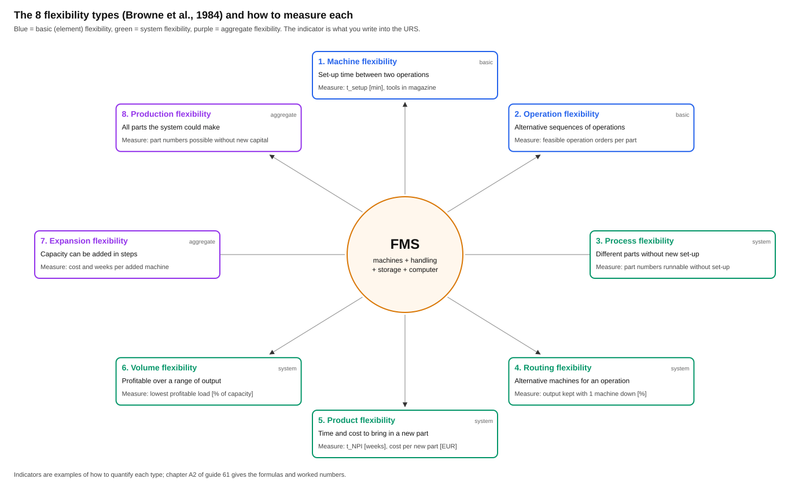
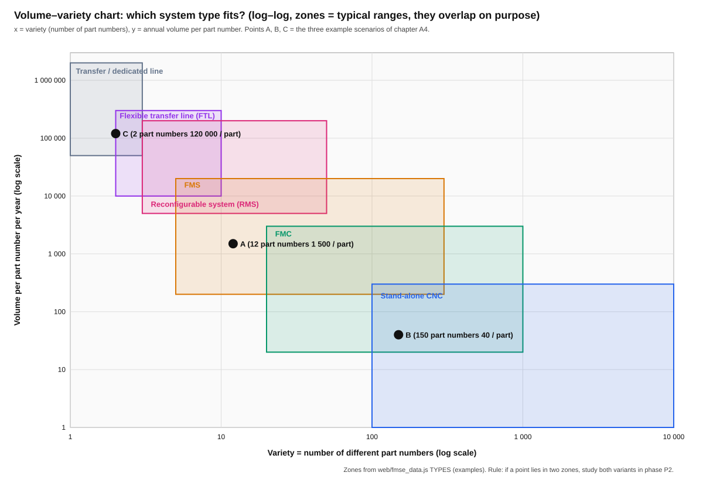
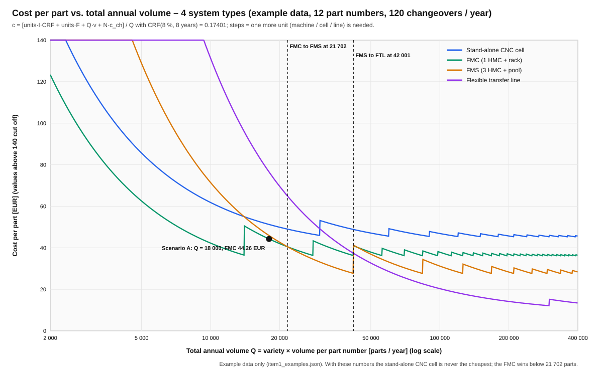
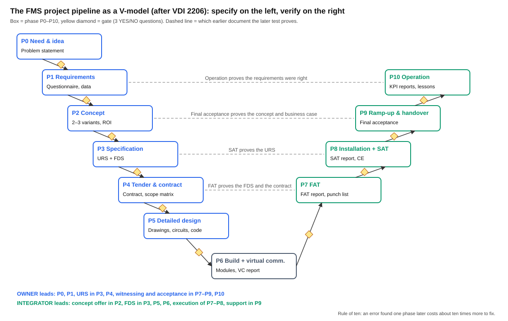
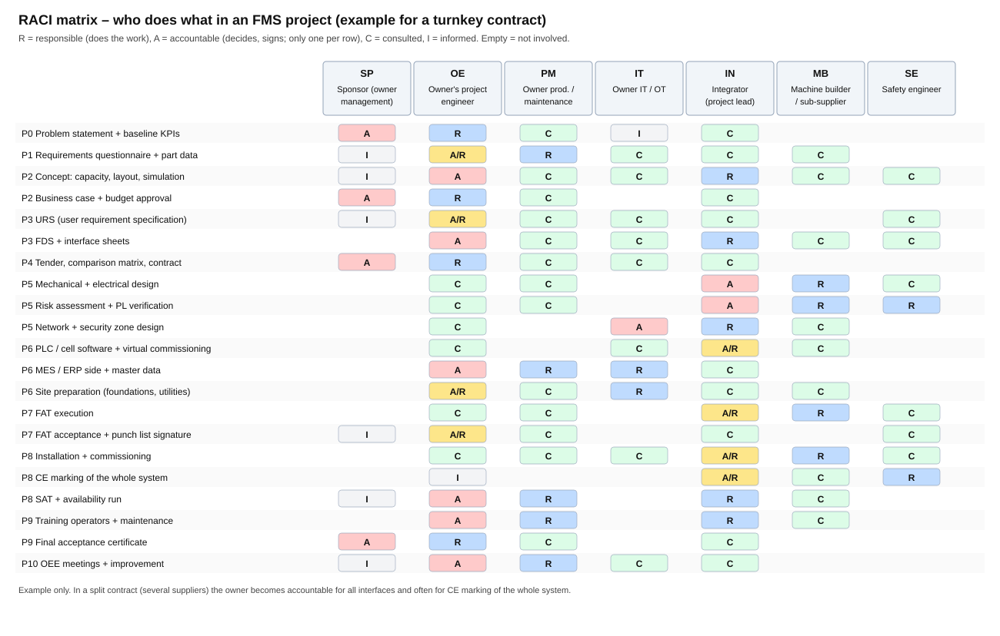
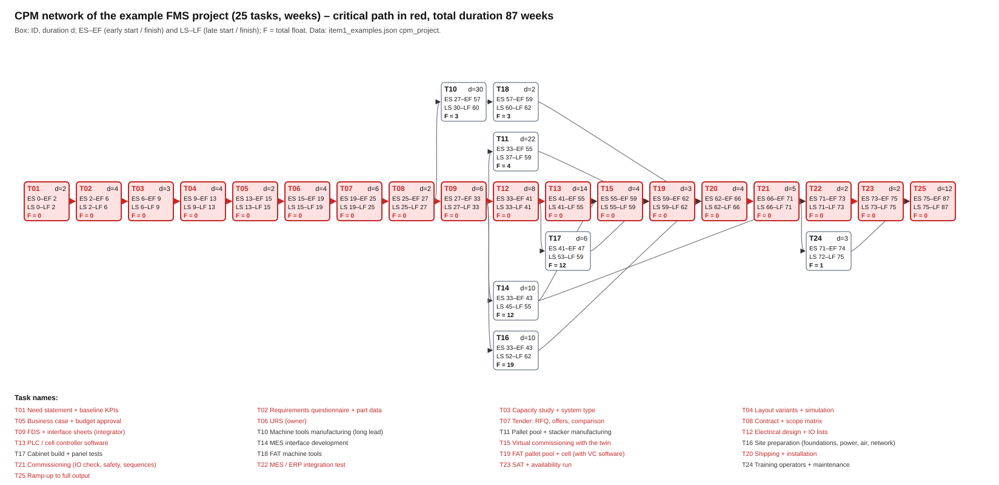
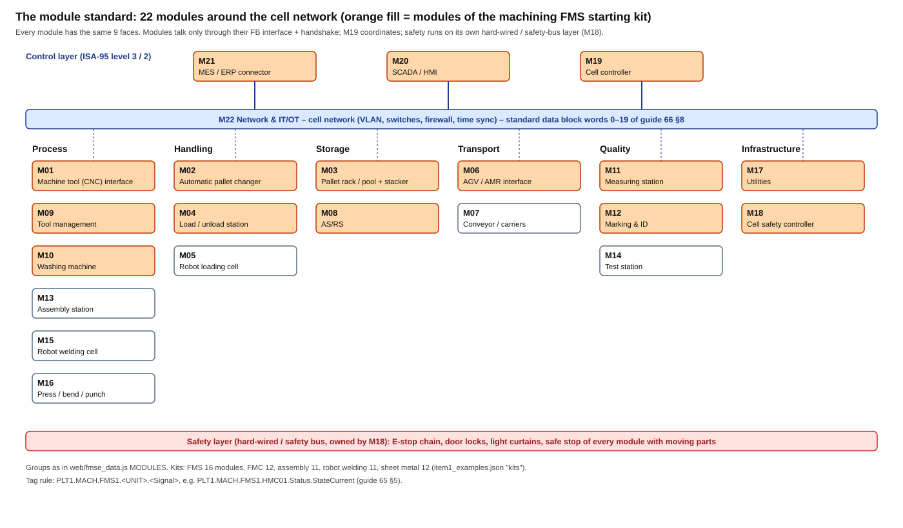
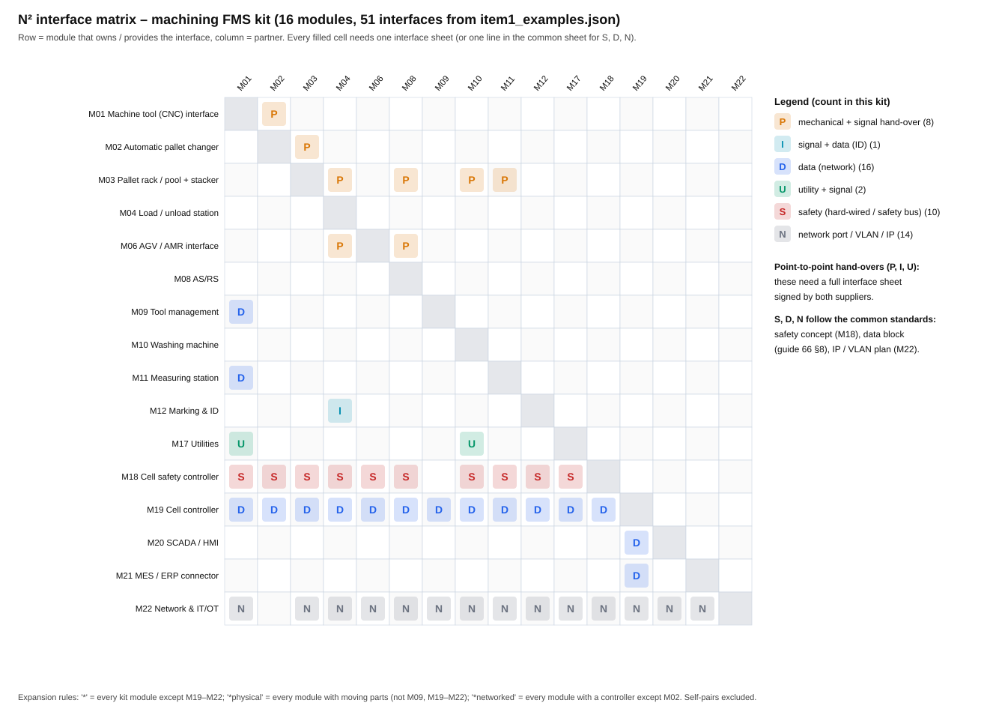

# 61 – FMS types, the project pipeline, requirements and the module standard (textbook)

> Tab **FMS engineering → item 1** (`/?feitem=1#fmse`). Contract: guide 60. State: **November 2026** (rewritten as a full textbook).
> **All numbers in this guide are examples or typical ranges.** They are not data from a real project or a real supplier.
> Every number of the worked examples (economics, business case, schedule, risks, acceptance, requirements, interfaces)
> is calculated from the shared file `tools/fmse/examples/item1_examples.json` with the formulas written in that file.
> The Python tools in `tools/fmse/` and the web tab use the same file, so the numbers must match.

## How to use this guide

This guide is a **textbook and a work manual** for one job: to design and implement a flexible manufacturing system
(FMS) in a real factory. A real factory has its own products, volumes, people, budget and existing machines. So the
guide does not give you "the" FMS. It gives you:

1. **Foundations (Part A)** – what an FMS is, the kinds of flexibility, the system types, the economics of choosing a
   type, and how each process domain (machining, assembly, welding …) changes the design.
2. **The project pipeline (Part B)** – the 11 phases P0–P10 from the first idea to daily operation, for **both roles**
   (factory owner and integrator), with documents, gates, schedule, cost, business case, risks, contracts and acceptance.
3. **Requirements engineering (Part C)** – how to collect facts (the 40 questions) and how to write a URS and an FDS
   that can be tested.
4. **The module standard (Part D)** – the 22 modules M01–M22 with 9 faces each, so every new FMS is **configured**
   from tested building blocks instead of invented again.
5. **Programs and tools (Part E)** – the offline Python tools, the web tab, a buy list of real software, standards,
   checklists and a glossary.

Read Part A once. Use Parts B–D as a reference during a project. Run the tools of Part E with your own data.

A **running use case** goes through the whole guide: the **compressor crankcase FMS** of this twin – 3 horizontal
machining centres (HMC), a pallet pool, a load station, a washer, a measuring station, for the crankcases of the
compressors VC10, VC20 and VC30 (mix 40 / 35 / 25 %). Boxes marked **Use case** show how each chapter is applied to it.

## Contents

**Part A – Foundations**
- A0 Purpose and where in the twin
- A1 What an FMS is – definition, components, history, economies of scale vs scope
- A2 The 8 flexibility types – definition, measurement, design, cost
- A3 System types in depth – line, FTL, RMS, FMS, FMC, stand-alone CNC; volume–variety and product–process matrix
- A4 Economics of system choice – CRF, annual cost, cost per part, break-even, sensitivity
- A5 Process domains in depth – machining, assembly, welding, sheet metal, moulding / casting, electronics, painting, hybrid

**Part B – The project pipeline**
- B1 Project models for automation – V-model, stage-gate, Lastenheft / Pflichtenheft, contract forms, ISO 21500
- B2 Roles and the RACI matrix
- B3–B13 The phases P0 to P10, one chapter each
- B14 Scheduling – WBS, CPM (fully worked), long-lead items, Gantt
- B15 Cost estimation and the business case (NPV, IRR, payback, sensitivity)
- B16 Risk management – register, heat map, mitigation
- B17 Contracts and acceptance – payments, guarantees, penalties, availability run, cycle-time check, Cpk

**Part C – Requirements engineering**
- C1 Requirement types, testable writing, vague words, IDs, traceability
- C2 The 40 questions one by one
- C3 URS and FDS templates
- C4 Example URS excerpt for the crankcase FMS

**Part D – The module standard**
- D1 Modular design theory – modules, interfaces, platforms, MTP, PackML, versioning, governance
- D2 The 9 faces in depth + interface sheet template + filled example M01 ⇄ M02
- D3 The 22 modules one by one
- D4 Configuring an FMS from modules – 3 complete cases with N² matrices
- D5 The engineering-hours model

**Part E – Programs, tools, buy list and reference**
- E1 Offline Python tools `tools/fmse/*.py`
- E2 The web tab item 1 and which chapter each card supports
- E3 Buy list – software and services for FMS project engineering
- E4 Standards list
- E5 Consolidated checklists
- E6 Common mistakes
- E7 Limits
- E8 Glossary
- E9 How the numbers were checked + drawings of this guide

---

# Part A – Foundations

## A0. Purpose and where in the twin

### A0.1 Purpose

Every factory is different, so every FMS is different. But the **way to a good FMS is always the same**:

1. Understand the need and collect the facts (requirements, Part C).
2. Choose the **kind** of system from volume, variety and money (Part A).
3. Specify, buy or build, test, start up and improve it in phases with gates (Part B).
4. Build it from **standard modules**, so circuits, programs and tests are re-used (Part D).

After this guide you can: place any production task on the volume–variety chart, compare system types in money,
run an FMS project as owner or integrator, write a testable URS, plan the schedule with CPM, calculate NPV / IRR,
manage risks, run an acceptance test with numbers, and configure an FMS from the module library.

### A0.2 Where in the twin

| Part of item 1 | What you can do | Chapters |
|---|---|---|
| **1A** Volume–variety chart | Enter variety and volume → see which system types fit; click a zone for details | A3 |
| **1B** Domain table | 8 process domains – what changes between products, which modules, which control | A5 |
| **1C** Pipeline | 11 phases P0–P10, switch role (owner / integrator / both), project length → months per phase, gates | B3–B13 |
| **1D** Questionnaire | 40 questions, saved in your browser, export Markdown / JSON, import JSON | C2 |
| **1E** Module map | 22 modules; choose a system type or domain → its starting kit; click a module → its 9 faces | D |
| Deep sections (file `web/fmse1x.js`, data `web/fmse1x_data.js`) | Flexibility types, economics, schedule, business case, risks, requirements checker, acceptance, module details | A2, A4, B14–B17, C1, D3 |

Deep links: `/?feitem=1#fmse`, with `fevar=` (variety), `fevol=` (volume), `fephase=P5`, `femod=M03`.
Worked examples in other tabs: **FMS & products** and **Live factory** (the crankcase FMS), **Ball screw + guide factory**,
**PLC layer**, **SCADA**, **Installation**.

---

## A1. What an FMS is

### A1.1 Definition

A **flexible manufacturing system (FMS)** is a group of **numerically controlled machines** that are connected by an
**automatic material handling system** and **storage**, and are controlled by a **central computer** (cell controller),
so that **different parts can be made in any order and mix**, with little or no changeover time at the machines.

All three parts must be present. If one is missing, it is not an FMS:

| Part | What it does | Examples |
|---|---|---|
| Processing stations | Change the part (cut, join, test, clean) | HMCs, lathes, mill-turn centres, washers, measuring machines, assembly or welding stations |
| Material handling + storage | Bring the right part / pallet / tool to the right station at the right time; hold work in progress (WIP) | Automatic pallet changer (APC), pallet pool with stacker crane, robot, AGV / AMR, conveyor, AS/RS |
| Computer control | Decide which part, which pallet, which machine, which program, when; collect data | Cell controller (line PLC or cell computer), SCADA, MES connection |

**Important words:**

- **Part family** – parts that are similar enough to use the same machines, fixtures and tools (guide 62).
- **Pallet** – a precise plate that carries the fixture and the part; the machine clamps the pallet, not the part.
  Because the part is fixtured **outside** the machine, the set-up time at the machine becomes the pallet change (≈ 15 s in the twin).
- **Routing** – the sequence of operations and the machines that can do them.
- **Unmanned (ghost) shift** – hours where the system works without operators, using the parts stored in the pallet pool.

### A1.2 Components of an FMS in detail

| Component | Function | Key design numbers | Module (Part D) |
|---|---|---|---|
| Machine tools | Machining operations | spindle power, work envelope, tool pockets, accuracy | M01 |
| Pallet changer | Swap pallet machine ⇄ set-up position | change time 10–30 s | M02 |
| Pallet pool / rack + stacker | Store and move pallets | number of places, crane cycle time | M03 |
| Load / unload station | Operator clamps parts on fixtures | load time per pallet, ergonomics, ID | M04 |
| Transport (AGV, conveyor, RGV) | Move pallets / parts / boxes | trips per hour, docking accuracy | M06, M07 |
| Central storage (AS/RS) | Raw parts, WIP, finished parts | places, crane cycles per hour | M08 |
| Tool management | Presetting, tool data, central tool store | tools per machine, sister tools, tool life | M09 |
| Washer, measuring, marking | Clean, check, identify | cycle time, measuring uncertainty | M10, M11, M12 |
| Utilities | Coolant, chips, air, extraction | flow, power, filter class | M17 |
| Safety | E-stop, guards, zones | performance level PL | M18 |
| Cell controller | Orders → pallets → machines → programs | rules, response time | M19 |
| SCADA / HMI, MES connector, network | People, business systems, IT | screens, messages, VLANs | M20, M21, M22 |

### A1.3 A short history (why FMS look the way they do)

| Period | Development | What we learned |
|---|---|---|
| 1950s–1960s | First NC machines (punched tape); in the UK the company **Molins** developed **"System 24"** (around 1967) – a concept of NC machines connected by automatic handling that should run 24 hours a day with very few people | The idea of the FMS: machines + handling + computer. It was only partly built – the computers and controls of that time were not ready |
| late 1960s–1970s | In the USA, machine-tool builders such as **Kearney & Trecker** and **Sundstrand** built early working systems for heavy prismatic parts (housings for tractors, engines, pumps), with NC machines, carts on tracks and a central computer | FMS works for families of prismatic parts with medium volume. Systems were large, expensive, and software was custom |
| 1980s | **Japanese** builders and users (for example Yamazaki Mazak and Fanuc) built highly automated FMS plants that ran unmanned at night; many FMS in Europe and the USA followed | Unmanned hours are the main economic lever; standard pallets and large tool magazines make it work. Many Western FMS failed because they were too complex, too custom, or the parts did not suit |
| 1990s | Smaller **FMC** (1–3 machines + pallet rack) became the most common form; **RMS** (reconfigurable systems, Koren 1999) was proposed for changing volumes | "Start small, add machines later" is often better than one big system |
| 2000s–today | Modular pallet automation from machine builders and specialist suppliers, robot cells, AGV / AMR, standard communication (OPC UA, MTConnect, umati), MES, digital twins and virtual commissioning | The FMS is now a **configured product**: standard modules + standard interfaces + software. This guide teaches exactly that |

### A1.4 Economies of scale vs economies of scope

- **Economies of scale:** cost per part falls when you make **more of the same** part. Fixed cost is shared by more
  parts. Typical for transfer lines.
- **Economies of scope:** cost per part falls when you make **many different** parts on the **same** resources.
  Fixed cost is shared by more part types. Typical for FMS.

**Formula (simple cost model):**

$$ c = \frac{F_{\text{year}}}{Q} + v + \frac{N_{\text{ch}} \cdot c_{\text{ch}}}{Q} $$

| Symbol | Meaning | Unit |
|---|---|---|
| c | cost per part | EUR / part |
| F_year | fixed cost per year (capital + fixed operating cost) | EUR / year |
| Q | total parts per year (all part numbers) | parts / year |
| v | variable cost per part (labour, energy, tools, consumables) | EUR / part |
| N_ch | changeovers per year | 1 / year |
| c_ch | cost of one changeover | EUR |

- Scale acts on the term F_year / Q (more Q → lower).
- Scope acts on the term N_ch · c_ch / Q: many part types means many changeovers. A system with a **low c_ch** (an FMS:
  pallets set up outside, tools already in the magazine) can make many types cheaply. A transfer line has a **high
  c_ch** (re-tooling the line), so variety kills it.

**Worked example (values from chapter A4, scenario B: 150 part numbers, 450 changeovers per year):**
changeover cost per year for the flexible transfer line = 450 × 2 500 EUR = 1 125 000 EUR; for the FMS = 450 × 15 EUR =
6 750 EUR. The same variety costs the line 167 times more in changeovers. This is economies of scope in one line.

---

## A2. The 8 flexibility types



"Flexible" is not one property. **Browne, Dubois, Rathmill, Sethi and Stecke (1984)** defined **8 types**. Use them
to ask the customer **which** flexibility he needs and **how much it may cost**. Never write "the system shall be
flexible" in a URS – write which type and the number.

**Levels:** machine and operation flexibility are properties of single elements (basic). Process, routing, product
and volume flexibility are properties of the system. Expansion and production flexibility describe the whole system
over time (aggregate).

### A2.1 Machine flexibility

- **Definition:** how easily a machine changes from one operation (or part) to the next – tools, program, fixture.
- **Indicator:** changeover time t_ch [min]; changeover share
  $$ s = \frac{t_{ch}}{L \cdot t_c + t_{ch}} $$
  with L = lot size [parts], t_c = cycle time [min / part]. Target s < 5 %.
- **Example:** lot L = 40, t_c = 6 min, t_ch = 90 min → s = 90 / (240 + 90) = **27 %** (stand-alone machine with manual set-up).
  Same machine with pallets set up outside and all tools in the magazine: t_ch = 0.25 min (pallet change 15 s) →
  s = 0.25 / 240.25 = **0.1 %**.
- **How to design for it:** large tool magazine (all tools of the family), zero-point clamping, pallets set up outside,
  programs from a server (DNC), tool presetting, SMED.
- **Cost:** bigger magazine and APC add roughly 5–15 % to the machine price (typical range – ask the supplier).

### A2.2 Operation flexibility

- **Definition:** a part can be made with **different sequences** of operations (OP20 before OP10) when this helps the flow.
- **Indicator:** number of feasible sequences per part; share of parts with ≥ 2 sequences.
- **Example:** housing with drilling (D) and milling (M) without precedence → 2 sequences (D-M, M-D). With 3 free
  operations: 3! = 6 sequences.
- **Design:** process planning with a precedence graph instead of a fixed routing; same datum (reference surfaces)
  for all operations; fixtures that allow all operations.
- **Cost:** mostly planning and cell-controller software.

### A2.3 Process (mix) flexibility

- **Definition:** the number of different parts the system can make **at the same time**, in any mix, without set-up.
- **Indicator:** number of part types runnable in a random mix without changeover; output loss when the mix changes.
- **Example:** the crankcase FMS runs VC10 / VC20 / VC30 mixed: each pallet carries its own fixture, the program is
  selected by pallet ID → process flexibility = 3 part types (could be 12 with more fixtures).
- **Design:** one fixture per pallet, all tools in all machines (or tool transport), program call by pallet / part ID.
- **Cost:** more pallets and fixtures (a fixture often costs 10–40 kEUR – example range), sister tools.

### A2.4 Routing flexibility

- **Definition:** production continues when a machine is down because the part can go to another machine.
- **Indicator:** average number of capable machines per operation r; output kept when one of m machines is down:
  $$ k = \frac{m-1}{m} \quad (\text{if every machine can do every operation}) $$
- **Example:** 3 identical HMCs → k = 2/3 = **67 %** of the output continues when one machine fails. Three different
  machines with one operation each → k = 0 % (every breakdown stops all parts).
- **Design:** identical or overlapping machines, the same programs on all machines, transport that reaches every
  machine, routing rules in the cell controller.
- **Cost:** every machine must be able to do all operations → more tools in every magazine, sometimes bigger machines.

### A2.5 Product flexibility

- **Definition:** how fast and how cheaply a **new** part can be introduced (or an old one replaced).
- **Indicator:** time to introduce a new part t_NPI [weeks] and cost per new part [EUR] = fixture + program + try-out + approval.
- **Example:** new crankcase VC40: modular fixture 9 kEUR + CAM program 5 kEUR + try-out and first article 4 kEUR =
  **18 kEUR**, t_NPI = **3 weeks** (example values).
- **Design:** work envelope with reserve, standard fixture interfaces, proven CAM post-processor, open control software,
  documented new-part procedure (B13).
- **Cost:** mostly engineering method, little hardware.

### A2.6 Volume flexibility

- **Definition:** the system is profitable over a **range** of total volume.
- **Indicator:**
  $$ VF = 1 - \frac{Q_{\min,\text{profitable}}}{Q_{\max}} \quad (0 \dots 1) $$
- **Example:** capacity Q_max = 42 000 parts / year (one FMS unit in A4). Profitable from Q_min = 21 000 → VF = 1 − 0.5 = **0.5**.
- **Design:** low fixed-cost share, shifts and unmanned hours as a buffer, modular capacity, people who can move.
- **Cost:** usually cheaper hardware but more planning.

### A2.7 Expansion flexibility

- **Definition:** capacity or capability can be **added later** in steps.
- **Indicator:** cost and stop time to add one machine: EUR per added unit and days of production stop.
- **Example:** pallet pool rail prepared for a 4th machine, foundation and network port ready → +1 machine with
  **2 weeks** stop instead of 8 weeks.
- **Design:** reserve space in the layout, extendable rail / conveyor, cell controller with the machine count as a
  parameter, 20 % reserve in cabinets, power and network.
- **Cost:** reserve space and about 5–10 % extra investment now (typical range).

### A2.8 Production flexibility

- **Definition:** the whole range (universe) of parts the system can make without new capital.
- **Indicator:** number of part numbers in the envelope (size, mass, material, tolerance).
- **Example:** work envelope 630 × 630 × 800 mm, 500 kg, cast iron / steel / aluminium → about 300 part numbers of the
  plant fit (example).
- **Design:** choose machine size and spindle for the whole family, not only for today's parts; standard pallet size.
- **Cost:** bigger or more universal machines cost more.

### A2.9 Typical flexibility profiles (1 = very low … 5 = very high, teaching values)

| Type | Machine | Process | Product | Routing | Volume | Expansion | Operation | Production |
|---|---|---|---|---|---|---|---|---|
| Stand-alone CNC | 5 | 3 | 5 | 3 | 4 | 4 | 4 | 5 |
| FMC | 4 | 4 | 4 | 2 | 3 | 3 | 3 | 4 |
| FMS | 4 | 5 | 4 | 5 | 3 | 4 | 4 | 4 |
| Flexible transfer line | 2 | 2 | 2 | 1 | 2 | 2 | 1 | 2 |
| Dedicated transfer line | 1 | 1 | 1 | 1 | 1 | 1 | 1 | 1 |

(Same values as the web tab, `FLEXREF` in `web/fmse1x_data.js`.)

### A2.10 How to use the 8 types in a project

1. In the requirements meeting, read the 8 types to the customer and ask: "Which of these do you need, and what is
   the number?" Write the answer as a requirement (C1), for example *"A new part of the family shall be introduced in
   ≤ 3 weeks including fixture, program and first-article inspection."*
2. In the concept phase, give each variant a score 1–5 per type, weight the types by importance, and add the result
   to the comparison matrix (B5).
3. Price each flexibility: what does it cost (A2.1–A2.8 "cost"), what is it worth (lost sales avoided, lower stock)?
   Flexibility you do not need is waste.

**Use case (crankcase FMS):** needed – process flexibility (mix of 3 models every day), routing flexibility (no
single machine may stop a model), product flexibility (+2 families in 3 years, question q39). Not needed – operation
flexibility (fixed OP10/OP20), high volume flexibility (stable demand).

---

## A3. System types in depth



### A3.1 Overview

| Type | Variety (part numbers) | Volume per part number per year | Flexibility | Typical investment class |
|---|---|---|---|---|
| Transfer / dedicated line | 1–3 | 50 000 – 2 000 000 | none | very high (often > 10 MEUR) |
| Flexible transfer line (FTL) | 2–10 | 10 000 – 300 000 | low (same route) | high (3–15 MEUR) |
| Reconfigurable system (RMS) | 3–50 | 5 000 – 200 000 | medium, cheap capacity change | high |
| **FMS** | 5–300 | 200 – 20 000 | high (any route, any order) | medium–high (2–10 MEUR) |
| Flexible manufacturing cell (FMC) | 20–1 000 | 20 – 3 000 | high, limited capacity | medium (0.5–1.5 MEUR) |
| Stand-alone CNC (job shop) | 100 – 10 000 | 1 – 300 | maximum, manual | low per machine (0.2–1 MEUR) |

Zones and investment classes are **typical ranges** (same zones as `TYPES` in `web/fmse_data.js`). The zones overlap
on purpose: if your point lies in two zones, compare both in phase P2 with the same KPIs.

### A3.2 Transfer line / dedicated line

- **Structure:** special machines (often multi-spindle heads) in a fixed sequence, linked by a synchronous or
  asynchronous transfer system. Each station does a few operations; the part moves station by station.
- **Control:** one line PLC; stations with simple PLC logic; cycle given by the slowest station (takt).
- **Typical size:** 10–60 stations, 1 part type (or 2–3 very similar), output 50–500 parts per hour.
- **Use cases:** (1) machining of engine blocks for one car engine, 300 000 / year; (2) assembly of one type of
  ball bearing; (3) bottling and filling (continuous variant).
- **Pros:** lowest cost per part at high volume; short cycle; simple planning.
- **Cons:** almost no flexibility; a new part means rebuilding stations; one station down stops the line (use buffers);
  long delivery time.
- **Select when:** 1–3 part types, stable demand for ≥ 5 years, very high volume.

### A3.3 Flexible transfer line (FTL)

- **Structure:** a line of CNC machining centres (1- or 2-spindle) with a fixed flow; all parts take the same route;
  each machine does a fixed group of operations. Gantry loaders or conveyors link the machines.
- **Control:** line PLC + CNCs; part type selects programs; changeover = new programs + fixtures + tools in all machines.
- **Typical size:** 4–20 machines, 2–10 variants of one family.
- **Use cases:** (1) cylinder heads in 4 variants, 80 000 / year; (2) e-motor housings (2 sizes) on 8 twin-spindle
  centres; (3) brake callipers for 3 car platforms.
- **Pros:** cheaper than a dedicated line for variants, uses standard machines (re-usable), good cost per part.
- **Cons:** low routing flexibility (one machine down stops the line unless duplicated), changeover cost per batch.
- **Select when:** few variants of one family, high volume, product life ≥ 3–5 years.

### A3.4 Reconfigurable manufacturing system (RMS)

- **Idea (Koren et al., 1999):** a system designed from the start for **rapid change of structure** (hardware and
  software) to adjust capacity and functionality to sudden market changes. "Exactly the capacity and functionality
  needed, when needed."
- **The 6 core characteristics (Koren):**

| Characteristic | Meaning | Design example |
|---|---|---|
| Modularity | components are modules that can be exchanged | spindle units, conveyor sections, robot cells as modules |
| Integrability | modules can be integrated quickly with standard interfaces | standard mechanical + electrical + data interface (Part D) |
| Customization | flexibility limited to one part family (not general) | machines designed for the family envelope |
| Convertibility | change between products quickly | quick-change fixtures, program switch by ID |
| Scalability | capacity can be added in small steps | add one machine / station, line layout with parallel stations |
| Diagnosability | quick detection of quality and reliability problems after a change | in-line measuring, SPC, state model with alarms |

- **Typical size:** 5–30 stations arranged in stages with parallel machines (e.g. 3 stages × 2–4 machines).
- **Use cases:** (1) e-motor housings ramping from 20 000 to 120 000 / year in 4 years; (2) battery-module assembly
  with growing models; (3) gearbox housings where machines are added stage by stage.
- **Pros:** capacity follows demand; investment in steps; good for uncertain markets.
- **Cons:** needs strong standards and engineering discipline; first project more expensive.
- **Select when:** volume uncertain or growing, family stable. **Note:** the module standard of Part D is the
  practical way to get integrability and scalability.

### A3.5 Flexible manufacturing system (FMS)

- **Structure:** 2–10 CNC machines (often identical HMCs), pallet pool or AGV transport, 1–3 load stations, central
  storage, tool management, washer / measuring, cell controller.
- **Control:** cell controller (M19) with order list, pallet and fixture data, routing rules, tool data; CNC programs
  called by pallet ID; MES connection.
- **Typical size:** 2–10 machines, 20–150 pallets, 5–300 part numbers.
- **Use cases:** (1) the **crankcase FMS**: 3 HMCs, VC10/20/30, pallet pool (machining); (2) hydraulic valve blocks,
  80 part numbers, 4 HMCs with a linear pallet pool (machining); (3) aerospace structural parts in aluminium, 5-axis
  machines with large pallets and an AS/RS (machining, high value).
- **Pros:** any part, any order, unmanned shifts, routing flexibility, low set-up.
- **Cons:** high investment, complex control, needs skilled maintenance; fixtures for every part.
- **Select when:** medium variety, medium volume, family of similar parts, unmanned hours wanted.

### A3.6 Flexible manufacturing cell (FMC)

- **Structure:** 1–3 machines with a pallet changer + pallet rack (6–30 pallets) or a robot that loads parts from
  drawers / trays.
- **Control:** often the machine's own pallet-management software or a small cell PLC; simple scheduling.
- **Typical size:** 1 machine + 12 pallets (the example in A4), up to 3 machines.
- **Use cases:** (1) job shop with 150 part types, lots of 40, 1 HMC + 12-pallet rack (machining); (2) turning cell
  with a robot and part drawers for shafts (rotational machining); (3) robot welding cell with a 2-station turntable
  (welding – the cell form of welding).
- **Pros:** cheap start, the classic first step to automation, can grow into an FMS.
- **Cons:** limited capacity; routing flexibility only with 2+ machines.
- **Select when:** high variety, small lots, budget limited, first automation project.

### A3.7 Stand-alone CNC (job shop)

- **Structure:** single CNC machines, manual loading and set-up, organised by function (all lathes together …).
- **Control:** CNC + people + paper or an MES for orders.
- **Use cases:** tool room, spare parts, prototypes, repair shops.
- **Pros:** maximum flexibility, lowest investment per machine, easy to start.
- **Cons:** highest cost per part, long lead time, depends on skilled operators, no unmanned hours.
- **Select when:** very high variety, very low volume, or as a first step.

### A3.8 The product–process matrix (Hayes & Wheelwright, 1979)

The product–process matrix links the **product structure** (one-of-a-kind → standard commodity) with the **process
structure** (job shop → continuous flow). Companies on the diagonal are efficient; companies far from the diagonal
pay too much (too flexible = expensive) or lose sales (too rigid).

| Product (columns) / Process (rows) | Low volume, unique | Multiple products, low volume | Few major products, higher volume | High volume, standard |
|---|---|---|---|---|
| Job shop (stand-alone CNC) | **diagonal** | | | too flexible, expensive |
| Batch (FMC / FMS) | | **diagonal** | | |
| Assembly line / FTL / RMS | | | **diagonal** | |
| Continuous / transfer line | too rigid, no sales | | | **diagonal** |

FMS and FMC moved the "batch" row: they make batch production almost as cheap as a line. That is why the volume–variety
chart (A3.1) has overlapping zones: the FMS zone covers part of the old job shop and part of the old line area.

### A3.9 Selection rules

1. Place the task on the chart: x = variety, y = annual volume per part number (log–log).
2. If inside one zone → that type is the first candidate. If in two zones → two variants.
3. Check the 8 flexibility types (A2) the customer needs; remove types that cannot give them.
4. Calculate the cost per part of each candidate with the same model (A4).
5. Check risk and strategy: growth (RMS / expandable FMS), skills, budget, lead time.
6. Decide at gate P2 with a weighted matrix (B5).

**Distance to a zone (used by the web tab 1A):**

$$ x = \log_{10}(\text{variety}), \quad y = \log_{10}(\text{volume per part}) $$

$$ d = \sqrt{\Delta x^2 + \Delta y^2}, \quad \Delta x = \max(0,\ x_{\min}-x,\ x-x_{\max}), \ \Delta y \text{ the same for } y $$

d = 0 means inside the zone. **Example:** scenario A (12 part numbers, 1 500 / part): x = 1.079, y = 3.176.
FMS zone x 0.699–2.477, y 2.301–4.301 → inside, d = 0. FMC zone x 1.301–3.0, y 1.301–3.477: Δx = 1.301 − 1.079 = 0.222,
Δy = 0 → d = 0.22 (close). So FMS first, FMC second – exactly what the economics in A4 confirm (FMC and FMS are within
4 % in cost per part).

---

## A4. Economics of system choice

The chart says which types **can** work. The economics say which type is **cheapest** for the volume and variety.
All inputs here are the **example** values of `item1_examples.json → economics`.

### A4.1 The model and its symbols

| Symbol | Meaning | Unit |
|---|---|---|
| i | interest rate (cost of capital) | 1 / year |
| n | economic life | years |
| CRF | capital recovery factor – turns an investment into an equal annual cost | 1 / year |
| I | investment per unit (machine group / cell / line) | EUR |
| F | fixed operating cost per unit per year (maintenance contract, floor, software, supervision) | EUR / year |
| v | variable cost per part (operator time, energy, tools, consumables) | EUR / part |
| cap | capacity per unit | parts / year |
| c_ch | cost of one changeover | EUR |
| variety | number of part numbers | – |
| q | volume per part number | parts / year |
| Q | total volume = variety × q | parts / year |
| N | changeovers per year = variety × orders per part number per year | 1 / year |

**Formulas (exactly as in the JSON `_formulas`):**

$$ CRF = \frac{i(1+i)^n}{(1+i)^n - 1} $$

$$ \text{units} = \left\lceil \frac{Q}{cap} \right\rceil $$

$$ C = \text{units}\cdot I \cdot CRF + \text{units}\cdot F + Q \cdot v + N \cdot c_{ch} \qquad [\text{EUR / year}] $$

$$ c = \frac{C}{Q} \qquad [\text{EUR / part}] $$

**Why the CRF?** An investment of I paid today is the same as n equal yearly payments of I · CRF when money costs i.
It contains depreciation and interest together.

**CRF worked:** i = 0.08, n = 8: (1.08)^8 = 1.85093; numerator 0.08 × 1.85093 = 0.148074; denominator 1.85093 − 1 = 0.850930;
**CRF = 0.148074 / 0.850930 = 0.174015**. So 1 EUR invested costs 0.174 EUR per year for 8 years.

| Type (example data) | I [MEUR] | F [MEUR / yr] | v [EUR / part] | cap [parts / yr / unit] | c_ch [EUR] | I · CRF [EUR / yr] | Fixed per unit I·CRF + F [EUR / yr] |
|---|---|---|---|---|---|---|---|
| Stand-alone CNC cell (3 machines, manual) | 0.90 | 0.06 | 38.0 | 30 000 | 180 | 156 613 | 216 613 |
| FMC (1 HMC + 12-pallet rack) | 0.85 | 0.05 | 22.0 | 14 000 | 40 | 147 913 | 197 913 |
| FMS (3 HMC + pallet pool + cell controller) | 2.60 | 0.12 | 14.0 | 42 000 | 15 | 452 438 | 572 438 |
| Flexible transfer line | 4.50 | 0.15 | 8.0 | 300 000 | 2 500 | 783 066 | 933 066 |

### A4.2 Scenario A – medium variety, medium volume

Inputs: variety 12, q = 1 500 / part, 10 orders per part number per year → Q = 12 × 1 500 = **18 000**,
N = 12 × 10 = **120** changeovers.

| Type | units = ⌈Q / cap⌉ | Capital units·I·CRF [EUR] | Fixed units·F [EUR] | Variable Q·v [EUR] | Changeover N·c_ch [EUR] | Annual cost C [EUR] | Cost per part [EUR] |
|---|---|---|---|---|---|---|---|
| Stand-alone CNC cell | ⌈18 000 / 30 000⌉ = 1 | 156 613 | 60 000 | 684 000 | 21 600 | 922 213 | 51.23 |
| **FMC** | ⌈18 000 / 14 000⌉ = 2 | 295 825 | 100 000 | 396 000 | 4 800 | 796 625 | 44.26 |
| FMS | ⌈18 000 / 42 000⌉ = 1 | 452 438 | 120 000 | 252 000 | 1 800 | 826 238 | 45.90 |
| Flexible transfer line | ⌈18 000 / 300 000⌉ = 1 | 783 066 | 150 000 | 144 000 | 300 000 | 1 377 066 | 76.50 |

**Step by step for the FMC row:** units = ⌈18 000 / 14 000⌉ = ⌈1.29⌉ = 2 cells. Capital 2 × 850 000 × 0.174015 = 295 825.
Fixed 2 × 50 000 = 100 000. Variable 18 000 × 22 = 396 000. Changeover 120 × 40 = 4 800. C = 796 625 EUR / year →
c = 796 625 / 18 000 = **44.26 EUR / part**.

**Result:** the FMC (two cells) is the cheapest, the FMS is only 1.64 EUR (3.7 %) more. With such a small difference,
decide by the other criteria: routing flexibility (FMS: one machine down = 67 % output; two separate FMCs: each cell
stops its own parts), growth (q06: VC20 4 000 → 9 000), unmanned hours, floor space.

### A4.3 Scenario B – high variety, low volume

Inputs: variety 150, q = 40, 3 orders per part number per year → Q = **6 000**, N = **450**.

| Type | units = ⌈Q / cap⌉ | Capital units·I·CRF [EUR] | Fixed units·F [EUR] | Variable Q·v [EUR] | Changeover N·c_ch [EUR] | Annual cost C [EUR] | Cost per part [EUR] |
|---|---|---|---|---|---|---|---|
| Stand-alone CNC cell | ⌈6 000 / 30 000⌉ = 1 | 156 613 | 60 000 | 228 000 | 81 000 | 525 613 | 87.60 |
| **FMC** | ⌈6 000 / 14 000⌉ = 1 | 147 913 | 50 000 | 132 000 | 18 000 | 347 913 | 57.99 |
| FMS | ⌈6 000 / 42 000⌉ = 1 | 452 438 | 120 000 | 84 000 | 6 750 | 663 188 | 110.53 |
| Flexible transfer line | ⌈6 000 / 300 000⌉ = 1 | 783 066 | 150 000 | 48 000 | 1 125 000 | 2 106 066 | 351.01 |

**Result:** the FMC wins clearly (57.99 EUR). The FMS is too big for 6 000 parts (its capital is shared by too few parts).
The transfer line is absurd: 450 changeovers × 2 500 EUR = 1.125 MEUR per year only for changeovers.

### A4.4 Scenario C – low variety, high volume

Inputs: variety 2, q = 120 000, 4 orders per part number per year → Q = **240 000**, N = **8**.

| Type | units = ⌈Q / cap⌉ | Capital units·I·CRF [EUR] | Fixed units·F [EUR] | Variable Q·v [EUR] | Changeover N·c_ch [EUR] | Annual cost C [EUR] | Cost per part [EUR] |
|---|---|---|---|---|---|---|---|
| Stand-alone CNC cell | ⌈240 000 / 30 000⌉ = 8 | 1 252 906 | 480 000 | 9 120 000 | 1 440 | 10 854 346 | 45.23 |
| FMC | ⌈240 000 / 14 000⌉ = 18 | 2 662 426 | 900 000 | 5 280 000 | 320 | 8 842 746 | 36.84 |
| FMS | ⌈240 000 / 42 000⌉ = 6 | 2 714 630 | 720 000 | 3 360 000 | 120 | 6 794 750 | 28.31 |
| **Flexible transfer line** | ⌈240 000 / 300 000⌉ = 1 | 783 066 | 150 000 | 1 920 000 | 20 000 | 2 873 066 | 11.97 |

**Result:** the flexible transfer line wins with 11.97 EUR – less than half of the FMS (6 units = 18 HMCs!).
Economies of scale: one line has capacity 300 000, so its large fixed cost is shared by 240 000 parts.

### A4.5 Summary of the three scenarios

| Scenario | Q [parts/yr] | N [changeovers/yr] | CNC cell | FMC | FMS | FTL | Cheapest |
|---|---|---|---|---|---|---|---|
| A – Medium variety, medium volume | 18 000 | 120 | 51.23 | **44.26** | 45.90 | 76.50 | FMC |
| B – High variety, low volume | 6 000 | 450 | 87.60 | **57.99** | 110.53 | 351.01 | FMC |
| C – Low variety, high volume | 240 000 | 8 | 45.23 | 36.84 | 28.31 | **11.97** | Flexible transfer line |

**Reading:** scenario B (high variety) → FMC; scenario C (high volume) → line; scenario A → FMC and FMS almost equal.
This is the volume–variety chart, now in money. **Finding with this example data:** the stand-alone CNC cell is never
the cheapest, because the example FMC (0.85 MEUR) costs less than the 3-machine CNC cell (0.90 MEUR) and has a lower v.
In a real job shop with one-off parts (no fixtures worth building), stand-alone machines win – the model does not
contain fixture cost per part number. Add it as an extra term when you use the model for very high variety.

### A4.6 Break-even volume between two types – derivation

Hold the number of units fixed (inside one "step"). Write the annual cost as fixed part + variable part:

$$ C_a(Q) = K_a + v_a Q, \qquad K_a = u_a (I_a \cdot CRF + F_a) + N c_{ch,a} $$

Two types cost the same when C_a = C_b:

$$ K_a + v_a Q^* = K_b + v_b Q^* \;\Rightarrow\; Q^* = \frac{K_b - K_a}{v_a - v_b} $$

The break-even is valid only if Q* lies inside the volume range where u_a and u_b are the assumed numbers.
Otherwise the curves cross at a **unit jump** (one more machine is bought).

**Worked (variety 12, N = 120 as in scenario A, Q free):**

1. **CNC vs FMS** (both 1 unit while Q ≤ 30 000): K_CNC = 216 613 + 120 × 180 = 238 213; K_FMS = 572 438 + 120 × 15 = 574 238.
   Q* = (574 238 − 238 213) / (38 − 14) = 336 025 / 24 = **14 001 parts / year**. Above it the FMS is cheaper than the CNC cell.
2. **FMC vs FMS** (FMC 2 units for 14 001–28 000, FMS 1 unit): K_FMC = 2 × 197 913 + 120 × 40 = 400 625; K_FMS = 574 238.
   Q* = (574 238 − 400 625) / (22 − 14) = 173 613 / 8 = **21 702 parts / year**. Above it the FMS is cheaper.
3. **FMS vs FTL** (FMS 1 unit up to 42 000): K_FTL = 933 066 + 120 × 2 500 = 1 233 066. Q* = (1 233 066 − 574 238) / (14 − 8) =
   658 828 / 6 = 109 805 – **outside** the range (FMS needs a second unit above 42 000). At Q = 42 001 the FMS jumps to 2 units:
   K_FMS,2 = 2 × 572 438 + 1 800 = 1 146 677. At Q = 42 001: FTL 1 233 066 + 8 × 42 001 = 1 569 074 EUR,
   FMS 1 146 677 + 14 × 42 001 = 1 734 691 EUR, FMC (4 units) 1 720 472 EUR. So the **FTL becomes cheapest at the unit
   jump 42 000 → 42 001**.
4. After that the FMC also crosses the FMS again at the FMC 4-unit / FMS 2-unit step: (1 146 677 − 796 450) / 8 = **43 778** –
   but the FTL is already cheaper than both there.

**Cheapest type over volume (variety 12, N = 120):** FMC below 21 702 · FMS from 21 702 to 42 000 · FTL from 42 001.



### A4.7 Sensitivity – how robust is the choice?

Scenario A, cost per part [EUR] when one input changes (all others at base values):

| Case (scenario A, Q = 18 000, N = 120) | CNC cell | FMC | FMS | FTL | Cheapest |
|---|---|---|---|---|---|
| Base (i = 8 %, n = 8) | 51.23 | **44.26** | 45.90 | 76.50 | FMC |
| Interest i = 5 % | 50.27 | **42.43** | 43.12 | 71.68 | FMC |
| Interest i = 12 % | 52.60 | **46.83** | 49.84 | 83.33 | FMC |
| Life n = 5 years | 55.06 | **51.48** | 56.94 | 95.61 | FMC |
| Life n = 10 years | 49.98 | **41.90** | 42.29 | 70.26 | FMC |
| Investment I +20 % | 52.97 | **47.54** | 50.93 | 85.20 | FMC |
| Investment I −20 % | 49.49 | 40.97 | **40.88** | 67.80 | FMS |
| Variable cost v +20 % | 58.83 | **48.66** | 48.70 | 78.10 | FMC |
| Changeover cost c_ch ×3 | 53.63 | **44.79** | 46.10 | 109.84 | FMC |

**Reading:** the FMC stays cheapest in 8 of 9 cases; only a 20 % cheaper FMS flips the decision. A decision that flips
with a 20 % price change is a **close** decision → negotiate the FMS price, or decide by flexibility and risk.
A longer life (10 years) almost equalises FMC and FMS (41.90 vs 42.29).

**Variety effect at constant total volume (Q = 18 000):** with 60 part numbers (6 orders each, N = 360) the transfer
line rises to 109.84 EUR / part while FMC and FMS stay almost the same (44.79 / 46.10). Variety punishes only systems
with high c_ch.

### A4.8 Real-factory notes on the economics

- Get I, F, v, cap and c_ch from **offers and time studies**, not from this guide.
- v includes **operator cost**: unmanned hours lower v strongly (an FMS with 3 machines and 1 operator per shift vs 3 operators).
- cap must use **effective** hours: hours per year × OEE (guide 64). The example caps already contain an OEE.
- Add one-time costs per part number (fixtures, programs, try-out) when variety is high.
- Use the result for the **ranking**, and the business case (B15) for the **decision**.
- Tool: `python tools/fmse/fms_economics.py --scenario all` prints all tables of this chapter (E1).

---

## A5. Process domains in depth

The method stays the same in every domain. What changes: what "flexible" means, which modules, the layout, the
control details, the traceability data and the KPIs.

### A5.1 Overview

| Domain | What changes between products | Typical flexible system | Key modules | Changeover driver | Typical control |
|---|---|---|---|---|---|
| Machining (prismatic) | NC program, fixture / pallet, tools | FMS with HMCs + pallet pool + tool management | M01 M02 M03 M04 M09 M10 M11 | tools in magazine, fixtures available | CNC + cell PLC, OPC UA / MTConnect, MES |
| Machining (rotational) | program, chuck jaws, tools | turning cells with robot / gantry + part buffers | M01 M05 M09 M11 | jaw change, bar size | CNC + robot + PLC |
| Assembly | part set, screw / press program, test recipe | modular line with workpiece carriers | M07 M12 M13 M14 | feeders and kits | station PLCs + line PLC, recipes from MES |
| Robot welding | robot program, fixture, wire / gas | welding cells with turntable / positioners | M04 M05 M15 | fixture change, programming | robot controller + safety PLC |
| Sheet metal | nest, punch / bending tools, material | laser / punch with sheet tower + sorting, bending cell | M08 M16 M05 | material, bending tools | machine CNC + tower control, nesting |
| Moulding / die casting | mould, material, recipe | quick mould change + automatic material supply | M01 (machine interface) M05 M17 | mould change (SMED) | Euromap 77 / OPC UA, MES |
| Electronics (SMT) | program, feeders, stencil | SMT line with offline feeder set-up | M07 M11 M12 | feeder set-up | IPC-CFX / Hermes, MES |
| Painting / surface | colour, recipe, hanger | power-and-free conveyor + robots with colour change | M05 M07 M17 | colour change (flush) | PLC + robot controllers, recipe per carrier |

### A5.2 Machining – prismatic parts

- **Process chain:** raw casting / forging → load on fixture (pallet) → rough machining OP10 → (turn-over) → finish OP20
  → wash → measure → unload → mark / ID.
- **Flexibility means:** any pallet to any machine, program by pallet ID, all tools of the family in each magazine.
- **Module kit:** FMS kit M01 M02 M03 M04 M06 M08 M09 M10 M11 M12 M17 M18 M19 M20 M21 M22 (D4).
- **Layout:** linear pallet pool along a row of HMCs (rail-guided stacker), load stations at one end, washer and CMM
  at the other; tool presetting room near the machines; chip conveyor channel under the machine row.
- **Control specifics:** pallet / fixture / program table; tool life and sister tools; spindle-hour balancing; unmanned
  shift planning (enough pallets loaded before the operators leave).
- **Traceability data:** serial number per part (DataMatrix), pallet ID, machine, program version, tools used,
  measured features, timestamps.
- **KPIs:** spindle utilisation, OEE per machine, unmanned hours achieved, pallets waiting, tool-related stops, scrap.
- **Reference system (example numbers):** 3 HMCs 500 mm pallets, 24-place pool, 2 load stations, washer, CMM; 12 part
  numbers; output 14 parts / h; 2 shifts + 1 unmanned.
- **Use case:** the crankcase FMS of this twin (HMC cycle 345 s per part, pallet change 15 s – `config/factory.json`).

### A5.3 Machining – rotational parts

- **Process chain:** bar / blank → turning OP10 → turn-over → OP20 (or mill-turn in one clamping) → deburr → measure → wash.
- **Flexibility means:** quick jaw change (or universal jaws), part-family programs, robot grippers for the family.
- **Module kit:** M01, M05 (robot), M07 or drawers, M09, M11, M12, M17, M18, M19–M22.
- **Layout:** robot in front of 1–2 lathes, part drawers or a tray stacker; measuring station in the robot reach.
- **Control:** robot program per part family with parameters (diameter, length); in-process measurement feeds tool offsets.
- **Traceability:** lot or serial, measured diameters, offset corrections.
- **KPIs:** OEE, unmanned hours, offsets per shift, scrap.
- **Reference system:** 2 lathes + 1 robot + 12-drawer stacker, shafts Ø20–80 mm, lots 50–500.
- **Use case:** ball-screw shafts in the "Ball screw + guide factory" tab (turning, whirling, grinding).

### A5.4 Assembly

- **Process chain:** base part on a carrier → add parts (manual / automatic) → screw, press, dispense → test (leak,
  function) → label → pack.
- **Flexibility means:** recipe per variant (screw program, press force window, test limits), part kits, poka-yoke.
- **Module kit (asm):** M04 M06 M07 M12 M13 M14 M18 M19 M20 M21 M22.
- **Layout:** loop or U-line with carriers, manual and automatic stations mixed, rework station, buffer before the test.
- **Control:** station PLCs + line PLC; carrier RFID tells each station the variant and the status; MES gives recipes.
- **Traceability:** serial per product, per screw: torque + angle; per press-fit: force–distance curve; test results.
- **KPIs:** first-pass yield, cycle per station, line balance, rework rate.
- **Reference system:** 10-station compressor assembly, 6 variants, 60 s takt.
- **Use case:** the compressor final assembly of the twin (FMS & products tab).

### A5.5 Robot welding

- **Process chain:** parts into fixture (manual) → robot welds (MAG / MIG / TIG / laser) → turn table → unload → inspect.
- **Flexibility means:** fixture change on a standard base plate, offline robot programming, touch sensing / seam tracking
  for part tolerances.
- **Module kit (weld):** M04 M05 M06 M12 M15 M17 M18 M19 M20 M21 M22.
- **Layout:** 2-station turntable (operator loads one side while the robot welds the other), fume extraction, light curtain.
- **Control:** robot controller with job numbers; power source over fieldbus; safety PLC for the turntable zone.
- **Traceability:** job number, weld parameters (current, voltage, wire feed) per seam, operator, wire lot.
- **KPIs:** arc-on time (often only 30–60 %), rework rate, fixture change time.
- **Reference system:** 1 robot + 2-station turntable + positioner, 40 frame types, lots 20–200.
- **Use case:** welding of compressor base frames (example).

### A5.6 Sheet metal

- **Process chain:** sheet from tower → laser / punch → sort parts → (deburr) → bend → (weld) → paint.
- **Flexibility means:** nests mixed from many orders; material change by the tower; bending tool change automatic.
- **Module kit (sheet):** M03 M05 M06 M08 M12 M16 M17 M18 M19 M20 M21 M22.
- **Layout:** laser with load / unload automation connected to a sheet tower (AS/RS); sorting robot; bending cell nearby.
- **Control:** nesting software creates programs; tower control and machine CNC; MES for orders.
- **Traceability:** order, nest, sheet lot (material certificate).
- **KPIs:** sheet utilisation, laser-on time, unmanned night hours.
- **Reference system:** 6 kW fibre laser + 2-tower 60 places + sorting + press brake with tool changer.
- **Use case:** covers and guards for the compressors (example).

### A5.7 Moulding and die casting

- **Process chain:** dry material → mould → take-out robot → (trim / degate) → inspect → pack.
- **Flexibility means:** quick mould change (SMED, mould carts, clamping), recipe from MES, material change.
- **Module kit:** M01 (machine interface – the moulding machine is the "machine tool"), M05, M07, M12, M17 (dryer, cooling),
  M18–M22.
- **Control:** machine controller via Euromap 77 / OPC UA; recipes; cavity pressure monitoring.
- **Traceability:** shot data per part or per lot, mould ID, material lot.
- **KPIs:** mould change time, scrap, cycle stability.
- **Reference system:** 4 injection machines 150–400 t, central material supply, 1 mould-change cart.
- **Use case:** plastic fan covers for the compressors (example).

### A5.8 Electronics (SMT)

- **Process chain:** solder paste print → pick-and-place → reflow → AOI → (THT) → test.
- **Flexibility means:** offline feeder trolley set-up, program change by board ID.
- **Module kit:** M07, M11 (AOI / test), M12, M18–M22 (machines usually have their own controls).
- **Control:** line software with IPC-CFX / IPC-Hermes-9852 board-transfer protocol; MES.
- **Traceability:** board serial, component reels (lot) per position.
- **KPIs:** changeover time, first-pass yield, DPMO.
- **Use case:** compressor controller boards (example; usually bought from an EMS supplier).

### A5.9 Painting and surface treatment

- **Process chain:** hang on carrier → pre-treatment → paint (robots) → flash-off → oven → cool → unload.
- **Flexibility means:** colour change with flushing (cost per change = paint + solvent + time), recipe per carrier.
- **Module kit:** M05 (paint robots), M07 (conveyor tracking), M12, M17 (air, extraction, ovens), M18–M22.
- **Control:** PLC + robot controllers; conveyor tracking; colour block planning (group same colours).
- **KPIs:** colour changes per shift, paint consumption per part, first-pass yield.
- **Use case:** powder coating of compressor tanks (example).

### A5.10 Mixed and hybrid systems

Many real factories combine domains: machining FMS → washing → assembly line → test → painting. Rules:
1. Every domain keeps its own module kit; the **cell controllers** of each domain talk through the MES (level 3) or a
   common line controller.
2. Use the **same** module standard (states, data block, tag naming) in all domains – then one SCADA shows everything.
3. Decouple domains with buffers sized by Little's law (guide 64).
4. Give every part one serial number from the first operation (M12), so traceability crosses domain borders.

---

# Part B – The project pipeline



## B1. Project models for automation projects

### B1.1 Why a project model?

An FMS project spends 1–10 MEUR, takes 12–24 months, and involves 5–20 companies. Without a model, people start
building before the requirements are clear, and errors are found at the end. The **rule of ten** says: an error found
one phase later costs about ten times more to fix (a wrong requirement found in P1 costs 1 hour; found at SAT it costs
a rebuild).

### B1.2 The V-model (VDI 2206)

VDI 2206 ("Development of mechatronic and cyber-physical systems", 2021 edition) uses a **V**:

- **Left side (going down):** requirements → system design → domain design (mechanics, electrics, software).
- **Bottom:** build / implement.
- **Right side (going up):** integration and verification at each level – module test, system test, acceptance.
- **Horizontal links:** every test on the right proves a document on the left. The SAT proves the URS, the FAT proves
  the FDS and the contract, module tests prove the module design.

In this guide the 11 phases P0–P10 sit on the V (drawing above). VDI 2206 also says: iterate (small V cycles) when
something is new – for example a prototype test cut (R04) before the order.

### B1.3 Stage-gate

A **stage-gate** process (Cooper) splits the project into **stages** (phases) separated by **gates**. At each gate a
decision board (sponsor + project lead + experts) decides: **go / kill / hold / recycle**. Rules:

1. Each gate has **fixed criteria** (in this guide: 3 YES/NO questions per phase + deliverables complete).
2. A NO means: do not start the next phase. Fix it, or stop the project.
3. Money is released **per stage**, not for the whole project at once (reduces loss if the project is killed early).

### B1.4 Lastenheft and Pflichtenheft (VDI/VDE 3694) = URS and FDS

The German guideline **VDI/VDE 3694** ("Lastenheft/Pflichtenheft for the use of automation systems") defines two documents:

| German | English (used in this guide) | Written by | Content | Question it answers |
|---|---|---|---|---|
| **Lastenheft** | **URS** – User Requirement Specification | Owner (customer) | All requirements: what the system must do, under which conditions, how it will be accepted | **WHAT** and **WHY** |
| **Pflichtenheft** | **FDS** – Functional Design Specification (also "functional specification") | Integrator (supplier) | How the supplier will meet every requirement: modules, functions, sequences, interfaces, tests | **HOW** and **WITH WHAT** |

Rules from practice: the URS must be **solution-neutral** where possible (say "≥ 14 parts / h", not "use 3 Brand-X machines").
The FDS answers **every** URS point (comply / partly / deviation + explanation). The owner **approves** the FDS; after
approval the FDS is the technical part of the contract.

### B1.5 Contract forms

| Form | What it means | Pros | Cons | When |
|---|---|---|---|---|
| **Turnkey (general contractor)** | One integrator delivers the whole FMS, responsible for all interfaces, CE and performance | One responsible party, clear guarantees | Higher price (risk premium), less owner influence on sub-suppliers | Owner has little automation staff; complex system |
| **Split contracts (multi-lot)** | Owner buys machines, pallet pool, software, installation separately | Lower price, owner chooses each supplier | **Owner owns all interfaces** and often the CE marking of the whole system; disputes "whose fault" | Owner has a strong engineering team |
| **Lead supplier + nominated subs** | Owner chooses key sub-suppliers (e.g. machine brand), integrator takes them under its contract | Owner standards kept, one responsible | Integrator adds a margin and may refuse responsibility for nominated subs – clarify | Common compromise |
| **EPCM / owner's engineer** | An engineering company manages the project for the owner | Expertise, owner keeps control | Extra cost; owner still carries interface risk | Large projects |

Payment types: **fixed price** (most common for FMS), **cost plus** (only for unclear scope), **unit price** (for
installation work). Always fix the change-order process (B17).

### B1.6 ISO 21500 basics

ISO 21500 (guidance on project management, latest edition 2021) groups project work into **process groups** –
initiating, planning, implementing, controlling, closing – and **subject areas** such as scope, schedule, cost, risk,
resources, quality, procurement, communication and stakeholders. Use it as a checklist: for each subject area, this
guide gives the FMS-specific tool:

| ISO 21500 subject | Tool in this guide |
|---|---|
| Integration | pipeline P0–P10 with gates (B3–B13) |
| Stakeholders | RACI (B2) |
| Scope | URS / FDS (C3), scope matrix (B7), WBS (B14) |
| Resources | RACI, module library hours (D5) |
| Schedule | CPM + Gantt (B14) |
| Cost | cost breakdown + business case (B15) |
| Risk | risk register + heat map (B16) |
| Quality | acceptance criteria, FAT / SAT (B17) |
| Procurement | tender + contract (B7, B17) |
| Communication | weekly meeting, monthly report, gate reviews |

---

## B2. Roles and the RACI matrix

### B2.1 The roles

| Role | Company | Main job |
|---|---|---|
| **Sponsor** | owner (management) | Owns the budget and the business case; decides at gates |
| **Owner's project engineer** (owner PM) | owner | Collects requirements, writes URS, runs tender, accepts; the "voice of the factory" |
| **Owner production + maintenance** | owner | Gives real data, joins design reviews, will run and repair the system |
| **Owner IT / OT** | owner | Network, security zones, MES / ERP, accounts, remote access |
| **Integrator project lead** | integrator / general contractor | Designs, builds, commissions; responsible for interfaces in a turnkey contract |
| **Machine builder / sub-supplier** | supplier | Machine tools, pallet pool, robot, washer … (often subcontracted by the integrator) |
| **Safety engineer** | integrator or independent | Risk assessment (ISO 12100), safety functions (ISO 13849), validation, CE file |

**Owner vs integrator in one sentence:** the owner says **what** and **accepts**; the integrator says **how** and
**delivers**. In a small company you may play both roles – then write the URS **before** you design, or you will
design what is easy instead of what is needed.

### B2.2 RACI

**R** = responsible (does the work) · **A** = accountable (decides and signs – only one A per row) · **C** = consulted
(asked before) · **I** = informed (told after). "A/R" = the same role decides and does.



| Activity | Sponsor | Owner PM | Prod. / maint. | IT / OT | Integrator | Machine builder | Safety eng. |
|---|---|---|---|---|---|---|---|
| P0 Problem statement + baseline KPIs | A | R | C | I | C | | |
| P1 Requirements questionnaire + part data | I | A/R | R | C | C | C | |
| P2 Concept: capacity, layout, simulation | I | A | C | C | R | C | C |
| P2 Business case + budget approval | A | R | C | | C | | |
| P3 URS | I | A/R | C | C | C | | C |
| P3 FDS + interface sheets | | A | C | C | R | C | C |
| P4 Tender, comparison matrix, contract | A | R | C | C | C | | |
| P5 Mechanical + electrical design | | C | C | | A | R | C |
| P5 Risk assessment + PL verification | | C | C | | A | R | R |
| P5 Network + security zone design | | C | | A | R | C | |
| P6 PLC / cell software + virtual commissioning | | C | | C | A/R | C | |
| P6 MES / ERP side + master data | | A | R | R | C | | |
| P6 Site preparation (foundations, utilities) | | A/R | C | R | C | C | |
| P7 FAT execution | | C | C | | A/R | R | C |
| P7 FAT acceptance + punch list signature | I | A/R | C | | C | | C |
| P8 Installation + commissioning | | C | C | C | A/R | R | C |
| P8 CE marking of the whole system | | I | | | A/R | C | R |
| P8 SAT + availability run | I | A | R | | R | C | |
| P9 Training operators + maintenance | | A | R | | R | C | |
| P9 Final acceptance certificate | A | R | C | | C | | |
| P10 OEE meetings + improvement | I | A | R | C | C | | |

**How to use it:** copy the table into the project handbook in P3, adjust it to your contract form, and let every
company sign it. **CE marking note:** whoever puts the complete FMS into service as an assembly of machines is its
"manufacturer" under the Machinery Regulation. In a turnkey contract this is the integrator; in split contracts it is
often the **owner** – plan the safety engineer and the technical file early (risk R08).

---

## B3. Phase P0 – Need and idea

**Purpose:** make clear **why** automation / an FMS: what problem, how big, what it is worth. Typical share: 3 % of
project time, < 1 % of cost.

**Inputs:** complaints (late deliveries, high cost, quality), strategy (new products), current KPIs.

**Owner – steps:**
1. Write the business need in numbers: output, lead time, cost, quality, labour, safety.
2. Collect the **baseline**: OEE, scrap rate, set-up hours per week, lead time, WIP, overtime – for at least 4 weeks.
3. Ask first: can 5S, SMED, better planning or a second shift solve it cheaper? (Automation of a bad process gives a
   fast bad process.)
4. Name a sponsor with budget and a small team (owner PM, production, maintenance, IT).
5. Estimate the value: what is 1 % OEE, 1 day lead time, 1 % scrap worth per year?

**Integrator – steps:**
1. First visit: listen, see the parts and the shop, take photos (with permission).
2. Ask for drawings, volumes, current routings and times.
3. Say early what is **not** sensible (e.g. FMS for 3 parts at 200 000 / year → line).

**Methods / tools:** KPI baseline, Pareto of losses, value stream map (guide 02), rough cost model (A4).

**Deliverable – problem statement (template, 1 page):**
1. Situation today (numbers). 2. Problem and its cost per year. 3. Goal (numbers + date). 4. Scope (in / out).
5. Constraints known. 6. Sponsor, team, decision date.

**Use case – problem statement (excerpt, example):**
> *Situation:* crankcases VC10/20/30 are machined on 4 stand-alone machining centres with manual set-up; 12 set-ups per
> week × 90 min = 18 h of 80 h available (22.5 %). Lead time 12 working days. 3 operators per shift.
> *Problem:* set-ups eat 25 % of machine time (q40); demand for VC20 grows from 4 000 to 9 000 / year.
> *Goal:* ≥ 14 crankcases / h in the mix 40/35/25 %, lead time ≤ 5 working days, 1 unmanned shift, by 09/2028.
> *Scope:* machining, washing, measuring, marking of crankcases; not the assembly.

**Gate P0:** Is the problem measured (not only felt)? · Is automation the right answer, or first 5S / SMED / planning? ·
Is there a sponsor with budget?

**Mistakes:** starting with a solution ("we need robots"); no baseline – later nobody can prove the benefit.

---

## B4. Phase P1 – Requirements and data

**Purpose:** collect **all** facts that decide the design. Share: 8 % of time, 1–2 % of cost.

**Inputs:** problem statement, drawings, ERP data (volumes, routings), site plans.

**Owner – steps:**
1. Fill the 40-question questionnaire (C2) in a 2–3 h meeting with production, maintenance, quality, IT.
2. Build the part / volume / mix table: part number, drawing, material, mass, annual volume now and in 5 years, lot size.
3. Write the hard constraints: brands (PLC, robot, CNC), protocols, budget range, floor, power, IT rules.
4. Mark unknown answers with owner and due date. Sign the questionnaire (risk R02).

**Integrator – steps:**
1. Check data quality: missing cycle times, unrealistic tolerances, volumes that do not match capacity.
2. Group parts into families (guide 62: production flow analysis, clustering).
3. First capacity check (guide 64): hours needed vs available.

**Capacity first check (formula):**

$$ H = \sum_i Q_i \cdot \frac{t_i}{60} \;[\text{h / year}], \qquad n = \left\lceil \frac{H}{T_{avail} \cdot OEE} \right\rceil $$

Q_i = annual volume of part i, t_i = machining time [min / part], T_avail = available hours per machine per year.
**Example:** 4 000 × 14 min + 3 000 × 18 min + 2 000 × 22 min → H = 933 + 900 + 733 = 2 567 h. Two shifts + one unmanned
shift, 240 days: T = 240 × 22 = 5 280 h; OEE 0.75 → 3 960 h per machine → n = ⌈2 567 / 3 960⌉ = 1 machine (65 % load).
With +15 % growth reserve: 2 952 h → still 1, but no redundancy → 2 machines if a breakdown must not stop delivery.

**Deliverables:** completed questionnaire (export JSON from tab 1D), part / volume / mix table, constraints list.

**Use case – part / volume table (example):**

| Part | Drawing | Material | Mass [kg] | Volume now / in 5 years | Lot | Machining time [min] |
|---|---|---|---|---|---|---|
| CC10 crankcase VC10 | CC10-D rev C | EN-GJL-250 | 18 | 6 000 / 8 000 | 40 | 5.2 |
| CC20 crankcase VC20 | CC20-D rev D | EN-GJL-250 | 22 | 4 000 / 9 000 | 30 | 5.8 |
| CC30 crankcase VC30 | CC30-D rev B | EN-GJL-250 | 28 | 3 000 / 4 500 | 20 | 6.4 |

**Gate P1:** Volume + mix for 5 years agreed? · All drawings and tolerances available? · Hard constraints written down?

**Mistakes:** volumes only for today; "we will give the drawings later"; IT not asked (R10).

---

## B5. Phase P2 – Concept and feasibility

**Purpose:** choose the system type and size it – 2–3 variants with cost and ROI. Share: 10 % of time, 2–4 % of cost
(often paid as a concept study).

**Inputs:** requirements set, site data, budget frame.

**Integrator – steps:**
1. Place the task on the volume–variety chart (A3); choose 2–3 candidate types.
2. Capacity and bottleneck per variant (guide 64): machines, load stations, pallets (Little's law), transport.
3. Layout variants (guide 64): floor plan with machine footprints, service areas, escape routes, crane reach.
4. Simulation of the best 2 variants in the twin (What-if tab): output, OEE, WIP, lead time with breakdowns.
5. Budget price ± 20 % and the cost model per variant (A4).

**Owner – steps:**
1. Compare variants with the **same KPIs** and a weighted matrix.
2. Check floor, foundations, power, air, network on site.
3. Decide the budget and the "must / nice" list. Prepare the business case (B15) for the sponsor.

**Comparison matrix (template + use case example):** score 1–5, weight in %.

| Criterion | Weight | Variant 1: 2 × FMC | Variant 2: FMS 3 HMC + pool | Variant 3: FMS 3 HMC + AGV |
|---|---|---|---|---|
| Cost per part (A4) | 25 % | 5 | 4 | 3 |
| Routing flexibility | 15 % | 2 | 5 | 5 |
| Unmanned hours | 15 % | 3 | 5 | 4 |
| Expansion (4th machine) | 10 % | 3 | 4 | 5 |
| Investment / budget fit | 15 % | 5 | 3 | 2 |
| Technical risk | 10 % | 5 | 4 | 3 |
| Floor space | 10 % | 3 | 4 | 3 |
| **Weighted score** | 100 % | **3.85** | **4.15** | **3.50** |

Calculation of variant 2: 0.25×4 + 0.15×5 + 0.15×5 + 0.10×4 + 0.15×3 + 0.10×4 + 0.10×4 = 1.00 + 0.75 + 0.75 + 0.40 + 0.45 + 0.40 + 0.40 = 4.15.
Variant 1: 1.25 + 0.30 + 0.45 + 0.30 + 0.75 + 0.50 + 0.30 = 3.85. Variant 3: 0.75 + 0.75 + 0.60 + 0.50 + 0.30 + 0.30 + 0.30 = 3.50.
(Scores and weights are examples.)

**Deliverables:** concept report (template: 1 summary, 2 requirements recap, 3 variants with layout, 4 capacity and
simulation results, 5 cost and ROI, 6 risks, 7 recommendation), simulation report, budget price.

**Gate P2:** Does the chosen variant reach the output with ≥ 15 % reserve? · ROI acceptable? · Risks listed?

**Mistakes:** only one variant ("the supplier's standard"); simulation without breakdowns; forgetting fixtures and
tools in the budget (often 15–25 % of the machine price – typical range).

---

## B6. Phase P3 – Specification (URS + FDS)

**Purpose:** write **what** the system must do (owner: URS) and **how** it will do it (integrator: FDS) – the base of
contract and acceptance. Share: 8 % of time, 2–3 % of cost.

**Owner – steps (URS):**
1. Use the URS template (C3). Convert every questionnaire answer into requirements with ID, text, verification.
2. Write acceptance criteria with numbers and formulas (availability, cycle time, Cpk – B17).
3. Write interface rules: PLC brand, data block (guide 66 §8), tag naming (guide 65 §5), protocols, MES messages.
4. Review with production, maintenance, quality, IT, safety. Freeze version 1.0.

**Integrator – steps (FDS):**
1. Answer every URS point (compliance matrix).
2. Describe modules (Part D), sequences, states (PackML), signals, HMI screens, alarms, safety concept.
3. Write one interface sheet per point-to-point interface (D2).
4. Write the acceptance test plan (what is measured at FAT / SAT, how, by whom).

**Deliverables:** URS, FDS, interface sheets, test plan, traceability matrix URS → FDS → test (C1).

**Use case – FDS excerpt (example):**
> *FDS-CAP-001 (answers URS-CAP-001):* The FMS has 3 identical HMCs (module M01 × 3) with APC (M02), a 24-place linear
> pallet pool (M03) and 2 load stations (M04). Theoretical capacity at 5.76 min per part (≈ 345 s, guide `config/factory.json`):
> 3 × 60 / 5.76 = 31.25 parts / h. Required 14 parts / h = 45 % of theoretical → covers planned OEE 0.75 and the
> load-station limit. Verification: TC-CAP-001 (8 h capacity run at FAT, count of good parts).

**Gate P3:** Every URS requirement testable (number + method)? · Every interface has one owner? · Safety concept
(risk assessment) started?

**Mistakes:** URS full of vague words (C1); FDS copied from another project without answering the URS; no interface owner.

---

## B7. Phase P4 – Tender and contract

**Purpose:** choose the supplier(s) and fix scope, price, time, acceptance, warranty and penalties. Share: 6 % of time.

**Owner – steps:**
1. Send the URS + commercial conditions to **3 or more** suppliers (RFQ) with a deadline and a fixed answer format
   (compliance matrix + price breakdown per module).
2. Clarification meetings; all answers in writing to all bidders.
3. Compare with a weighted matrix (technical 40–50 %, price 30–40 %, service / references 10–20 % – typical).
4. Visit 1–2 reference plants of the best two bidders.
5. Negotiate and sign: scope matrix, milestones and payments, acceptance criteria, guarantees, penalties, warranty,
   spare parts, training, **rights to source code and passwords**, escrow.

**Integrator – steps:** answer point by point (comply / deviation), clarify open points in writing, plan resources
and sub-suppliers, check the financial risk of guarantees.

**Scope matrix (template excerpt):** one line per item, one column per party; exactly one "D" (delivers) per line.

| Item | Owner | Integrator | Machine builder | Pallet pool supplier | IT |
|---|---|---|---|---|---|
| Machine foundations | D | spec | spec | | |
| HMC × 3 incl. APC | | contract | D | | |
| Pallet pool + stacker | | contract | | D | |
| Cell controller software | | D | | | |
| MES interface (owner side) | D | | | | C |
| Network switches cell (M22) | | D | | | approve |
| Power feed to main cabinet | D | spec | | | |
| CE marking whole system | | D | input | input | |
| Training | | D | D (machine) | D (pool) | |

**Gate P4:** Scope matrix without empty cells? · Acceptance criteria and penalties agreed? · Rights to PLC / robot / CNC
programs and documentation in the contract?

**Mistakes:** choosing only by price; unclear "by others" items; no software rights (you cannot change your own FMS later).

---

## B8. Phase P5 – Detailed design

**Purpose:** design every module: mechanics, electrics, pneumatics / hydraulics, safety, programs, network, HMI, MES
interface. Share: 15 % of time, 10–15 % of cost.

**Integrator – steps:**
1. 3D layout and mechanical design (fixtures, guards, foundations drawing for the owner).
2. Circuit diagrams per module from the library (item 8), IO lists, cable lists, network plan with IP / VLAN (guide 66).
3. Software design: module FBs, state machines, handshakes, cell controller logic (items 9–10).
4. Risk assessment ISO 12100 and safety functions with PL calculation ISO 13849-1.
5. Design reviews at **30 / 60 / 90 %** with the owner.

**Owner – steps:**
1. Attend design reviews; check against URS; approve layout, foundations, utilities, network plan, safety concept.
2. Prepare the site: foundations, power, air, network, IT accounts, permits (task T16).
3. Prepare MES / ERP master data (parts, routings, programs, fixtures).

**Design review checklist (30 / 60 / 90 %):** layout and access for maintenance · interface sheets signed · IO list
complete · safety functions with PL required / reached · network plan approved by IT · HMI screens drafted ·
spare-parts concept · open-points list.

**Deliverables:** 3D model + drawings, circuit diagrams, IO list, cable list, software design, signal lists, safety
concept + PL verification, site preparation drawings.

**Gate P5:** All interface sheets signed by both sides? · Safety functions verified (PL reached)? · Site ready date confirmed?

**Mistakes:** design reviews skipped "to save time"; safety designed after the mechanics (expensive changes); site not
started (R06).

---

## B9. Phase P6 – Build and virtual commissioning

**Purpose:** manufacture, assemble and wire; test the software against a simulated plant **before** the hardware is
ready. Share: 15 % of time, 50–60 % of cost (hardware).

**Integrator – steps:**
1. Manufacture, assemble, wire; panel tests (insulation, IO test against the IO list).
2. **Virtual commissioning (VC):** run the real PLC program (or a PLC simulator) against a 3D model (the twin) that
   simulates sensors and actuators. Test every sequence, every fault reaction, every handshake.
3. Module tests: each module alone with its FAT steps (D3).

**Owner – steps:** visit the shop and check progress against the schedule; prepare the MES / ERP side and master data;
select operators and super-users for training.

**Virtual commissioning – what to test (minimum list):** normal sequence for every part type · every handshake with
timeout · every alarm and its reaction · E-stop and restart (state Aborted → Clearing → Stopped → Resetting → Idle) ·
mode changes · MES order download and confirmation · power-off / power-on recovery · pallet / data mismatch.

**Deliverables:** built modules, VC report (sequences and faults tested, open bugs), draft documentation.

**Gate P6:** Every sequence and fault reaction tested virtually? · Module tests passed? · FAT procedure agreed?

**Mistakes:** VC model too simple (no faults); software "finished on site".

---

## B10. Phase P7 – FAT (factory acceptance test)

**Purpose:** prove at the supplier, before shipping, that the system meets URS / FDS – with real parts if possible.
Share: 5 % of time.

**Integrator – steps:** run the FAT procedure: functions, sequences, faults, E-stop, safety functions, capacity run
(e.g. 8 h), data to MES test system; fix A-points.

**Owner – steps:** witness; run real parts; measure quality (CMM); check documentation, HMI, alarms, MES messages;
classify and sign the punch list.

**Punch-list classes:** **A** = must be fixed before shipping · **B** = fix on site before SAT · **C** = minor, fix before
final acceptance.

**Use case – FAT protocol excerpt (example):**

| Test ID | Requirement | Procedure | Expected | Result | Signed |
|---|---|---|---|---|---|
| TC-CAP-001 | URS-CAP-001 | 8 h capacity run, mix 40/35/25 %, count good parts | ≥ 112 parts (14 / h) | 118 parts | owner + integrator |
| TC-INT-001 | URS-INT-001 | read / write words 0–19 of every module with a Modbus client | all words as in the data block | M10 word 17 wrong scaling | open (A) |
| TC-SAF-003 | URS-SAF-001 | open door load station during stacker move | stacker safe stop, PLr d reached | OK | owner + integrator + safety eng. |
| TC-CYC-001 | contract §7.2 | time 10 batches of 10 parts on HMC01 | mean ≤ 57.6 min | see B17.5 | – |

**Use case – punch list excerpt (example):**

| No. | Module | Finding | Class | Responsible | Due |
|---|---|---|---|---|---|
| 1 | M10 washer | word 17 LastCycle_s sent in 0.1 s, not s | A | integrator | before shipping |
| 2 | M04 load station | HMI text not in local language | B | integrator | before SAT |
| 3 | M03 pool | stacker noise 82 dB(A) at 1 m (limit 80) | B | pool supplier | before SAT |
| 4 | M20 SCADA | alarm colour of warnings not per style guide | C | integrator | final acceptance |

**Gate P7:** No open A-points? · Capacity / cycle time shown? · Safety functions validated?

**Mistakes:** FAT with dummy parts only; owner signs without testing faults; no CMM report.

---

## B11. Phase P8 – Installation and SAT

**Purpose:** install, align, connect; prove the system in the real factory. Share: 12 % of time, 8–12 % of cost.

**Owner – steps:** foundations, utilities, network ready on time; lifting, transport, permits; safety at work during
installation (site rules, permits to work); witness the SAT and the availability run.

**Integrator – steps:** installation and alignment; wiring; commissioning (IO check, axes, safety validation,
sequences); MES / ERP connection and message tests; SAT procedure; CE file and declaration of conformity.

**Use case – SAT report excerpt (example, values from B17):**
> *SAT availability run:* 72 h, owner-caused stops 1.2 h (no castings for 50 min, break of shift handover 22 min),
> supplier-caused stops 3.1 h (stacker fork sensor 2.0 h, M10 pump 1.1 h).
> A = (72 − 1.2 − 3.1) / (72 − 1.2) = 67.7 / 70.8 = **95.62 %** ≥ target 95 % → **passed**.
> *Unmanned test:* 8 h without operator action – passed. *Open B-points:* 1 (noise) – fixed during SAT.

**Gate P8:** Availability run passed? · All safety functions validated on site? · As-built documents delivered?

**Mistakes:** site not ready (R06); MES tested only at the end (T22 is on the critical path!); the CE file forgotten.

---

## B12. Phase P9 – Ramp-up and handover

**Purpose:** reach target output and quality step by step; train people; hand over. Share: 10 % of time.

**Owner – steps:** ramp-up plan with weekly targets (30 % → 60 % → 100 %); training of operators, maintenance,
programmers; final acceptance when the guaranteed KPIs are reached for the agreed time.

**Integrator – steps:** support on site; optimise cycle times; fix B / C points; final documentation; spare parts list.

**Use case – ramp-up curve (example, target 14 parts / h = 100 %, task T25 = 12 weeks):**

| Week | Planned [% of target] | Planned [parts / h] | Actual [parts / h] | Actual [%] | Main loss |
|---|---|---|---|---|---|
| 1 | 30 | 4.2 | 3.9 | 28 | operators learning load station |
| 2 | 40 | 5.6 | 5.0 | 36 | tool breakages VC30 |
| 3 | 50 | 7.0 | 6.6 | 47 | program optimisation |
| 4 | 60 | 8.4 | 8.6 | 61 | – |
| 6 | 75 | 10.5 | 9.8 | 70 | washer alarms |
| 8 | 85 | 11.9 | 11.6 | 83 | unmanned shift started |
| 10 | 95 | 13.3 | 13.4 | 96 | – |
| 12 | 100 | 14.0 | 14.2 | 101 | final acceptance test |

**Gate P9:** Guaranteed output / OEE reached for the agreed weeks? · People trained and signed? · Spare parts in stock?

**Mistakes:** no ramp-up plan ("it will run from day 1"); integrator leaves too early (R15); training without practice.

---

## B13. Phase P10 – Operation and improvement

**Purpose:** run, measure, improve. Share: 8 % of the project frame, then continuous.

**Owner – steps:** daily OEE and downtime meeting (15 min, top 3 losses); preventive and predictive maintenance;
**new part introduction procedure:** (1) check envelope / tools / fixture interface → (2) fixture + CAM program →
(3) virtual check (collision, cycle) → (4) first-article try-out → (5) CMM approval → (6) release in MES; back-ups of
all programs; lessons learned for the next project.

**Integrator – steps:** service contract with response times; secure remote support (through the owner's DMZ, guide 66);
upgrades and retrofits.

**KPIs:** OEE, unmanned hours achieved, MTBF / MTTR, scrap, new parts introduced per year and their t_NPI.

**Gate P10 (yearly):** OEE trend improving? · Back-ups of all programs current? · Lessons learned written?

### B13.1 Phase durations from the project length

$$ t_{phase} = T_{project} \cdot \frac{d_{phase}}{\sum d} $$

Typical shares d (web tab 1C): P0 3 %, P1 8 %, P2 10 %, P3 8 %, P4 6 %, P5 15 %, P6 15 %, P7 5 %, P8 12 %, P9 10 %, P10 8 %.
**Example:** for an 18-month project, P5 = 18 × 15 / 100 = **2.7 months**. These shares are a first plan only; the
CPM schedule (B14) gives the real dates. Machine delivery (6–12 months) often decides the critical path – but not always
(see B14).

---

## B14. Scheduling – WBS, CPM, long-lead items, Gantt

### B14.1 Work breakdown structure (WBS)

The WBS splits the project into deliverable-oriented packages. Rule: **100 % rule** – the WBS contains all the work,
and nothing that is not in the scope. For an FMS, a good WBS follows the **modules**:

| Level 1 | Level 2 (examples) |
|---|---|
| 1 Project management | 1.1 planning · 1.2 reporting · 1.3 gate reviews · 1.4 risk management |
| 2 Engineering | 2.1 concept · 2.2 URS / FDS · 2.3 mechanical design · 2.4 electrical design · 2.5 software design · 2.6 safety |
| 3 Modules (one package per module) | 3.M01 HMC × 3 · 3.M02 APC · 3.M03 pallet pool · 3.M04 load stations · … · 3.M22 network |
| 4 Software | 4.1 module FBs · 4.2 cell controller · 4.3 SCADA · 4.4 MES interface · 4.5 virtual commissioning |
| 5 Site | 5.1 foundations · 5.2 utilities · 5.3 network · 5.4 installation · 5.5 commissioning |
| 6 Acceptance | 6.1 FAT · 6.2 SAT · 6.3 availability run · 6.4 final acceptance |
| 7 People | 7.1 training · 7.2 documentation · 7.3 ramp-up support |

Each work package has: owner, duration, cost, predecessors, deliverable. The 25 tasks below are a **summary level** of such a WBS.

### B14.2 The critical path method (CPM)

**Symbols:** d = duration [weeks]; ES / EF = early start / early finish; LS / LF = late start / late finish;
TF = total float; FF = free float.

1. **Forward pass** (from the start): ES = max(EF of all predecessors) (0 if none); EF = ES + d.
2. Project duration T = max(EF).
3. **Backward pass** (from the end): LF = min(LS of all successors) (T if none); LS = LF − d.
4. **Total float** TF = LS − ES (how much the task can slip without delaying the project).
5. **Free float** FF = min(ES of successors) − EF (how much it can slip without delaying any successor).
6. **Critical path** = tasks with TF = 0. Any delay on them delays the end.

**Calendar convention (same as `cpm_schedule.py`):** week w starts on start date + 7·w days; a task's finish date =
start date + 7·EF − 1 day. Example start: Monday 2027-01-04.

### B14.3 Worked example – the 25-task FMS project (from `cpm_project` in the JSON)

**Forward pass, step by step (first tasks):** T01: ES 0, EF 0 + 2 = 2. T02: ES = EF(T01) = 2, EF 6. … T08: ES 25, EF 27.
T09 and T10 both follow T08: ES 27; T09 EF 33; T10 EF 27 + 30 = 57. T12 follows T09: ES 33, EF 41. T13: ES 41, EF 55.
T14: ES 33, EF 43. **T15 follows T13 and T14:** ES = max(55, 43) = 55, EF 59. T11: ES 33, EF 55. T17: ES 41, EF 47.
**T19 follows T11, T15, T17:** ES = max(55, 59, 47) = 59, EF 62. T18: ES 57, EF 59. T16: ES 33, EF 43.
**T20 follows T18, T19, T16:** ES = max(59, 62, 43) = 62, EF 66. T21: 66–71. T22 follows T21, T14: ES = max(71, 43) = 71, EF 73.
T23: 73–75. T24: 71–74. **T25 follows T23, T24:** ES = max(75, 74) = 75, EF 87. → **T = 87 weeks.**

**Backward pass (examples):** T25: LF 87, LS 75. T24: LF = LS(T25) = 75, LS 72 → TF = 72 − 71 = **1**. T20: LF = LS(T21) = 66, LS 62.
T16: LF = LS(T20) = 62, LS 52 → TF = 52 − 33 = **19**. T10: LF = LS(T18) = 60, LS 30 → TF = 30 − 27 = **3**.
T14 has two successors: LF = min(LS(T15) = 55, LS(T22) = 71) = 55, LS 45 → TF = **12**.

| ID | Task | d [wk] | Predecessors | ES | EF | LS | LF | Total float | Free float | Critical | Early start date | Early finish date |
|---|---|---|---|---|---|---|---|---|---|---|---|---|
| T01 | Need statement + baseline KPIs | 2 | – | 0 | 2 | 0 | 2 | 0 | 0 | **yes** | 2027-01-04 | 2027-01-17 |
| T02 | Requirements questionnaire + part data | 4 | T01 | 2 | 6 | 2 | 6 | 0 | 0 | **yes** | 2027-01-18 | 2027-02-14 |
| T03 | Capacity study + system type | 3 | T02 | 6 | 9 | 6 | 9 | 0 | 0 | **yes** | 2027-02-15 | 2027-03-07 |
| T04 | Layout variants + simulation | 4 | T03 | 9 | 13 | 9 | 13 | 0 | 0 | **yes** | 2027-03-08 | 2027-04-04 |
| T05 | Business case + budget approval | 2 | T04 | 13 | 15 | 13 | 15 | 0 | 0 | **yes** | 2027-04-05 | 2027-04-18 |
| T06 | URS (owner) | 4 | T05 | 15 | 19 | 15 | 19 | 0 | 0 | **yes** | 2027-04-19 | 2027-05-16 |
| T07 | Tender: RFQ, offers, comparison | 6 | T06 | 19 | 25 | 19 | 25 | 0 | 0 | **yes** | 2027-05-17 | 2027-06-27 |
| T08 | Contract + scope matrix | 2 | T07 | 25 | 27 | 25 | 27 | 0 | 0 | **yes** | 2027-06-28 | 2027-07-11 |
| T09 | FDS + interface sheets (integrator) | 6 | T08 | 27 | 33 | 27 | 33 | 0 | 0 | **yes** | 2027-07-12 | 2027-08-22 |
| T10 | Machine tools manufacturing (long lead) | 30 | T08 | 27 | 57 | 30 | 60 | 3 | 0 | no | 2027-07-12 | 2028-02-06 |
| T11 | Pallet pool + stacker manufacturing | 22 | T09 | 33 | 55 | 37 | 59 | 4 | 4 | no | 2027-08-23 | 2028-01-23 |
| T12 | Electrical design + IO lists | 8 | T09 | 33 | 41 | 33 | 41 | 0 | 0 | **yes** | 2027-08-23 | 2027-10-17 |
| T13 | PLC / cell controller software | 14 | T12 | 41 | 55 | 41 | 55 | 0 | 0 | **yes** | 2027-10-18 | 2028-01-23 |
| T14 | MES interface development | 10 | T09 | 33 | 43 | 45 | 55 | 12 | 12 | no | 2027-08-23 | 2027-10-31 |
| T15 | Virtual commissioning with the twin | 4 | T13, T14 | 55 | 59 | 55 | 59 | 0 | 0 | **yes** | 2028-01-24 | 2028-02-20 |
| T16 | Site preparation (foundations, power, air, network) | 10 | T09 | 33 | 43 | 52 | 62 | 19 | 19 | no | 2027-08-23 | 2027-10-31 |
| T17 | Cabinet build + panel tests | 6 | T12 | 41 | 47 | 53 | 59 | 12 | 12 | no | 2027-10-18 | 2027-11-28 |
| T18 | FAT machine tools | 2 | T10 | 57 | 59 | 60 | 62 | 3 | 3 | no | 2028-02-07 | 2028-02-20 |
| T19 | FAT pallet pool + cell (with VC software) | 3 | T11, T15, T17 | 59 | 62 | 59 | 62 | 0 | 0 | **yes** | 2028-02-21 | 2028-03-12 |
| T20 | Shipping + installation | 4 | T18, T19, T16 | 62 | 66 | 62 | 66 | 0 | 0 | **yes** | 2028-03-13 | 2028-04-09 |
| T21 | Commissioning (IO check, safety, sequences) | 5 | T20 | 66 | 71 | 66 | 71 | 0 | 0 | **yes** | 2028-04-10 | 2028-05-14 |
| T22 | MES / ERP integration test | 2 | T21, T14 | 71 | 73 | 71 | 73 | 0 | 0 | **yes** | 2028-05-15 | 2028-05-28 |
| T23 | SAT + availability run | 2 | T22 | 73 | 75 | 73 | 75 | 0 | 0 | **yes** | 2028-05-29 | 2028-06-11 |
| T24 | Training operators + maintenance | 3 | T21 | 71 | 74 | 72 | 75 | 1 | 1 | no | 2028-05-15 | 2028-06-04 |
| T25 | Ramp-up to full output | 12 | T23, T24 | 75 | 87 | 75 | 87 | 0 | 0 | **yes** | 2028-06-12 | 2028-09-03 |

**Critical path (87 weeks):** T01 → T02 → T03 → T04 → T05 → T06 → T07 → T08 → T09 → T12 → T13 → T15 → T19 → T20 → T21 → T22 → T23 → T25.
Sum of the critical durations: 2+4+3+4+2+4+6+2+6+8+14+4+3+4+5+2+2+12 = 87 ✔.



**Near-critical tasks:** T24 (float 1), T10 machine tools (3), T18 (3), T11 pallet pool (4). Watch them like critical tasks.

**Key lesson:** the machine tools (30 weeks, the classic long-lead item) are **not** on the critical path in this example.
The **software chain** is: FDS → electrical design → PLC / cell controller software → virtual commissioning → FAT of the cell.
Put the best people on the software and start the electrical design immediately after the FDS. If the machine delivery
slips by more than 3 weeks, it becomes critical – the penalty clause and the weekly supplier report (R01) protect this.

**Key dates (start 2027-01-04):** contract signed end of week 27 (2027-07-11) · FDS approved 2027-08-22 · FAT of the cell
finished 2028-03-12 · SAT finished 2028-06-11 · full output **2028-09-03** (≈ 20 months).

### B14.4 Long-lead items

Items with long delivery must be **ordered early** (sometimes with a letter of intent before the full contract) and
tracked weekly. Typical long-lead items in an FMS (durations are typical ranges – check with suppliers):

| Item | Typical delivery | Action |
|---|---|---|
| Machine tools (HMC, 5-axis) | 6–12 months | letter of intent, penalty clause, monthly visits |
| Pallet pool / stacker crane / AS/RS | 5–9 months | order right after the FDS layout freeze |
| Robots | 2–6 months | standard models, order with the cell design |
| Special fixtures | 3–5 months | need final part drawings – freeze drawings early |
| Transformers, main switchboards | 3–9 months | owner's site preparation, order in P4 |
| Safety PLC, drives, network components | 1–6 months (varies with market) | check stock early, approve equivalents |

### B14.5 Gantt chart

A Gantt chart shows the same schedule as bars on a time axis. Text version of the example (1 character = 1 week;
`#` = critical task, `=` = non-critical task, `-` = total float):

```
Week      0         10        20        30        40        50        60        70        80        
          |.........|.........|.........|.........|.........|.........|.........|.........|......
T01       ##
T02         ####
T03             ###
T04                ####
T05                    ##
T06                      ####
T07                          ######
T08                                ##
T09                                  ######
T10                                  ==============================---
T11                                        ======================----
T12                                        ########
T13                                                ##############
T14                                        ==========------------
T15                                                              ####
T16                                        ==========-------------------
T17                                                ======------------
T18                                                                ==---
T19                                                                  ###
T20                                                                     ####
T21                                                                         #####
T22                                                                              ##
T23                                                                                ##
T24                                                                              ===-
T25                                                                                  ############
```

The tool `python tools/fmse/cpm_schedule.py --start 2027-01-04 --html gantt.html` draws the same chart as an offline HTML page.

### B14.6 Schedule control

- Update the schedule **every week** with actual progress; recompute the CPM.
- Report the **critical path** and the float of near-critical tasks, not only "% complete".
- **Crashing:** to shorten the project, shorten critical tasks (more people, overtime, parallel work) – the cheapest
  per week first. Shortening a non-critical task does not help.
- **Fast tracking:** start tasks in parallel that were planned in series (e.g. electrical design before the FDS is
  100 % approved) – more risk of rework.

---

## B15. Cost estimation and the business case

### B15.1 Cost breakdown structure (typical shares for a machining FMS)

| Cost group | Typical share of investment | Notes |
|---|---|---|
| Machine tools incl. APC | 35–50 % | biggest single item |
| Pallet pool / transport / storage | 10–20 % | stacker, rails, AS/RS, AGV |
| Fixtures, pallets, tools (first set) | 10–20 % | often forgotten in early estimates |
| Washer, measuring, marking | 5–10 % | |
| Electrical, safety, network | 5–8 % | cabinets, cables, safety PLC, switches |
| Software (cell controller, SCADA, MES interface) | 5–10 % | engineering hours |
| Engineering + project management | 5–10 % | design, documentation |
| Installation, commissioning, training | 4–8 % | |
| Site preparation (owner) | 3–8 % | foundations, power, air, building |
| Contingency | 10–15 % | for unknowns, owner-held |

(Typical ranges from practice – your project will differ.)

### B15.2 Estimating methods

| Method | How | Accuracy | Phase |
|---|---|---|---|
| Analogous | cost of a similar past project × size factor | ± 30–50 % | P0–P1 |
| Parametric | cost = f(parameters), e.g. EUR per machine, per pallet place, per IO point, per engineering hour | ± 20–30 % | P2 |
| Bottom-up | sum of all work packages and offers | ± 5–10 % | P4–P5 |

**Parametric example (example rates):** 3 HMC × 650 kEUR = 1 950 kEUR; 24 pallet places × 8 kEUR = 192 kEUR; stacker + rail
250 kEUR; 30 fixtures × 9 kEUR = 270 kEUR; software 1 400 h × 95 EUR = 133 kEUR; electrical 600 IO × 120 EUR = 72 kEUR →
subtotal 2 867 kEUR. **Scale exponent** for analogous estimates: C_2 = C_1 · (S_2 / S_1)^0.6 to 0.8 (bigger systems cost
less per unit). Example: 2-machine FMS 1.9 MEUR → 3-machine: 1.9 × 1.5^0.7 = 1.9 × 1.328 = 2.52 MEUR.

**Contingency:** add 10–15 % (risk R09) and hold it on the owner side. Use the risk register (B16): contingency ≈ sum of
(probability × cost impact) of the open risks, as a check.

### B15.3 Business case – formulas

| Symbol | Meaning (example value from `business_case` in the JSON) |
|---|---|
| I0 | investment at t = 0: 2.9 MEUR |
| S | annual saving at full output: 0.62 MEUR / year |
| ramp_t | share of the saving reached in year t: 0.5, 0.85, then 1 |
| O | extra operating cost per year: 0.08 MEUR |
| r | discount rate: 8 % |
| n | years: 8 |
| R | residual value at the end of year n: 0.29 MEUR |

$$ CF_t = S \cdot ramp_t - O $$

$$ NPV = -I_0 + \sum_{t=1}^{n} \frac{CF_t}{(1+r)^t} + \frac{R}{(1+r)^n} $$

- **IRR** = the rate r where NPV(r) = 0 (found by bisection between −0.99 and 1.0, tolerance 1e-7).
- **Payback** = the first year where the cumulative undiscounted CF ≥ I0, with linear interpolation inside the year.
- **Discounted payback** = the same with discounted CF.
- **Convention (same as the tools):** the residual value counts only in NPV and IRR, **not** in payback and discounted payback.

### B15.4 Worked business case

| Year t | Ramp factor | CF_t = 0.62·ramp − 0.08 [M EUR] | Discount factor 1/1.08^t | Discounted CF [M EUR] | Cumulative CF [M EUR] | Cumulative discounted CF [M EUR] |
|---|---|---|---|---|---|---|
| 0 | – | −2.900 (investment) | 1.00000 | −2.90000 | −2.900 | −2.90000 |
| 1 | 0.50 | 0.62 × 0.50 − 0.08 = 0.230 | 0.92593 | 0.21296 | -2.670 | -2.68704 |
| 2 | 0.85 | 0.62 × 0.85 − 0.08 = 0.447 | 0.85734 | 0.38323 | -2.223 | -2.30381 |
| 3 | 1.00 | 0.62 × 1.00 − 0.08 = 0.540 | 0.79383 | 0.42867 | -1.683 | -1.87514 |
| 4 | 1.00 | 0.62 × 1.00 − 0.08 = 0.540 | 0.73503 | 0.39692 | -1.143 | -1.47822 |
| 5 | 1.00 | 0.62 × 1.00 − 0.08 = 0.540 | 0.68058 | 0.36751 | -0.603 | -1.11071 |
| 6 | 1.00 | 0.62 × 1.00 − 0.08 = 0.540 | 0.63017 | 0.34029 | -0.063 | -0.77041 |
| 7 | 1.00 | 0.62 × 1.00 − 0.08 = 0.540 | 0.58349 | 0.31508 | 0.477 | -0.45533 |
| 8 | 1.00 | 0.62 × 1.00 − 0.08 = 0.540 | 0.54027 | 0.29175 | 1.017 | -0.16358 |
| 8 (residual) | – | +0.290 | 0.54027 | 0.15668 | – | -0.00691 |

**Step by step:**
- Sum of discounted CF (years 1–8) = 2.73642 MEUR. Residual present value = 0.29 / 1.08^8 = 0.29 × 0.54027 = 0.15668 MEUR.
- **NPV = −2.9 + 2.73642 + 0.15668 = -0.0069 MEUR (≈ -6 907 EUR).**
- **IRR = 7.9449 %** – just below the 8 % rate (that is why NPV is slightly negative).
- **Payback:** cumulative CF after year 6 = 2.837 (< 2.9), after year 7 = 3.377. Payback = 6 + (2.9 − 2.837) / 0.54 = 6 + 0.1167 = **6.12 years**.
- **Discounted payback:** cumulative discounted CF after 8 years = 2.73642 < 2.9 → **not reached within 8 years** (even with the residual
  2.73642 + 0.15668 = 2.89310 < 2.9).

**Honest verdict:** this example is a **marginal project**. It does not earn the 8 % cost of capital (NPV ≈ −7 kEUR,
IRR 7.94 %), and the money comes back only after 6.1 years. A sponsor should not approve it as it is. NPV at other rates:

| Discount rate r | NPV [M EUR] |
|---|---|
| 0 % | +1.3070 |
| 4 % | +0.5635 |
| 6 % | +0.2600 |
| 7 % | +0.1223 |
| 8 % | -0.0069 |
| 10 % | -0.2425 |
| 12 % | -0.4513 |

### B15.5 Sensitivity – what makes it pay?

NPV [MEUR] / IRR for changes of the annual saving (rows) and the investment (columns). Convention: saving % scales only S;
investment % scales only I0 (residual, extra opex, ramp and rate unchanged). Positive NPV in **bold**.

| Annual saving change (rows) / Investment change (columns) | I −10 % (2.61) | I ±0 (2.90) | I +10 % (3.19) | I +20 % (3.48) |
|---|---|---|---|---|
| Saving -20 % (0.496 M EUR) | -0.356 / 4.8 % | -0.646 / 2.6 % | -0.936 / 0.6 % | -1.226 / -1.1 % |
| Saving -10 % (0.558 M EUR) | -0.037 / 7.7 % | -0.327 / 5.3 % | -0.617 / 3.3 % | -0.907 / 1.5 % |
| Saving +0 % (0.620 M EUR) | **+0.283 / 10.4 %** | -0.007 / 7.9 % | -0.297 / 5.8 % | -0.587 / 3.9 % |
| Saving +10 % (0.682 M EUR) | **+0.603 / 13.1 %** | **+0.313 / 10.4 %** | **+0.023 / 8.2 %** | -0.267 / 6.2 % |
| Saving +20 % (0.744 M EUR) | **+0.922 / 15.6 %** | **+0.632 / 12.8 %** | **+0.342 / 10.4 %** | **+0.052 / 8.3 %** |

**Reading:**
- **+10 % saving** (0.682 MEUR / year, e.g. a third unmanned shift or less scrap) → NPV **+0.313 MEUR**, IRR 10.4 %.
- **−10 % investment** (2.61 MEUR, e.g. a cheaper pool or fewer fixtures in the first phase) → NPV **+0.283 MEUR**.
- −10 % saving already gives −0.327 MEUR: the project is **more sensitive to the saving than to the investment** – check the
  saving assumptions (labour rates, unmanned hours, scrap) with production before approval.
- Actions before gate P2: confirm the saving in a pilot (time study, unmanned test on an existing machine), negotiate the
  investment, or phase the project (FMC first, expand later – A4 showed the FMC is cheaper at today's volume).

### B15.6 Where the saving comes from (structure of S – example)

| Saving source | How to calculate | Example [kEUR / year] |
|---|---|---|
| Labour | operators saved × hours × rate | 3 → 1 per shift, 2 shifts: 4 × 1 650 h × 52 EUR = 343 |
| Set-up time | set-up hours freed × machine-hour rate | 18 h / week × 46 weeks × 120 EUR ÷ 2 (only half is sellable) = 50 |
| Unmanned hours | extra output × contribution margin | 1 000 parts × 95 EUR = 95 |
| Scrap | scrap rate reduction × volume × part cost | 1.5 % × 13 000 × 210 EUR = 41 |
| Inventory | WIP reduction × capital rate | 400 kEUR × 8 % = 32 |
| Overtime, quality cost, others | | 59 |
| **Total S** | | **620** |

(Example split chosen to add up to the JSON value 0.62 MEUR.)

---

## B16. Risk management

### B16.1 Process

1. **Identify** risks in a workshop (owner + integrator + key suppliers) at P2 and at every gate.
2. **Assess:** probability P (1 = rare … 5 = almost certain) and impact I (1 = negligible … 5 = project fails / > 10 % budget
   or > 3 months).
3. **Score** = P × I (1–25). Classes: **high ≥ 15**, medium 8–14, low ≤ 7.
4. **Respond:** avoid, reduce (mitigate), transfer (contract, insurance), accept. Every high risk needs an owner and an action with a date.
5. **Monitor** monthly; update the register; close risks that are gone.

**Sorting convention (same as `risk_register.py`):** by score (high first), then by P (higher first), then by ID.

### B16.2 The example register (15 risks from the JSON)

| Rank | ID | Risk | P (1–5) | I (1–5) | Score P×I | Class | Mitigation (example) |
|---|---|---|---|---|---|---|---|
| 1 | R02 | Part data / volumes wrong or missing | 4 | 4 | 16 | **high** | Questionnaire signed by owner, 5-year volume review gate P1 |
| 2 | R03 | Interfaces between suppliers unclear | 4 | 4 | 16 | **high** | Interface sheets per module, signed; one integrator responsible |
| 3 | R05 | Software (cell controller / MES) late or buggy | 4 | 4 | 16 | **high** | Module library, virtual commissioning, early MES test system |
| 4 | R01 | Machine delivery late (long lead) | 3 | 5 | 15 | **high** | Order early (letter of intent), penalty clause, weekly supplier report |
| 5 | R15 | Ramp-up longer than planned | 4 | 3 | 12 | medium | Ramp-up plan with weekly targets, supplier support on site in contract |
| 6 | R04 | Cycle time not reached | 3 | 4 | 12 | medium | Test cut before order, guaranteed time in contract, time study at FAT |
| 7 | R09 | Budget overrun | 3 | 4 | 12 | medium | Contingency 10-15 %, change-order process, monthly cost report |
| 8 | R08 | Safety concept changes late (CE) | 2 | 5 | 10 | medium | Risk assessment from P3, safety engineer reviews at 30/60/90 % |
| 9 | R07 | Operators not trained / not accepted | 3 | 3 | 9 | medium | Involve operators from P2, training plan, super-users |
| 10 | R10 | Network / IT security rules block integration | 3 | 3 | 9 | medium | IT department in P3, zone model agreed early (item 6) |
| 11 | R11 | Fixture design not robot / pallet ready | 3 | 3 | 9 | medium | Fixture standard in URS, design review with pallet supplier |
| 12 | R06 | Foundation / site not ready | 2 | 4 | 8 | medium | Site plan with dates, owner checklist, weekly site meeting |
| 13 | R13 | Key person leaves the project | 2 | 4 | 8 | medium | Deputy for each role, documentation in shared folder |
| 14 | R12 | Tool magazine too small for unmanned shifts | 2 | 3 | 6 | low | Pocket calculation (item 3) in FDS |
| 15 | R14 | Supplier insolvency | 1 | 5 | 5 | low | Financial check in tender, bank guarantees, escrow of source code |

Counts: **4 high, 9 medium, 2 low**. Top 3: **R02, R03, R05** (score 16 each), then R01 (15).

### B16.3 Heat map (5 × 5)

Cell = class and score, then the risk IDs in that cell (H = high, M = medium, L = low).

| Impact (rows) ▼ / Probability (columns) | P = 1 | P = 2 | P = 3 | P = 4 | P = 5 |
|---|---|---|---|---|---|
| **I = 5** | L 5: R14 | M 10: R08 | H 15: R01 | H 20: – | H 25: – |
| **I = 4** | L 4: – | M 8: R06, R13 | M 12: R04, R09 | H 16: R02, R03, R05 | H 20: – |
| **I = 3** | L 3: – | L 6: R12 | M 9: R07, R10, R11 | M 12: R15 | H 15: – |
| **I = 2** | L 2: – | L 4: – | L 6: – | M 8: – | M 10: – |
| **I = 1** | L 1: – | L 2: – | L 3: – | L 4: – | L 5: – |

**Reading:** the high risks cluster at P = 4, I = 4: wrong data, unclear interfaces, late software. All three are
**engineering-method risks** – exactly what the questionnaire (C2), the interface sheets (D2) and the module library with
virtual commissioning (D, B9) reduce. A good method is the best risk mitigation.

### B16.4 Mitigation in practice (examples)

| Risk | Action | Owner | Effect (re-assessed) |
|---|---|---|---|
| R02 data wrong | questionnaire signed, 5-year volume review at gate P1, data check by integrator | owner PM | P 4 → 2, score 8 |
| R03 interfaces | interface sheet per module pair (D2), signed, one integrator responsible | integrator | P 4 → 2, score 8 |
| R05 software | module library, VC with the twin (T15), MES test system early (T14 starts week 33) | integrator | P 4 → 2, score 8 |
| R01 machine late | letter of intent, penalty 0.5 % per week (max 5 %), weekly supplier report | owner PM | P 3 → 2, score 10 |

**Quantitative check (expected value):** expected cost of a risk = P(%) × cost impact. Example R01: probability 30 %,
impact 4 weeks of delay × 40 kEUR per week = 160 kEUR → expected 48 kEUR. Sum over all risks ≈ the contingency you need.

---

## B17. Contracts and acceptance

### B17.1 Payment milestones (typical)

| Milestone | Payment | Proof |
|---|---|---|
| Order / contract signature | 30 % (against advance-payment bank guarantee) | signed contract |
| FDS approved | 10 % | signed FDS |
| FAT passed (no A-points) | 30 % | signed FAT report |
| SAT passed (availability run) | 20 % | signed SAT report |
| Final acceptance (KPIs reached, docs complete) | 10 % (or a performance bond) | final acceptance certificate |

(The web pipeline uses 30 / 30 / 30 / 10 as a simple variant. Shares are typical – negotiate them.)

### B17.2 Guarantees, liquidated damages, warranty

- **Performance guarantee:** output (parts / h), availability (%), cycle time, quality (Cpk) – each with a measuring method.
- **Liquidated damages (LD) for delay:** e.g. 0.5 % of contract value per week of delay, capped at 5 %.
- **LD for performance:** e.g. 1 % per 1 % availability below target, capped at 5 %; below a minimum the owner may refuse acceptance.
- **Warranty:** typically 12–24 months from final acceptance; response times for service.
- **Bank guarantees:** advance payment guarantee, performance bond (5–10 %), warranty bond.
- **Source code escrow:** PLC / cell controller sources deposited with a third party in case the supplier fails (R14).
- **Change orders:** written, priced and approved **before** the work; price list for typical changes.

### B17.3 Acceptance-run availability – formula

$$ A = \frac{T_{run} - T_{owner} - T_{supplier}}{T_{run} - T_{owner}} $$

| Symbol | Meaning | Example |
|---|---|---|
| T_run | length of the acceptance run | 72 h |
| T_owner | stops caused by the owner (no raw parts, no operator, utilities) – removed from the base | 1.2 h |
| T_supplier | stops caused by the supplier's equipment or software | 3.1 h |
| target | guaranteed availability | 95 % |

**Worked:** A = (72 − 1.2 − 3.1) / (72 − 1.2) = 67.7 / 70.8 = **0.9562 = 95.62 % ≥ 95 % → PASS.**
Allowed supplier stop time at this target: (1 − 0.95) × 70.8 = **3.54 h** (used 3.1 h – only 0.44 h reserve).

**Rules to write in the contract:** list which stops are owner, supplier, or neutral (e.g. power failure of the grid);
who logs stops (both sign the log every shift); what restarts the run after a major failure; minimum output during the run.

### B17.4 Cycle-time check – 10 measured values

**Reading of the example data:** guaranteed time 57.6 min. In this guide it is read as the **time of one test batch of
10 crankcases on one HMC** (10 × 5.76 min, consistent with the twin's 345 s HMC cycle). The JSON only gives minutes; what
"one cycle" means must be written in the contract.

$$ \bar{x} = \frac{1}{n}\sum x_i, \qquad s = \sqrt{\frac{\sum (x_i - \bar{x})^2}{n-1}} $$

| No. i | Measured x_i [min] | x_i − x̄ [min] | (x_i − x̄)² [min²] | Above 57.6? |
|---|---|---|---|---|
| 1 | 56.9 | -0.49 | 0.2401 | no |
| 2 | 57.4 | +0.01 | 0.0001 | no |
| 3 | 58.1 | +0.71 | 0.5041 | yes |
| 4 | 57.0 | -0.39 | 0.1521 | no |
| 5 | 57.3 | -0.09 | 0.0081 | no |
| 6 | 57.8 | +0.41 | 0.1681 | yes |
| 7 | 56.8 | -0.59 | 0.3481 | no |
| 8 | 57.5 | +0.11 | 0.0121 | no |
| 9 | 57.2 | -0.19 | 0.0361 | no |
| 10 | 57.9 | +0.51 | 0.2601 | yes |
| Σ | 573.9 | 0.00 | 1.7290 | 3 of 10 |

- Mean x̄ = 573.9 / 10 = **57.39 min**.
- Sample standard deviation s = √(1.729 / 9) = √0.19211 = **0.438 min**.
- Maximum = **58.1 min**; minimum 56.8 min.
- **Verdict (convention: on the mean):** 57.39 ≤ 57.6 → **PASS**. Information: 3 of 10 values (30 %) are above 57.6.

**Discussion – a stricter criterion:** if the contract said "every cycle ≤ 57.6 min" or used an upper limit such as
x̄ + 1.645·s (estimated 95th percentile) = 57.39 + 1.645 × 0.438 = 58.11 min, the result would be **FAIL**. The z-value of
the limit is (57.6 − 57.39) / 0.438 = 0.48 → about 32 % of single cycles are expected above the guarantee. So: **write in
the contract whether the guarantee is for the mean, for the P95, or for each cycle**, and the number of cycles.

### B17.5 Process capability Cpk

$$ C_p = \frac{USL - LSL}{6s}, \qquad C_{pk} = \min\left(\frac{USL - \bar{x}}{3s},\ \frac{\bar{x} - LSL}{3s}\right) $$

USL / LSL = upper / lower specification limit, x̄ = mean, s = sample standard deviation. Typical requirement: Cpk ≥ 1.33
(automotive often 1.67 for new processes). Cp shows what the process **could** do if centred; Cpk what it **does**.

**Worked example (same 10 values as `acceptance.py` and `tools/fmse/examples/bore_values_example.txt`):** bore Ø52 H7 →
LSL 52.000, USL 52.030 mm. Values: 52.017, 52.020, 52.023, 52.019, 52.021, 52.018, 52.022, 52.020, 52.024, 52.016.
- x̄ = 520.200 / 10 = 52.0200 mm. Deviations² sum = 0.00006 mm² → s = √(0.00006 / 9) = 0.002582 mm.
- Cp = 0.030 / (6 × 0.002582) = 0.030 / 0.015492 = **1.936**.
- Cpu = (52.030 − 52.020) / (3 × 0.002582) = 0.010 / 0.007746 = 1.291; Cpl = 0.020 / 0.007746 = 2.582.
- **Cpk = 1.291 < 1.33 → FAIL** although Cp is 1.94. The process is good but **not centred** (mean 52.020 instead of 52.015).
  Action: shift the tool offset by −0.005 mm → Cpk ≈ Cp = 1.94.

(The web tab uses a second example with 25 values, mean 52.0157, s 0.00257: Cp 1.94, Cpk 1.85 → pass.)
**Note:** URS-QUA-001 asks for 50 consecutive parts. 10 or 25 values are for teaching; with few values the Cpk estimate
is uncertain.

### B17.6 The acceptance documents

| Document | When | Content | Signed by |
|---|---|---|---|
| FAT procedure | before FAT | test cases with requirement ID, method, expected result | owner + integrator |
| FAT report + punch list | end of FAT | results, A / B / C points | owner + integrator |
| Commissioning records | P8 | IO check, safety validation, axis data | integrator (+ safety engineer) |
| SAT report | end of SAT | tests on site, availability run, open points | owner + integrator |
| Declaration of conformity + CE | before use | conformity with the Machinery Regulation | manufacturer of the assembly |
| Final acceptance certificate | after ramp-up | KPIs reached, docs complete, start of warranty | owner + integrator |

---

# Part C – Requirements engineering

## C1. Requirement types, testable writing, traceability

### C1.1 Types of requirements

| Type | Question | Example |
|---|---|---|
| Functional | What must the system do? | "The cell controller shall send the next pallet to the first free capable machine." |
| Performance | How much, how fast, how good? | "≥ 14 parts / h in the mix 40/35/25 %." |
| Interface | With what does it connect, how? | "Every module provides the standard data block via Modbus TCP." |
| Environmental / site | Under which conditions? | "Operation at 15–35 °C ambient without air conditioning." |
| Safety / legal | Which laws and standards? | "EU Machinery Regulation (EU) 2023/1230." |
| Quality | Which precision and capability? | "Bore A Ø52 H7 Cpk ≥ 1.33 over 50 parts." |
| Operational / people | Who operates, with which skills? | "One operator per shift runs the whole system." |
| Documentation / training | What must be delivered? | "Circuit diagrams as EPLAN PDF + native files." |
| Commercial / project | Dates, warranty, service | "SAT passed by 2028-06-11." |
| Constraint | Fixed conditions, not negotiable | "PLC brand Siemens S7-1500 only." |

### C1.2 Testable requirements – the SMART rule

A requirement is good when it is **S**pecific (one thing), **M**easurable (number + unit), **A**chievable (physically
possible), **R**elevant (traces to a need), and **T**estable / time-bound (verification method, when).

**Form:** `[ID] The [system / module] shall [verb] [object] [number + unit] [condition]. Verification: [method].`

**Words:** **shall** = mandatory; **should** = wish (scored in the tender, not mandatory); **may** = allowed; **will** =
statement of fact (not a requirement). Use **one requirement per sentence**.

### C1.3 Vague words and how to rewrite them

| Vague word | Why bad | Write instead (example) |
|---|---|---|
| fast | nobody can test "fast" | cycle time ≤ 57.6 min per 10-part test batch (mean of 10) |
| quick (changeover) | not measurable | changeover ≤ 10 min from last good part to first good part |
| reliable | no number, no method | technical availability ≥ 95 % in a 72 h run, formula B17.3 |
| robust | means different things | runs 8 h unmanned without operator action |
| user-friendly | taste | operator starts a new order in ≤ 3 HMI steps; HMI in local language |
| flexible | which of the 8 types? | new part in ≤ 3 weeks; any mix of VC10/20/30 without set-up |
| approximately, about | no limit | between 13.5 and 14.5 parts per hour / at least 14 |
| as soon as possible | no date | SAT passed by 2028-06-11 |
| state of the art | changes, not testable | name the standard: positioning accuracy per ISO 230-2 ≤ 8 µm |
| sufficient, adequate | who decides? | storage for 20 pallets = 8 h unmanned |
| minimal, low, high, small, large | relative | give the number and unit |
| easy | taste | tool change by 1 person in ≤ 2 min without special tools |
| high quality | no limit | Cpk ≥ 1.33 for feature X over 50 parts; scrap ≤ 0.5 % |
| modern, latest | changes with time | name the product and version |
| efficient, optimal | for what? | energy ≤ 2.1 kWh per part |
| if possible, normally | makes it optional / unclear | decide: "shall" or delete; list the cases |
| etc., and so on | open list – the rest is not included | write the full list |
| some, several | how many? | give the number |

(Same list as the requirements checker of the web tab, `VAGUE` in `web/fmse1x_data.js`.)

**Before / after examples:**

| Before (bad) | After (good) |
|---|---|
| The system shall be fast and reliable. | URS-CAP-001: The system shall produce at least 14 good parts per hour in the mix 40/35/25 %. Verification: 8 h capacity run at FAT, count of good parts. |
| The changeover shall be quick. | URS-PRC-004: A product changeover shall take ≤ 10 min from last good part to first good part. Verification: stopwatch on 3 changeovers at FAT (mean). |
| The HMI shall be user-friendly and modern. | URS-PPL-003: The operator shall start a new order in ≤ 3 HMI steps, in English and the local language. Verification: demonstration at FAT by an operator of the owner. |
| Storage shall be sufficient for unmanned operation. | URS-UNM-001: The system shall run 8 h unmanned without operator action. Verification: 8 h unmanned test run at SAT. |
| Weld quality shall be good. | Weld seams per ISO 5817 quality level C, verified by macro sections of 3 parts at FAT. |

### C1.4 Requirement IDs

Format: `URS-<GROUP>-<NNN>`, e.g. `URS-CAP-001`. Groups (same as the URS generator and the web tab):
PRD products · CAP capacity · PRC process · QUA quality · TEC existing technology · LOG logistics · SIT site · PPL people ·
SAF safety · ITO IT / OT · BUS business (plus AVL availability, UNM unmanned, INT interfaces, DOC documentation as used in
the example). Rules: never re-use an ID; a deleted requirement keeps its ID with the status "deleted"; versions of the
URS list changed IDs.

### C1.5 Traceability URS → FDS → test

Every URS requirement must have **at least one** FDS answer and **at least one** test case. Every test case must trace
back to a requirement (no tests for nothing, no requirement without a test).

| URS ID | Group | Requirement (URS text) | FDS answer (example ID) | Test case (example ID) | Verification method |
|---|---|---|---|---|---|
| URS-PRD-001 | Products | The system shall machine crankcases VC10, VC20 and VC30 (drawings CC10-D rev C, CC20-D rev D, CC30-D rev B). | FDS-PRD-001 | TC-PRD-001 | Inspection of first parts against drawing (CMM report) |
| URS-CAP-001 | Capacity | The system shall produce at least 14 crankcases per hour in the product mix 40/35/25 %. | FDS-CAP-001 | TC-CAP-001 | 8 h capacity run at FAT and 72 h at SAT, count of good parts |
| URS-AVL-001 | Availability | Technical availability caused by the supplier shall be at least 95 % during the 72 h acceptance run. | FDS-AVL-001 | TC-AVL-001 | Formula A = (T_run - T_owner - T_supplier)/(T_run - T_owner) |
| URS-QUA-001 | Quality | Bore A diameter 52 H7 shall reach Cpk >= 1.33 over 50 consecutive parts. | FDS-QUA-001 | TC-QUA-001 | CMM measurement of 50 parts, Cpk calculation |
| URS-UNM-001 | Unmanned | The system shall run 8 h unmanned without operator action. | FDS-UNM-001 | TC-UNM-001 | 8 h unmanned test run at SAT |
| URS-INT-001 | Interfaces | Every module shall provide the standard data block (guide 66 section 8) via Modbus TCP. | FDS-INT-001 | TC-INT-001 | Read / write test of all words with a Modbus client at FAT |
| URS-SAF-001 | Safety | The system shall comply with the EU Machinery Regulation (EU) 2023/1230; safety functions with PL as per risk assessment. | FDS-SAF-001 | TC-SAF-001 | Risk assessment, PL verification report, CE declaration |
| URS-DOC-001 | Documentation | Documentation in English and the local language: manuals, circuit diagrams (EPLAN PDF + native), PLC sources, spare parts list. | FDS-DOC-001 | TC-DOC-001 | Check of delivered documents against list |

(FDS and test IDs are examples of a naming scheme: same group and number as the URS ID.)

**Coverage formula:**

$$ \text{coverage} = \frac{\text{number of URS requirements with ≥ 1 passed test}}{\text{number of URS requirements}} \cdot 100\ \% $$

Example: 8 requirements, 7 passed at SAT, URS-QUA-001 waiting for 50 parts → coverage 7 / 8 = 87.5 %. Final acceptance needs 100 %.

---

## C2. The 40 questions one by one

The questionnaire (tab 1D, `QUEST` in `web/fmse_data.js`) has 11 groups. For each question: **why** it matters, **how**
to get the data, **typical answers** in three domains (M = machining FMS, A = assembly line, W = robot welding), and
**red flags** (answers that mean risk). Example answers are examples, not targets.

### Products (q01–q05)

**q01 Which part families / products?** Why: decides machine type, size, fixtures. How: product list from ERP, drawings,
samples. Typical: M "crankcases VC10/20/30, cast iron"; A "compressor head assemblies, 6 variants"; W "base frames, 40
types". Red flag: "everything we make" – no family, no FMS.

**q02 Number of part numbers (variety).** Why: x-axis of the volume–variety chart → system type. How: count active part
numbers with demand in the last 24 months (ERP). Typical: M 12; A 6; W 40. Red flag: count includes dead parts (inflates variety).

**q03 Largest part: size and mass.** Why: work envelope, pallet size, robot / crane payload, ergonomics. How: drawing +
weigh the casting. Typical: M 400 × 350 × 300 mm, 28 kg; A 300 × 250 × 200, 9 kg; W 1 800 × 900 × 400, 60 kg. Red flag:
mass > 15–25 kg handled manually (lifting aids needed, q32).

**q04 Material and raw-part condition.** Why: process, tools, chips, cleaning. How: drawing + supplier spec. Typical: M
EN-GJL-250 castings; A machined parts + bought parts; W S355 laser-cut sheets. Red flag: casting allowance varies a lot (tool breakage).

**q05 Tightest tolerances and surfaces.** Why: machine class, temperature control, measuring. How: drawing review (mark
critical features). Typical: M Ø52 H7, flatness 0.02, Ra 0.8; A press-fit force 2–4 kN; W ±1 mm frame. Red flag:
µm-tolerances in a shop without climate control.

### Volume (q06–q09)

**q06 Annual volume now and in 5 years.** Why: capacity and reserve. How: sales plan signed by sales. Typical: M VC20
4 000 → 9 000; A 30 000 / year; W 6 000 frames. Red flag: no 5-year number (R02).

**q07 Lot / order size and frequency.** Why: set-up share, storage, scheduling. How: order history. Typical: M 20–60
weekly; A daily mix; W 20–200. Red flag: lots of 1 with long set-up – only FMC / FMS with offline set-up helps.

**q08 Required delivery lead time.** Why: buffers and WIP limits. Typical: M ≤ 5 days; A same day; W ≤ 10 days.
Red flag: lead time shorter than the process time → stock of finished goods needed.

**q09 Working time and unmanned hours.** Why: available hours, pallet storage for unmanned shifts. Typical: M 2 shifts +
1 unmanned, 240 days; A 2 shifts; W 1–2 shifts. Red flag: "unmanned" wanted without enough loaded pallets or tool life.

### Process (q10–q14)

**q10 Process steps with times (routing).** Why: machine count, balancing. How: routings, time studies, CAM
simulation. Typical: M OP10 rough 8 min, OP20 finish 6 min, wash 2 min; A 10 stations × 55 s; W 4 min arc time. Red flag:
times "from the old machine" without check.

**q11 Process domain.** Why: module kit (A5, D4). Choice list in the tab. Red flag: "mixed" without a clear split.

**q12 Set-up today and number per week.** Why: SMED potential, fixture / tool strategy, saving in the business case.
Typical: M 90 min × 12 / week; A 30 min × 5; W 45 min × 8. Red flag: nobody measured it.

**q13 Fixtures: dedicated, modular, zero-point?** Why: number and cost of pallets / fixtures. Typical: M dedicated
tombstones; A carriers with inserts; W dedicated fixtures on a base plate. Red flag: fixtures not designed for automatic
loading (R11).

**q14 Tools: number, tool life, central tool store?** Why: magazine size, tool management (M09). Typical: M 120 tools, 30
sister tools; A screwdriver bits; W torch consumables. Red flag: magazine smaller than tools needed for unmanned hours (R12).

### Quality (q15–q17)

**q15 Inspection: what, where, how often?** Why: CMM / gauge / vision modules, SPC. Typical: M CMM first part + 1 in 10;
A 100 % leak test; W visual + macro sections. Red flag: 100 % CMM with a CMM cycle longer than the takt.

**q16 Traceability level.** Why: marking, RFID, MES data model. Options: none / lot / serial / serial + process data.
Typical: M serial + measured values; A serial + torque curves; W lot. Red flag: "serial + data" wanted but no MES (q21).

**q17 Customer / sector standards.** Why: documentation and validation effort. Typical: ISO 9001; automotive IATF 16949;
aerospace AS9100; medical ISO 13485. Red flag: IATF / medical without a validation plan.

### Existing technology (q18–q21)

**q18 Existing machines to integrate.** Why: retrofit / interface effort. Typical: M 2 × HMC Fanuc 31i, 2015, Ethernet.
Red flag: old controls without an interface – budget for retrofit.

**q19 Company standard PLC / robot / CNC brands.** Why: spare parts, skills, library. Typical: Siemens S7-1500, Fanuc
robots. Red flag: no standard – every supplier brings his own brand.

**q20 Allowed networks and protocols.** Why: communication design (guide 66). Typical: Ethernet + Modbus TCP + HTTP only.
Red flag: rule unknown – IT blocks it at SAT (R10).

**q21 Existing ERP / MES.** Why: integration (items 11–12). Typical: ERP Odoo; no MES. Red flag: ERP data quality poor (routings wrong).

### Logistics (q22–q24)

**q22 How do raw parts arrive and finished parts leave?** Why: load / unload, storage, transport. Typical: Euro pallets
by forklift. Red flag: castings in mesh boxes with random orientation → manual handling or vision.

**q23 Storage needed.** Why: AS/RS or rack size. Typical: 40 raw, 20 WIP pallets. Red flag: no space for raw-part buffer.

**q24 Internal transport today and wanted.** Why: transport module (M06 / M07). Typical: forklift → AGV. Red flag: floor
not suitable for AGVs (q26).

### Site (q25–q28)

**q25 Floor area, height, crane.** Why: layout, AS/RS height, installation. Typical: 40 × 18 m, 8 m, 10 t crane.
Red flag: area without service access and escape routes.

**q26 Floor / foundation.** Why: machine foundations, AGV flatness. Typical: 200 mm concrete, ±5 mm / 2 m. Red flag:
precision machines on a thin floor near presses (vibration).

**q27 Power, air, cooling water.** Why: utilities (M17). Typical: 400 V 50 Hz, 400 kVA, 7 bar. Red flag: transformer full –
long lead (B14.4).

**q28 Climate.** Why: accuracy, cabinet cooling, IP class. Typical: 15–35 °C, no air-con. Red flag: tight tolerances +
large temperature swings → thermal compensation or climate.

### People (q29–q30)

**q29 Operators per shift, skills, languages.** Why: automation level, HMI, training. Typical: 2 operators, CNC basic,
local language. Red flag: no operator assigned for the ramp-up.

**q30 Maintenance and programming skills.** Why: technology choice, service contract. Typical: 1 electrician, no PLC
programmer. Red flag: complex software and nobody in house → service contract and training mandatory.

### Safety (q31–q32)

**q31 Country / legal framework.** Why: CE / conformity, standards. Typical: EU – Machinery Regulation (EU) 2023/1230
(applies from 20 January 2027, replacing the Machinery Directive 2006/42/EC). Red flag: export to other markets without
checking local rules.

**q32 Special risks.** Why: safety concept, guards. Typical: parts 28 kg → no manual lifting; robots near people;
explosive dust (aluminium). Red flag: ATEX zones not known.

### IT / OT (q33–q34)

**q33 IT security rules.** Why: architecture, offline operation, remote service. Typical: no internet on the shop floor;
VPN by IT only. Red flag: supplier expects a cloud connection.

**q34 Data wanted and history period.** Why: data model, historian size. Typical: OEE + alarms + energy, 2 years.
Red flag: "all data forever" (no purpose, big cost).

### Business (q35–q40)

**q35 Budget range and payback target.** Why: variant choice. Typical (this example): 2.5–3.2 MEUR, payback ≤ 7 years (B15: I0 = 2.9 MEUR, payback 6.12 years). Red flag: budget
far below the concept price; payback target that the saving cannot reach (compare B15).

**q36 Target dates.** Why: schedule feasibility (B14). Typical (this example): order 03/2027, full output 09/2028 (B14: 87 weeks from 2027-01-04). Red flag: date earlier
than machine delivery + installation + ramp-up.

**q37 Guaranteed KPIs wanted.** Why: acceptance criteria. Typical (this example): ≥ 14 parts / h, availability ≥ 95 % (= URS-AVL-001, B17). Red flag: KPIs without formula.

**q38 Role of our company.** Why: which tasks of each phase are ours (owner / integrator / machine builder / consultant).
Red flag: the role is unclear between two companies (who owns the interfaces?).

**q39 Future: new parts, expansion?** Why: modularity, reserve, software openness. Typical: +2 families in 3 years.
Red flag: "maybe" – design reserve anyway (expansion flexibility A2.7).

**q40 Biggest pain point today (one sentence).** Why: keeps the project focused. Typical: "set-up times eat 25 % of machine
time". Red flag: no pain – then why automate?

### C2.1 Running the questionnaire meeting

1. Invite production, maintenance, quality, logistics, IT, finance (for q35). 2–3 hours.
2. Fill the web tab 1D live on a projector; unknown answers: write "OPEN – name – date".
3. Export **JSON** (format `fms-requirements-v1`) and **Markdown**. The JSON is the input of
   `python tools/fmse/urs_generator.py questionnaire.json` (E1), which drafts the URS.
4. Send the Markdown to all participants for correction within one week; sign the final version (risk R02).

---

## C3. URS and FDS templates

### C3.1 URS template (chapters and what to write)

| Chapter | What to write | Typical size |
|---|---|---|
| 0 Document control | title, version, date, author, approvals, change history | 1 page |
| 1 Introduction | purpose, scope (in / out), definitions, referenced documents | 1–2 pages |
| 2 Situation and goals | problem statement (P0), goals with numbers, baseline KPIs | 1–2 pages |
| 3 Products (PRD) | part list, drawings, materials, masses, tolerances, raw-part condition, future parts | 2–5 pages |
| 4 Capacity and volume (CAP) | volumes per part now / in 5 years, mix, lot sizes, working time, unmanned hours, output guarantee | 1–2 pages |
| 5 Process (PRC) | routings, times, fixtures, tools, set-up targets, process limits | 2–4 pages |
| 6 Quality and traceability (QUA) | inspection plan, Cpk requirements, traceability level, data per part | 1–3 pages |
| 7 Existing technology and standards (TEC) | brands, protocols, data block (guide 66 §8), tag naming (guide 65 §5), PackML states (guide 65 §6) | 2–3 pages |
| 8 Logistics (LOG) | raw-part supply, storage, transport, packaging | 1–2 pages |
| 9 Site and utilities (SIT) | floor plan, foundations, power, air, water, climate, crane, access | 1–2 pages |
| 10 People, operation, training (PPL) | operators, skills, HMI language, training plan, documentation | 1–2 pages |
| 11 Safety and legal (SAF) | Machinery Regulation, standards, special risks, safety concept rules (M18) | 1–2 pages |
| 12 IT / OT and data (ITO) | network zones, security rules, remote access, MES / ERP messages, data and history | 1–3 pages |
| 13 Documentation (DOC) | list of documents, formats, languages, delivery dates | 1 page |
| 14 Acceptance (BUS) | FAT / SAT content, availability formula, cycle-time and Cpk method, punch-list classes | 2–3 pages |
| 15 Commercial and project | schedule, milestones, warranty, service, spare parts, rights to software | 1–2 pages |
| Annex | questionnaire, drawings, layout, volume table, traceability matrix | – |

### C3.2 FDS template (integrator)

| Chapter | What to write |
|---|---|
| 0 Document control | version, approvals, list of URS version answered |
| 1 Compliance matrix | every URS ID: comply / partly / deviation + FDS reference |
| 2 System overview | layout, module list (Part D) with variants, kit, quantities |
| 3 Capacity proof | calculation + simulation results (guide 64) |
| 4 Module descriptions | per module: function, boundary, main data, the 9 faces summary |
| 5 Sequences and states | PackML state model per module, sequence charts (GRAFCET / SFC), modes |
| 6 Interfaces | N² matrix (D4) + interface sheets (D2) |
| 7 Control architecture | ISA-95 levels, who decides what (guide 65), cell controller rules |
| 8 Communication | protocols, data block, IP / VLAN plan, security zones (guide 66) |
| 9 HMI and alarms | screen list, navigation, alarm numbering and texts |
| 10 Safety concept | risk assessment summary, safety functions, PL required / reached, zones, stop categories |
| 11 Electrical | power, cabinets, IO list summary, cable routing |
| 12 Data and MES | messages, data per part, OEE calculation |
| 13 Tests | FAT and SAT test cases with URS trace, VC plan |
| 14 Documentation and training | deliverables, training plan |
| 15 Open points and deviations | list with owner and date |

---

## C4. Example URS excerpt for the crankcase FMS

> **URS – Crankcase FMS, version 1.0 (example).** Owner: Example Compressors, Plant 1. Status: approved for tender.
>
> **3 Products**
> - **URS-PRD-001** The system shall machine crankcases VC10, VC20 and VC30 (drawings CC10-D rev C, CC20-D rev D,
>   CC30-D rev B). *Verification:* inspection of first parts against drawing (CMM report).
> - **URS-PRD-002** The system shall accept parts up to 400 × 350 × 300 mm and 28 kg. *Verification:* demonstration with CC30 at FAT.
> - **URS-PRD-003** A new part of the family shall be introducible in ≤ 3 weeks (fixture + program + first article),
>   provided it fits the envelope of URS-PRD-002. *Verification:* demonstration of the new-part procedure during ramp-up.
>
> **4 Capacity**
> - **URS-CAP-001** The system shall produce at least 14 crankcases per hour in the product mix 40/35/25 %.
>   *Verification:* 8 h capacity run at FAT and 72 h at SAT, count of good parts.
> - **URS-CAP-002** The layout shall have space and interfaces for a 4th HMC without moving existing modules.
>   *Verification:* layout review at the 60 % design review.
> - **URS-UNM-001** The system shall run 8 h unmanned without operator action. *Verification:* 8 h unmanned test run at SAT.
>
> **6 Quality**
> - **URS-QUA-001** Bore A diameter 52 H7 shall reach Cpk ≥ 1.33 over 50 consecutive parts. *Verification:* CMM measurement of 50 parts, Cpk calculation.
> - **URS-QUA-002** Every crankcase shall carry a DataMatrix serial number; machine, pallet, program version and measured
>   values shall be stored per serial for 10 years. *Verification:* data check of 20 serials in the MES at SAT.
>
> **7 Technology and interfaces**
> - **URS-INT-001** Every module shall provide the standard data block (guide 66 section 8) via Modbus TCP.
>   *Verification:* read / write test of all words with a Modbus client at FAT.
> - **URS-INT-002** Every module shall implement the PackML state model with the state and command numbers of guide 65 §6.
>   *Verification:* state test per module at FAT (each command in each allowed state).
> - **URS-INT-003** Tag names shall follow PLT1.MACH.FMS1.<UNIT>.<Signal> in PLC, SCADA, MES and circuit diagrams.
>   *Verification:* document review + random check of 50 tags.
>
> **11 Safety**
> - **URS-SAF-001** The system shall comply with the EU Machinery Regulation (EU) 2023/1230; safety functions with PL as
>   per risk assessment. *Verification:* risk assessment, PL verification report, CE declaration.
>
> **13 Documentation**
> - **URS-DOC-001** Documentation in English and the local language: manuals, circuit diagrams (EPLAN PDF + native),
>   PLC sources, spare parts list. *Verification:* check of delivered documents against list.
>
> **14 Acceptance**
> - **URS-AVL-001** Technical availability caused by the supplier shall be at least 95 % during the 72 h acceptance run.
>   *Verification:* formula A = (T_run − T_owner − T_supplier) / (T_run − T_owner).

---

# Part D – The module standard



## D1. Modular design theory

### D1.1 Modules, interfaces, platforms

- A **module** is a building block with a clear function, a clear **boundary** (what is inside, what is outside) and
  **standard interfaces**. Inside, it can change (new supplier, new version) without changing the rest.
- An **interface** is everything that crosses the boundary: mechanics (position, load), energy (power, air, coolant),
  signals (handshake bits), data (data block, messages), safety (E-stop chain, door locks), people (HMI).
- A **platform** is a set of modules and interfaces used for a whole product family. Car makers use platforms; an FMS
  integrator with a module library uses a platform for FMS.
- **Rule of modular design:** strong coupling **inside** a module, weak and standard coupling **between** modules.

**Benefits for FMS projects:** re-used design and code (fewer hours, D5), tested functions (fewer bugs at commissioning,
risk R05), comparable offers (every supplier fills the same interface sheet), easier maintenance (same states and alarms
everywhere), expansion (add a module = add a known block).

### D1.2 MTP – the Module Type Package (VDI/VDE/NAMUR 2658)

In the process industry, **MTP** (VDI/VDE/NAMUR 2658) describes a module ("process equipment assembly") by a standard
file: its services, its HMI, its data interface (based on OPC UA). A process orchestration layer (POL) then integrates the
module "plug and produce" without new programming. **The idea for FMS:** each module offers **services** (e.g. "move pallet
from A to B", "wash program 3") with a standard state machine and data block; the cell controller orchestrates services.
Our module standard uses PackML states (guide 65) and a fixed data block (guide 66) for the same purpose.

### D1.3 PackML and PackTags (ISA-TR88.00.02)

PackML gives every module the **same state machine** and the **same tags**. The numbers used everywhere in this project
(guide 65 §6):

| No. | State | No. | State |
|---|---|---|---|
| 1 | Clearing | 10 | Holding |
| 2 | Stopped | 11 | Held |
| 3 | Starting | 12 | Unholding |
| 4 | Idle | 13 | Suspending |
| 5 | Suspended | 14 | Unsuspending |
| 6 | Execute | 15 | Resetting |
| 7 | Stopping | 16 | Completing |
| 8 | Aborting | 17 | Complete |
| 9 | Aborted | | |

Commands: 1 Reset · 2 Start · 3 Stop · 4 Hold · 5 Unhold · 6 Suspend · 7 Unsuspend · 8 Abort · 9 Clear.
Modes: 1 Production · 2 Maintenance · 3 Manual (mode change only in Stopped, Idle or Aborted).
**OEE from states:** Execute = running; Suspended = starved / blocked (external); Held = internal stop; Aborted = fault.

### D1.4 The standard data block (guide 66 §8)

Words 0–19 are **identical in every module**; module-specific data starts at word 20.

| Word | Name | Type | Direction (module view) |
|---|---|---|---|
| 0 | Status.StateCurrent | INT | out |
| 1 | Status.UnitModeCurrent | INT | out |
| 2 | Command.CntrlCmd | INT | in |
| 3 | Command.Bits (b0 CmdChangeRequest, b1 HS.Request, b2 HS.Ack, b3 FaultReset) | WORD | in |
| 4 | Status.Bits (b0 Ready, b1 Busy, b2 Done, b3 Fault, b4 Warning, b5 Auto, b6 PartPresent, b7 HS.Ready) | WORD | out |
| 5 | Command.UnitMode | INT | in |
| 6 / 7 | Admin.AlarmNo / WarningNo | INT | out |
| 8–9 | Admin.ProdProcessedCount | DINT | out |
| 10–11 | Admin.ProdDefectiveCount | DINT | out |
| 12–13 | Job.Id | DINT | in |
| 14–15 | Job.PalletId | DINT | in / out |
| 16–17 | Status.LastCycle_s | REAL | out |
| 18 | Status.Heartbeat | UINT | out |
| 19 | Command.Heartbeat | UINT | in |

Modbus TCP: holding registers, 32-bit values high word first, REAL = IEEE 754, time-out 500 ms, heartbeat 3 s.

### D1.5 Tag naming and unit codes

Tag = path through the equipment hierarchy (guide 65 §5): `PLT1.MACH.FMS1.<UNIT>.<Signal>`, e.g.
`PLT1.MACH.FMS1.HMC01.Status.StateCurrent`. Positive logic (`DoorClosed` = 1 when closed), English names, fixed-length
codes. Unit codes used in this guide (example convention – put yours into the URS):

| Module | Unit code | Module | Unit code | Module | Unit code |
|---|---|---|---|---|---|
| M01 | HMC01… (or LTH01, MC01) | M09 | TM01 | M17 | UT01 |
| M02 | HMC01.APC (equipment module of the machine) | M10 | WA01 | M18 | SF01 |
| M03 | PP01 | M11 | MS01 | M19 | CC01 |
| M04 | LS01, LS02 | M12 | ID01 | M20 | SC01 |
| M05 | RC01 | M13 | ST01… | M21 | MX01 |
| M06 | DK01 (AGV dock) | M14 | TS01 | M22 | NW01 |
| M07 | CV01 | M15 | WC01 | | |
| M08 | ASRS01 | M16 | PR01 | | |

### D1.6 Library versioning (semantic versions)

Every module in the library has a version **MAJOR.MINOR.PATCH**, e.g. `M03 PalletPool v2.3.1`:
- **MAJOR** – interface changed (data block words, handshake, mechanics) → partners must change. Rare, planned.
- **MINOR** – new function, interface compatible (e.g. a new optional word after word 20) → partners unchanged.
- **PATCH** – bug fix, no interface change.

Store per version: drawings, circuit set, IO list, PLC FB source, HMI faceplate, alarm list, FAT steps, interface sheets,
spare parts, release notes. A project records which version of each module it uses (the "bill of modules").

### D1.7 Governance of the library

| Rule | Why |
|---|---|
| One **library owner** (person) approves every new version | avoids uncontrolled copies |
| Projects take modules from the library, never copy-and-modify silently | keeps the platform |
| A project special = **variant** with its own ID, or a new library version after review | specials become re-usable |
| Lessons learned (P10) feed the library within 3 months after SAT | the library improves every project |
| Every version has passed its FAT steps on a test bench or in VC | "tested" means tested |
| Release notes list interface changes | partners know what to adapt |

---

## D2. The 9 faces in depth

Every module is described by the same **9 faces** (guide 60 §4). The face says **what** must be defined; the later
items fill the content.

| Face | Content | Filled in item | Minimum content in the interface sheet |
|---|---|---|---|
| 1 Mechanical interface | mounting, floor fixing, hand-over position + tolerance, guards, reach | 3 | hand-over coordinates, tolerance, load, centring, transfer height |
| 2 Electrical / circuits | power feed, 24 V DC control, IO list, terminals, cabinet | 7–8 | voltage, current, connector / terminal, signal list with type |
| 3 Safety | safety functions, PL required / reached, link to cell safety | 7–8 | which safety function crosses the boundary, PLr, stop category |
| 4 State model | PackML states 1–17, commands 1–9, modes, PackTags | 5, 9 | states in which a hand-over is allowed |
| 5 PLC function block | one FB per module with standard interface (cmd, status, data, alarms) | 9–10 | FB name and version |
| 6 Hand-over (handshake) | Ready → Request → Busy → Done, timeouts | 9–10 | signal sequence, timeouts, error reaction |
| 7 Communication | data block words 0–19 + module part from word 20 | 6 | protocol, addresses, word order, heartbeat |
| 8 HMI & alarms | standard screen, alarm numbers + texts | 9–10 | alarm numbers of the interface faults |
| 9 Documents & tests | interface sheet, FAT steps, spare parts, maintenance plan | 11, 13 | FAT steps for this interface |

### D2.1 Interface sheet template

```
INTERFACE SHEET  IF-<Mxx>-<Myy>  version <n>  date <yyyy-mm-dd>
Partners:      <Mxx name> (supplier A)  <->  <Myy name> (supplier B)
Owner of the interface: <company / person>     Approved by: <owner>, <A>, <B>
1 Purpose         what crosses the boundary and why (1-3 sentences)
2 Mechanical      hand-over position (x, y, z), tolerance, load / mass, centring, transfer height, drawings
3 Energy          power / air / coolant crossing the boundary (if any)
4 Signals         table: signal | from -> to | type (DI/DO, bit in word) | meaning (1 = ...) | tag name
5 Sequence        step list or GRAFCET of the hand-over; allowed PackML states of both partners
6 Timing          max time per step, time-outs, reaction on time-out (alarm no., state)
7 Data            data block words used, module words (20+), protocol, word order, heartbeat
8 Safety          safety functions crossing the boundary, PLr / PL, stop category, who validates
9 Faults          list of interface faults with alarm numbers and recovery
10 Tests          FAT / SAT steps for this interface with expected result
11 Open points    list with owner and date
```

### D2.2 Filled example – IF-M01-M02 (HMC ⇄ automatic pallet changer)

The APC (M02) is an **equipment module of the machine**: it is wired into the machine control (no own network port,
see the expansion rule `*networked` in the JSON). The interface is still written down, because the APC often comes from
another supplier than the cell integration, and the cell controller must know its states.

```
INTERFACE SHEET  IF-M01-M02  version 1  date 2027-09-15 (example)
Partners: M01 HMC01 machine tool interface (machine builder)  <->  M02 HMC01.APC rotary pallet changer (machine builder)
Owner of the interface: machine builder; integration check: integrator; approved: owner PM
```

| Section | Content (example values) |
|---|---|
| 1 Purpose | Exchange the pallet between the machine table and the set-up position of the APC; tell the cell when a pallet is at the machine and when the change is done. |
| 2 Mechanical | Pallet 500 × 500 mm, max. load incl. fixture 700 kg; centring by 4 locating cones + zero-point clamps; repeatability on the table ±0.005 mm; transfer height 1 050 mm above floor at the set-up position (for the stacker, IF-M02-M03). |
| 3 Energy | Hydraulic clamping from the machine unit (clamp pressure switch); air for cone cleaning 6 bar. |
| 4 Signals | see table below |
| 5 Sequence | see step list below |
| 6 Timing | Pallet change 15 s nominal (twin value); time-out 30 s → alarm 201 "APC change time-out", HMC to Held (11). Clamp confirmation within 3 s after ChangeDone. |
| 7 Data | HMC01 data block: word 0 state, word 4 status bits (b6 PartPresent = pallet on table), words 14–15 Job.PalletId (pallet now on the table), word 20 program number, word 21 APC position (1 = pallet A in machine, 2 = pallet B), word 22 spindle load %, word 23 lowest tool life %. Modbus TCP, high word first. |
| 8 Safety | APC rotation only with the machine work-area door closed and locked **and** the set-up station guard closed: safety function SF-HMC01-03, PLr d, stop category 1; door locks in the machine safety circuit, linked to M18 (E-stop chain). The network signal DoorClosed is **information only**, never the safety function. |
| 9 Faults | 201 change time-out · 202 pallet not clamped (pressure switch) · 203 set-up position not free / pallet not seated · 204 cone air pressure low (warning) · 205 APC position sensor inconsistent |
| 10 Tests | see FAT steps below |

**Signals (4):**

| Signal | From → to | Type | Meaning (1 = …) | Tag |
|---|---|---|---|---|
| PalletAtMachine | M02 → M01 | DI on CNC PMC / PLC | a pallet is on the table, seated and clamped | PLT1.MACH.FMS1.HMC01.APC.PalletAtMachine |
| ChangeRequest | M01 → M02 | DO | the machine asks for a pallet change (end of program, M-code) | PLT1.MACH.FMS1.HMC01.APC.ChangeRequest |
| ChangeDone | M02 → M01 | DI | the change is finished, new pallet clamped | PLT1.MACH.FMS1.HMC01.APC.ChangeDone |
| DoorClosed | M01 → M02 | DI (information) | work-area door closed and locked | PLT1.MACH.FMS1.HMC01.DoorClosed |

**Hand-over sequence (Ready → Request → Busy → Done):**

| Step | Condition | Action | HMC01 PackML state |
|---|---|---|---|
| 0 | HMC01 in Execute (6), program running; pallet B ready and clamped at set-up position (from stacker, IF-M02-M03) | – | 6 |
| 1 | program reaches pallet-change M-code | M01 sets **ChangeRequest = 1** | 6 |
| 2 | DoorClosed = 1, set-up guard closed, pallet B seated | APC unclamps table, lifts, rotates 180°, lowers; Busy (status bit b1 = 1) | 6 |
| 3 | pallet B seated, clamp pressure OK within 3 s | M02 sets **PalletAtMachine = 1, ChangeDone = 1** | 6 |
| 4 | M01 sees ChangeDone | M01 resets ChangeRequest; reads pallet ID → Job.PalletId (words 14–15), calls the program for that pallet | 6 |
| 5 | ChangeRequest = 0 | M02 resets ChangeDone; pallet A now at the set-up position → ready for the stacker (IF-M02-M03, ReadyToGive) | 6 |
| Error | time-out 30 s in step 2–3 | alarm 201, Hold → **Held (11)**; cell controller marks HMC01 not available; operator sends Stop (→ Stopped 2), switches to Manual (3) and recovers (mode change only in Stopped, Idle or Aborted) | 10 → 11 |

**FAT steps for IF-M01-M02:** (1) 10 changes in automatic, measure time (≤ 15 s mean); (2) open the door during the change →
safe stop, no restart without reset; (3) remove pallet B (sensor) → change refused, alarm 203; (4) simulate clamp pressure
low → alarm 202, HMC Held; (5) read word 21 and words 14–15 via Modbus after each change → correct position and pallet ID;
(6) power off / on in the middle of the change → recovery procedure works.

---

## D3. The 22 modules one by one

Format for every module: purpose · boundary (inside / outside) · variants · key parameters · typical IO and tags ·
module data words (20+) · handshake partners · typical alarms · FAT steps · use cases. IO counts (DI / DO / AI) are the
examples of `MODULES` in `web/fmse_data.js`; alarm numbers use the scheme **module number × 100 + running number**
(M01 → 1xx, M03 → 3xx …; the example above uses 21xx for the APC as part of the machine). All values are examples.

### D3.1 M01 – Machine tool (CNC) interface

- **Purpose:** connect a CNC machine to the cell: start program N, door, clamping, pallet present, cycle end, alarms, data.
- **Boundary:** inside – the machine with its CNC, PMC / PLC, spindle, axes, tool magazine, own safety. Outside – pallet
  supply (M02 / M03 / M05), tool data (M09), coolant / chips (M17), cell decisions (M19).
- **Variants:** HMC with APC (pallet), VMC with robot loading, lathe / mill-turn, grinding machine, moulding machine
  (Euromap 77 – same module idea), retrofit of old machines (IO box).
- **Key parameters:** program number range, cycle time, pallet / part ID source, max. pallet load, interface type
  (hard-wired IO, OPC UA, MTConnect, umati).
- **Typical IO (24 / 16 / 0):** DI CycleRunning, CycleEnd, Alarm, DoorClosed, PartClamped, PalletAtMachine, ReadyForLoad;
  DO CycleStart, ProgramSelect bits, FeedHold, DoorOpenRequest. Tags e.g. `PLT1.MACH.FMS1.HMC01.CycleEnd`.
- **Module words (20+):** 20 program number · 21 APC position · 22 spindle load % · 23 lowest tool life % · 24 door / clamp bits · 25 feed override %.
- **Handshake partners:** M02 (pallet change), M05 (robot loading), M09 (tool data), M17 (coolant), M19 (jobs), M18 (safety).
- **Typical alarms:** 101 CNC alarm active · 102 program not found · 103 tool life expired, no sister tool · 104 spindle overload ·
  105 coolant not OK (from M17) → feed hold.
- **FAT steps:** start each program by number from M19; read all data words; force each CNC alarm class → correct PackML
  state (Held / Aborted); door and clamp interlocks; 8 h run with real parts.
- **Use cases:** HMC01–03 of the crankcase FMS; lathes of the ball-screw factory; injection moulding machines (Euromap 77).

### D3.2 M02 – Automatic pallet changer (APC)

- **Purpose:** swap the pallet between machine table and set-up position (rotary or shuttle).
- **Boundary:** inside – APC mechanics, drives, clamping, sensors. Outside – the machine (M01), the stacker (M03) or the
  operator at a manual set-up position.
- **Variants:** rotary 2-pallet, shuttle 2-pallet, multi-pallet rotary magazine (6–12 pallets – then it is a small M03).
- **Key parameters:** change time (10–30 s), pallet size and load, repeatability, transfer height.
- **Typical IO (12 / 8 / 0):** DI PalletSeatedA / B, ClampPressureOK, PositionA / B, GuardClosed; DO Unclamp, Lift, Rotate, ConeAir.
- **Module words:** reported through M01 words 20–25 (no own network port).
- **Handshake partners:** M01 (IF-M01-M02, D2.2), M03 (ReadyToGive / ReadyToTake, TransferDone).
- **Typical alarms:** 201–205 (see D2.2).
- **FAT steps:** D2.2 list + transfer to the stacker fork with the transfer-height check.
- **Use cases:** every HMC of an FMS; FMC with one machine and a pallet rack.

### D3.3 M03 – Pallet rack / pallet pool + stacker

- **Purpose:** store pallets and move them between rack places, machines (APC set-up positions), load stations, washer, CMM.
- **Boundary:** inside – rack, rail, stacker crane (travel, lift, fork), its PLC and safety fence. Outside – partner
  hand-over positions, the decision which pallet goes where (M19).
- **Variants:** linear pool (rail stacker, 1–2 levels), rotary / circular rack, multi-level pool, AGV-based pallet transport (then M06).
- **Key parameters:** places, levels, pallet load, travel / lift speed, cycle time per move, number of hand-over points.
- **Typical IO (40 / 24 / 2):** DI position sensors, fork end positions, pallet present per place (or by data), fence doors;
  DO drives enable, fork, brakes; AI travel and lift position.
- **Module words:** 20 move from (place) · 21 move to · 22 fork position · 23 free places · 24 current move ID · 25–26 travel position (REAL).
- **Handshake partners:** M02, M04, M08, M10, M11 (ReadyToGive / ReadyToTake, TransferDone); M19 move orders.
- **Typical alarms:** 301 move time-out · 302 place occupied (data / sensor mismatch) · 303 fork not in end position · 304 fence
  door open · 305 drive fault.
- **FAT steps:** every place × every hand-over point (sample of 20 moves); data / sensor mismatch test; fence door → safe stop;
  move time per trip (crane cycle, guide 63); power-off recovery with pallet on the fork.
- **Use cases:** the crankcase FMS pool (24 places in the example); FMC 12-pallet rack; sheet-metal tower uses the same idea.

### D3.4 M04 – Load / unload station

- **Purpose:** the operator clamps parts on fixtures (or unloads finished parts); pallet ID, part ID, release.
- **Boundary:** inside – station table (often tilting / rotating), door or light curtain, buttons, ID reader, HMI. Outside –
  pallet transport (M03 / M06), marking (M12), the fixture itself (part of the pallet).
- **Variants:** manual with rotation; with crane / manipulator for heavy parts; robot-loaded; AGV docking station.
- **Key parameters:** load time per pallet, ergonomics (working height, mass, q32), number of stations (guide 64).
- **Typical IO (16 / 10 / 0):** DI PalletPresent, DoorClosed / LightCurtainOK, OperatorRelease, RotationPosition; DO DoorLock,
  Rotate, Lamp signals.
- **Module words:** 20 fixture ID expected · 21 part type to load · 22 load instruction number (screen) · 23 operator ID.
- **Handshake partners:** M03 (PalletPresent, OperatorRelease, SafeToEnter), M06 (AGV docking), M12 (ID read / serial marking).
- **Typical alarms:** 401 wrong fixture on pallet · 402 release without part present · 403 door open during transfer · 404 ID read failed.
- **FAT steps:** load each part type with the instruction screen; wrong-fixture test; door / curtain → stacker safe stop; time 10
  loads (guide 64 uses this time).
- **Use cases:** LOAD-CC of the twin (90 s per pallet); assembly line loading; welding fixture loading.

### D3.5 M05 – Robot loading cell

- **Purpose:** a robot loads / unloads machines or stations from trays, drawers, conveyors.
- **Boundary:** inside – robot, gripper, part buffers, robot controller, fence, safety scanner. Outside – the machine (M01),
  conveyor (M07), station (M13), welding equipment (M15).
- **Variants:** industrial robot with fence; collaborative robot (ISO/TS 15066 – speed and force limits); gantry loader.
- **Key parameters:** payload incl. gripper, reach, cycle time per load, number of grippers / quick changer, buffer capacity
  (= unmanned time).
- **Typical IO (32 / 32 / 0):** DI gripper open / closed / part present, zone sensors, door; DO gripper, blow-off; plus fieldbus to the robot controller.
- **Module words:** 20 robot program / job number · 21 gripper ID · 22 buffer level · 23 robot position code (home / in machine).
- **Handshake partners:** M01 (door open, ReadyForLoad, RobotOutOfMachine, clamp / unclamp), M07, M13, M15.
- **Typical alarms:** 501 part not gripped · 502 robot not home at start · 503 collision detected · 504 buffer empty (warning, Suspend).
- **FAT steps:** each part type load / unload; RobotOutOfMachine interlock before machine start; gripper loss test; zone violation
  → safe stop; buffer empty → Suspended (5).
- **Use cases:** turning cells; robot feeding assembly; robot + welding (with M15).

### D3.6 M06 – AGV / AMR interface (docking station)

- **Purpose:** docking position, load transfer, transport order from the fleet manager, safety at the station.
- **Boundary:** inside – the docking station side (guides, transfer conveyor, sensors, IO / optical link). Outside – the vehicle
  and its fleet manager (supplier), the station it serves.
- **Variants:** roller-conveyor transfer, lift-deck, fork AGV to rack, tugger train.
- **Key parameters:** docking accuracy (±5–10 mm typical), transfer height, transfer time, safety field muting at the station.
- **Typical IO (8 / 8 / 0):** DI AGVDocked, ReadyToGive / ReadyToTake (from AGV), TransferActive, TransferDone; DO same from the station.
- **Module words:** 20 dock status bits (ready-to-give / take) · 21 transport order ID · 22 load ID.
- **Handshake partners:** M04, M07, M08; fleet manager (VDA 5050 orders, through M19 or MES).
- **Typical alarms:** 601 docking time-out · 602 transfer time-out · 603 load not detected after transfer.
- **FAT steps:** 20 dockings with accuracy check; interrupted transfer; E-stop at the station stops vehicle transfer.
- **Use cases:** castings to the load station (twin AGVs); assembly line supply; AS/RS P&D station.

### D3.7 M07 – Conveyor / carrier transport

- **Purpose:** move parts or workpiece carriers between stations; stoppers; RFID read points.
- **Boundary:** inside – conveyor sections, drives, stoppers, lift-and-locate units, sensors, RFID heads. Outside – the stations.
- **Variants:** belt / roller / chain; carrier systems (pallet conveyors) in loop or U form; power-and-free (painting).
- **Key parameters:** speed, carriers in the loop, accumulation, positioning accuracy at stations.
- **Typical IO (24 / 16 / 0):** DI carrier present per stop, lift up / down; DO stopper, lift, drive.
- **Module words:** 20 carriers in loop · 21 carrier at stop n (ID) · 22 blocked sections bits.
- **Handshake partners:** M13, M14 (CarrierPresent, IdRead, Release), M05, M06, M12.
- **Typical alarms:** 701 carrier jam · 702 RFID read error at stop · 703 drive fault.
- **FAT steps:** loop run with all carriers; jam detection; read / write at every RFID point.
- **Use cases:** assembly line; washer in/out; SMT board transport.

### D3.8 M08 – AS/RS (automatic storage)

- **Purpose:** store raw parts, WIP, finished goods; crane; WMS orders.
- **Boundary:** inside – rack, stacker crane(s), P&D (pick-up and drop) stations, WMS / crane control. Outside – the
  vehicles and pools that hand over, the ERP stock.
- **Variants:** unit-load AS/RS, mini-load for boxes, shuttle systems, vertical lift modules, sheet towers.
- **Key parameters:** places, single / dual command cycle time (FEM 9.851, guide 03), throughput per hour.
- **Typical IO (48 / 32 / 4):** crane sensors, P&D presence, fire / rack sensors.
- **Module words:** 20 order ID · 21 source · 22 destination · 23 free places · 24 crane state.
- **Handshake partners:** M03, M06 (P&D station transfer), M21 (stock to ERP via MES).
- **Typical alarms:** 801 crane fault · 802 place mismatch · 803 P&D blocked · 804 contour check failed (load overhang).
- **FAT steps:** throughput test (cycles per hour); contour check; inventory check after 100 moves.
- **Use cases:** ASRS-RAW of the twin; sheet tower of a laser.

### D3.9 M09 – Tool management

- **Purpose:** tool presetting, tool IDs, central tool store, tool life, transfer of tool data to machine magazines.
- **Boundary:** inside – presetter, tool database, ID chips / DataMatrix on holders, central store (if any). Outside – machine magazine (M01).
- **Variants:** presetter + manual loading; central tool store with tool robot; tool data only (no store).
- **Key parameters:** tools per machine, sister tools, tool life model, data format to the CNC.
- **Typical IO (16 / 8 / 0):** ID reader, store sensors.
- **Module words:** 20 tool ID last transferred · 21 tools below life limit · 22 transfer status.
- **Handshake partners:** M01 (tool ID, length, radius, remaining life → CNC tool table).
- **Typical alarms:** 901 tool data transfer failed · 902 tool ID unknown · 903 tool life below limit, no sister.
- **FAT steps:** preset 10 tools, transfer, compare CNC table; wrong ID test; unmanned-shift tool-life check (risk R12).
- **Use cases:** crankcase FMS with 120 tools and 30 sister tools (q14).

### D3.10 M10 – Washing / cleaning machine

- **Purpose:** clean parts between operations or before measuring / assembly.
- **Boundary:** inside – washer with pumps, heaters, filters, drying, its PLC. Outside – part / pallet transfer (M03 / M07), water supply and extraction (M17).
- **Variants:** chamber washer, through-feed, robot-held part in a washer, high-pressure deburring.
- **Key parameters:** cycle time (twin: 150 s), wash programs, cleanliness spec (residual particles), temperature.
- **Typical IO (16 / 12 / 4):** DI door, level, part present; DO pumps, heater, door; AI temperature, pressure, level, conductivity.
- **Module words:** 20 wash program · 21 bath temperature · 22 filter pressure difference · 23 program result.
- **Handshake partners:** M03 (ReadyToTake, WashProgram, WashDone), M17.
- **Typical alarms:** 1001 temperature low · 1002 level low · 1003 filter clogged · 1004 program time-out.
- **FAT steps:** each program; cleanliness test on parts; level / temperature alarms; data block scaling check (punch-list example).
- **Use cases:** WASH-01 of the twin; before assembly; before CMM.

### D3.11 M11 – Measuring station (CMM / gauging / vision)

- **Purpose:** measure parts; send OK / NOK and values; feedback to machine offsets.
- **Boundary:** inside – CMM / gauge / camera, its software, temperature compensation. Outside – part transfer, the decision what to do with NOK (M19 / MES).
- **Variants:** shop-floor CMM, in-process probe in the machine, gauging fixture, vision system, laser scanner.
- **Key parameters:** measuring uncertainty U (rule U ≤ T / 10, guide 63), cycle time, temperature equalisation time.
- **Typical IO (12 / 8 / 4):** DI part present, door; AI temperature.
- **Module words:** 20 measuring program · 21 result OK / NOK · 22 number of features out of tolerance · 23–24 key value (REAL).
- **Handshake partners:** M03 (MeasProgram, ResultOK / NOK), M01 (offset feedback through M19), M21 (values to MES).
- **Typical alarms:** 1101 probe error · 1102 temperature out of range · 1103 program time-out.
- **FAT steps:** measure a master part 10 times (repeatability); NOK part → blocked; values arrive in MES.
- **Use cases:** CMM after the washer in the crankcase FMS; vision check in assembly.

### D3.12 M12 – Marking and identification

- **Purpose:** laser / dot-peen marking, DataMatrix reading, RFID read / write on pallets and carriers.
- **Boundary:** inside – marking head, reader, RFID antenna and controller. Outside – the serial number source (MES / M19), the carrier.
- **Variants:** laser marker, dot-peen, label printer; DataMatrix reader; RFID (HF 13.56 MHz typical for carriers).
- **Key parameters:** mark size and quality grade (ISO/IEC 29158 for direct marks), read rate, read distance.
- **Typical IO (8 / 8 / 0):** DI trigger, ready, read OK; DO trigger, start mark; data over network.
- **Module words:** 20 last read ID (DINT, 20–21) · 22 read quality grade · 23 mark job status.
- **Handshake partners:** M04 (pallet RFID / serial marking at load station), M07 (carrier read / write at read points).
- **Typical alarms:** 1201 no read · 1202 grade below limit · 1203 marking laser fault.
- **FAT steps:** mark and read 50 parts (read rate 100 %); grade check; read at max. speed of the conveyor.
- **Use cases:** serial DataMatrix on crankcases (URS-QUA-002); carrier RFID in assembly.

### D3.13 M13 – Assembly station (screw / press / dispense)

- **Purpose:** screwdriving (torque–angle), press-fit (force–distance), dispensing, with a recipe per product.
- **Boundary:** inside – tool controllers (screw, press, dispenser), fixtures, sensors, station PLC. Outside – carrier transport (M07), part feeding, recipes (M19 / MES).
- **Variants:** manual with guided tools, semi-automatic, fully automatic with robot (M05).
- **Key parameters:** torque / angle windows, force–distance windows, cycle time, recipe count.
- **Typical IO (24 / 16 / 4):** DI carrier present, part present, tool OK / NOK; DO start program, clamp; AI force, distance.
- **Module words:** 20 recipe number · 21 result OK / NOK · 22 joint count · 23–24 last torque (REAL) · 25–26 last force (REAL).
- **Handshake partners:** M07 (CarrierPresent, IdRead, Release), M05 (robot feeding), M21 (curves to MES).
- **Typical alarms:** 1301 torque out of window · 1302 force–distance curve out of envelope · 1303 wrong part (poka-yoke).
- **FAT steps:** run every recipe; inject NOK (wrong screw, missing part) → NOK and carrier marked; curves arrive in MES.
- **Use cases:** compressor head assembly; pump assembly; gearbox assembly.

### D3.14 M14 – Test station (leak / function)

- **Purpose:** leak test, electrical / performance test; result and curves to MES.
- **Boundary:** inside – test equipment, fixture, test PLC / PC. Outside – carrier, product data (recipe), MES.
- **Variants:** pressure-decay leak test, helium test, end-of-line function test (run-in of a compressor).
- **Key parameters:** test time, test limits, measurement system analysis (gauge R&R), first-pass yield.
- **Typical IO (16 / 12 / 8):** DI carrier present, clamp; DO valves; AI pressure, flow, current, temperature.
- **Module words:** 20 test program · 21 result · 22 failure code · 23–24 key value (REAL).
- **Handshake partners:** M07 (carrier at test station; result to carrier RFID / MES).
- **Typical alarms:** 1401 test fail · 1402 test equipment calibration due · 1403 fixture seal leak.
- **FAT steps:** master OK / NOK parts (correct detection); gauge R&R; result storage per serial.
- **Use cases:** compressor end-of-line test; leak test of crankcases.

### D3.15 M15 – Robot welding cell

- **Purpose:** robot + power source + turntable / positioner, fixture change, torch service.
- **Boundary:** inside – robot, power source, wire feeder, positioner, torch cleaning, fume extraction hood, light curtain, cell PLC. Outside – part loading (M04 / operator), fixtures (per product), extraction unit (M17).
- **Variants:** 2-station turntable, 2-axis positioner, gantry robot for large parts, laser welding cell.
- **Key parameters:** arc-on time, job numbers, positioner payload, fixture change time.
- **Typical IO (32 / 24 / 2):** DI station ready, light curtain, fixture ID; DO index table; AI current, voltage (or via fieldbus).
- **Module words:** 20 job number · 21 station side (A / B) · 22 arc-on time last part · 23 wire consumption.
- **Handshake partners:** M05 (robot + power source + positioner: job number, arc on, table index), M04 (operator side), M17.
- **Typical alarms:** 1501 arc start failed · 1502 wire end · 1503 torch collision · 1504 gas flow low.
- **FAT steps:** weld 30 parts, macro sections on 3 (ISO 5817 level); index with light curtain interrupted → safe stop.
- **Use cases:** compressor base frames; furniture frames; vehicle sub-assemblies.

### D3.16 M16 – Press / bending / punching

- **Purpose:** sheet-metal or forming station with tool change and part handling.
- **Boundary:** inside – press / press brake / punch with CNC, tools, tool changer, safety (light curtains, two-hand). Outside – sheet supply (M08 tower), part handling (M05), nesting / programs (MES).
- **Variants:** press brake with automatic tool changer, punch / laser combination, servo press.
- **Key parameters:** force, tool change time, bending accuracy, program count.
- **Typical IO (24 / 16 / 4):** DI tool present, safety OK, part present; DO cycle start, tool change; AI force / position.
- **Module words:** 20 program · 21 tool set ID · 22 stroke counter · 23 last angle (REAL 23–24).
- **Handshake partners:** M05 (robot loading), M08 (sheet tower). **Note:** the example JSON has no interface lines for M16 yet – add them in a real project (D4).
- **Typical alarms:** 1601 tool missing · 1602 angle out of tolerance · 1603 safety light curtain.
- **FAT steps:** each program; tool change time; safety distance check (ISO 13855).
- **Use cases:** covers and guards; cabinet sheet parts.

### D3.17 M17 – Utilities (air, coolant, chips, extraction)

- **Purpose:** central coolant / chip system, compressed air, fume / mist extraction – status to the cell.
- **Boundary:** inside – pumps, filters, chip conveyors, extraction fans, their PLC. Outside – consumers (M01, M10, M15).
- **Variants:** central coolant system for all machines or one unit per machine; central chip conveyor channel; extraction.
- **Key parameters:** flow, pressure, filter class, chip volume (guide 63), power.
- **Typical IO (16 / 8 / 8):** DI pump running, conveyor fault, level; DO pump, conveyor; AI pressure, temperature, level, concentration.
- **Module words:** 20 coolant pressure · 21 coolant temperature · 22 concentration % · 23 chip conveyor status bits.
- **Handshake partners:** M01 (CoolantOK, ChipConveyorFault → feed hold), M10 (wash water, extraction alarms).
- **Typical alarms:** 1701 coolant pressure low · 1702 chip conveyor jam · 1703 level low · 1704 extraction filter clogged.
- **FAT steps:** each alarm → correct reaction at the consumers (feed hold, Held); flow / pressure measurement.
- **Use cases:** central coolant of the crankcase FMS; fume extraction in welding.

### D3.18 M18 – Cell safety controller

- **Purpose:** safety PLC / relays: E-stop circuit, zones, door locks, muting, safe stop of all modules.
- **Boundary:** inside – safety PLC, safety IO, safety bus (e.g. PROFIsafe, FSoE, CIP Safety), zone logic. Outside – the
  safety devices of each module (they connect to M18), standard control.
- **Variants:** safety relays (small cells), safety PLC (FMS), distributed safety with safety bus.
- **Key parameters:** number of zones, safety functions with PLr, response times, stop categories (IEC 60204-1: 0, 1, 2).
- **Typical IO (32 / 16 / 0):** safe inputs (E-stop, door switches, light curtains, scanners), safe outputs (STO of drives, contactors, door locks).
- **Module words:** 20 zone status bits · 21 E-stop location code · 22 safety function active bits (information only).
- **Handshake partners:** every module with moving parts (`*physical` in the JSON) – hard-wired or safety bus.
- **Typical alarms:** 1801 E-stop pressed (location) · 1802 door open in zone n · 1803 safety device discrepancy · 1804 muting error.
- **FAT steps:** test every safety function (validation per ISO 13849-2): E-stop each button, each door, each curtain; response
  times; restart only after reset. Document in the PL verification report.
- **Use cases:** every FMS. **Rule:** safety signals never only over the standard network.

### D3.19 M19 – Cell controller (line PLC / cell computer)

- **Purpose:** the brain of the FMS: orders → pallets → machines → programs, routing, scheduling rules, module coordination.
- **Boundary:** inside – order list, pallet / fixture / program tables, routing rules, module orchestration, data collection.
  Outside – module internals (only their data block!), MES planning (M21), safety (M18).
- **Variants:** line PLC (deterministic, small systems); industrial PC with cell software (large FMS); supplier's pallet-management software (FMC).
- **Key parameters:** number of modules, rules (FIFO, shortest processing time, earliest due date, guide 02), response time, data storage.
- **Typical IO:** network only (data blocks of all modules).
- **Module words:** M19 writes words 2, 3, 5, 12–15, 19 of every module and reads all others.
- **Handshake partners:** all modules (`*` in the JSON), M20, M21.
- **Typical alarms:** 1901 module heartbeat lost (> 3 s) · 1902 no capable machine for a pallet · 1903 order data incomplete · 1904 pallet data mismatch.
- **FAT steps:** full sequence with all modules; heartbeat loss of each module → that module marked unavailable, others continue;
  routing when one machine is down (routing flexibility test, A2.4); restart after power loss with consistent pallet data.
- **Use cases:** crankcase FMS cell controller; assembly line PLC; welding cell PLC.

### D3.20 M20 – SCADA / HMI system

- **Purpose:** overview screens, alarms, trends, operator commands for the whole cell.
- **Boundary:** inside – SCADA server / clients, screens, alarm server, historian (or link to it). Outside – logic (stays in PLCs / M19).
- **Key parameters:** screens, tags, alarm count, history period (q34), users and roles.
- **Module words:** reads data blocks through M19; sends operator commands through M19.
- **Handshake partners:** M19 (overview, alarms, commands).
- **Typical alarms:** 2001 connection to M19 lost · 2002 historian disk space low.
- **FAT steps:** every screen; alarm list with all module alarms; user rights; trend of state and counters.
- **Use cases:** SCADA tab of the twin; one SCADA for all domains (A5.10).

### D3.21 M21 – MES / ERP connector

- **Purpose:** orders down, confirmations / quality / OEE up; standard messages.
- **Boundary:** inside – interface software (message mapping, buffering when the MES is offline). Outside – MES / ERP business logic.
- **Variants:** direct database / REST interface, OPC UA, B2MML (ISA-95 messages), file exchange (simple systems).
- **Key parameters:** messages, frequency, buffering time offline, data per part (traceability).
- **Handshake partners:** M19 (jobs down, confirmations / quality / OEE up).
- **Typical alarms:** 2101 MES not reachable (buffering) · 2102 message rejected · 2103 buffer > 80 %.
- **FAT steps:** order download → production → confirmation; MES offline 1 h → buffered, no data lost; data per serial complete.
- **Use cases:** crankcase FMS ⇄ MES; ERP Odoo ⇄ MES (q21).

### D3.22 M22 – Network and IT/OT infrastructure

- **Purpose:** switches, VLANs, firewall, time sync, back-up server, remote access.
- **Boundary:** inside – cell switches, cell firewall, NTP, back-up server. Outside – plant network (owner IT), internet (usually none, q33).
- **Key parameters:** IP / VLAN plan (guide 66 §6), zones and conduits (IEC 62443), port count + 20 % reserve, redundancy.
- **Handshake partners:** every module with a controller (`*networked` in the JSON: all except M02).
- **Typical alarms:** 2201 switch port down · 2202 time sync lost · 2203 back-up failed.
- **FAT steps:** IP plan check (each device answers at its address); firewall rules (allowed / blocked flows); time sync; back-up and restore of one PLC.
- **Use cases:** every FMS; the "only Modbus TCP + HTTP" rule of the ball-screw factory.

**Note on alarm numbers:** with the scheme module × 100, the modules M20–M22 get 20xx–22xx; inside a module, numbers 01–99 are
free. Write the scheme into the URS (C4, URS-INT) so all suppliers use it.

---

## D4. Configuring an FMS from modules – 3 complete cases

### D4.1 The configuration procedure

1. **Requirements** → questionnaire (C2), key numbers.
2. **System type** → volume–variety chart (A3) + economics (A4).
3. **Starting kit** → from the type or domain (`kits` in the JSON = `KIT` / `DOMKIT` in `web/fmse_data.js`).
4. **Module list** → add / remove modules, quantity and variant of each.
5. **N² interface matrix** → all module pairs; every filled cell is an interface to define.
6. **Document set** → interface sheets for point-to-point interfaces, common standards for safety, data and network.

**N² matrix symbols (from the JSON interface types):** P = mechanical + signal hand-over, I = signal + data (ID),
U = utility + signal, D = data (network), S = safety (hard-wired / safety bus), N = network port / VLAN / IP, · = none,
— = the module itself. Row = module that provides the interface ("from" in the JSON), column = partner.

**Expansion rules (`_interfaces_note` of the JSON):** `*` = every kit module except M19–M22; `*physical` = every module with
moving parts (not M09, M19–M22); `*networked` = every module with a controller except M02. Self-pairs are excluded.

**Counting conventions:** this guide counts **one interface per filled cell**. `interface_matrix.py` additionally counts the
**letters per type** (a "mech+signal" interface counts once as M and once as S): for the FMS kit M 8, S 11, D 17, U 2, F 10
(safety), N 14 – the same 51 interfaces seen by type.

### D4.2 Case 1 – Machining FMS (the crankcase FMS)

- **Requirements:** 12 part numbers (3 today), 1 500 / part, ≥ 14 parts / h, 1 unmanned shift, serial traceability.
- **Type:** FMS (A3: inside the FMS zone; A4: FMS 45.90 vs FMC 44.26 EUR – chosen for routing flexibility and growth, B5 score 4.15).
- **Kit (16 modules):** M01 M02 M03 M04 M06 M08 M09 M10 M11 M12 M17 M18 M19 M20 M21 M22.
- **Module list (quantities and variants – example):** M01 × 3 (HMC 500 mm pallets) · M02 × 3 (rotary APC) · M03 × 1 (linear pool,
  24 places) · M04 × 2 · M06 × 1 (AGV dock for castings) · M08 × 1 (ASRS-RAW) · M09 × 1 (presetter + tool data) · M10 × 1 ·
  M11 × 1 (shop-floor CMM) · M12 × 2 (pallet RFID + part DataMatrix) · M17 × 1 · M18 × 1 · M19 × 1 · M20 × 1 · M21 × 1 · M22 × 1.



**N² matrix – FMS kit (51 interfaces (P 8, I 1, U 2, D 16, S 10, N 14)):**

| from \ to | M01 | M02 | M03 | M04 | M06 | M08 | M09 | M10 | M11 | M12 | M17 | M18 | M19 | M20 | M21 | M22 |
|---|---|---|---|---|---|---|---|---|---|---|---|---|---|---|---|---|
| **M01** | — | P | · | · | · | · | · | · | · | · | · | · | · | · | · | · |
| **M02** | · | — | P | · | · | · | · | · | · | · | · | · | · | · | · | · |
| **M03** | · | · | — | P | · | P | · | P | P | · | · | · | · | · | · | · |
| **M04** | · | · | · | — | · | · | · | · | · | · | · | · | · | · | · | · |
| **M06** | · | · | · | P | — | P | · | · | · | · | · | · | · | · | · | · |
| **M08** | · | · | · | · | · | — | · | · | · | · | · | · | · | · | · | · |
| **M09** | D | · | · | · | · | · | — | · | · | · | · | · | · | · | · | · |
| **M10** | · | · | · | · | · | · | · | — | · | · | · | · | · | · | · | · |
| **M11** | D | · | · | · | · | · | · | · | — | · | · | · | · | · | · | · |
| **M12** | · | · | · | I | · | · | · | · | · | — | · | · | · | · | · | · |
| **M17** | U | · | · | · | · | · | · | U | · | · | — | · | · | · | · | · |
| **M18** | S | S | S | S | S | S | · | S | S | S | S | — | · | · | · | · |
| **M19** | D | D | D | D | D | D | D | D | D | D | D | D | — | · | · | · |
| **M20** | · | · | · | · | · | · | · | · | · | · | · | · | D | — | · | · |
| **M21** | · | · | · | · | · | · | · | · | · | · | · | · | D | · | — | · |
| **M22** | N | · | N | N | N | N | N | N | N | N | N | N | N | N | N | — |

**Point-to-point interfaces that need a full interface sheet (13):**

| No. | From | To | Kind | Content (from item1_examples.json) |
|---|---|---|---|---|
| 1 | M01 | M02 | mech+signal | Pallet hand-over on the machine table: locating cones, clamp; signals PalletAtMachine, ChangeRequest, ChangeDone, DoorClosed |
| 2 | M02 | M03 | mech+signal | Pallet transfer APC set-up station ⇄ stacker fork: transfer height, centring; signals ReadyToGive/ReadyToTake, TransferDone |
| 3 | M03 | M04 | mech+signal | Pallet transfer stacker ⇄ load station; signals PalletPresent, OperatorRelease, SafeToEnter |
| 4 | M03 | M10 | mech+signal | Pallet / part transfer to washer; signals ReadyToTake, WashProgram, WashDone |
| 5 | M03 | M11 | mech+signal | Pallet / part to measuring station; temperature equalisation; signals MeasProgram, ResultOK/NOK |
| 6 | M03 | M08 | mech+signal | Load transfer pallet pool ⇄ AS/RS P&D station |
| 7 | M06 | M04 | mech+signal | AGV docking at load station: guides, transfer height; handshake ReadyToGive/Take, TransferActive, TransferDone |
| 8 | M06 | M08 | mech+signal | AGV docking at AS/RS P&D station |
| 9 | M12 | M04 | signal+data | Pallet RFID read / serial marking at load station |
| 10 | M09 | M01 | data | Tool ID, length, radius, remaining life → CNC tool table |
| 11 | M11 | M01 | data | Measured deviations → tool / work offset correction in the CNC (closed loop), only inside limits, every correction logged |
| 12 | M17 | M01 | utility+signal | Coolant, chips, air; CoolantOK, ChipConveyorFault → feed hold |
| 13 | M17 | M10 | utility+signal | Wash water / extraction; level and temperature alarms |

(The tool `interface_matrix.py --kit fms --sheets DIR` writes one sheet file per interface; examples are in
`tools/fmse/examples/interface_sheets_fms/`.)

**Document set:** 13 interface sheets (with quantities: IF-M01-M02 applies 3 times, once per machine) + 1 safety concept
(covers the 10 S cells) + 1 data block specification (the 16 D cells) + 1 IP / VLAN plan (the 14 N cells) + FDS + FAT / SAT
procedures. (M11 → M01 offset feedback was added to the example list in the item-3 redo, 2026-11-14.) **Gaps to check in a real project** (not in the example list): M10 → M11
part temperature, M08 ⇄ M04 if castings go directly to the load station.

### D4.3 Case 2 – Assembly line

- **Requirements:** compressor head assembly, 6 variants, 30 000 / year, takt 60 s, serial + torque data per joint.
- **Type:** modular assembly line with carriers (A5.4).
- **Kit (asm, 11 modules):** M04 M06 M07 M12 M13 M14 M18 M19 M20 M21 M22.
- **Module list (example):** M04 × 1 (base part loading) · M06 × 1 (AGV supply) · M07 × 1 (carrier loop, 23 carriers – item 3 calculator at 120 parts / h) · M12 × 6
  (RFID read points) · M13 × 6 (2 screw, 2 press, 1 dispense, 1 manual) · M14 × 1 (leak + function test) · M18–M22 × 1.

**N² matrix – assembly kit (31 interfaces (P 4, I 2, U 0, D 9, S 6, N 10)):**

| from \ to | M04 | M06 | M07 | M12 | M13 | M14 | M18 | M19 | M20 | M21 | M22 |
|---|---|---|---|---|---|---|---|---|---|---|---|
| **M04** | — | · | · | · | · | · | · | · | · | · | · |
| **M06** | P | — | P | · | · | · | · | · | · | · | · |
| **M07** | · | · | — | · | P | P | · | · | · | · | · |
| **M12** | I | · | I | — | · | · | · | · | · | · | · |
| **M13** | · | · | · | · | — | · | · | · | · | · | · |
| **M14** | · | · | · | · | · | — | · | · | · | · | · |
| **M18** | S | S | S | S | S | S | — | · | · | · | · |
| **M19** | D | D | D | D | D | D | D | — | · | · | · |
| **M20** | · | · | · | · | · | · | · | D | — | · | · |
| **M21** | · | · | · | · | · | · | · | D | · | — | · |
| **M22** | N | N | N | N | N | N | N | N | N | N | — |

**Point-to-point interfaces (6):**

| No. | From | To | Kind | Content (from item1_examples.json) |
|---|---|---|---|---|
| 1 | M06 | M04 | mech+signal | AGV docking at load station: guides, transfer height; handshake ReadyToGive/Take, TransferActive, TransferDone |
| 2 | M06 | M07 | mech+signal | AGV docking at conveyor entry / exit |
| 3 | M07 | M13 | mech+signal | Carrier stop + lift-and-locate at assembly station; CarrierPresent, IdRead, Release |
| 4 | M07 | M14 | mech+signal | Carrier at test station; result to carrier RFID / MES |
| 5 | M12 | M04 | signal+data | Pallet RFID read / serial marking at load station |
| 6 | M12 | M07 | signal+data | Carrier RFID read / write at conveyor read points |

**Document set:** 6 interface sheet types (M07-M13 applies to each of the 6 stations, M12-M07 to each read point), safety
concept, data block spec, IP plan, recipe specification (variants × stations), traceability data model. **Gap:** the JSON line
"M05 → M13 robot feeds assembly station" drops out because M05 is not in the asm kit – add M05 if a station is robot-fed.

### D4.4 Case 3 – Robot welding cell

- **Requirements:** base frames, 40 types, 6 000 / year, lots 20–200, weld quality ISO 5817 C.
- **Type:** FMC-type welding cell (2-station turntable) – A3.6 use case 3.
- **Kit (weld, 11 modules):** M04 M05 M06 M12 M15 M17 M18 M19 M20 M21 M22.
- **Module list (example):** M04 × 2 (operator side A and B of the turntable) · M05 × 1 (robot) · M06 × 1 · M12 × 1 (frame label) ·
  M15 × 1 (power source + turntable + torch service) · M17 × 1 (fume extraction) · M18–M22 × 1.

**N² matrix – welding kit (29 interfaces (P 2, I 1, U 1, D 9, S 6, N 10)):**

| from \ to | M04 | M05 | M06 | M12 | M15 | M17 | M18 | M19 | M20 | M21 | M22 |
|---|---|---|---|---|---|---|---|---|---|---|---|
| **M04** | — | · | · | · | · | · | · | · | · | · | · |
| **M05** | · | — | · | · | P | · | · | · | · | · | · |
| **M06** | P | · | — | · | · | · | · | · | · | · | · |
| **M12** | I | · | · | — | · | · | · | · | · | · | · |
| **M15** | · | · | · | · | — | · | · | · | · | · | · |
| **M17** | · | · | · | · | U | — | · | · | · | · | · |
| **M18** | S | S | S | S | S | S | — | · | · | · | · |
| **M19** | D | D | D | D | D | D | D | — | · | · | · |
| **M20** | · | · | · | · | · | · | · | D | — | · | · |
| **M21** | · | · | · | · | · | · | · | D | · | — | · |
| **M22** | N | N | N | N | N | N | N | N | N | N | — |

**Point-to-point interfaces (4):**

| No. | From | To | Kind | Content (from item1_examples.json) |
|---|---|---|---|---|
| 1 | M06 | M04 | mech+signal | AGV docking at load station: guides, transfer height; handshake ReadyToGive/Take, TransferActive, TransferDone |
| 2 | M05 | M15 | mech+signal | Robot + welding power source + positioner: job number, arc on, table index |
| 3 | M12 | M04 | signal+data | Pallet RFID read / serial marking at load station |
| 4 | M17 | M15 | utility+signal | Fume extraction + torch cooling water; ExtractionOK interlock → no arc start |

**Document set:** 4 interface sheets + safety concept (turntable zone, light curtain, welding fumes) + data block spec + IP plan +
welding procedure specifications (WPS). **Gaps (add in a real project):** M15 ⇄ M04 turntable side ready / operator release, M05 ⇄ M04 if the robot also loads.

### D4.5 Interface counts of all kits (from the JSON)

| Kit | Modules | Interfaces | Of which point-to-point (P, I, U, plus D between non-control modules) |
|---|---|---|---|
| FMS (machining) | 16 | 51 interfaces (P 8, I 1, U 2, D 16, S 10, N 14) | 13 |
| FMC | 12 | 32 interfaces (P 3, I 1, U 1, D 11, S 6, N 10) | 6 (P 3 + I 1 + U 1 + M09→M01) |
| Assembly | 11 | 31 interfaces (P 4, I 2, U 0, D 9, S 6, N 10) | 6 |
| Robot welding | 11 | 29 interfaces (P 2, I 1, U 1, D 9, S 6, N 10) | 4 |
| Sheet metal | 12 | 33 interfaces (P 4, I 0, U 1, D 10, S 7, N 11) | 5 |

**Why the N² matrix matters:** an FMS with m modules has up to m(m − 1)/2 module pairs (16 modules → 120 pairs). Only 51 are
real interfaces – but **each** of them is a place where two suppliers can misunderstand each other (risk R03). The matrix makes
the list complete; the interface sheets make each one clear.

**Finding in the example data (updated in the item-3 redo, 2026-11-14):** the sheet-metal kit had no line for the press / laser
module M16; the JSON now contains M08 → M16 (sheet tower ⇄ laser / punch load), M05 → M16 (sorting / bending robot) and M17 → M16
(fume / dust extraction, FilterOK → no cut), so the kit has 5 point-to-point interfaces (with M03 → M08 and M06 → M08). Still to add
in a real project: M03 ⇄ M05.

---

## D5. The engineering-hours model

### D5.1 Formula

$$ E_n = E_1 \cdot \left(1 - r \cdot \frac{m_{reused}}{m}\right) $$

| Symbol | Meaning | Unit |
|---|---|---|
| E_1 | engineering hours of the first project (everything new) | h |
| E_n | engineering hours of a later project with library modules | h |
| r | saving on a re-used module (share of its hours not needed again), typical 0.5–0.7 | – |
| m | number of modules in the project | – |
| m_reused | modules taken from the library without major change | – |

### D5.2 Worked examples

| Case | E_1 [h] | m | m_reused | r | E_n [h] | Saving |
|---|---|---|---|---|---|---|
| Machining FMS, 12 of 16 modules from library | 4 000 | 16 | 12 | 0.6 | 4 000 × (1 − 0.6 × 0.75) = **2 200** | 45 % |
| Same, first project (empty library) | 4 000 | 16 | 0 | 0.6 | 4 000 | 0 % |
| Same, all 16 modules re-used (theoretical limit) | 4 000 | 16 | 16 | 0.6 | 1 600 | 60 % |
| Welding cell, 9 of 11 re-used | 3 000 | 11 | 9 | 0.6 | 3 000 × (1 − 0.6 × 0.818) = **1 527** | 49 % |
| Assembly line, 7 of 11 re-used, lower r | 3 500 | 11 | 7 | 0.5 | 3 500 × (1 − 0.5 × 0.636) = **2 386** | 32 % |

**Money:** 1 800 h saved × 95 EUR / h (example rate) = 171 kEUR on one FMS project – more than the effort to build and maintain
the library for one year in a small integrator company (assumption – check your own numbers).

**Limits of the model:** r falls if a module needs changes (a "special"); the first project with a new library costs **more**
than E_1 (documentation and testing to library standard, typically +15–30 %); the model ignores learning effects of the team.
Use it to justify the library budget, and measure real hours per module in every project (P10 lessons learned) to calibrate r.

---

# Part E – Programs, tools, buy list and reference

## E1. Offline Python tools (`tools/fmse/`)

All tools: Python 3 **standard library only**, run offline on the factory PC, read `tools/fmse/examples/item1_examples.json`
by default, print plain-text tables, and have `--selftest` (checks the formulas against known results and prints PASS / FAIL).
Run them from the project folder, e.g. `python tools/fmse/fms_economics.py --selftest`. `python tools/fmse/run_all_selftests.py` runs all self-tests at once (expected: TOTAL PASS).

| Tool | Command | What it does | Chapter |
|---|---|---|---|
| Economics of system choice | `python tools/fmse/fms_economics.py [--scenario A\|B\|C\|all] [--selftest]` | CRF, units, annual cost and cost per part for the 4 types, cheapest type, break-even volumes, cost-per-part table over volume | A4 |
| CPM schedule | `python tools/fmse/cpm_schedule.py [--tasks file.csv] [--start 2027-01-04] [--html gantt.html] [--selftest]` | forward / backward pass, floats, critical path, calendar dates, offline HTML Gantt | B14 |
| Business case | `python tools/fmse/business_case.py [--selftest]` | cash-flow table, NPV, IRR, payback, discounted payback, sensitivity grid | B15 |
| Acceptance | `python tools/fmse/acceptance.py [--selftest]` | availability of the acceptance run, cycle-time check (mean, s, max, verdict), Cp / Cpk | B17 |
| URS generator | `python tools/fmse/urs_generator.py questionnaire.json [--out URS_draft.md] [--trace trace.csv] [--selftest]` | turns the questionnaire export of tab 1D (`{"format":"fms-requirements-v1","date":"…","answers":{"q01":"…",…}}`) into a URS draft (one requirement per answer, ID `URS-<group>-<no>`, a proposed verification method, open points for empty answers, vague-word warnings) and a traceability CSV (FDS and test columns empty, for the integrator); `--make-example FILE` writes a questionnaire filled with the example answers | C1–C4 |
| Risk register | `python tools/fmse/risk_register.py [--csv out.csv] [--selftest]` | score P × I, classes, sorted register, 5 × 5 heat map, CSV export | B16 |
| Interface matrix | `python tools/fmse/interface_matrix.py --kit fms\|fmc\|asm\|weld\|sheet [--sheets DIR] [--selftest]` | expands the interface list for a kit, prints the N² matrix and the counts, writes one interface sheet per interface | D4 |

**Expected key results with the example file (use them to check that your copy works):**

| Tool | Key result |
|---|---|
| `fms_economics.py --scenario all` | CRF 0.174015 · A: CNC 51.23, **FMC 44.26** (2 units), FMS 45.90, FTL 76.50 · B: 87.60, **57.99**, 110.53, 351.01 → FMC · C: 45.23 (8 units), 36.84 (18), 28.31 (6), **11.97** → FTL. Break-even (variety 12, N 120): CNC / FMS 14 001, FMC / FMS 21 702, FTL cheapest from the unit jump 42 000 → 42 001 |
| `cpm_schedule.py --start 2027-01-04` | 87 weeks, end 2028-09-03; critical T01–T09, T12, T13, T15, T19–T23, T25; floats T24 1, T10 3, T18 3, T11 4, T14 12, T17 12, T16 19 |
| `business_case.py` | CF 0.23, 0.447, 0.54 × 6 · NPV -0.0069 MEUR · IRR 7.9449 % · payback 6.12 years · discounted payback not reached within 8 years |
| `acceptance.py` | A = 95.62 % → PASS · cycle mean 57.39, s 0.4383, max 58.1, 3 of 10 above 57.6 → PASS on the mean · Cpk example Cp 1.936, Cpk 1.291 → FAIL (not centred) |
| `risk_register.py` | 4 high, 9 medium, 2 low; top R02, R03, R05 (16), R01 (15) |
| `interface_matrix.py --kit fms` | 51 interfaces (by type letters M 8, S 11, D 17, U 2, F 10, N 14); fmc 32, asm 31, weld 29, sheet 33 |

**How to use the tools with your own project:**
1. Copy `item1_examples.json` to your project folder, change the inputs (never the formulas), and pass the file to the tools
   (see each tool's `--help` for the option that selects another input file; `cpm_schedule.py` also reads a task CSV with
   `--tasks`, format like `tools/fmse/examples/cpm_example.csv`).
2. Run `--selftest` after every update of the tools.
3. Requirements: `python tools/fmse/urs_generator.py --make-example q.json`, then `python tools/fmse/urs_generator.py q.json --out URS_draft.md --trace trace.csv`. The draft is a **start**: rewrite it into the URS structure of C3 and check every requirement against C1.
4. Keep the printed tables with the gate documents (concept report, business case, risk register).

## E2. The web tab item 1 – which card supports which chapter

| Card (tab FMS engineering → 1) | What you do there | Chapter |
|---|---|---|
| 1A volume–variety chart | enter variety and volume; ranked system types | A3 |
| 1B domain table | compare 8 domains | A5 |
| 1C pipeline | phases with owner / integrator tasks, gates, months per phase | B3–B13 |
| 1D questionnaire | 40 questions, export JSON / Markdown → URS generator | C2 |
| 1E module map | kits, 22 modules, 9 faces | D1–D3 |
| Deep sections 1F–1M (`web/fmse1x.js`) | flexibility types and profiles, economics calculator, CPM / Gantt, business case, risk register, requirements checker (vague words), acceptance calculator (availability, cycle, Cpk), module details | A2, A4, B14–B17, C1, D3 |

The deep sections use a copy of the same example JSON (`EX` in `web/fmse1x_data.js`) – if you change one, change both.

## E3. Buy list – software and services for FMS project engineering

**Project rule:** the factory PC is **offline**. Mark of each tool: **offline** = runs fully without internet after
installation and licence activation; **server** = runs on an on-premise server in your network; **cloud** = needs internet
(not usable on the offline factory PC – only on an office PC). Licence models and offline capability change – **check the
datasheet / maker's website before buying.** Price classes: € = free / low, €€ = medium, €€€ = high; all **estimate – ask for
a quote**.

### E3.1 Requirements management

| Product | What it does | Licence model | Offline? | Price class | What to check |
|---|---|---|---|---|---|
| Excel / LibreOffice Calc templates (URS table, traceability matrix) | simple requirement lists with IDs, filters, trace columns | office licence / free (LibreOffice) | offline | € | version control (file naming), one owner of the master file |
| `urs_generator.py` (this project) | URS draft + trace CSV from the questionnaire | project file | offline | € | review every generated requirement |
| IBM Engineering Requirements Management DOORS Next | professional requirements management, baselines, links, ReqIF | subscription / term licence | server (on-premise deployment possible) or cloud | €€€ | server effort, ReqIF exchange with suppliers – see maker's website |
| Siemens Polarion REQUIREMENTS / ALM | requirements + tests + traceability in one web tool | subscription / perpetual (see maker) | server (on-premise) or cloud | €€–€€€ | on-premise option, licence per user |
| Jama Connect | requirements, reviews, traceability | subscription | mainly cloud; self-hosted option – see maker's website | €€€ | offline capability before buying |
| ReqIF tools (e.g. ReqIF Studio / Eclipse RMF) | read / edit ReqIF files exchanged with suppliers | free / open source | offline | € | compatibility with your partners' tool |

### E3.2 Scheduling

| Product | What it does | Licence model | Offline? | Price class | What to check |
|---|---|---|---|---|---|
| `cpm_schedule.py` (this project) | CPM + HTML Gantt | project file | offline | € | for ≤ a few hundred tasks |
| ProjectLibre | desktop project planning (Gantt, CPM, resources), opens MS Project files | free / open source (desktop) | offline | € | file exchange with suppliers |
| GanttProject | simple desktop Gantt / CPM | free / open source | offline | € | features for resources limited |
| Microsoft Project (desktop edition) | professional planning, resources, baselines | perpetual or subscription (see maker) | desktop edition offline; online plans need cloud | €€ | which edition is desktop – see maker's website |
| Oracle Primavera P6 (Professional / EPPM) | large-project scheduling, multi-project | licence per user | desktop / on-premise server; cloud version exists | €€€ | needed only for very large programmes |

### E3.3 Simulation (material flow, capacity)

| Product | What it does | Licence model | Offline? | Price class | What to check |
|---|---|---|---|---|---|
| Twin of this project (What-if, FMS engineering item 4) | DES of the FMS, OEE, WIP, Gantt | project files | offline | € | model limits (guide 64) |
| Siemens Tecnomatix Plant Simulation | object-oriented discrete-event simulation, 3D, statistics | perpetual / subscription, licence server | offline with local / network licence | €€€ | training effort, library for your elements |
| FlexSim | 3D discrete-event simulation | perpetual / subscription; free limited express version (see maker) | offline (desktop) | €€–€€€ | licence activation offline |
| AnyLogic | multi-method simulation (DES, agents, system dynamics); Personal Learning Edition free | per-seat licence | desktop offline; cloud for sharing | €€–€€€ | PLE limits for commercial use |
| Visual Components | 3D layout + simulation + robot / PLC connection | subscription / perpetual (see maker) | desktop | €€–€€€ | component library for your machines |
| Simio | 3D object-based simulation | per-seat licence | desktop | €€–€€€ | – |
| SimPy (Python library) | DES library for programmers | free / open source | offline | € | not stdlib – project rule: only on office PCs, or vendor it |

### E3.4 Layout / CAD / robot simulation

| Product | What it does | Licence model | Offline? | Price class | What to check |
|---|---|---|---|---|---|
| AutoCAD (Autodesk) | 2D layouts, foundations, floor plans | subscription | desktop (periodic online licence check – see maker's website) | €€ | licence check interval on offline PCs |
| SOLIDWORKS (Dassault Systèmes) | 3D mechanical design, fixtures, guards; export for the twin (guide 55) | perpetual / subscription | desktop | €€–€€€ | licence server, versions of partners |
| Siemens Tecnomatix Process Simulate | robot and human simulation, offline programming, virtual commissioning | licence per module | desktop / server | €€€ | robot controller support (RCS) |
| FreeCAD / LibreCAD | free 3D / 2D CAD | open source | offline | € | file exchange (STEP, DXF) |

### E3.5 Virtual commissioning

| Product | What it does | Licence model | Offline? | Price class | What to check |
|---|---|---|---|---|---|
| The twin of this project | PLC against the 3D twin via Modbus TCP / HTTP (B9) | project files | offline | € | signal list complete |
| Siemens S7-PLCSIM Advanced | simulates S7-1500 PLCs on a PC with an API for coupling to simulation | licence | offline | €€ | needs TIA Portal; coupling interface |
| Siemens NX Mechatronics Concept Designer (MCD) | physics-based machine models for VC | licence | desktop | €€€ | effort to build models |
| ISG-virtuos | real-time simulation for virtual commissioning (machines, plants) | licence | desktop | €€–€€€ | real-time hardware options |
| Simumatik | simulation platform for virtual commissioning and training | subscription | see maker's website (cloud components) | €€ | offline capability before buying |
| Factory I/O | 3D training / small VC scenes with PLC drivers | per-seat licence | desktop | € | for training and small cells |
| CODESYS (with simulation mode) | IEC 61131-3 programming with simulation | development system free, runtime licences | offline | €–€€ | runtime licence for real targets |

### E3.6 Document management and collaboration

| Product | What it does | Licence model | Offline? | Price class | What to check |
|---|---|---|---|---|---|
| Structured folder + naming rule (guide 15) + Git for software | versions of documents and code | free | offline / local server | € | discipline, back-up |
| Nextcloud (self-hosted) | file sharing, versions, on your own server | open source / enterprise subscription | server (on-premise) | €–€€ | IT security approval |
| Microsoft SharePoint | document libraries, workflows | subscription (online) / server licence (on-premise editions – see maker) | cloud or server | €€ | which edition your IT runs |
| M-Files, OpenText and other DMS / PLM | controlled documents, approvals, PLM | licence | server / cloud | €€–€€€ | integration with CAD and ERP |
| EPLAN Electric P8 | electrical design, circuit diagrams (URS-DOC-001 asks EPLAN PDF + native) | licence | desktop (licence server) | €€–€€€ | version of the native files to deliver |

### E3.7 Services you may buy

| Service | When | What to check |
|---|---|---|
| Concept study / simulation study | P2 | independent from the later supplier? report + model handed over? |
| Owner's engineer (consultant) | P1–P9 if the owner has no automation team | references with FMS, hourly rates, no supplier ties |
| Independent safety engineer / CE consultant | P3–P8 | ISO 12100 / 13849 experience, liability insurance |
| Test cut / time study at the machine builder | P2–P4 (risk R04) | real parts, written report with times |
| Training (PLC, CNC, maintenance) | P9 | practical part on the real system |
| Service contract | P10 | response times, remote access via owner DMZ, spare parts stock |

## E4. Standards and guidelines for this topic

| Standard | Title / content (short) | Used in |
|---|---|---|
| VDI 2206 | Development of mechatronic and cyber-physical systems (V-model) | B1.2 |
| VDI/VDE 3694 | Lastenheft / Pflichtenheft (URS / FDS) for automation systems | B1.4, C3 |
| VDI 2221 | Design of technical products and systems – development methodology | D1 |
| ISO 21500 | Project, programme and portfolio management – guidance / context and concepts | B1.6 |
| ISO 12100 | Safety of machinery – risk assessment and risk reduction | B8, D3.18 |
| ISO 13849-1 / -2 | Safety-related parts of control systems – design (PL) / validation | B8, D2.2, D3.18 |
| IEC 62061 | Functional safety of machinery control systems (SIL) – alternative to ISO 13849 | D3.18 |
| IEC 60204-1 | Electrical equipment of machines (stop categories 0, 1, 2) | D3.18 |
| ISO 13855 | Positioning of safeguards (safety distances) | D3.16 |
| ISO/TS 15066 | Collaborative robots (speed, force limits) | D3.5 |
| IEC 62264 (ISA-95) | Enterprise–control system integration, levels and messages | D1, D3.21 |
| ISA-TR88.00.02 | PackML machine and unit states, PackTags | D1.3 |
| VDI/VDE/NAMUR 2658 | Module Type Package (MTP) – automation engineering of modular plants | D1.2 |
| IEC 62443 | Industrial communication networks – IT security (zones, conduits) | D3.22 |
| Regulation (EU) 2023/1230 | EU Machinery Regulation (applies from 20 January 2027; replaces Directive 2006/42/EC) | B2, C2 q31 |
| ISO 9001 / IATF 16949 / AS9100 | Quality management (general / automotive / aerospace) | C2 q17 |
| ISO 5817 | Welding – quality levels for imperfections | C1.3, D3.15 |
| FEM 9.851 | Performance data of stacker cranes (cycle times) | D3.8 |
| ISO 230-2 | Test code for machine tools – positioning accuracy | C1.3 |

(Check the latest edition of each standard before you cite it in a contract.)

## E5. Consolidated checklists

**Before the concept (end of P1)**
- [ ] Questionnaire complete and signed; open answers with owner and date
- [ ] Parts, drawings, volumes for 5 years, lot sizes, routings with times
- [ ] Hard constraints (brands, protocols, budget, floor, power, IT rules)
- [ ] Sponsor, decision date, baseline KPIs

**Before the decision on the system type (end of P2)**
- [ ] Task on the volume–variety chart; 2–3 variants
- [ ] Cost per part of each variant with the same model (A4); sensitivity checked
- [ ] Capacity with ≥ 15 % reserve; simulation with breakdowns
- [ ] Business case: NPV, IRR, payback; what makes it pay (B15.5)
- [ ] Risk register started; high risks have actions

**Before the contract (end of P4)**
- [ ] URS testable (no vague words, every requirement with a method)
- [ ] FDS / offer answers every URS point (compliance matrix)
- [ ] Scope matrix without empty cells
- [ ] Acceptance criteria with formulas (availability, cycle-time rule: mean / P95 / each, Cpk)
- [ ] Payments, guarantees, LDs, warranty, escrow, rights to software and documents
- [ ] CPM schedule with long-lead items; machine order / letter of intent timing

**Design (P5) and build (P6)**
- [ ] Interface sheet for every point-to-point interface of the N² matrix, signed
- [ ] Safety functions with PLr / PL; validation plan
- [ ] IP / VLAN plan approved by IT; zones and conduits
- [ ] Virtual commissioning of all sequences and faults

**Acceptance (P7–P9)**
- [ ] FAT with real parts; punch list A / B / C; no open A-points at shipping
- [ ] SAT availability run logged and signed every shift
- [ ] Traceability coverage 100 % before final acceptance
- [ ] Training records; spare parts; as-built documents; back-ups

**Module library (every project)**
- [ ] Every module used has all 9 faces filled and a version number
- [ ] Specials documented as variants or new versions
- [ ] FAT steps from the module files used in the FAT procedure
- [ ] Lessons learned fed back within 3 months

## E6. Common mistakes

| Mistake | Result | Better |
|---|---|---|
| Buying machines first, designing the system later | handling and control do not fit | concept and URS before machine orders |
| Volume data only for today | system full after 2 years | 5–10 year volume, reserve ≥ 15 % |
| One machine of each kind in an "FMS" | no routing flexibility | ≥ 2 machines that can do the same operations, or accept the risk |
| URS with words like "fast", "reliable" | disputes at acceptance | numbers + method (C1.3) |
| Comparing variants with different KPIs | wrong decision | same model and data for all variants (A4, B5) |
| Approving a marginal business case without sensitivity | project never pays | check NPV grid, confirm the saving (B15.5) |
| Watching only the machine delivery | software is late, SAT slips | CPM: the critical path is often the software chain (B14.3) |
| No interface owner | missing signals at commissioning | interface sheet per pair, signed (D2) |
| Safety over the normal network | not compliant, dangerous | safety PLC / safety bus (M18) |
| Cycle-time guarantee without a rule (mean / each) | dispute at FAT | write the rule and the number of cycles (B17.4) |
| Every project programmed from zero | long commissioning, new bugs | module library with tested FBs (D) |
| No virtual commissioning | bugs found on site | test PLC against the twin (B9) |
| Split contract without interface management | "not my fault" at SAT | turnkey, or owner takes the interface role explicitly (B1.5) |

## E7. Limits

- Chart zones, flexibility profiles, phase shares, cost shares and durations are **typical values** from literature and
  practice; real projects vary.
- The economics model (A4) has no fixture cost per part number, no learning curve, no taxes and no inflation; use it for ranking.
- The business case uses yearly cash flows at year end; real projects have monthly payments (milestones) and taxes.
- CPM assumes fixed durations and unlimited resources; use resource levelling and risk buffers for real schedules.
- Item 1 gives the method; capacity, layout, communication, circuits, programs, MES and ERP details are in items 2–12.
- Legal requirements (CE, Machinery Regulation, national law) must be checked for each country and project.
- Software products in the buy list change licence models and features – check before buying.

## E8. Glossary

| Term | Meaning |
|---|---|
| **APC** | automatic pallet changer (M02) |
| **AS/RS** | automated storage and retrieval system (M08) |
| **Break-even volume** | volume at which two system types have the same annual cost |
| **Cell controller** | computer / PLC that coordinates the FMS (M19) |
| **Cp / Cpk** | process capability (potential / actual, including centring) |
| **CPM** | critical path method – forward / backward pass, float, critical path |
| **CRF** | capital recovery factor – turns an investment into an equal annual cost |
| **Critical path** | chain of tasks with zero float; determines the project duration |
| **Economies of scale / scope** | lower cost per part through more of the same / through many types on the same resources |
| **FAT / SAT** | factory / site acceptance test |
| **FDS** | functional design specification (Pflichtenheft) – how the integrator meets the URS |
| **Float (total / free)** | time a task can slip without delaying the project / its successors |
| **FMC** | flexible manufacturing cell – 1–3 machines with pallet rack or robot |
| **FMS** | flexible manufacturing system – CNC machines + automatic handling + storage + computer control |
| **FTL** | flexible transfer line – CNC machines in a fixed sequence |
| **Gate** | decision point at the end of a phase (go / kill / hold / recycle) |
| **Interface sheet** | document that defines one interface between two modules (D2) |
| **IRR** | internal rate of return – rate at which NPV = 0 |
| **Kit** | starting set of modules for a system type or domain |
| **LD** | liquidated damages – agreed penalty for delay or missed performance |
| **Lastenheft / Pflichtenheft** | German for URS / FDS (VDI/VDE 3694) |
| **Long-lead item** | item with long delivery time that must be ordered early |
| **Module** | standard building block of an FMS with 9 defined faces (M01–M22) |
| **MTP** | Module Type Package (VDI/VDE/NAMUR 2658) |
| **N² matrix** | square matrix of all module pairs showing the interfaces |
| **NPV** | net present value – sum of discounted cash flows minus investment |
| **OEE** | overall equipment effectiveness = availability × performance × quality |
| **PackML / PackTags** | standard state machine and tags for machines (ISA-TR88.00.02) |
| **Payback (discounted)** | years until cumulative (discounted) cash flow equals the investment |
| **Punch list** | list of open points after FAT / SAT, classes A / B / C |
| **RACI** | responsible, accountable, consulted, informed |
| **RMS** | reconfigurable manufacturing system (Koren) |
| **Routing flexibility** | ability to send a part to another machine when one is down |
| **Scope matrix** | table: who delivers which item |
| **Semantic version** | MAJOR.MINOR.PATCH numbering of library modules |
| **Stage-gate** | project model with stages separated by decision gates |
| **Turnkey** | one contractor delivers the complete working system |
| **URS** | user requirement specification (Lastenheft) – what the owner needs, testable |
| **V-model** | development model: specify on the left, verify on the right (VDI 2206) |
| **Virtual commissioning** | testing the control software against a simulation before the real plant |
| **WBS** | work breakdown structure |

## E9. How the numbers were checked + drawings of this guide

- All economics, business-case, schedule, risk, acceptance, requirement and interface numbers were calculated with a Python
  script (standard library) directly from `tools/fmse/examples/item1_examples.json`, using the formulas in its `_formulas`
  section and the conventions: Q = variety × q_per_part; N = variety × orders_per_part_year; sensitivity scales only the saving
  or only I0; payback without residual; risk ties by score, then P, then ID; week w starts at start + 7w days, finish =
  start + 7·EF − 1; cycle-time verdict on the mean.
- The results were compared with the outputs of `fms_economics.py`, `cpm_schedule.py`, `business_case.py`, `acceptance.py` and
  `risk_register.py` – they agree.
- Example values not from the JSON (part data, comparison scores, ramp-up curve, saving split, parametric rates, module data
  words beyond guide 66) are **teaching examples** and are marked as such.

| Drawing | Content | Data source |
|---|---|---|
| `img/61_volume_variety.svg` | zones of the 6 system types + scenarios A, B, C | `TYPES` (web) + JSON scenarios |
| `img/61_flexibility_types.svg` | the 8 flexibility types with indicators | A2 |
| `img/61_vmodel_pipeline.svg` | phases P0–P10 on the V-model with gates | B1, B3–B13 |
| `img/61_raci.svg` | RACI matrix | B2 |
| `img/61_cpm_network.svg` | 25-task network with ES / EF / LS / LF / float, critical path | JSON `cpm_project` (computed) |
| `img/61_cost_per_part.svg` | cost per part vs volume for 4 types | JSON `economics` (computed) |
| `img/61_module_map.svg` | 22 modules, FMS kit highlighted, network and safety layers | `MODULES` (web) + JSON `kits` |
| `img/61_n2_interfaces.svg` | N² matrix of the FMS kit, 51 interfaces | JSON `interfaces` + `kits` (computed) |
