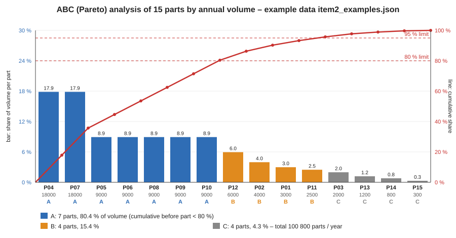
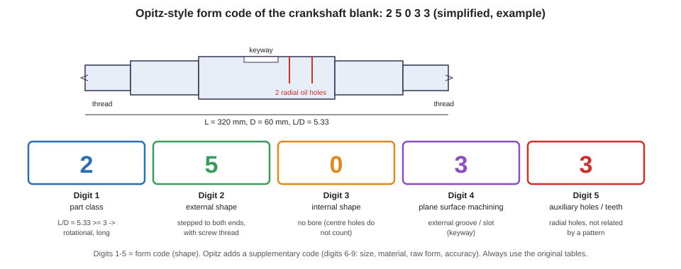
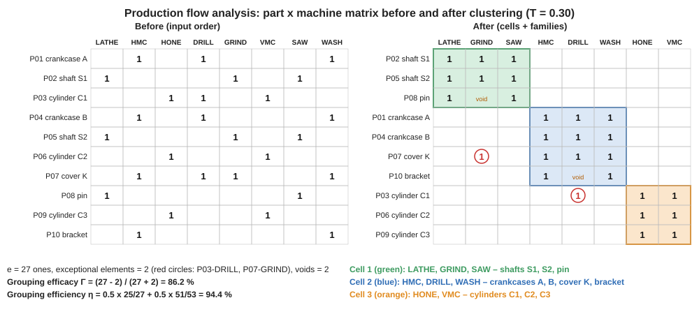
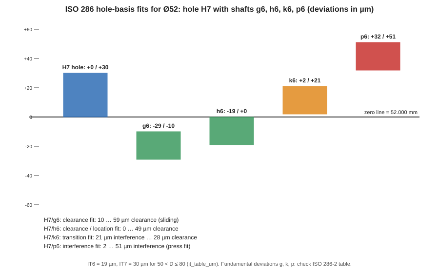
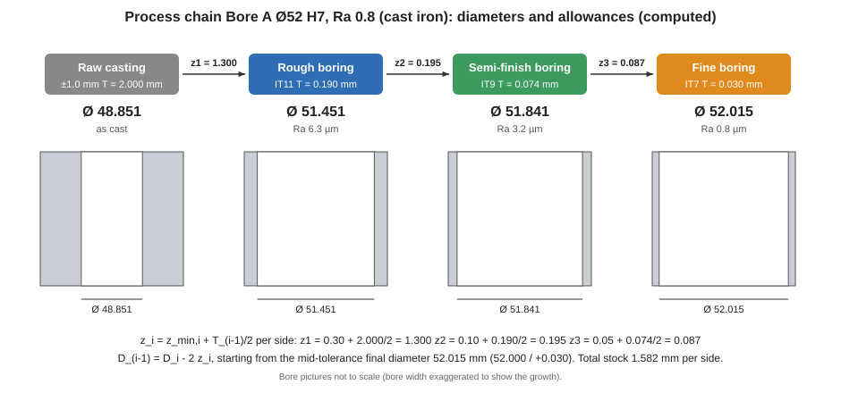
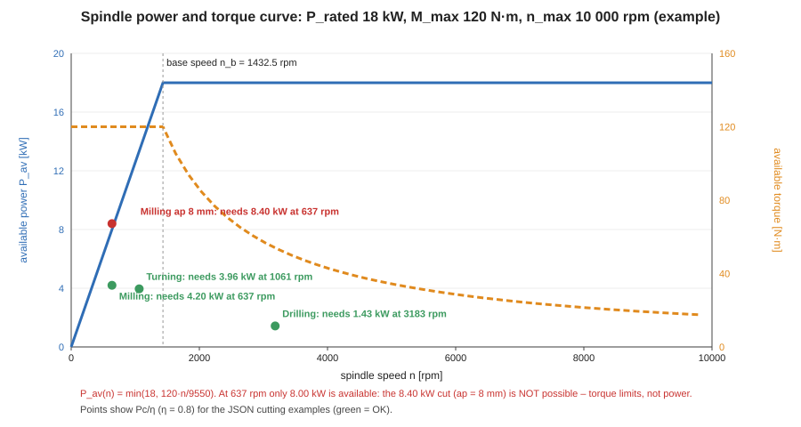
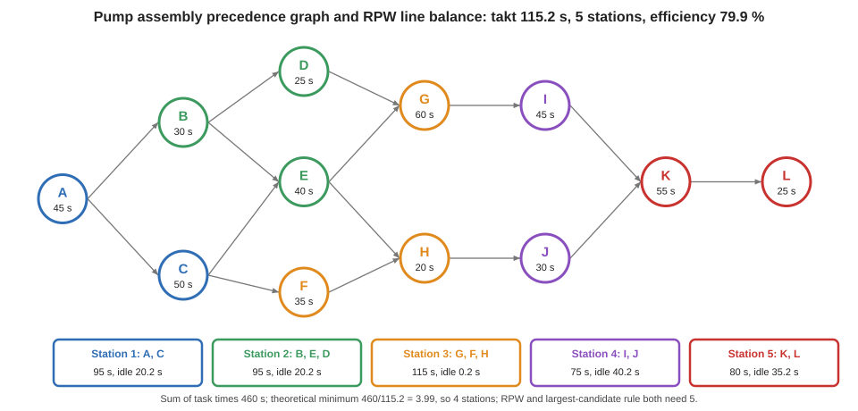
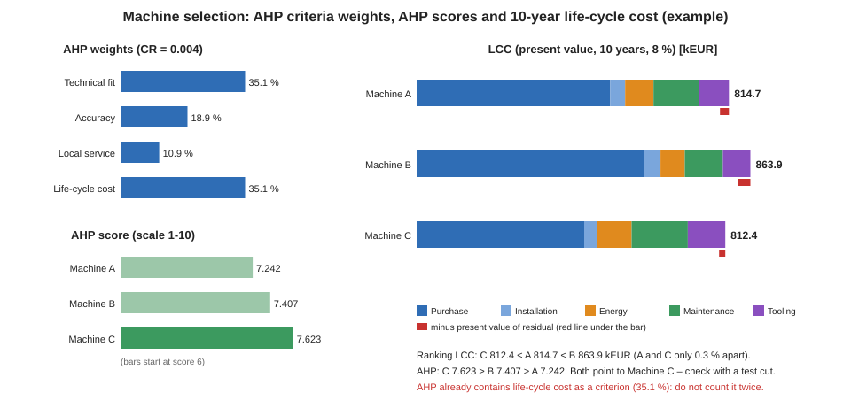

# 62 – From product to process to machines (textbook, all domains)

> Tab **FMS engineering → item 2** (`/?feitem=2#fmse`, capacity presets: `&fecap=mach|asm|weld|sheet`). Contract: guide 60.
> State: **November 2026** (rewritten as a full textbook). Previous item: guide 61 (FMS types, pipeline, module standard).
> **All numbers in this guide are examples or typical ranges.** They are not data from a real project, a real catalogue
> or a real supplier. Every number of the worked examples (ABC, part families, IT grades, process chain, cutting times,
> spindle check, tool life, moulding, bending, welding, calendar, capacity, EOQ, line balance, AHP, life-cycle cost) is
> calculated from the shared file `tools/fmse/examples/item2_examples.json` with the formulas written in its `_formulas`
> section. The Python tools in `tools/fmse/` and the web tab use the same file, so the numbers must match.

## How to use this guide

Guide 61 told you **which kind** of system fits your volume and variety (line, FTL, RMS, FMS, FMC, stand-alone CNC) and how
to run the project. This guide does the **engineering work in the middle of phase P1–P2** (guide 61 §B4–B5): it turns a
**product** into **processes**, the processes into **times**, the times into a **number of machines**, and the machines into
a **buying decision**. This chain is the same for every factory and every product:

```
product + volumes ──► part families ──► process chain per feature ──► routing sheet ──► times per operation
        (Part A)          (Part A)              (Part B)                  (Part B)           (Part C)
                                                                                                 │
     machine order ◄── acceptance test ◄── machine selection (AHP, LCC) ◄── number of machines ◄─┘
        (Part E)           (Part E)                 (Part E)                     (Part D)
```

The guide has seven parts:

1. **Part A – Product analysis**: product structure and bill of materials (BOM), make-or-buy, PQ / ABC analysis,
   group technology (classification and coding), production flow analysis (PFA) to find part families and cells.
2. **Part B – Process planning**: features, datums and set-ups, ISO 286 tolerances and fits, surface roughness, GD&T,
   process capability, process chains with allowances, the machining processes one by one, assembly, welding, sheet
   metal, injection moulding, and complete routing sheets.
3. **Part C – Time estimation**: cutting data, the formulas for turning, milling, drilling and tapping, the spindle
   power–torque check, tool life (Taylor) and economic cutting speed, non-productive times, manual work (MTM), and the
   times of welding, bending, laser cutting and moulding.
4. **Part D – Capacity and number of machines**: available hours from the calendar, OEE, load per machine group, lot size
   (EOQ, SMED), takt time and line balancing, alternative routings and growth.
5. **Part E – Machine selection**: specification of machine parameters, checklists per machine type, AHP, life-cycle cost,
   run-off and acceptance (Cmk, ISO 230-2, ISO 10791), and the **buy list** of real makers.
6. **Part F – Three complete worked cases**: machining FMS (crankcase family), assembly line (pump), sheet-metal housing.
7. **Part G – Programs and tools**: the offline Python tools, the web tab, glossary, standards, checklists, common mistakes,
   limits, and how the numbers were checked.

Read Parts A–D once from the start; they build on each other. Use Part E when you write a machine specification or
compare offers. Use Part F as a template for your own project. Run the tools of Part G with your own data.

A **running use case** goes through the whole guide: the **compressor factory** of this twin – crankcases VC10, VC20, VC30
(prismatic, cast iron, on horizontal machining centres), cylinders, cylinder heads, crankshafts, con-rods, flywheels,
valve plates and covers – and the **assembly line** for the compressor / pump. Boxes marked **Use case** show how each
chapter is applied to it.

**Notation used everywhere:** numbers with a space as thousands separator (18 000), decimal point (52.015). Formulas use
SI-based workshop units: mm, m/min, mm/min, rpm (= min⁻¹), kW, N·m, N/mm², min, s, h, EUR. "Example" means a teaching value.

## Contents

**Part A – Product analysis**
- A0 Purpose and where in the twin
- A1 Product structure, BOM levels, make-or-buy
- A2 PQ analysis – Pareto / ABC, PQR, what each class means for the system design
- A3 Group technology – classification and coding (Opitz-style code digit by digit, KK-3, DCLASS, MICLASS, company codes)
- A4 Production flow analysis – King's ROC step by step, Jaccard similarity, single linkage, Γ and η, exceptional
  elements and voids, other methods

**Part B – Process planning**
- B1 Features, datums, the 3-2-1 principle, set-up planning, fixturing
- B2 Tolerances and surfaces – ISO 286 (IT grades, deviations, fits), Ra / Rz, GD&T for process choice
- B3 Process capability of processes and process chains with allowances (fully worked)
- B4 The machining processes one by one (turning … EDM)
- B5 Non-machining domains – assembly, robot welding, sheet metal, injection moulding
- B6 Routing sheets – crankcase and shaft

**Part C – Time estimation**
- C1 Cutting data sources
- C2 Turning, milling, drilling, tapping – fully worked
- C3 Spindle power–torque curve and the power check
- C4 Tool life – Taylor, economic cutting speed
- C5 Non-productive times
- C6 Manual work times – MTM / MTM-UAS
- C7 Welding, bending, laser and moulding times

**Part D – Capacity and number of machines**
- D1 Available hours from the calendar, shift models
- D2 OEE assumptions
- D3 Load per group and number of machines (fully worked)
- D4 Lot size – EOQ, set-up vs capacity, SMED
- D5 Takt time and line balancing (RPW and largest-candidate rule, mixed-model lines)
- D6 Alternative routings and growth scenarios

**Part E – Machine selection**
- E1 Specification of machine parameters
- E2 Checklists per machine type
- E3 AHP and weighted scoring (fully worked)
- E4 Life-cycle cost (fully worked) and combining with AHP
- E5 Test cut, run-off and acceptance (Cmk, ISO 230-2, ISO 10791)
- E6 Buy list – real makers and series per machine type

**Part F – Complete worked cases**
- F1 Machining FMS for the crankcase family
- F2 Assembly line for the pump / compressor
- F3 Sheet-metal housing

**Part G – Programs, tools and reference**
- G1 Offline Python tools `tools/fmse/*.py`
- G2 The web tab item 2 – which section supports which chapter
- G3 Standards list
- G4 Consolidated checklists
- G5 Common mistakes
- G6 Limits
- G7 Glossary
- G8 How the numbers were checked + drawings of this guide

---

# Part A – Product analysis

## A0. Purpose and where in the twin

### A0.1 Purpose

Item 1 (guide 61) told you **which kind** of system fits. Item 2 answers the next questions for **any** product:

1. Which parts are important (volume, money) and which are a small "tail"? (**ABC / PQ analysis**, A2)
2. Which parts belong together (**part families**), and which machines form a **cell**? (**GT and PFA**, A3–A4)
3. Which **process** can make each feature (tolerance, surface), in which order, with how much stock? (Part B)
4. How long does each operation take (**cycle time**)? Is the spindle strong enough? (Part C)
5. How many **machines** of each type do I need? Where is the **bottleneck**? Which lot size? Which takt? (Part D)
6. Which **machine model** do I buy, how do I compare offers in money, and how do I accept the machine? (Part E)

**The order matters:** product → families → processes → times → capacity → selection. If you start with a machine
catalogue, you buy what the salesman likes, not what your parts need. If you start with capacity before the process
chain is clear, the times are guesses and the machine count is wrong.

After this guide you can: analyse a product range with ABC and PQR, code parts and form families, cluster a part ×
machine matrix and judge the result with numbers, read ISO 286 and choose a capable process chain with correct
allowances, write a routing sheet, calculate cutting times, power and torque and check them against a spindle curve,
choose an economic cutting speed, calculate available hours, machine count, utilisation, lot size and takt, balance an
assembly line, compare machines with AHP and life-cycle cost, and write the acceptance test for a new machine.

### A0.2 Where in the twin

| Section of item 2 | What you can do | Chapters |
|---|---|---|
| **2A** Part families | part × machine matrix (click to change), rank order clustering, similarity threshold → cells, grouping efficacy, exceptional elements | A4 |
| **2B** Process selection | nominal size + tolerance + Ra → required IT grade from the ISO 286 table, all processes as bars (economical / capable / not capable), suggested last operation; joining and test processes | B2–B3, B5 |
| **2C** Cycle time | turning, milling, drilling (with power + torque check), robot welding, laser cutting, assembly station | C2, C3, C7 |
| **2D** Capacity | 4 editable presets (machining FMS, assembly line, welding cells, sheet metal): load, set-up hours, machines, utilisation, takt, bottleneck | D3 |
| **2E** Selection | 10 checks before a quotation, weighted scoring matrix | E1, E3 |
| Deep sections **2F–2M** | the worked examples of this guide with the shared JSON (see G2) | A2, A3, B3, C3–C7, D1, D4, D5, E3, E4 |

Deep links: `/?feitem=2#fmse`, capacity preset `&fecap=mach|asm|weld|sheet`. Worked examples in other tabs:
**FMS & products** and **Live factory** (the crankcase FMS with 3 HMCs), **Ball screw + guide factory** (rotational parts,
grinding), **HMC build** (guide 12: what is inside a machining centre – use it when you read the machine specification
in E1).

---

## A1. Product structure, BOM levels, make-or-buy

### A1.1 Why start with the product structure

A factory does not make "a compressor". It makes **parts**, buys other parts, and **assembles** them in a certain order.
The product structure tells you:

- which items you **make** (they need processes and machines – this guide),
- which items you **buy** (they need suppliers, incoming inspection and storage – not machines),
- which items are **assemblies** (they need assembly stations and test – B5, D5),
- how many of each item you need per product (the **quantity per**), so that product volumes become **part volumes**.

### A1.2 Bill of materials (BOM) and levels

A **bill of materials** is the list of all items in a product with the quantity per parent item. Items are arranged in
**levels**: level 0 = finished product, level 1 = main assemblies and parts that go directly into the product, level 2 =
parts of the level-1 assemblies, and so on. Three common forms:

| Form | What it shows | Used for |
|---|---|---|
| **Structure BOM (multi-level)** | the tree with all levels, quantity per parent | design, assembly sequence, MRP explosion |
| **Single-level BOM** | only the direct children of one item | work orders for one assembly station |
| **Quantity (summary) BOM** | every item once with the total quantity per product | purchasing, part volumes for this guide |

**Example – 2-cylinder compressor VC20 (simplified, teaching example – the same BOM as web section 2F):**

| Level | Item | Qty per parent | Make / buy | Comment |
|---|---|---|---|---|
| 0 | Compressor VC20 | 1 | make (final assembly) | assembled + tested on the line (D5) |
| 1 | Crankcase assembly | 1 | make (assembly) | |
| 2 | P01 Crankcase VC20 | 1 | make | prismatic, cast iron, HMC (A4 cell 2) |
| 2 | Main bearing | 2 | buy | catalogue part |
| 2 | P14 Oil sight glass holder | 1 | make | small turned part (only some variants – volume 800 in A2) |
| 1 | Crank drive | 1 | make (assembly) | |
| 2 | P06 Crankshaft | 1 | make | rotational, lathe + grinder |
| 2 | P07 Con-rod | 2 | make | forged blank bought, machined |
| 2 | Piston + rings | 2 | buy | |
| 2 | P10 Flywheel | 1 | make | rotational, lathe + VMC |
| 1 | Cylinder group | 1 | make (assembly) | |
| 2 | P04 Cylinder | 2 | make | bore honed |
| 2 | P08 Valve plate | 1 | make | flat part, ground sealing face |
| 2 | P05 Cylinder head | 1 | make | prismatic, VMC |
| 2 | Head gasket | 1 | buy | |
| 1 | P09 Cover | 1 | make | flat, VMC |
| 1 | Bolt kit M8 / M10 | 1 | buy | C-parts, kanban |

**Part volume from product volume** (MRP explosion, simplified):

$$ Q_{part} = \sum_{p} Q_p \cdot q_{p,part} \cdot (1 + s) $$

| Symbol | Meaning | Unit |
|---|---|---|
| Q_p | annual volume of product p | pieces / year |
| q_p,part | quantity of the part per product p (product of the quantities along the BOM path) | – |
| s | spare-part and scrap allowance (e.g. 0.02–0.05) | – |

**Worked example (teaching values):** the con-rod is used 2 × per compressor. Compressors: VC10 4 000, VC20 3 000,
VC30 2 000 → 9 000 compressors. Con-rods = 9 000 × 2 = **18 000 / year** (s = 0 here). This is exactly the con-rod
volume P07 in the ABC example of A2. In the same way cylinders 9 000 × 2 = 18 000 (P04), and the parts used once per
compressor (cylinder head P05, crankshaft P06, valve plate P08, cover P09, flywheel P10) 9 000 × 1 = 9 000. Always do this explosion **before** the ABC analysis – the factory makes
parts, so the ABC analysis is about part volumes, not product volumes.

### A1.3 Make-or-buy

For every item decide: make it in the new system, buy it, or make it elsewhere in the company. Decide with **four
groups of criteria**, not only with the price:

| Group | Questions | Tends to "make" | Tends to "buy" |
|---|---|---|---|
| Strategy / know-how | Is the part core know-how (sealing faces, tight bores)? Does it define product quality? | yes | no, standard catalogue part |
| Cost | Make cost (variable + share of fixed) vs purchase price + logistics + quality cost | make cost lower | price lower, no investment |
| Capacity / flexibility | Do we have (or plan) the machines? Is volume stable? | stable volume, fits the family | peak volumes, very different process |
| Risk / supply | Few suppliers? Long lead time? Quality problems? | supplier risk high | many capable suppliers |

**Cost comparison (incremental view):**

$$ C_{make} = Q\,(c_{mat} + c_{var}) + C_{fix,add}, \qquad C_{buy} = Q\,(p + c_{log} + c_{qual}) $$

$$ Q_{BE} = \frac{C_{fix,add}}{(p + c_{log} + c_{qual}) - (c_{mat} + c_{var})} $$

| Symbol | Meaning | Unit |
|---|---|---|
| Q | annual volume | pieces / year |
| c_mat, c_var | material cost and variable process cost (machine + labour time × rate, tools, energy) per part | EUR / piece |
| C_fix,add | **additional** fixed cost per year only because we make the part (share of machine, fixture, programs, gauges) | EUR / year |
| p, c_log, c_qual | purchase price, logistics cost, quality cost (incoming inspection, claims) per part | EUR / piece |
| Q_BE | break-even volume: above it "make" is cheaper | pieces / year |

**Worked example (teaching values):** a bracket P11, Q = 2 500 / year. Make: material 3.20 EUR, process 4 min at
90 EUR/h = 6.00 EUR → 9.20 EUR; additional fixed cost (fixture + program + gauge, written off per year) 4 000 EUR/year.
Buy: price 10.50 EUR + logistics 0.40 + quality 0.30 = 11.20 EUR.
C_make = 2 500 × 9.20 + 4 000 = 27 000 EUR; C_buy = 2 500 × 11.20 = 28 000 EUR → make is 1 000 EUR/year cheaper.
Q_BE = 4 000 / (11.20 − 9.20) = **2 000 pieces/year**. The volume is only 25 % above break-even, so the decision is
not robust: if the bracket brings an exceptional element into the cell (A4), **buy** is the better choice.

**Rule:** use only **additional** fixed cost. If the machine exists anyway and has free capacity, its depreciation is not
an additional cost of the part (it is sunk). If the part makes a new machine necessary, the full machine cost counts.

**Use case:** in the compressor factory, crankcases, cylinders, crankshafts and valve plates are "make" (core know-how,
tight tolerances). Bearings, seals, screws and the motor are "buy". The service part kit P15 is a purchased kit with a
packing operation only.

---

## A2. PQ analysis – Pareto / ABC, PQR

### A2.1 The idea

**PQ analysis** (product–quantity analysis) plots the products or parts against their volume. In most factories a few
items make most of the volume (or money) – the **Pareto principle** ("80/20 rule"). The ABC classification puts each
item into a class:

- **A** – the few items that make most of the volume → candidates for **dedicated, high-output** equipment or a fixed
  family in a cell; detailed time studies, best process.
- **B** – medium items → typical **FMS / FMC** parts: shared flexible machines, pallets, quick change.
- **C** – the long tail of small volumes → **stand-alone CNC**, job shop, or **buy**; keep set-up effort low.

### A2.2 The method and formulas (as in the JSON)

1. Make the list of parts with annual volume Q_i (and price c_i if you want the revenue basis).
2. Choose the **basis**: volume v_i = Q_i (machine load, handling) or revenue v_i = Q_i · c_i (money tied up, value).
3. Sort the parts by v_i, largest first (equal values keep the input order).
4. Calculate the share and the cumulative share:

$$ s_i = \frac{v_i}{\sum_j v_j}, \qquad S_i = \sum_{j \le i} s_j $$

5. Class rule (JSON `abc`): look at the cumulative share **before** adding the part, S_(i−1):
   **A** if S_(i−1) < 80 %, **B** if S_(i−1) < 95 %, otherwise **C**.

The "before" rule means: the part that crosses the 80 % line is still A. This is the usual convention in tools; write it
in your report, because other conventions (class by cumulative share **after** adding) give a different border part.

### A2.3 Worked example – 15 parts by volume (JSON `pq_parts`)

Total volume Σ Q = **100 800 parts / year**.

| Rank | Part | Volume Q [pcs/year] | Share s [%] | Cum. before [%] | Cum. after [%] | Class |
|---|---|---|---|---|---|---|
| 1 | P04 Cylinder | 18 000 | 17.86 | 0.00 | 17.86 | **A** |
| 2 | P07 Con-rod | 18 000 | 17.86 | 17.86 | 35.71 | **A** |
| 3 | P05 Cylinder head | 9 000 | 8.93 | 35.71 | 44.64 | **A** |
| 4 | P06 Crankshaft | 9 000 | 8.93 | 44.64 | 53.57 | **A** |
| 5 | P08 Valve plate | 9 000 | 8.93 | 53.57 | 62.50 | **A** |
| 6 | P09 Cover | 9 000 | 8.93 | 62.50 | 71.43 | **A** |
| 7 | P10 Flywheel | 9 000 | 8.93 | 71.43 | 80.36 | **A** |
| 8 | P12 Pipe flange | 6 000 | 5.95 | 80.36 | 86.31 | B |
| 9 | P02 Crankcase VC10 | 4 000 | 3.97 | 86.31 | 90.28 | B |
| 10 | P01 Crankcase VC20 | 3 000 | 2.98 | 90.28 | 93.25 | B |
| 11 | P11 Bracket | 2 500 | 2.48 | 93.25 | 95.73 | B |
| 12 | P03 Crankcase VC30 | 2 000 | 1.98 | 95.73 | 97.72 | C |
| 13 | P13 Spacer | 1 200 | 1.19 | 97.72 | 98.91 | C |
| 14 | P14 Oil sight glass holder | 800 | 0.79 | 98.91 | 99.70 | C |
| 15 | P15 Service part kit | 300 | 0.30 | 99.70 | 100.00 | C |

**Intermediate steps for the border parts:** P10 Flywheel: cumulative before = (18 000 + 18 000 + 5 × 9 000 − 9 000) / 100 800
= 72 000 / 100 800 = 71.43 % < 80 % → **A**; after adding 9 000 → 81 000 / 100 800 = 80.36 %. P12: before = 80.36 % ≥ 80 %
and < 95 % → **B**. P11: before 93.25 % < 95 % → **B**. P03: before 96 500 / 100 800 = 95.73 % ≥ 95 % → **C**.

**Result (volume basis):** **A = 7 parts** (P04, P07, P05, P06, P08, P09, P10) with 80.4 % of the volume;
**B = 4 parts** (P12, P02, P01, P11) with 15.4 %; **C = 4 parts** (P03, P13, P14, P15) with 4.3 %.



**Same parts on the revenue basis** (v = Q × price, total 4 093 800 EUR/year – shows how the picture changes):

| Rank | Part | Revenue [EUR/year] | Share [%] | Cum. before [%] | Class |
|---|---|---|---|---|---|
| 1 | P04 Cylinder | 720 000 | 17.59 | 0.00 | A |
| 2 | P06 Crankshaft | 630 000 | 15.39 | 17.59 | A |
| 3 | P02 Crankcase VC10 | 600 000 | 14.66 | 32.98 | A |
| 4 | P01 Crankcase VC20 | 540 000 | 13.19 | 47.63 | A |
| 5 | P05 Cylinder head | 495 000 | 12.09 | 60.82 | A |
| 6 | P03 Crankcase VC30 | 460 000 | 11.24 | 72.92 | A |
| 7 | P10 Flywheel | 225 000 | 5.50 | 84.15 | B |
| 8 | P07 Con-rod | 216 000 | 5.28 | 89.65 | B |
| 9 | P08 Valve plate | 81 000 | 1.98 | 94.92 | B |
| 10 | P09 Cover | 54 000 | 1.32 | 96.90 | C |
| 11 | P11 Bracket | 35 000 | 0.85 | 98.22 | C |
| 12 | P12 Pipe flange | 24 000 | 0.59 | 99.08 | C |
| 13 | P15 Service part kit | 9 000 | 0.22 | 99.66 | C |
| 14 | P13 Spacer | 2 400 | 0.06 | 99.88 | C |
| 15 | P14 Oil sight glass holder | 2 400 | 0.06 | 99.94 | C |

On the revenue basis the three **crankcases become A-parts** (they are expensive) and the con-rod drops to B. Which
basis is right? **Both, for different questions:** volume for handling, set-ups, takt and machine load per piece type;
revenue for the money in the system, inspection effort and which parts justify a dedicated fixture. The best basis for
**machine capacity** is the **load in hours** (Q × time per part, D3) – a crankcase with 36 min on the HMC loads the
system more than a cover with 3 min, even at a lower volume.

### A2.4 What each class means for the system design

| Class | Typical system answer | Fixtures and tools | Planning |
|---|---|---|---|
| **A** (high volume, few types) | dedicated cell or line, FTL, high-output machines (multi-spindle, transfer, robot cell), or a fixed family on dedicated pallets in the FMS | dedicated, optimised fixtures, special tools, tool life monitored | detailed time study, line balancing, SMED not critical (long runs) |
| **B** (medium) | **FMS / FMC** – the classic area: shared machining centres, pallet pool, routing flexibility | modular / family fixtures, standard tools | lot size by EOQ (D4), set-ups matter |
| **C** (low volume, many types) | stand-alone CNC, job shop corner, outsourcing, or "buy" | universal clamping (vice, zero-point plates), standard tools | minimise programming and set-up effort; CAM templates |

**Use case:** crankcases are C/B by volume but A by revenue and load → they stay in the FMS (cell 2 of A4, guide 61 use case).
Cylinders, con-rods and crankshafts (A by volume) justify their own cells; the cylinder cell (honing) is close to a
dedicated line. The small C-parts P13, P14 run on one universal VMC or are bought.

### A2.5 PQR analysis (product – quantity – routing)

PQ tells you **how many**; PQR adds **which route**. Group the parts by routing (the sequence of machine types), then add
the volume per group. A PQR table shows quickly which routing families carry the load:

| Routing family | Route | Parts (example) | Volume [pcs/year] | Share [%] |
|---|---|---|---|---|
| R1 prismatic, large | casting → HMC → WASH → CMM | crankcases VC10/20/30 | 9 000 | 8.9 |
| R2 prismatic, small | VMC → WASH | heads, covers, valve plates, flange, bracket | 35 500 | 35.2 |
| R3 rotational, ground | SAW → LATHE → GRIND → WASH | crankshaft (and pins) | 9 000 | 8.9 |
| R4 rotational, turned | LATHE → VMC → WASH | flywheel, spacer | 10 200 | 10.1 |
| R5 bores honed | VMC → HONE → WASH | cylinders | 18 000 | 17.9 |
| R6 forged, machined | VMC → (DRILL) → WASH | con-rods | 18 000 | 17.9 |
| R7 other | – | sight glass holder, service kit | 1 100 | 1.1 |

(Routing families and the assignment of parts are a teaching example; the volumes are the JSON `pq_parts` volumes, total 100 800.)
The PQR table is the bridge to A4: the routing of every part is the row of the part × machine matrix.

---

## A3. Group technology – classification and coding

### A3.1 Idea

**Group technology (GT)** uses the similarity of parts. Similar parts are designed, planned and made in a similar way.
Two kinds of similarity:

- **Design similarity** – shape, size, features, material, tolerances → used for **design retrieval** ("do we already
  have such a part?"), standard parts, process plan templates (variant process planning, CAPP).
- **Manufacturing similarity** – the same machines and route → used for **cells** (A4).

A **classification and coding system** turns the part description into a short code. Similar codes = similar parts.

| Code structure | How it works | Pro | Contra |
|---|---|---|---|
| **Monocode (hierarchical)** | the meaning of each digit depends on the digits before (a tree) | short, much information | hard to learn and to search for single features |
| **Polycode (chain)** | each digit has a fixed meaning, independent of the others | easy to search ("all parts with digit 4 = 3") | longer for the same information |
| **Hybrid** | mixture; most practical systems (Opitz: first digit decides the table for the following digits) | balance | – |

### A3.2 The Opitz system (simplified)

The **Opitz system** (H. Opitz, Aachen, 1970) is the best-known public system. It has:

- a **form code** of 5 digits (digits 1–5): part class, main shape, internal shape, plane surfaces, auxiliary holes and teeth,
- a **supplementary code** of 4 digits (digits 6–9): main dimension, material, raw material form, accuracy,
- optionally a **secondary code** for company-specific data (operations, machines).

Digit 1 (part class) decides how digits 2–5 are read:

| Digit 1 | Part class | Typical example |
|---|---|---|
| 0 | rotational, L/D ≤ 0.5 | disc, flange, ring |
| 1 | rotational, 0.5 < L/D < 3 | bush, short shaft, flywheel |
| 2 | rotational, L/D ≥ 3 | long shaft, crankshaft blank |
| 3–5 | rotational special (with deviation, e.g. eccentric) | crankshaft with throws, cam |
| 6 | non-rotational, flat (A/B ≤ 3, A/C ≥ 4) | plate, valve plate, cover |
| 7 | non-rotational, long (A/B > 3) | bar, rail, con-rod-like |
| 8 | non-rotational, cubic (A/B ≤ 3, A/C < 4) | housing, crankcase, block |
| 9 | special | – |

(A ≥ B ≥ C are the edge lengths of the enveloping box. Class limits as in common textbook versions of the Opitz tables –
check the original tables before you build a company code on them.)

For rotational parts (digit 1 = 0, 1, 2) the following digits mean (simplified):

| Digit – meaning | Values (simplified) |
|---|---|
| 2 – external shape | 0 smooth, no shape elements · 1 stepped to one end, no shape elements · 2 stepped to one end with thread · 3 stepped to one end with functional groove · 4 stepped to both ends, no shape elements · **5 stepped to both ends with thread** · 6 stepped to both ends with groove · 7 functional cone · 8 operating thread · 9 other |
| 3 – internal shape | **0 no hole, no bore** · 1 no shape elements, through · 2 with thread · 3 with groove · 4 stepped to one end … 9 other |
| 4 – plane surface machining | 0 none · 1 surface plane / curved in one direction · 2 external plane surfaces related by graduation · **3 external groove and/or slot** · 4 external spline · 5 … 9 other combinations |
| 5 – auxiliary holes and gear teeth | 0 no auxiliary hole · 1 axial holes not related by a pattern · 2 axial holes related by a pattern · **3 radial holes not related by a pattern** · 4 … axial and radial · 6–9 gear teeth types |

### A3.3 Worked example – crankshaft blank (JSON `opitz_example`)

Part: compressor crankshaft blank, L = 320 mm, D = 60 mm, stepped to both ends with thread, centre holes only, one
keyway, two radial oil holes not on a pattern.

| Digit | Question | Evidence on the drawing | Value |
|---|---|---|---|
| 1 part class | rotational? which L/D? | L/D = 320 / 60 = **5.33 ≥ 3** → rotational, long | **2** |
| 2 external shape | steps? thread? groove? | stepped to both ends, with screw thread | **5** |
| 3 internal shape | bore? | no bore – centre holes do not count | **0** |
| 4 plane surface machining | flats, slots, splines? | external groove / slot (keyway) | **3** |
| 5 auxiliary holes / teeth | holes? pattern? teeth? | radial holes, not related by a pattern | **3** |

**Form code = 2 5 0 3 3 → "25033".**



**How to read the code back:** "a long rotational part, stepped to both ends with thread, no bore, with a keyway and
radial holes". A search for `25*3*` finds all long stepped shafts with keyways → candidates for the same lathe + VMC (or
mill-turn) family, the same steady rest, the same keyway cutter, the same CAM template.

**What the code tells the process planner (link to Part B):**

| Digit value | Process consequence |
|---|---|
| 2 (L/D ≥ 3) | between centres or chuck + tailstock; for L/D > 8–10 a steady rest; centre holes as datum (B1) |
| 5 (stepped both ends, thread) | turning both ends → 2 set-ups on a lathe, or 1 on a twin-spindle lathe / mill-turn; thread turning |
| 0 (no bore) | no boring; centre drilling only |
| 3 (keyway) | milling → driven tools on a mill-turn, or a VMC operation |
| 3 (radial holes) | drilling with a C-axis on a mill-turn, or VMC with an indexer |

**Supplementary code (example only, not in the JSON):** digit 6 main dimension D = 60 mm (class of 50–100 mm), digit 7
material steel (e.g. 42CrMo4, heat treatable), digit 8 raw form round bar or forging, digit 9 accuracy class "digits 2 and
4" (bearing seats IT6, ground). Write the full 9-digit code only with the original tables.

### A3.4 Other systems

| System | Origin | Structure | Notes |
|---|---|---|---|
| **KK-3** | Japan (JSPMI) | 21 digits, hybrid, general purpose for machined parts | very detailed, includes functions and material; long |
| **MICLASS** (later MultiClass) | TNO Netherlands, later OIR (USA) | 12 digits universal + up to 18 company-specific | computer supported, interactive coding |
| **DCLASS** | Brigham Young University (USA) | decision-tree code of 8 digits for parts (also for processes and materials) | tree logic, used for CAPP research |
| **Brisch** | UK | monocode, company-specific | early practical system |
| **Company code** | your company | e.g. 6–10 digits: product line, part type, shape class, size class, material, accuracy | best in practice: short, fits your parts |

**How to build a company code (practical method):**
1. Collect 200–500 representative drawings.
2. Define the **few attributes** that decide process and machine: rotational / prismatic / sheet, size class (fits which
   machine envelope?), material group, tightest IT grade, special features (thread, gearing, hardened surface).
3. Give each attribute one digit (polycode), max. 8–10 digits.
4. Code all parts, test retrieval ("find all housings < 400 mm, cast iron, IT7"), fix the classes.
5. Store the code as a field in the PLM / ERP item master, so it is filled for every new part (mandatory field).

Today many companies use **feature-based search in the CAD / PLM system** (3D shape search) instead of a manual code.
The idea is the same; the coding work is done by the software. Keep a short code anyway for the factory (ERP, MES).

### A3.5 Use of the code for families and retrieval

- **Design retrieval:** before a new part is designed, search the code → reuse an existing part (avoids a new part number:
  every new part number costs drawing, programs, fixture, stock, quality planning – often estimated at 1 000–5 000 EUR
  per year and part number in literature; check your own number).
- **Process plan templates:** one routing template per code class (variant process planning).
- **Families for fixtures:** parts with the same digits 1–3 and size class often share a fixture base.
- **First rough cells:** group by digit 1 (rotational / flat / cubic) + size → then refine with PFA (A4), because shape
  similarity alone ignores the real routes (common mistake, G5).

---

## A4. Production flow analysis (PFA)

### A4.1 Idea (Burbidge)

**Production flow analysis** (J. L. Burbidge, 1960s–1970s) forms families and cells from the **real routings**, not from
the shapes. You write the **part × machine incidence matrix**: one row per part, one column per machine (type), and
a_ij = 1 if part i visits machine j. Then you re-order rows and columns so that the 1s form **blocks on the diagonal**.
Each block = one **machine cell** with its **part family**.

Three quality ideas:
- **Exceptional element** = a 1 outside the blocks: the part needs a machine of another cell (an inter-cell move).
- **Void** = a 0 inside a block: a machine of the cell that a part of the family does not use.
- A good solution has **few exceptional elements and few voids**.

### A4.2 The example matrix (JSON `pfa`)

10 parts × 8 machines, rows and columns deliberately mixed (as in web 2A):

| Part \ Machine | LATHE | HMC | HONE | DRILL | GRIND | VMC | SAW | WASH |
|---|---|---|---|---|---|---|---|---|
| P01 crankcase A | 0 | 1 | 0 | 1 | 0 | 0 | 0 | 1 |
| P02 shaft S1 | 1 | 0 | 0 | 0 | 1 | 0 | 1 | 0 |
| P03 cylinder C1 | 0 | 0 | 1 | 1 | 0 | 1 | 0 | 0 |
| P04 crankcase B | 0 | 1 | 0 | 1 | 0 | 0 | 0 | 1 |
| P05 shaft S2 | 1 | 0 | 0 | 0 | 1 | 0 | 1 | 0 |
| P06 cylinder C2 | 0 | 0 | 1 | 0 | 0 | 1 | 0 | 0 |
| P07 cover K | 0 | 1 | 0 | 1 | 1 | 0 | 0 | 1 |
| P08 pin | 1 | 0 | 0 | 0 | 0 | 0 | 1 | 0 |
| P09 cylinder C3 | 0 | 0 | 1 | 0 | 0 | 1 | 0 | 0 |
| P10 bracket | 0 | 1 | 0 | 0 | 0 | 0 | 0 | 1 |

Number of 1s: **e = 27**.

### A4.3 King's rank order clustering (ROC) step by step

ROC (J. R. King, 1980) – JSON `roc`:
1. Read each **row** as a binary number: the leftmost column is the highest bit. With 8 columns the weights are
   128, 64, 32, 16, 8, 4, 2, 1.
2. Sort the rows by this number, largest first (equal numbers keep their order – "stable" sort).
3. Read each **column** as a binary number: the top row is the highest bit. With 10 rows the weights are
   512, 256, …, 2, 1.
4. Sort the columns, largest first (stable).
5. Repeat 1–4 until nothing changes (max. 20 iterations).

**Iteration 1 – row values** (columns in input order LATHE 128, HMC 64, HONE 32, DRILL 16, GRIND 8, VMC 4, SAW 2, WASH 1):

| Part | Row bits | Calculation | Value |
|---|---|---|---|
| P01 | 0 1 0 1 0 0 0 1 | 64 + 16 + 1 | 81 |
| P02 | 1 0 0 0 1 0 1 0 | 128 + 8 + 2 | 138 |
| P03 | 0 0 1 1 0 1 0 0 | 32 + 16 + 4 | 52 |
| P04 | 0 1 0 1 0 0 0 1 | 64 + 16 + 1 | 81 |
| P05 | 1 0 0 0 1 0 1 0 | 128 + 8 + 2 | 138 |
| P06 | 0 0 1 0 0 1 0 0 | 32 + 4 | 36 |
| P07 | 0 1 0 1 1 0 0 1 | 64 + 16 + 8 + 1 | 89 |
| P08 | 1 0 0 0 0 0 1 0 | 128 + 2 | 130 |
| P09 | 0 0 1 0 0 1 0 0 | 32 + 4 | 36 |
| P10 | 0 1 0 0 0 0 0 1 | 64 + 1 | 65 |

Sorted rows: **P02 (138), P05 (138), P08 (130), P07 (89), P01 (81), P04 (81), P10 (65), P03 (52), P06 (36), P09 (36).**

**Iteration 1 – column values** (rows in the new order, weights P02 = 512, P05 = 256, P08 = 128, P07 = 64, P01 = 32,
P04 = 16, P10 = 8, P03 = 4, P06 = 2, P09 = 1):

| Machine | Rows with a 1 | Calculation | Value |
|---|---|---|---|
| LATHE | P02, P05, P08 | 512 + 256 + 128 | 896 |
| HMC | P07, P01, P04, P10 | 64 + 32 + 16 + 8 | 120 |
| HONE | P03, P06, P09 | 4 + 2 + 1 | 7 |
| DRILL | P07, P01, P04, P03 | 64 + 32 + 16 + 4 | 116 |
| GRIND | P02, P05, P07 | 512 + 256 + 64 | 832 |
| VMC | P03, P06, P09 | 4 + 2 + 1 | 7 |
| SAW | P02, P05, P08 | 512 + 256 + 128 | 896 |
| WASH | P07, P01, P04, P10 | 64 + 32 + 16 + 8 | 120 |

Sorted columns (stable): **LATHE 896, SAW 896, GRIND 832, HMC 120, WASH 120, DRILL 116, HONE 7, VMC 7.**

**Matrix after iteration 1:**

| Part \ Machine | LATHE | SAW | GRIND | HMC | WASH | DRILL | HONE | VMC | Row value |
|---|---|---|---|---|---|---|---|---|---|
| P02 shaft S1 | 1 | 1 | 1 | 0 | 0 | 0 | 0 | 0 | 224 |
| P05 shaft S2 | 1 | 1 | 1 | 0 | 0 | 0 | 0 | 0 | 224 |
| P08 pin | 1 | 1 | 0 | 0 | 0 | 0 | 0 | 0 | 192 |
| P07 cover K | 0 | 0 | 1 | 1 | 1 | 1 | 0 | 0 | 60 |
| P01 crankcase A | 0 | 0 | 0 | 1 | 1 | 1 | 0 | 0 | 28 |
| P04 crankcase B | 0 | 0 | 0 | 1 | 1 | 1 | 0 | 0 | 28 |
| P10 bracket | 0 | 0 | 0 | 1 | 1 | 0 | 0 | 0 | 24 |
| P03 cylinder C1 | 0 | 0 | 0 | 0 | 0 | 1 | 1 | 1 | 7 |
| P06 cylinder C2 | 0 | 0 | 0 | 0 | 0 | 0 | 1 | 1 | 3 |
| P09 cylinder C3 | 0 | 0 | 0 | 0 | 0 | 0 | 1 | 1 | 3 |

**Iteration 2:** the new row values (last column) are already in descending order, and the column values in the new row
order are 896, 896, 832, 120, 120, 116, 7, 7 – also descending. **Nothing changes → ROC stops after 2 iterations.**

You can already see three blocks: {LATHE, SAW, GRIND} × {P02, P05, P08}, {HMC, WASH, DRILL} × {P07, P01, P04, P10},
{HONE, VMC} × {P03, P06, P09}, with two 1s outside: P07 on GRIND and P03 on DRILL. **ROC only re-orders**; it does not
draw the block borders. The borders come from the similarity method (A4.4) or from the engineer's judgement.

**Weaknesses of ROC:** the result depends on the input order (ties); with many exceptional elements the blocks are not
clear; binary numbers become very long for big matrices (use ROC2 – A4.9). Use ROC to **see** the structure, then decide
the cells with numbers.

### A4.4 Similarity coefficient (Jaccard) and single linkage (McAuley, 1972)

For every pair of machines j, k count over all parts (JSON `jaccard`):
- a = number of parts that use **both** j and k,
- b = parts that use j but not k, c = parts that use k but not j.

$$ s_{jk} = \frac{a}{a + b + c} \qquad (0 \le s_{jk} \le 1) $$

**Example HMC – DRILL:** parts with HMC: P01, P04, P07, P10; parts with DRILL: P01, P03, P04, P07. Both: P01, P04, P07 →
a = 3. HMC only: P10 → b = 1. DRILL only: P03 → c = 1. s = 3 / (3 + 1 + 1) = **0.600**.

**Example LATHE – GRIND:** LATHE: P02, P05, P08; GRIND: P02, P05, P07 → a = 2, b = 1 (P08), c = 1 (P07) → s = 2/4 = **0.500**.

**Full similarity matrix (computed):**

| | LATHE | HMC | HONE | DRILL | GRIND | VMC | SAW | WASH |
|---|---|---|---|---|---|---|---|---|
| **LATHE** | 1 | 0 | 0 | 0 | 0.500 | 0 | 1.000 | 0 |
| **HMC** | 0 | 1 | 0 | 0.600 | 0.167 | 0 | 0 | 1.000 |
| **HONE** | 0 | 0 | 1 | 0.167 | 0 | 1.000 | 0 | 0 |
| **DRILL** | 0 | 0.600 | 0.167 | 1 | 0.167 | 0.167 | 0 | 0.600 |
| **GRIND** | 0.500 | 0.167 | 0 | 0.167 | 1 | 0 | 0.500 | 0.167 |
| **VMC** | 0 | 0 | 1.000 | 0.167 | 0 | 1 | 0 | 0 |
| **SAW** | 1.000 | 0 | 0 | 0 | 0.500 | 0 | 1 | 0 |
| **WASH** | 0 | 1.000 | 0 | 0.600 | 0.167 | 0 | 0 | 1 |

**All pairs with s > 0, sorted:**

| Pair | a | b | c | s |
|---|---|---|---|---|
| LATHE – SAW | 3 | 0 | 0 | 1.000 |
| HONE – VMC | 3 | 0 | 0 | 1.000 |
| HMC – WASH | 4 | 0 | 0 | 1.000 |
| HMC – DRILL | 3 | 1 | 1 | 0.600 |
| DRILL – WASH | 3 | 1 | 1 | 0.600 |
| LATHE – GRIND | 2 | 1 | 1 | 0.500 |
| GRIND – SAW | 2 | 1 | 1 | 0.500 |
| HONE – DRILL | 1 | 2 | 3 | 0.167 |
| HMC – GRIND | 1 | 3 | 2 | 0.167 |
| GRIND – WASH | 1 | 2 | 3 | 0.167 |
| DRILL – VMC | 1 | 3 | 2 | 0.167 |
| DRILL – GRIND | 1 | 3 | 2 | 0.167 |

**Single linkage clustering (SLCA) at the threshold T** (JSON `slca`): join two machines when s_jk ≥ T (and s_jk > 0).
The cells are the **connected groups** (a machine joined to any member belongs to the cell – "single link").
With **T = 0.30** all pairs down to 0.500 are joined, the 0.167 pairs are not:

- Cell 1: LATHE – SAW (1.0), LATHE – GRIND (0.5), GRIND – SAW (0.5) → **{LATHE, GRIND, SAW}**
- Cell 2: HMC – WASH (1.0), HMC – DRILL (0.6), DRILL – WASH (0.6) → **{HMC, DRILL, WASH}**
- Cell 3: HONE – VMC (1.0) → **{HONE, VMC}**

**Dendrogram idea:** if you lower T step by step from 1 to 0 and record when groups merge, you get a tree (dendrogram):

| Merge level s | Groups that merge |
|---|---|
| 1.000 | LATHE + SAW; HMC + WASH; HONE + VMC |
| 0.600 | {HMC, WASH} + DRILL |
| 0.500 | {LATHE, SAW} + GRIND |
| 0.167 | {LATHE, GRIND, SAW} + {HMC, DRILL, WASH}, then + {HONE, VMC} |

**Choosing T:** every T between 0.167 (exclusive) and 0.500 gives the same 3 cells (checked for T = 0.20 … 0.50). At T = 0.60
GRIND becomes a single machine (4 groups); at T = 0.70 DRILL also leaves cell 2 (5 groups). A wide stable range of T is a
sign of a **clear** structure. Choose T in the middle of the widest stable range, not at a border.

**Assign parts to cells:** each part goes to the cell where it has the **most operations** (tie → lowest cell number):

| Part | Operations in cell 1 / 2 / 3 | Cell |
|---|---|---|
| P01 crankcase A | 0 / 3 / 0 | 2 |
| P02 shaft S1 | 3 / 0 / 0 | 1 |
| P03 cylinder C1 | 0 / 1 / 2 | 3 |
| P04 crankcase B | 0 / 3 / 0 | 2 |
| P05 shaft S2 | 3 / 0 / 0 | 1 |
| P06 cylinder C2 | 0 / 0 / 2 | 3 |
| P07 cover K | 1 / 3 / 0 | 2 |
| P08 pin | 2 / 0 / 0 | 1 |
| P09 cylinder C3 | 0 / 0 / 2 | 3 |
| P10 bracket | 0 / 2 / 0 | 2 |

**Result:**

| Cell | Machines | Part family | Block size (parts × machines) |
|---|---|---|---|
| 1 | LATHE, GRIND, SAW | P02 shaft S1, P05 shaft S2, P08 pin | 3 × 3 = 9 |
| 2 | HMC, DRILL, WASH | P01 crankcase A, P04 crankcase B, P07 cover K, P10 bracket | 4 × 3 = 12 |
| 3 | HONE, VMC | P03 cylinder C1, P06 cylinder C2, P09 cylinder C3 | 3 × 2 = 6 |



### A4.5 Quality of the grouping – efficacy Γ and efficiency η

Count:
- e = total number of 1s = 27,
- e_exc = 1s **outside** the blocks = 2 (**P03 → DRILL**, **P07 → GRIND**),
- e_void = 0s **inside** the blocks = 2 (**P08 on GRIND**, **P10 on DRILL**),
- cells inside blocks = 9 + 12 + 6 = 27; ones inside = 27 − 2 = 25; cells outside = 10 × 8 − 27 = 53; zeros outside =
  53 − 2 = 51.

**Grouping efficacy** (Kumar and Chandrasekharan, 1990 – JSON `efficacy`):

$$ \Gamma = \frac{e - e_{exc}}{e + e_{void}} = \frac{27 - 2}{27 + 2} = \frac{25}{29} = 0.862 = \mathbf{86.2\ \%} $$

**Grouping efficiency** (Chandrasekharan and Rajagopalan, 1986 – JSON `efficiency`, q = 0.5):

$$ \eta_1 = \frac{\text{ones inside}}{\text{cells inside}} = \frac{25}{27} = 0.9259, \qquad
   \eta_2 = \frac{\text{zeros outside}}{\text{cells outside}} = \frac{51}{53} = 0.9623 $$

$$ \eta = q\,\eta_1 + (1-q)\,\eta_2 = 0.5 \times 0.9259 + 0.5 \times 0.9623 = \mathbf{0.944 = 94.4\ \%} $$

**Conventions (same in web 2A and `pfa_cells.py`):** cells are numbered by their **first machine in the input order**
(LATHE → cell 1, HMC → cell 2, HONE → cell 3); if there is no cell outside the blocks (one single cell), η2 = 1 by definition.

**Which measure?** η is always high for big sparse matrices (η2 is close to 1 because most cells are 0 anyway) – it
does not discriminate well. Γ does not have this problem and is the usual measure today. Judgement (rules of thumb):
Γ ≥ 80 % good, 60–80 % acceptable with decisions on each exceptional element, < 60 % → no clear cell structure (consider a
functional layout or an FMS where every machine can do most operations).

### A4.6 Exceptional elements – the four decisions with a cost comparison

Each exceptional element needs a **decision**. Four answers:

| Option | What | When |
|---|---|---|
| 1 Duplicate the machine | buy a second (perhaps simpler) machine for the cell | load on that machine type in the cell is high enough; machine is cheap |
| 2 Accept an inter-cell move | the part travels to the other cell and back | few parts, low volume, transport is easy (AGV, carts) |
| 3 Change design / process | redesign the feature or do the operation on a machine of the own cell | e.g. drill on the VMC instead of the DRILL, hard turning instead of grinding |
| 4 Subcontract / buy | buy the part or the operation | operation is rare and special |

**Cost comparison – exceptional element P03 → DRILL (teaching values):** P03 cylinder C1, 6 000 pcs/year, lot 60 →
100 lots/year, 1.5 min drilling per part.

| Option | Annual cost (example) | Calculation | Comment |
|---|---|---|---|
| 1 second drill in cell 3 | 8 942 EUR + floor 1 500 = **10 442 EUR** | investment 60 000 EUR × CRF 0.14903 (8 %, 10 years: CRF = 0.08 / (1 − 1.08⁻¹⁰)) | load only 150 h/year → 4 % utilised – not justified |
| 2 inter-cell move | 100 lots × 2 moves × 12.50 EUR = **2 500 EUR** + WIP + delay | handling + paperwork per move | cheapest, but adds lead time and a scheduling dependency |
| 3 drill on the VMC in cell 3 | 6 000 × 1.5 min / 60 × (90 − 70) EUR/h = **3 000 EUR** (rate difference VMC vs DRILL) | VMC has free capacity (D3) | no move, no new machine, program change only → **usually best** |
| 4 buy the drilled cylinder | price difference 0.80 EUR × 6 000 = **4 800 EUR** | supplier drills | adds supplier dependency |

**Decision in the example:** option 3 – move the drilling to the VMC of cell 3 (the hole pattern is within VMC accuracy).
P07 → GRIND: the cover K needs a ground sealing face; options: surface grinding in cell 1 (move), fine milling on the HMC
with a face mill and wiper inserts (Ra 0.8 possible – B3), or subcontract. Check the flatness tolerance first (B2.5).

### A4.7 Voids

A void (P08 pin does not use GRIND, P10 bracket does not use DRILL) means the part flows **past** a machine of its cell.
Voids are not costly by themselves, but many voids mean the cell is too big for the family (low utilisation of some
machines, complicated flow). In the example both voids are harmless: the pin needs no grinding, the bracket has no holes
that need the DRILL (they can be done on the HMC).

### A4.8 What the cells mean for an FMS

- **Cell 2 (HMC, DRILL, WASH)** with crankcases, cover and bracket is the classic **prismatic FMS**: on modern HMCs the
  drilling is done on the HMC itself (DRILL disappears as a separate machine), so the cell becomes **HMCs + pallet pool +
  washer + measuring** – the system of guide 61's use case.
- **Cell 1 (SAW, LATHE, GRIND)** is a **rotational cell**: saw → lathe (or mill-turn) → grinder; automated with a gantry
  or robot loader (module M05).
- **Cell 3 (VMC, HONE)** is the **cylinder cell**: VMC (or HMC) + honing machine, high volume → nearly a line.

**Real-factory rule:** PFA gives a proposal. Check it with the people: shape similarity (same fixture concept?), materials
(cast iron dust and aluminium chips do not mix well), quality (one team responsible per family), and **load** (D3):
a cell with 3 machines that are 20 % loaded is not economic – combine cells or use a flexible FMS instead.

### A4.9 Other methods (brief) and when to use them

| Method | Idea | When to use |
|---|---|---|
| **ROC2** (King and Nakornchai, 1982) | same as ROC but sorts by moving rows/columns with a 1 in the current column/row to the top (no long binary numbers) | big matrices (hundreds of parts) |
| **DCA** – direct clustering algorithm (Chan and Milner, 1982) | sort rows and columns by number of 1s, then move rows/columns to form blocks | quick hand method |
| **Bond energy algorithm** (McCormick et al., 1972) | maximise the sum of products of neighbouring entries | visual clustering |
| **p-median model** (Kusiak, 1987) | integer program: choose p "median" parts/machines, minimise total dissimilarity | when the number of cells p is fixed in advance |
| **Integer / mixed-integer programming with costs** | minimise inter-cell moves + machine duplication cost under capacity limits | final design with real costs and capacities |
| **Genetic algorithms, simulated annealing, tabu search** | search for good block-diagonal forms with Γ as fitness | large problems, many constraints (capacity, alternative routings) |
| **Weighted PFA** | entries = load in hours or number of moves instead of 0/1 | when volumes differ a lot (an exceptional element with 18 000 parts/year is worse than one with 300) |

**Practical recommendation:** for a factory study use ROC + Jaccard/SLCA (as in this guide and in `pfa_cells.py`) for the
first proposal, then a **weighted** check with volumes, then decide each exceptional element with costs (A4.6). Use
optimisation methods only when the matrix is large or when capacity limits must be respected exactly.

**Use case:** the twin's crankcase FMS is cell 2. The cylinder and shaft cells of the compressor factory are not modelled
as FMS in the twin – they are dedicated cells (A2.4).

---

# Part B – Process planning

**Process planning** decides for every part **how** it is made: which features, which datums, how many set-ups, which
process for each feature, in which order, with how much stock, on which machine type, with which tools. The result is the
**routing sheet** (B6). Process planning comes **before** times and capacity, because the times depend on the processes.

## B1. Features, datums and set-ups

### B1.1 Features

A **feature** is a geometric element of a part with a manufacturing meaning: a plane face, a bore, a thread, a slot, a
pocket, a shaft seat, a groove, a chamfer. Process planning works feature by feature:

| Feature (prismatic) | Typical process chain | Feature (rotational) | Typical process chain |
|---|---|---|---|
| plane face (sealing) | rough mill → finish mill (→ grind / scrape) | cylindrical seat (bearing) | rough turn → finish turn → (harden) → grind |
| bore Ø > 30 mm, IT7 | rough bore → semi bore → fine bore | face / shoulder | face turn (→ grind face) |
| small bore Ø < 20 mm, IT7 | drill → (countersink) → ream | thread | thread turn / roll |
| threaded hole | drill → tap (or thread mill) | keyway | mill (driven tool or VMC) |
| slot, pocket | rough mill → finish mill | radial hole | drill (C-axis, driven tool) |
| cylinder bore Ø 40–150 | rough + fine bore → hone | centre holes | centre drill (datum) |

### B1.2 Datums and the 3-2-1 principle

A part in space has **6 degrees of freedom (DOF)**: 3 translations (X, Y, Z) and 3 rotations (A, B, C). A fixture must
remove all 6 – no more, no less (over-constraint deforms the part, under-constraint lets it move).

**3-2-1 principle** for prismatic parts:
- **3 points** on the **primary datum** plane (largest, most stable face) → removes 1 translation + 2 rotations (3 DOF),
- **2 points** on the **secondary datum** (a long side) → removes 1 translation + 1 rotation (2 DOF),
- **1 point** on the **tertiary datum** (a short side) → removes the last translation (1 DOF).
- Clamping forces push the part **against** the locators (never pull it away from them) and act **over** a support
  (no bending).

**For rotational parts:** a chuck (3-jaw: centres and clamps, 4–5 DOF) + face stop (1 DOF); between centres: two centre
holes define the axis (5 DOF) + driver for rotation.

**Common locating schemes for cast housings (crankcase):**

| Op | Datum scheme | Why |
|---|---|---|
| 10 (first op, raw casting) | 3 cast pads (primary) + 2 cast pads (secondary) + 1 cast pad (tertiary) – the "RPS" points from the casting drawing | the only datums on a raw casting; defined by the designer and the foundry together |
| 20, 30 (all later ops) | machined base face (primary) + 2 reamed locating holes Ø10 H7 (one round pin + one diamond pin) | "face + 2 holes" is the most repeatable datum for housings; one pin round, one relieved (diamond) to avoid over-constraint |

**Datum rules:**
1. Use the **same datum** for all operations where possible ("datum unity") – every datum change adds an error.
2. Use the **design datum** (from the drawing) as manufacturing datum where possible, otherwise convert the tolerances
   (tolerance chain – the converted tolerance is always tighter).
3. Machine the datum features **first** (op 10).
4. Features with a **tight relative tolerance** (e.g. position 0.02 mm between two bores, coaxiality of two bearing bores)
   must be made **in the same set-up**.

### B1.3 Set-up planning and number of set-ups

A **set-up** = one clamping of the part. Every set-up costs time (load, clamp, align) and adds a re-clamping error
(typically 0.01–0.03 mm on good locators). Method:

1. List the features with their **tool approach direction (TAD)**: +X, −X, +Y, −Y, +Z, −Z.
2. List the **tolerance relations** between features (position, parallelism, perpendicularity, coaxiality).
3. Group features that are reachable in one clamping **and** have tight relations.
4. The machine kinematics decides how many TADs one set-up can reach:

| Machine | TADs per set-up | Typical set-ups for a cubic housing |
|---|---|---|
| 3-axis VMC | 1 (+Z) | up to 6 (one per face) – or 2–3 with an indexer |
| VMC + 4th axis (indexer) | 4 (around the axis) | 2–3 |
| HMC with B-axis (rotary table) | 4 side faces (spindle horizontal) | **2** (op 10 base + op 20/30 four sides; the top deck is a "side" on a tombstone) |
| 5-axis (swivel table / head) | 5 (all except the clamped face) | 1–2 |
| Mill-turn / twin-spindle lathe | turning both ends + milling with C/Y | 1 (complete machining) |

**Number of set-ups estimate:** n_setups ≈ number of distinct TAD groups that the machine cannot reach in one clamping,
plus 1 if the clamping face itself has features. Fewer set-ups = fewer pallets, fixtures, loading actions, errors.

**Use case:** the crankcase (prismatic, 4 sides + base) on the HMC: op 10 (base face + locating holes, fixture A),
op 20 + 30 (all four sides and all bores in one clamping, fixture B on a tombstone). Two fixtures, two pallet types in
the FMS – exactly the routing of B6.

### B1.4 Fixturing basics

| Fixture type | When | FMS note |
|---|---|---|
| Dedicated fixture (one part number) | A-parts, high volume, tight tolerances | one pallet type per part → many pallets in the pool |
| Family / modular fixture (base + changeable inserts) | B-parts of one family (GT) | fewer pallets; insert change = set-up (D4) |
| Universal (vice, zero-point plate, soft jaws) | C-parts | flexible, slower loading, lower accuracy |
| Tombstone (2–4 faces, several parts) | HMC with long cycle per pallet | longer unmanned run per pallet (guide 61 A1.2) |
| Hydraulic clamping | FMS, repeatable clamp force, monitoring | pressure switch per circuit → interlock (module M04) |

**Clamping force estimate (friction clamping):**

$$ F_N \ge \frac{S \cdot F_{cut}}{\mu}, \qquad F_{cut} \approx \frac{60\,000 \cdot P_c}{v_c} $$

| Symbol | Meaning | Unit |
|---|---|---|
| F_N | total normal clamping force | N |
| F_cut | cutting force that tries to move the part (tangential force at the tool) | N |
| P_c | cutting power (C2) | kW |
| v_c | cutting speed | m/min |
| μ | friction coefficient part – locator (steel on cast iron, dry: 0.1–0.2) | – |
| S | safety factor (2–3) | – |

**Example (the milling cut of C2, P_c = 3.361 kW at v_c = 160 m/min):** F_cut = 60 000 × 3.361 / 160 = 1 260 N.
With μ = 0.2 and S = 2: F_N ≥ 2 × 1 260 / 0.2 = **12 600 N** → e.g. 2 hydraulic clamps of 6.3 kN each. Better: put a
**fixed stop** in the direction of the cutting force – then friction is not needed for that direction.

---

## B2. Tolerances and surfaces

### B2.1 The ISO 286 system – basic words

ISO 286-1 defines a **system of limits and fits** for cylindrical features (and opposite parallel faces):

| Word | Meaning |
|---|---|
| Nominal size D | the size on the drawing (e.g. Ø52) |
| Upper / lower limit deviation | ES / EI for holes, es / ei for shafts – distance of the limit from the nominal size |
| Tolerance T = IT | upper limit − lower limit (the **width** of the tolerance zone) |
| Standard tolerance grade IT01 … IT18 | the **size** of the tolerance zone: higher number = larger tolerance |
| Fundamental deviation (letter) | the **position** of the zone relative to the zero line: capital letters for holes (A … ZC), small letters for shafts (a … zc) |
| Tolerance class | letter + grade, e.g. H7 (hole), g6 (shaft) |
| Fit | the relation hole – shaft: clearance, transition, interference |

**Ø52 H7** means: hole, fundamental deviation H (lower deviation EI = 0), grade 7 (IT7 = 30 µm for 50 < D ≤ 80) →
52.000 … 52.030 mm. This is the bore A of the process chain example (B3.3).

### B2.2 The IT table (from the JSON, ISO 286-1)

Standard tolerance values in **µm** for the grades IT5 … IT13 (JSON `it_table_um`; size range lower < D ≤ upper):

| D over … up to [mm] | IT5 | IT6 | IT7 | IT8 | IT9 | IT10 | IT11 | IT12 | IT13 |
|---|---|---|---|---|---|---|---|---|---|
| 0 – 3 | 4 | 6 | 10 | 14 | 25 | 40 | 60 | 100 | 140 |
| 3 – 6 | 5 | 8 | 12 | 18 | 30 | 48 | 75 | 120 | 180 |
| 6 – 10 | 6 | 9 | 15 | 22 | 36 | 58 | 90 | 150 | 220 |
| 10 – 18 | 8 | 11 | 18 | 27 | 43 | 70 | 110 | 180 | 270 |
| 18 – 30 | 9 | 13 | 21 | 33 | 52 | 84 | 130 | 210 | 330 |
| 30 – 50 | 11 | 16 | 25 | 39 | 62 | 100 | 160 | 250 | 390 |
| **50 – 80** | **13** | **19** | **30** | **46** | **74** | **120** | **190** | **300** | **460** |
| 80 – 120 | 15 | 22 | 35 | 54 | 87 | 140 | 220 | 350 | 540 |
| 120 – 180 | 18 | 25 | 40 | 63 | 100 | 160 | 250 | 400 | 630 |
| 180 – 250 | 20 | 29 | 46 | 72 | 115 | 185 | 290 | 460 | 720 |
| 250 – 315 | 23 | 32 | 52 | 81 | 130 | 210 | 320 | 520 | 810 |
| 315 – 400 | 25 | 36 | 57 | 89 | 140 | 230 | 360 | 570 | 890 |
| 400 – 500 | 27 | 40 | 63 | 97 | 155 | 250 | 400 | 630 | 970 |

**Where the values come from:** for grades IT5 … IT18 the standard uses the **tolerance unit**

$$ i = 0.45\sqrt[3]{D_m} + 0.001\,D_m \quad [\mu m], \qquad D_m = \sqrt{D_{lower} \cdot D_{upper}}, \qquad IT_k = f_k \cdot i $$

with the factors f = 7, 10, 16, 25, 40, 64, 100, 160, 250 for IT5 … IT13 (each step × 1.6, the R5 series), and rounds the
result. **Example 50–80 mm:** D_m = √(50 × 80) = 63.25 mm → i = 0.45 × 3.984 + 0.063 = 1.856 µm → IT7 = 16 × 1.856 = 29.7 →
rounded **30 µm** (table). If you use the nominal size D = 52 instead of D_m, you get i = 1.732 and IT7 = 27.7 µm – **wrong
for decisions**. **Always use the table**, never the formula with the nominal size (the old version of this guide did that).

### B2.3 How to read the table – the required grade from a tolerance

Rule (JSON `it_grade`): find the size range of the nominal size D (lower < D ≤ upper; D ≤ 3 → first range); the
**required grade** is the **largest k with IT_k ≤ tolerance width**. (The process must reach at least this grade.)

**Worked example 1 (the main example): D = 52 mm, tolerance width 30 µm, Ra 0.8 µm.**
Range 50 < 52 ≤ 80 → row 50–80: IT6 = 19 ≤ 30 ✓, IT7 = 30 ≤ 30 ✓, IT8 = 46 > 30 ✗ → **required grade IT7**.

**More examples (computed with the same rule):**

| Nominal D [mm] | Drawing tolerance | Width [µm] | Row | Check | Required grade |
|---|---|---|---|---|---|
| 52 | H7 (0 / +0.030) | 30 | 50–80 | IT7 = 30 ≤ 30 < IT8 = 46 | **IT7** |
| 52 | ±0.0095 | 19 | 50–80 | IT6 = 19 ≤ 19 < 30 | **IT6** |
| 52 | 0 / +0.046 | 46 | 50–80 | IT8 = 46 ≤ 46 < 74 | **IT8** |
| 52 | ±0.030 | 60 | 50–80 | IT8 = 46 ≤ 60 < 74 | **IT8** |
| 52 | ±0.050 | 100 | 50–80 | IT9 = 74 ≤ 100 < 120 | **IT9** |
| 52 | ±0.006 | 12 | 50–80 | 12 < IT5 = 13 | **finer than IT5** → honing, lapping, fine grinding |
| 25 | ±0.010 | 20 | 18–30 | IT6 = 13 ≤ 20 < IT7 = 21 | **IT6** (not IT7!) |
| 25 | 0 / +0.021 | 21 | 18–30 | IT7 = 21 ≤ 21 | **IT7** |
| 15 | 0 / −0.008 | 8 | 10–18 | IT5 = 8 ≤ 8 | **IT5** |
| 8 | 0 / +0.015 | 15 | 6–10 | IT7 = 15 ≤ 15 | **IT7** |
| 120 | 0 / +0.040 | 40 | 80–120 | IT7 = 35 ≤ 40 < 54 | **IT7** |
| 200 | ±0.036 | 72 | 180–250 | IT8 = 72 ≤ 72 | **IT8** |

**Lessons:** (1) a symmetric tolerance ±0.010 is 20 µm wide – look at the **width**, not the number after ±. (2) Border
cases (Ø120 is still in the 80–120 row; Ø50 is in the 30–50 row) matter. (3) A tolerance smaller than IT5 is a warning:
check whether the designer really needs it.

### B2.4 Fundamental deviations and fits (hole-basis system)

In the **hole-basis system** all holes are **H** (EI = 0) and the fit is chosen by the **shaft letter**. This is the
preferred system in machine building: one reamer / boring setting and one plug gauge per hole size; the shafts are easier
to make to different sizes. (Shaft-basis h is used for drawn shafting, e.g. linear shafts and pins.)

**Fundamental deviations of shafts (µm), extract for two size ranges – check against ISO 286-2 before use:**

| Shaft letter | Deviation given | 30 < D ≤ 50 | 50 < D ≤ 65 | Fit character with H7 |
|---|---|---|---|---|
| f | es | −25 | −30 | clearance, running fit |
| g | es | −9 | −10 | clearance, sliding / location fit |
| h | es | 0 | 0 | clearance (zero minimum), location |
| k | ei | +2 | +2 | transition, location with light press |
| m | ei | +9 | +11 | transition |
| n | ei | +17 | +20 | transition / light interference |
| p | ei | +26 | +32 | interference, press fit |
| r | ei | +34 | +41 | interference |
| s | ei | +43 | +53 | interference, heavy press / shrink |

The other limit: for a–h shafts ei = es − IT, for j–zc shafts es = ei + IT.

**Worked fits for Ø52 (H7 hole 0 / +30 µm, IT6 = 19 µm for the shafts):**

| Fit | Shaft limits [µm] | Shaft size [mm] | Max. clearance | Min. clearance / max. interference | Type, use |
|---|---|---|---|---|---|
| H7/f7 | −30 / −60 (IT7 = 30) | 51.940 – 51.970 | 30 − (−60) = **90** | 0 − (−30) = **30** clearance | running fit: shaft in plain bearing |
| H7/g6 | −10 / −29 | 51.971 – 51.990 | 30 − (−29) = **59** | 0 − (−10) = **10** clearance | sliding fit: locating pins, slides |
| H7/h6 | 0 / −19 | 51.981 – 52.000 | **49** | **0** | location fit: centring, spigots |
| H7/k6 | +2 / +21 | 52.002 – 52.021 | 30 − 2 = **28** clearance | 21 − 0 = **21** interference | transition: gears, couplings on shafts (with key) |
| H7/p6 | +32 / +51 | 52.032 – 52.051 | – | min. 32 − 30 = **2**, max. **51** interference | press fit: bushes, bearing rings under load |
| H7/s6 | +53 / +72 | 52.053 – 52.072 | – | min. **23**, max. **72** interference | heavy press / shrink fit |



**What the fit means for the process (and the press-fit station of B5):** an interference fit (p6, s6) is assembled with a
press (force–distance monitored, module M13) or by heating the hub / cooling the shaft. A transition fit (k6) can be
pushed with low force. Bearing fits follow the **bearing maker's tables** (e.g. inner ring rotating load → k5/m5 shaft),
not only ISO 286.

### B2.5 Surface roughness – Ra, Rz and the link to processes

| Parameter | Definition (simplified) | Note |
|---|---|---|
| **Ra** | arithmetic mean of the absolute profile deviations from the mean line over the evaluation length | most used in Europe for machined surfaces; not sensitive to single peaks |
| **Rz** | mean of the maximum peak-to-valley heights of 5 sampling lengths | sensitive to peaks / scratches; often used for sealing faces |
| Rmr(c) (material ratio) | share of material at a cut depth c | bearing / sliding surfaces, honed bores |
| Rpk, Rk, Rvk | peak / core / valley heights from the Abbott curve | honed cylinder bores (oil retention) |

**Rule of thumb:** Rz ≈ 4 … 7 × Ra for machined surfaces (not a conversion – specify the parameter you need).

**Standards:** surface texture indication on drawings ISO 1302 (now replaced by **ISO 21920-1**), parameters ISO 4287
(now **ISO 21920-2**), measurement rules ISO 4288 (now **ISO 21920-3**). Many drawings still use the old standards –
both are seen in practice.

**Roughness grades (N-numbers, old ISO 1302) and typical last process:**

| Ra [µm] | N grade | Typical last process |
|---|---|---|
| 25 / 12.5 | N11 / N10 | sand casting, sawing, rough turning / milling |
| 6.3 | N9 | rough turning / milling, drilling |
| 3.2 | N8 | finish milling, drilling (good), broaching |
| 1.6 | N7 | finish turning, finish milling, reaming |
| 0.8 | N6 | fine turning, fine boring, reaming (best), grinding (rough) |
| 0.4 | N5 | grinding, fine boring (best), hard turning |
| 0.2 | N4 | fine grinding, honing |
| 0.1 / 0.05 | N3 / N2 | honing, superfinishing |
| 0.025 / 0.012 | N1 / – | lapping, polishing |

**Theoretical roughness in turning** (feed marks of a tool with nose radius r_ε):

$$ R_{z,th} = \frac{f^2}{8\,r_\varepsilon}, \qquad R_a \approx \frac{f^2}{32\,r_\varepsilon} \qquad [\text{mm, with } f, r_\varepsilon \text{ in mm}] $$

**Example:** f = 0.25 mm, r_ε = 0.8 mm → R_z,th = 0.0625 / 6.4 = 0.00977 mm = **9.8 µm**; R_a ≈ 0.0625 / 25.6 = 0.00244 mm =
**2.4 µm**. For **Ra 0.8 µm** the feed must be f = √(32 × 0.8 × 0.0008) = **0.143 mm** (or use a wiper insert, which allows
about 2 × the feed for the same Ra). Real Ra is 20–50 % higher than theoretical (vibration, built-up edge, tool wear).

### B2.6 GD&T basics relevant to process choice (ISO 1101)

**Geometrical tolerances** (ISO 1101, GPS system) limit form, orientation, location and run-out – independent of the size
tolerance (ISO 8015 independence principle, unless the envelope requirement Ⓔ is written).

| Group | Symbols (names) | Process consequence |
|---|---|---|
| Form | straightness, flatness, roundness, cylindricity | flatness ≤ 0.01 on a sealing face → grinding, fine milling with wiper inserts on a rigid machine, or lapping; roundness ≤ 0.003 → grinding / honing |
| Orientation | parallelism, perpendicularity, angularity | perpendicularity bore ⟂ face → face and bore in the **same set-up** (same spindle position) |
| Location | position, concentricity / coaxiality, symmetry | position 0.02 of bores to datums → same set-up as the datums or very accurate locators; **coaxiality of two bearing bores** → line boring with one long bar, or bore from both sides with the B-axis turned 180° (rotary table accuracy ≤ 3–5″ needed) |
| Run-out | circular run-out, total run-out | shaft seats run-out ≤ 0.01 to the axis → grind all seats **between the same centres** in one set-up |
| Profile | line profile, surface profile | 5-axis milling, CMM measurement |

**Rules for the planner:**
1. Mark on the drawing every **relation** (position, coaxiality, perpendicularity) below 0.05 mm – these features go
   into one set-up (B1.3).
2. Translate each geometrical tolerance into a **machine requirement**: positioning accuracy (ISO 230-2, E5), rotary table
   accuracy, spindle run-out, thermal stability.
3. Check that the measuring equipment can measure it (CMM uncertainty ≤ 10–20 % of the tolerance).

**Use case:** crankcase bore Ø52 H7 with position 0.02 to the locating holes and perpendicularity 0.02 to the deck face →
fine boring on the HMC in the same clamping as the deck face (op 30, fixture B), CMM 1 in 20.

---

## B3. Process capability and process chains

### B3.1 What each process can do (web 2B data, `PROC` in `web/fmse2_data.js`)

The table gives the **IT grade range** (best … worst) and the **Ra range** that each process reaches **economically** in
normal production (typical values, examples – machine, tool, material and settings change them):

| Process | Domain | IT best | IT worst | Ra best [µm] | Ra worst [µm] | Typical machine / note |
|---|---|---|---|---|---|---|
| Sand casting | Primary | 14 | 16 | 12.5 | 25 | foundry – raw part, machining allowance 2–5 mm |
| Die casting (Al, Zn) | Primary | 11 | 13 | 0.8 | 3.2 | die casting cell – near net shape |
| Forging (closed die) | Primary | 13 | 15 | 3.2 | 12.5 | forging press – allowance 1–3 mm |
| Injection moulding | Primary | 10 | 13 | 0.2 | 1.6 | moulding machine – depends on mould and shrinkage |
| Additive (metal LPBF) | Primary | 11 | 14 | 6 | 15 | LPBF machine – functional surfaces machined after |
| Laser cutting (sheet) | Sheet metal | 11 | 13 | 1.6 | 12.5 | fibre laser – tolerance grows with thickness |
| Punching | Sheet metal | 10 | 12 | 3.2 | 12.5 | turret punch – burr side |
| Press-brake bending | Sheet metal | 12 | 14 | 3.2 | 12.5 | press brake – angle ± 0.3–0.5°, flange ± 0.1–0.2 mm |
| Rough turning | Machining | 11 | 13 | 6.3 | 12.5 | CNC lathe |
| Finish turning | Machining | 7 | 9 | 0.8 | 3.2 | CNC lathe |
| Hard turning (CBN) | Machining | 6 | 7 | 0.2 | 0.8 | rigid CNC lathe – replaces some grinding |
| Rough milling | Machining | 11 | 13 | 6.3 | 12.5 | HMC / VMC |
| Finish milling | Machining | 8 | 9 | 1.6 | 3.2 | HMC / VMC |
| Drilling | Machining | 11 | 13 | 3.2 | 6.3 | HMC / VMC / drill |
| Reaming | Machining | 7 | 8 | 0.8 | 1.6 | HMC / VMC |
| Fine boring | Machining | 6 | 7 | 0.4 | 1.6 | HMC / VMC with fine-boring head |
| Broaching | Machining | 7 | 8 | 0.8 | 3.2 | broaching machine – high volume only |
| Cylindrical grinding | Machining | 5 | 6 | 0.1 | 0.8 | OD / ID grinder |
| Surface grinding | Machining | 5 | 7 | 0.2 | 0.8 | surface grinder |
| Honing | Machining | 4 | 6 | 0.05 | 0.4 | honing machine – bores, cylinders |
| Lapping / superfinishing | Machining | 3 | 5 | 0.012 | 0.1 | lapping / superfinish – seals, gauges |
| Wire EDM | Machining | 5 | 7 | 0.2 | 1.6 | wire EDM – hard materials, dies |

**How web 2B judges a process** for a required grade g and a required Ra_req:
- **not capable** if g < IT_best or Ra_req < Ra_best (the process cannot reach it even at its best),
- **economical** if g ≥ IT_worst and Ra_req ≥ Ra_worst (even the worst normal result is good enough),
- **capable** otherwise (reachable with fine settings – check Cpk, B3.4).

**Worked example – IT7, Ra 0.8 (bore Ø52 H7):** economical: hard turning, cylindrical / surface grinding, honing, lapping;
capable: finish turning, reaming, **fine boring**, broaching, wire EDM; not capable: all casting / sheet / rough processes,
finish milling (IT8 best), drilling.

**Suggesting the last operation (convention of web 2B and `tolerance_process.py`):**
1. Filter by the **feature type** – only processes that can make this geometry:

| Feature | Processes considered for the last operation |
|---|---|
| `bore` (bore in a housing, part does not rotate) | Reaming, Fine boring, Broaching, Honing, Lapping |
| `bore_rot` (bore in a rotating part, e.g. a bush on a lathe) | Finish turning, Hard turning, Reaming, Fine boring, Cylindrical grinding, Honing, Lapping |
| `shaft` (external cylinder) | Finish turning, Hard turning, Cylindrical grinding, Lapping |
| `face` (plane face) | Finish turning, Hard turning, Finish milling, Broaching, Surface grinding, Lapping |

2. Keep only the **capable** ones (economical or capable).
3. Sort **least precise capable process first**: coarser IT_best first, then coarser Ra_best (then table order). The least
   precise process that still reaches the requirement is **usually the cheapest**. "Economical / capable" is shown as
   information (Cpk risk), it does not change the order.

**Result for D 52 / 30 µm / Ra 0.8 / bore:** required IT7 → **1 Reaming** (IT7–8, Ra 0.8–1.6), **2 Broaching** (IT7–8, Ra 0.8–3.2),
**3 Fine boring** (IT6–7, Ra 0.4–1.6), **4 Honing** (IT4–6), **5 Lapping** (IT3–5). The tool therefore prints "… → Reaming as the
LAST operation".

**Why the example chain of B3.3 ends with fine boring and not with reaming (the engineer's decision after the list):**

| Candidate | Fits when | Against it for bore A Ø52 |
|---|---|---|
| Reaming | small and medium diameters (≈ Ø3–40), many equal holes, size held by the tool | a Ø52 reamer is large and expensive; it **follows** the pre-bored hole (does not correct position); no size compensation for wear; Ra 0.8 and IT7 only at its best end |
| Broaching | very high volume, fixed product, through-holes / profiles, dedicated broaching machine | volume of the crankcases (9 000 / year in 3 variants) is far too low for broach cost; extra machine; not in an FMS |
| Fine boring | medium volume, many sizes on one machine, **position and perpendicularity** from the machine, µm adjustment / automatic compensation | – (chosen: same HMC, same set-up as the deck face, B2.6) |
| Honing | Ra < 0.4, cylindricity of a few µm, cross-hatch | not needed here; right for the cylinder bores (cell 3) |

So the ranking is the **start** of the decision; volume, diameter, position tolerance and the machine you already have
decide the final choice (B3.5).

### B3.2 Process chains – why several steps

One process cannot go from a raw casting (IT15, ±1 mm, Ra 25) to IT7 / Ra 0.8 in one cut: the cutting force of a deep
roughing cut deflects the tool and the part, the cast skin is hard and irregular, and the form errors of the raw part are
**copied** (reduced only partly) into the next surface. Every step:
1. removes the stock left by the step before **plus** the error (tolerance) of that step,
2. reaches a better grade and surface,
3. leaves a smaller, uniform stock for the next step.

**Error reduction ratio** of a step: k = T_before / T_after. Typical: roughing 5–10, semi-finishing 2–4, finishing 2–3.
More steps if the ratio would be larger.

**Minimum stock z_min** per side of each step (typical): must be larger than the damaged layer of the step before (cast
skin, feed marks, deformed layer) plus the form/position error that is not part of the size tolerance:

| Step | z_min per side (typical) |
|---|---|
| Roughing after casting / forging | 0.3–1.0 mm (+ the raw tolerance) |
| Semi-finishing after roughing | 0.1–0.3 mm |
| Finishing (turning, boring) after semi-finishing | 0.03–0.1 mm |
| Reaming | 0.1–0.25 mm on the diameter (0.05–0.12 per side) |
| Grinding after turning | 0.1–0.2 mm per side (more if hardened, distortion) |
| Honing after fine boring | 0.01–0.04 mm per side |

### B3.3 Worked example – Bore A Ø52 H7, Ra 0.8 (JSON `process_chain`)

**Feature:** Bore A Ø52 H7 (52.000 / +0.030), Ra 0.8 µm, cast iron EN-GJL-250, length 60 mm. Raw (cast) bore tolerance
2.0 mm on the diameter (±1.0). Steps from the JSON:

| Step | Name | IT reached | z_min per side [mm] | Ra reached [µm] |
|---|---|---|---|---|
| 1 | Rough boring | IT11 | 0.30 | 6.3 |
| 2 | Semi-finish boring | IT9 | 0.10 | 3.2 |
| 3 | Fine boring | IT7 | 0.05 | 0.8 |

**Formulas (JSON `allowance`)** – all tolerances T are on the diameter, in mm:

$$ z_i = z_{min,i} + \frac{T_{i-1}}{2}, \qquad D_{i-1} = D_i - 2\,z_i \quad (\text{bore}), \qquad D_3 = D_{final} = \text{mid-tolerance size} $$

| Symbol | Meaning |
|---|---|
| z_i | nominal stock **per side** removed by step i |
| z_min,i | minimum stock per side of step i (damaged layer + errors not in T) |
| T_(i−1) | tolerance (on the diameter) of the step **before** i; for i = 1 the raw-part tolerance |
| D_i | nominal (mid) diameter **after** step i; D_(i−1) = diameter before step i |

**Reading chosen in this guide (and stated for the tools):** "+ T_(i−1)/2" uses half of the diameter tolerance of the
previous step **per side**, because a bore at the lower limit of the previous step has T/2 more stock per side than the
mid size. Diameters are **nominal mid values** of each step. For a **shaft** the sign changes: D_(i−1) = D_i + 2 z_i.

**Step 1 – tolerance of each step from the IT table (row 50–80, D = 52):**
IT11 = 190 µm → T_1 = 0.190 mm; IT9 = 74 µm → T_2 = 0.074 mm; IT7 = 30 µm → T_3 = 0.030 mm. Raw: T_0 = 2.000 mm.

**Step 2 – stock per side:**
- z_1 (rough boring) = 0.30 + 2.000 / 2 = 0.30 + 1.000 = **1.300 mm**
- z_2 (semi-finish) = 0.10 + 0.190 / 2 = 0.10 + 0.095 = **0.195 mm**
- z_3 (fine boring) = 0.05 + 0.074 / 2 = 0.05 + 0.037 = **0.087 mm**
- total stock per side = 1.300 + 0.195 + 0.087 = **1.582 mm** (3.164 mm on the diameter)

**Step 3 – diameters, backwards from the mid-tolerance final size** D_3 = (52.000 + 52.030) / 2 = **52.015 mm**:
- before fine boring: D_2 = 52.015 − 2 × 0.087 = **51.841 mm**
- before semi-finishing: D_1 = 51.841 − 2 × 0.195 = **51.451 mm**
- raw cast bore: D_0 = 51.451 − 2 × 1.300 = **48.851 mm** (± 1.0 mm)

| Step | Diameter before [mm] | Diameter after [mm] | z per side [mm] | T after [mm] | Ra after [µm] | Error ratio k = T_before / T_after |
|---|---|---|---|---|---|---|
| Raw casting | – | 48.851 | – | 2.000 | ~25 | – |
| 1 Rough boring | 48.851 | 51.451 | 1.300 | 0.190 | 6.3 | 2.000 / 0.190 = 10.5 |
| 2 Semi-finish boring | 51.451 | 51.841 | 0.195 | 0.074 | 3.2 | 0.190 / 0.074 = 2.6 |
| 3 Fine boring | 51.841 | 52.015 | 0.087 | 0.030 | 0.8 | 0.074 / 0.030 = 2.5 |



**Why each step:**
- **Rough boring** removes the cast skin (hard, sand inclusions) and most of the stock (1.3 mm per side), corrects the
  position of the cast core (cores can shift 0.5–1 mm). High feed, a robust boring bar with 2 inserts. The bore is
  round and in position to IT11 afterwards.
- **Semi-finish boring** removes the error of roughing (deflection, form) with a uniform small stock → the fine boring
  tool gets a constant load. Without it the 1.3 mm cut variation would be copied into the final bore.
- **Fine boring** with an adjustable fine-boring head (µm adjustment) at a small feed for Ra 0.8 (B2.5: f ≈ 0.1 with
  r_ε 0.4 – 0.8) reaches IT7. In an FMS the head is often automatically adjusted (measure → compensate, U-axis or
  electronic heads) or the tool wear is compensated by in-process probing.

**Check of the chain:** final grade IT7 ≤ required IT7 ✓; final Ra 0.8 ≤ 0.8 ✓; the error ratios are all in the typical
range (roughing ≤ 10–11, finishing ≤ 3) ✓. Fine boring was "capable" (not "economical") in B3.1 → plan **process capability
proof (Cpk ≥ 1.33)** at the run-off (E5) and in-process measurement.

### B3.4 Process capability Cp / Cpk – the link to the process table

The IT ranges of B3.1 are only typical. The real measure of whether a process holds a tolerance is the **process
capability** (ISO 22514, guide 61 §B17.5):

$$ C_p = \frac{USL - LSL}{6\,\sigma}, \qquad C_{pk} = \min\left(\frac{USL - \mu}{3\,\sigma}, \frac{\mu - LSL}{3\,\sigma}\right) $$

Requirement typical Cpk ≥ 1.33 (series), ≥ 1.67 (critical / automotive), machine capability Cmk ≥ 1.67 (E5). A process is
"capable" for a tolerance T when 6σ ≤ T / 1.33, i.e. σ ≤ T / 8. **Example:** IT7 at Ø52 = 30 µm → σ ≤ 30 / 8 = **3.75 µm** for Cp = 1.33 –
achievable by fine boring on a thermally stable HMC with tool compensation; not by a single roughing pass.

### B3.5 Choosing the cheapest capable chain

For each candidate chain: check capability (last step capable, error ratios reasonable), then compare **cost per part**:

$$ c_{chain} = \sum_i \left( \frac{t_i}{60}\,r_i + c_{tool,i} \right) + c_{handling} $$

with t_i = time of step i [min], r_i = machine + labour rate of the machine of step i [EUR/h], c_tool = tool cost per part,
c_handling = extra transport / set-up per part if a step needs **another machine**.

**Example – bore A Ø52 H7 Ra 0.8 (teaching values for times and rates):**

| Chain | Steps (machine) | Time [min] | Machines | Cost per part [EUR] | Capable? | Comment |
|---|---|---|---|---|---|---|
| a | rough + semi + fine boring (HMC, same set-up) | 0.4 + 0.35 + 0.5 = 1.25 | 1 | 1.25/60 × 90 + 0.60 tools = **2.48** | yes (fine boring capable, Cpk to prove) | position / perpendicularity in the same set-up ✓ |
| b | rough boring + reaming Ø52 (HMC) | 0.4 + 0.45 = 0.85 | 1 | 0.85/60 × 90 + 1.40 (large reamer) = **2.68** | borderline (reaming IT7 and Ra 0.8 only at its best end) | Ø52 reamers are expensive; size fixed by the tool – no compensation |
| c | rough + semi boring (HMC) + honing (honing machine) | 0.75 + 0.6 | 2 | 0.75/60 × 90 + 0.6/60 × 70 + 0.50 tools + 0.40 handling = **2.73** | yes (honing economical) | extra machine and handling; only if roundness / Ra 0.2–0.4 are needed (cylinders!) |

**Decision:** chain **a** (all on the HMC, one set-up) – although reaming is first in the "least precise capable" list of
B3.1, chain b is more expensive here (reamer cost per part) and does not correct position. Chain c is right for the **cylinder bores** (Ra 0.2–0.4, cross-hatch for
oil retention, cylindricity a few µm) – that is why cell 3 in A4 has a honing machine.

**General rules:**
1. The last operation is decided by tolerance, Ra **and** geometry (bore / shaft / face) **and** geometric tolerances.
2. Prefer chains that stay on **one machine and one set-up** (accuracy + no handling).
3. Use the tightest processes (grinding, honing, lapping) only where the drawing really needs them.
4. Consider **substitution**: hard turning instead of grinding (IT6–7, Ra 0.2–0.8, no coolant problem, one machine);
   fine milling with wiper inserts instead of surface grinding for flatness ≥ 0.02; thread milling instead of tapping
   for large or expensive parts (no broken tap).
5. Ask the designer to open tolerances that are tighter than the function needs – every grade costs (cost roughly × 1.5–2
   per grade in the IT6–IT8 region, literature rule of thumb).

---

## B4. The machining processes one by one

For each process: **principle**, **machine types**, **typical data** (example values – use the tool maker's data, C1),
**quality**, **cost drivers**. Formulas for times are in Part C.

### B4.1 Turning

- **Principle:** the part rotates (cutting speed), a single-point tool moves along (feed) → cylinders, faces, cones, threads, grooves.
- **Machines:** 2-axis CNC lathe (chucker or bar); with driven tools + C-axis + Y-axis = **mill-turn / turning centre**;
  twin-spindle (main + sub-spindle → complete machining of both ends); multi-spindle automats (high volume); vertical
  lathes (large diameters); Swiss-type sliding headstock (small long parts).
- **Typical data (steel, carbide):** v_c 150–300 m/min, f 0.1–0.4 mm, a_p 0.5–4 mm (roughing up to 6–10); cast iron v_c 150–300;
  aluminium 300–1 000+.
- **Quality:** finish turning IT7–9, Ra 0.8–3.2; hard turning (CBN) IT6–7, Ra 0.2–0.8.
- **Cost drivers:** number of set-ups (one vs two ends), bar feeding / loading automation, chip control (long chips stop
  unmanned work), insert cost, cycle time of the finishing pass (feed for Ra).

### B4.2 Milling

- **Principle:** a rotating multi-tooth tool, the part (or tool) moves → faces, slots, pockets, contours, 3D surfaces.
- **Machines:** VMC (vertical spindle), **HMC** (horizontal spindle, rotary table, pallet changer – standard FMS machine),
  5-axis (swivel table or swivel head), gantry / portal mills (large parts), mill-turn.
- **Typical data:** face milling cast iron v_c 150–250 m/min, f_z 0.1–0.3 mm; steel v_c 150–250, f_z 0.1–0.25; aluminium
  v_c 500–3 000.
- **Quality:** rough IT11–13, Ra 6.3–12.5; finish IT8–9, Ra 1.6–3.2 (wiper inserts: Ra 0.8 possible on faces).
- **Cost drivers:** metal removal rate Q (spindle power and stiffness), tool change and positioning time (chip-to-chip),
  number of set-ups (4th / 5th axis), fixture cost, tool cost per edge.

### B4.3 Drilling

- **Principle:** a rotating tool with 2 (or more) cutting edges feeds axially → holes from the solid.
- **Machines:** done on machining centres in an FMS; dedicated drilling machines or multi-spindle heads for high volume;
  deep-hole drilling machines (gun drilling) for L/D > 20.
- **Typical data (solid carbide, coolant through):** cast iron v_c 80–120 m/min, f 0.2–0.35 mm; steel v_c 70–120,
  f 0.1–0.3; HSS ≈ 1/3 of these values. Depth up to 5–8 × D standard, 12–30 × D with special drills.
- **Quality:** IT11–13 (IT9–10 with good carbide drills), Ra 3.2–6.3; position ± 0.05–0.1 (better with a centring step).
- **Cost drivers:** number of holes (positioning time often larger than drilling time – C5), tool life, chip evacuation
  in deep holes, coolant pressure (internal coolant 20–70 bar).

### B4.4 Reaming

- **Principle:** a multi-edge tool removes a small stock (0.1–0.3 mm on the diameter) from a drilled hole → size and Ra.
- **Machines:** machining centres; floating holders on less accurate machines.
- **Typical data:** v_c 10–30 m/min (HSS) / 50–150 (carbide, cermet), f 0.1–0.5 mm (higher than drilling per rev).
- **Quality:** IT7–8, Ra 0.8–1.6. Position is **not** corrected (the reamer follows the hole).
- **Cost drivers:** special diameters (special reamers expensive, long delivery), tool life, need for a pre-drill of the
  right size. For many bore sizes in an FMS, **fine boring** or **circular interpolation** is more flexible.

### B4.5 Boring (rough, semi-finish, fine)

- **Principle:** a single-point (or 2-edge) tool on a bar enlarges an existing hole; corrects position and form.
- **Machines:** machining centres with boring bars and fine-boring heads (manual µm adjustment or automatic / U-axis);
  line boring bars for coaxial bearing bores; horizontal boring mills for large parts.
- **Typical data (cast iron):** rough v_c 100–200 m/min, f 0.15–0.3 mm/rev; fine v_c 150–250, f 0.05–0.15; overhang ≤ 4 × D
  (steel bar), up to 6–10 × D (carbide or damped bars).
- **Quality:** fine boring IT6–7, Ra 0.4–1.6, position and perpendicularity from the machine.
- **Cost drivers:** tool adjustment (manual adjustment needs a setter → automatic compensation for unmanned work), bar
  stiffness, measuring loop.

### B4.6 Tapping and thread milling

- **Principle (tapping):** a tap cuts (or forms) the thread in one in-and-out movement; spindle speed and feed are
  synchronised (rigid tapping: feed per rev = pitch P).
- **Principle (thread milling):** a thread mill moves on a helix (circular interpolation + Z = P per revolution).
- **Machines:** machining centres (rigid tapping, synchronised spindle); thread forming taps for ductile materials (no chips).
- **Typical data:** tapping v_c 8–20 m/min (HSS-E, steel), 15–30 (cast iron, carbide taps faster); thread milling v_c 80–150.
- **Quality:** thread tolerance 6H standard (ISO 965); forming gives stronger threads.
- **Cost drivers:** tap breakage (a broken tap scraps an expensive housing → thread milling for valuable parts), tool
  life, reversing time. Thread milling: one tool for many diameters of the same pitch, no breakage risk, longer time.

### B4.7 Grinding

- **Principle:** an abrasive wheel (corundum, SiC, CBN, diamond) removes very small chips at high speed (v_s 30–60 m/s,
  CBN up to 120+ m/s).
- **Machines:** cylindrical OD grinders (between centres, plunge or traverse), ID grinders, universal (OD + ID),
  centreless (high volume pins), surface grinders, profile / gear grinders.
- **Typical data:** stock 0.1–0.3 mm per side; plunge feed 0.5–3 mm/min (roughing) → spark-out; dressing intervals.
- **Quality:** IT5–6, Ra 0.1–0.8, roundness ≤ 1–2 µm, hard materials (after heat treatment).
- **Cost drivers:** grinding time (slow material removal), dressing, wheel cost, coolant filtration, in-process gauging
  (Marposs-type gauges), thermal stability of the room.

### B4.8 Honing

- **Principle:** abrasive stones on an expanding tool rotate and oscillate in the bore at low speed → cross-hatch pattern,
  removes form errors (roundness, cylindricity, taper).
- **Machines:** vertical / horizontal honing machines (single or multi-spindle), with in-process air gauging; diamond or
  CBN stones; plateau honing for cylinder liners.
- **Typical data:** stock 0.01–0.05 mm per side; cutting speed 20–60 m/min (rotation + stroke), cross-hatch angle 30–60°.
- **Quality:** IT4–6, Ra 0.05–0.4, cylindricity a few µm, controlled surface for oil retention (Rpk, Rk, Rvk).
- **Cost drivers:** extra machine and handling, stone life, measuring, cleanliness after honing (washer).

### B4.9 Broaching

- **Principle:** a long tool with many teeth, each tooth a little higher than the one before, is pulled or pushed once →
  the full profile in one stroke (keyways, splines, internal profiles, external surfaces).
- **Machines:** vertical / horizontal broaching machines (internal / surface broaching).
- **Typical data:** v_c 2–15 m/min (HSS), stroke time a few seconds.
- **Quality:** IT7–8, Ra 0.8–3.2, excellent repeatability.
- **Cost drivers:** **very high tool cost** (one broach per profile, thousands of EUR) → only for high volume and fixed
  products. In an FMS replaced by milling, slotting, or wire EDM.

### B4.10 EDM (electrical discharge machining)

- **Principle:** electric sparks between an electrode and the part in a dielectric remove material – independent of
  hardness. **Wire EDM:** a wire (Ø 0.1–0.3 mm) cuts through-contours; **sinker EDM:** a shaped electrode sinks a cavity.
- **Machines:** wire EDM, sinker EDM, small-hole EDM drilling.
- **Typical data:** wire EDM cutting rate e.g. 100–300 mm²/min (main cut, depends on height and material); several skim
  cuts for accuracy and Ra.
- **Quality:** wire IT5–7, Ra 0.2–1.6; sinker IT7–9 (electrode wear).
- **Cost drivers:** slow (long cycle), electrode manufacture (sinker), wire consumption; but runs unmanned for many
  hours. Typical for tools and dies, hardened parts, prototypes – rarely in a series FMS for compressor parts.

**Summary – which process for which feature (first choice for medium volume):**

| Feature | Requirement | First choice | Alternative |
|---|---|---|---|
| Bore Ø 20–150 in a housing | IT7, Ra 0.8–1.6 | rough + semi + fine boring (HMC) | reaming (small Ø), honing (Ra < 0.4) |
| Small bore Ø < 16 | IT7, Ra 1.6 | drill + ream | drill + circular milling |
| Shaft seat | IT6, Ra 0.4, hardened | turn → harden → grind | hard turning (CBN) |
| Sealing face | flatness 0.02, Ra 0.8 | fine milling with wiper inserts | surface grinding |
| Thread M6–M16 | 6H | tapping (rigid) | thread milling (valuable parts) |
| Keyway in shaft | P9 width | milling (driven tool) | broaching (high volume, hub) |
| Cylinder bore | IT6, Ra 0.2–0.4, cross-hatch | fine boring + honing | – |

---

## B5. Non-machining domains

### B5.1 Assembly – joining process choice

The assembly domain uses **joining**, **handling** and **testing** processes. Each one gives a quality signal that goes
to the MES per serial number (item 11) – plan the signal when you choose the process. Data from `JOIN` (web 2B):

| Process | How it works | Check / quality signal | Typical cycle | Module |
|---|---|---|---|---|
| Screwdriving (torque–angle) | electric nutrunner tightens to torque, monitors angle window | final torque + angle curve per screw | 2–5 s per screw (automatic) | M13 |
| Press-fit | servo press pushes a bearing / pin, monitors force over distance | force–distance curve inside an envelope | 3–8 s | M13 |
| Riveting / clinching | plastic deformation joins sheets without heat | force curve, final height | 1–3 s | M13 / M16 |
| Adhesive dispensing | robot applies a bead, then curing | bead vision check, cure time | 10–60 s + cure | M13 |
| MIG/MAG welding | arc with wire electrode and gas – steel frames | current / voltage / wire feed monitoring, visual | weld speed 0.3–1 m/min | M15 |
| TIG welding | tungsten electrode, filler wire – thin, stainless, aluminium | current, visual, leak test | 0.1–0.3 m/min | M15 |
| Laser welding | focused laser – deep, narrow seams, low distortion | seam tracking, process monitoring | 1–6 m/min | M15 |
| Resistance spot welding | two electrodes squeeze and pass current – sheet metal | current, time, electrode force, nugget tests | 1–3 s per spot | M15 |
| Leak test (pressure decay) | fill with air, close, measure pressure drop | Δp in time vs limit → leak rate | 10–40 s | M14 |
| Function / performance test | run the product, measure flow, power, noise … | measured values vs limits, curves to MES | 30 s – 10 min | M14 |

**Choice rules:** detachable joint needed (service)? → screw. Permanent, high strength, no heat? → press-fit, rivet, clinch.
Sealing + joining? → adhesive. Steel structure? → welding (B5.3). Interference fits from B2.4 (p6, s6) → press-fit
station with force–distance monitoring; the expected force can be estimated from the interference with Lamé's equations
(press-fit force = p · π · D · L · μ – ask the press maker for a sizing tool).

### B5.2 Assembly sequence, precedence graph and DFA

**Precedence graph:** nodes = assembly tasks with their times; arrows = "must be done before". It comes from the product
structure (A1) and from accessibility (you cannot insert the pistons before the crankshaft is in). It is the input for
line balancing (D5, with the pump example of the JSON: 12 tasks, 460 s).

**Rules for a good assembly sequence:**
1. Start with a **base part** that carries the others (housing on a carrier / workpiece pallet).
2. Assemble **from one direction** (top-down) – no turning of the part, simple automation.
3. Test **as early as possible** (e.g. leak test of the housing before expensive parts go in).
4. Heavy and precise operations (press-fit) at stations with a stable frame; manual work where variants differ.
5. Keep variant-specific tasks late (postponement) – the line runs the same up to the variant point.

**DFA – design for assembly (Boothroyd–Dewhurst, basics).** The design efficiency compares the real assembly time with an
ideal design:

$$ E_{DFA} = \frac{3 \cdot N_{min}}{T_{total}} $$

| Symbol | Meaning | Unit |
|---|---|---|
| N_min | theoretical minimum number of parts | – |
| 3 | ideal handling + insertion time per part (Boothroyd–Dewhurst assumption) | s |
| T_total | estimated total manual assembly time (handling + insertion times from the DFA tables) | s |

A part is **necessary** (counts in N_min) only if at least one answer is "yes": (1) does it move relative to the parts
already assembled? (2) must it be of a different material (insulation, wear)? (3) must it be separate for assembly or
service? Otherwise it is a candidate to be **combined** with another part or **eliminated** (screws, clips, spacers, labels).

**Worked example – small pump sub-assembly (teaching values):**

| Part | Qty | Time per part [s] | Total [s] | Necessary? |
|---|---|---|---|---|
| Base | 1 | 4.5 | 4.5 | yes (base) |
| Shaft | 1 | 6.0 | 6.0 | yes (moves) |
| Bearing | 2 | 5.0 | 10.0 | yes (moves, other material) |
| Rotor | 1 | 5.5 | 5.5 | yes (moves) |
| Cover | 1 | 4.0 | 4.0 | yes (service access) |
| Screw | 4 | 8.0 | 32.0 | no |
| Seal | 1 | 6.5 | 6.5 | yes (other material) |
| Plug | 1 | 3.5 | 3.5 | no |
| Label | 1 | 4.0 | 4.0 | no |
| **Sum** | **13** | | **76.0** | N_min = 7 |

E = 3 × 7 / 76.0 = **0.276 = 27.6 %**. Redesign: cover with snap-fit (4 screws eliminated, cover time 4.5 s), plug
integrated into the base, label printed by laser marking (not a part) → 7 parts, T = 4.5 + 6.0 + 10.0 + 5.5 + 4.5 + 6.5 =
37.0 s → E = 21 / 37.0 = **0.568 = 56.8 %**, and the line needs 39 s less work content per product. Values of 25–50 % are
typical for good existing designs; DFA is a **design** tool – use it with the designers in phase P1–P2, before the line
is specified.

### B5.3 Robot welding

**Process selection:**

| Process | Materials / thickness | Speed (JOIN) | Pro | Contra | Typical use |
|---|---|---|---|---|---|
| MIG/MAG (GMAW) | steel, stainless, aluminium; 1–20+ mm | 0.3–1 m/min | high deposition, robust, cheap | spatter, heat input, distortion | frames, brackets, machine bases |
| TIG (GTAW) | thin sheets, stainless, aluminium, root passes | 0.1–0.3 m/min | best quality, no spatter | slow | pipes, vessels, visible seams |
| Laser (and laser-hybrid) | thin to medium sheet, steel / stainless / Al | 1–6 m/min | fast, deep, narrow, low distortion | tight gap tolerance (fit-up!), cost, laser safety | car bodies, housings, high volume |
| Resistance spot | overlapping sheets 0.5–3 mm | 1–3 s per spot | no filler, fast, cheap per joint | access from both sides, electrode wear | sheet assemblies |

**Weld time (JSON `welding_arc`):**

$$ t_{arc} = \frac{L_{weld}}{v_{weld}} $$

**Example:** L_weld = 1 800 mm = 1.8 m, v_weld = 0.6 m/min → t_arc = 1.8 / 0.6 = **3.0 min = 180 s** per part.

**Where does v_weld come from? (deposition check, teaching values):** wire Ø1.2 mm, wire feed 10 m/min → wire cross-section
π × 1.2² / 4 = 1.131 mm² → 11.31 cm³/min × 7.85 g/cm³ = 88.8 g/min (≈ 5.3 kg/h). A fillet weld a = 4 mm needs about a² = 16 mm²
cross-section (× 1.2 for reinforcement = 19.2 mm²) → 19.2 cm³ × 7.85 = 151 g per metre → v_weld = 88.8 / 151 = **0.59 m/min** –
consistent with the 0.6 m/min of the JSON.

**Robot cell cycle (2-station turntable – the operator loads side B while the robot welds side A):**

$$ t_{robot} = t_{arc} + n_s\,t_{air} + \frac{t_{clean}}{N}, \qquad t_{cycle} = \max(t_{robot}, t_{load}) + t_{index}, \qquad \text{arc-on ratio} = \frac{t_{arc}}{t_{cycle}} $$

**Example (teaching values):** 14 seams × 4 s air moves = 56 s; torch cleaning 20 s every 5 parts = 4 s → t_robot = 180 + 56
+ 4 = 240 s; operator load / unload 150 s (hidden because < 240 s); table index 4 s → **t_cycle = 244 s**; arc-on ratio = 180 /
244 = **73.8 %** (good cells: 60–80 %). If loading took 300 s, the robot would wait – the cycle becomes 304 s.

**Planning notes:** fixture accuracy and part fit-up decide the quality (gap ≤ 0.5–1 × wire Ø for MAG, ≤ 0.1 mm for laser);
seam tracking (touch sensing, laser sensor) compensates part variation; WPS / welding procedure qualification (ISO 15614)
before production; quality levels ISO 5817; fume extraction (M17 in guide 61).

### B5.4 Sheet metal – laser / punch, nesting, bending

**Laser cutting time (teaching example):**

$$ t = \frac{L_{cut}}{v} + n_p\,(t_p + t_m) + \frac{t_{sheet}}{N_{parts/sheet}} $$

Cut length 3.2 m at v = 8 m/min = 24 s; 9 pierces × 0.7 s (pierce + move) = 6.3 s; sheet change 60 s for 24 parts per
sheet = 2.5 s → **t = 32.8 s per part**. Cutting speed depends on laser power, material and thickness (maker's cutting
tables: e.g. thin steel sheet with a 6 kW fibre laser cuts several times faster than 10 mm plate).

**Nesting yield:**

$$ \eta_{nest} = \frac{N \cdot A_{part}}{A_{sheet}} $$

**Example:** sheet 3 000 × 1 500 mm, rectangular blank 480 × 300 mm, gap 10 mm. Orientation 1: ⌊3 000 / 490⌋ × ⌊1 500 / 310⌋ =
6 × 4 = 24 parts; orientation 2 (turned 90°): ⌊3 000 / 310⌋ × ⌊1 500 / 490⌋ = 9 × 3 = **27 parts** → yield = 27 × 0.144 m² /
4.5 m² = **86.4 %**. Nesting software (mixed parts, common-line cutting) reaches typically 75–90 %. Material is often 50–70 %
of a sheet-metal part's cost – nesting yield is a key number.

**Bending time (JSON `bending`):**

$$ t = n_{bends} \cdot t_{bend} + t_{handling} $$

**Example:** 6 bends × 9 s + 20 s handling = **74 s** per part. (t_bend 8–15 s per bend including repositioning; large or heavy
parts more; add tool change time per lot to the set-up: modern press brakes with automatic tool changers reduce it to minutes.)

**Bending force (air bending, rule of thumb used in press-brake tables):**

$$ F \approx \frac{1.42 \cdot R_m \cdot s^2 \cdot L}{V} \quad [\text{kN}; R_m \text{ in N/mm}^2, s \text{ and } V \text{ in mm}, L \text{ in m}] $$

**Example:** steel R_m = 400 N/mm², s = 2 mm, L = 1 m, die opening V = 8 s = 16 mm → F = 1.42 × 400 × 4 × 1 / 16 = **142 kN**
(≈ 14.5 t per metre). Check the press-brake tonnage and the tool load limit (kN/m) – see the maker's bending table.

**Bending sequence rules:** bend from the outside to the inside (flanges first, then the box), short flanges before long
ones when collisions allow, keep the part stable on the back gauge, avoid turning the part more than necessary; check
collisions in the press-brake software (offline programming). Minimum flange length ≈ V / 2 + s.

### B5.5 Injection moulding – cycle, cooling time, clamp force (JSON `moulding`)

**Cooling time** (one-dimensional heat conduction in a plate of wall thickness s, cooled from both sides; JSON `cooling_time`):

$$ t_{cool} = \frac{s^2}{\pi^2\,\alpha} \cdot \ln\left( \frac{8}{\pi^2} \cdot \frac{T_m - T_w}{T_e - T_w} \right) $$

| Symbol | Meaning | Example | Unit |
|---|---|---|---|
| s | wall thickness | 2.5 | mm |
| α | thermal diffusivity of the plastic | 0.09 | mm²/s |
| T_m | melt temperature | 230 | °C |
| T_w | mould wall temperature | 40 | °C |
| T_e | ejection temperature (part stiff enough) | 90 | °C |

**Step by step:**
1. s² / (π² α) = 6.25 / (9.8696 × 0.09) = 6.25 / 0.88826 = **7.036 s**
2. (T_m − T_w) / (T_e − T_w) = 190 / 50 = 3.8; × 8 / π² = 3.8 × 0.81057 = **3.080**
3. ln(3.080) = **1.125**
4. t_cool = 7.036 × 1.125 = **7.92 s**

**Cycle (JSON `mould_cycle`):** t_cycle = t_inject + t_hold + t_cool + t_open/eject/close = 1.5 + 4.0 + 7.92 + 5.0 = **18.42 s**
→ 3 600 / 18.42 = **195.5 shots per hour** (× number of cavities = parts per hour; 2 cavities → 391 parts/h).

**Cooling time grows with s²** (same materials and temperatures):

| Wall s [mm] | 1.5 | 2.0 | 2.5 | 3.0 | 4.0 |
|---|---|---|---|---|---|
| t_cool [s] | 2.85 | 5.07 | 7.92 | 11.40 | 20.26 |

→ the designer's wall thickness decides the cycle time and the number of machines. Thick walls also cause sink marks; ribs
instead of thick walls.

**Clamp force (JSON `clamp_force`):**

$$ F = p_{cav} \cdot A_{proj} \cdot S \qquad (1\ \text{bar} \cdot \text{cm}^2 = 10\ \text{N} = 0.01\ \text{kN}) $$

Example: p_cav = 350 bar, A_proj = 180 cm² (projected area of all cavities + runner), S = 1.2 → F = 350 × 180 × 1.2 =
75 600 bar·cm² = **756 kN** (≈ 77 t) → machine class **≥ 800 kN** (e.g. 80–100 t class; check shot volume, tie-bar distance
and mould height too, E2). Cavity pressure depends on material, flow length / wall ratio and gate design (typical 250–600
bar; a mould-filling simulation gives a better value).

---

## B6. Routing sheets (complete examples)

A **routing sheet** (operation sheet, Arbeitsplan) is the result of process planning. It has one line per operation:
operation number, description, machine (group), fixture / set-up, tools, set-up time per lot, time per part, and the
inspection. It is the input for capacity (D3), for the RFQ to machine suppliers (E) and later for the MES work plan (item 11).

**Rules:** operation numbers in steps of 10 (room for inserted operations); one line per clamping (set-up) on the same
machine, not per feature; times in minutes per part; set-up time per lot separately; inspection operations included.

### B6.1 Crankcase VC20 (prismatic, cast iron – the same routing as web section 2H)

| Op | Operation | Machine | Set-up / fixture | Tools | Set-up [min/lot] | Time [min/part] |
|---|---|---|---|---|---|---|
| 10 | Mill base face, drill + ream 2 locating holes | HMC | Fixture A – raw casting, 3-2-1 on cast pads | T01 face mill Ø80, T02 drill Ø9.8, T03 reamer Ø10 H7 | 10 | 9 |
| 20 | Mill top deck + cylinder faces, rough + semi-finish bores Ø52 | HMC | Fixture B – on the locating holes, tombstone with 4 parts | T04 face mill Ø63, T05 boring bar rough, T06 boring bar semi-finish | 10 | 15 |
| 30 | Fine bore Ø52 H7, main bearing bores, drill + tap threads | HMC | Fixture B – same clamping as op 20 | T07 fine boring head, T08 line boring bar, T09 drill Ø8.5, T10 tap M10 | 0 | 12 |
| 40 | Wash + dry (chips, coolant) | Washer | part carrier | – | 0 | 2 |
| 50 | Leak test (air 6 bar, pressure decay) | Leak tester | test fixture with seals | – | 5 | 1.5 |
| 60 | Measure 1 in 20 – bores, positions, flatness | CMM | CMM fixture | star probe Ø3 | 0 | 0.75 |

**Checks:** HMC time = 9 + 15 + 12 = **36 min per part** = the capacity input of D3 (JSON `capacity`, Crankcase VC20, HMC 36 min);
washer 2 min = JSON washer time; set-up on the HMC 10 + 10 = 20 min per lot = JSON HMC set-up 20 min. Bore A of B3.3 is made
in op 20 (rough + semi) and op 30 (fine) – the same clamping (fixture B), so perpendicularity and position are kept (B2.6).
Leak test and CMM are not in the JSON capacity groups – add them as groups in a real study (they are small loads here:
leak tester 9 000 × 1.5 / 60 = 225 h/year for all crankcases).

### B6.2 Crankshaft (rotational, steel – teaching example, times = JSON `capacity`)

Raw part: forged blank 42CrMo4 (bought), Opitz code 25033 (A3.3).

| Op | Operation | Machine | Set-up / fixture | Tools | Set-up [min/lot] | Time [min/part] |
|---|---|---|---|---|---|---|
| 10 | Face both ends, centre drill (datum) | Lathe | chuck + steady rest, then centres | face tool, centre drill | 12 | 2.0 |
| 20 | Rough + finish turn end 1, thread | Lathe | between centres + driver | CNMG / VNMG inserts, thread insert | 5 | 3.5 |
| 30 | Rough + finish turn end 2, thread | Lathe | between centres, turned | as op 20 | 8 | 3.5 |
| 40 | Mill keyway, drill 2 radial oil holes | VMC | V-blocks + end stop, indexer | keyway cutter, drill Ø6 long | 30 | 4.0 |
| 50 | Induction harden bearing seats | (subcontract / heat treatment) | – | – | – | – |
| 60 | Grind bearing seats (between centres, in-process gauge) | Grinder | centres + driver | CBN wheel | 40 | 7.0 |
| 70 | Wash | Washer | basket | – | 0 | 1.5 |
| 80 | Measure seats, run-out (1 in 10) | gauge / CMM | – | – | – | – |

**Checks:** lathe 2.0 + 3.5 + 3.5 = **9 min** (JSON Crankshaft, Lathe 9), VMC 4 (JSON 4), grinder 7 (JSON 7), washer 1.5 (JSON 1.5).
Set-ups: lathe 12 + 5 + 8 = 25 min per lot = JSON lathe set-up 25 min; VMC 30 = JSON; grinder 40 = JSON. The grinding after
hardening follows B3.2 (stock 0.1–0.2 per side). Alternative: **hard turning** instead of grinding if IT6 / Ra 0.4 can be held
(B3.5 rule 4) – then the grinder disappears from the cell (the grinder was 47 % loaded in D3).

**Routing sheet header (fill for every part):** part number + revision, material + raw part (drawing, supplier), Opitz /
company code, lot size, annual volume, author, date, approval; per operation also the NC program number, fixture number,
gauge / inspection plan reference and the critical characteristics (special characteristics ◆) that need SPC.

---

# Part C – Time estimation

Times are needed long before a supplier makes a time study: for capacity (Part D), cost (guide 61 A4), make-or-buy (A1.3)
and the machine specification (E1). The formulas of this part give **± 20–30 %** – good enough for the concept, and a
check of the supplier's time study later (difference > 20 % → ask why).

**Structure of the time per part** (machining):

$$ t_{part} = t_c + t_{nc}, \qquad t_{nc} = t_{tool\,change} + t_{rapid} + t_{probe} + t_{pallet}/k + \dots, \qquad t_{lot} = t_{setup} + Q_{lot}\,t_{part} $$

t_c = cutting (chip-producing) time, t_nc = non-productive time per part (C5), k = parts per pallet.

## C1. Cutting data sources

| Source | What you get | Note |
|---|---|---|
| **Tool maker catalogues and selection software** (Sandvik Coromant CoroPlus ToolGuide, Kennametal NOVO, Iscar ITA, Walter GPS, Seco Suggest, Mitsubishi, Kyocera …) | v_c, f / f_z, a_p ranges per insert grade and material group (ISO P, M, K, N, S, H) | best first source; most tools also exist offline as PDF catalogues – check offline use for the factory PC |
| **Machinability data handbooks** (e.g. the Machining Data Handbook, VDI 3323-style material groups) | starting values per material group | older, conservative |
| **Specific cutting force k_c** tables (Kienzle: k_c = k_c1.1 · h^(−m_c)) | k_c1.1 and m_c per material | for power and torque (C2) |
| **Own data** from the factory (MES / CNC data: real feeds, tool life) | real times and tool lives | the best source after start-up – build a cutting data database |
| **Supplier time studies** (CAM simulation of your part on the offered machine) | full cycle including non-productive times | ask in the RFQ (E1) |

**Material groups and k_c used in this guide (JSON `cutting.materials`, typical values for chip thickness ≈ 0.2–0.3 mm):**

| Index | Material | k_c [N/mm²] | ISO group |
|---|---|---|---|
| 0 | Steel C45 / 42CrMo4 | 1 900 | P |
| 1 | Cast iron EN-GJL-250 | 1 100 | K |
| 2 | Stainless 1.4301 | 2 300 | M |
| 3 | Aluminium AlSi10Mg | 750 | N |

**Kienzle correction (why k_c changes):** k_c = k_c1.1 · h^(−m_c), with h = chip thickness [mm], k_c1.1 = force for h = 1 mm and
b = 1 mm, m_c ≈ 0.2–0.3. Thinner chips → higher k_c. The JSON values are fixed "typical" values; for small feeds increase k_c.

## C2. Turning, milling, drilling, tapping – fully worked

### C2.1 Turning (JSON `turning`)

$$ n = \frac{1000\,v_c}{\pi D}, \quad v_f = f \cdot n, \quad t_c = \frac{\text{passes} \cdot L}{v_f}, \quad P_c = \frac{k_c\,a_p\,f\,v_c}{60\,000}, \quad M = \frac{9550\,P_c}{n} $$

| Symbol | Meaning | Example (JSON) | Unit |
|---|---|---|---|
| v_c | cutting speed | 200 | m/min |
| D | workpiece diameter | 60 | mm |
| n | spindle speed | – | rpm |
| f | feed per revolution | 0.25 | mm |
| v_f | feed speed | – | mm/min |
| L | cutting length per pass | 120 | mm |
| passes | number of passes | 3 | – |
| a_p | depth of cut | 2 | mm |
| k_c | specific cutting force, steel | 1 900 | N/mm² |
| P_c | cutting power at the tool | – | kW |
| M | torque at the spindle (cutting) | – | N·m |

**Step by step:**
1. n = 1000 × 200 / (π × 60) = 200 000 / 188.50 = **1 061.03 rpm**
2. v_f = 0.25 × 1 061.03 = **265.26 mm/min**
3. t_c = 3 × 120 / 265.26 = 360 / 265.26 = **1.357 min** (81.4 s)
4. P_c = 1 900 × 2 × 0.25 × 200 / 60 000 = 190 000 / 60 000 = **3.167 kW**
5. M = 9 550 × 3.167 / 1 061.03 = **28.50 N·m**
6. motor power with η = 0.8: P_c / η = 3.958 kW (motor torque 9 550 × 3.958 / 1 061.03 = 35.6 N·m)
7. metal removal rate Q = a_p × f × v_c = 2 × 0.25 × 200 = **100 cm³/min**

(Simplification: D is constant for all passes. For roughing over several passes D becomes smaller and n higher with
constant v_c (G96) – the time changes a little.)

### C2.2 Milling (JSON `milling`)

$$ n = \frac{1000\,v_c}{\pi D_c}, \quad v_f = f_z\,z\,n, \quad t_c = \frac{\text{passes}\,(L + D_c)}{v_f}, \quad Q = \frac{a_p\,a_e\,v_f}{1000}, \quad P_c = \frac{a_p\,a_e\,v_f\,k_c}{60 \cdot 10^6}, \quad M = \frac{9550\,P_c}{n} $$

| Symbol | Meaning | Example (JSON) | Unit |
|---|---|---|---|
| D_c | cutter diameter | 80 | mm |
| z | number of teeth | 6 | – |
| f_z | feed per tooth | 0.2 | mm |
| v_c | cutting speed (cast iron) | 160 | m/min |
| a_p | axial depth of cut | 4 | mm |
| a_e | radial width of cut | 60 | mm |
| L | length of the face | 300 | mm |
| passes | number of passes | 2 | – |
| k_c | cast iron EN-GJL-250 | 1 100 | N/mm² |

The path L + D_c includes the approach and run-out of the cutter (full cutter diameter: a safe simplification for face
milling; for a centred cut the exact extra path is smaller).

**Step by step:**
1. n = 1000 × 160 / (π × 80) = 160 000 / 251.33 = **636.62 rpm**
2. v_f = 0.2 × 6 × 636.62 = **763.94 mm/min**
3. t_c = 2 × (300 + 80) / 763.94 = 760 / 763.94 = **0.9948 min** (59.7 s)
4. Q = 4 × 60 × 763.94 / 1000 = **183.35 cm³/min**
5. P_c = 4 × 60 × 763.94 × 1 100 / 60 000 000 = **3.3614 kW**
6. M = 9 550 × 3.3614 / 636.62 = **50.42 N·m**; motor: P_c / η = 4.202 kW, motor torque 63.0 N·m

Check: P_c = Q × k_c / 60 000 = 183.35 × 1 100 / 60 000 = 3.361 kW ✓ (the same formula, written with Q).

### C2.3 Drilling (JSON `drilling`)

$$ n = \frac{1000\,v_c}{\pi D}, \quad t_{hole} = \frac{H + 0.3\,D}{f\,n}, \quad P_c = \frac{f\,v_c\,D\,k_c}{240\,000} $$

H = hole depth, 0.3 D = approach + tip length (118°–140° point), f = feed per revolution.

**Example (cast iron, k_c 1 100):** D = 10 mm, H = 30 mm, f = 0.25 mm, v_c = 100 m/min, 12 holes.
1. n = 1000 × 100 / (π × 10) = **3 183.10 rpm**; v_f = 0.25 × 3 183.10 = 795.77 mm/min
2. t_hole = (30 + 3) / 795.77 = **0.04147 min = 2.488 s**
3. 12 holes: 12 × 2.488 = **29.86 s = 0.4976 min** (cut time only – positioning between holes is non-productive time, C5)
4. P_c = 0.25 × 100 × 10 × 1 100 / 240 000 = 275 000 / 240 000 = **1.146 kW**; M = 9 550 × 1.146 / 3 183.1 = **3.44 N·m**

(Where the power formula comes from: each of the 2 cutting edges carries the force F = k_c · (D/2) · (f/2) at the mean radius
D/4 → torque M = 2 · F · D/4 = k_c · D² · f / 8 [N·mm]; P = M · 2πn / 60 000 000 kW with n = 1000 v_c / (π D) gives
P_c = f · v_c · D · k_c / 240 000 kW. Check: M = 1 100 × 10² × 0.25 / 8 = 3 438 N·mm = 3.44 N·m ✓.)

### C2.4 Tapping (JSON `tapping`)

$$ n = \frac{1000\,v_c}{\pi D}, \qquad t = \frac{2\,(H + 2P)}{P \cdot n} \quad (\text{in and out at the same speed}) $$

H = thread depth, P = pitch (feed per rev = P), 2P = approach. **Example:** M10 × 1.5, H = 20 mm, v_c = 12 m/min, 12 holes.
1. n = 1000 × 12 / (π × 10) = **381.97 rpm**; v_f = 1.5 × 381.97 = 572.96 mm/min
2. t = 2 × (20 + 3) / (1.5 × 381.97) = 46 / 572.96 = **0.08029 min = 4.817 s** per hole
3. 12 holes: **57.8 s = 0.963 min** (cut time only; many machines reverse faster – e.g. 2× speed out – then the time is lower)

### C2.5 Summary of the JSON cutting examples

| Operation | n [rpm] | v_f [mm/min] | Time | P_c [kW] | M [N·m] |
|---|---|---|---|---|---|
| Turning (3 passes) | 1 061.03 | 265.26 | 1.357 min | 3.167 | 28.50 |
| Face milling (2 passes) | 636.62 | 763.94 | 0.9948 min | 3.361 | 50.42 |
| Drilling 12 × Ø10 | 3 183.10 | 795.77 | 2.488 s / hole, 0.4976 min | 1.146 | 3.44 |
| Tapping 12 × M10 | 381.97 | 572.96 | 4.817 s / hole, 0.963 min | – | – |

**Use case:** for the crankcase, op 30 (B6.1) contains drilling and tapping of e.g. 12 M10 holes: cut time 0.50 + 0.96 =
1.46 min, plus 2 tool changes and 24 positioning moves (C5) – the non-productive time is of the same size as the cut time.

## C3. Spindle power–torque curve and the power check

### C3.1 The curve

A machine-tool spindle (motor + drive) delivers **constant torque** up to the **base speed** n_b and **constant power**
above it (field weakening). Simplified model (JSON `spindle_curve`):

$$ P_{av}(n) = \min\left(P_{rated},\ \frac{M_{max} \cdot n}{9550}\right), \qquad n_b = \frac{9550 \cdot P_{rated}}{M_{max}}, \qquad \text{check: } \frac{P_c}{\eta} \le P_{av}(n) $$

**Example spindle (JSON):** P_rated = 18 kW, M_max = 120 N·m, n_max = 10 000 rpm, η = 0.8 →
n_b = 9 550 × 18 / 120 = **1 432.5 rpm**.

| n [rpm] | 250 | 500 | 636.6 | 1 000 | 1 432.5 | 2 000 | 4 000 | 6 000 | 8 000 | 10 000 |
|---|---|---|---|---|---|---|---|---|---|---|
| P_av [kW] | 3.14 | 6.28 | 8.00 | 12.57 | 18.0 | 18.0 | 18.0 | 18.0 | 18.0 | 18.0 |
| M_av [N·m] | 120 | 120 | 120 | 120 | 120 | 85.95 | 42.98 | 28.65 | 21.49 | 17.19 |



### C3.2 Checks of the JSON cuts

| Cut | n [rpm] | P_c [kW] | Needed P_c/η [kW] | P_av(n) [kW] | Region | Verdict |
|---|---|---|---|---|---|---|
| Turning | 1 061.0 | 3.167 | 3.958 | min(18, 120 × 1 061.0 / 9 550) = 13.33 | torque (n < n_b) | **OK**, 30 % of P_av |
| Milling | 636.6 | 3.361 | 4.202 | min(18, 120 × 636.6 / 9 550) = 8.00 | torque | **OK**, 53 % of P_av |
| Drilling | 3 183.1 | 1.146 | 1.432 | 18.0 | power (n > n_b) | **OK**, 8 % |

(Strictly the turning cut needs a **lathe** spindle; the check uses the same example spindle to show the method.)

### C3.3 A case where torque, not power, limits

Increase the axial depth of the milling cut from 4 mm to **8 mm** (same n = 636.6 rpm, v_f = 763.94 mm/min):
P_c = 8 × 60 × 763.94 × 1 100 / 60 000 000 = **6.723 kW** → needed P_c / η = **8.403 kW**. Available at 636.6 rpm: only
**8.00 kW** (120 N·m × 636.6 / 9 550). The motor would need 9 550 × 8.403 / 636.6 = **126.1 N·m** > 120 N·m → **not possible**,
although the spindle is "18 kW" and the cut needs less than half of it. Maximum a_p at this speed: a_p = 8.00 × 0.8 ×
60 000 000 / (60 × 763.94 × 1 100) = **7.6 mm**.

**What to do:** (1) higher speed (smaller tool, or higher v_c if the tool allows: P_av grows with n up to n_b); (2) take
two passes; (3) a spindle with a gearbox / two-range winding (high torque at low speed – typical for HMCs that do heavy
boring and large face mills); (4) specify the **torque curve** in the RFQ (E1), not only kW.

**Rule:** large tools (face mills Ø100–160, boring bars Ø80+, large taps) run at low speed → they need **torque**. Check
every heavy operation at **its** speed against the curve from the machine datasheet (S1 continuous and S6 40 % curves).

## C4. Tool life – Taylor, economic cutting speed

### C4.1 Taylor equation (JSON `taylor`)

$$ v \cdot T^n = C \quad \Rightarrow \quad T = \left(\frac{C}{v}\right)^{1/n} $$

| Symbol | Meaning | Example | Unit |
|---|---|---|---|
| v | cutting speed | – | m/min |
| T | tool life (cutting time until the wear limit, e.g. VB = 0.3 mm) | – | min |
| n | Taylor exponent (HSS ≈ 0.1–0.15, carbide ≈ 0.2–0.3, ceramics ≈ 0.4–0.6) | 0.25 | – |
| C | speed for T = 1 min | 400 | m/min |

**Tool life at a given speed (default v = 200 m/min):** T = (400 / 200)^(1/0.25) = 2⁴ = **16.0 min**.

| v [m/min] | 150 | 200 | 203.3 | 250 | 300 | 303.9 | 350 | 400 |
|---|---|---|---|---|---|---|---|---|
| T [min] | 50.57 | 16.00 | 14.99 | 6.55 | 3.16 | 3.00 | 1.71 | 1.00 |

**Lesson:** with n = 0.25, +25 % speed (200 → 250) cuts the tool life by 59 % (16 → 6.55 min). Speed is the strongest lever on
tool cost.

### C4.2 Economic cutting speed (JSON `taylor_econ`)

Cost per part = machine time × rate + tool change time × rate + tool cost, all as functions of v. Setting the derivative to
zero gives the optimum tool lives:

$$ T_{min\,cost} = \left(\frac{1}{n} - 1\right)\left(t_{ct} + \frac{K_t}{M/60}\right), \qquad T_{max\,prod} = \left(\frac{1}{n} - 1\right) t_{ct}, \qquad v = \frac{C}{T^n} $$

| Symbol | Meaning | Example | Unit |
|---|---|---|---|
| M | machine + labour rate | 90 | EUR/h |
| M / 60 | the same per minute | 1.5 | EUR/min |
| K_t | tool cost per cutting edge (insert price / edges + holder share) | 6.0 | EUR |
| t_ct | time to change the tool (edge) | 1.0 | min |

**Step by step:**
1. 1/n − 1 = 1/0.25 − 1 = **3**
2. K_t / (M/60) = 6.0 / 1.5 = **4.0 min** (the tool cost expressed as machine minutes)
3. T_min cost = 3 × (1.0 + 4.0) = **15.0 min** → v_min cost = 400 / 15^0.25 = 400 / 1.968 = **203.3 m/min**
4. T_max prod = 3 × 1.0 = **3.0 min** → v_max prod = 400 / 3^0.25 = 400 / 1.316 = **303.9 m/min**

**Interpretation:**
- Between 203 and 304 m/min is the **high-efficiency range**. Run near **v_min cost** normally; near **v_max prod** only on the
  **bottleneck** (where an hour of machine time is worth more than the rate M – then the "real" M is higher, which moves
  the optimum up anyway).
- In an **FMS with unmanned shifts** the tool must survive the unmanned period: choose a lower speed (longer T) or plan
  **sister tools** in the magazine (guide 61 module M09). Example: 8 unmanned hours with 30 min cutting per hour on this
  tool = 240 min of cutting → at 200 m/min (T = 16 min) that is **15 edges** = sister tools or a different strategy.
- **Tool changes per part:** n_tc = t_c / T. Example: the turning cut has t_c = 1.357 min at v = 200 (T = 16 min) →
  1.357 / 16 = **0.085 changes per part** (one change every 11.8 parts); tool cost per part = 0.085 × (6.0 + 1.0 × 1.5) = 0.64 EUR.

## C5. Non-productive times

| Element | Typical value (example) | What drives it | How to reduce |
|---|---|---|---|
| Tool change chip-to-chip (machining centre) | 2–6 s (HMC), 1.5–4 s (VMC), 1 s (fast drill-tap centres) | magazine type, tool mass, distance | tool sequence in the program, fast changer (E1) |
| Rapid traverse moves | rapid 40–60 m/min, acceleration 5–10 m/s²; typically 0.5–2 s per move | number of moves, distances, acceleration | optimise the path (CAM), group features |
| Positioning between holes | 0.5–1.5 s per hole | as above | — |
| Pallet change (APC) | 8–20 s (HMC) | pallet size | pallet pool: loading is done outside the machine (hidden time) |
| Probing (part alignment, in-process measurement) | 5–30 s per probing cycle | number of points | probe only where needed (first part, critical features) |
| Spindle acceleration / deceleration | 0.5–2 s | spindle inertia, speed | — |
| Coolant on / off, door, chip clearing | 1–5 s | — | — |
| Lathe: chuck open / close, bar feed, part catcher | 3–10 s | automation | — |

**Rule of thumb when no detail is known:** non-cutting share 30–45 % of the cycle on machining centres for parts with many
small features (drill-tap), 15–25 % for parts with long cuts. **Estimate:** t_part = t_c / (1 − s_nc).
**Example:** turning t_c = 1.357 min with s_nc = 35 % → t_part = 1.357 / 0.65 = **2.09 min**.

**Better estimate (element method):** count tool changes and moves. **Example – op 30 drilling + tapping of 12 holes:**
cut 0.4976 + 0.9634 = 1.461 min; 2 tool changes × 5 s = 10 s; 24 positionings × 1 s = 24 s → t = 1.461 + 34 / 60 = **2.03 min**.

## C6. Manual work times – MTM / MTM-UAS

For manual operations (loading pallets, assembly, inspection) times come from **predetermined motion time systems**:

- **MTM-1** (Methods-Time Measurement): basic motions (reach, grasp, move, position, release …), unit **TMU** =
  1/100 000 h = **0.036 s**. Very detailed; for short-cycle high-volume work.
- **MTM-UAS** (universal analysing system) and **MTM-MEK** (single / small series): aggregated motion blocks (get and place,
  handle tool, operate, motion cycles, body motions, visual control) with distance classes → faster to analyse, used for
  batch and series assembly.
- **REFA** time study (German practice, VDI 2815-related terms) or stopwatch / video studies for existing work; **MOST**
  (Maynard) is another predetermined system.

**MTM-UAS idea – element table (teaching values, rounded TMU – use the official MTM tables in a real project):**

| Element | Description | Distance class | TMU (example) | s |
|---|---|---|---|---|
| Get and place, < 1 kg, easy | pick a screw from a bin and place it | ≤ 50 cm | 45 | 1.62 |
| Get and place, < 1 kg, loose position | place a seal | ≤ 50 cm | 55 | 1.98 |
| Get and place, 1–8 kg | place a housing on the carrier | 50–80 cm | 80 | 2.88 |
| Handle tool | pick up a nutrunner, place it back | ≤ 50 cm | 45 | 1.62 |
| Operate | press the button, start | – | 15 | 0.54 |
| Visual control | check a label | – | 15 | 0.54 |

**Example – manually fit a cover with 4 screws (machine nutrunner):** place cover (55) + 4 × get screw (4 × 45 = 180) + handle
tool (45) + 4 × screw cycles with the tool (4 × 30 = 120, example) + visual control (15) = 415 TMU = **14.9 s**. Add allowances
(personal, fatigue, delay – e.g. 8–15 %) → 16.5 s standard time.

**Use:** the element times feed the task times of the precedence graph (D5). MTM is also the basis of ergonomic and
"design for assembly" comparisons (B5.2).

## C7. Welding, bending, laser and moulding times (summary)

| Domain | Formula (JSON) | Example inputs | Result |
|---|---|---|---|
| Robot welding, arc time | t_arc = L_weld / v_weld | 1 800 mm, 0.6 m/min | **180 s** (3.0 min) |
| Robot cell cycle | max(t_robot, t_load) + t_index | robot 240 s, load 150 s, index 4 s | 244 s, arc-on 73.8 % (B5.3) |
| Laser cutting | L/v + n_p (t_p + t_m) + t_sheet/N | 3.2 m, 8 m/min, 9 pierces, 60 s / 24 parts | 32.8 s (B5.4) |
| Bending | n_bends · t_bend + t_handling | 6 × 9 s + 20 s | **74 s** |
| Injection moulding cooling | s²/(π² α) · ln(8/π² · (T_m − T_w)/(T_e − T_w)) | s 2.5, α 0.09, 230 / 40 / 90 °C | **7.92 s** |
| Moulding cycle | t_inject + t_hold + t_cool + t_open | 1.5 + 4.0 + 7.92 + 5.0 | **18.42 s** (195.5 shots/h) |
| Clamp force | p_cav · A_proj · S | 350 bar, 180 cm², 1.2 | **756 kN** |

All are explained step by step in B5.3–B5.5.

---

# Part D – Capacity and number of machines

## D1. Available hours from the calendar

### D1.1 Formula (JSON `available_hours`)

$$ \text{days} = 365 - d_{weekend} - d_{holidays} - d_{shutdown}, \qquad h = \text{days} \cdot \text{shifts} \cdot (h_{shift} - h_{break}), \qquad h_{avail} = h \cdot (1 - m_{plan}) $$

**Example (JSON `calendar`):**
1. days = 365 − 104 − 10 − 10 = **241 days**
2. h = 241 × 2 × (8.0 − 0.5) = 241 × 15 = **3 615 h**
3. h_avail = 3 615 × (1 − 0.03) = **3 506.55 h per machine and year**

The 3 % planned maintenance is subtracted here (planned, known); breakdowns, set-up losses and speed losses are in the OEE
(D2). Do not count them twice.

### D1.2 Shift models

| Model | Hours per day (net) | h_avail per year (241 days, 3 % maint.) | Note |
|---|---|---|---|
| 1 shift | 7.5 | 1 753.3 | small job shops |
| **2 shifts** | 15 | **3 506.6** | JSON base case |
| 3 shifts | 22.5 | 5 259.8 | heavy investment, high utilisation needed |
| 2 shifts + unmanned 3rd shift (FMS) | 15 + 6 unmanned | 3 506.6 + 241 × 6 × 0.97 = **4 909.2** | needs pallet pool, sister tools, monitoring (guide 61) |
| Continuous 7 days (3 shifts, 4–5 crews) | 22.5 × 7 | ≈ 7 500–8 000 | process industries, moulding |

(The unmanned-shift row is a teaching example: 6 unmanned hours per day.) In the web 2D presets the hours are written per
machine group directly (e.g. HMC 5 280 h for 22 h/day × 240 days, other groups 3 840 h = 2 × 8 h × 240 days) – these are
other assumptions than the JSON calendar; always write down which calendar you used.

## D2. OEE assumptions

$$ OEE = A \cdot P \cdot Q $$

A = availability (run time / planned time, losses: breakdowns, set-ups, waiting), P = performance (ideal cycle × output /
run time, losses: small stops, slow running), Q = quality (good / total).

| Situation | Typical OEE for planning | Note |
|---|---|---|
| New FMS, year 1 (ramp-up) | 0.60–0.70 | learning, programs, faults |
| Mature FMS / machining cell | 0.75–0.85 | the JSON uses 0.75 for HMC, VMC, lathe |
| Grinding (dressing, measuring, long set-ups) | 0.65–0.75 | JSON 0.70 |
| Washer, simple automatic stations | 0.85–0.90 | JSON 0.85 |
| Assembly line (paced) | 0.80–0.90 | line availability = product of station availabilities without buffers |
| "World class" (marketing number) | 0.85 | do **not** plan with it for a new system |

**Important:** if the set-up time is calculated **explicitly** in the load (D3), the OEE used for planning should **not**
contain set-up losses again (or only small ones). The JSON model adds set-up hours to the load **and** divides by OEE –
this is slightly conservative; state it in your report.

## D3. Load per group and number of machines (fully worked)

### D3.1 Formulas (JSON `load`)

$$ L_g = \sum_i \frac{Q_i\,t_{ig}}{60} + \sum_{i:\,t_{ig}>0} \left\lceil \frac{Q_i}{lot_i} \right\rceil \frac{t_{setup,g}}{60}, \qquad
   m_g = \left\lceil \frac{L_g}{h_{avail} \cdot OEE_g} \right\rceil, \qquad u_g = \frac{L_g}{m_g \cdot h_{avail} \cdot OEE_g} $$

| Symbol | Meaning | Unit |
|---|---|---|
| Q_i | annual volume of part i | pcs/year |
| t_ig | time per part of part i on group g | min |
| lot_i | lot size of part i | pcs |
| t_setup,g | set-up time per lot on group g | min |
| L_g | load of group g (run + set-up) | h/year |
| m_g | number of machines (rounded up) | – |
| u_g | utilisation of the installed machines | – |

**Convention:** set-up hours count only for the parts that **use** the group (t_ig > 0); the same h_avail = 3 506.55 h
(D1) for all groups; growth 0 % in the base case.

### D3.2 Input (JSON `capacity`)

| Part | Q [pcs/year] | Lot | Lots/year ⌈Q/lot⌉ | HMC [min] | VMC [min] | Lathe [min] | Grinder [min] | Washer [min] |
|---|---|---|---|---|---|---|---|---|
| Crankcase VC20 | 3 000 | 30 | 100 | 36 | 0 | 0 | 0 | 2 |
| Crankcase VC10 | 4 000 | 40 | 100 | 28 | 0 | 0 | 0 | 2 |
| Crankcase VC30 | 2 000 | 20 | 100 | 44 | 0 | 0 | 0 | 2 |
| Cylinder | 18 000 | 120 | 150 | 0 | 6 | 0 | 0 | 1.5 |
| Crankshaft | 9 000 | 60 | 150 | 0 | 4 | 9 | 7 | 1.5 |
| Flywheel | 9 000 | 90 | 100 | 0 | 3 | 5 | 0 | 1 |

| Group | OEE | Set-up [min/lot] | Capacity per machine h_avail × OEE [h] |
|---|---|---|---|
| HMC | 0.75 | 20 | 3 506.55 × 0.75 = 2 629.91 |
| VMC | 0.75 | 30 | 2 629.91 |
| Lathe | 0.75 | 25 | 2 629.91 |
| Grinder | 0.70 | 40 | 3 506.55 × 0.70 = 2 454.59 |
| Washer | 0.85 | 0 | 3 506.55 × 0.85 = 2 980.57 |

### D3.3 Step by step

**HMC:**
- run = (3 000 × 36 + 4 000 × 28 + 2 000 × 44) / 60 = (108 000 + 112 000 + 88 000) / 60 = 308 000 / 60 = **5 133.33 h**
- set-up = (100 + 100 + 100) lots × 20 min / 60 = 6 000 / 60 = **100.00 h**
- L = **5 233.33 h** → L / capacity = 5 233.33 / 2 629.91 = 1.990 → **2 machines**, u = 5 233.33 / (2 × 2 629.91) = **99.5 %**

**VMC:**
- run = (18 000 × 6 + 9 000 × 4 + 9 000 × 3) / 60 = (108 000 + 36 000 + 27 000) / 60 = **2 850.00 h**
- set-up = (150 + 150 + 100) × 30 / 60 = **200.00 h** → L = **3 050.00 h** → 1.160 → **2 machines**, u = **58.0 %**

**Lathe:** run = (9 000 × 9 + 9 000 × 5) / 60 = **2 100.00 h**; set-up = (150 + 100) × 25 / 60 = **104.17 h** → L = **2 204.17 h** →
0.838 → **1 machine**, u = **83.8 %**

**Grinder:** run = 9 000 × 7 / 60 = **1 050.00 h**; set-up = 150 × 40 / 60 = **100.00 h** → L = **1 150.00 h** → 0.469 → **1**, u = **46.9 %**

**Washer:** run = (3 000 + 4 000 + 2 000) × 2 / 60 + 18 000 × 1.5 / 60 + 9 000 × 1.5 / 60 + 9 000 × 1 / 60 = 300 + 450 + 225 + 150 =
**1 125.00 h**; set-up 0 → L = **1 125.00 h** → 0.377 → **1**, u = **37.7 %**

### D3.4 Result table

| Group | Run [h] | Set-up [h] | Load L [h] | Exact machines | Machines m | Utilisation u |
|---|---|---|---|---|---|---|
| **HMC** | 5 133.33 | 100.00 | 5 233.33 | 1.990 | **2** | **99.5 %** ← bottleneck |
| VMC | 2 850.00 | 200.00 | 3 050.00 | 1.160 | 2 | 58.0 % |
| Lathe | 2 100.00 | 104.17 | 2 204.17 | 0.838 | 1 | 83.8 % |
| Grinder | 1 050.00 | 100.00 | 1 150.00 | 0.469 | 1 | 46.9 % |
| Washer | 1 125.00 | 0.00 | 1 125.00 | 0.377 | 1 | 37.7 % |

**Overall takt** of the machining system (all 45 000 parts): takt = 3 506.55 × 60 / 45 000 = **4.675 min per part** (an average
pace for the whole mix – useful for the material-flow design, not for a single machine).

### D3.5 Interpretation – the bottleneck is NOT acceptable

**HMC: 2 machines at 99.5 % is not a solution.** The formula rounds 1.990 up to 2, but a group loaded at 99.5 % has no reserve for
variation, breakdowns longer than the OEE assumes, rework, new parts, or growth. Queueing theory (item 4, guide 64) shows that
waiting time and WIP grow without limit as u → 100 %. **Plan u ≤ 85 %** for machine groups in an FMS. Options:

| Option | Calculation | Result |
|---|---|---|
| a) 3 HMCs (2 shifts) | 5 233.33 / (3 × 2 629.91) | **66.3 %** – reserve for +28 % growth before 85 % |
| b) 2 HMCs + 3rd shift | h_avail = 5 259.8 h → 5 233.33 / (2 × 5 259.8 × 0.75) | 66.3 % – same as a), needs a third crew |
| c) 2 HMCs + 6 unmanned hours/day (FMS with pallet pool) | h = 4 909.2 h → 5 233.33 / (2 × 4 909.2 × 0.75) | **71.1 %** – the classic FMS answer (guide 61) |
| d) reduce load | faster process (C4: v toward v_max prod on the bottleneck), fewer set-ups (bigger lots: lot 100 instead of 20–40 saves 70 h), move work to the VMCs (58 %) | each measure a few %, not enough alone |

**Recommendation for the use case:** option c (2 HMCs with pallet pool and unmanned hours) **or** 3 HMCs – decide with the
investment comparison (guide 61 A4) and the simulation (item 4). The twin's crankcase FMS uses **3 HMCs** – consistent with
this result.

**Other groups:** VMC 1.16 → 2 machines at 58 % – typical "1.15 problem": buy 2 (routing flexibility, reserve) **or** reduce load
by 14 % to fit 1 machine (e.g. move the flywheel VMC operation to a mill-turn lathe). The lathe at 83.8 % is near the limit
(see growth, D6). Grinder 46.9 % and washer 37.7 % are low – single machines with **no backup**: decide consciously what
happens when they fail (guide 61 E6 "one machine of each kind").

## D4. Lot size – EOQ, set-up vs capacity, SMED

### D4.1 Economic order (lot) quantity (JSON `eoq`)

Large lots → few set-ups but much stock; small lots → little stock but many set-ups. The **EOQ** (Harris / Andler formula)
minimises the sum:

$$ TC(Q) = \frac{D}{Q}\,S + \frac{Q}{2}\,H, \qquad Q^* = \sqrt{\frac{2\,D\,S}{H}}, \qquad S = t_{setup} \cdot r + c_{admin}, \qquad H = i \cdot c_{unit} $$

| Symbol | Meaning | Example (JSON) | Unit |
|---|---|---|---|
| D | annual demand | 4 000 | pcs/year |
| t_setup | set-up time | 0.333333 (20 min) | h |
| r | machine + labour rate during set-up | 90 | EUR/h |
| c_admin | order / admin cost per lot | 20 | EUR |
| S | cost per set-up (lot) | – | EUR |
| i | holding cost rate (interest, space, risk) | 0.25 | 1/year |
| c_unit | value of one part | 180 | EUR |
| H | holding cost per part and year | – | EUR/(pc·year) |

**Step by step:**
1. S = 0.333333 × 90 + 20 = 30.00 + 20 = **50.00 EUR**
2. H = 0.25 × 180 = **45.00 EUR per part and year**
3. Q* = √(2 × 4 000 × 50 / 45) = √8 888.9 = **94.28 parts**
4. TC(Q*) = 4 000 / 94.28 × 50 + 94.28 / 2 × 45 = 2 121.32 + 2 121.32 = **4 242.64 EUR/year** (at the optimum both parts are equal)
5. lots per year = 4 000 / 94.28 = 42.4

**Total-cost curve:**

| Lot Q | Lots/year | Set-up cost D/Q·S [EUR] | Holding Q/2·H [EUR] | Total [EUR] | vs EOQ |
|---|---|---|---|---|---|
| 20 | 200.0 | 10 000.0 | 450.0 | 10 450.0 | +146 % |
| 40 | 100.0 | 5 000.0 | 900.0 | 5 900.0 | +39 % |
| 60 | 66.7 | 3 333.3 | 1 350.0 | 4 683.3 | +10.4 % |
| 80 | 50.0 | 2 500.0 | 1 800.0 | 4 300.0 | +1.4 % |
| **94.28** | **42.4** | **2 121.3** | **2 121.3** | **4 242.6** | 0 |
| 100 | 40.0 | 2 000.0 | 2 250.0 | 4 250.0 | +0.2 % |
| 120 | 33.3 | 1 666.7 | 2 700.0 | 4 366.7 | +2.9 % |
| 150 | 26.7 | 1 333.3 | 3 375.0 | 4 708.3 | +11.0 % |
| 200 | 20.0 | 1 000.0 | 4 500.0 | 5 500.0 | +29.6 % |
| 300 | 13.3 | 666.7 | 6 750.0 | 7 416.7 | +74.8 % |
| 400 | 10.0 | 500.0 | 9 000.0 | 9 500.0 | +123.9 % |

**Lessons:** (1) the curve is **flat** near Q*: lots of 80–120 cost only 0–3 % more → round to practical numbers (pallet
quantities, multiples of the parts per pallet, a weekly demand). (2) The crankcase VC10 of D3 runs in lots of **40** – the
EOQ says 94 (100 practical) – with lot 40 the cost is 39 % above the optimum.

### D4.2 Set-up vs capacity trade-off

The EOQ uses money only. On a **bottleneck** the set-up time also costs **capacity**: every hour of set-up on the HMC (99.5 %
loaded!) is an hour of lost output. Rules:
- On a bottleneck use **larger** lots than the EOQ (or reduce the set-up time) – the "real" cost of a set-up there is the
  margin of the lost parts, not 90 EUR/h.
- On non-bottlenecks use **smaller** lots (set-up time is free there – idle time anyway) → less WIP, shorter lead time.
- **Example:** HMC crankcases with lot 100 instead of 20/30/40: lots = 40 + 30 + 20 = 90 instead of 300 → set-up 90 × 20 / 60 =
  **30 h** instead of 100 h → 70 h saved = 1.3 % of the HMC load. Helpful, but not enough to fix 99.5 % (D3.5).
- In an FMS with pallets and **off-line set-up** (fixtures prepared at the load station), the machine set-up is only the
  pallet change → set-up time on the machine ≈ 0 → lot size 1 is possible (economies of scope, guide 61 A1.4).

### D4.3 SMED – single minute exchange of die (Shingo)

**SMED** reduces set-up time in four steps:
1. **Observe and measure** the current set-up (video), list every element with time.
2. **Separate** internal (machine stopped) and external (can be done while the machine runs) elements.
3. **Convert** internal to external: preset tools outside (tool presetter), prepare fixtures on a second pallet, zero-point
   clamping, standard heights, checklists.
4. **Streamline** the rest: quick clamps instead of screws, no adjustments (fixed stops, pins), parallel work, standard programs.

**Effect on the EOQ:** S falls → Q* falls with √S. If SMED cuts the set-up from 20 min to 5 min: S = 0.0833 × 90 + 20 = 27.5 EUR
→ Q* = √(2 × 4 000 × 27.5 / 45) = **69.9** parts, TC = 3 146.4 EUR/year (−26 %). The admin cost (20 EUR) now dominates – reduce
it too (kanban, electronic orders).

## D5. Takt time and line balancing

### D5.1 Takt time (JSON `takt`)

$$ \text{takt} = \frac{h_{avail} \cdot 3600}{\text{demand}} \quad [s] $$

**Example (JSON `line_balance`):** 3 840 h, 120 000 pumps per year → takt = 3 840 × 3 600 / 120 000 = **115.2 s**. Every station
of a paced line must finish its work in ≤ 115.2 s. (The line study uses 3 840 h – e.g. 2 × 8 h × 240 days without the 3 %
maintenance deduction of D1; another calendar than D1, as in the JSON.)

### D5.2 Precedence table (JSON tasks)

| Task | Description | t [s] | Predecessors | All (transitive) successors | Positional weight PW [s] |
|---|---|---|---|---|---|
| A | Place housing on carrier | 45 | – | B C D E F G H I J K L | 460 |
| B | Press bearing 1 | 30 | A | D E G H I J K L | 330 |
| C | Insert crankshaft | 50 | A | E F G H I J K L | 360 |
| D | Press bearing 2 | 25 | B | G I K L | 210 |
| E | Fit con-rods | 40 | B, C | G H I J K L | 275 |
| F | Insert pistons | 35 | C | H J K L | 165 |
| G | Torque con-rod bolts | 60 | D, E | I K L | 185 |
| H | Fit cylinders | 20 | E, F | J K L | 130 |
| I | Fit valve plates | 45 | G | K L | 125 |
| J | Fit heads | 30 | H | K L | 110 |
| K | Torque head bolts | 55 | I, J | L | 80 |
| L | Leak test + label | 25 | K | – | 25 |

**Positional weight** (JSON `line_balance_rpw`) = own time + times of **all** successors. **Example C:** 50 + (E 40 + F 35 + G 60 +
H 20 + I 45 + J 30 + K 55 + L 25) = 50 + 310 = **360 s**. Example D: 25 + (G 60 + I 45 + K 55 + L 25) = 25 + 185 = **210 s**.

Sum of task times Σt = **460 s**. Theoretical minimum number of stations = ⌈460 / 115.2⌉ = ⌈3.993⌉ = **4**.

### D5.3 RPW assignment step by step

**Priority list** (descending PW, tie → lower ID): **A 460, C 360, B 330, E 275, D 210, G 185, F 165, H 130, I 125, J 110, K 80, L 25.**

**Rule (standard RPW, as in `line_balance.py` and the web):** for the current station, scan the priority list from the top and
take the **first task** whose predecessors are all assigned **and** whose time fits into the remaining station time; if no
task fits, close the station and open a new one.

| Step | Station | Candidates (predecessors done) in priority order | Chosen | Station time [s] | Remaining [s] |
|---|---|---|---|---|---|
| 1 | 1 | A | A (45) | 45 | 70.2 |
| 2 | 1 | C, B | C (50) | 95 | 20.2 |
| 3 | 1 | B (30 > 20.2), … none fits | close station 1 | 95 | 20.2 idle |
| 4 | 2 | B | B (30) | 30 | 85.2 |
| 5 | 2 | E, D, F | E (40) | 70 | 45.2 |
| 6 | 2 | D, F (H not yet: needs F) | D (25) | 95 | 20.2 |
| 7 | 2 | G (60 > 20.2), F (35 > 20.2) – none fits | close station 2 | 95 | 20.2 idle |
| 8 | 3 | G, F | G (60) | 60 | 55.2 |
| 9 | 3 | F, I | F (35) | 95 | 20.2 |
| 10 | 3 | H (20 ✓), I (45 ✗) | H (20) | 115 | 0.2 |
| 11 | 3 | I, J – none fits in 0.2 | close station 3 | 115 | 0.2 idle |
| 12 | 4 | I, J | I (45) | 45 | 70.2 |
| 13 | 4 | J | J (30) | 75 | 40.2 |
| 14 | 4 | K (55 > 40.2) | close station 4 | 75 | 40.2 idle |
| 15 | 5 | K | K (55) | 55 | 60.2 |
| 16 | 5 | L | L (25) | 80 | 35.2 |

**Result RPW:**

| Station | Tasks | Time [s] | Idle [s] | Load [%] |
|---|---|---|---|---|
| 1 | A, C | 95 | 20.2 | 82.5 |
| 2 | B, E, D | 95 | 20.2 | 82.5 |
| 3 | G, F, H | 115 | 0.2 | 99.8 |
| 4 | I, J | 75 | 40.2 | 65.1 |
| 5 | K, L | 80 | 35.2 | 69.4 |

$$ \text{efficiency} = \frac{\sum t}{N \cdot \text{takt}} = \frac{460}{5 \times 115.2} = \frac{460}{576} = \mathbf{79.86\ \%}, \qquad \text{balance delay} = 1 - 0.7986 = \mathbf{20.14\ \%} $$

Total idle time per cycle = 5 × 115.2 − 460 = 116.0 s.



### D5.4 Comparison – largest-candidate rule (LCR)

**LCR:** priority = task time (largest first, tie → lower ID): G 60, K 55, C 50, A 45, I 45, E 40, F 35, B 30, J 30, D 25, L 25, H 20.
Same assignment procedure:

| Station | Tasks | Time [s] | Idle [s] |
|---|---|---|---|
| 1 | A, C | 95 | 20.2 |
| 2 | F, B, E | 105 | 10.2 |
| 3 | D, G, H | 105 | 10.2 |
| 4 | I, J | 75 | 40.2 |
| 5 | K, L | 80 | 35.2 |

Also **5 stations, 79.86 %**. LCR balances stations 2 and 3 better (105 / 105 instead of 95 / 115), which leaves more room for
variation at station 3 – with RPW, station 3 at 115 s / 115.2 s has practically **no reserve** (any disturbance stops the line).

### D5.5 Why 4 stations are not reached

The theoretical minimum 4 needs an efficiency of 460 / (4 × 115.2) = **99.8 %** – only 0.8 s idle time in total for the whole line.
All task times are multiples of 5 s, so every one of the 4 stations would need **exactly 115 s**. Look at station 1: it must
start with A (45 s, the only task without predecessors) and then needs exactly 70 s more from tasks that become free:
B 30, C 50, B + D 55, B + C 80, C + F 85, B + C + … ≥ 80 – **no combination gives 70 s** (H 20 s cannot come before E and F).
So station 1 cannot reach 115 s, and 4 stations are impossible. **5 stations is the optimum** for this data, not a weakness
of the heuristic (a proof like this, or an exact method such as SALOME / branch and bound, tells you when to stop searching).

**Ways to 4 stations:** split long tasks (G torque con-rod bolts 60 s → two nutrunner spindles, 30 s), parallel stations for the
long tasks, more working time (longer takt, e.g. 3 shifts), automation of a task (multi-spindle nutrunner for K), or reduce work
content with DFA (B5.2). A line with stations at > 95 % of takt needs buffers or an operator who can help ("floater").

### D5.6 Mixed-model lines (brief)

When several variants run on one line (web 2D preset "asm": pump V1 / V2 / V3):
- **Weighted average task time:** t̄_k = Σ_v q_v t_vk / Σ_v q_v. **Example** manual pre-assembly: (60 000 × 1.2 + 45 000 × 1.4 + 24 000 × 1.6)
  / 129 000 = **1.344 min**.
- Balance the line with the weighted times, then check **each variant**: a station may exceed the takt for a long variant if the
  next product is a short one (**sequencing**, e.g. heijunka pattern V1 V2 V1 V3 V1 V2 …) and the station has a drift zone.
- Variant-specific stations: option kits, parallel stations, or a separate cell for a rare variant.

## D6. Alternative routings and growth scenarios

### D6.1 Alternative routings

An FMS has value when a part can go to **more than one** machine (routing flexibility, guide 61 A2.4). In the capacity model:
- write the **primary** and the **alternative** group per operation,
- balance the loads by moving operations: e.g. the flywheel VMC operation (3 min, 450 h + 50 h set-up) could run on a mill-turn
  lathe → VMC load 3 050 − 500 = 2 550 h → 0.97 machines → **1 VMC** (97 % – too high for safety; better: move the cylinder
  drilling, or keep 2 VMCs),
- the HMCs of an FMS should be **identical** (same envelope, tools, programs) → any crankcase on any HMC.

### D6.2 Growth scenarios (JSON capacity × growth factor; lots ⌈Q·g/lot⌉ re-calculated)

| Group | Base: L [h] / m / u | +15 %: L / m / u | +30 %: L / m / u |
|---|---|---|---|
| HMC | 5 233.3 / 2 / 99.5 % | 6 018.3 / **3** / 76.3 % | 6 803.3 / 3 / 86.2 % |
| VMC | 3 050.0 / 2 / 58.0 % | 3 508.0 / 2 / 66.7 % | 3 965.0 / 2 / 75.4 % |
| Lathe | 2 204.2 / 1 / 83.8 % | 2 535.0 / 1 / **96.4 %** ← bottleneck | 2 865.4 / **2** / 54.5 % |
| Grinder | 1 150.0 / 1 / 46.9 % | 1 322.8 / 1 / 53.9 % | 1 495.0 / 1 / 60.9 % |
| Washer | 1 125.0 / 1 / 37.7 % | 1 293.8 / 1 / 43.4 % | 1 462.5 / 1 / 49.1 % |

**Reading:** with +15 % the HMC group needs **3** machines and the **lathe becomes the bottleneck (96.4 %)**; with +30 % the
HMC group (86.2 %) is again over the 85 % planning limit and the lathe needs a second machine. → Plan the HMC group for
3 machines with floor space and pallet-pool length for a **4th** (expansion flexibility), and the lathe with space for a second.

**Rules for growth planning:**
1. Use the **5-year volume** (or 5–10 years for the building) plus a reserve of 10–20 % (guide 61 E5).
2. Check **every** group at every scenario – the bottleneck moves (here HMC → lathe).
3. Reserve floor space, power and network for the next machine of every group that is above 70 % today.
4. Use simulation (item 4) for the final number: the static model ignores queues, breakdowns and mix effects.

---

# Part E – Machine selection

After Part D you know **how many machines of which type**. Part E decides **which model**: specify, compare, buy, accept.
**Rule:** write the specification from your parts (Parts B–D), **then** open catalogues and offers.

## E1. Specification of machine parameters

The machine specification (a chapter of the URS, guide 61 C3) lists for every machine type:

| Group | Parameters | Where the number comes from |
|---|---|---|
| **Work envelope** | X / Y / Z travels, pallet size, max. part mass on the pallet, interference circle (HMC: Ø × height of the swing), lathe: swing over bed, turning length, bar capacity; laser: sheet size; press brake: bending length, open height | largest part of the family + fixture (B1.4); tombstone with several parts |
| **Spindle** | power **and torque curve** (S1 / S6), base speed, n_max, taper (HSK-A63 / A100, BT40 / BT50 / CAT, Capto), spindle bearing life, run-out | heaviest cut at its speed (C3: P_c/η ≤ P_av(n) for **every** heavy operation); smallest tool at n_max |
| **Axes / feeds** | rapid traverse, acceleration, feed force (thrust for drilling / tapping), rotary table indexing time and accuracy | C5 non-productive times; drilling thrust F_f ≈ 0.5 · k_c · f · D/2 (rule of thumb) |
| **Accuracy** | positioning accuracy A and repeatability R per ISO 230-2, rotary table (″), circularity (ISO 230-4 ballbar), thermal drift (ISO 230-3), achievable IT grade on your critical features | B2–B3 (IT7 bore, position 0.02, coaxiality); E5 acceptance |
| **Thermal behaviour** | spindle and structure cooling, thermal compensation, warm-up program, drift over 8 h | IT7 = 30 µm at Ø52 → thermal drift must stay ≤ 5–10 µm in the measured period |
| **Tool system** | magazine size (pockets incl. **sister tools** for unmanned shifts – C4), max. tool length / Ø / mass, tool change time chip-to-chip, tool ID (RFID chip), tool breakage detection, presetting data transfer | number of tools per family × sisters; C5 |
| **Productivity** | chip-to-chip time, pallet change time, cycle time of **your** parts (supplier time study) | C2–C5, D3 |
| **Automation interface (M01)** | APC / pallet pool option, automatic door, robot loading interface, zero-point clamping with media (hydraulics / air through the pallet), interface signals: start, cycle end, door open / closed, clamp OK, alarm, mode, program number | guide 61 D3.1 (module M01), interface sheet IF-M01-M02 (guide 61 D2.2) |
| **Control and communication** | CNC brand / model (company standard?), options (5-axis, probing, adaptive control), protocols: OPC UA (umati), MTConnect, Modbus TCP, PROFINET / EtherNet/IP for the cell PLC, DNC / program transfer, data for OEE (states, alarms, counters) | guide 66; project rule "only Modbus TCP + HTTP" in this twin |
| **Coolant / chips** | coolant through spindle (bar), filtration (µm), chip conveyor type (hinge / scraper for cast iron dust), mist extraction | material (cast iron → scraper conveyor + fine filtration) |
| **Site** | footprint incl. maintenance area, mass and foundation, power (kVA), compressed air, noise, transport size | layout (item 4), building |
| **Service and documents** | local service, spare parts stock, response time, training, documentation language, CE / Machinery Regulation | guide 61 B17, E5 |

**RFQ package to the supplier (minimum):** drawings + 3D models of the representative parts, volumes and lot sizes, the
routing proposal (B6), required accuracies with the measuring method, the automation interface sheet, the communication
requirements, the site data, and the request for a **time study of your parts** and a **test cut** (E5).

## E2. Checklists per machine type

Each list: what to check in the datasheet / offer in addition to E1.

**HMC (horizontal machining centre – the FMS standard machine)**
- [ ] pallet size / mass / interference circle fit the tombstone + parts; number of pallets in the APC; **pallet pool** option (how many, which size)
- [ ] B-axis: indexing or continuous (NC rotary table), indexing time, accuracy (″), clamping torque
- [ ] spindle torque at low speed for face mills and boring bars (C3); taper HSK-A63/A100 or BT/CAT 40/50
- [ ] magazine 60–300+ pockets, sister tools, heavy-tool handling, tool breakage detection
- [ ] chip-to-chip time, rapid traverse, acceleration; through-spindle coolant pressure
- [ ] chip removal for cast iron (inclined walls, scraper conveyor), fine filtration
- [ ] thermal compensation, ballscrew / structure cooling; ISO 10791 tests offered
- [ ] interface to the pallet pool / cell controller (M01, M02, M03 signals) and data interface

**VMC (vertical machining centre)**
- [ ] table size and load, Y-travel vs part + vice / fixture; 4th / 5th axis option (trunnion)
- [ ] spindle speed vs tool diameters (aluminium high speed, steel torque)
- [ ] automation: side door for robot loading, automatic door, pallet changer option
- [ ] magazine size, tool change time; probing; coolant through spindle

**5-axis machining centre**
- [ ] kinematics (swivel-rotary table vs swivel head), table load in tilted position, collision space
- [ ] kinematic accuracy (pivot calibration, e.g. with a calibration ball), volumetric compensation
- [ ] CAM post-processor availability, simulation (machine model) for your CAM system
- [ ] automation (pallet changer / robot cell) and zero-point clamping

**Lathe / mill-turn**
- [ ] swing, turning length, bar capacity, chuck size, tailstock / steady rest (L/D > 5, A3.3 digit 1 = 2)
- [ ] main and sub-spindle torque curves; C-axis and Y-axis travels; driven tool power and speed
- [ ] turret positions or tool magazine (mill-turn), B-axis milling head
- [ ] bar feeder / gantry loader / robot interface; part catcher; chip control (long chips!)

**Cylindrical grinder**
- [ ] centre distance and swing, wheel size and speed (conventional or CBN), wheel head configuration (straight / angular)
- [ ] dressing system (diamond roll, CNC dressing), in-process gauging and post-process gauge feedback
- [ ] thermal stability, coolant temperature control and filtration (µm)
- [ ] loading (gantry), measurement of run-out / roundness, achievable IT5–6 on **your** part (test grinding)

**Honing machine**
- [ ] bore Ø range and length, number of spindles, single- or multi-stage, plateau honing
- [ ] in-process air gauging, size control, stone feed system (mechanical / hydraulic / electromechanical)
- [ ] cross-hatch angle and surface parameters (Rk, Rpk, Rvk) achievable; cleanliness / washing after honing

**Industrial washer**
- [ ] process (spray, flood / immersion, injection flood, ultrasonic), number of stages, drying (hot air, vacuum)
- [ ] residual dirt limit (cleanliness specification, e.g. per ISO 16232 / VDA 19 – mg per part, max. particle size) and how it is proven
- [ ] cycle time vs takt (D3: washer 37.7 %), part carrier / fixture, robot or conveyor loading
- [ ] bath filtration, oil separation, energy, chemistry, exhaust; maintenance access

**CMM / measuring station**
- [ ] measuring volume, MPE_E (length measuring error per ISO 10360-2) vs your tolerances (rule: uncertainty ≤ 10–20 % of the tolerance)
- [ ] temperature range for the stated accuracy (shop-floor CMM vs lab), probe system (touch, scanning)
- [ ] automation: pallet / fixture interface, program start by part ID, results to MES / SPC (Q-DAS format, DMIS, I++ DME)
- [ ] measuring time per part and sampling plan (1 in 20 → 0.75 min per part in B6.1)

**Robot welding cell**
- [ ] robot reach and payload (torch + cable package), hollow-wrist arm, number of axes incl. positioner
- [ ] power source (MIG/MAG pulse, CMT-type low-heat processes), wire feeder, torch cleaning station
- [ ] positioner type (turntable 2-station, tilt-rotate), payload and part envelope; **load time vs robot time** (B5.3)
- [ ] seam tracking (touch sense, arc tracking, laser), offline programming software
- [ ] safety (light curtains, arc screens), fume extraction, interface to the cell controller (job number, arc on, faults)

**Fibre laser cutting machine**
- [ ] sheet size (3 000 × 1 500 / 4 000 × 2 000), laser power (kW) vs material and thickness (cutting tables)
- [ ] automation: shuttle table, load / unload tower (sheet storage), sorting
- [ ] nesting software (common-line cutting, remnant management), part marking
- [ ] assist gas (N2 / O2 / air) supply and cost, extraction, safety class

**Press brake**
- [ ] tonnage (kN) vs bending force (B5.4: 142 kN/m example), bending length, open height, stroke, throat depth
- [ ] back gauge axes (4–6), crowning, angle measurement (laser angle sensors)
- [ ] tool system and **automatic tool changer**, robot bending cell option
- [ ] offline programming with collision check, set-up time per lot

**Injection moulding machine**
- [ ] clamp force (B5.5: 756 kN → ≥ 800 kN class), tie-bar distance and mould height for your mould, opening stroke
- [ ] shot volume and screw diameter (shot = 20–80 % of max. shot volume), injection pressure and speed
- [ ] drive: hydraulic / hybrid / all-electric (energy, precision, clean room)
- [ ] dry cycle time, peripherals (dryer, temperature control units, hot runner control, robot / sprue picker), Euromap 77 interface (OPC UA)

**Screwdriving / press-fit stations (assembly, module M13)**
- [ ] screwdriving: torque range of the spindle (min–max, use 30–80 % of max.), accuracy class, angle monitoring, multi-spindle option, controller with curve storage and fieldbus / OPC UA output
- [ ] press-fit: force range (kN) vs calculated press-in force, stroke, force–distance monitoring with envelope windows, accuracy class of the force sensor
- [ ] traceability: result + curve per serial number to MES; calibration procedure (ISO 5393 for nutrunners, force sensor calibration)
- [ ] safety (two-hand / light curtain), changeover between variants (program by part ID)

## E3. AHP and weighted scoring

### E3.1 Weighted scoring (web 2E)

$$ S = \frac{\sum_k s_k\,w_k}{5\sum_k w_k} \times 100\ \% $$

s_k = score 1–5 per criterion, w_k = weight. **Fix the weights before you open the offers.** Knock-out criteria (part does not
fit, no service in the country, CNC brand not accepted) are checked **first** and are not scored. If the best two are < 5
points apart, the result is not robust – test cut, reference visit, change weights and see if the ranking holds.

**Example (web 2E data, `CRIT` and `CANDS`):** weights technical fit 20, accuracy 15, cycle time 15, automation 15, control 10,
service 15, LCC 10 (Σ 100). Machine A scores 4 4 3 5 4 3 3 → Σ s·w = 80 + 60 + 45 + 75 + 40 + 45 + 30 = 375 → S = 375 / 500 = **75 %**;
B 5 4 4 3 3 5 2 → 100 + 60 + 60 + 45 + 30 + 75 + 20 = 390 → **78 %**; C 3 3 4 4 5 4 5 → 60 + 45 + 60 + 60 + 50 + 60 + 50 = 385 → **77 %**.
B and C are only 1 point apart → not robust.

### E3.2 AHP – analytic hierarchy process (Saaty) – JSON `ahp`

Weighted scoring needs weights. **AHP** derives them from **pairwise comparisons**: for each pair of criteria answer "how much
more important is i than j?" on Saaty's scale 1 (equal), 3 (moderate), 5 (strong), 7 (very strong), 9 (extreme), 2/4/6/8
in between; a_ji = 1 / a_ij.

**Pairwise matrix (JSON):**

| | Technical fit | Accuracy | Local service | Life-cycle cost |
|---|---|---|---|---|
| **Technical fit** | 1 | 2 | 3 | 1 |
| **Accuracy** | 0.5 | 1 | 2 | 0.5 |
| **Local service** | 0.333333 | 0.5 | 1 | 0.333333 |
| **Life-cycle cost** | 1 | 2 | 3 | 1 |

**Step 1 – weights = normalised geometric means of the rows:**

| Criterion | Row product | Geometric mean (product^(1/4)) | Weight w |
|---|---|---|---|
| Technical fit | 1 × 2 × 3 × 1 = 6 | 6^0.25 = 1.56508 | 1.56508 / 4.45656 = **0.3512** |
| Accuracy | 0.5 × 1 × 2 × 0.5 = 0.5 | 0.5^0.25 = 0.84090 | **0.1887** |
| Local service | 0.333333 × 0.5 × 1 × 0.333333 = 0.0555554 | 0.48549 | **0.1089** |
| Life-cycle cost | 6 | 1.56508 | **0.3512** |
| Sum | | 4.45656 | 1.0000 |

**Step 2 – consistency:** (A w)_i = Σ_j a_ij w_j:
(A w)_1 = 1 × 0.35119 + 2 × 0.18869 + 3 × 0.10894 + 1 × 0.35119 = 1.40656 → ratio 1.40656 / 0.35119 = 4.00517;
(A w)_2 = 0.75775 → 4.01591; (A w)_3 = 0.43741 → 4.01516; (A w)_4 = 1.40656 → 4.00517.

$$ \lambda_{max} = \frac{4.00517 + 4.01591 + 4.01516 + 4.00517}{4} = 4.01036, \quad CI = \frac{\lambda_{max} - n}{n - 1} = \frac{0.01036}{3} = 0.00345, \quad CR = \frac{CI}{RI(4)} = \frac{0.00345}{0.90} = \mathbf{0.0038} $$

CR < 0.10 → the comparisons are **consistent** (RI = random index: n = 3: 0.58, 4: 0.90, 5: 1.12, 6: 1.24, 7: 1.32). If CR ≥ 0.10,
go back to the team and revise the comparisons that contradict each other (e.g. A > B, B > C but C > A).

**Step 3 – alternative scores** (scores 1–10 per criterion, score = Σ w_k s_k):

| Alternative | Technical fit | Accuracy | Service | LCC | Calculation | Score |
|---|---|---|---|---|---|---|
| Machine A | 8 | 7 | 6 | 7 | 0.3512 × 8 + 0.1887 × 7 + 0.1089 × 6 + 0.3512 × 7 = 2.8095 + 1.3208 + 0.6536 + 2.4583 | **7.242** |
| Machine B | 9 | 8 | 9 | 5 | 3.1607 + 1.5095 + 0.9804 + 1.7559 | **7.407** |
| Machine C | 7 | 6 | 8 | 9 | 2.4583 + 1.1321 + 0.8715 + 3.1607 | **7.623** |

**Ranking AHP: C 7.623 > B 7.407 > A 7.242.** Gap C – B = (7.623 − 7.407) / 7.623 = **2.8 %** – less than 5 % → **not robust**.

**Sensitivity check:** with **equal weights** (0.25 each): A = 28 / 4 = 7.00, B = 31 / 4 = **7.75**, C = 30 / 4 = 7.50 → **B** would win.
The decision for C depends on the high weight of life-cycle cost (35 %). Discuss the weights with the management **before**
the offers, document them, and check the ranking at ± 20 % weight changes.

(AHP can also compare the alternatives pairwise per criterion instead of direct scores – more work, the same logic.)

## E4. Life-cycle cost (JSON `lcc`)

### E4.1 Formula

$$ LCC = I_{purchase} + I_{install} + \sum_{t=1}^{N} \frac{E_t + M_t + T_t}{(1 + r)^t} - \frac{R_N}{(1 + r)^N} $$

$$ E_t = P_{avg} \cdot h \cdot c_{kWh}, \qquad M_t = m \cdot I_{purchase} $$

| Symbol | Meaning | Example | Unit |
|---|---|---|---|
| N | years of use | 10 | years |
| r | discount rate | 8 % | – |
| E_t | energy cost per year | – | EUR |
| P_avg | average electrical power in operation | 12–17 | kW |
| h | operating hours per year | 4 500 | h |
| c_kWh | energy price | 0.18 | EUR/kWh |
| M_t | maintenance cost per year = share m of the purchase price | – | EUR |
| T_t | tooling cost per year (machine-specific: tool system, holders) | – | EUR |
| R_N | residual value after N years | – | EUR |

Constant annual costs → Σ 1/(1+r)^t for t = 1 … 10 = **annuity (present value) factor 6.710081**; discount factor of the residual
1/1.08¹⁰ = **0.463193**.

### E4.2 Worked for 3 candidates

**Annual costs:**

| Candidate | Energy kW × 4 500 h × 0.18 | Maintenance m × purchase | Tooling | Sum per year |
|---|---|---|---|---|
| Machine A | 14 × 4 500 × 0.18 = 11 340 | 0.035 × 520 000 = 18 200 | 12 000 | **41 540** |
| Machine B | 12 × 4 500 × 0.18 = 9 720 | 0.025 × 610 000 = 15 250 | 11 000 | **35 970** |
| Machine C | 17 × 4 500 × 0.18 = 13 770 | 0.05 × 450 000 = 22 500 | 15 000 | **51 270** |

**Present values and LCC:**

| Candidate | Purchase | Installation | PV running costs (sum × 6.710081) | − PV residual (× 0.463193) | **LCC** | Rank |
|---|---|---|---|---|---|---|
| Machine A | 520 000 | 40 000 | 41 540 × 6.710081 = 278 736.78 | − 52 000 × 0.463193 = − 24 086.06 | **814 650.72** | 2 |
| Machine B | 610 000 | 45 000 | 35 970 × 6.710081 = 241 361.63 | − 70 000 × 0.463193 = − 32 423.54 | **863 938.08** | 3 |
| Machine C | 450 000 | 35 000 | 51 270 × 6.710081 = 344 025.87 | − 36 000 × 0.463193 = − 16 674.97 | **812 350.91** | 1 |

(Split of the PV running costs, e.g. A: energy 76 092, maintenance 122 123, tooling 80 521 EUR.)

**Ranking LCC: C 812 351 < A 814 651 < B 863 938 EUR.** C and A differ by only 2 300 EUR = **0.3 %** – inside the accuracy of
the estimate (the energy and maintenance numbers are ± 20 %) → treat A and C as **equal in cost**. B costs 6 % more over 10 years
although its running costs are the lowest – the high purchase price is not recovered.

**Equivalent annual cost** (to compare machines with different lives): EAC = LCC / annuity factor → A 121 407, B 128 752,
C 121 064 EUR/year.



### E4.3 Combining AHP and LCC

Three common ways:

| Method | Calculation | Result in the example |
|---|---|---|
| **Rank sum** (simple) | AHP rank + LCC rank | A 3 + 2 = 5, B 2 + 3 = 5, **C 1 + 1 = 2** → C |
| **Benefit / cost ratio** | AHP score per MEUR of LCC | A 7.242 / 0.8147 = 8.89, B 7.407 / 0.8639 = 8.57, **C 7.623 / 0.8124 = 9.38** → C |
| **LCC as one AHP criterion** (as in the JSON: "life-cycle cost" with 35 %) | score the LCC 1–10 inside the AHP | already in the AHP score – **do not count LCC twice**; then the LCC table is the **check** of that score |

**Decision in the example:** Machine C is first in both views → a clear direction, **but** neither margin is robust (AHP 2.8 %,
LCC 0.3 %). Before the order: knock-out criteria checked, test cut on a critical part (E5), reference visit, written guarantee for
the energy and maintenance assumptions (or measure them at a reference customer).

## E5. Test cut, run-off and acceptance of a machine

### E5.1 Sequence

1. **Test cut (before the order):** the supplier machines 1–5 of **your** critical parts (your material, drawing, fixture concept)
   → proves cycle time, accuracy and the process (B3). Report with times, measurement protocol (CMM), tool data.
2. **Pre-acceptance at the maker (FAT):** geometric and positioning tests, run-off with your parts, machine capability (Cmk),
   safety functions, interface signals (M01) – guide 61 B10.
3. **Final acceptance on site (SAT):** after installation and levelling: repeat geometry / positioning, capability run, availability
   run (guide 61 B17.3), documentation, training.

### E5.2 Machine capability Cm / Cmk (ISO 22514-3)

Machine capability uses **short-term** data: typically **50 parts** in a row (minimum 25–30), same material lot, same tool, no
adjustment, measured on a CMM. Only the machine's variation is in the data (no long-term effects like tool wear, temperature
changes over days, different operators).

$$ C_m = \frac{USL - LSL}{6\,s}, \qquad C_{mk} = \min\left(\frac{USL - \bar{x}}{3\,s}, \frac{\bar{x} - LSL}{3\,s}\right), \qquad \text{requirement typical } C_{mk} \ge 1.67 $$

**Example (teaching values):** bore A Ø52 H7 (LSL 52.000, USL 52.030), 50 parts: mean x̄ = 52.0148 mm, standard deviation s = 0.0021 mm
→ C_m = 0.030 / (6 × 0.0021) = **2.38**; C_mk = min((52.030 − 52.0148) / 0.0063, (52.0148 − 52.000) / 0.0063) = min(2.41, 2.35) = **2.35** ≥ 1.67 ✓.
(Process capability Cpk ≥ 1.33 is then checked in series production over weeks – guide 61 B17.5.)

**Rules:** check normality of the data first (ISO 22514-2 distribution models); measure with a gauge whose uncertainty is small
(gauge R&R / MSA, %GRR ≤ 10 % for critical characteristics); write in the contract **which characteristics**, **how many parts**,
**which formula** and the **limit**.

### E5.3 ISO 230-2 – positioning accuracy and repeatability of axes

The axis moves to target positions (e.g. every 50–100 mm over the travel), **5 times in each direction** (bidirectional), a laser
interferometer measures the real position. Results (ISO 230-2):
- **E** – positioning error range, **A** – accuracy (bidirectional, including ± 2s), **R** – repeatability (unidirectional in positive and negative direction,
  and bidirectional R), **B** – reversal value (backlash), **M** – mean bidirectional positional deviation.
- Typical good machining centre (closed loop with linear scales, temperature-controlled room): A in the order of 5–10 µm over
  1 m, R 2–5 µm – **see datasheet** and agree the measuring conditions (temperature 20 °C ± 1 K, warm-up).
- The datasheet must say which **standard** the value refers to (ISO 230-2, VDI/DGQ 3441 and JIS give different numbers for
  the same machine – compare like with like).

Related: **ISO 230-1** (geometric accuracy), **ISO 230-3** (thermal effects), **ISO 230-4** (circular tests – ballbar), **ISO 230-7**
(rotary axes).

### E5.4 ISO 10791 – test conditions for machining centres

**ISO 10791** has parts for machining centres, e.g. geometric tests for horizontal-spindle (part 1) and vertical-spindle
(part 2) machines, accuracy and repeatability of positioning of linear and rotary axes (part 4), accuracy of speeds and
interpolations (part 6), **accuracy of a finished test piece** (part 7 – a standard test part with bores, faces, circle, square,
diamond, which shows the real machining accuracy), thermal distortions (part 10). For lathes: **ISO 13041** (turning centres);
for grinders: **ISO 4703** and others.

**Acceptance protocol (minimum content):** machine data and serial number, ambient temperature, measuring equipment with calibration,
each test with tolerance and measured value, Cmk run with raw data, cycle time measurement of the reference parts, safety
function tests, interface signal tests (M01 checklist), open points (punch list A/B/C), signatures.

## E6. Buy list – real makers and series per machine type

**How to read the tables (project rule):** **Spec** = what this guide's calculations ask for (use case values). **Maker + series** =
examples of products that exist in that class – **not a recommendation**, the list is not complete (local makers can be equal or
better). **Key data** = typical catalogue **range of the class**, not of one model; for model data **see datasheet**. **Price class**
(machine without automation, 2025–2026 level, depends strongly on options, region and quantity) = **estimate – ask for a quote**:
€ < 100 kEUR, €€ 100–300 kEUR, €€€ 300–700 kEUR, €€€€ > 700 kEUR. Equipment for assembly stations is priced per station.

### E6.1 Horizontal machining centres (HMC) – crankcase cell (D3: 2–3 machines)

| Spec (use case) | Maker + series | Key data range of the class | Price class | What to check in the datasheet |
|---|---|---|---|---|
| pallet 400–500 mm, part + fixture ≤ 400–500 kg, X/Y/Z ≈ 560–730 mm, spindle ≥ 18 kW with ≥ 120 N·m at low speed (C3), HSK-A63 / BT40, magazine ≥ 120 pockets, APC + pallet pool option | DMG MORI **NHX** series | pallet 400–630 mm class; power / torque: see datasheet | €€–€€€ | torque curve, pallet pool (e.g. linear pallet pool options), CELOS / control options |
| same | Mazak **HCN** series | see datasheet | €€–€€€ | Mazatrol / SmoothX control, Palletech pool system |
| same | Okuma **MA-H / MB-H** series | see datasheet | €€–€€€ | thermal stability concept (Thermo-Friendly), OSP control |
| same | Makino **a-series** (e.g. a51nx / a61nx class) | see datasheet | €€€ | spindle options, MMC pallet systems |
| same, high volume / automotive | Heller **H** series (H 2000 / H 4000 / H 5000 class) | see datasheet | €€€ | 4-axis HMC for series production, automation options |
| 5-axis horizontal-spindle, complex housings | Grob **G** series (universal machining centres, e.g. G350 / G550 class) | see datasheet | €€€ | 5-axis kinematics, automation (pallet / robot cells) |
| economic HMC | DN Solutions **NHP** series | see datasheet | €€ | service network, control brand |
| precision HMC | Kitamura **HX** series | see datasheet | €€–€€€ | accuracy specification (standard used) |
| other examples | Matsuura (**H.Plus**), Toyoda / JTEKT (**FH** series), Chiron / Starrag, Burkhardt+Weber | see datasheet | €€–€€€€ | local service |

### E6.2 Vertical machining centres (VMC) and 5-axis – cylinder / flywheel / head parts (D3: 2 VMCs)

| Spec | Maker + series | Key data range | Price class | What to check |
|---|---|---|---|---|
| table ≈ 1 000 × 500 mm, 20–30 kW, BT40, robot-door option | Haas **VF** series | see datasheet | € –€€ | control (Haas NGC), service, spindle torque option |
| 5-axis precision, automation-ready | Hermle **C** series (C 22 / C 32 / C 42 class) | see datasheet | €€–€€€ | pallet / robot automation (HS flex type systems), table load tilted |
| fast drill-tap, small parts, high volume | Brother **SPEEDIO** series | see datasheet | € | BT30 taper (light cuts only), chip-to-chip time |
| double-spindle / high-volume small parts | Chiron **FZ / DZ** series | see datasheet | €€–€€€ | twin-spindle, automation |
| fast drill-tap | Fanuc **ROBODRILL** | see datasheet | € | BT30, robot integration with Fanuc robots |
| general VMC / 5-axis | DMG MORI **CMX V / DMU**, Mazak **VCN / VARIAXIS**, Okuma **GENOS M / MU** | see datasheet | € –€€€ | as above |

### E6.3 Lathes and mill-turn centres – shaft cell (D3: 1 lathe at 83.8 %, 2 at +30 %)

| Spec | Maker + series | Key data range | Price class | What to check |
|---|---|---|---|---|
| crankshaft blank Ø60 × 320 (A3.3), tailstock / steady rest, driven tools + C-axis for keyway / radial holes, gantry loader | DMG MORI **CLX / NLX / CTX** series | see datasheet | €–€€ | turning length, tailstock, Y-axis, loader |
| same, mill-turn complete machining | Mazak **QUICK TURN** (lathes) / **INTEGREX** (mill-turn) | see datasheet | €–€€€ | B-axis head, sub-spindle |
| same | Okuma **LB** (lathes) / **MULTUS** (mill-turn) | see datasheet | €–€€€ | — |
| production turning, compact automation | INDEX **G** / **C** series, EMAG **VL** (vertical pick-up) | see datasheet | €€–€€€ | integrated automation (pick-up spindle), chip flow |
| economic lathes | DN Solutions **Lynx / Puma** series, Nakamura-Tome | see datasheet | € –€€ | service, control brand |

### E6.4 Grinding machines

| Spec | Maker + series | Key data range | Price class | What to check |
|---|---|---|---|---|
| OD grinding of bearing seats, IT5–6, Ra ≤ 0.4, in-process gauge (B6.2 op 60) | Studer (United Grinding) **S33 / S41 / favorit** class | see datasheet | €€–€€€ | centre distance, wheel head (angular), CBN option, gauging |
| crankshaft / camshaft high-volume CBN grinding | Junker (e.g. **JUCRANK** crankshaft grinders) | see datasheet | €€€–€€€€ | pendulum / pin grinding, cycle time, loader |
| universal and OD grinding | Kellenberger (United Grinding) | see datasheet | €€–€€€ | as above |
| other | EMAG (grinding), Okamoto, Toyoda | see datasheet | €€–€€€ | — |

### E6.5 Honing machines – cylinder cell

| Spec | Maker + series | Key data range | Price class | What to check |
|---|---|---|---|---|
| cylinder bores Ø40–150, IT5–6, Ra 0.2–0.4, plateau honing, air gauging | Nagel (vertical honing machines) | see datasheet | €€–€€€ | number of spindles / stages, in-process gauging, surface parameters |
| same, high volume | Gehring (honing machines and technology) | see datasheet | €€–€€€ | multi-spindle, laser structuring options |
| small series / job shop honing | Sunnen (vertical / horizontal honing machines) | see datasheet | € –€€ | bore range, manual vs CNC |

### E6.6 Industrial washers

| Spec | Maker + series | Key data range | Price class | What to check |
|---|---|---|---|---|
| crankcases after machining, spray + injection flood + vacuum drying, residual dirt limit, robot / conveyor loading | Dürr **Ecoclean** (e.g. **EcoCvelox** robot-based / **EcoCwave** immersion class) | see datasheet | €€–€€€ | cleanliness proof, cycle, filtration |
| compact rotating-basket / spray washers | **MAFAC** (e.g. JAVA / KEA class) | see datasheet | €–€€ | basket size, number of baths, drying |
| other | BvL Oberflächentechnik, Pero, Rösler (also mass finishing) | see datasheet | €–€€€ | — |

### E6.7 Coordinate measuring machines (CMM)

| Spec | Maker + series | Key data range | Price class | What to check |
|---|---|---|---|---|
| crankcase 1 in 20, volume ≈ 700 × 1 000 × 600 mm, MPE_E small enough for IT7 / position 0.02 (uncertainty ≤ 10–20 % of tolerance), scanning probe, shop-floor or lab | Zeiss **CONTURA / PRISMO / ACCURA** | MPE_E: see datasheet (ISO 10360-2) | €–€€€ | temperature range for the MPE, probe system, software (CALYPSO) |
| same | Hexagon **GLOBAL S** / Leitz **PMM-C** (high end) | see datasheet | €–€€€ | PC-DMIS, automation |
| same | Mitutoyo **CRYSTA-Apex / STRATO-Apex** | see datasheet | €–€€ | MCOSMOS, shop-floor version |
| in-line / shop-floor gauging | Marposs, Jenoptik, Renishaw **Equator** (comparative gauging) | see datasheet | €–€€ | cycle time, correlation to the CMM |

### E6.8 Welding robots and cells

| Spec | Maker + series | Key data range | Price class | What to check |
|---|---|---|---|---|
| MAG frames, reach 1.4–2.0 m, payload 6–12 kg, 2-station turntable, seam tracking (B5.3: arc 180 s, cycle 244 s) | Fanuc **ARC Mate** series | reach / payload: see datasheet | €€ (cell) | power source partner, offline programming (ROBOGUIDE) |
| same | ABB **IRB** arc welding robots (e.g. IRB 1520ID / 2600ID hollow wrist) | see datasheet | €€ | power-source integration, RobotStudio |
| same | KUKA **KR CYBERTECH** (arc) | see datasheet | €€ | KUKA.ArcTech, cell builder |
| same | Yaskawa **Motoman AR** series | see datasheet | €€ | positioners, MotoSim |
| complete welding systems | **Cloos QIROX** | see datasheet | €€–€€€ | integrated power source + robot + positioner |
| same | **Panasonic TAWERS** (robot with integrated power source) | see datasheet | €€ | process options |
| power sources (with any robot) | Fronius (TPS/i), Lincoln Electric, ESAB, Kemppi | see datasheet | € | process packages (pulse, low-heat), data interface |

### E6.9 Fibre lasers, punching, press brakes

| Spec | Maker + series | Key data range | Price class | What to check |
|---|---|---|---|---|
| sheet 3 000 × 1 500, 3–12 kW fibre, load / unload tower (F3: laser 20.8 % loaded) | Trumpf **TruLaser** (e.g. 3000 series) | power / thickness: see cutting tables | €€–€€€ | automation (tower), nesting (TruTops), gas consumption |
| same | Bystronic **ByStar Fiber** / ByCut | see datasheet | €€–€€€ | BySoft, automation |
| same | Amada **ENSIS / VENTIS** | see datasheet | €€–€€€ | beam control technology, automation |
| laser + punch / combination, panel bending | Salvagnini (**L5 / L3** lasers, **P4** panel benders, S4 punch-shear) | see datasheet | €€–€€€€ | flexible manufacturing lines for sheet metal |
| press brake ≥ 150 kN/m × 3 m (B5.4), automatic tool changer, angle measurement | Trumpf **TruBend** (e.g. 5000 series) | tonnage: see datasheet | €–€€€ | ToolMaster tool change, ACB angle sensor |
| same | Bystronic **Xpert** | see datasheet | €–€€ | Mobile Bending Cell options |
| same | Amada **HG** series | see datasheet | €–€€€ | automatic tool changer variants |

### E6.10 Injection moulding machines

| Spec | Maker + series | Key data range | Price class | What to check |
|---|---|---|---|---|
| clamp ≥ 800 kN (B5.5: 756 kN), shot volume for the part, all-electric or hybrid, robot sprue picker, Euromap 77 | Engel (**victory** tie-bar-less, **e-mac** all-electric, **duo** large) | see datasheet | €–€€€ | tie-bar distance / tie-bar-less platen, energy |
| same | Arburg **ALLROUNDER** series | see datasheet | €–€€ | GESTICA / SELOGICA control, robot integration |
| same | KraussMaffei **CX / GX / PX** series | see datasheet | €–€€€ | — |
| same, economic | Haitian (**Mars**, **Zhafir** electric) | see datasheet | € –€€ | service network, control |

### E6.11 Screwdriving and press-fit equipment (assembly stations)

| Spec | Maker + series | Key data range | Price class (per station equipment) | What to check |
|---|---|---|---|---|
| head bolts / con-rod bolts, torque + angle, curve per screw to MES, multi-spindle option (D5: tasks G, K) | Atlas Copco (Power Focus controllers with fixtured spindles) | torque range per spindle: see datasheet | € per spindle | accuracy class, curve storage, OPC UA / fieldbus |
| same | Desoutter (CVI3 / CVIC controllers + fixtured spindles) | see datasheet | € | as above |
| same | Bosch Rexroth (**Nexo** cordless nutrunner, **CS351** tightening system) | see datasheet | € | as above |
| bearing press-fit H7/p6 class (B2.4), force–distance monitoring (D5: tasks B, D) | Kistler (electromechanical joining systems **NCF** series, **maXYmos** monitors) | force range: see datasheet | € –€€ | force range vs calculated force, envelope evaluation, data output |
| same | Promess (electro-mechanical assembly presses, e.g. **EMAP** / UFM) | see datasheet | € –€€ | — |
| same | Schmidt Technology (**ServoPress** series) | see datasheet | € –€€ | — |

**Use this list like this:** choose 3–5 makers per type with **local service** (knock-out!), send the same RFQ (E1) to all, score
with fixed weights (E3), compute LCC (E4), and insist on a test cut (E5) for the critical part before the order.

---

# Part F – Complete worked cases

Each case goes the full way: **product → families → process chain → routing → times → capacity → machines → selection**. Use
them as templates: copy the structure, replace the data.

## F1. Machining FMS for the crankcase family

| Step | Work | Result (this guide's numbers) |
|---|---|---|
| 1 Product | BOM explosion (A1): 9 000 compressors → crankcases VC10 4 000, VC20 3 000, VC30 2 000 | 9 000 crankcases / year, cast iron EN-GJL-250 |
| 2 ABC | volume basis: crankcases B / C (P02, P01 B; P03 C); revenue basis: all three **A** (A2.3) | high value, medium volume, 3 variants → FMS territory (A2.4) |
| 3 Family / cell | PFA (A4): cell 2 = HMC + DRILL + WASH with crankcases A / B + cover + bracket; Γ = 86.2 %, η = 94.4 %; exceptional P07 → GRIND decided by fine milling | drilling integrated in the HMC → cell = HMCs + washer + measuring |
| 4 Process chain | critical feature bore A Ø52 H7 Ra 0.8 → IT7 (B2.3); final-op ranking reaming / broaching / fine boring / honing / lapping; chosen rough + semi + fine boring in one set-up (B3.3–B3.5) | diameters 48.851 → 51.451 → 51.841 → 52.015 mm, z = 1.300 / 0.195 / 0.087 mm |
| 5 Routing | B6.1: ops 10–30 on the HMC (2 fixtures, tombstone), wash, leak test, CMM 1 in 20 | HMC 36 min VC20 (28 VC10, 44 VC30), set-up 20 min per lot |
| 6 Times | C2–C5: face milling 0.995 min, drilling 12 holes 0.50 min, tapping 0.96 min + non-productive; spindle check OK in the torque region; tool life at v_min cost 15 min | supplier time study must confirm ± 20 % |
| 7 Capacity | D1 3 506.55 h; D3 HMC load 5 233.3 h → 2 machines at **99.5 % – not acceptable** | 2 HMC + pallet pool + 6 unmanned h/day (71.1 %) **or** 3 HMC (66.3 %); with +15 % growth 3 HMC at 76.3 % |
| 8 Lot size | EOQ for VC10: 94 parts (D4.1); with the pallet pool off-line set-up the machine set-up is a pallet change | lots 100 or smaller; set-up 30 h instead of 100 h |
| 9 Machines | E1 specification (pallet 400–500, ≥ 120 N·m at low speed, ≥ 120 pockets incl. sisters, pallet pool, Modbus TCP / OPC UA interface); buy list E6.1 | 3 identical HMCs (routing flexibility), washer E6.6, CMM E6.7 |
| 10 Selection | AHP weights 35 / 19 / 11 / 35 %, CR 0.004; scores C 7.623 > B 7.407 > A 7.242; LCC C 812 351 < A 814 651 < B 863 938 EUR | C first in both, not robust (2.8 % / 0.3 %) → test cut + reference visit before order; acceptance with Cmk ≥ 1.67 (E5) |

**Design consequences for the FMS (link to guide 61 and items 3–6):** modules M01 × 3, M02 × 3, M03 (pallet pool sized for the
unmanned hours: pallets ≥ unmanned hours × parts per hour ÷ parts per pallet), M04 load station, M09 tool management with sister
tools, M10 washer, M11 CMM, M19 cell controller – exactly the FMS kit of guide 61 D4. The twin's **Live factory** tab shows this
system running.

## F2. Assembly line for the pump / compressor

| Step | Work | Result |
|---|---|---|
| 1 Product | BOM levels (A1): housing, bearings, crankshaft, con-rods, pistons, cylinders, valve plates, heads, bolts | 12 assembly tasks (JSON `line_balance`) |
| 2 DFA | B5.2: sub-assembly with 13 parts, E = 27.6 % → redesign 7 parts, E = 56.8 % | less work content before the line is designed |
| 3 Joining processes | B5.1: press-fit bearings (B, D) with force–distance curves, torque–angle nutrunners (G, K), leak test (L) | quality signals per serial number to MES |
| 4 Precedence + times | D5.2: Σ t = 460 s; times from MTM-UAS (C6) or time study | positional weights A 460 … L 25 |
| 5 Takt | 3 840 h × 3 600 / 120 000 = **115.2 s** | min. 4 stations |
| 6 Balance | RPW: A C · B E D · G F H · I J · K L; LCR: A C · F B E · D G H · I J · K L | **5 stations**, efficiency **79.86 %**, balance delay 20.14 %; 4 impossible (D5.5) |
| 7 Improvement | split G (60 s) into 2 spindles, multi-spindle nutrunner for K, use LCR balance (no station at 99.8 %) | robust line with reserve |
| 8 Variants (web 2D preset `asm`, 3 840 h, pumps V1 60 000 / V2 45 000 / V3 24 000) | load per station group: manual pre-assembly 2 915 h → 1 station at 89.3 %, auto screwdriving 1 255 h (38.4 %), press-fit 925 h (28.3 %), leak test 1 770 h (51.2 %), **function test 3 445 h → 2 testers (52.8 %)**; takt 3 840 × 60 / 129 000 = 1.786 min = 107.2 s | function test is the longest operation → parallel testers; manual pre-assembly near the limit (89 %) |
| 9 Equipment | E2 checklists screwdriving / press-fit; buy list E6.11; leak testers (pressure decay) | station-by-station specification |
| 10 Acceptance | cycle time per station ≤ takt in the run-off; Cmk of press-fit force / torque results; traceability 100 % | guide 61 B17 |

(Line study and the web preset use different example products and volumes – both are teaching data; in a real project use one
data set.)

## F3. Sheet-metal housing

| Step | Work | Result |
|---|---|---|
| 1 Product | housing P3 (welded) + panel P1 + cover P2 (web 2D preset `sheet`): 30 000 / 20 000 / 8 000 per year | 58 000 parts / year |
| 2 Family | all flat blanks → laser; all bent parts → press brake; only P3 welded | one sheet-metal cell: laser + tower, press brake, deburr, welding |
| 3 Process chain | laser cut (IT11–13, B3.1) → deburr → bend (angle ± 0.3–0.5°) → weld (P3) | tolerances: holes cut by laser IT11–13 – tighter holes need punching / reaming after |
| 4 Nesting | B5.4: blank 480 × 300 on 3 000 × 1 500 → 27 parts, yield **86.4 %** | material cost per part from the yield |
| 5 Times | laser 32.8 s (B5.4), bending 6 × 9 + 20 = **74 s** (JSON), MAG arc 1.8 m / 0.6 = **180 s** (B5.3) | preset times per part: laser 0.6–1.5 min, brake 0.9–2.5 min, weld 4 min (P3) |
| 6 Bending force | 1.42 × 400 × 2² × 1 / 16 = **142 kN/m** | press brake ≥ 150 kN/m class with 3 m length if parts are long |
| 7 Capacity (preset hours: laser 5 280 h, others 3 840 h) | laser 825 h → 1 (20.8 %), press brake 1 308 h → 1 (48.7 %), deburr 270 h → 1 (8.3 %), welding 550 h → 1 (17.9 %) | press brake is the bottleneck at only 48.7 % → room for growth or for more products; the laser has large free capacity (sell capacity or 1 shift) |
| 8 Machines | E2 checklists fibre laser, press brake, robot welding cell; buy list E6.9 / E6.8 | laser with tower for unmanned night cutting; robot welding only if P3 volume grows (17.9 % → manual welding first) |
| 9 Selection | AHP + LCC like E3 / E4 (energy and assist gas dominate the laser's running cost) | test cut of the housing: cut quality, bending angles, weld distortion |

---

# Part G – Programs, tools and reference

## G1. Offline Python tools (`tools/fmse/`)

All tools: Python 3 **standard library only**, run offline on the factory PC, read `tools/fmse/examples/item2_examples.json` by
default, print plain-text tables with the formulas filled in, and have `--selftest` (checks against the known results and prints
PASS / FAIL). Run from the project folder. `python tools/fmse/run_all_selftests.py` runs the self-tests of all item-1 and item-2
tools (expected: TOTAL PASS).

| Tool | Command | What it does | Chapter |
|---|---|---|---|
| ABC analysis | `python tools/fmse/abc_analysis.py [--basis volume\|revenue] [--csv f] [--selftest]` | sorts parts, shares, cumulative share before / after, classes A / B / C, class summary, text Pareto chart; `--csv` reads your own part list | A2 |
| PFA cells | `python tools/fmse/pfa_cells.py [--matrix file.csv] [--T 0.3] [--selftest]` | King's ROC with iterations, Jaccard matrix, single linkage at T, part assignment, exceptional elements, voids, Γ and η | A4 |
| Opitz code | `python tools/fmse/gt_opitz.py [--digits 2,5,0,3,3 \| --explain] [--selftest]` | builds / decodes the simplified 5-digit form code, explains each digit | A3 |
| Tolerance → process | `python tools/fmse/tolerance_process.py [--D 52 --tol 30 --ra 0.8] [--feature bore\|bore_rot\|shaft\|face] [--chain] [--selftest]` | required IT grade from the ISO table, verdict for every process, final-operation ranking (least precise capable first), process chain with allowances and diameters | B2–B3 |
| Process times | `python tools/fmse/process_time.py turn\|mill\|drill\|tap\|spindle\|taylor\|mould\|bend\|weld [options] [--selftest]` | n, v_f, time, Q, power, torque; spindle power–torque check; Taylor tool life and economic speeds; cooling time, cycle, clamp force; bending and arc time | C2–C4, C7, B5 |
| Capacity plan | `python tools/fmse/capacity_plan.py [--calendar] [--eoq] [--selftest]` | available hours, load per group, machines, utilisation, bottleneck, takt; EOQ with total-cost table | D1, D3, D4 |
| Line balance | `python tools/fmse/line_balance.py [--rule rpw\|lcr] [--selftest]` | precedence check, positional weights, station assignment, efficiency, balance delay, text Gantt | D5 |
| Machine selection | `python tools/fmse/machine_select.py [--ahp] [--lcc] [--selftest]` | AHP weights, λmax, CI, CR, alternative scores; LCC with present values, ranking, combined view | E3–E4 |

**Expected key results with the example file (use them to check that your copy works):**

| Tool | Key result |
|---|---|
| `abc_analysis.py` | total 100 800; **A = P04, P07, P05, P06, P08, P09, P10** (7 parts, 80.36 %), B = P12, P02, P01, P11 (4, 15.38 %), C = P03, P13, P14, P15 (4, 4.27 %); `--basis revenue`: A 6 (P04, P06, P02, P01, P05, P03), B 3 (P10, P07, P08), C 6 |
| `pfa_cells.py` | ROC converges in 2 iterations; cells {LATHE, GRIND, SAW} / {HMC, DRILL, WASH} / {HONE, VMC}; exceptional P03-DRILL, P07-GRIND; voids 2; **Γ = 86.2 %**, **η = 94.4 %** |
| `gt_opitz.py` | code **25033** |
| `tolerance_process.py --D 52 --tol 30 --ra 0.8 --feature bore --chain` | **IT7** (IT7 = 30 ≤ 30 < IT8 = 46); final-op ranking Reaming, Broaching, Fine boring, Honing, Lapping; z = 1.300 / 0.195 / 0.087 mm; D 48.851 → 51.451 → 51.841 → 52.015 mm |
| `process_time.py turn / mill / drill / tap` | turning n 1 061.03, v_f 265.26, t 1.357 min, P_c 3.167 kW, M 28.50 N·m; milling n 636.62, v_f 763.94, t 0.9948 min, Q 183.35 cm³/min, P_c 3.3614 kW, M 50.42 N·m; drilling 2.488 s per hole (cut only), P_c 1.146 kW; tapping 4.817 s per hole |
| `process_time.py spindle` | n_b 1 432.5 rpm; turning, milling (torque region) and drilling (power region) **OK** |
| `process_time.py taylor` | T at 200 m/min = 16.0 min; T_min cost 15 min → v 203.3 m/min; T_max prod 3 min → v 303.9 m/min |
| `process_time.py mould / bend / weld` | cooling 7.92 s, cycle 18.42 s, clamp 756 kN (77.1 t); bending 74 s; arc 180 s |
| `capacity_plan.py --calendar --eoq` | 241 days, 3 615 h, **3 506.55 h**; HMC 5 233.3 h → 2 at 99.5 % (bottleneck, not acceptable); VMC 3 050 h → 2 at 58.0 %; lathe 2 204.2 h → 1 at 83.8 %; grinder 1 150 h → 1 at 46.9 %; washer 1 125 h → 1 at 37.7 %; takt 4.675 min; EOQ 94.28, total cost 4 242.64 EUR/year |
| `line_balance.py --rule rpw / lcr` | takt 115.2 s, min 4; RPW A C · B E D · G F H · I J · K L; LCR A C · F B E · D G H · I J · K L; 5 stations, 79.86 %, balance delay 20.14 % |
| `machine_select.py --ahp --lcc` | weights 0.3512 / 0.1887 / 0.1089 / 0.3512, λmax 4.01036, CR 0.0038; scores A 7.242, B 7.407, C 7.623; annuity factor 6.710081; LCC A 814 650.72, B 863 938.08, C 812 350.91 EUR; C first in both, gaps 2.8 % / 0.3 % |

**How to use the tools with your own project:**
1. Copy `item2_examples.json` to your project folder, change the inputs (never the formulas), and pass the file to the tools (see
   each tool's `--help` for the option that selects another input file; `abc_analysis.py --csv` and `pfa_cells.py --matrix` read CSV
   files exported from the ERP – part list with volume and price, routing matrix with 0/1).
2. Run `--selftest` after every update of the tools.
3. Keep the printed tables with the concept report (P2 gate, guide 61 B5).

## G2. The web tab item 2 – which section supports which chapter

| Section (tab FMS engineering → 2) | What you do there | Chapter |
|---|---|---|
| 2A part families | edit the part × machine matrix, ROC, threshold T → cells, Γ, exceptional elements | A4 |
| 2B process selection | D, tolerance, Ra → IT grade from the ISO table, process bars, last operation; joining processes | B2, B3, B5.1 |
| 2C cycle-time estimators | turning, milling, drilling with power and torque, welding, laser, assembly station | C2, C3, C7 |
| 2D capacity presets | machining FMS, assembly, welding, sheet metal (own hours per group – see D1.2) | D3, F2, F3 |
| 2E selection | 10 checks, weighted scoring with fixed weights | E1, E3.1 |
| 2F product analysis | ABC / Pareto with the JSON part list, BOM of the VC20 compressor, class meaning | A1, A2 |
| 2G group technology | build / decode the simplified Opitz code, compare two codes | A3 |
| 2H process chain and allowances | per-step IT, T, z, diameters (editable), diameter diagram, routing-sheet builder + crankcase VC20 routing | B3, B6 |
| 2I time and tool life | spindle power / torque curve with the 3 cuts, Taylor economics + cost curve, tapping, moulding cooling / cycle / clamp force, bending, arc time | C2–C4, C7 |
| 2J calendar, capacity and lot size | available hours, load and machines per group (growth optional), EOQ cost curve, lot size vs set-up hours | D1–D4, D6 |
| 2K line balancing | precedence graph, positional weights, RPW and LCR stations, Gantt vs takt | D5 |
| 2L decision | AHP weights with CI / CR, alternative scores, life-cycle cost ranking | E3, E4 |
| 2M machine catalogue | 14 machine types: what to specify, typical ranges, datasheet checks, makers (estimate – ask for a quote) | E1, E2, E6 |

(Section titles checked against the finished tab on 2026-11-14.) The deep sections use a copy of the same example JSON (`EX2` in the web data) – if you change one, change both.

## G3. Standards and guidelines for this topic

| Standard | Title / content (short) | Used in |
|---|---|---|
| ISO 286-1 | Geometrical product specifications (GPS) – ISO code system for tolerances on linear sizes – basis of tolerances, deviations and fits (IT grades) | B2.1–B2.3 |
| ISO 286-2 | Tables of standard tolerance classes and limit deviations for holes and shafts | B2.4 |
| ISO 8015 | GPS – fundamentals, independence principle | B2.6 |
| ISO 1101 | GPS – geometrical tolerancing (form, orientation, location, run-out) | B2.6 |
| ISO 5459 | GPS – datums and datum systems | B1.2 |
| ISO 1302 (withdrawn, replaced by ISO 21920-1) | indication of surface texture on drawings | B2.5 |
| ISO 21920-1/-2/-3 | GPS – surface texture: profile – indication, terms and parameters, specification operators (replaces ISO 1302, 4287, 4288) | B2.5 |
| ISO 965 | ISO general purpose metric screw threads – tolerances (6H / 6g) | B4.6 |
| ISO 230-1 / -2 / -3 / -4 / -7 | Test code for machine tools: geometric accuracy / positioning accuracy and repeatability / thermal effects / circular tests / rotary axes | E1, E5.3 |
| ISO 10791 (parts 1–10) | Test conditions for machining centres (geometry, positioning, test piece part 7, thermal part 10) | E5.4 |
| ISO 13041 | Test conditions for numerically controlled turning machines and turning centres | E5.4 |
| ISO 10360-2 | Acceptance and reverification tests for CMMs – length measuring error MPE_E | E2, E6.7 |
| ISO 22514 (parts 1–8) | Statistical methods in process management – capability and performance (part 2 process, part 3 machine capability) | B3.4, E5.2 |
| VDI 2815 | Terms for production engineering and planning (time types, capacity terms) | C, D |
| MTM-1, MTM-UAS, MTM-MEK (Deutsche MTM-Vereinigung / MTM Association) | predetermined motion time systems | C6 |
| VDI 3633 | Simulation of systems in materials handling, logistics and production | D6, item 4 |
| VDI 2860 | Assembly and handling – handling functions, symbols | B5.2 |
| ISO 5393 | Rotary tools for threaded fasteners – performance test method (nutrunner capability) | E2 |
| ISO 15614 / ISO 5817 | Welding procedure qualification / quality levels for imperfections | B5.3 |
| ISO 16232 / VDA 19 | Road vehicles – cleanliness of components (residual dirt) | E2 washer |
| Euromap 77 (OPC UA 40077) | data exchange injection moulding machine ↔ MES | E2 |

(Check the latest edition of each standard before you cite it in a contract.)

## G4. Consolidated checklists

**Product analysis (A)**
- [ ] BOM exploded to part volumes for 5 years (A1.2); make-or-buy decided with additional fixed cost only (A1.3)
- [ ] ABC on volume **and** revenue (and load in hours); the class meaning written for each part (A2)
- [ ] parts coded (company code or Opitz-type) and searchable (A3)
- [ ] part × machine matrix for **all** parts; ROC + similarity; T chosen in a stable range; Γ calculated; every exceptional element
      has a decision with cost (A4)

**Process planning (B)**
- [ ] every critical feature has IT (from the table, by width), Ra, geometric tolerances, datums (B2)
- [ ] set-up plan: tight relations in one set-up; number of set-ups and fixtures (B1)
- [ ] final operation chosen from the capable list **and** volume / position / machine arguments (B3.1, B3.5)
- [ ] process chain with z_min, T per step, diameters before / after; error ratios reasonable (B3.3)
- [ ] routing sheet with op numbers, machine, fixture, tools, set-up per lot, time per part, inspection (B6)

**Times (C)**
- [ ] cutting data from the tool maker for the real material; k_c corrected for thin chips (C1)
- [ ] every heavy operation checked against the spindle **curve** at its speed (C3)
- [ ] tool life and sister tools for unmanned hours (C4)
- [ ] non-productive time counted (element method or share) (C5); own estimate vs supplier time study < 20 % or explained

**Capacity (D)**
- [ ] calendar written down (days, shifts, breaks, maintenance) (D1); OEE realistic, no double counting of set-ups (D2)
- [ ] load with set-ups per group; machines rounded up; **u ≤ 85 %** on every group; bottleneck named (D3)
- [ ] lot sizes: EOQ on non-bottlenecks, bigger lots / SMED on the bottleneck (D4)
- [ ] assembly: takt, precedence, balance, efficiency; why the minimum is (not) reached (D5)
- [ ] growth +15 / +30 %: where does the bottleneck move? space reserved (D6)

**Machine selection (E)**
- [ ] specification from parts, not from catalogues; torque curve, accuracy standard, automation and data interface named (E1)
- [ ] checklist of the machine type completed (E2)
- [ ] knock-outs checked; weights fixed **before** the offers; CR < 0.10; sensitivity of the ranking checked (E3)
- [ ] LCC of all candidates with the same assumptions; not counted twice with AHP (E4)
- [ ] test cut done; acceptance protocol with Cmk, ISO 230-2, ISO 10791 tests and the M01 interface in the contract (E5)

## G5. Common mistakes

| Mistake | Result | Better |
|---|---|---|
| ABC only on product volume, not on part volume | wrong classes (con-rod × 2, cylinder × 2) | explode the BOM first (A1.2) |
| Families only by shape | cells with many exceptional elements | PFA from real routings (A4) |
| Accepting cells with Γ < 60 % | constant inter-cell traffic | functional / FMS layout or redesign (A4.5) |
| IT grade from the formula with the nominal size | wrong grade at borders (27.7 instead of 30 µm) | always the ISO table (B2.2) |
| ±0.010 read as "IT7 at 20 mm" | process too weak | use the **width** 20 µm → IT6 at Ø25 (B2.3) |
| Tightest process for every feature | slow, expensive | cheapest capable process; tight ones only where needed (B3.5) |
| Stock without the previous tolerance | the finishing tool cuts air or breaks | z_i = z_min + T_(i−1)/2 (B3.3) |
| Features with tight relations in different set-ups | position / coaxiality not held | same set-up (B1.3, B2.6) |
| Spindle checked at max. kW only | not enough torque at low speed | power–speed curve (C3) |
| Time = cutting time only | 30–45 % too little capacity | add non-productive times (C5) |
| Capacity without set-up time | 5–25 % too little capacity | add ⌈Q/lot⌉ × set-up (D3) |
| OEE 95 % assumed | machines too few | 65–75 % for a new system, measure later (D2) |
| "2 machines" accepted at 99.5 % | queues, late deliveries, no growth | plan u ≤ 85 % (D3.5) |
| EOQ used on the bottleneck | lost output | larger lots / SMED on the bottleneck (D4.2) |
| A station at 99.8 % of takt | line stops at every disturbance | re-balance (LCR), split tasks, buffers (D5) |
| Weights changed after seeing offers | choice is not objective | fix weights first; AHP with CR (E3) |
| LCC counted in AHP **and** added again | cost weighted twice | one or the other, LCC table as check (E4.3) |
| Accuracy values of different standards compared | wrong machine chosen | same standard (ISO 230-2) and conditions (E5.3) |
| Buying without a test cut | cycle time / accuracy surprises at FAT | test cut of the critical part (E5.1) |
| Ignoring load time in welding / assembly | robot waits for the operator | compare load vs robot time, 2-station table (B5.3) |

## G6. Limits

- Process capability ranges (B3.1), cutting data, k_c values, OEE values, MTM element times and machine data ranges are **typical
  values** – machines, tools, materials and people change them. Check with tool maker data, test cuts and Cpk data.
- Time formulas ignore acceleration, tool wear, chip problems and exact entry / exit paths – ± 20–30 %.
- The ISO 286 table in the JSON covers IT5–IT13 and D ≤ 500 mm only; fundamental deviations in B2.4 are an extract – use
  ISO 286-2.
- The Opitz code here is simplified (5 form digits, rotational parts) – use the original tables for a real classification system.
- PFA uses 0/1 entries; volumes and costs enter only in the decisions (A4.6) – use weighted PFA for big volume differences.
- The capacity model is static (averages); queues, breakdowns, mix changes and the interaction of machines come in item 4
  (simulation, guide 64). The model adds set-up hours and also divides by OEE – slightly conservative.
- EOQ assumes constant demand and independent items; on shared machines lot sizes interact (use the bottleneck rule D4.2).
- RPW and LCR are heuristics; for this example 5 stations are proven optimal (D5.5), in general exact methods may find fewer.
- AHP scores and LCC inputs are estimates; small differences (< 5 %) are not decisions.
- Buy-list makers and series change; the list is an example, not a recommendation; always ask for current datasheets and quotes.

## G7. Glossary

| Term | Meaning |
|---|---|
| **3-2-1 principle** | locating a prismatic part with 3 + 2 + 1 points to remove all 6 degrees of freedom |
| **ABC analysis** | classification of items by their share of volume or value (Pareto) |
| **AHP** | analytic hierarchy process – weights from pairwise comparisons, with consistency ratio CR |
| **Allowance (stock) z** | material removed per side by a process step |
| **Arc-on ratio** | welding time ÷ cycle time of a welding cell |
| **Balance delay** | 1 − line efficiency; share of idle time on a line |
| **Base speed n_b** | spindle speed where constant torque changes to constant power |
| **BOM** | bill of materials – items and quantities of a product, in levels |
| **Bottleneck** | the machine group with the highest utilisation; it sets the output |
| **Cm / Cmk** | machine capability (short-term, about 50 parts) |
| **Cp / Cpk** | process capability (long-term) |
| **CR / CI** | consistency ratio / index of an AHP matrix (CR < 0.10 acceptable) |
| **Datum** | reference feature for locating and dimensioning |
| **DFA** | design for assembly – fewer, easier parts (Boothroyd–Dewhurst) |
| **EOQ** | economic order (lot) quantity, √(2DS/H) |
| **Exceptional element** | a part operation on a machine of another cell (1 outside the blocks) |
| **Feature** | geometric element with a manufacturing meaning (bore, face, thread …) |
| **Fit** | relation hole – shaft: clearance, transition, interference |
| **Fundamental deviation** | letter that places the tolerance zone relative to the zero line |
| **Grouping efficacy Γ** | (e − e_exc) / (e + e_void) – quality of a cell solution |
| **Grouping efficiency η** | q·η1 + (1 − q)·η2 – older quality measure |
| **GT** | group technology – using the similarity of parts |
| **IT grade** | ISO standard tolerance grade; higher number = larger tolerance |
| **Jaccard coefficient** | similarity a / (a + b + c) of two machines |
| **k_c** | specific cutting force [N/mm²] |
| **LCC** | life-cycle cost – purchase + discounted running costs − residual |
| **LCR** | largest-candidate rule for line balancing |
| **Make-or-buy** | decision to produce an item in house or purchase it |
| **MTM** | methods-time measurement; 1 TMU = 0.036 s |
| **Opitz code** | classification code for parts: 5 form digits + 4 supplementary digits |
| **OEE** | overall equipment effectiveness = availability × performance × quality |
| **PFA** | production flow analysis – families and cells from routings |
| **Positional weight** | task time + times of all successors (RPW) |
| **PQ / PQR analysis** | product–quantity (and routing) analysis |
| **Process chain** | sequence of process steps for one feature from raw to final |
| **Ra / Rz** | arithmetic mean roughness / mean peak-to-valley height [µm] |
| **ROC** | rank order clustering (King) – sorting the matrix by binary weights |
| **Routing sheet** | list of operations with machine, fixture, tools, set-up and time |
| **RPW** | ranked positional weight method for line balancing |
| **Set-up** | one clamping of a part; also the change-over between lots |
| **Single linkage** | clustering: join groups if any pair is similar enough (≥ T) |
| **SMED** | single minute exchange of die – set-up reduction method |
| **Takt time** | available time ÷ demand – the pace the system must keep |
| **Taylor equation** | v · T^n = C – tool life vs cutting speed |
| **Utilisation u** | load ÷ capacity of the installed machines |
| **Void** | 0 inside a block – a cell machine that a family part does not use |

## G8. How the numbers were checked + drawings of this guide

- All worked numbers of Parts A–F that come from the JSON (ABC, PFA, Opitz, IT grades, process chain, cutting, spindle, Taylor,
  moulding, bending, welding, calendar, capacity, growth, EOQ, line balance, AHP, LCC) were calculated with a Python script
  (standard library) directly from `tools/fmse/examples/item2_examples.json`, using the formulas in its `_formulas` section,
  and compared with the outputs of the tools of G1 – they agree.
- **Conventions used (also in the tools and the web):** ABC ties keep the JSON order, class by the cumulative share **before** the
  part; ROC stable sorts; PFA cells numbered by their first machine in input order, part tie → lowest cell, η2 = 1 if nothing is
  outside the blocks; IT range lower < D ≤ upper; allowance z_i = z_min,i + T_(i−1)/2 with T on the diameter and the raw tolerance
  for step 1, diameters from the mid-tolerance final size; drilling and tapping times are cut times only (no positioning);
  tapping in and out at the same speed; set-up hours only for parts with t_ig > 0; the calendar hours 3 506.55 h for all groups;
  growth 0 % in the base case and lots re-calculated with ⌈Q·g / lot⌉ for growth; RPW scans the priority list for the first
  feasible task that fits; AHP uses the JSON value 0.333333 (not exactly 1/3); LCC with constant annual costs (no price escalation),
  maintenance as a share of the purchase price.
- Example values **not** from the JSON (make-or-buy, PQR routing families, exceptional-element costs, chain comparison times,
  fundamental deviations, DFA, welding deposition, nesting, bending force, MTM elements, Cmk data, web scoring, web capacity
  presets) are **teaching examples** and are marked as such.

| Drawing | Content | Data source |
|---|---|---|
| `img/62_abc_pareto.svg` | Pareto chart of 15 parts by volume, classes, 80 / 95 % lines | JSON `pq_parts` (computed) |
| `img/62_pfa_blocks.svg` | part × machine matrix before / after, 3 cells, exceptional elements, voids, Γ, η | JSON `pfa` (computed) |
| `img/62_opitz_code.svg` | crankshaft blank sketch and the 5 digits 25033 | JSON `opitz_example` |
| `img/62_iso286_fits.svg` | Ø52 H7 with g6, h6, k6, p6 zones and fit types | JSON `it_table_um` + ISO 286-2 deviations (B2.4) |
| `img/62_process_chain.svg` | bore A: raw → rough → semi → fine, diameters, z, T | JSON `process_chain` (computed) |
| `img/62_spindle_curve.svg` | P_av(n) and torque curve, operating points, torque-limited case | JSON `cutting.spindle` + cuts (computed) |
| `img/62_precedence_graph.svg` | 12 tasks, precedence arrows, RPW stations | JSON `line_balance` (computed) |
| `img/62_ahp_lcc.svg` | AHP weights, scores, LCC stacked bars | JSON `ahp`, `lcc` (computed) |
