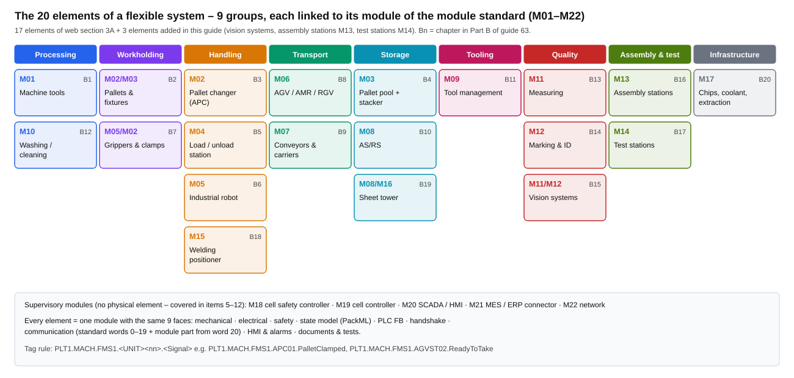
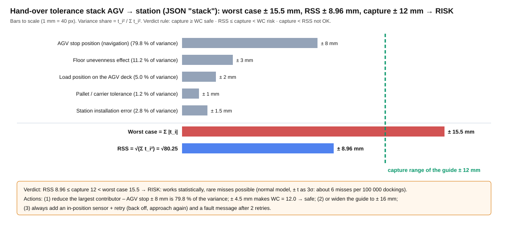
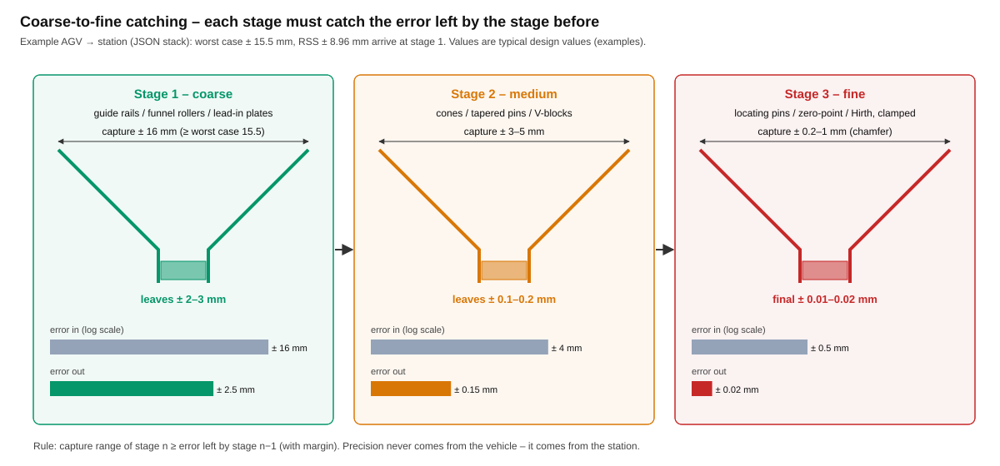
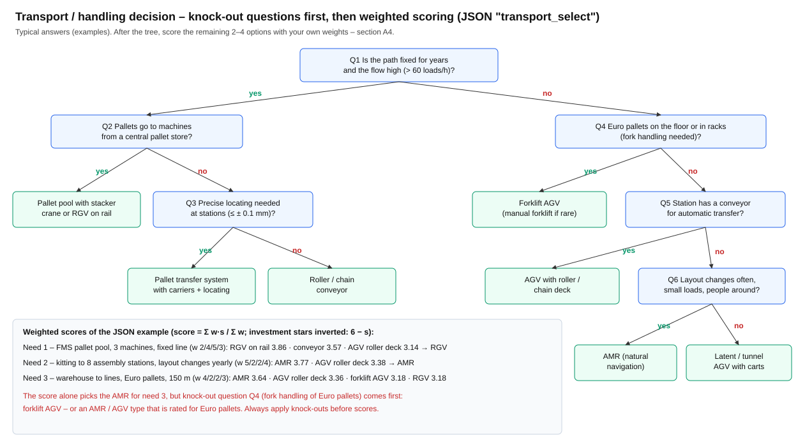
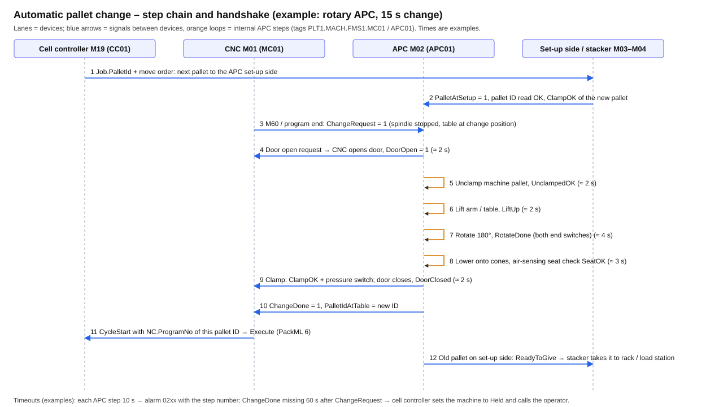
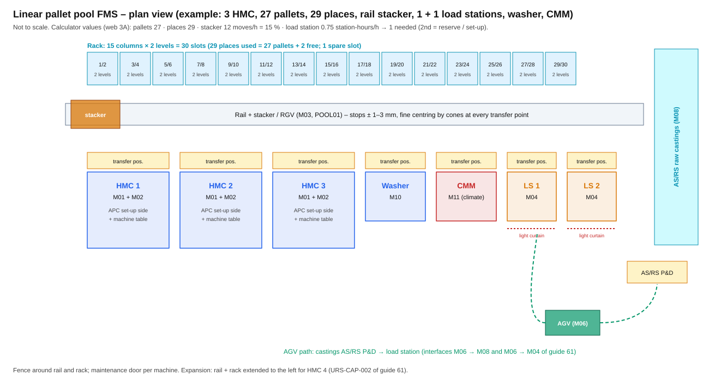
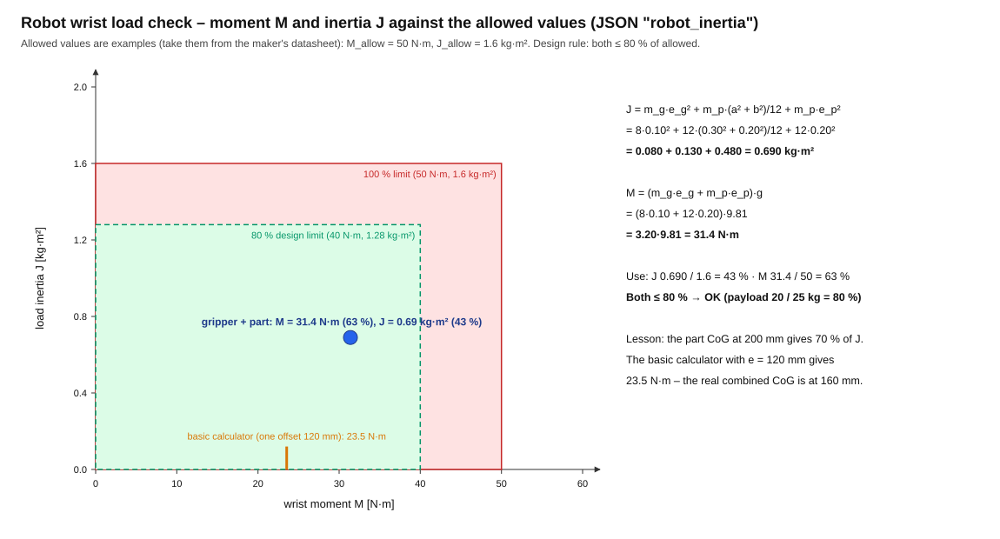
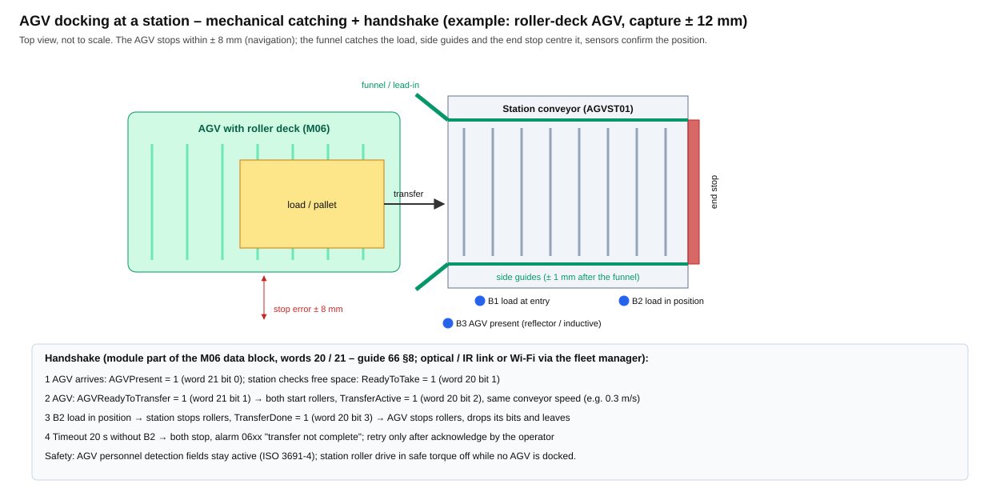
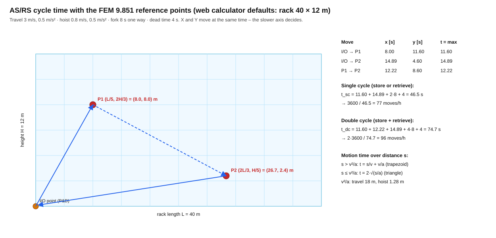
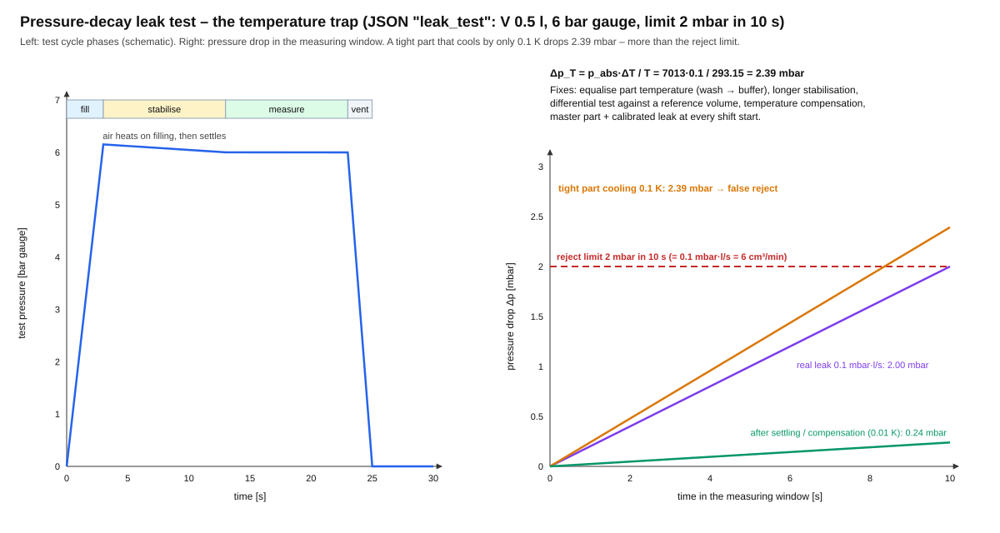

# 63 – The elements of a flexible system: types, selection, sizing, interfaces (textbook, all domains)

> Tab **FMS engineering → item 3** (`/?feitem=3#fmse`, one element: `&feel=agv`). Contract: guide 60.
> State: **November 2026** (rewritten as a full textbook). Previous items: guide 61 (FMS types, pipeline, module standard) and
> guide 62 (product → process → machines). Next: guide 64 (capacity, layout, simulation).
> **All numbers in this guide are examples or typical ranges.** They are not data from a real project, a real catalogue or a
> real supplier. The 17 basic sizing calculations use exactly the inputs and formulas of the web calculators (`CALC` in
> `web/fmse3.js`, default = the third field of each input). The deeper calculations (AGV battery, robot inertia, screw preload,
> press fit, leak test, vision, conveyor drive, transport scoring, tolerance stack) use the shared file
> `tools/fmse/examples/item3_examples.json` with the formulas written in its `_formulas` section. The Python tools in
> `tools/fmse/` and the web tab use the same sources, so the numbers must match. Every number was re-calculated with Python.

## How to use this guide

Guide 61 chose the **kind** of system and fixed the **module standard** (modules M01–M22, each with 9 faces). Guide 62 turned
the product into processes, times and a **number of machines**. This guide does the next engineering step: it chooses and
sizes the **building blocks around the machines** – workholding, handling, transport, storage, tooling, quality, assembly and
test stations, infrastructure – and defines **how each block is handed over to the next one**.

```
machines (guide 62) ──► element list (A2) ──► sizing per element (Part B) ──► hand-overs: tolerance + handshake (A3, B.7–B.8)
                                                        │
  buy list + FAT (B.11–B.12) ◄── failure modes + maintenance (B.10) ◄── safety (B.9) ◄── interfaces + IO + data block (B.7)
```

The guide has four parts:

1. **Part A – How to think about elements**: element vs module, the 9 faces applied to physical elements, a reusable
   **selection procedure** with a form, **hand-over design** (tolerance stacks, coarse-to-fine catching, capture ranges) and
   the **transport / handling choice** (comparison table, weighted scores, decision tree).
2. **Part B – One chapter per element** (20 elements). Every chapter has the same 14 sections:
   1 function and use · 2 working principle · 3 main components · 4 types in depth · 5 key parameters · 6 sizing (fully worked) ·
   7 interfaces (mechanical, electrical, IO list with tag names, data block word 20+, handshake partners) · 8 control sequence
   (step chain + PackML) · 9 safety · 10 failure modes and maintenance · 11 commissioning / FAT tests · 12 buy list ·
   13 use cases (3 domains) · 14 typical mistakes.
3. **Part C – Three complete worked examples**: machining FMS (3 HMCs + pallet pool + AGV), assembly line, robot welding cell –
   all calculations chained.
4. **Part D – Programs and reference**: the offline Python tools, the web tab, standards, glossary, consolidated checklists,
   limits, and how the numbers were checked.

Read Part A once from the start. Then use Part B like a handbook: open the chapter of the element you must specify, buy, build
or accept. Part C shows how the chapters work together in one project. Run the tools of Part D with your own numbers.

A **running use case** goes through the guide: the **compressor factory** of this twin – crankcases VC10 / VC20 / VC30 on three
horizontal machining centres with a pallet pool (the FMS kit of guide 61 §D4.2), the **compressor head assembly line** (guide 61
§D4.3) and the **base-frame welding cell** (guide 61 §D4.4).

**Notation used everywhere:** numbers with a space as thousands separator (31 250), decimal point (0.049). Formulas use SI units
unless written: mm, m, s, min, h, kg, N, N·m, kg·m², W, kW, Wh, bar, mbar, l, µm. "Example" means a teaching value. Tag names
follow guide 65 §5: `PLT1.MACH.FMS1.<UNIT><nn>.<Signal>` with positive logic (`ClampOK`, not `ClampNotOK`).

**Price classes in the buy lists** (equipment, 2025–2026 level, without installation, strongly dependent on options, region and
quantity) = **estimate – ask for a quote**: € < 50 kEUR · €€ 50–200 kEUR · €€€ 200–700 kEUR · €€€€ > 700 kEUR. Makers and series
are **examples of products that exist in the class – not a recommendation**; local makers can be equal or better. Model data:
**see datasheet** – this guide never invents catalogue values.

## Contents

**Part A – How to think about elements**
- A0 Purpose and where in the twin
- A1 Element vs module – the 9 faces applied to physical elements, unit codes, tag names, data block
- A2 Selection method for any element – the 10-step procedure and the element specification form
- A3 Hand-over between elements – tolerance stacks (worst case vs RSS), coarse-to-fine catching, capture-range design
- A4 Transport and handling choice – comparison table, weighted scores for 3 needs, decision tree

**Part B – The elements one by one**
- B1 Machine tools (M01) · B2 Pallets & fixtures, zero-point (M02/M03) · B3 Automatic pallet changer (M02)
- B4 Pallet pool + stacker (M03) · B5 Load / unload station (M04) · B6 Industrial robot (M05) · B7 Grippers & clamps (M05/M02)
- B8 AGV / AMR / RGV (M06) · B9 Conveyors & workpiece carriers (M07) · B10 AS/RS (M08) · B11 Tool management (M09)
- B12 Washing / cleaning (M10) · B13 Measuring (M11) · B14 Marking & identification (M12) · B15 Vision systems (M11 / M12 / M05)
- B16 Assembly stations – screwdriving, press-fit, dispensing (M13) · B17 Test stations – leak, function (M14)
- B18 Welding positioners & turntables (M15) · B19 Sheet tower & sorting (M08/M16) · B20 Chips, coolant & extraction (M17)

**Part C – Complete worked examples**
- C1 Machining FMS – element list and sizing summary (3 HMCs, pallet pool, load stations, washer, CMM, AGV)
- C2 Assembly line – element list and sizing summary
- C3 Robot welding cell – element list and sizing summary

**Part D – Programs, tools and reference**
- D1 Offline Python tools · D2 The web tab item 3 · D3 Standards · D4 Consolidated checklists · D5 Common mistakes (summary)
- D6 Limits · D7 Glossary · D8 How the numbers were checked · D9 Figures

---

# Part A – How to think about elements

## A0. Purpose and where in the twin

### A0.1 Purpose

After guides 61 and 62 you know the system type (for example an FMS), the processes and the number of machines (for example
3 HMCs). A real system needs much more than the machines: pallets and fixtures, a pallet changer, a store, a vehicle, load
stations, tools, a washer, a measuring machine, codes on the parts, chip and coolant systems, and – in other domains – robots,
conveyors, screwdrivers, presses, leak testers, cameras, positioners and sheet towers. For every one of these **elements** you
must answer the same questions:

1. **Which types exist** and when is each one right? (section 4 of each chapter)
2. **How big** must it be – how many pallets, places, vehicles, pockets, newtons, watts? (section 6)
3. **How does it connect** – mechanical hand-over with tolerance, power, signals, data words, handshake? (sections 7–8)
4. **How can it fail, how is it kept running, how is it accepted?** (sections 9–11)
5. **Who makes it** and what must I check in the datasheet? (section 12)

### A0.2 Where in the twin

| Part of the tab | What you can do there | Chapter of this guide |
|---|---|---|
| **3A** Element map | 17 elements in 8 groups; click one → types table, key parameters, selection rules, **sizing calculator** with editable inputs, interface (mechanical + signals), typical mistakes | Part B sections 4–7, 14 |
| **3B** Transport comparison | 10 transport / handling options rated by route flexibility, throughput, distance, stop accuracy, floor, investment | A4, B8, B9 |
| **3C** Tolerance stack | editable contributors → worst case and RSS vs capture range, largest contributor, coarse-to-fine stages | A3 |
| Deep sections (item-3 redo, `web/fmse3x_data.js`) | the deeper JSON calculations: AGV battery and charging, robot inertia, screw preload, press fit, leak test with temperature error, vision pixel size, conveyor drive, transport scoring for the 3 needs | B6, B8, B9, B15–B17, A4 |

Real built examples in the other tabs of the twin (read them as detailed case studies of single elements):

| Element | Guide with a complete real design |
|---|---|
| Pallet changer, zero-point clamping | `docs/09_pallet_changer_apc.md`, `docs/36_plc_ladder_apc.md` |
| AGV | `docs/11_agv_build.md` |
| HMC (machine, magazine, pallet interface) | `docs/12_hmc_build.md` |
| Material handling, conveyors, stacker in the compressor factory | `docs/03_material_handling.md` |
| Industrial robot (mechanics, dynamics, control) | `docs/21_industrial_robot.md`, `docs/22_robot_math_dynamics.md`, `docs/23_robot_control_system.md` |
| AS/RS (rack, stacker crane, fork, control, WMS) | `docs/31_asrs_mechanical_3d.md`, `docs/32_asrs_control_system.md`, `docs/38_asrs_stacker_crane_manufacturing.md`, `docs/39_asrs_telescopic_fork.md` |
| Mechanical interfaces (fits, cones, pins) | `docs/10_mechanical_interfaces.md` |
| Identification and numbering | `docs/15_numbering_and_identification.md` |
| Quality inspection (ball-screw factory) | `docs/44_bsf_quality_inspection.md` |

---

## A1. Element vs module – the 9 faces applied to physical elements

### A1.1 Two words, two views

- An **element** is a physical thing you can buy and touch: a pallet changer, a stacker crane, an AGV, a leak tester.
  The element view asks: *what does it do, how big must it be, which type?*
- A **module** (guide 61 §D1, guide 60 §4) is the **standard package** around an element: the element **plus** its 9 faces
  (mechanical interface, electrical, safety, state model, PLC function block, handshake, communication, HMI and alarms,
  documents and tests). The module view asks: *how does it fit into the system without special engineering?*

One element can belong to two modules (grippers serve the robot M05 and the fixture M02), and one module can contain several
elements (module M03 = rack + stacker crane + transfer stations). The rule of guide 60 stays: **a module never talks directly to
the internals of another module** – only through its FB interface and the handshake; the cell controller M19 coordinates;
safety is always hard-wired or safety bus through M18.

### A1.2 The 9 faces applied to physical elements – what you write for each element

| Face | Question for a physical element | Typical content (example: pallet pool M03) | Detail in |
|---|---|---|---|
| 1 Mechanical interface | Where and how is the load handed over? Which tolerance? Which floor / foundation? | transfer height 900 mm ± 1, cones Ø40, fork stroke, floor load 15 kN per wheel | A3, B.7 |
| 2 Electrical / circuits | Which supply, which IO, which cabinet? | 400 V 3~ 32 A, 24 V DC, 48 DI / 24 DO, PROFINET | item 7–8 (guides 67–68) |
| 3 Safety | Which hazards, which safety functions, which PL? | fence + door lock (PL d), safe speed of stacker, muting at transfer | B.9, item 7 |
| 4 State model | How does it map to PackML? | Execute = move in progress, Suspended = no order, Held = fork error | B.8, guide 65 §6 |
| 5 PLC function block | Which commands, status, data, alarms? | `FB_Pool` with Move(From, To), Status, Alarms | items 9–10 |
| 6 Handshake | Ready → Request → Busy → Done with whom? | ReadyToGive / ReadyToTake with M02, M04, M10, M11 | B.7–B.8 |
| 7 Communication | Which words in the data block? | words 0–19 standard + 20 Move.From, 21 Move.To, 22 PalletAt, 23 FreePlaces | B.7, guide 66 §8 |
| 8 HMI & alarms | Which screen, which alarm numbers? | rack map, alarm 0301–0399 | items 9–10 |
| 9 Documents & tests | Interface sheet, FAT steps, spare parts, maintenance plan | FAT: 50 moves without fault, positioning ± 1 mm | B.10–B.11 |

### A1.3 The element list of this guide and the module codes

The 17 elements of web section 3A plus three elements added in this guide (assembly stations M13, test stations M14, vision
systems). Unit codes are used in tag names (A1.4).



| Chapter | Element | Group | Module | Unit code (tags) | Main sizing question |
|---|---|---|---|---|---|
| B1 | Machine tools | Processing | M01 | MC | cycle time, productive share |
| B2 | Pallets & fixtures (incl. zero-point) | Workholding | M02/M03 | (part of APC / POOL) | number of pallets (Little's law) |
| B3 | Automatic pallet changer (APC) | Handling | M02 | APC | utilisation gain |
| B4 | Pallet pool + stacker | Storage | M03 | POOL | places, stacker utilisation |
| B5 | Load / unload station | Handling | M04 | LS | number of stations |
| B6 | Industrial robot | Handling | M05 | ROB | payload, moment, inertia, reach |
| B7 | Grippers & clamps | Workholding | M05/M02 | (part of ROB / fixture) | gripping / clamping force |
| B8 | AGV / AMR / RGV | Transport | M06 | AGVST (station side) | fleet size, battery |
| B9 | Conveyors & carriers | Transport | M07 | CONV | carriers, speed, drive power |
| B10 | AS/RS | Storage | M08 | ASRS | single / double cycle, throughput |
| B11 | Tool management | Tooling | M09 | TOOL | pockets, sister tools |
| B12 | Washing / cleaning | Processing | M10 | WASH | washers, cleanliness |
| B13 | Measuring (CMM, gauging, probe) | Quality | M11 | CMM | U vs T, CMM load |
| B14 | Marking & identification | Quality | M12 | MARK | code size, RFID band |
| B15 | Vision systems | Quality | M11 / M12 / M05 | CMM / MARK / ROB (camera as equipment module) | pixel size, pixels per defect |
| B16 | Assembly stations (screw, press, dispense) | Assembly & test | M13 | ST | preload, press force, bead volume |
| B17 | Test stations (leak, function) | Assembly & test | M14 | TEST | leak rate, temperature error |
| B18 | Welding positioners & turntables | Handling | M15 | WELD | rotation and tilt torque |
| B19 | Sheet tower & sorting | Storage | M08/M16 | ASRS / PRESS | places, unmanned hours |
| B20 | Chips, coolant & extraction | Infrastructure | M17 | UTIL | chip volume, tank size |

The supervisory modules M18 (safety controller, unit code SAFE), M19 (cell controller, CC), M20 SCADA, M21 MES/ERP connector and
M22 network have no physical element of their own; they appear in every chapter as **partners** (handshake with CC, safety
signals to SAFE).

### A1.4 Tag names used in this guide

Guide 65 §5 fixed the rule: the tag name is the path through the equipment hierarchy, the **same** in PLC, SCADA, MES,
historian, circuit diagram and FAT list. In this guide: `PLT1.MACH.FMS1.<UNIT><nn>.<Signal>`.

| Part | Meaning | Example |
|---|---|---|
| `PLT1` | site (plant 1) | |
| `MACH` | area (machining); for other areas use `ASSY`, `WELD`, `SHEET` | `PLT1.ASSY.LINE1.ST03.TorqueOK` |
| `FMS1` | work centre (cell / line) | |
| `<UNIT><nn>` | unit code from the table above + two-digit number (fixed length) | `MC02`, `APC02`, `AGVST01` |
| `<Signal>` | English, positive logic, state as noun / adjective, command as verb with `Cmd` | `DoorClosed`, `CmdUnclamp` |

An APC that belongs to one machine can also be written as an equipment module of the machine: `PLT1.MACH.FMS1.HMC02.APC.ClampOK`
(the example in guide 65 §5). Both are correct; **choose one rule per project and write it into the URS** (guide 61 phase P3).
This guide uses separate unit codes so that every module of the standard has its own data block.

### A1.5 The data block – standard part and module part

Every module has the standard data block of guide 66 §8. **Words 0–19 are identical in every module** (state, mode, command,
handshake bits, alarm numbers, counters, job, pallet ID, last cycle time, heartbeats). **The module-specific part starts at word
20.** Each chapter of Part B gives the module part. Where `web/fmse6_data.js` (`EXTRA`) already defines it (M01, M03, M04, M06,
M11, M13, M15), this guide copies it exactly; for the other modules the chapter gives a **proposal** marked "(proposal – not yet in
`EXTRA`)". Reminder of the standard bits used in the sequences:

| Word | Bits used in the sequences of Part B |
|---|---|
| 3 `Command.Bits` (in) | b0 CmdChangeRequest · b1 HS.Request · b2 HS.Ack · b3 FaultReset |
| 4 `Status.Bits` (out) | b0 Ready · b1 Busy · b2 Done · b3 Fault · b4 Warning · b5 Auto · b6 PartPresent · b7 HS.Ready |
| 0 `Status.StateCurrent` | PackML state: 2 Stopped · 15 Resetting · 4 Idle · 3 Starting · 6 Execute · 16 Completing · 17 Complete · 10/11/12 Holding/Held/Unholding · 13/5/14 Suspending/Suspended/Unsuspending · 7 Stopping · 8/9 Aborting/Aborted · 1 Clearing |

**The generic handshake (all elements):** the giving side sets `HS.Ready` (word 4 b7) when it can give, the cell controller or
the taking side sets `HS.Request` (word 3 b1), the module goes `Busy` (word 4 b1) and finally `Done` (b2); the requester confirms
with `HS.Ack` (word 3 b2), and the module clears `Done`. Every step has a timeout and an alarm number (module × 100 + step).

---

## A2. Selection method for any element

### A2.1 The 10-step procedure

The same procedure works for a pallet changer, a robot, a leak tester or a chip conveyor. Use it every time; it protects you
from the most common error – choosing a product from a catalogue before the requirement is written.

| Step | Question | Output | Tool / chapter |
|---|---|---|---|
| 1 Requirements | What must the element do? Load, size, mass, throughput, accuracy, environment, unmanned hours, variants | requirement list with numbers | questionnaire (guide 61 C2), routing (guide 62) |
| 2 Types | Which types can do it? Knock-out criteria first | 2–4 candidate types | section 4 of each chapter, A4 |
| 3 Sizing | How big? Calculate with the formulas | sized values with margins | section 6, web 3A, `element_sizing.py` |
| 4 Interface | Mechanical hand-over + tolerance, power, IO, data words | interface sheet draft | A3, section 7 |
| 5 Control | Step chain, PackML mapping, handshake partners, timeouts | sequence description | section 8, guide 65 |
| 6 Safety | Hazards, safety functions, PL required | input to the risk assessment | section 9, item 7 |
| 7 Maintenance | Failure modes, detection, preventive intervals, spare parts | FMEA lines, maintenance plan | section 10 |
| 8 Test | How do we prove it works? Acceptance values | FAT / SAT steps | section 11, guide 61 C5 |
| 9 Buy | Which makers? What to check in the datasheet? Price class | request for quotation (RFQ) | section 12 |
| 10 Review | Does the element still fit the system (space, time, interfaces)? | updated module list, N² matrix | guide 61 D4, guide 64 |

**Margins (typical design rules used in this guide):**

| Quantity | Use at most | Why |
|---|---|---|
| Robot payload, wrist moment, wrist inertia | 80 % of rated | acceleration peaks, hoses, later part changes |
| Stacker crane / AS/RS crane / shared transport | 60–70 % (pool), up to 85 % for an AS/RS crane with queues | it serves everyone – queues grow fast near 100 % |
| Load / unload station with people | 80–85 % | breaks, variation of manual work |
| Machines (capacity) | 85 % | guide 62 D3 |
| AGV fleet utilisation | 60–75 % after availability and traffic | peaks, charging, blocking |
| Positioner torque | 80 % | fixture changes later add mass |
| Screw preload | 50–80 % of proof load | normal assembly window (VDI 2230 ≈ 70 % of yield) |
| Press force of the press | ≥ 1.5–2 × calculated press-fit force | μ and interference scatter |
| Vision | ≥ 3 pixels on the smallest defect | detection needs several pixels |

### A2.2 The element specification form (template)

Copy this form for every element of the module list. It becomes the technical part of the request for quotation and the base of
the interface sheet. Fields in *italics* are examples for the pallet pool of the use case.

```
ELEMENT SPECIFICATION                              Project: ____  Rev: __  Date: ____  Author: ____
1  Element / module ............ Pallet pool + stacker / M03 / unit POOL01
2  Function ...................... store pallets, serve 3 HMC (M01/M02), 2 load stations (M04), washer (M10), CMM (M11)
3  Load ......................... pallet 500 × 500 mm, max. 600 kg incl. fixture and parts, max. height 900 mm
4  Throughput ................... 12 moves/h average, peak 20 moves/h (stacker ≤ 60–70 %)
5  Accuracy ..................... stop ± 1–3 mm; final centring by cones at transfer stations (± 0.1 mm)
6  Quantity ..................... 29 places (27 pallets + 2 free), expansion to 40 places (HMC 4)
7  Environment .................. machining hall, coolant mist, 10–35 °C, floor flatness DIN 15185 class
8  Operation .................... 3 shifts, 1 unmanned shift (8 h), MTBF target ≥ 1 000 h, MTTR ≤ 1 h
9  Interfaces ................... mech.: transfer height, cones, fork stroke   el.: 400 V, 24 V, PROFINET
                                  data: standard data block words 0–19 + 20–23 (guide 66 §8)  handshake: M02/M04/M10/M11
10 Control ...................... PackML states (guide 65 §6), moves by order from M19, double moves allowed
11 Safety ....................... fence + interlocked doors, safe speed in set-up mode, light curtain muting at LS
12 Maintenance .................. lubrication plan, wheel / guide roller wear, fork chain check, spare parts list
13 Tests ........................ FAT: 50 moves each place without fault; positioning; timeout alarms; SAT: 72 h run
14 Documents .................... layout, interface sheets, IO list, circuit diagrams, FB source, manuals (language)
15 Commercial ................... delivery time, warranty, training, service response time, price class (quote)
```

### A2.3 Worked example of the procedure – the AGV for castings (summary)

1. **Requirements:** castings from AS/RS P&D to 2 load stations, 120 m loaded / 100 m empty, peak 24 orders/h, Euro-size
   load carrier on a roller deck, unmanned shift.
2. **Types:** forklift AGV (no – the station has conveyors), AMR (stop accuracy ± 10–30 mm too poor for roller transfer without
   extra catching), **AGV with roller deck** (yes), RGV (no – the path crosses an aisle). Knock-out decided before scores.
3. **Sizing:** fleet 3 vehicles (B8.6.1); battery check: availability 79.8 % without opportunity charging, still 3 vehicles (B8.6.2).
4. **Interface:** transfer height, funnel ± 12 mm vs worst case 15.5 mm → risk → reduce the AGV stop error or widen the funnel (A3.2).
5. **Control:** docking handshake words 20/21 (B8.8).
6. **Safety:** ISO 3691-4 personnel detection, station roller drive STO while no AGV (B8.9).
7. **Maintenance:** battery, wheels, scanner windows (B8.10).
8. **Test:** 100 dockings per station without fault, stop accuracy measured (B8.11).
9. **Buy:** RFQ to 3 makers with the same form (B8.12).
10. **Review:** simulation of the peak hour in item 4 (guide 64).

---

## A3. Hand-over between elements

Every time a load goes from one element to the next – AGV to station, stacker to pallet changer, robot to fixture, carrier to
assembly station – two independent position errors meet. The hand-over works only if the **receiving element can catch the
largest error that can arrive**. This chapter gives the method (tolerance stack), the hardware (coarse-to-fine catching) and
three design examples.

### A3.1 Tolerance stack – worst case and RSS

Each contributor i has a symmetric tolerance ± t_i (mm). Two ways to add them:

$$ WC = \sum_i |t_i| \qquad\qquad RSS = \sqrt{\sum_i t_i^2} $$

| Symbol | Meaning | Unit |
|---|---|---|
| t_i | ± tolerance of contributor i (stop error, floor, load position, part tolerance, installation) | mm |
| WC | worst case: all errors at their limit in the same direction | mm |
| RSS | root sum of squares: statistical sum, valid if the errors are independent and roughly normal with ± t_i ≈ ± 3σ_i | mm |
| capture | the range the first catching element (guide, funnel) can still catch and centre | mm |

**Verdict rule (JSON `_formulas.stack`, same in web 3C and `tolerance_stack.py`):**
- capture ≥ WC → **safe** (always catches);
- RSS ≤ capture < WC → **risk** (catches statistically; rare misses – add monitoring + retry);
- capture < RSS → **not OK** (misses often – redesign).

**Worked example – AGV → station (JSON `stack`, = web 3C default):**

| No. | Contributor | ± t_i [mm] | t_i² [mm²] | Share of RSS² |
|---|---|---|---|---|
| 1 | AGV stop position (navigation) | 8 | 64 | 79.8 % |
| 2 | Floor unevenness effect | 3 | 9 | 11.2 % |
| 3 | Load position on the AGV deck | 2 | 4 | 5.0 % |
| 4 | Pallet / carrier tolerance | 1 | 1 | 1.2 % |
| 5 | Station installation error | 1.5 | 2.25 | 2.8 % |
| | **Sum** | **15.5** | **80.25** | 100 % |

- WC = 8 + 3 + 2 + 1 + 1.5 = **± 15.5 mm**
- RSS = √80.25 = **± 8.96 mm**
- capture of the funnel = ± 12 mm → 8.96 ≤ 12 < 15.5 → **RISK**.
- Largest contributor: AGV stop (79.8 % of the variance) → reduce it first.



**What the "risk" means in numbers.** With the normal model (each ± t_i = 3σ_i), σ_total = RSS / 3 = 2.986 mm. The capture
± 12 mm is z = 12 / 2.986 = 4.02 standard deviations. The probability of an error outside ± 12 mm is 2·(1 − Φ(4.02)) =
**0.0059 %**, about 6 misses per 100 000 dockings. The Monte Carlo option of the tool gives the same order
(`tolerance_stack.py --montecarlo 100000 --seed 1`: 7 of 100 000 = 0.0070 %). With 24 dockings per hour and 6 000 operating
hours per year (144 000 dockings), that is **about 8 misses per year** – each one a stop that needs a person. And the normal
model is optimistic: an AGV stop error is often closer to a uniform distribution, then misses are more frequent. So:

**Options to make it safe (all calculated):**

| Option | Change | New WC | New RSS | Verdict with capture ± 12 |
|---|---|---|---|---|
| 0 Base | – | 15.5 | 8.96 | risk |
| 1 Better AGV stop (markers, mechanical stop) | AGV ± 8 → ± 5 | 12.5 | 6.42 | risk (close) |
| 2 Stop error reduced to the limit | AGV ± 8 → ± 4.5 | **12.0** | 6.04 | **safe** |
| 3 Better stop + flatter floor | AGV ± 3, floor ± 1.5 | 9.0 | 4.30 | safe with margin |
| 4 Wider funnel | capture ± 12 → ± 16 | 15.5 | 8.96 | safe |

In practice combine option 4 (wider lead-in, cheap) with an **in-position sensor + one automatic retry** (back off 100 mm, approach
again) and an alarm after the second failure.

**Rules for tolerance stacks:**
1. Make one stack for **every** hand-over, in **every** direction that matters (x, y, height z, angle).
2. Use WC for safety-relevant or very frequent hand-overs; RSS only when contributors are really independent and a rare miss is
   detected and handled automatically.
3. Ask suppliers for the **real** stop accuracy with the measuring condition (load, speed, floor, number of runs) – a catalogue
   value "± 5 mm" without condition is a marketing number.
4. Angles become distances: a tilt of 0.3° over a 500 mm high load gives 500 · tan 0.3° = 2.6 mm at the top.

### A3.2 Coarse-to-fine catching – the stages and design values

The final location of a pallet in a machine must be ± 0.01–0.02 mm, but a vehicle stops ± 5–10 mm. **No single element can
catch ± 15 mm and locate ± 0.02 mm.** The solution is a chain of stages; each stage catches the error left by the stage before.



| Stage | Hardware | Typical capture | Typical result | Design values (examples – check maker data) |
|---|---|---|---|---|
| 1 coarse | guide rails with lead-in, funnel plates, guide rollers, V-entry on the floor or on the conveyor | ± 10–25 mm | ± 2–3 mm | lead-in angle 15–30° to the travel direction; lead-in length ≥ capture / tan(angle) (± 16 mm at 20° → ≥ 44 mm); rollers on the guides for heavy loads; hardened wear strips |
| 2 medium | cones, tapered pins, V-blocks, centring rollers, lift-and-locate pins | ± 2–5 mm | ± 0.1–0.2 mm | cone angle 15–20° (half angle) for self-centring without jamming; pin with conical tip, cylindrical part h6/H7; one round pin + one diamond (relieved) pin so the load is not over-determined |
| 3 fine | locating pins in bushes, zero-point clamping modules, Hirth coupling, machine pallet cones with face contact (ISO 8526 type) | ± 0.2–1 mm (chamfer / cone entry) | ± 0.002–0.02 mm (clamped) | zero-point: repeatability typically ≤ 0.005 mm (see datasheet); Hirth: indexing accuracy in arc-seconds class; locating face clean and air-blown, seat check by air sensing |

**Why "one round + one diamond pin":** two round pins locate the same direction twice – if the hole distance has a tolerance the
load jams. The diamond pin is relieved on two sides; it fixes only the rotation around the round pin.

**How the stages work in time:** stage 1 works while the load moves (passive guides). Stage 2 works when the load is lowered or
lifted (the cone pulls it into place – the drive must allow the small side motion: floating fork, compliant roller deck, or the
lift unit lifts the carrier off the conveyor). Stage 3 works when clamping (the clamp pulls the load on the faces).

### A3.3 Capture-range design – three examples

**Example 1 – AGV → station (JSON stack):** see A3.1. Final design: funnel ± 16 mm (stage 1), centring pins in the station
conveyor that lift the carrier (stage 2, ± 0.5 mm), no stage 3 (the carrier is only transported further). In-position sensor B2 +
retry.

**Example 2 – Robot → fixture (machine loading):**

| Contributor | ± mm | Comment |
|---|---|---|
| Robot pose repeatability (ISO 9283 RP) | 0.05 | see datasheet; medium robots typically ± 0.02–0.08 mm |
| Part position in the gripper (jaw play, part tolerance) | 0.3 | raw casting surfaces |
| Robot absolute error after re-teach / temperature | 0.2 | thermal drift of the arm over the day |
| Fixture position on the pallet (pallet repeatability) | 0.01 | zero-point / pallet cones |
| Part tolerance at the locating surfaces (raw casting) | 0.5 | casting tolerance |

WC = 0.05 + 0.3 + 0.2 + 0.01 + 0.5 = **± 1.06 mm**; RSS = √(0.0025 + 0.09 + 0.04 + 0.0001 + 0.25) = √0.3826 = **± 0.62 mm**.
Design: locating pins in the fixture with a chamfer entry of ≥ 1.2 mm (capture ≥ WC), the robot inserts with compliance
(floating gripper or soft-float function) and the clamp pulls the part onto the rest pads. If the casting tolerance is larger, the
fixture needs a pre-centring (V-block) or the robot uses vision (B15) to find the part.

**Example 3 – Stacker → machine pallet changer:**

| Contributor | ± mm | Comment |
|---|---|---|
| Stacker stop in travel direction | 2 | rail vehicle with position encoder, typical ± 1–3 mm |
| Fork / lift height positioning | 1 | |
| Pallet position on the fork | 1 | fork with locating pins |
| Rail installation / settlement | 1 | |

WC = 2 + 1 + 1 + 1 = **± 5 mm**; RSS = √(4 + 1 + 1 + 1) = √7 = **± 2.65 mm**. Design: the APC set-up station has cones that
catch ± 5 mm (stage 2, capture ≥ WC) → ± 0.1 mm; the machine pallet cones and face contact give the final ± 0.005 mm (stage 3,
machine maker's pallet system). Check that the fork can **float** sideways ± 5 mm when the pallet is lowered onto the cones,
otherwise the cones fight the fork.

(These two extra examples are teaching values written for this guide; they are not in the JSON. The calculation method is the same
as `tolerance_stack.py --csv`.)

---

## A4. Transport and handling choice

### A4.1 The comparison table (web 3B, `TRANS` in `web/fmse3_data.js`)

★ = low … ★★★★★ = high; for investment ★ = cheap. Typical values.

| Option | Route flexibility | Throughput | Distance | Stop accuracy | Floor / building | Investment | Best for |
|---|---|---|---|---|---|---|---|
| Forklift (manual) | ★★★★★ | ★★ | any | ± 50 mm | normal floor | ★ | low volume, irregular moves |
| Forklift AGV | ★★★★ | ★★ | 50–500 m | ± 10 mm | flat floor, wide aisles | ★★★ | Euro pallets, warehouse ⇄ lines |
| AGV with roller / chain deck | ★★★★ | ★★★ | 20–300 m | ± 5–10 mm | flat floor (± 5 mm / 2 m) | ★★★ | machine and assembly lines with conveyor stations |
| AMR (natural navigation) | ★★★★★ | ★★ | 20–300 m | ± 10–30 mm (better with markers) | good map, few changes | ★★ | kitting, small loads, changing layouts |
| RGV on rail | ★★ | ★★★★ | 5–100 m | ± 1 mm | rail in the floor | ★★★ | pallet pools, lines along machines |
| Roller / chain conveyor | ★ | ★★★★ | 1–100 m | ± 2 mm (stopper) | fixed path | ★★ | fixed flows, buffers |
| Pallet transfer system (carriers) | ★★ | ★★★★ | 1–80 m | ± 0.05 mm (locating unit) | fixed path | ★★★ | assembly systems |
| Stacker crane (pallet pool / AS/RS) | ★★ | ★★★ | rack length | ± 1–3 mm | rack, height | ★★★★ | central pallet storage + transport |
| Gantry robot | ★★ | ★★★ | 2–30 m | ± 0.1 mm | overhead structure | ★★★ | lathe lines, heavy parts above machines |
| Robot on 7th axis (track) | ★★★ | ★★★ | 2–20 m | ± 0.1 mm | floor track | ★★★ | one robot serving several machines |

### A4.2 Weighted scoring (JSON `transport_select`)

**Method.** Four criteria k: route flexibility, throughput, stop accuracy, investment. Each option gets stars s_k = 1…5 (route
flexibility, throughput and investment copied from the table above; stop accuracy converted: ± 50 mm → 1, ± 10–30 mm → 2,
± 5–10 mm → 3, ± 1–3 mm → 4, ≤ ± 1 mm → 5). Each need has weights w_k = 1…5. For investment, fewer stars are better, so the
score uses (6 − stars).

$$ score = \frac{\sum_k w_k \, s_k}{\sum_k w_k} \qquad (s_{investment} = 6 - stars) $$

**Star table used (from the JSON, investment already inverted in the last column):**

| Option | Route flexibility | Throughput | Stop accuracy | Investment stars | 6 − stars |
|---|---|---|---|---|---|
| Forklift AGV | 4 | 2 | 3 | 3 | 3 |
| AGV with roller deck | 4 | 3 | 3 | 3 | 3 |
| AMR | 5 | 2 | 2 | 2 | 4 |
| RGV on rail | 2 | 4 | 5 | 3 | 3 |
| Roller / chain conveyor | 1 | 4 | 4 | 2 | 4 |
| Stacker crane (pallet pool) | 2 | 3 | 4 | 4 | 2 |

(Ambiguity resolved: the forklift AGV stops ± 10 mm – exactly on the border between the classes "± 10–30 mm" and "± 5–10 mm";
the JSON gives 3 stars, this guide follows the JSON.)

**Need 1 – FMS pallet pool, 3 machines, fixed line.** Weights 2 / 4 / 5 / 3, Σw = 14.

| Option | w·s flexibility | w·s throughput | w·s accuracy | w·s investment | Σ | Score |
|---|---|---|---|---|---|---|
| **RGV on rail** | 2·2 = 4 | 4·4 = 16 | 5·5 = 25 | 3·3 = 9 | 54 | **3.86** |
| Roller / chain conveyor | 2·1 = 2 | 4·4 = 16 | 5·4 = 20 | 3·4 = 12 | 50 | 3.57 |
| AGV with roller deck | 2·4 = 8 | 4·3 = 12 | 5·3 = 15 | 3·3 = 9 | 44 | 3.14 |
| Stacker crane (pallet pool) | 2·2 = 4 | 4·3 = 12 | 5·4 = 20 | 3·2 = 6 | 42 | 3.00 |
| Forklift AGV | 2·4 = 8 | 4·2 = 8 | 5·3 = 15 | 3·3 = 9 | 40 | 2.86 |
| AMR | 2·5 = 10 | 4·2 = 8 | 5·2 = 10 | 3·4 = 12 | 40 | 2.86 |

→ **RGV on rail** (3.86). This is the classic linear pallet pool: a rail vehicle with lifting forks or a chain transfer. The
stacker crane scores lower only because of investment – choose it when floor space is short and a 2–4 level rack is needed.

**Need 2 – Kitting to 8 assembly stations, layout changes yearly.** Weights 5 / 2 / 2 / 4, Σw = 13.

| Option | w·s flexibility | w·s throughput | w·s accuracy | w·s investment | Σ | Score |
|---|---|---|---|---|---|---|
| **AMR** | 5·5 = 25 | 2·2 = 4 | 2·2 = 4 | 4·4 = 16 | 49 | **3.77** |
| AGV with roller deck | 5·4 = 20 | 2·3 = 6 | 2·3 = 6 | 4·3 = 12 | 44 | 3.38 |
| Forklift AGV | 5·4 = 20 | 2·2 = 4 | 2·3 = 6 | 4·3 = 12 | 42 | 3.23 |
| RGV on rail | 5·2 = 10 | 2·4 = 8 | 2·5 = 10 | 4·3 = 12 | 40 | 3.08 |
| Roller / chain conveyor | 5·1 = 5 | 2·4 = 8 | 2·4 = 8 | 4·4 = 16 | 37 | 2.85 |
| Stacker crane (pallet pool) | 5·2 = 10 | 2·3 = 6 | 2·4 = 8 | 4·2 = 8 | 32 | 2.46 |

→ **AMR** (3.77). Kitting carts are light, routes change, people walk around – exactly the AMR case.

**Need 3 – Warehouse to lines, Euro pallets, 150 m.** Weights 4 / 2 / 2 / 3, Σw = 11.

| Option | w·s flexibility | w·s throughput | w·s accuracy | w·s investment | Σ | Score |
|---|---|---|---|---|---|---|
| **AMR** | 4·5 = 20 | 2·2 = 4 | 2·2 = 4 | 3·4 = 12 | 40 | **3.64** |
| AGV with roller deck | 4·4 = 16 | 2·3 = 6 | 2·3 = 6 | 3·3 = 9 | 37 | 3.36 |
| RGV on rail | 4·2 = 8 | 2·4 = 8 | 2·5 = 10 | 3·3 = 9 | 35 | 3.18 |
| Forklift AGV | 4·4 = 16 | 2·2 = 4 | 2·3 = 6 | 3·3 = 9 | 35 | 3.18 |
| Roller / chain conveyor | 4·1 = 4 | 2·4 = 8 | 2·4 = 8 | 3·4 = 12 | 32 | 2.91 |
| Stacker crane (pallet pool) | 4·2 = 8 | 2·3 = 6 | 2·4 = 8 | 3·2 = 6 | 28 | 2.55 |

→ the score picks the **AMR** (3.64). **But look at the requirement:** Euro pallets picked from the floor or from racks need
**fork handling**. A typical AMR carries a top module (roller, lift, cart hook), not forks. This is why the decision tree (A4.3)
asks the **knock-out questions first**: "Euro pallets on the floor or in racks?" → forklift AGV (or an AMR / AGV type that is
explicitly rated for Euro pallets and the rack heights). **Lesson: a weighted score only ranks options that passed the
knock-outs.** Scores with 4 criteria never know everything – load type, floor, fire rules, people traffic, existing racks.

### A4.3 Decision tree



1. **Q1** Is the path fixed for years and the flow high (> 60 loads/h)? yes → Q2, no → Q4.
2. **Q2** Do pallets go to machines from a central pallet store? yes → **pallet pool with stacker crane or RGV**. no → Q3.
3. **Q3** Is precise locating needed at the stations (≤ ± 0.1 mm)? yes → **pallet transfer system with carriers and lift-and-locate
   units**; no → **roller / chain conveyor**.
4. **Q4** Euro pallets on the floor or in racks (fork handling)? yes → **forklift AGV** (manual forklift if moves are rare). no → Q5.
5. **Q5** Does the station have a conveyor for automatic transfer? yes → **AGV with roller / chain deck**. no → Q6.
6. **Q6** Does the layout change often, are loads small, are people around? yes → **AMR**; no → **latent / tunnel AGV with carts**.

Then score the 2–4 remaining options with your own weights (`transport_select.py --weights 2,4,5,3`). Heavy parts above machines →
gantry robot; one robot for several machines → robot on a 7th axis (both are handling, not transport, but compete for the same
task – B6).

**The golden rule of transport:** precision never comes from the vehicle – it comes from the station (A3.2).

---

# Part B – The elements one by one

Every chapter has the same 14 sections (B*n*.1 … B*n*.14). The sizing section first shows the **web calculator** (web 3A, same
inputs and formulas as `web/fmse3.js`, defaults used) step by step, then the **deeper calculations** where they exist. IO lists
are **typical minimum lists** – the real list comes from the supplier's interface description and goes into the interface sheet
(guide 61 D2). Signal direction is seen from the cell controller: **DI** = input to the controller (status from the element),
**DO** = output from the controller (command to the element). Where signals are exchanged over the network, they live in the data
block (A1.5) instead of wires; safety signals are always hard-wired or safety bus (M18).

---

## B1. Machine tools (M01, unit code MC)

### B1.1 Function and where it is used

The machine tools add the value: they cut, grind, turn or form the part. In a flexible system they must do three things that a
stand-alone machine does not need: **start a program by command** (not by an operator button), **report the result and state**
to the cell controller, and **accept automatic loading** (pallet changer, robot through an automatic door, gantry).
Domains: prismatic machining (HMC, VMC, 5-axis), rotational machining (lathes, mill-turn), finishing (grinders, honing).
In assembly lines the "machine" is the assembly station (B16); in welding the robot cell (B18); in sheet metal the laser / punch
(B19) – they use the same M01-type interface ideas.

### B1.2 Working principle

A CNC machine moves a tool relative to the part along programmed paths (axes X, Y, Z, plus rotary axes A, B, C) while the spindle
turns the tool (milling, drilling) or the part (turning). The time per pallet is cutting time plus non-cutting time (tool
changes, rapid moves, pallet change, probing). In an FMS the machine is a **server in a queue**: it takes the next pallet from the
APC, runs the program that belongs to the pallet ID and gives the pallet back. Its productivity is the **productive share**
(cutting time / cycle time) times availability.

### B1.3 Main components

| Group | Components | What matters in an FMS |
|---|---|---|
| Mechanical | bed, column, axes with ball screws / linear motors and guides, rotary table (B axis), spindle, tool magazine and changer, pallet changer interface, enclosure with automatic door | same pallet interface on all machines of a group; door opening for robot loading |
| Drives | servo axes, spindle motor, magazine drive, APC drive, hydraulics for clamping | power–torque curve (guide 62 C3) |
| Sensors | axis encoders, spindle load, tool length / breakage detection (laser or touch), workpiece probe, pallet seat check (air sensing), door switches | breakage detection for unmanned shifts |
| Control | CNC (Fanuc, Siemens, Heidenhain, Mazak, Okuma …), PLC of the machine, automation interface (digital IO, PROFINET, OPC UA, MTConnect, Modbus TCP) | the **automation interface must be ordered with the machine** |

### B1.4 Types in depth

| Type | How it works | + Strengths | − Weaknesses | Use when |
|---|---|---|---|---|
| HMC (horizontal machining centre) | spindle horizontal, rotary B-axis table, APC standard | 4 sides in one set-up, chips fall away, made for pallets | higher price, bigger footprint | prismatic parts in an FMS – first choice |
| VMC (vertical machining centre) | spindle vertical, table X-Y | cheap, easy set-up | 1 side per set-up, chips stay on the part, pallet option rare | plates, simple parts, robot-loaded cells |
| 5-axis machining centre | swivel head or trunnion table | complex shapes in 1 set-up | expensive, programming effort | housings with many angles, moulds, aerospace |
| CNC lathe / mill-turn | rotating part, turret, driven tools, Y-axis, sub-spindle | complete machining of shafts / flanges | robot / gantry loading needed | rotational parts |
| Grinder / honing machine | abrasive finishing | IT4–6, Ra < 0.4 µm | slow, dressing, coolant filtration | bearing seats, cylinders, guide rails |

**When to use which:** the part family (guide 62 A3–A4) decides the machine type; the tightest feature decides the class (guide
62 B3). **All machines of one FMS group should be the same model** – then any pallet can go to any machine (routing flexibility,
guide 61 A2). A mix of HMC and VMC in one FMS means two pallet systems and two routes – usually two cells.

### B1.5 Key parameters and typical ranges

| Parameter | Typical range (examples) | Note |
|---|---|---|
| Pallet size (HMC) | 400, 500, 630, 800, 1000 mm | ISO 8526 type interfaces |
| Table load | 300–3 000 kg | include fixture + parts |
| Spindle power / torque | 15–45 kW / 100–1 000 N·m | check the curve at your speed |
| Spindle taper | HSK-A63 / A100, BT40 / BT50, SK40 / SK50, Capto | same on all machines |
| Magazine | 40–120 pockets (chain), 120–400 (rack) | B11 |
| Chip-to-chip time | 2–5 s | matters more than rapid traverse for short cuts |
| Pallet change time | 7–20 s | B3 |
| Positioning accuracy / repeatability (ISO 230-2) | 0.004–0.010 / 0.002–0.005 mm | see datasheet |

### B1.6 Sizing – cycle time and productive share (web calculator `cycle`)

$$ t_{non} = \frac{n_{tc}\,t_{c2c} + t_{rap} + t_{pal} + t_{mea}}{60}, \qquad t_{cyc} = t_c + t_{non}, \qquad share = \frac{t_c}{t_{cyc}} $$

| Symbol | Meaning | Default | Unit |
|---|---|---|---|
| t_c | cutting time per pallet | 8 | min |
| n_tc | tool changes | 18 | – |
| t_c2c | chip-to-chip time | 4 | s |
| t_rap | rapid moves total | 40 | s |
| t_pal | pallet change | 15 | s |
| t_mea | probing / measuring | 30 | s |

Step by step:
1. Tool changes: 18 · 4 = 72 s.
2. Non-cutting: (72 + 40 + 15 + 30) / 60 = 157 / 60 = **2.62 min**.
3. Cycle: 8 + 2.62 = **10.62 min** per pallet.
4. Productive share: 8 / 10.62 = **75 %**.
5. Pallets per hour (100 % availability): 60 / 10.62 = **5.65 /h**.

Verdict (web): share ≥ 70 % → "Good productive share." Below 70 %: fewer tool changes (combination tools), faster changer, fewer
probing cycles. **Variant:** combination tools reduce tool changes from 18 to 12 → non-cutting (48 + 40 + 15 + 30)/60 = 2.22 min,
cycle 10.22 min, share 78 %.

The number of machines comes from guide 62 D3 (load per group ÷ available hours ÷ 85 %).

### B1.7 Interfaces

**Mechanical:** pallet hand-over on the machine table through the APC (B3): pallet cones and face contact, clamping, seat check.
For robot loading: automatic door (opening width ≥ gripper + part + 2 × 50 mm), fixture accessible from the door side, hand-over
position taught (A3.3 example 2). Coolant and chip outlet to M17.

**Electrical:** 400 V 3~ main supply (sized by the maker), 24 V DC interface, emergency stop chain and door interlock linked to
M18 (machine stops and locks the door when the cell is not safe; the cell stops when the machine signals a fault).

**Typical IO / data list (tag prefix `PLT1.MACH.FMS1.MC01.`):**

| Signal | Dir. | Type | Meaning |
|---|---|---|---|
| `ReadyForLoad` | DI | BOOL | machine in automatic, program finished, table at load position |
| `CycleRunning` | DI | BOOL | program running |
| `CycleEnd` | DI | BOOL | program finished (pulse or until acknowledged) |
| `DoorClosed` / `DoorOpen` | DI | BOOL | door end positions (two signals, positive logic) |
| `PalletClamped` | DI | BOOL | pallet clamped and seat check OK |
| `Alarm` | DI | BOOL | CNC alarm active (number in the data block) |
| `CmdCycleStart` | DO | BOOL | start the program selected by `NC.ProgramNo` |
| `CmdDoorOpen` / `CmdDoorClose` | DO | BOOL | automatic door |
| `CmdFeedHold` | DO | BOOL | feed hold from the cell (e.g. coolant fault M17) |
| `NC.ProgramNo` | data | DINT | program number for the pallet ID |

**Module part of the data block (word 20+, from `EXTRA` M01):**

| Word | Name | Type | Dir. | Meaning |
|---|---|---|---|---|
| 20–21 | `NC.ProgramNo` | DINT | in | program to run |
| 22 | `NC.SpindleLoad_pct` | INT | out | spindle load |
| 23 | `NC.ToolLifeMin_pct` | INT | out | lowest remaining tool life |
| 24 | `NC.DoorClosed` | WORD bit 0 | out | + bit 1 PalletClamped, bit 2 ReadyForLoad |

**Handshake partners:** M02 APC (pallet change), M05 robot (door + load), M09 tool data (tool table), M11 measuring (offset
feedback – the new interface M11 → M01 of guide 61), M17 utilities (coolant, chips → feed hold), M19 cell controller (job,
program, start, result), M18 safety.

### B1.8 Control sequence (machine cycle in PackML)

| Step | Action | PackML state |
|---|---|---|
| 0 | machine in automatic, no pallet / job | Idle (4) |
| 1 | cell controller writes `Job.Id`, `Job.PalletId`, `NC.ProgramNo`; sends Start | Starting (3) |
| 2 | APC change (B3) – new pallet clamped, `PalletClamped` | Starting (3) |
| 3 | `CmdCycleStart` → program runs | Execute (6) |
| 4 | tool breakage → machine stops at a safe point | Held (11) – internal reason |
| 5 | no next pallet available at the APC | Suspended (5) – external reason |
| 6 | program end (M30 / M60), `CycleEnd`, counters +1 | Completing (16) → Complete (17) |
| 7 | cell controller Reset → ready for next job | Resetting (15) → Idle (4) |
| F | CNC alarm / E-stop | Aborting (8) → Aborted (9), Clear (1) after reset |

### B1.9 Safety

Hazards: rotating spindle and tools, axes motion, ejected chips / tool fragments, coolant (skin, slippery floor), automatic door
(crushing), APC motion. Typical safety functions: interlocked guard with guard locking (door locked while spindle runs), safe
reduced speed in set-up mode with enabling device, safe stop of the automation when the machine door is opened by the robot side,
E-stop chain to M18. Details in item 7 (guide 67).

### B1.10 Failure modes and maintenance

| Failure | Effect | Cause | Detection | Action |
|---|---|---|---|---|
| tool breakage | scrap of all following parts in the unmanned shift | wear, wrong data, chip jam | laser / probe breakage check, spindle load monitor | sister tool, stop pallet, alarm to MES |
| pallet not seated | wrong part position, scrap, crash | chips on cones | air-sensing seat check | blow-off, re-seat, alarm |
| spindle bearing wear | vibration, poor surface | age, crash | vibration monitoring, temperature | planned replacement |
| thermal drift | size drift over the day | warm-up, coolant temperature | probe check of a reference | warm-up program, coolant temperature control (B20) |
| automation signal lost | cell waits | cable, network | heartbeat (word 18/19) timeout | alarm, safe stop of the handshake |

Preventive maintenance (typical, follow the maker): daily – chips off cones and pallet seats, coolant level; weekly – way covers,
air filter; monthly – lubrication check, spindle run-up log; yearly – geometry check (ISO 230-2 / ballbar), spindle vibration
baseline.

### B1.11 Commissioning / FAT tests

1. Automation signals one by one (IO list) – each signal in both states, tag name equal in PLC and SCADA.
2. Program call by number from the cell controller – 3 different programs, correct pallet ID assignment.
3. Door open / close by command, 20 cycles; interlock: spindle cannot start with door open.
4. Feed hold from M17 signal stops the axes within the maker's time.
5. Pallet change 20 times (B3.11).
6. Capability test cut (Cmk ≥ 1.67 on key features, guide 62 E5.2), positioning ISO 230-2.
7. Heartbeat loss → module goes to a safe state within the timeout (e.g. 3 s).

### B1.12 Buy list

| Spec (use case) | Maker + series (examples) | Key data range of the class | Price class | What to check in the datasheet |
|---|---|---|---|---|
| HMC 400–630 mm pallets, APC, pool-ready | DMG MORI NHX, Mazak HCN, Okuma MA-H / MB-H, Makino a-series, Heller H, Kitamura HX, Doosan / DN Solutions HM | see guide 62 E6.1 | €€€ | automation interface (IO / OPC UA / MTConnect), pallet system options, door for robot, magazine options |
| VMC / 5-axis with robot door | Haas, Hermle C-series, DMG MORI DMU, Grob G-series, Brother Speedio | see guide 62 E6.2 | €€–€€€ | automatic door, robot interface package, zero-point table |
| Lathe / mill-turn with loader | DMG MORI CLX / NLX, Mazak QTN / Integrex, Okuma LB / Multus, EMAG VL (pick-up) | see guide 62 E6.3 | €€–€€€ | loader / robot interface, chuck clamp monitoring |

Full machine buy lists are in guide 62 E6. The automation side of the machine is checked in every offer: list of interface
signals, protocol, who delivers the door drive and the safety integration.

### B1.13 Use cases

1. **Machining (FMS):** 3 HMCs with 500 mm pallets serve the crankcase family; every machine has all tools of all 3 part numbers
   (B11), the cell controller sends the program number with the pallet ID.
2. **Machining (robot cell):** 2 VMCs loaded by one robot through automatic doors; zero-point fixtures allow lot changes in
   minutes (B2).
3. **Sheet metal:** the fibre laser is the "machine" – start by job number from the nesting software, sheet loading by the tower
   (B19) – the M01 ideas (program number, start, end, ready for load) are the same.

### B1.14 Typical mistakes

- Different machine models in one group – fixtures do not fit everywhere.
- Automation interface not ordered – an expensive retrofit after delivery.
- Magazine too small for unmanned shifts (B11).
- Chip-to-chip time ignored – a "fast" machine with slow tool change loses on short cuts.
- No heartbeat – the cell does not notice that the machine stopped talking.

---

## B2. Pallets & fixtures, zero-point clamping (M02/M03)

### B2.1 Function and where it is used

The **pallet** carries the fixture; the **fixture** holds the part in a defined position (3-2-1 principle, guide 62 B1.2).
Pallets make **offline set-up** possible: the next part is clamped while the machine cuts. The number of pallets is the work in
process (WIP) of the system. Domains: machining (machine pallets, tombstones), assembly (workpiece carriers, B9), welding
(fixtures on turntables, B18), measuring (CMM pallets).

### B2.2 Working principle

The pallet has a **standard bottom interface** (cones / pull studs + face contact) that locates it in the machine with µm
repeatability, and a **top interface** (T-slots, grid holes, zero-point receivers) for fixtures. Hydraulic or pneumatic fixtures
clamp by pressure; the pressure is supplied through a **docking coupling** at the load station and kept by check valves (or a
pressure accumulator) while the pallet travels. **Zero-point clamping:** a pull stud on the fixture is pulled down by balls or a
slide in the module (spring-clamped, pneumatically or hydraulically released) – the taper or face gives the position.

### B2.3 Main components

| Group | Components |
|---|---|
| Mechanical | pallet plate (steel, hardened faces), locating cones / pull studs, fixture body, rest pads, locators (round + diamond pin), clamps, tombstone |
| Drives | hydraulic / pneumatic clamping cylinders, swing clamps, zero-point modules |
| Sensors | clamp pressure switch, air-sensing of the seat (back pressure), part-present (air or inductive), pallet ID tag (RFID) |
| Control | none on the pallet (passive); coupling and valves at load station and machine |

### B2.4 Types in depth

| Type | How it works | + Strengths | − Weaknesses | Use when |
|---|---|---|---|---|
| Machine pallet (ISO 8526 type, 400–1000 mm) | standard interface to the machine pallet changer | repeatability ≈ 2–5 µm | heavy, expensive | HMC FMS |
| Zero-point clamping system | pull studs + clamping modules (pneumatic / hydraulic release) | fixture change < 1 min, ± 5 µm class | cost per module | many small lots, VMC / 5-axis cells |
| Tombstone (1/4/6 faces) | vertical fixture block on the pallet | many parts per pallet → long unmanned run | tool access, weight | small / medium prismatic parts |
| Modular fixture (grid, T-slot) | standard elements assembled per part | cheap for prototypes, re-use | lower rigidity, set-up skill | low volume, job shop |
| Hydraulic / pneumatic fixture | clamps by pressure, monitored | fast, constant force, clamp monitoring | coupling / docking needed | series parts in FMS |

### B2.5 Key parameters

| Parameter | Typical range | Note |
|---|---|---|
| Number of pallets | from Little's law (B2.6) | |
| Pallet size / load | as machine (B1.5) | load incl. fixture + parts |
| Parts per pallet | 1–16 (tombstone) | more parts → longer cycle per pallet → fewer pallets for unmanned hours |
| Clamping force | from cutting force (B7.6) | |
| Clamping monitoring | pressure switch, air sensing | required for unmanned shifts |
| Repeatability (zero-point) | ≤ 0.005 mm class | see datasheet |
| Pallet ID | RFID HF tag (B14) | read at LS and machine |

### B2.6 Sizing – number of pallets (web calculator `pallets`)

Little's law: **WIP = TH × FT** (work in process = throughput × flow time).

$$ N_{manned} = n_m \cdot 2 + n_m \cdot b + N_{load} + N_{other}, \qquad N_{unmanned} = n_m\left(1 + \left\lceil \frac{T \cdot 60}{t_{pal}} \right\rceil\right), \qquad N = \max(N_{manned}, N_{unmanned}) $$

| Symbol | Meaning | Default | Unit |
|---|---|---|---|
| n_m | machines | 3 | – |
| t_pal | cycle per pallet (tombstone with 4 parts) | 60 | min |
| b | waiting pallets per machine (manned) | 2 | – |
| N_load | pallets at load stations | 2 | – |
| N_other | pallets in wash / CMM / transport | 1 | – |
| T | unmanned period | 8 | h |

Step by step:
1. Manned: 3·2 (table + APC) + 3·2 (buffer) + 2 + 1 = **15 pallets**.
2. Unmanned: ⌈8·60 / 60⌉ = 8 pallets per machine for the night + 1 on the table → 3·(1 + 8) = **27 pallets**.
3. N = max(15, 27) = **27 pallets**.
4. Throughput TH = 3·60 / 60 = **3.00 pallets/h**.
5. Flow time = WIP / TH = 27 / 3 = **9.0 h**.

Verdict (web): the unmanned shift decides the pallet count. **Variant:** with 25 min per pallet (1 part per pallet) the unmanned
need is 3·(1 + ⌈480/25⌉) = 3·(1 + 20) = **63 pallets** – so **more parts per pallet is the cheapest way to long unmanned runs**.

### B2.7 Interfaces

**Mechanical:** bottom – machine pallet cones / zero-point studs (stage 3 of A3.2); top – fixture interface; for transport – fork
pockets or locating holes for the stacker fork (stage 2); hydraulic coupling at the load station (docking with self-sealing
couplings). **Electrical:** none on the pallet; clamp-pressure switches sit on the docking unit or the machine table.
**Data:** pallet ID (RFID) – cell controller keeps the table pallet ID ↔ fixture ↔ part number ↔ program ↔ state (raw / done /
NOK). Pallet ID lives in word 14–15 (`Job.PalletId`) of every module that holds the pallet.

Typical signals at the station that clamps (`PLT1.MACH.FMS1.LS01.`): `ClampPressureOK`, `FixtureClamped`, `PartPresent[n]`,
`PalletIdRead`, `CmdClamp`, `CmdUnclamp`.

### B2.8 Control sequence

Pallets are passive; their life cycle is tracked by the cell controller: *empty → loaded raw (LS) → in rack → at machine → done →
(wash → CMM) → LS unload → empty*. Each transition is a move order with the pallet ID. Rule: **the pallet ID is read at every
transfer point that changes the state**, and a mismatch (expected ID ≠ read ID) stops the move (Held + alarm).

### B2.9 Safety

Hazards: pallet falling (fork, transfer), hydraulic pressure (hose burst, coupling), fixture clamp pinch points, heavy pallets
in manual handling. Measures: pressure relief, check valves with pressure monitoring, protected couplings, lifting aids, load
rating marked on each pallet.

### B2.10 Failure modes and maintenance

| Failure | Effect | Cause | Detection | Action |
|---|---|---|---|---|
| chips on locating faces | position error, scrap | poor cleaning | air sensing of seat | clean / blow-off station, alarm |
| clamp pressure lost during transport | part loose | leaking check valve, seal | pressure switch at the machine before cut | re-clamp, repair valve |
| worn locator pins | position error | wear | regular measurement with a master | replace pins |
| wrong fixture on pallet | crash | ID not checked | RFID read + plausibility | block move |

Preventive: cleaning every cycle (load station), seal check monthly, locator measurement every 3–6 months, pallet repeatability
check yearly with a master part.

### B2.11 Commissioning / FAT tests

1. Repeatability: pallet changed 10 times, measure a reference bore with the spindle probe → spread ≤ the maker value (e.g. ≤ 5 µm).
2. Clamp pressure kept 8 h (unmanned shift) with the coupling disconnected – pressure drop within the limit.
3. Seat check detects a 0.03 mm shim under one face (test with feeler foil).
4. Every pallet ID read correctly at every read point (100 %).

### B2.12 Buy list

| Spec | Maker + series (examples) | Key data range of the class | Price class | What to check in the datasheet |
|---|---|---|---|---|
| zero-point modules for VMC / 5-axis fixtures | Schunk VERO-S, AMF Zero-Point (K10 / K20 class), Lang Quick-Point, Stark (Roemheld group) Speedy, Erowa (PowerChuck / MTS), System 3R (Delphin, Macro) | pull-in / holding force class per module: see datasheet; repeatability ≤ 0.005 mm class | € per module | holding force, release pressure, repeatability, sealing against coolant, air-sensing option |
| machine pallets 400–630 mm | machine maker's pallets (DMG MORI, Mazak, Makino …), Erowa / System 3R for EDM / small parts | ISO 8526 type interfaces | € | load, flatness, pallet system of the machine |
| hydraulic fixtures / clamps | Roemheld, Hilma (Roemheld group), AMF, Kosmek, Enerpac | clamping force per element: see datasheet | € per element | clamp force at your pressure, monitoring (pressure switch, position sensing) |
| tombstones / modular fixtures | AMF, Jergens, Halder, Kipp, Lang | – | € | material, grid, rigidity |
| pallet RFID | Balluff BIS (HF), Turck BL ident, Siemens SIMATIC RF200 / RF300 | HF 13.56 MHz, read on metal | € | on-metal tag, read distance, IP rating |

### B2.13 Use cases

1. **Machining FMS:** 27 machine pallets with 4-part tombstones for the crankcase family (calculated above), hydraulic fixtures,
   RFID on each pallet.
2. **5-axis cell:** zero-point system on the machine table; fixtures on 40 small pallets in a drawer store loaded by a robot (FMC
   type).
3. **Welding:** fixtures on the two sides of a turntable (B18) with pneumatic clamps and clamp-closed sensors.

### B2.14 Typical mistakes

- Number of pallets fixed by budget, not by Little's law and the unmanned period.
- No pallet ID – the controller cannot know which fixture is where.
- Fixture without clamp monitoring in unmanned operation.
- Hydraulic fixture without pressure keeping for the transport time.
- Locating on a raw casting surface that varies ± 1 mm without pre-centring.

---

## B3. Automatic pallet changer – APC (M02, unit code APC)

### B3.1 Function and where it is used

The APC swaps the pallet between the machine table and a set-up position in seconds, so loading happens **while the machine
cuts**. In an FMS the set-up position of the APC is also the **transfer point to the pallet pool** (interface M02 → M03).
Domains: HMCs (standard), VMCs (shuttle option), multi-pallet machines (FMC), EDM (pallet changers for electrodes and parts).
A complete own-design APC is in `docs/09_pallet_changer_apc.md` and its ladder program in `docs/36_plc_ladder_apc.md`.

### B3.2 Working principle

Rotary APC: the arm or the table lifts both pallets (the one in the machine and the one at the set-up side), turns 180° and
lowers them onto the cones; the machine clamps the new pallet. Shuttle APC: pallets slide on rails between the table and two
set-up positions. The gain: the spindle is idle only for the change time instead of the full load time.

### B3.3 Main components

| Group | Components |
|---|---|
| Mechanical | rotary arm or table with slewing bearing, lift unit, pallet cones, set-up station with cones, guard / door |
| Drives | servo or hydraulic rotation, hydraulic / pneumatic lift, clamping cylinders |
| Sensors | rotation end positions (2 × inductive), lift up / down, clamp / unclamp, seat check (air), pallet present at set-up side, door positions |
| Control | machine PLC (usually) or own PLC for retrofit APCs; signals to the cell |

### B3.4 Types in depth

| Type | How it works | + Strengths | − Weaknesses | Use when |
|---|---|---|---|---|
| Rotary APC (2 pallets) | arm / table turns 180° | fast (8–20 s), compact | only 2 pallets | standard on HMCs |
| Shuttle APC | pallets slide on rails left / right | simple, open loading | longer, space on both sides | VMC, large pallets |
| Multi-pallet APC / pallet magazine | rotary or linear store of 6–30 pallets at one machine | unmanned hours at one machine | only for that machine | FMC (one machine) |

### B3.5 Key parameters

Change time 7–20 s; pallet size / max load as machine; loading position open / with door / light curtain; signals to the cell;
rotation accuracy before seating (the cones do the final location); lift stroke 30–80 mm (example values – see datasheet).

### B3.6 Sizing – benefit of a pallet changer (web calculator `apc`)

$$ u_0 = \frac{t_c}{t_c + t_{load}}, \qquad u_1 = \begin{cases} \dfrac{t_c}{t_c + t_{ch}/60} & t_{load} \le t_c \\[2mm] \dfrac{t_c}{t_{load} + t_{ch}/60} & t_{load} > t_c \end{cases}, \qquad gain = \frac{u_1}{u_0} - 1 $$

| Symbol | Meaning | Default | Unit |
|---|---|---|---|
| t_c | cutting time per pallet | 12 | min |
| t_load | unload + clean + load + clamp | 6 | min |
| t_ch | pallet change time | 15 | s |

Step by step:
1. Without APC: u0 = 12 / (12 + 6) = **67 %** (the spindle waits during loading).
2. With APC (6 ≤ 12, loading hidden): u1 = 12 / (12 + 0.25) = **98 %**.
3. Gain = 0.9796 / 0.6667 − 1 = **+47 %** output.

**Variant – operator is the bottleneck:** t_load = 15 min > t_c = 12 min: u0 = 12 / 27 = 44.4 %, u1 = 12 / (15 + 0.25) = 78.7 %
(+77 %, but the machine still waits 3.25 min per pallet). Verdict (web): "Loading takes longer than cutting – the operator is the
bottleneck. Add a pallet pool / second load station."

### B3.7 Interfaces

**Mechanical:** machine side – pallet cones + clamping (maker's system); set-up side – transfer to the stacker fork (A3.3
example 3: capture ± 5 mm at the set-up cones); operator side – loading height 900–1 100 mm (ergonomics), guard / light curtain.
**Electrical:** part of the machine supply; safety signals (door, light curtain) to the machine safety and M18.

**Typical IO list (`PLT1.MACH.FMS1.APC01.`):**

| Signal | Dir. | Meaning |
|---|---|---|
| `PalletAtSetup` | DI | pallet present at the set-up side |
| `PalletAtMachine` | DI | pallet present in the machine |
| `PalletClamped` / `PalletUnclamped` | DI | clamp end positions (pressure switch + position) |
| `SeatOK` | DI | air-sensing seat check OK |
| `RotateDone` | DI | rotation finished, both end positions consistent |
| `ChangeDone` | DI | change finished |
| `SetupSideReadyToGive` / `ReadyToTake` | DI | for the stacker hand-over |
| `CmdChangeRequest` | DO | start the change (or from the CNC by M60) |
| `CmdSetupRelease` | DO | stacker may take / place at the set-up side |

**Module part (word 20+) – proposal (not yet in `EXTRA`):** 20 `APC.Bits` (b0 PalletAtSetup, b1 PalletAtMachine, b2 Clamped,
b3 SeatOK, b4 ReadyToGive, b5 ReadyToTake) · 21 `APC.Step` (current step number of the sequence) · 22–23 `APC.PalletIdSetup`
(DINT) · 24 `APC.LastChange_ds` (change time in 0.1 s).

**Handshake partners:** M01 (machine program end / start), M03 (stacker at the set-up side), M19.

### B3.8 Control sequence – pallet change



| Step | Condition | Action | Timeout → alarm |
|---|---|---|---|
| 10 | `PalletAtSetup` and new pallet clamped and ID OK, CNC `ChangeRequest` (M60) | open door | 10 s → 0210 |
| 20 | `DoorOpen` | unclamp machine pallet | 10 s → 0220 |
| 30 | `PalletUnclamped` | lift | 10 s → 0230 |
| 40 | lift up | rotate 180° | 10 s → 0240 |
| 50 | `RotateDone` (both switches consistent) | lower onto cones | 10 s → 0250 |
| 60 | lift down + `SeatOK` | clamp | 10 s → 0260 |
| 70 | `PalletClamped` (pressure + position) | close door | 10 s → 0270 |
| 80 | `DoorClosed` | `ChangeDone`, swap pallet IDs in the data block | – |
| 90 | old pallet at set-up side | `SetupSideReadyToGive` → stacker takes it (M03) | – |

PackML: steps 10–80 run inside **Execute (6)** of the APC; a missing new pallet = **Suspended (5)**; a step timeout = **Held
(11)** with alarm; a collision or safety stop = **Aborted (9)**. Sum of the example step times (2 + 2 + 2 + 4 + 3 + 2 s) = 15 s =
t_ch of the calculator.

### B3.9 Safety

Hazards: rotating arm (impact, crushing between arm and fixed parts), lowering pallet, operator in the set-up area during
rotation. Safety functions: light curtain or interlocked door at the set-up side (rotation only when the area is clear), safe
stop, muting not allowed during rotation; hydraulic lift with load-holding valve. Details: guide 67.

### B3.10 Failure modes and maintenance

| Failure | Effect | Cause | Detection | Action |
|---|---|---|---|---|
| seat check fails | machine does not start | chips on cones | `SeatOK` = 0 | blow-off, re-lower once, then alarm |
| rotation not complete | change stops | drive / brake fault, obstacle | `RotateDone` timeout | Held, operator check |
| clamp pressure low | pallet loose | pump, leakage | pressure switch | no cycle start |
| backlash in rotation | pallet hits cones hard | worn gear | sound, impact, wear on cones | adjust / replace (see guide 09 backlash chapter) |

Preventive: daily cone cleaning; weekly lift / rotation times logged (a growing time = wear); monthly hydraulic oil level and
filter; yearly slewing bearing lubrication and backlash check.

### B3.11 Commissioning / FAT tests

1. 50 consecutive changes without fault; average change time ≤ the offered value (e.g. 15 s).
2. Each timeout tested by blocking the sensor → correct alarm number.
3. Light curtain interrupted during rotation → safe stop; restart only after acknowledge.
4. Repeatability of the pallet in the machine (B2.11 test 1).

### B3.12 Buy list

| Spec | Maker + series (examples) | Key data | Price class | What to check |
|---|---|---|---|---|
| APC as option of the HMC | machine makers (DMG MORI, Mazak, Okuma, Makino, Heller …) | change time: see datasheet | part of the machine (€–€€ option) | change time with max load, set-up side access for the pool, signals |
| retrofit APC / pallet changer for VMC | Erowa, System 3R, Fastems (with automation), Lang, own design (guide 09) | – | €–€€ | integration with the CNC (M-codes), safety |
| multi-pallet store at one machine | Fastems FPC / FMS One, Erowa Robot Dynamic, DMG MORI PH Cell, Mazak MPP / Palletech, Liebherr PHS, Roemheld / Hilma (pallet handling) | pallets 6–30+ | €€–€€€ | pallet load, number of places, control software, interface to the CNC |

### B3.13 Use cases

1. **Machining FMS:** each of the 3 HMCs has a rotary APC; its set-up side is the transfer point of the linear pool.
2. **FMC:** one HMC with a 12-place rotary pallet store for a job shop with 150 part types (guide 61 A3 use case).
3. **EDM / grinding:** electrode and workpiece changer with 20–40 small zero-point pallets.

### B3.14 Typical mistakes

- Loading position without safety – operator inside the swing area.
- Forget that clamping time counts when load > cut.
- Set-up side not reachable by the stacker fork (APC orientation decided without the pool layout).
- No pallet ID swap in the data after the change – the controller thinks the old pallet is still in the machine.

---

## B4. Pallet pool / rack + stacker (M03, unit code POOL)

### B4.1 Function and where it is used

A rack of pallet places plus a transport (stacker crane or rail-guided vehicle) that serves several machines, load stations,
washer and CMM – the heart of a classic FMS. The pool decouples the machines from the people: during the unmanned shift the
machines take raw pallets from the rack and put finished ones back. Domains: machining FMS (main use), also fixture / die storage
for presses and moulding machines, and electrode / pallet stores in EDM.

### B4.2 Working principle

The cell controller decides which pallet goes where (scheduling, guide 65); the pool controller executes **move orders** "from
place A to place B". The vehicle travels on a floor rail, lifts with forks or a chain transfer, and hands over at transfer
stations that have cones (stage 2 of A3.2). The vehicle is shared – it is a server in a queue, so its utilisation decides the
waiting time of the machines.

### B4.3 Main components

| Group | Components |
|---|---|
| Mechanical | rack (1–4 levels), floor rail and top guide, vehicle (travel, lift, fork / chain transfer), transfer stations at machines / LS, fence |
| Drives | travel servo (rack-and-pinion or friction wheel), hoist servo, fork drive, energy chain or busbar |
| Sensors | absolute position (laser distance or bar code positioning), fork end positions, load present / overhang, place occupied sensors (optional), safety scanners / door switches |
| Control | pool PLC with order queue, rack database (place ↔ pallet ID), HMI with rack map |

### B4.4 Types in depth

| Type | How it works | + Strengths | − Weaknesses | Use when |
|---|---|---|---|---|
| Linear pallet pool (1–2 levels) | rack along a rail, RGV or stacker | expandable, serves many machines | long footprint | FMS 2–8 machines |
| Multi-level pallet system | high rack 2–4 levels, stacker crane | many places on a small floor area | height, the stacker is a single point of failure | many pallets, small hall |
| Rotary pallet store | round store at one or two machines | compact, simple | not expandable | FMC |

### B4.5 Key parameters

Places (pallets + free places), stacker time per move 30–60 s (example), moves per hour, machines and stations served, pallet
load (pallet + fixture + parts, often 300–1 500 kg), expansion reserve, positioning ± 1–3 mm.

### B4.6 Sizing – places and stacker load (web calculator `pool`)

$$ \frac{pallets}{h} = \frac{n_m \cdot 60}{t_{pal}}, \qquad \frac{moves}{h} = \frac{pallets}{h} \cdot m, \qquad u = \frac{(moves/h)\, t_{mv}}{3600}, \qquad places = N + n_{free} $$

| Symbol | Meaning | Default | Unit |
|---|---|---|---|
| n_m | machines | 3 | – |
| t_pal | cycle per pallet | 60 | min |
| N | pallets (from B2.6) | 27 | – |
| t_mv | stacker time per move | 45 | s |
| m | moves per pallet cycle | 4 | – |
| n_free | free places for exchange | 2 | – |

Step by step:
1. Pallets through the machines: 3·60 / 60 = **3.00 /h**.
2. Moves: 3.00 · 4 = **12.0 moves/h** (machine → rack → load station → rack → machine).
3. Stacker utilisation: 12 · 45 / 3600 = **15 %**.
4. Places: 27 + 2 = **29 places**.

Verdict (web): stacker has reserve for added machines (limit 70 %). **Variants:** 25 min per pallet → 7.2 pallets/h, 28.8 moves/h,
36 %; 6 machines at 60 min → 30 %. The stacker only becomes critical with short cycles and many machines – then use direct moves
(machine ⇄ load station without rack) or a second vehicle.



### B4.7 Interfaces

**Mechanical:** transfer positions at every APC set-up side, LS, washer, CMM, AS/RS P&D: same transfer height, cones (capture
≥ stacker WC, A3.3 example 3), fork must float. Rack: load per place, beam deflection, fire protection, floor anchoring.
**Electrical:** 400 V supply, busbar or energy chain to the vehicle, safety circuit (fence doors, scanners) to M18.

**Typical IO / data (`PLT1.MACH.FMS1.POOL01.`):** `MoveActive`, `MoveDone`, `ForkHome`, `LoadOnFork`, `PositionOK`,
`DoorsClosed`, `CmdMove` (with From / To), `CmdAbort`.

**Module part (word 20+, `EXTRA` M03):**

| Word | Name | Type | Dir. | Meaning |
|---|---|---|---|---|
| 20 | `Move.From` | INT | in | place number |
| 21 | `Move.To` | INT | in | place number |
| 22 | `Move.PalletAt` | INT | out | current place of the fork |
| 23 | `Rack.FreePlaces` | INT | out | free places |

**Handshake partners:** M02 (ReadyToGive / ReadyToTake at the APC set-up side), M04, M10, M11, M08 (AS/RS P&D), M19 (orders).

### B4.8 Control sequence – one move "place A → place B"

| Step | Action | Check | PackML |
|---|---|---|---|
| 0 | wait for order | – | Idle (4) |
| 1 | order received (From, To, PalletId); check A occupied, B free, partner ReadyToGive | plausibility | Starting (3) |
| 2 | travel + hoist to A (simultaneous) | position window ± 1 mm | Execute (6) |
| 3 | partner at A confirms `ReadyToGive` (pallet unclamped, area safe) | handshake | Execute |
| 4 | fork out, lift, fork in; `LoadOnFork` | fork end positions, load present | Execute |
| 5 | travel + hoist to B | | Execute |
| 6 | partner at B `ReadyToTake`; fork out, lower, fork in | seat on cones | Execute |
| 7 | update rack database, `MoveDone` | ID read at B if reader there | Completing → Complete |
| – | partner not ready (e.g. LS not released) | wait | Suspended (5) |
| – | fork error, load overhang | stop | Held (11) / Aborted (9) |

### B4.9 Safety

Hazards: moving vehicle (crushing against rack / stations), falling pallets from height, persons in the aisle. Measures: fence
with interlocked doors (guard locking while moving), safe speed in maintenance mode, safety laser scanners at open transfer
points, load overhang detection, mechanical end buffers, rack design per EN 15512 / EN 15620 for static racks (check national
rules for high racks). Details: guide 67.

### B4.10 Failure modes and maintenance

| Failure | Effect | Cause | Detection | Action |
|---|---|---|---|---|
| position lost | moves stop | encoder / laser dirty | plausibility of position | reference run, clean |
| fork collision | damage | wrong database (place occupied) | load sensors, current monitoring | rack inventory function, ID check |
| wheel / guide roller wear | noise, inaccuracy | age | inspection, position deviation trend | replace |
| vehicle down | **all** machines starve | single point of failure | – | spare parts on site, manual emergency mode, MTTR target |

Preventive: monthly – rails, wheels, guide rollers, fork chains; quarterly – positioning check at every transfer station; yearly –
rack inspection (EN 15635 type inspection of storage equipment), brake test of hoist.

### B4.11 Commissioning / FAT tests

1. Each place: 2 moves in and out (all 29 + transfer points) without fault.
2. Positioning at each transfer station within ± 1 mm (measured).
3. Throughput test: 20 moves timed → average ≤ offered move time (e.g. 45 s).
4. Database: power-off / power-on keeps the rack image; inventory check function.
5. Safety: door opening during a move → safe stop; maintenance mode with safe reduced speed.

### B4.12 Buy list

| Spec | Maker + series (examples) | Key data | Price class | What to check |
|---|---|---|---|---|
| linear pallet pool for 3–8 HMCs, 20–100 places | Fastems FMS One / MLS, Liebherr PHS (pallet handling systems), DMG MORI LPP (linear pallet pool), Mazak Palletech, Makino MMC2, Roemheld / Hilma pallet handling, Fibro, Barlog | pallet load and places: see datasheet | €€–€€€€ | cell control software (scheduling, tool check), interfaces to different machine makers, expansion, move time |
| multi-level system | Fastems MLS, Liebherr PHS Allround, Stöcklin, own stacker (guide 31 / 38 of the twin) | – | €€€ | rack height, stacker speed, fire rules |

### B4.13 Use cases

1. **Machining FMS (use case):** 3 HMCs, 29 places, rail stacker, 2 load stations, washer, CMM (plan view above).
2. **Press shop:** die storage rack with a die-change cart – same move logic, much heavier loads.
3. **Moulding:** mould storage and mould-change cart serving 4 injection machines (guide 61 use case).

### B4.14 Typical mistakes

- Stacker too slow when more machines are added – calculate the utilisation for the final expansion.
- No free places → every exchange needs extra moves.
- Rack load (pallet + fixture + parts) underestimated.
- Set-up side of the APCs not aligned with the rail – expensive turns in the transfer.
- No emergency manual mode – vehicle failure stops all machines for days.

---

## B5. Load / unload station (M04, unit code LS)

### B5.1 Function and where it is used

Where people clamp raw parts on fixtures and take finished parts off – often **the real bottleneck of an FMS**. It is also where
the pallet ID and the part serial are linked (M12), where chips are cleaned and where the operator releases the pallet back to
the system. Domains: machining FMS, welding cells (operator side of the turntable), assembly (base-part loading), robot cells
(drawer / tray loading).

### B5.2 Working principle

The pool brings the pallet to the station, the safety device (light curtain or door) lets the operator in only when the vehicle
is outside, the operator works with the pallet (often turned and tilted for access), confirms the work with the **release
button**, and the pallet is checked (ID, clamp pressure, part count) before the pool takes it back.

### B5.3 Main components

Mechanical: transfer station with cones, rotate / tilt unit, chip tray and cleaning gun, lifting aid (crane, balancer), tool and
document holder. Drives: rotate / tilt (manual with index or motor), hydraulic power for the fixture coupling. Sensors: pallet
present, rotation index, clamp pressure, part present, light curtain / door switch. Control: operator panel (job display, part
count, release button, ID read), connection to the pool PLC / M19.

### B5.4 Types in depth

| Type | How it works | + Strengths | − Weaknesses | Use when |
|---|---|---|---|---|
| Manual station with tilt / rotate | pallet turned / tilted for access | ergonomic, all faces reachable | space | tombstones, heavy parts |
| Station with crane / balancer | lifting aid for parts > 15–23 kg | safe for heavy parts | slower | castings > 15 kg |
| Robot load station | robot clamps parts from trays | unmanned loading | gripper per part, fixture must suit the robot | high volume, simple parts |

### B5.5 Key parameters

Operator time per pallet (unclamp, clean, clamp, check) – here 15 min for 4 parts; pallet arrivals per hour; lifting aids;
working height 900–1 100 mm; safety device; display of the job and the clamping instruction (picture per fixture).

### B5.6 Sizing – number of stations (web calculator `loadst`)

$$ \lambda = \frac{n_m \cdot 60}{t_{pal}}, \qquad W = \frac{\lambda\, t_{load}}{60}, \qquad n = \left\lceil \frac{W}{u_{max}} \right\rceil, \qquad u = \frac{W}{n} $$

| Symbol | Meaning | Default | Unit |
|---|---|---|---|
| n_m | machines | 3 | – |
| t_pal | cycle per pallet | 60 | min |
| t_load | operator time per pallet (4 parts) | 15 | min |
| u_max | maximum station utilisation | 0.8 | – |

Step by step:
1. Arrivals λ = 3·60 / 60 = **3.00 pallets/h**.
2. Work W = 3.00 · 15 / 60 = **0.75 station-hours per hour**.
3. Stations n = ⌈0.75 / 0.8⌉ = **1**.
4. Utilisation = 0.75 / 1 = **75 %** (≤ 80 % → OK).

Verdict (web): one station is enough. **But** queueing: at 75 % with random arrivals a pallet waits on average a multiple of the
service time (M/M/1: Wq = ρ/(1 − ρ) · t = 3 · 15 = 45 min – an upper estimate because arrivals in an FMS are less random). That is
why the use case of guide 61 has **2 load stations** – one for the work, one for set-up / changeover and as reserve. **Variant:**
t_load = 25 min → W = 1.25 → 2 stations at 62.5 %. Check the queue with simulation (guide 64).

### B5.7 Interfaces

**Mechanical:** pallet transfer position (same as pool transfer); operator side: working height, reach ≤ 600 mm, lifting aid.
**Electrical:** 230 / 400 V for rotate unit and hydraulic coupling, 24 V operator panel, light curtain / door to M18.

**Typical IO (`PLT1.MACH.FMS1.LS01.`):** `PalletPresent`, `SafeToEnter` (vehicle out, light curtain active), `OperatorRelease`
(button, confirmed), `LightCurtainOK`, `ClampPressureOK`, `PalletIdRead`, `CmdUnlockDoor`, `CmdCouplingConnect`.

**Module part (word 20+, `EXTRA` M04):**

| Word | Name | Type | Dir. | Meaning |
|---|---|---|---|---|
| 20 | `LS.OperatorRelease` | WORD bit 0 | out | + bit 1 LightCurtainOK, bit 2 ClampPressureOK |
| 21 | `LS.PartsOnPallet` | INT | out | part count entered / sensed |
| 22–31 | `LS.SerialFirst` | STRING[20] | out | 10 words – first serial on the pallet |

**Handshake partners:** M03 (pallet in / out), M06 (AGV brings raw parts – interface M06 → M04), M12 (pallet RFID / part marking
– interface M12 → M04), M19 (job display), M18.

### B5.8 Control sequence

| Step | Action | PackML |
|---|---|---|
| 1 | pallet arrives, `PalletPresent`, ID read, job displayed (unload part A, load part B, picture) | Execute (6) |
| 2 | vehicle leaves, `SafeToEnter` → operator works | Execute |
| 3 | operator presses `OperatorRelease`; station checks clamp pressure, part count, ID | Completing (16) |
| 4 | `ReadyToGive` → pool takes the pallet | Complete (17) |
| – | operator on break, no release for > x min | Suspended (5) (external reason: no operator) |
| – | clamp pressure not OK after release | Held (11), message to the operator |

### B5.9 Safety

Hazards: vehicle / pallet moving while the operator is inside, rotating tilt unit, heavy parts (manual handling – EU limit
recommendations about 15–25 kg depending on conditions; follow local rules), hydraulic coupling. Safety functions: light curtain
or door interlock (no vehicle move when the area is occupied), muting only for the vehicle with defined conditions, two-hand or
hold-to-run for powered tilt. Details: guide 67.

### B5.10 Failure modes and maintenance

| Failure | Effect | Cause | Detection | Action |
|---|---|---|---|---|
| chips left on locators | position error at the machine | poor cleaning | seat check at the machine | cleaning place + instruction picture |
| wrong part / wrong orientation | crash or scrap | similar parts | part-present sensors, poka-yoke pins | design fixtures poka-yoke |
| release without clamping | part loose | operator error | pressure check before `ReadyToGive` | block release |
| light curtain fault | station stops | dirty, misaligned | self-test | clean / align |

Preventive: daily – clean, check light curtain; weekly – coupling seals; monthly – tilt unit, lifting aid inspection (legal
inspection intervals for lifting equipment apply).

### B5.11 Commissioning / FAT tests

1. Light curtain: interrupt during vehicle move → safe stop; muting only for the vehicle.
2. Release logic: release without clamp pressure → refused with message.
3. ID and serial: pallet ID read and part serial linked in the cell controller for 10 pallets.
4. Time study: operator time for each fixture ≤ planned (15 min for 4 parts).

### B5.12 Buy list

| Spec | Maker + series (examples) | Key data | Price class | What to check |
|---|---|---|---|---|
| load station of a pallet pool | delivered by the pool maker (Fastems, Liebherr, DMG MORI, Mazak …) | tilt / rotate options | € | ergonomics, tilt angle, coupling |
| lifting aids | Schmalz (vacuum tube lifters), Zasche, Knight, Gorbel, Demag | capacity: see datasheet | € | capacity incl. gripper, gripper for the part |
| light curtains / safety | Sick, Pilz, Keyence, Omron, Leuze | type 4 / PL e class | € | resolution, muting, response time (safety distance) |
| operator panels / RFID | Siemens, Balluff, Turck | – | € | panel software from the cell controller |

### B5.13 Use cases

1. **Machining FMS:** 2 load stations with tilt for tombstones and a balancer for 18 kg castings.
2. **Welding:** operator side A / B of the turntable is the load station (B18).
3. **Robot cell:** drawer station – the operator fills trays outside, the robot takes parts inside (safe because the drawer
   separates the zones).

### B5.14 Typical mistakes

- Only one load station for 3–4 machines → machines wait (calculate W and the queue).
- No chip cleaning place → chips on locating surfaces.
- No picture / instruction per fixture → wrong orientation at night shift.
- Release button without checks → loose parts go into the machine.

---

## B6. Industrial robot (M05, unit code ROB)

### B6.1 Function and where it is used

The robot loads machines, handles parts between stations, welds, assembles, palletises. In the module standard M05 = **robot +
gripper + safety** as one package. Domains: machining (machine loading, deburring), assembly (pick-and-place, screwdriving),
welding (M15 uses a robot), sheet metal (bending, sorting), moulding (part removal), measuring (CMM loading). The robot of the twin
is described in depth in `docs/21_industrial_robot.md` (mechanics), `docs/22_robot_math_dynamics.md` (kinematics, dynamics),
`docs/23_robot_control_system.md` and `docs/24_robot_control_circuits.md`.

### B6.2 Working principle

A chain of joints (6 rotary axes for an articulated robot) positions the tool centre point (TCP) in space. Each joint has a servo
motor with gearbox and brake. The controller interpolates paths (point-to-point, linear, circular) and limits speed and torque.
**The load the robot can carry is limited by three things at the wrist:** the mass (payload), the **moment** (mass × distance of
the centre of gravity from the flange, from gravity and acceleration) and the **mass moment of inertia** (resistance to
rotational acceleration of the wrist axes). Too much moment or inertia overloads the wrist gears and causes vibration, path
error and early failure – even when the mass is inside the rating.

### B6.3 Main components

| Group | Components |
|---|---|
| Mechanical | base, arm links, wrist (axes 4–6), flange (ISO 9409-1), dress pack (hoses, cables), 7th axis track (option), riser |
| Drives | AC servo motors with absolute encoders and brakes, gearboxes (cycloidal / harmonic), drives in the controller |
| Sensors | encoders, force-torque sensor (option), collision detection (motor current), safety position / speed monitoring (safe robot functions) |
| Control | robot controller with teach pendant, safety controller (safe zones, safe speed), fieldbus / IO to the cell, gripper IO |

### B6.4 Types in depth

| Type | How it works | + Strengths | − Weaknesses | Use when |
|---|---|---|---|---|
| 6-axis articulated robot | 6 rotary joints | flexible, large reach | needs fence or scanner | machine loading, welding, handling |
| SCARA | 4 axes, fast horizontal moves | very fast, precise in a plane | small payload, limited reach | small part assembly |
| Gantry (linear) robot | X-Y-Z linear axes overhead | big area, heavy loads, over machines | structure, cost | lathe loading lines, heavy parts |
| Collaborative robot (cobot) | power and force limiting (ISO/TS 15066) | works next to people, simple teach | slow, small payload | light handling, assembly, flexible cells |
| Delta robot | parallel arms | extremely fast picking | small payload, small area | packaging, sorting small parts |

**Choice:** payload + reach + speed + safety concept. A cobot is only "collaborative" after a risk assessment of the **application**
(gripper, part, speeds) – the sharp part or the gripper often forces a speed so low that the cycle fails; then use a normal robot
with a scanner zone.

### B6.5 Key parameters

| Parameter | Typical range (examples) | Note |
|---|---|---|
| Rated payload | 3–20 kg (small), 20–80 kg (medium), 100–1 000 kg (large) | incl. gripper |
| Reach | 0.5–3.5 m | |
| Pose repeatability RP (ISO 9283) | ± 0.02–0.1 mm | absolute accuracy much worse unless calibrated |
| Allowed wrist moment / inertia | see datasheet / load diagram | per axis 4, 5, 6 |
| Cycle | pick-place 1–6 s typical | |

### B6.6 Sizing

#### B6.6.1 Payload, wrist moment and reach (web calculator `robot`)

$$ m = m_p + m_g, \qquad M = m\,g\,\frac{e}{1000}, \qquad use_m = \frac{m}{m_{rated}}, \qquad use_M = \frac{M}{M_{allow}}, \qquad margin = r_{robot} - r_{need} $$

| Symbol | Meaning | Default | Unit |
|---|---|---|---|
| m_p | part mass | 12 | kg |
| m_g | gripper mass | 8 | kg |
| e | CoG offset from the flange (combined) | 120 | mm |
| m_rated | rated payload | 25 | kg |
| M_allow | allowed wrist moment | 50 | N·m |
| r_need | reach needed | 1 650 | mm |
| r_robot | robot reach | 1 850 | mm |

Step by step: load m = 12 + 8 = **20 kg**; payload use 20 / 25 = **80 %**; wrist moment M = 20 · 9.81 · 0.120 = **23.5 N·m**;
moment use 23.544 / 50 = **47 %**; reach margin 1 850 − 1 650 = **200 mm** (needed ≥ 105 % · 1 650 = 1 732.5 mm → OK).
Verdict (web): ✓ – payload and moment ≤ 80 %, reach ≥ 105 %; "check also inertia J in the maker's load diagram".

#### B6.6.2 Inertia and moment with gripper and part separated (JSON `robot_inertia`)

The basic calculator uses **one** combined offset. In reality the gripper and the part have different centres of gravity, and
the part has its own size. The JSON model: gripper = point mass m_g at distance e_g; part = cuboid a × b × c with mass m_p, CoG at
e_p, rotation about the wrist axis parallel to c:

$$ J = m_g e_g^2 + \frac{m_p (a^2 + b^2)}{12} + m_p e_p^2 \quad [kg\,m^2], \qquad M = (m_g e_g + m_p e_p)\, g \quad [N\,m] $$

| Symbol | Meaning | Value | Unit |
|---|---|---|---|
| m_g, e_g | gripper mass, CoG distance | 8, 0.10 | kg, m |
| m_p, e_p | part mass, CoG distance | 12, 0.20 | kg, m |
| a, b, c | part dimensions | 0.30, 0.20, 0.15 | m |
| J_allow, M_allow | allowed (example – see datasheet) | 1.6, 50 | kg·m², N·m |

Step by step:
1. Gripper: 8 · 0.10² = **0.080 kg·m²**.
2. Part about its own CoG: 12 · (0.30² + 0.20²) / 12 = 12 · 0.13 / 12 = **0.130 kg·m²**.
3. Part offset (Steiner term): 12 · 0.20² = **0.480 kg·m²**.
4. J = 0.080 + 0.130 + 0.480 = **0.690 kg·m²** → use 0.69 / 1.6 = **43.1 %**.
5. M = (8 · 0.10 + 12 · 0.20) · 9.81 = 3.20 · 9.81 = **31.39 N·m** → use 31.392 / 50 = **62.8 %**.
6. Both ≤ 80 % → **OK**.



**Lessons:** (1) the Steiner term m_p·e_p² is 70 % of J – the **distance** of the part matters more than its size; a gripper that
holds the part closer to the flange is the best improvement. (2) The basic calculator gave 23.5 N·m with e = 120 mm; the real
combined CoG is (8·0.10 + 12·0.20) / 20 = 0.16 m = 160 mm, which gives 20 · 9.81 · 0.16 = 31.4 N·m. **Always calculate the combined
CoG from the parts, never guess it.** (3) Makers give a **load diagram** (allowed CoG distance L_z along the flange axis vs L_xy
across it, curves per payload). Plot your point; also enter the load data (mass, CoG, inertia) in the robot controller – the
controller uses it for the dynamic model and collision detection.

### B6.7 Interfaces

**Mechanical:** flange ISO 9409-1 (bolt circle per robot size), tool changer (option), gripper fingers on the part (B7),
hand-over to fixture (A3.3 example 2: WC ± 1.06 mm → fixture pins with ≥ 1.2 mm chamfer entry), robot base on a foundation or
plate (anchors per the maker's base load data: tilting moment, forces).
**Electrical:** 400 V supply to the controller, safety IO (E-stop, protective stop, enabling) to M18, gripper valves / electric
gripper IO, fieldbus to the cell PLC.

**Typical IO (`PLT1.MACH.FMS1.ROB01.`):**

| Signal | Dir. | Meaning |
|---|---|---|
| `RobotHome` | DI | robot in home position (safe for others) |
| `RobotOutOfMachine` | DI | robot outside the machine envelope (zone signal from safe robot function) |
| `ProgramRunning` / `CycleDone` | DI | |
| `GripperClosed` / `GripperOpen` / `PartInGripper` | DI | gripper sensors |
| `CmdStartJob` + `JobNo` | DO | job / program number |
| `MachineReadyToLoad` (from M01) | DO (relay of M01) | interlock: robot may enter |
| `CmdHold` | DO | |

**Module part (word 20+) – proposal (not yet in `EXTRA`):** 20 `Rob.JobNo` (INT, in) · 21 `Rob.Bits` (b0 Home, b1 OutOfMachine,
b2 GripperClosed, b3 PartInGripper, b4 CollisionDetected) · 22 `Rob.Override_pct` · 23 `Rob.Zone` (current zone number).

**Handshake partners:** M01 (door, ready to load, clamp / unclamp), M02 (fixture), M07 (carrier present), M15 (welding), M18
(zones, fence), M19.

### B6.8 Control sequence – machine loading cycle

| Step | Robot | Machine (M01) | PackML robot |
|---|---|---|---|
| 1 | pick raw part from tray / conveyor, `PartInGripper` | cutting | Execute (6) |
| 2 | wait at pre-position outside | `ReadyForLoad` = cycle end + door open | Execute (or Suspended 5 if the machine is not ready) |
| 3 | enter, unload finished part (gripper 1), load raw part (gripper 2, double gripper) | `CmdUnclamp` / `CmdClamp` from the robot | Execute |
| 4 | leave, `RobotOutOfMachine` | door closes, cycle start | Execute |
| 5 | place finished part (measuring / conveyor / tray) | | Completing (16) → Complete (17) |
| – | part lost (`PartInGripper` drops) | – | Held (11), alarm |
| – | protective stop (fence door) | – | Aborted / stopped by safety; restart after reset |

Interlock rule: the robot enters the machine only with `MachineReadyToLoad` **and** `DoorOpen`; the machine starts only with
`RobotOutOfMachine` (safe zone signal, not just a program flag).

### B6.9 Safety

Hazards: impact and crushing by the arm and the part, part ejected when the gripper opens, sharp parts, welding light / fumes.
Safety functions: fence with interlocked doors or laser scanners / light curtains, safe zones and safe speed (safe robot
functions, category / PL per risk assessment), enabling device in teach mode, reduced speed 250 mm/s in manual mode (EN ISO
10218-1), PFL limits for cobots (ISO/TS 15066 body-region values). Standards: EN ISO 10218-1 / -2:2025. Details: guide 67.

### B6.10 Failure modes and maintenance

| Failure | Effect | Cause | Detection | Action |
|---|---|---|---|---|
| gear wear in the wrist | vibration, path error, failure | overload (moment / inertia), high duty | current trend, vibration, backlash check | correct load data, replace gear |
| dress-pack cable break | random IO faults | torsion at axis 6 | IO error pattern | route dress pack, replace at interval |
| collision | damage, position offset | teaching error, wrong part | collision detection | re-calibrate TCP / zero, check program |
| lost part | damage, stop | gripper pressure, wrong μ (B7) | part-present sensor | check gripper force, fail-safe gripper |

Preventive (follow the maker): grease / oil change of gearboxes typically every 10 000–20 000 h or yearly; battery of the encoder
backup per maker; cable check; mastering / zero check after collisions.

### B6.11 Commissioning / FAT tests

1. Load data entered and verified (maker's load identification routine where available).
2. 100 loading cycles without fault; cycle time ≤ planned.
3. Interlocks: robot does not enter with door closed or machine not ready; machine does not start with robot inside (try both).
4. Safety: each fence door, scanner field, E-stop → correct stop category; safe zones verified with a test program.
5. Repeatability at the fixture: 10 loadings, part position measured (≤ planned capture).

### B6.12 Buy list

| Spec | Maker + series (examples) | Key data | Price class | What to check |
|---|---|---|---|---|
| 6-axis, 25 kg, reach ≥ 1.75 m (use case) | Fanuc M-20 / M-710 series, ABB IRB 2600 / 4600, KUKA KR IONTEC / KR QUANTEC (lower range), Yaskawa Motoman GP25 class, Stäubli TX2-140 / TX2-160 class, Kawasaki RS series | payload / reach / allowed moments: see datasheet and load diagram | €€ (robot + controller), cell €€–€€€ | load diagram (L_z, L_xy), allowed moment and inertia per axis, safe robot functions option, IP rating (coolant) |
| cobot for light loading | Universal Robots UR10e / UR20, Fanuc CRX, ABB GoFa, KUKA LBR iisy, Yaskawa HC series, Doosan Robotics | payload 5–30 kg class | € | PFL settings, cycle time at safe speed |
| gantry loader | Güdel, Liebherr (gantry loaders), Fibro, Schunk linear modules | – | €€ | stroke, payload, speed, deflection |
| 7th axis track | Güdel TMF / TMO, the robot maker's tracks | – | € | length, accuracy, cable chain |

### B6.13 Use cases

1. **Machining:** one robot on a 7th axis loads 2 lathes and a measuring station with a double gripper (FMC).
2. **Assembly:** SCARA places valve plates on the compressor head, vision finds the part (B15).
3. **Welding:** 6-axis robot with a 2-station turntable (B18).

### B6.14 Typical mistakes

- Only payload checked – wrist moment or inertia exceeded with a long gripper.
- Combined CoG guessed instead of calculated (23.5 vs 31.4 N·m in the example).
- Gripper loses the part at E-stop (no fail-safe gripper).
- Robot enters the machine without "door open + ready" interlock.
- Cobot chosen for a sharp, heavy part – the safe speed kills the cycle time.

---

## B7. Grippers & clamps (M05/M02)

### B7.1 Function and where it is used

Grippers hold the part during **handling** (robot, gantry); clamps hold it during **machining or processing** (fixture). Both
must hold the part against gravity, acceleration and process forces – with a safety factor and with a defined behaviour when
energy is lost. Domains: everywhere a part is handled or processed.

### B7.2 Working principle

**Force-fit (friction):** the jaws press on the part; friction μ·F_N holds it. **Form-fit (shape):** the jaws are shaped so the
part cannot move in the critical direction – the force only keeps the jaws closed. Form-fit needs much less force and is safer.
Vacuum: atmospheric pressure presses the part against the cup (F = Δp · A). Magnetic: magnetic flux holds ferrous sheet.

### B7.3 Main components

Gripper body with drive (pneumatic cylinder, electric motor with spindle, hydraulic), jaws / fingers (customised), sensors
(open / closed / part present, analogue position for electric grippers), fail-safe element (spring, check valve), quick-change
interface. Clamp: cylinder (swing, block, wedge), rest pads, locators, pressure switch / position sensor.

### B7.4 Types in depth

| Type | How it works | + Strengths | − Weaknesses | Use when |
|---|---|---|---|---|
| Parallel gripper (pneumatic / electric) | two jaws close on the part | universal | jaws per part family | robot loading |
| Three-jaw centric gripper | three jaws, centring | round parts centred | only round parts | shafts, flanges |
| Vacuum gripper | suction cups | flat parts, sheets | porous / oily surfaces | sheet metal, boxes |
| Magnetic gripper | electro / permanent magnet | fast for steel sheets | residual magnetism, only ferrous | sheet metal |
| Hydraulic / pneumatic clamp | clamps the part in the fixture | high constant force | supply via pallet coupling | machining fixtures |

### B7.5 Key parameters

Part mass and acceleration (incl. emergency stop deceleration), friction coefficient μ (oily steel 0.1–0.15, rubber pads 0.3–0.5),
number of contact jaws, safety factor (2 typical for grippers, 2–3 for clamps), process force (cutting force), fail-safe behaviour,
stroke per jaw, closing time.

### B7.6 Sizing – gripping and clamping force (web calculator `grip`)

$$ F_{jaw} = \frac{m (g + a)\, S}{\mu\, n}, \qquad F_{clamp} = \frac{S_c\, F_c}{\mu\, n_c} $$

| Symbol | Meaning | Default | Unit |
|---|---|---|---|
| m | part mass | 12 | kg |
| a | acceleration (incl. stop) | 10 | m/s² |
| μ | friction coefficient | 0.12 | – |
| n | contact jaws | 2 | – |
| S | safety factor gripper | 2 | – |
| F_c | cutting force | 3 000 | N |
| n_c | clamps | 2 | – |
| S_c | safety factor clamp | 2.5 | – |

Step by step:
1. Force to hold: m(g + a) = 12 · (9.81 + 10) = 237.7 N.
2. With safety: 237.7 · 2 = 475.4 N; per jaw by friction: 475.4 / (0.12 · 2) = **1 981 N per jaw**.
3. Clamp: 2.5 · 3 000 / (0.12 · 2) = **31 250 N per clamp**.

**Interpretation:** friction grip on oily steel needs about 8 times the load as jaw force. With rubber pads (μ = 0.4) the jaw force
drops to 12 · 19.81 · 2 / (0.4 · 2) = 594 N. With **form-fit** jaws (a step under the part carries the weight) the friction formula
does not apply – the jaws must only stay closed. The same for clamps: 31 250 N per clamp is large; if the fixture has a **fixed
stop against the main cutting direction** (form-fit), the cutting force goes into the stop and the clamps only press the part onto
the stop and rest pads. Design fixtures so the cutting force pushes the part **against** solid locators, never against the clamp.

### B7.7 Interfaces

**Mechanical:** finger / jaw contact surfaces on the part (avoid machined sealing faces), gripping position, gripper flange to the
robot (ISO 9409-1 or tool changer). **Electrical / pneumatic:** valves (5/3 closed centre or check valve for fail-safe),
pressure switch, sensors (inductive / magnetic for open, closed, part present); electric grippers via IO-Link.
**Typical IO (`PLT1.MACH.FMS1.ROB01.Grip1.`):** `Open`, `Closed`, `PartPresent`, `PressureOK`, `CmdClose`, `CmdOpen`
(for electric grippers also `Position_mm`, `ForceSetpoint`). Data block: part of the robot module (bits in word 21 of B6.7).

### B7.8 Control sequence

Close → wait `Closed` **and** `PartPresent` (both, with timeout 1–2 s) → move. If `Closed` but no part → the jaws closed past the
part = part missing → alarm, do not move. Open only at the release position and only after the receiving side confirms
(fixture clamped or part on the conveyor).

### B7.9 Safety

The gripper must **hold the part at E-stop and air loss** (spring-closing gripper or check valve; electric gripper with
self-locking drive). Pinch points of fingers for manual loading (cobot) – limit force. Clamps: pressure relief, guards.

### B7.10 Failure modes and maintenance

| Failure | Effect | Cause | Detection | Action |
|---|---|---|---|---|
| part slips | lost part, damage | μ lower than assumed (oil), wear of jaw pads | part-present sensor, position drift | form-fit jaws, re-calculate force |
| sensor misadjusted | false part-present | vibration | plausibility (closed + present) | fixed sensor brackets |
| seal wear | force drops | wear | closing time trend | seal kit |

Preventive: monthly sensor check and cleaning; seal kit per maker interval (e.g. million cycles class – see datasheet).

### B7.11 Commissioning / FAT tests

Pull test: measure the holding force with a spring scale / force gauge ≥ calculated value; E-stop test with the part held at
maximum speed; air-off test (part still held for the defined time); part-missing test.

### B7.12 Buy list

| Spec | Maker + series (examples) | Key data | Price class | What to check |
|---|---|---|---|---|
| parallel gripper ≥ 2 000 N per jaw | Schunk PGN-plus-P / PGL-plus, Zimmer GPP / GPD series, Festo DHPS / HGPT, SMC MHS / MHZ | gripping force and moment load: see datasheet | € | gripping force at your finger length, allowed finger moment, fail-safe option |
| electric gripper | Schunk EGU / EGK, Zimmer GEP, Festo EHPS, OnRobot | – | € | force control, IO-Link |
| vacuum | Schmalz, Piab, Festo | – | € | vacuum level, leakage on oily surfaces |
| hydraulic / pneumatic clamps | Roemheld, Hilma, Kosmek, AMF, Enerpac | clamping force: see datasheet | € | force at pressure, position monitoring |

### B7.13 Use cases

1. **Machining:** double gripper for raw / finished crankcase with form-fit fingers on the cast bosses.
2. **Assembly:** electric gripper with force control for press-fitting a bushing (B16).
3. **Sheet metal:** vacuum gripper with zones for sorting cut parts (B19).

### B7.14 Typical mistakes

- μ assumed 0.5 on oily steel (real 0.1–0.15).
- No part-present sensor – the robot moves empty or drops parts.
- Cutting force pushes against the clamp instead of a solid stop.
- Gripper opens at air loss.

---

## B8. AGV / AMR / RGV (M06, station side unit code AGVST)

### B8.1 Function and where it is used

Driverless vehicles move pallets, carts, bins or parts between storage, machines and assembly. A **fleet manager** gives the
orders; each station has a **docking interface**. Module M06 is the AGV **interface** (station side + messages); the vehicle itself
is bought as a system. Domains: machining (castings from AS/RS to load stations, finished parts to assembly), assembly (kitting,
line supply), welding (frames between cells), warehouse logistics. The twin's own AGV design: `docs/11_agv_build.md`.

### B8.2 Working principle

Navigation: magnetic tape / spots (fixed), laser with reflectors (± 5–10 mm), natural contour navigation (SLAM, AMR, ± 10–30 mm),
QR floor codes. The vehicle drives a route given by the fleet manager, docks at the station (fine positioning with sensors or
mechanical guides) and transfers the load (rollers, forks, lift). Personnel protection by safety laser scanners with speed-
dependent fields (ISO 3691-4). Energy from a battery (lithium-ion or lead), charged at charging stations (opportunity charging
during waits, or full charge / battery swap).

### B8.3 Main components

Chassis with drive units (differential, mecanum or steered wheels), battery and battery management, navigation sensors, safety
scanners, load handling (roller deck, fork, lift), vehicle controller, Wi-Fi, fleet manager (server), charging stations, station
interface (docking guides, sensors, optical / IR or Wi-Fi handshake).

### B8.4 Types in depth

| Type | How it works | + Strengths | − Weaknesses | Use when |
|---|---|---|---|---|
| Forklift AGV | automatic forklift, laser / natural navigation | uses existing pallets and racks | slow, big safety fields | warehouse to line, Euro pallets |
| Latent / tunnel AGV | drives under a cart and lifts it | simple, cheap carts | carts needed | kitting, assembly supply |
| Load-carrier AGV with roller deck | conveyor on top docks to stations | automatic transfer to conveyors | station needs a matching conveyor | machine and assembly lines |
| AMR (natural navigation) | plans its own path around obstacles | easy to change routes | less exact stop, needs a good floor and map | flexible logistics |
| RGV (rail-guided vehicle) | runs on a rail | fast, exact, simple | fixed line | pallet pools, lines along machines |

### B8.5 Key parameters

Orders per hour (peak), distances, speed (average incl. curves 0.5–1.5 m/s), transfer time, battery / charging strategy, stop
accuracy (± 5–10 mm typical), safety fields (ISO 3691-4), floor flatness and slopes, load mass and size, aisle width.

### B8.6 Sizing

#### B8.6.1 Fleet size (web calculator `agv`)

$$ t_{trip} = \frac{d_l + d_e}{v} + t_{tr}, \qquad W = \frac{trips/h \cdot t_{trip}}{3600}, \qquad n = \left\lceil \frac{W}{\eta \cdot f} \right\rceil, \qquad u = \frac{W}{n} $$

| Symbol | Meaning | Default | Unit |
|---|---|---|---|
| trips/h | transport orders per hour (peak) | 24 | /h |
| d_l, d_e | average loaded / empty distance | 120, 100 | m |
| v | speed (average incl. curves) | 1.0 | m/s |
| t_tr | docking + load + unload | 40 | s |
| η | availability (charging) | 0.85 | – |
| f | traffic / blocking factor | 0.85 | – |

Step by step: t_trip = (120 + 100)/1.0 + 40 = **260 s**; W = 24 · 260 / 3600 = **1.73 vehicle-hours per hour**; effective
factor 0.85 · 0.85 = 0.7225; n = ⌈1.733 / 0.7225⌉ = ⌈2.40⌉ = **3 vehicles**; utilisation 1.733 / 3 = **58 %**.
Verdict (web): add 1 vehicle as reserve if a stopped AGV would stop production; verify with simulation (item 4).

#### B8.6.2 Battery, charging and availability (JSON `agv_battery`)

The 0.85 availability above is an **assumption**. Now check it with the energy balance of one vehicle (each of the 3 vehicles does
24 / 3 = 8 trips per hour; trip = 220 s driving + 20 s lifting + 20 s other = 260 s, the same as t_trip above).

$$ E_{trip} = \frac{P_{drive} t_{drive} + P_{lift} t_{lift}}{3.6} \;[Wh], \qquad t_{busy} = trips \cdot (t_{drive} + t_{lift} + t_{other}) $$
$$ E_h = trips \cdot E_{trip} + P_{idle} \cdot 1000 \cdot \frac{3600 - t_{busy}}{3600}, \qquad E_{use} = V \cdot Ah \cdot DoD $$
$$ t_{run} = \frac{E_{use}}{E_h}, \qquad t_{charge} = \frac{E_{use}}{P_{charge} \cdot 1000 \cdot \eta_{ch}}, \qquad A = \frac{t_{run}}{t_{run} + t_{charge}}, \qquad share_{ch} = \frac{E_h}{P_{charge} \cdot 1000 \cdot \eta_{ch}} $$

(P in kW, t in s; kW·s / 3.6 = Wh.)

| Symbol | Meaning | Value | Unit |
|---|---|---|---|
| V, Ah, DoD | battery voltage, capacity, usable depth of discharge | 48, 100, 0.8 | V, Ah, – |
| P_drive, t_drive | driving power, driving time per trip | 1.2, 220 | kW, s |
| P_lift, t_lift | lifting / roller power and time per trip | 0.8, 20 | kW, s |
| t_other | other time per trip (docking, waiting at the station) | 20 | s |
| trips | trips per hour and vehicle | 8 | /h |
| P_idle | idle power (electronics, scanners) | 0.15 | kW |
| P_charge, η_ch | charger power, charging efficiency | 3.0, 0.9 | kW, – |

Step by step:
1. Energy per trip: E_trip = (1.2 · 220 + 0.8 · 20) / 3.6 = (264 + 16) / 3.6 = **77.78 Wh**.
2. Busy time: 8 · (220 + 20 + 20) = **2 080 s** per hour (57.8 %); idle 3 600 − 2 080 = 1 520 s.
3. Energy per working hour: E_h = 8 · 77.78 + 150 · 1 520 / 3 600 = 622.22 + 63.33 = **685.56 Wh**.
4. Usable battery energy: 48 · 100 · 0.8 = **3 840 Wh**.
5. Runtime per charge: 3 840 / 685.56 = **5.60 h**.
6. Charge time (full usable): 3 840 / (3 000 · 0.9) = 3 840 / 2 700 = **1.422 h**.
7. Availability **without** opportunity charging (charging stops the vehicle): 5.601 / (5.601 + 1.422) = **79.75 %** – lower than
   the assumed 85 %.
8. Opportunity charging: charge share = 685.56 / 2 700 = **0.2539 h per working hour = 15.2 min/h**. Idle time = 1 520 / 60 =
   **25.3 min/h** → the charging **fits into the idle time** → availability **1.0** (if it did not fit: A = 1 − (share − idle
   share)).

**Effect on the fleet:**

| Case | Availability | Vehicles = ⌈W / (A · f)⌉ | Vehicles | Extra vs web |
|---|---|---|---|---|
| assumed (web input) | 0.85 | ⌈1.7333 / (0.85 · 0.85)⌉ = ⌈2.40⌉ | 3 | – |
| battery, no opportunity charging | 0.7975 | ⌈1.7333 / (0.7975 · 0.85)⌉ = ⌈2.56⌉ | 3 | 0 |
| battery, opportunity charging | 1.0 | ⌈1.7333 / (1.0 · 0.85)⌉ = ⌈2.04⌉ | 3 | 0 |

For the example the fleet stays **3 vehicles**. With a higher load the battery matters: the tool's self-test with 40 orders/h
gives 4 vehicles with the assumed 0.85 but **5** with the battery-only availability (`agv_fleet.py`). **Rule:** never take the
availability from the brochure – calculate it from the energy balance of your duty cycle, and plan charging stations at places
where vehicles wait anyway (load stations, AS/RS P&D).

### B8.7 Interfaces

**Mechanical (station):** docking guides / funnel (A3: capture ≥ WC, here ± 16 mm), end stop, transfer height (roller deck height
± 5 mm adjustable), conveyor speed matched, floor marking / reflectors, charging contacts. **Electrical:** station conveyor drive,
sensors B1 (load at entry), B2 (load in position), B3 (AGV present); optical / IR data coupler or Wi-Fi via the fleet manager;
STO of the station drive while no AGV is docked.

**Typical IO (station, `PLT1.MACH.FMS1.AGVST01.`):** `ReadyToGive`, `ReadyToTake`, `TransferActive`, `TransferDone`, `LoadAtEntry`,
`LoadInPosition`, `AGVPresent` (from AGV), `AGVReadyToTransfer` (from AGV).

**Module part (word 20+, `EXTRA` M06):**

| Word | Name | Type | Dir. | Meaning |
|---|---|---|---|---|
| 20 | `Dock.ReadyToGive` | WORD bit 0 | out | + bit 1 ReadyToTake, bit 2 TransferActive, bit 3 TransferDone |
| 21 | `Dock.AGVPresent` | WORD bit 0 | in | + bit 1 AGVReadyToTransfer |

**Messages fleet manager ⇄ cell controller (M19):** transport order (order ID, from, to, load ID, priority), status (accepted,
on the way, at source, loaded, at destination, done, error), vehicle status (position, battery, faults). Standards: VDA 5050 (open
interface AGV ⇄ master control, MQTT / JSON) is widely used in new projects – ask for it in the URS.

**Handshake partners:** M04 (load station – interface M06 → M04), M08 (AS/RS P&D – M06 → M08), M07 (conveyor entry / exit), M19.

### B8.8 Control sequence – docking handshake



| Step | AGV | Station | Timeout → alarm |
|---|---|---|---|
| 1 | arrives, fine positioning, `AGVPresent` = 1 | checks space and conveyor free | – |
| 2 | – | `ReadyToTake` = 1 (unload to station) or `ReadyToGive` = 1 (load from station) | 30 s → 0610 |
| 3 | `AGVReadyToTransfer` = 1 | both start rollers, `TransferActive` = 1 | – |
| 4 | – | `LoadInPosition` (B2) → stop rollers, `TransferDone` = 1 | 20 s → 0620 |
| 5 | stops rollers, drops bits, leaves | resets bits after `AGVPresent` = 0 | 10 s → 0630 |

PackML (station): Idle (4) waiting for AGV → Execute (6) during transfer → Complete (17) → Reset. Transfer error = Held (11); retry
only after operator acknowledge.

### B8.9 Safety

Hazards: collision with persons, crushing between vehicle and fixed objects, falling loads, battery (fire, charging gases for lead
batteries). Standards: **ISO 3691-4** (driverless industrial trucks), EN 1525 (older, replaced in many uses by ISO 3691-4).
Functions: personnel detection with speed-dependent protective fields (PL d typical), warning lights / sound, safe speed limits in
zones, emergency stop buttons on the vehicle, load securing, station: STO of rollers while no AGV docked, aisle width with safety
clearance (typically ≥ 0.5 m both sides – check the standard and national rules). Details: guide 67.

### B8.10 Failure modes and maintenance

| Failure | Effect | Cause | Detection | Action |
|---|---|---|---|---|
| docking fault | transfer stops | stop error > capture (A3) | `LoadInPosition` timeout | retry, wider funnel, better stop |
| navigation lost | vehicle stops | changed environment, dirty sensor | fleet manager | update map, reflectors |
| battery empty | vehicle stops on the route | charging strategy wrong | battery management | energy balance (B8.6.2) |
| scanner field triggered by objects | frequent stops | pallets in aisles | stop statistics | 5S, field design |
| Wi-Fi drop-outs | delays | coverage | network monitoring | Wi-Fi survey, roaming settings |

Preventive: daily – clean scanner windows; weekly – wheels, bumpers, emergency stops; monthly – battery health (state of health),
drive units; yearly – safety function test, brake test.

### B8.11 Commissioning / FAT tests

1. Stop accuracy: 30 stops per station, measure x / y / angle → within the value used in the stack (± 8 mm).
2. 100 dockings per station without fault (count retries).
3. Throughput: peak hour with all vehicles (24 orders/h) – order lead time recorded.
4. Safety: protective fields at every speed, emergency stop, station STO, obstacles in the aisle.
5. Battery: one full shift with real orders – energy per hour vs 685.56 Wh calculation.

### B8.12 Buy list

| Spec | Maker + series (examples) | Key data | Price class | What to check |
|---|---|---|---|---|
| roller-deck AGV / AMR, ≤ 1 t | KUKA KMP / KMR series, MiR (MiR250 / MiR600 / MiR1350 with top modules), Omron LD / HD series, SEW-Eurodrive MAXOLUTION, DS Automotion, Agilox | payload, speed, stop accuracy: see datasheet | €–€€ per vehicle | stop accuracy with measuring conditions, top-module options, VDA 5050, fleet manager licence |
| forklift AGV for Euro pallets | Jungheinrich (EKX / ERC automated), Linde Material Handling (L-MATIC, R-MATIC), Toyota / BT autopilot, Still, Agilox ONE | lift height, load | €€ per vehicle | lift height and load curve, rack interface, aisle width |
| RGV / rail transfer | Fastems, Liebherr, SEW (rail systems), Stöcklin | – | €–€€ | speed, positioning, rail installation |

### B8.13 Use cases

1. **Machining FMS:** 3 roller-deck AGVs bring castings from the AS/RS P&D to the 2 load stations (C1).
2. **Assembly:** AMRs with carts supply 8 stations with kits (need 2 of A4, AMR 3.77).
3. **Warehouse to lines:** forklift AGVs move Euro pallets 150 m (need 3 – knock-out picks forks).

### B8.14 Typical mistakes

- Fleet sized for the average – peaks block the line.
- Stations designed with ± 1 mm accuracy for a ± 8 mm vehicle.
- Charging time forgotten – availability 79.75 % instead of 85 %.
- No VDA 5050 or open interface – locked to one maker forever.
- Floor flatness not checked before the order.

---

## B9. Conveyors & workpiece carriers (M07, unit code CONV)

### B9.1 Function and where it is used

Conveyors move parts or carriers on a fixed path – cheap and fast for line-type flows, assembly systems and buffers between
machines. A **pallet transfer system** with carriers (workpiece pallets) is the backbone of most flexible assembly lines: each
carrier has an RFID tag, stops at stations, is lifted and located for precise work. Domains: assembly (main), machining lines
(parts between machines, buffers), packaging, chip conveying (B20).

### B9.2 Working principle

Belts, chains or rollers move carriers by friction; **stoppers** stop a carrier at a station while the belt keeps running under it
(accumulation); **lift-and-locate units** lift the carrier off the belt onto locating pins (± 0.05 mm class) for precise work;
transverse units and curves build loops. RFID read / write heads at stations read the carrier ID and the work content.

### B9.3 Main components

Profiles and legs (aluminium), belts / chains / rollers, drive units (geared motor with frequency inverter), stoppers (pneumatic /
electric with damping), lift-and-locate units, transverse conveyors, curves, carriers (with locating bushes, RFID tag, fixture
plate), sensors (carrier present, end positions), RFID heads, zone controllers.

### B9.4 Types in depth

| Type | How it works | + Strengths | − Weaknesses | Use when |
|---|---|---|---|---|
| Roller conveyor | driven rollers, zones with accumulation | robust, heavy loads | fixed path | pallets, boxes |
| Belt / chain conveyor | belt or chain carries parts | simple, cheap | no accumulation (belt) / wear (chain) | small parts, chips |
| Pallet transfer system with carriers | carriers on belts, stoppers, lift-and-locate units | ± 0.05 mm at stations, RFID per carrier | carriers cost money | assembly systems |
| Overhead / power-and-free | hangers on overhead track | floor free, buffers | height, cost | painting, heavy parts |
| Linear motor transport (movers) | independent movers on a track | very flexible spacing, high speed | expensive | high-speed assembly, small parts |

### B9.5 Key parameters

Throughput (parts/h), number of carriers, speed (6–20 m/min typical for transfer systems), pitch, stop / locate accuracy, buffer
places per station, load per carrier, loop transport time.

### B9.6 Sizing

#### B9.6.1 Carriers and conveyor speed (web calculator `conv`)

$$ N_{way} = \frac{TH \cdot t_{tr}}{3600}, \qquad N = \left\lceil n_s (1 + b) \cdot 0.8 + N_{way} \right\rceil, \qquad v_{min} = \frac{pitch}{1000} \cdot \frac{TH}{3600} \cdot 60 \;[m/min] $$

| Symbol | Meaning | Default | Unit |
|---|---|---|---|
| TH | throughput | 120 | parts/h |
| n_s | stations | 8 | – |
| b | buffer places per station | 2 | – |
| t_tr | transport time around the loop | 90 | s |
| pitch | carrier length + gap | 400 | mm |

Step by step: carriers on the way = 120 · 90 / 3600 = **3.0**; at stations and buffers 8 · (1 + 2) · 0.8 = 19.2; N = ⌈19.2 + 3.0⌉
= **23 carriers**; minimum speed = 0.4 m · 120 / 3600 · 60 = **0.80 m/min** (the real speed is much higher – the minimum only
shows the conveyor is never the limit). Factor 0.8: buffers are rarely all full. **Variant (guide 61 assembly case, takt 60 s =
60 parts/h):** on the way 1.5, N = ⌈20.7⌉ = 21 carriers. Too many carriers jam the loop – test the number in simulation (guide 64).

#### B9.6.2 Drive power (JSON `conveyor_drive`)

$$ F = m_{tot}\, g\, \mu_{roll} + m_{tot}\, a, \qquad P = \frac{F\, v}{\eta} $$

| Symbol | Meaning | Value | Unit |
|---|---|---|---|
| m_tot | moving mass (carriers + parts + belt share) | 600 | kg |
| μ_roll | rolling / friction coefficient | 0.03 | – |
| a | acceleration | 0.3 | m/s² |
| v | speed | 0.3 | m/s |
| η | drive efficiency (gear + motor) | 0.8 | – |

Step by step: friction force 600 · 9.81 · 0.03 = **176.58 N**; acceleration force 600 · 0.3 = **180 N**; F = **356.58 N**; power
P = 356.58 · 0.3 / 0.8 = **133.72 W**. Choose the next standard geared motor above, e.g. 0.18 or 0.25 kW (check the start torque
and the accumulation case: with accumulated carriers the belt slides under stopped carriers – the friction coefficient between
belt and carrier (often 0.1–0.3 by design) and the accumulated mass add force; the maker's sizing tool covers this).

### B9.7 Interfaces

**Mechanical:** stop position (stopper), lift-and-locate pins (capture ± 2–3 mm, result ± 0.05 mm), transfer height, carrier
fixture interface to the part, AGV docking at entry / exit (B8). **Electrical:** 400 V drives with inverters, 24 V sensors /
stoppers, RFID heads (IO-Link or fieldbus), zone controllers.

**Typical IO per station (`PLT1.ASSY.LINE1.CONV01.Stn03.`):** `CarrierPresent`, `CarrierLocated` (lift up, pins in), `IdRead`,
`StopperClosed`, `CmdRelease`, `CmdLift`, `CmdLower`; RFID data: carrier ID, variant, work status per station.

**Module part (word 20+) – proposal (not yet in `EXTRA`):** 20 `Conv.Bits` (b0 DriveRunning, b1 Jam, b2 LoopFull) · 21
`Conv.CarriersInLoop` · 22 `Conv.Speed_mpm10` (m/min × 10) · 23 `Conv.StationStates` (bit per station: carrier located).

**Handshake partners:** M13 (assembly station – interface M07 → M13), M14 (test – M07 → M14), M12 (RFID read points – M12 →
M07), M06 (AGV at entry / exit – M06 → M07), M05 (robot), M19.

### B9.8 Control sequence – carrier at a station

1. Carrier arrives at the stopper, `CarrierPresent`. 2. RFID read → variant + status; if no work needed → release. 3. Lift and
locate, `CarrierLocated` → station gets `HS.Request` (start). 4. Station `Done` (result written to RFID and MES). 5. Lower, open
stopper, carrier leaves; stopper closes after the carrier has passed (sensor). PackML of the conveyor: Execute while running;
Suspended when the downstream buffer is full (blocked) or no carrier arrives (starved).

### B9.9 Safety

Hazards: pinch points at belts, rollers, stoppers, lift units, transverse units. Measures: guards at drive / return points, low
belt forces (finger-safe design of transfer systems), covers on lift units, E-stop zones. Details: guide 67.

### B9.10 Failure modes and maintenance

| Failure | Effect | Cause | Detection | Action |
|---|---|---|---|---|
| carrier jam in a curve | loop stops | wear, wrong carrier | jam sensor / timeout | clear, check guides |
| RFID read error | wrong work / no work | tag damaged, distance | read status | replace tag, re-teach distance |
| belt wear | slipping, slow transport | age, accumulation | transport time trend | replace belt |
| locating pin wear | position error | wear | measurement | replace pins / bushes |

Preventive: monthly – belts, tension, stoppers damping; quarterly – lift-and-locate pins and carrier bushes; yearly – drives.

### B9.11 Commissioning / FAT tests

1. Carrier loop with 23 carriers for 1 h without jam. 2. Positioning of 10 carriers at a precise station: repeatability ≤ ± 0.05 mm
(dial gauge). 3. RFID read / write at every head 100 times. 4. Throughput: 120 carriers/h through the bottleneck station.
5. Accumulation: block one station, the loop must not jam (buffer logic).

### B9.12 Buy list

| Spec | Maker + series (examples) | Key data | Price class | What to check |
|---|---|---|---|---|
| pallet transfer system, carriers 160–640 mm | Bosch Rexroth TS 2plus / TS 5, Montech (Montrac – self-driven shuttles), mk Technology Group (versaMOVE), Afag (pallet transfer / handling), FlexLink (X-series), Beckhoff XTS / B&R ACOPOStrak (linear movers) | load per carrier, speed: see datasheet | €€–€€€ per line | locating accuracy, carrier load, RFID system, design tool |
| roller / belt conveyors | Interroll (RollerDrive, modular conveyor platform), mk, Bosch Rexroth (profiles), item | – | € per metre class | zero-pressure accumulation, 24 V roller drives |
| drives | SEW-Eurodrive, Nord, Lenze | – | € | inverter integration |

### B9.13 Use cases

1. **Assembly:** compressor head line with 6 stations and 21–24 carriers (C2).
2. **Machining:** roller conveyor buffer between the washer and the CMM (temperature equalisation time as buffer).
3. **Packaging / end of line:** roller conveyor to the palletiser.

### B9.14 Typical mistakes

- Too few carriers – stations starve; too many – the loop jams.
- Precision work on a carrier that is only stopped, not located.
- RFID tag position not standardised on the carrier.
- Drive sized without the accumulation case.

---

## B10. AS/RS – automatic storage and retrieval system (M08, unit code ASRS)

### B10.1 Function and where it is used

A high rack with a stacker crane (or shuttles) stores raw material, WIP and finished goods; controlled by a **WMS** (warehouse
management system) which talks to MES / ERP. Domains: raw castings / bar stock for machining, kits for assembly, finished goods,
sheets (B19 is a special AS/RS). The twin has a complete AS/RS: `docs/31_asrs_mechanical_3d.md` (rack, crane), `32` (control),
`33` (circuits), `34` (WMS / ERP / MES), `38` (crane manufacturing), `39` (telescopic fork).

### B10.2 Working principle

The crane travels along the aisle (X) and hoists (Y) **at the same time**; the slower axis decides the time. At the place the fork
(telescopic or shuttle) stores or retrieves the load. A **single cycle** = one store **or** one retrieve per trip; a **double cycle**
= store a load at place 1, drive to place 2, retrieve – one trip for two moves. Throughput per aisle is limited by the crane cycle
time; the **FEM 9.851** standard defines reference points so that cycle times of different offers can be compared.

### B10.3 Main components

Rack (steel, EN 15512 / EN 15620), crane (mast, travel unit, hoist, lifting carriage, telescopic fork), drives (travel, hoist, fork
servos), positioning (laser distance / barcode), P&D (pick-up and drop-off) stations with conveyors, safety (fence, aisle access
interlock, overspeed governor on the hoist), crane PLC, WMS.

### B10.4 Types in depth

| Type | How it works | + Strengths | − Weaknesses | Use when |
|---|---|---|---|---|
| Unit-load AS/RS | stacker crane for pallets up to 1–2 t | high density, big loads | throughput limited per aisle | raw castings, finished goods |
| Miniload | crane for bins / trays up to 50–300 kg | fast, small parts | bins only | small parts, kits |
| Shuttle system | one shuttle per level + lift | very high throughput | complex, expensive | big logistics |
| Vertical lift module (VLM) | trays in a tower, one opening | compact, cheap | slow, manual picking | tools, spare parts, kits |

### B10.5 Key parameters

Places, moves per hour (single / double cycles), crane speeds and accelerations (travel 2–4 m/s, hoist 0.5–1.5 m/s typical), load
size and mass, rack length and height, fork cycle time, fire protection, rack design standard.

### B10.6 Sizing – cycle times with the FEM 9.851 points (web calculator `asrs`)

**Motion time over a distance s** (trapezoid or triangle profile):

$$ t(s) = \begin{cases} \dfrac{s}{v} + \dfrac{v}{a} & s > \dfrac{v^2}{a} \text{ (top speed reached)} \\[2mm] 2\sqrt{\dfrac{s}{a}} & s \le \dfrac{v^2}{a} \end{cases} \qquad t(P) = \max(t_x, t_y) $$

**Reference points:** P1 = (L/5, 2H/3), P2 = (2L/3, H/5).

$$ t_{sc} = t(P_1) + t(P_2) + 2 t_f + t_0, \qquad t_{dc} = t(P_1) + t(P_1 \to P_2) + t(P_2) + 4 t_f + t_0 $$

| Symbol | Meaning | Default | Unit |
|---|---|---|---|
| L, H | rack length, height | 40, 12 | m |
| v_x, a_x | travel speed, acceleration | 3, 0.5 | m/s, m/s² |
| v_y, a_y | hoist speed, acceleration | 0.8, 0.5 | m/s, m/s² |
| t_f | fork cycle (one way) | 8 | s |
| t_0 | dead time per cycle | 4 | s |

Step by step:
1. Points: P1 = (40/5, 2·12/3) = (8.0, 8.0) m; P2 = (2·40/3, 12/5) = (26.67, 2.4) m.
2. Limits: v_x²/a_x = 9 / 0.5 = 18 m; v_y²/a_y = 0.64 / 0.5 = 1.28 m.
3. I/O → P1: x 8 m ≤ 18 → 2√(8/0.5) = 8.00 s; y 8 m > 1.28 → 8/0.8 + 0.8/0.5 = 10 + 1.6 = 11.60 s → **t(P1) = 11.60 s** (hoist decides).
4. I/O → P2: x 26.67 > 18 → 26.67/3 + 6 = 8.89 + 6 = 14.89 s; y 2.4 → 3 + 1.6 = 4.60 s → **t(P2) = 14.89 s** (travel decides).
5. P1 → P2: x 18.67 > 18 → 6.22 + 6 = 12.22 s; y 5.6 → 7 + 1.6 = 8.60 s → **t(P1→P2) = 12.22 s**.
6. Single cycle: 11.60 + 14.89 + 2·8 + 4 = **46.5 s** → 3 600 / 46.49 = **77 moves/h**.
7. Double cycle: 11.60 + 12.22 + 14.89 + 4·8 + 4 = **74.7 s** → 2 · 3 600 / 74.71 = **96 moves/h**.



**Number of cranes (aisles) for a peak:** cranes = ⌈peak / (double-cycle throughput · 0.85)⌉. Example peak 150 moves/h:
⌈150 / (96.37 · 0.85)⌉ = ⌈1.83⌉ = **2 cranes** (one per aisle) – `asrs_cycle.py --peak 150`. With only single cycles (no
double-cycle logic) ⌈150 / (77.44 · 0.85)⌉ = ⌈2.28⌉ = 3 cranes – **double cycles in the control logic save a whole aisle**.
Utilisation for a demand of 40 moves/h with one crane: 40 / 96.37 = 42 % (double) or 40 / 77.44 = 52 % (single).

**Rack geometry effect** (from `asrs_cycle.py`, single cycles): a 20 × 6 m rack gives 97 moves/h, 100 × 24 m only 52 – long
and high racks hold more but serve slower; for throughput, more short aisles beat one long aisle.

### B10.7 Interfaces

**Mechanical:** P&D stations with conveyors (transfer to AGV M06 or pallet pool M03 – interfaces M06 → M08, M03 → M08), load
contour check (gauging frame) before storage, rack foundation and floor flatness (very strict for high-bay cranes).
**Electrical:** busbar or energy chain, safety (aisle access, overspeed, end buffers).
**Data:** WMS ⇄ PLC (transport order, storage place, done), MES ⇄ WMS (stock, reservation), ERP (material master).

**Typical IO (`PLT1.MACH.FMS1.ASRS01.`):** `CraneInAuto`, `OrderActive`, `OrderDone`, `PDInReady`, `PDOutOccupied`,
`ContourCheckOK`, `AisleDoorClosed`.

**Module part (word 20+) – proposal (not yet in `EXTRA`):** 20 `Asrs.OrderType` (1 store, 2 retrieve, 3 double) · 21–22
`Asrs.PlaceFrom` / 23–24 `Asrs.PlaceTo` (DINT) · 25 `Asrs.Bits` (b0 PDInReady, b1 PDOutOccupied, b2 ContourOK) · 26
`Asrs.FreePlaces`.

**Handshake partners:** M06 (AGV at P&D), M03 (pool), M07 (conveyor), M21 (WMS / MES), M19.

### B10.8 Control sequence – crane order

1. WMS assigns the place and sends the order. 2. Load at P&D in: contour check OK, ID read. 3. Crane picks (fork cycle), travels +
hoists to the place, stores (fork cycle). 4. Double cycle: travels to the retrieve place, retrieves, back to P&D out. 5. Done to
WMS, stock booked. PackML: Execute during orders, Suspended when no order or P&D out occupied (blocked), Held for fork faults.

### B10.9 Safety

Hazards: crane motion, falling loads, persons in the aisle (only with lock-out and maintenance mode), fire (high rack). Functions:
aisle access interlock with key transfer, overspeed governor / safety brake on the hoist, end-of-aisle buffers and safe speed
reduction, load contour check, sprinkler / fire rules. Standards: EN 528 (rail dependent storage and retrieval equipment –
safety), EN 15512 / EN 15620 (racks), EN 15635 (use and maintenance of racks). Details: guide 67.

### B10.10 Failure modes and maintenance

| Failure | Effect | Cause | Detection | Action |
|---|---|---|---|---|
| crane breakdown | no material to the FMS | single aisle | – | buffer stock at P&D, service contract, MTTR |
| fork collision | damage | load overhang, wrong place data | contour check, sensors | inventory, contour gauge |
| positioning error | fork misses | laser dirty, rail wear | position check | clean, realign |
| WMS / PLC mismatch | load "lost" | communication error | inventory comparison | reconciliation function |

Preventive: monthly – fork, chains / belts, wheels; quarterly – hoist brake test; yearly – rack inspection by a competent person
(EN 15635), overspeed governor test.

### B10.11 Commissioning / FAT tests

1. Cycle time at P1 / P2 measured (FEM 9.851 test) vs offer (46.5 / 74.7 s in the example).
2. Throughput test: 1 h of mixed single / double cycles.
3. Every place approached (inventory run).
4. Safety: aisle access, overspeed, end buffers, contour check.
5. WMS: 50 orders end to end incl. booking.

### B10.12 Buy list

| Spec | Maker + series (examples) | Key data | Price class | What to check |
|---|---|---|---|---|
| unit-load AS/RS, 1 aisle, pallets ≤ 1 t | SSI Schäfer (Exyz class cranes), Dematic, Swisslog (Vectura), Stöcklin, Mecalux, Kardex Mlog, TGW | speeds, cycle times: see offer (ask for FEM 9.851 values) | €€€–€€€€ | cycle times at FEM points, WMS functions, service, fire concept |
| miniload / shuttle | Knapp, TGW, Dematic Multishuttle, SSI Schäfer Cuby | – | €€€ | throughput per aisle |
| VLM | Kardex Shuttle XP, Hänel Lean-Lift, Modula | – | € | tray load, access time |

### B10.13 Use cases

1. **Machining FMS:** raw-casting AS/RS with one crane; AGV brings castings to the load stations (C1).
2. **Assembly:** miniload for kits; AMR takes kit carts to stations.
3. **Tooling:** VLM for tools and fixtures next to the presetting room (B11).

### B10.14 Typical mistakes

- Throughput from catalogue cycle times without the real rack size.
- No double cycles in the control logic (3 cranes instead of 2 in the example).
- P&D stations too small – the crane waits for conveyors.
- Peak hour not used for sizing.

---

## B11. Tool management (M09, unit code TOOL)

### B11.1 Function and where it is used

Tool assembly, presetting, tool data, tool life and transport to the machine magazines. In an FMS **the right tool must be in the
right machine BEFORE the pallet arrives** – the cell controller performs a **kit check** (all tools of the program present with
enough remaining life) before it sends a pallet to a machine. Domains: machining (main), also punching (punch tools), welding
(torch consumables – simple life counters), assembly (screwdriver bits – life counters).

### B11.2 Working principle

Tools are assembled (holder + cutter), measured on a **presetter** (length, radius), identified (RFID chip in the holder or
DataMatrix), and the data go to the CNC tool table by ID – never typed by hand. During machining the CNC counts the life
(minutes, parts, or by spindle load); when a tool is worn it switches to a **sister tool** (identical spare) or blocks the next
program. Tool breakage detection (laser, touch probe, spindle current) stops scrap.

### B11.3 Main components

Presetter (optical measuring machine), shrink-fit unit / assembly station, tool holders (HSK, SK/BT, Capto) with RFID chips, RFID
read / write heads at the presetter and at each machine magazine, tool data management software (central database), machine
magazine (chain 40–120 pockets, rack 120–400+), central tool store with tool robot (large systems), breakage detection.

### B11.4 Types in depth

| Type | How it works | + Strengths | − Weaknesses | Use when |
|---|---|---|---|---|
| Tool presetter | measures length / radius offline | correct offsets, less machine time | needs data transfer to CNC | every CNC shop |
| Tool ID (RFID chip / DataMatrix) | tool carries its ID / data | no typing errors, life follows the tool | chips and readers on every machine | FMS, many machines |
| Central tool store + tool robot | store supplies all machine magazines automatically | fewer tools, flexibility | expensive, complex | large FMS |
| Large chain / rack magazine | 120–400 pockets per machine | all tools of all parts always in the machine | cost, tool investment | FMS with many parts, unmanned shifts |

### B11.5 Key parameters

Unique tools of all parts in the pool, critical (wearing) tools, tool life data, sister tools for unmanned hours, magazine pockets,
tool holder standard, data flow presetter → CNC, breakage detection method.

### B11.6 Sizing – pockets and sister tools (web calculator `tools`)

$$ s = \max\left(0, \left\lceil \frac{n_p \cdot t_{use}}{T_{life}} \right\rceil - 1\right), \qquad P = \left\lceil (T_u + k\, s)\left(1 + \frac{r}{100}\right) \right\rceil $$

| Symbol | Meaning | Default | Unit |
|---|---|---|---|
| T_u | unique tools of all active parts | 95 | – |
| k | critical (wearing) tools | 12 | – |
| T_life | average tool life | 45 | min |
| t_use | cutting time per part per critical tool | 1.5 | min |
| n_p | parts in the unmanned period | 40 | – |
| r | reserve | 10 | % |

Step by step: use per critical tool 40 · 1.5 = **60 min**; 60 / 45 = 1.33 → ⌈1.33⌉ − 1 = **1 sister** per critical tool; pockets
(95 + 12 · 1) · 1.10 = 117.7 → **118 pockets** → a 120-pocket magazine. Verdict (web): ≤ 120 → a standard magazine (60–120) is
enough; above ≈ 120 consider a chain / rack magazine (180–400) or a central tool store.

### B11.7 Interfaces

**Mechanical:** tool holder standard (HSK DIN 69893 / ISO 12164, SK ISO 7388, BT, Capto ISO 26623), magazine pockets, RFID chip
position in the holder (DIN 69873 bore). **Data:** tool ID, length, radius, remaining life → CNC / cell controller (interface
M09 → M01 of guide 61); kit check before pallet release.

**Typical data (`PLT1.MACH.FMS1.TOOL01.`):** `ToolDataReady`, `KitCheckOK[machine]`, `ToolLifeWarning`, `BrokenToolDetected`
(from M01), tool records (ID, T-number, L, R, life, status).

**Module part (word 20+) – proposal (not yet in `EXTRA`):** 20 `Tool.KitCheckReq` (program number, in) · 21 `Tool.KitCheckResult`
(0 open, 1 OK, 2 missing tool, 3 life too low) · 22 `Tool.MissingCount` · 23 `Tool.LifeWarnings`.

**Handshake partners:** M01 (tool table, magazine load / unload), M19 (kit check before dispatch), M21 (MES tool data).

### B11.8 Control sequence – kit check and tool loading

1. Cell controller plans the next pallet for machine 2 → asks M09 for a kit check (program → tool list). 2. M09 compares with the
magazine of machine 2 (IDs + remaining life ≥ planned use + margin). 3. OK → pallet dispatched. Missing → task to the tool room
(load tool X with life ≥ y), pallet waits or goes to another machine (routing flexibility). 4. Tool loaded at the magazine
loading station, RFID read → CNC table updated automatically.

### B11.9 Safety

Sharp cutters (gloves, holders), shrink-fit unit (hot holders, 300–400 °C class), magazine loading station on the machine
(interlocked door, magazine stops while loading), laser class of breakage detection (usually class 2).

### B11.10 Failure modes and maintenance

| Failure | Effect | Cause | Detection | Action |
|---|---|---|---|---|
| broken drill not detected | scrap of the whole unmanned shift | no breakage check | – | laser / probe check after critical tools |
| wrong offset typed | crash / scrap | manual input | – | data by RFID only |
| tool life data wrong | early breakage or waste | no feedback | life statistics | update life from real wear |
| RFID chip damaged | tool unknown | chips, heat | read error | spare chips, re-write |

Preventive: presetter calibration (master tool) monthly; RFID heads cleaning; tool life statistics review monthly.

### B11.11 Commissioning / FAT tests

1. Tool measured on the presetter → data in the CNC by RFID in < 1 min, no typing. 2. Kit check: remove one tool → pallet not
dispatched, message correct. 3. Sister tool switch at end of life (simulate). 4. Breakage detection detects a broken tool (test
with a shortened tool).

### B11.12 Buy list

| Spec | Maker + series (examples) | Key data | Price class | What to check |
|---|---|---|---|---|
| presetter with data transfer | Zoller (smile / venturion), Haimer (Microset UNO / VIO), Kelch (Kenova), Speroni | measuring range: see datasheet | € | post-processor for your CNC, RFID write |
| RFID tool ID | Balluff BIS C / BIS M, Turck, Haimer / Zoller integration | HF / LF chips in the holder | € | chip type per holder standard, read head in the magazine |
| tool data management | Zoller TMS, TDM Systems, Haimer, CNC maker's tool management | – | € | interface to the cell controller / MES |
| breakage detection | Blum (laser LaserControl, TC touch probes), Renishaw (TRS2, NC4), Marposs | – | € | detection time, coolant robustness |
| shrink-fit | Haimer Power Clamp, Zoller, Bilz | – | € | cooling, holder range |

### B11.13 Use cases

1. **Machining FMS:** 120-pocket magazine per HMC, all tools of 3 crankcase types + sisters; RFID data from the Zoller-type
   presetter; kit check in the cell controller.
2. **Large FMS (8 machines):** central tool store with tool robot – fewer duplicate tools.
3. **Punching:** punch tool life counters and automatic tool change in the punch magazine (B19).

### B11.14 Typical mistakes

- Magazine sized for one part, not for the family.
- No breakage detection – a broken drill scraps the whole unmanned shift.
- Offsets typed by hand.
- No kit check – the pallet waits at the machine for a missing tool.

---

## B12. Washing / cleaning (M10, unit code WASH)

### B12.1 Function and where it is used

Removes chips, oil, emulsion and particles before measuring, assembly or between operations. **Cleanliness** is often a drawing
requirement (residual dirt per VDA 19 / ISO 16232). Domains: machining (before CMM and assembly), assembly (component cleaning),
painting (pre-treatment), hydraulics / compressors (oil channels must be clean).

### B12.2 Working principle

Cleaning = chemistry (detergent) + mechanics (spray pressure, ultrasound, immersion flow) + temperature (40–70 °C) + time. Then
rinsing, and **drying** (hot air, vacuum drying) – drying is often the longest step. Bath filtration keeps the particles from
returning to the part.

### B12.3 Main components

Chamber or tunnel, part holder / basket / robot, pumps, nozzles (flood, high pressure up to 500+ bar for targeted deburring),
ultrasound generators, heating, tanks, filtration (bag, cartridge, centrifuge), oil separator, drying (blower, vacuum), exhaust,
controller with programs per part.

### B12.4 Types in depth

| Type | How it works | + Strengths | − Weaknesses | Use when |
|---|---|---|---|---|
| Spray washer (chamber / through-feed) | nozzles spray solution | universal | blind holes difficult | general |
| Robot washer / targeted high-pressure | robot moves part or nozzle to each bore | clean bores, HP deburring | program per part | housings with oil channels |
| Immersion + ultrasonic | part dipped, ultrasound | fine particles | batch, slow | precision parts |
| Vacuum solvent cleaning | modified alcohol / hydrocarbon in a closed vacuum chamber | very clean, dry | cost, solvent rules | precision, oil-sensitive parts |

### B12.5 Key parameters

Cycle time and parts per basket, cleanliness spec (e.g. no particle > 600 µm, residual dirt < 5 mg per part), drying, bath
filtration fineness (e.g. 25 µm), temperature, part orientation (drain holes), chemistry (aqueous / solvent).

### B12.6 Sizing – washer capacity (web calculator `wash`)

$$ cycles/h = \frac{TH}{p_b}, \qquad W = \frac{TH}{p_b} \cdot \frac{t_c}{3600}, \qquad n = \left\lceil \frac{W}{OEE} \right\rceil, \qquad u = \frac{W}{n} $$

| Symbol | Meaning | Default | Unit |
|---|---|---|---|
| TH | parts per hour | 40 | /h |
| t_c | wash + dry cycle | 120 | s |
| p_b | parts per basket / cycle | 4 | – |
| OEE | overall equipment effectiveness | 0.85 | – |

Step by step: cycles 40 / 4 = **10.0 /h**; work 10 · 120 / 3600 = **0.33 machine-hours/h**; washers ⌈0.333 / 0.85⌉ = **1**;
utilisation **33 %**. Verdict (web): drying time is usually the longest step – check it with the supplier. In the FMS of C1
(12 parts/h, 4 per pallet) the work is 12 / 4 · 120 / 3 600 = 0.10 → 10 %.

### B12.7 Interfaces

**Mechanical:** load / unload by stacker (pallet washer – interface M03 → M10), robot or conveyor; part orientation (drain), basket
or fixture. **Utilities (M17 → M10):** water, compressed air, exhaust, drain. **Typical IO (`PLT1.MACH.FMS1.WASH01.`):** `PartIn`,
`ReadyToTake`, `WashDone`, `BathTempOK`, `BathLevelOK`, `FilterAlarm`, `CmdStart` + program number.

**Module part (word 20+) – proposal (not yet in `EXTRA`):** 20 `Wash.ProgramNo` (in) · 21 `Wash.Bits` (b0 BathTempOK, b1 LevelOK,
b2 FilterOK, b3 DryingActive) · 22 `Wash.BathTemp_C10` (°C × 10) · 23 `Wash.CyclesSinceBathChange`.

**Handshake partners:** M03 / M05 / M07 (loading), M11 (part temperature to the CMM – a gap noted in guide 61), M17, M19.

### B12.8 Control sequence

Load → door close → wash (program by part number) → rinse → blow / vacuum dry → door open → `WashDone` → unload. PackML: Execute
during the program; Held for bath temperature low or filter alarm; Suspended when no part.

### B12.9 Safety

Hot liquids and steam, chemicals (skin, eyes – SDS), high-pressure jets, robot inside (fence), slippery floor, explosion protection
for solvent washers (ATEX). Details: guide 67.

### B12.10 Failure modes and maintenance

| Failure | Effect | Cause | Detection | Action |
|---|---|---|---|---|
| parts wet / rusty | CMM errors, corrosion | drying too short | visual, moisture | longer dry, vacuum drying |
| particles back on the part | cleanliness fail | filter saturated | filter differential pressure | change filter, bath |
| nozzles blocked | blind holes dirty | particles, scale | pressure monitoring, cleanliness test | nozzle cleaning |
| bath contaminated with oil | poor cleaning | no oil separator | bath analysis | skimmer, bath change |

Preventive: daily – level, temperature, filter pressure; weekly – nozzles; per plan – bath change (by analysis); cleanliness test
(ISO 16232 extraction) per sampling plan.

### B12.11 Commissioning / FAT tests

1. Cycle time with drying measured (≤ 120 s in the example). 2. Cleanliness test on 5 parts per type (extraction + filter weighing
+ particle count) ≤ spec. 3. Parts dry at exit (no water in blind holes). 4. Alarms: temperature, level, filter.

### B12.12 Buy list

| Spec | Maker + series (examples) | Key data | Price class | What to check |
|---|---|---|---|---|
| robot / targeted washer for housings | Dürr Ecoclean (EcoCcell, EcoCflex), MAFAC (JAVA, PALMA), Bvl Oberflächentechnik, Pero (R1 / R2 solvent), Höckh, Sugino (high-pressure deburring) | – | €€–€€€ | cleanliness guarantee (VDA 19 test), cycle with drying, footprint, media |
| spray / basket washer | MAFAC, Bvl, Dürr Ecoclean, Teknox | – | €–€€ | basket size, filtration |

### B12.13 Use cases

1. **Machining FMS:** pallet washer served by the stacker before the CMM (C1).
2. **Compressor assembly:** component cleaning of crankcases before assembly (residual dirt spec from the oil system).
3. **Painting line:** pre-treatment tunnel.

### B12.14 Typical mistakes

- No drying – rust and wet parts at the CMM.
- Bath not filtered – particles back on the part.
- Cleanliness not specified as a number.
- Drain orientation of the part ignored.

---

## B13. Measuring – CMM, gauging, probing (M11, unit code CMM)

### B13.1 Function and where it is used

Checks that parts are right and **feeds back corrections** (closed loop – interface M11 → M01, added to guide 61 in this redo).
The measuring system must be much better than the tolerance. Domains: machining (CMM, in-process probe, gauging), assembly (force,
position, torque measurement – B16), sheet metal (laser scanning), welding (seam inspection). Vision measuring: B15.

### B13.2 Working principle

**CMM:** a touch or scanning probe measures points; software fits elements (circle, plane) and compares with the CAD / drawing
(GD&T). **In-process probe:** the spindle probe measures on the machine before / after cutting. **Gauging:** air or LVDT gauges
measure key features in seconds (100 %). **Uncertainty U (k = 2)** must be small compared with the tolerance width T, otherwise good
parts are rejected and bad parts accepted near the limits.

### B13.3 Main components

CMM (bridge / gantry / horizontal arm), probe head and stylus changer, temperature compensation (shop-floor CMM) or climate room,
loading (pallet interface / robot), software (CAD-based programs, statistics, interface to MES), reference artefacts (ring gauge,
step gauge).

### B13.4 Types in depth

| Type | How it works | + Strengths | − Weaknesses | Use when |
|---|---|---|---|---|
| CMM | touch / scanning probe in a climate room or shop-floor CMM | universal, accurate | slow, temperature sensitive | first part, sampling |
| In-process probe | spindle probe measures on the machine | fast, automatic offsets | uses machine time, same errors as the machine | set-up, adaptive machining |
| Dedicated gauging station | air / LVDT gauges for key features | fast, 100 % | one part type | high volume key features |
| Vision / laser systems | camera, laser profile | contactless, fast | surfaces, lighting | presence, position, assembly checks (B15) |

### B13.5 Key parameters

Uncertainty U vs tolerance T, gauge R&R (%GRR), measuring time and sampling interval (1 in n), part and room temperature (20 °C
reference, ISO 1), MPE_E of the CMM (ISO 10360-2).

### B13.6 Sizing – capability and CMM load (web calculator `meas`)

$$ ratio = \frac{T}{U}, \qquad zone = T - 2U, \qquad u_{CMM} = \frac{TH}{n} \cdot \frac{t_m}{60} $$

| Symbol | Meaning | Default | Unit |
|---|---|---|---|
| T | tolerance width | 30 | µm |
| U | expanded uncertainty (k = 2) | 4 | µm |
| t_m | CMM time per part | 12 | min |
| n | measure 1 in n parts | 10 | – |
| TH | parts per hour | 8 | /h |

Step by step: ratio 30 / 4 = **7.5 : 1**; acceptance zone after guard bands 30 − 2·4 = **22 µm**; CMM load 8 / 10 · 12 / 60 =
**16 %**. Verdict (web): ◐ U between T/10 and T/5 – acceptable, use guard bands (the machine must keep the feature within 22 µm).
Rules: **U ≤ T/10 good, ≤ T/5 minimum**; %GRR ≤ 10 % good, 10–30 % conditional, > 30 % not acceptable (MSA). In the FMS of C1
(12 parts/h): 12 / 10 · 12 / 60 = 24 %.

### B13.7 Interfaces

**Mechanical:** part loading by pallet (interface M03 → M11 – CMM with pallet interface) or robot; **temperature equalisation** time
(washed parts are warm – buffer time or measurement of part temperature with compensation). **Data:** part ID, program, values,
OK / NOK, offsets → MES and machine.

**Typical IO (`PLT1.MACH.FMS1.CMM01.`):** `ReadyToTake`, `MeasRunning`, `ResultValid`, `ResultOK`, `ResultNOK`, `PartTempOK`,
`CmdStart` + program.

**Module part (word 20+, `EXTRA` M11):**

| Word | Name | Type | Dir. | Meaning |
|---|---|---|---|---|
| 20 | `Meas.ProgramNo` | INT | in | measuring program |
| 21 | `Meas.ResultOK` | WORD bit 0 | out | + bit 1 NOK, bit 2 ResultValid |
| 22 | `Meas.FeaturesOut` | INT | out | number of features out of tolerance |

**Offset feedback M11 → M01 (new interface in guide 61):** measured deviation → tool / work offset correction in the CNC, **only
inside limits** (e.g. correction ≤ 30 % of T per step), every correction logged with part ID; outside the limit → machine to Held
and alarm (never correct blindly – a broken tool also produces a "deviation").

**Handshake partners:** M03 / M05 (loading), M10 (part temperature), M01 (offsets via M19), M21 (results to MES), M19.

### B13.8 Control sequence

Part arrives → temperature check / wait → program by part number → measure → evaluate → result to MES; trend → offset to machine
(within limits); NOK → part blocked, machine Held if the feature is critical, next part 100 % measured. PackML: Execute during
measuring, Suspended when no part, Held for probe crash / stylus missing.

### B13.9 Safety

Moving CMM axes (shop-floor CMM: guards or light curtains, low speed collision protection), robot loading zone. Low hazard
compared with machines; still part of the cell safety (M18).

### B13.10 Failure modes and maintenance

| Failure | Effect | Cause | Detection | Action |
|---|---|---|---|---|
| warm part measured | false NOK / OK | no equalisation | part temperature | buffer time, compensation |
| stylus broken / bent | wrong values | collision | stylus qualification | requalify each shift |
| CMM drift | systematic error | temperature, wear | daily ring gauge check | recalibrate (ISO 10360) |
| program for wrong revision | wrong verdict | data management | revision check with part ID | release process |

Preventive: daily – reference check (ring gauge / artefact); stylus qualification per shift; yearly – ISO 10360-2 verification;
climate monitoring.

### B13.11 Commissioning / FAT tests

1. ISO 10360-2 acceptance (MPE_E) on site. 2. Gauge R&R study (10 parts × 3 repeats × 2–3 operators or automatic repeats) – %GRR.
3. Results arrive in MES with part ID. 4. Offset feedback test: simulated deviation → correction inside the limit, logged; outside
→ Held.

### B13.12 Buy list

| Spec | Maker + series (examples) | Key data | Price class | What to check |
|---|---|---|---|---|
| shop-floor / climate-room CMM | Zeiss (CONTURA, PRISMO, CMM-Shopfloor), Hexagon (Global, Tigo SF), Mitutoyo (CRYSTA-Apex, MACH series for line use), Wenzel, Coord3 | MPE_E: see datasheet (ISO 10360-2) | €€–€€€ | MPE at your temperature range, pallet / robot loading option, software interface (DMIS, Q-DAS / AQDEF output) |
| in-process probes | Renishaw (OMP, RMP series), Blum (TC series), Marposs | repeatability: see datasheet | € | transmission (radio / optical), software macros |
| gauging | Marposs, Jenoptik (Hommel), Mahr, Renishaw Equator (comparative gauge) | – | €–€€ | cycle time, master calibration |

### B13.13 Use cases

1. **Machining FMS:** shop-floor CMM served by the stacker, 1 in 10 parts + first part after tool change; offsets to the HMC (C1).
2. **High volume:** air gauging station for 2 bores, 100 %, SPC.
3. **Ball-screw factory of the twin:** inspection concepts in `docs/44_bsf_quality_inspection.md`.

### B13.14 Typical mistakes

- Measuring warm parts right after machining / washing.
- Measuring system not better than the tolerance (U > T/5).
- Offsets fed back without limits.
- Results on paper instead of MES per serial.

---

## B14. Marking & identification (M12, unit code MARK)

### B14.1 Function and where it is used

Gives every part, pallet, carrier and tool an **identity**: laser or dot-peen DataMatrix on parts, RFID on pallets, carriers and
tools. Traceability, routing (which program for this pallet?) and quality records depend on it. Domains: all.

### B14.2 Working principle

**DataMatrix ECC 200** (ISO/IEC 16022): a 2D matrix of modules (cells) with error correction (Reed-Solomon) – readable even when
partly damaged. Marked by laser (engraving, annealing) or dot-peen (pin impacts). Read by a camera reader; quality graded per
ISO/IEC 15415 (printed) or ISO/IEC TR 29158 (AIM DPM, direct part marking). **RFID:** a tag with memory, read by radio – HF
13.56 MHz (1–10 cm, reliable on metal with special tags, ISO 15693) or UHF 860–960 MHz (1–10 m, many tags at once).

### B14.3 Main components

Laser marker (fibre laser, class 4 inside an enclosure → class 1 system) or dot-peen head, marking station with fixture, code
reader / verifier (camera with lighting), RFID tags and read / write heads, ID controller / IO-Link master, connection to MES
(serial number generation).

### B14.4 Types in depth

| Type | How it works | + Strengths | − Weaknesses | Use when |
|---|---|---|---|---|
| Laser marking (DataMatrix, text) | fibre laser engraves / anneals | fast, permanent | surface, class 4 enclosure | serial numbers on parts |
| Dot-peen marking | pin hits the surface | cheap, rough surfaces | noise, slower | castings, forgings |
| RFID HF 13.56 MHz | read range 1–10 cm | reliable on metal (special tags) | short range | pallets, carriers, tools |
| RFID UHF 860–960 MHz | read range 1–10 m | many tags at once | metal / liquids disturb | logistics, containers |
| Labels (printed DataMatrix / barcode) | thermal transfer label | cheap | not permanent in coolant | boxes, finished goods |

### B14.5 Key parameters

Data content (characters), code size and cell size, read reliability (grade ≥ B / C), where in the flow it is read, surface
(roughness, colour, curvature), quiet zone, reader resolution (≥ 3–5 pixels per cell).

### B14.6 Sizing – DataMatrix size (web calculator `dmc`)

Smallest ECC 200 square symbol with enough capacity (alphanumeric capacities from the web table: 10×10 → 3, 12 → 6, 14 → 10,
16 → 16, **18 → 25**, 20 → 31, 22 → 43, 24 → 52, 26 → 64, 32 → 91, 36 → 127, 40 → 169, 44 → 214).

$$ size = modules \cdot cell, \qquad size_{qz} = (modules + 2\,qz) \cdot cell $$

| Symbol | Meaning | Default | Unit |
|---|---|---|---|
| c | characters (alphanumeric) | 20 | – |
| cell | cell (module) size | 0.3 | mm |
| qz | quiet zone (modules each side) | 2 | – |

Step by step: 20 characters → first symbol with capacity ≥ 20 = **18 × 18** (25); size 18 · 0.3 = **5.4 mm**; with quiet zone
(18 + 4) · 0.3 = **6.6 mm**. Verdict (web): dot-peen on castings cell ≥ 0.5–1 mm; laser on machined steel 0.2–0.4 mm; reader
resolution ≥ 3–5 pixels per cell. **Reader check (teaching example):** 5 pixels per 0.3 mm cell → pixel 0.06 mm → a 2 448-pixel
camera covers 2 448 · 0.06 = 147 mm field of view – enough for code position tolerance.

### B14.7 Interfaces

**Mechanical:** marking position on the fixture / pallet (a surface that is **not machined later**), laser enclosure, reader
position and distance. **Data:** serial from MES → marker (interface M21 → M12 → part), read result → MES; pallet RFID read at the
load station (interface M12 → M04), carrier RFID at conveyor read points (M12 → M07).

**Typical IO (`PLT1.MACH.FMS1.MARK01.`):** `MarkDone`, `VerifyGrade` (A–F), `VerifyOK`, `TagPresent`, `ReadOK`, `CmdMark` +
string, `CmdRead`.

**Module part (word 20+) – proposal (not yet in `EXTRA`):** 20 `Mark.Bits` (b0 MarkDone, b1 VerifyOK, b2 TagPresent, b3 ReadOK) ·
21 `Mark.Grade` (1 A … 5 F) · 22–31 `Mark.Serial` (STRING[20], 10 words) · 32–33 `Mark.TagId` (DINT).

**Handshake partners:** M04, M07, M01 (pallet ID at machine), M21 (serials), M19.

### B14.8 Control sequence

Marking: part in position → MES gives the next serial → mark → verify (read + grade) → OK: serial booked to the part; NOK
(grade < C or read fails) → re-mark is impossible on the same spot → part to rework / scrap decision. RFID: tag present → read →
plausibility (expected ID?) → write status at the end of the station.

### B14.9 Safety

Laser class 4 → enclosure with interlocked door (class 1 system), fume extraction (marking fumes), dot-peen noise. RFID: no hazard
(check pacemaker guidance near strong readers).

### B14.10 Failure modes and maintenance

| Failure | Effect | Cause | Detection | Action |
|---|---|---|---|---|
| code unreadable later | traceability lost | marked on a later-machined face, coolant, rust | verify grade at later stations | marking position rule, grade monitoring |
| low grade | read failures | focus, surface | verifier grade trend | adjust laser, cleaning |
| RFID read fail | pallet unknown | tag damaged, distance | read status | spare tags, holder design |

Preventive: lens cleaning weekly; verifier calibration card monthly; RFID heads cleaning.

### B14.11 Commissioning / FAT tests

1. 100 marks → all grade ≥ B (ISO/IEC TR 29158 for DPM). 2. Code still readable after washing / coolant exposure test. 3. RFID:
1 000 reads on the moving pallet / carrier → 100 % OK. 4. Serial booking in MES end to end.

### B14.12 Buy list

| Spec | Maker + series (examples) | Key data | Price class | What to check |
|---|---|---|---|---|
| fibre laser marker | Trumpf (TruMark), Gravotech, Keyence (MD-F / MD-X), Foba, Rofin (Coherent) | power, field: see datasheet | € | marking time for your code, enclosure class 1 |
| dot-peen | SIC Marking, Gravotech, Telesis, Pryor | – | € | cycle, noise, depth |
| code readers / verifiers | Cognex (DataMan), Keyence (SR series), Sick (Lector), Datalogic | – | € | DPM reading, verification standard |
| RFID HF | Balluff BIS, Siemens SIMATIC RF200 / RF300, Turck BL ident, Pepperl+Fuchs | ISO 15693 | € | on-metal tags, IO-Link, read distance |

### B14.13 Use cases

1. **Machining:** DataMatrix laser-marked on the crankcase in the first operation; pallet RFID at LS and machines.
2. **Assembly:** carrier RFID with variant and process status at every station (C2).
3. **Welding:** label / dot-peen on the frame; fixture RFID on the turntable.

### B14.14 Typical mistakes

- Code marked on a surface that is machined later.
- Code too small for the reader distance.
- No verification after marking.
- UHF RFID chosen for pallets on metal machines.

---

## B15. Vision systems (inspection, guidance, code reading – M11 / M12 / M05)

### B15.1 Function and where it is used

A camera with lighting and software that **inspects** (presence, completeness, defects, dimensions), **guides** a robot (finds
the part position – 2D / 3D), or **reads** codes (B14). Vision is not a separate module of the standard: it is an **equipment
module** inside M11 (inspection, measuring), M12 (code reading), M05 (robot guidance) or M13 / M14 (assembly check). Domains: all –
assembly checks, machining (part orientation, tool check), welding (seam tracking), sheet metal (part sorting), electronics (AOI).

### B15.2 Working principle

A lens images the field of view (FOV) onto a sensor with px_x × px_y pixels. **Each pixel sees FOV / pixels millimetres.** Software
finds edges, patterns, blobs, codes; sub-pixel algorithms reach about 1/10 pixel repeatability under good lighting. **Lighting is
more important than the camera:** backlight for silhouettes, dark-field for scratches and engraved codes, diffuse dome for shiny
parts, structured light / laser triangulation for 3D.

### B15.3 Main components

Camera (area or line scan, mono / colour, 2D / 3D), lens (focal length from FOV and distance), lighting (ring, bar, dome,
backlight, coaxial), controller / smart camera software, trigger (sensor or PLC), mounting with protection (coolant, welding
spatter), calibration target.

### B15.4 Types in depth

| Type | How it works | + Strengths | − Weaknesses | Use when |
|---|---|---|---|---|
| Smart camera (2D) | camera + processor + software in one | simple, robust | limited power | presence, code, simple checks |
| PC-based vision | industrial cameras + PC software | powerful, flexible | more engineering | complex inspection, many cameras |
| 3D vision (stereo, structured light, laser profile) | depth image | robot bin picking, volume, height | cost, calibration | robot guidance, weld seams |
| Deep-learning vision | trained neural network classifies defects | handles natural variation | needs many good / bad images | cosmetic defects, assembly variants |
| Line scan | one line, part moves | high resolution on moving parts | needs exact motion | web, cylinders, long parts |

### B15.5 Key parameters

FOV, sensor resolution, pixel size on the part, smallest defect, working distance, depth of field, exposure time (motion blur =
speed × exposure), lighting, cycle time, camera quality data per EMVA 1288 (noise, sensitivity).

### B15.6 Sizing – pixel resolution (JSON `vision`)

$$ pixel = \max\left(\frac{FOV_x}{px_x}, \frac{FOV_y}{px_y}\right), \qquad px_{defect} = \frac{defect}{pixel} \;(\ge 3), \qquad repeatability \approx \frac{pixel}{10} $$

| Symbol | Meaning | Value | Unit |
|---|---|---|---|
| FOV_x, FOV_y | field of view | 120, 90 | mm |
| px_x, px_y | sensor pixels (5 MP class) | 2 448, 2 048 | – |
| defect | smallest defect to detect | 0.3 | mm |

Step by step: x: 120 / 2 448 = **0.04902 mm/px**; y: 90 / 2 048 = 0.04395 mm/px; worst = **0.04902 mm/px**; pixels on the defect
0.3 / 0.04902 = **6.12 px** ≥ 3 → **OK** (detection); measurement repeatability ≈ 0.0049 mm (sub-pixel, good lighting); smallest
detectable defect with 3 px = 3 · 0.04902 = 0.147 mm. **Rules:** detection ≥ 3 px; for measuring a dimension with tolerance T the
repeatability should be ≤ T/10 (the same golden rule as B13) – here T ≥ 0.05 mm. **Motion blur** (teaching example): part moving
0.5 m/s with 100 µs exposure moves 0.05 mm = 1 pixel – the limit; use shorter exposure or strobe lighting.

### B15.7 Interfaces

**Mechanical:** camera bracket (rigid, adjustable, protected), part presentation (repeatable position, background), lighting
geometry, shielding from daylight. **Electrical:** 24 V, trigger input, result outputs, Ethernet (GigE Vision, PROFINET, EtherNet/IP).

**Typical IO (inside the host module, e.g. `PLT1.ASSY.LINE1.ST04.Vis1.`):** `CmdTrigger`, `JobNo` (recipe per variant),
`Busy`, `ResultOK`, `ResultNOK`, `ResultValid`, position data X / Y / angle for robot guidance.

Data words: part of the host module's word 20+ area (e.g. for M11 use word 21 bits; for robot guidance add X, Y, angle as REAL
words in the M05 area).

**Handshake partners:** host module (M11 / M12 / M13 / M05), M19 (recipe), M21 (images / results stored with serial).

### B15.8 Control sequence

Part in position (sensor / carrier located) → trigger → exposure + processing (50–500 ms) → `ResultValid` with OK / NOK (and
coordinates) → host decides (NOK → reject path, robot uses offsets). Recipe change by variant from the carrier RFID. PackML: part of
the host's Execute; a camera fault = host Held.

### B15.9 Safety

Strong LED / laser lighting (eye safety class, glare for operators – shield), laser line projectors (laser class). Vision is **not**
a safety device unless certified as such (use safety-rated sensors for person protection).

### B15.10 Failure modes and maintenance

| Failure | Effect | Cause | Detection | Action |
|---|---|---|---|---|
| false rejects | good parts scrapped | lighting change, dirty lens | reject rate trend | enclosure, cleaning, golden-part test |
| false accept | defect passes | threshold too loose | audit with bad samples | challenge parts each shift |
| camera moved | wrong positions | knock | calibration check | rigid mount, recalibrate |

Preventive: daily – golden / challenge parts (one good, one bad); weekly – lens and lighting cleaning; after changes – recalibration.

### B15.11 Commissioning / FAT tests

1. Test set of ≥ 50 good + ≥ 20 bad parts (all defect types) → 0 false accepts, false rejects ≤ agreed (e.g. ≤ 0.5 %). 2. Repeatability:
measure one part 30 times → spread ≤ T/10. 3. Cycle time with processing. 4. Robot guidance: 20 picks at random positions inside the
FOV without fault.

### B15.12 Buy list

| Spec | Maker + series (examples) | Key data | Price class | What to check |
|---|---|---|---|---|
| smart camera, 5 MP class | Cognex (In-Sight), Keyence (IV / CV-X / XG-X), Sick (InspectorP, Lector), Omron (FH / FHV), Datalogic | resolution, processing: see datasheet | € | tools included, communication protocol, IP rating |
| industrial cameras + software | Basler (ace 2), Teledyne (FLIR / DALSA), Allied Vision, IDS; software Halcon (MVTec), Cognex VisionPro | EMVA 1288 data in the datasheet | € | sensor, interface (GigE / USB3), EMVA data |
| 3D vision | Sick (Ranger / Ruler / Visionary), Keyence (LJ-X), Zivid, Photoneo, Cognex 3D | – | €–€€ | accuracy at working distance, cycle |
| lighting | CCS, Smart Vision Lights, Effilux, Stemmer | – | € | wavelength, strobe |

### B15.13 Use cases

1. **Assembly:** check that the valve plate, gasket and all 8 screws are present before the leak test (C2).
2. **Machining:** robot picks castings from a bin with 3D vision (B6).
3. **Welding:** laser seam tracking corrects the robot path for part tolerance (B18).

### B15.14 Typical mistakes

- Camera chosen first, lighting last.
- Fewer than 3 pixels on the smallest defect.
- No challenge parts – nobody notices that the system accepts everything.
- No recipe per variant – the wrong program checks the part.

---

## B16. Assembly stations – screwdriving, press-fit, dispensing (M13, unit code ST)

### B16.1 Function and where it is used

An assembly station joins parts: **screwdriving** (threaded joints with controlled torque / angle), **press-fitting** (bearings,
bushings, pins with force-displacement monitoring), **dispensing** (sealant, adhesive, grease beads). In a flexible line every
station works by **recipe** (variant from the carrier RFID) and stores the **process data per joint** with the serial number.
Domains: assembly (main), also sub-assembly inside machining cells (e.g. pressing a bushing after machining).

### B16.2 Working principle

**Screwdriving:** the tightening torque T creates a preload (clamp force) F in the bolt; most of the torque is lost in thread and
head friction, so the same torque gives a wide preload scatter. Strategies: torque control, torque + angle monitoring, angle
control after a snug torque (more accurate preload), yield-point control. **Press-fit:** the shaft is larger than the hole
(interference δ); pressing it in needs a force that rises with the joint length; the force-displacement curve shows if the parts
are right (envelope / window monitoring). **Dispensing:** a metering pump (volumetric) delivers a defined volume per length while a
robot or axis moves the nozzle; bead presence and width are checked by vision.

### B16.3 Main components

| Station | Components |
|---|---|
| Screwdriving | EC nutrunner spindle (motor, gear, torque transducer, angle encoder), controller with tightening programs, screw feeder (blow feed / pick-and-place), positioning (axis / robot / manual arm with position control), socket changer |
| Press-fit | servo press (spindle with force sensor and position encoder) or hydraulic press with monitoring, tooling (punch, support), part locating, guard |
| Dispensing | material supply (drum pump / cartridge), metering unit (gear / piston / progressive cavity), dosing valve, nozzle, robot or 3-axis system, bead inspection camera, mixing for 2K |

### B16.4 Types in depth

| Type | How it works | + Strengths | − Weaknesses | Use when |
|---|---|---|---|---|
| Hand-held EC tool with controller | operator uses a transducerised tool, data recorded | flexible, cheap | operator dependent | low volume, many variants |
| Fixtured multi-spindle nutrunner | several spindles at once | short cycle, consistent | per bolt pattern | high volume, fixed patterns |
| Robot-guided nutrunner | robot positions one spindle | flexible pattern, unmanned | cycle per screw | variants, unmanned stations |
| Servo press with force-displacement | electric spindle press | full curve, programmable, clean | cost per kN | press fits with quality data |
| Hydraulic press | hydraulic cylinder | high force, cheap per kN | oil, less precise control | large forces |
| Volumetric dispensing (robot) | metering pump + robot path | exact bead | material handling | sealing beads (FIPG), adhesives |

### B16.5 Key parameters

Screw: size and property class, torque, angle, preload target, friction (nut factor K), tool capability (Cmk per ISO 5393), cycle
per screw (2–6 s typical). Press: interference, diameter, length, material, μ, press force and stroke, speed, force-displacement
window. Dispensing: bead cross-section, length, speed, material viscosity, pot life.

### B16.6 Sizing

#### B16.6.1 Screw preload from torque (JSON `screw_preload`)

$$ F_{preload} = \frac{T}{K \cdot d} $$

| Symbol | Meaning | Value | Unit |
|---|---|---|---|
| T | tightening torque | 25 | N·m |
| K | nut factor (friction factor, typical 0.15–0.25 for steel, lightly oiled) | 0.2 | – |
| d | nominal diameter (M8) | 8 mm = 0.008 | m |
| F_proof | proof load of M8 class 8.8 (example – check ISO 898-1) | 23 500 | N |

Step by step: F = 25 / (0.2 · 0.008) = 25 / 0.0016 = **15 625 N**; use of proof load 15 625 / 23 500 = **66.5 %** → **OK** (rule of
thumb, after VDI 2230: 50–80 % OK, 80–90 % high, > 90 % not OK, < 50 % low – the joint may open or loosen).

**The friction trap:** the same 25 N·m with K = 0.15 gives 20 833 N (88.7 % – high) and with K = 0.25 only 12 500 N (53.2 % –
low). **A ± 25 % friction scatter gives a ± 25 % preload scatter** – this is why critical joints use torque + angle or angle
control, controlled lubrication / coated screws, and VDI 2230 calculations (which also include embedding, thermal and operating
loads). The simple formula is a first check, not a joint design.

#### B16.6.2 Press-fit pressure and force (JSON `press_fit`)

Solid shaft in a hub of the same material (thick-walled cylinder, Lamé), δ = diametral interference:

$$ p = \frac{E\,\delta}{2\,d}\left(1 - \left(\frac{d}{D}\right)^2\right) \;[MPa], \qquad F_{press} = p \cdot \pi\, d\, L \cdot \mu \;[N] $$

| Symbol | Meaning | Value | Unit |
|---|---|---|---|
| d | joint diameter | 20 | mm |
| D | hub outer diameter | 40 | mm |
| L | joint length | 25 | mm |
| δ | diametral interference | 0.02 | mm |
| E | Young's modulus (steel) | 210 000 | MPa |
| μ | friction coefficient for pressing | 0.12 | – |

Step by step:
1. E·δ / (2d) = 210 000 · 0.02 / 40 = **105 MPa**.
2. Hub factor 1 − (20/40)² = 1 − 0.25 = **0.75**.
3. Contact pressure p = 105 · 0.75 = **78.75 MPa**.
4. Contact area π · 20 · 25 = 1 570.8 mm²; normal force p · A = 123 700 N.
5. Press force F = 123 700 · 0.12 = **14 844 N ≈ 14.8 kN**.

**Interpretation:** μ scatters (0.08 → 9.9 kN, 0.15 → 18.6 kN, 0.2 → 24.7 kN) and the interference scatters with the ISO fit
tolerances (guide 62 B2.4) – so choose a press with **≥ 1.5–2 × the nominal force (here a 25–30 kN servo press)** and monitor the
force-displacement curve in a window: too low force = undersize / wrong part; too high = oversize, misalignment, missing chamfer.
For different materials, hollow shafts or temperature (shrink fits) use DIN 7190.

#### B16.6.3 Dispensing bead (teaching example, not in the JSON)

Round bead Ø3 mm, length 400 mm: volume = π/4 · 3² · 400 = **2 827 mm³ = 2.83 cm³**; at 50 mm/s nozzle speed the path takes
400 / 50 = **8 s** plus approach. The metering pump must deliver 2.83 cm³ in 8 s at the material viscosity – check with the supplier.

### B16.7 Interfaces

**Mechanical:** carrier lift-and-locate at the station (interface M07 → M13, ± 0.05 mm), tool reach, reaction support of the
nutrunner (torque reaction arm), press frame stiffness, nozzle cleaning station. **Electrical:** 400 V / 230 V tool controllers,
24 V, fieldbus; safety: guard / light curtain, two-hand for manual presses.

**Typical IO (`PLT1.ASSY.LINE1.ST03.`):** `CarrierLocated` (from M07), `RecipeLoaded`, `CycleRunning`, `TorqueOK`, `AngleOK`,
`ForceWindowOK`, `BeadOK`, `ResultOK` / `ResultNOK`, `CmdStart` + recipe.

**Module part (word 20+, `EXTRA` M13):**

| Word | Name | Type | Dir. | Meaning |
|---|---|---|---|---|
| 20 | `Asm.RecipeNo` | INT | in | recipe per variant |
| 21–22 | `Asm.Torque_Nm` | REAL | out | final torque (2 words) |
| 23–24 | `Asm.Angle_deg` | REAL | out | final angle (2 words) |
| 25 | `Asm.ResultOK` | WORD bit 0 | out | result |

(For a press station use the same words for force [kN] and position [mm] – write it in the interface sheet.) Full curves go to MES
/ the tool's own database by Ethernet, not through the data block.

**Handshake partners:** M07 (carrier), M05 (robot feeding parts), M12 (serial), M21 (process data), M19.

### B16.8 Control sequence – robot screwdriving station

1. Carrier located, RFID variant → recipe. 2. Feeder presents a screw; robot picks with the spindle (vacuum socket). 3. Robot
positions over hole 1; spindle runs program (snug torque → angle → final torque window). 4. Result per screw (torque, angle,
OK / NOK) stored. 5. Repeat for all screws (pattern order: crosswise). 6. All OK → `ResultOK`, carrier released; NOK → retry rule
(e.g. loosen and re-tighten once only if allowed by the engineering spec), otherwise carrier marked NOK in RFID → rework.
PackML: Execute per carrier; Held for feeder empty or tool fault; Suspended when no carrier.

### B16.9 Safety

Reaction torque (hand-held tools), pinch points of robot / press (guards, light curtains, two-hand control for manual presses –
ISO 13851), press energy, dispensing materials (SDS, skin contact, isocyanates in some adhesives). Details: guide 67.

### B16.10 Failure modes and maintenance

| Failure | Effect | Cause | Detection | Action |
|---|---|---|---|---|
| cross-threaded screw | joint fails | misalignment | torque rises early, angle too small | window monitoring, NOK |
| preload scatter | joint loosens | friction variation | angle window | coated screws, angle control |
| press-fit too low force | part loose | undersize | force window | NOK, part check |
| bead gap | leak | air in material, nozzle | vision bead check | purge, nozzle clean |
| transducer drift | wrong torque | wear | daily check on a joint simulator | recalibrate |

Preventive: daily – torque check on a reference joint, nozzle cleaning; monthly – tool capability check; yearly – transducer
calibration (ISO 6789 for hand tools, ISO 5393 for power tools).

### B16.11 Commissioning / FAT tests

1. Tool capability: 25–50 tightenings on a joint simulator (hard and soft joint) → Cmk ≥ 1.67 (ISO 5393). 2. Press: force /
position accuracy with a reference load cell; window test with good / undersize / oversize parts. 3. Dispensing: bead weight
repeatability, vision check with intentional gaps. 4. Data: every joint result stored with the serial in MES.

### B16.12 Buy list

| Spec | Maker + series (examples) | Key data | Price class | What to check |
|---|---|---|---|---|
| EC nutrunner spindles + controller | Atlas Copco (QST, Power Focus 8), Desoutter (CVIC, CONNECT), Bosch Rexroth (System 350), Apex / Cleco, Stanley Engineered Fastening, Deprag | torque range, accuracy: see datasheet | € per spindle | torque range for your joint, strategies, data output (Open Protocol, fieldbus) |
| servo press with force-displacement | Kistler (NCFT / maXYmos monitoring), Promess (EMAP / UFM), Schmidt Technology (ServoPress), Tox Pressotechnik, Janome, Bosch Rexroth (smart function kit) | force class (e.g. 30 kN for the example), stroke | €–€€ | force accuracy, curve monitoring windows, data interface |
| dispensing | Atlas Copco (SCA), Bdtronic, Nordson, ViscoTec, Graco, Scheugenpflug | – | €–€€ | metering accuracy, material compatibility |
| screw feeders | Weber Schraubautomaten, Deprag, Stöger | – | € | screw geometry, feeding time |

### B16.13 Use cases

1. **Compressor head assembly:** 2 screwdriving stations (8 × M8 head screws, torque + angle), 2 press stations (valve-seat
   bushings with force window), 1 dispensing station (FIPG bead), 1 manual station (C2).
2. **Machining cell:** press a bushing into the housing right after machining (servo press next to the HMC, robot-fed).
3. **Electronics:** adhesive dispensing on a housing lid with vision bead check.

### B16.14 Typical mistakes

- Torque only, no angle monitoring – cross-threading and soft joints pass.
- Press sized exactly to the nominal force.
- No process data per serial – no traceability when field failures appear.
- Dispensing material handling (pot life, temperature) forgotten.

---

## B17. Test stations – leak, function (M14, unit code TEST)

### B17.1 Function and where it is used

The end-of-line test proves that the product works: **leak test** (housings, valves, compressors, castings), **function test**
(pressure, flow, current, noise, speed, electrical safety). The result decides OK / NOK and is stored per serial. Domains:
assembly (main), machining (leak test of castings for porosity), welding (pressure test of tanks).

### B17.2 Working principle – pressure-decay leak test

The part is filled with air to a test pressure, valves close, the air **stabilises** (filling heats the air adiabatically; the part
deforms), then the pressure drop Δp over the **measuring time** Δt is measured. The leak rate:

$$ Q = \frac{V \cdot \Delta p}{\Delta t} \;[mbar\cdot l/s], \qquad Q_{cm^3/min} \approx Q \cdot 60 \;\;(1\ mbar\cdot l/s \approx 1\ cm^3/s \text{ at } 1\ bar) $$

**The temperature trap.** Gas pressure follows temperature (p/T = const at constant volume). If the air or the part cools by ΔT
during the measurement, the pressure drops although the part is tight:

$$ \Delta p_T = p_{abs} \cdot \frac{\Delta T}{T_{abs}} $$

Other methods: **differential pressure** (part vs a tight reference volume – common temperature effects cancel), mass flow, and
**tracer gas** (helium or hydrogen/nitrogen mix with a sniffer or in a vacuum chamber – for very small leaks, 10⁻³ … 10⁻⁶ mbar·l/s
and below).



### B17.3 Main components

Leak tester (pressure regulator, valves, high-resolution pressure / differential sensor, controller), test fixture with seals
(sealing plugs, clamping), reference volume, calibrated leak (master leak), part temperature measurement (optional), helium
detector and chamber for tracer gas, function test bench (pressure / flow / electrical sensors), data connection to MES.

### B17.4 Types in depth

| Type | How it works | + Strengths | − Weaknesses | Use when |
|---|---|---|---|---|
| Pressure decay (relative) | measure Δp of the part | simple, cheap | temperature and volume sensitive | medium leaks (≈ 0.05–5 cm³/min class) |
| Differential pressure | Δp between part and reference | cancels common temperature effects, finer | reference must match | smaller leaks, short cycles |
| Mass flow | flow needed to keep the pressure | direct leak rate, large volumes | flow sensor range | larger leaks, big volumes |
| Tracer gas (helium / H2) | detect gas escaping | very small leaks, locates the leak | gas cost, chamber | refrigeration, high-tightness parts |
| Function test bench | runs the product, measures output | proves function | product-specific | end of line |

### B17.5 Key parameters

Test pressure (gauge and absolute), part volume, reject limit (Δp in Δt, or Q / cm³/min), fill / stabilise / measure / vent times,
temperature stability of the part (after washing!), seal design, calibration with a master leak.

### B17.6 Sizing – leak rate and temperature error (JSON `leak_test`)

| Symbol | Meaning | Value | Unit |
|---|---|---|---|
| V | test volume (part + fixture) | 0.5 | l |
| Δp | reject limit pressure drop | 2.0 | mbar |
| Δt | measuring time | 10 | s |
| p_abs | absolute test pressure (6 bar gauge + 1 013 mbar) | 7 013 | mbar |
| ΔT | temperature change of the air during the measurement | 0.1 | K |
| T_abs | absolute temperature (20 °C) | 293.15 | K |

Step by step:
1. Leak rate at the limit: Q = 0.5 · 2.0 / 10 = **0.1 mbar·l/s**.
2. In flow units: 0.1 · 60 = **6.00 cm³/min** (the reject limit expressed as a leak flow).
3. Temperature error: Δp_T = 7 013 · 0.1 / 293.15 = **2.39 mbar**.
4. Compare: 2.39 mbar > 2.0 mbar limit → **NOT OK** – a tight part that cools by only 0.1 K during the 10 s would be **rejected**;
   a part that warms by 0.1 K could **hide** a real leak of 6 cm³/min. The test cannot tell a leak from a temperature drift.
5. Allowed temperature change for a good test (rule of thumb: temperature error ≤ 10 % of the limit = 0.2 mbar):
   ΔT_max = 0.2 · 293.15 / 7 013 = **0.0084 K**. With 0.01 K the error is 0.24 mbar = 12 % → still marginal.

**How real stations solve it:**
- **Temperature equalisation:** parts from the washer (40–60 °C) go through a cooling / buffer section until they are close to the
  station temperature (conveyor buffer time, B9; or a cooling tunnel). Measure the part temperature at entry and reject or wait if
  it is outside a band.
- **Longer stabilisation time:** the heat from filling decays; the stabilisation phase is chosen from a test series (pressure curve
  of a master part becomes straight).
- **Differential method with a reference volume:** a tight reference of the same volume and thermal behaviour sees the same
  temperature drift; only the difference is measured.
- **Temperature compensation in the tester:** the tester learns the drift (from master parts, or with a temperature sensor) and
  subtracts it; re-learned per shift or when the part temperature changes.
- **Lower test pressure** (where the spec allows): Δp_T is proportional to p_abs.
- **Daily calibration:** a master part (tight) + a calibrated leak (e.g. exactly the reject limit) – the station must accept the
  tight master and reject the master + leak.

### B17.7 Interfaces

**Mechanical:** carrier at the test station (interface M07 → M14), sealing adaptors on the part (no sealing on cast skin with pores),
clamping forces vs test pressure (F = p · A of the sealed area – at 6 bar = 0.6 N/mm² a Ø100 mm seal needs 0.6 · 7 854 = 4.7 kN).
**Utilities:** dry, clean compressed air (filtered, stable pressure), helium for tracer gas. **Data:** result (Q, Δp, OK / NOK,
pressure curve) per serial to MES; result written to the carrier RFID.

**Typical IO (`PLT1.ASSY.LINE1.TEST01.`):** `CarrierLocated`, `SealsClosed`, `TestRunning`, `ResultOK`, `ResultNOK`, `GrossLeak`,
`PartTempOK`, `CmdStart` + program.

**Module part (word 20+) – proposal (not yet in `EXTRA`):** 20 `Test.ProgramNo` (in) · 21 `Test.Bits` (b0 ResultOK, b1 NOK,
b2 GrossLeak, b3 PartTempOK, b4 ResultValid) · 22–23 `Test.LeakRate` (REAL, cm³/min) · 24–25 `Test.DeltaP_mbar` (REAL) ·
26 `Test.PartTemp_C10`.

**Handshake partners:** M07, M12 (serial / RFID), M17 (compressed air), M21, M19.

### B17.8 Control sequence

| Phase | Typical time (example) | Check |
|---|---|---|
| clamp + seal | 2 s | seals closed |
| fill to 6 bar | 3 s | gross leak check (pressure not reached → NOK "gross leak") |
| stabilise | 10 s | heat from filling decays |
| measure | 10 s | Δp ≤ 2 mbar → OK |
| vent | 2 s | pressure ≈ 0 before unclamp (safety) |
| result | – | write to MES + RFID, release carrier |

PackML: Execute per part; Held when the calibration check fails (station blocked until the master test passes); Suspended when no
carrier.

### B17.9 Safety

Stored pressure energy (part burst – test pressure vs part strength, guard / enclosure), pressure must be vented before unclamping
(interlock), helium (asphyxiation in closed rooms – ventilation), electrical function tests with high voltage (EN 50191 test
stations, enclosure). Details: guide 67.

### B17.10 Failure modes and maintenance

| Failure | Effect | Cause | Detection | Action |
|---|---|---|---|---|
| false rejects | good parts to rework | temperature drift, worn seals | NOK rate trend, master part | equalisation, seal change |
| false accepts | leaking product shipped | drift compensation wrong, sensor drift | master + calibrated leak daily | calibrate, block station |
| seal wear | leaks at the seal | cycles | master test | seal change interval |
| contaminated air | valve faults | no filter | pressure instability | air treatment (M17) |

Preventive: daily – master part + calibrated leak; weekly – seals; yearly – pressure sensor calibration (traceable), calibrated
leak re-certification.

### B17.11 Commissioning / FAT tests

1. Gauge R&R of the leak test (repeat a master 30 times → spread vs limit). 2. Discrimination: master + calibrated leak at the limit
→ 100 % NOK; tight master → 100 % OK (e.g. 50 tests each). 3. Temperature test: parts at +2 K and −2 K vs station → compensation /
temperature check works. 4. Cycle time. 5. Data per serial in MES.

### B17.12 Buy list

| Spec | Maker + series (examples) | Key data | Price class | What to check |
|---|---|---|---|---|
| pressure-decay / differential leak tester | ATEQ (F5200 / F6200 class), InterTech Development, Uson (Sprint / Qualitek), Cincinnati Test Systems, Furness Controls, JW Froehling | resolution, test pressure ranges: see datasheet | € per channel | resolution vs your limit, temperature compensation function, data output |
| helium tracer gas | Pfeiffer Vacuum (ASM series), Inficon (LDS / UL / Protec), Leybold (Phoenix) | detectable leak rate: see datasheet | €–€€ (chamber systems €€) | sensitivity, cycle time, helium recovery |
| fixtures / sealing | Ateq, Uson, Sealing plug makers (Cincinnati Test Systems, InterTech) | – | € | seal material, wear |

### B17.13 Use cases

1. **Compressor head:** pressure-decay test at 6 bar after assembly, with a buffer for temperature equalisation after washing (C2).
2. **Machining:** porosity leak test of crankcase castings after rough machining (reject early, before expensive finishing).
3. **Welding:** pressure test of welded tanks; helium test for refrigerant circuits.

### B17.14 Typical mistakes

- Testing warm parts straight from the washer (the 0.1 K trap: 2.39 mbar > 2 mbar).
- Reject limit set without a calibrated leak.
- Sealing on porous cast skin.
- No master check per shift – drift goes unnoticed.

---

## B18. Welding positioners & turntables (M15, unit code WELD)

### B18.1 Function and where it is used

Positioners turn and tilt the workpiece so the robot welds in the best position (flat / horizontal welds have the best quality
and speed), and **turntables** let the operator load one side while the robot welds the other. Module M15 = robot welding cell
(robot + power source + positioner + torch service + fume extraction interface). Domains: welding (main), also grinding / painting
of large parts, assembly of heavy parts (rotating fixtures).

### B18.2 Working principle

A motor with a gearbox rotates the face plate (rotation axis) and tilts it (tilt axis). The **load torque** = weight × distance of
the centre of gravity from the axis; the drive must hold and move it, including the start / stop torque. Servo positioners are
**external axes of the robot** (coordinated motion – the robot and the positioner move together during welding). The welding
current returns through a **ground (earth) connection** – it must not flow through the bearings.

### B18.3 Main components

Base, rotation drive (servo + gearbox), tilt drive, face plate / fixture interface, ground brush or ground contact, slip ring for
fixture air / signals, turntable with dividing wall (light / spatter screen), welding power source, wire feeder, torch, torch
cleaning station, fume extraction hood, safety (light curtain / door at the operator side).

### B18.4 Types in depth

| Type | How it works | + Strengths | − Weaknesses | Use when |
|---|---|---|---|---|
| 2-station turntable | table turns 180° between operator side and robot side | loading hidden in weld time | index time, space | medium parts |
| Head-tailstock positioner | rotates long parts around their axis | long frames | floor space | frames, beams |
| Tilt-rotate positioner (2-axis) | tilts and rotates | best weld positions | load-moment limits | complex weldments |
| Skyhook / drop-centre | U-shaped, part rotates near its CoG | large parts low CoG | special | big frames |

### B18.5 Key parameters

Load (part + fixture), eccentricity of the centre of gravity (rotation), distance from the tilt axis, rated rotation and tilt
torque, index time, repeatability, welding current rating of the ground contact.

### B18.6 Sizing – torque check (web calculator `posit`)

$$ M_{rot} = m\,g\,\frac{e}{1000}, \qquad M_{tilt} = m\,g\,\frac{h}{1000} $$

| Symbol | Meaning | Default | Unit |
|---|---|---|---|
| m | part + fixture mass | 600 | kg |
| e | CoG distance from the rotation axis | 80 | mm |
| h | CoG distance from the tilt axis | 300 | mm |
| M_rot,rated | rated rotation torque | 1 000 | N·m |
| M_tilt,rated | rated tilt torque | 3 000 | N·m |

Step by step: rotation 600 · 9.81 · 0.080 = **471 N·m** → use 471 / 1 000 = **47 %**; tilt 600 · 9.81 · 0.300 = **1 766 N·m** →
use 1 766 / 3 000 = **59 %**. Verdict (web): ✓ inside the ratings. **Margin view:** for 80 % use, the CoG may move to e ≤ 136 mm
and h ≤ 408 mm – adding clamps or a heavier fixture later eats this margin. Keep the CoG close to the axes (counterweights in the
fixture). Check also the dynamic torque (inertia × angular acceleration) in the maker's load diagram.

### B18.7 Interfaces

**Mechanical:** fixture interface plate (bolt pattern, locating pins), ground connection (rotary ground brush rated for the current),
dividing wall, operator loading height. **Utilities (interface M17 → M15, new in guide 61):** fume extraction + torch cooling water;
`ExtractionOK` interlock → no arc start. **Robot + power source + positioner (M05 → M15):** job number, arc on, table index.

**Typical IO (`PLT1.WELD.CELL1.WELD01.`):** `SideAReady` / `SideBReady` (operator release), `IndexDone`, `TableSideAtRobot`,
`FixtureClampsClosed`, `ArcOn`, `ExtractionOK`, `GasFlowOK`, `WireOK`, `CmdIndex`, `CmdStartJob` + job.

**Module part (word 20+, `EXTRA` M15):**

| Word | Name | Type | Dir. | Meaning |
|---|---|---|---|---|
| 20 | `Weld.JobNo` | INT | in | robot + power source job |
| 21–22 | `Weld.ArcOnTime_s` | REAL | out | arc-on time (2 words) |
| 23 | `Weld.TableSide` | INT | out | 1 = A at robot, 2 = B |

**Handshake partners:** M04 (operator sides A / B), M05 (robot), M17 (extraction), M12 (frame label), M18, M19.

### B18.8 Control sequence – 2-station turntable

1. Operator loads side B, clamps (sensors), presses release `SideBReady`, leaves (light curtain clear). 2. Robot finishes side A →
`CmdIndex` → table turns 180° (`IndexDone`, `TableSide` = 2). 3. Robot welds side B (job by fixture RFID / part type); arc-on time
counted. 4. Operator unloads A and reloads. PackML: Execute while welding; Suspended if the operator side is not ready at index time
(the robot waits – operator is the bottleneck); Held for wire / gas / extraction faults.

### B18.9 Safety

Arc radiation (UV – screens, dividing wall), fumes (extraction, ISO 21904 / national limits), hot parts, crushing at the turning
table (light curtain / safety mat at the operator side; index only when clear), robot motion (fence). Details: guide 67.

### B18.10 Failure modes and maintenance

| Failure | Effect | Cause | Detection | Action |
|---|---|---|---|---|
| current through bearings | damaged bearings, bad welds | no / worn ground brush | weld quality, bearing noise | ground brush maintenance |
| fixture too heavy | drive overload, inaccuracy | added clamps | torque monitoring | recalculate M, counterweight |
| spatter on fixture | position error | no cleaning | part fit | cleaning, anti-spatter |
| extraction weak | fumes in the hall | filter clogged | `ExtractionOK` (pressure) | filter change |

Preventive: daily – torch cleaning (automatic station), spatter removal; weekly – ground brush, wire feeder rolls; monthly – drive
and gear check; extraction filters by differential pressure.

### B18.11 Commissioning / FAT tests

1. Index time and repeatability (10 indexes, position measured). 2. Torque check with the heaviest fixture + part (drive current
≤ limit). 3. Safety: index blocked with the operator side occupied. 4. `ExtractionOK` = 0 → no arc start. 5. Test welds per WPS
(ISO 15614 / ISO 5817 quality level).

### B18.12 Buy list

| Spec | Maker + series (examples) | Key data | Price class | What to check |
|---|---|---|---|---|
| 2-station turntable / positioner, ≥ 600 kg | Fanuc (positioners, ARC Mate cells), ABB (IRBP series), Yaskawa Motoman (MT / MH positioners, ArcWorld cells), KUKA (KP positioners), Cloos (QRC cells / positioners), Valk Welding, Kawasaki | rated load, torques: see datasheet / load diagram | €€ (cell €€–€€€) | load diagram (e, h), index time, ground current rating |
| power sources | Fronius (TPS/i), Lincoln Electric (Power Wave), Kemppi (X8 / A7), ESAB, Cloos (QINEO), Panasonic | – | € | robot interface, process packages, weld data output |
| fume extraction | Kemper, Nederman, Plymovent, Teka | – | € | airflow, filter class, interlock signal |

### B18.13 Use cases

1. **Base frames (guide 61 welding case):** 40 types, 2-station turntable, robot with seam tracking (C3).
2. **Long beams:** head-tailstock positioner with a robot on a track.
3. **Heavy assembly:** rotating fixture for bolting a large housing (positioner without welding).

### B18.14 Typical mistakes

- Earth through bearings – damaged bearings, bad welds.
- Fixture too heavy for the positioner after adding clamps.
- No `ExtractionOK` interlock.
- Operator side slower than the weld time – the robot waits.

---

## B19. Sheet tower & sorting – sheet metal (M08/M16)

### B19.1 Function and where it is used

Automatic storage of raw sheets and cut parts next to a laser or punch, with loading / unloading and sorting, so the machine can run
unmanned. Domains: sheet metal (main), also plate storage for plasma / waterjet. The new interfaces of guide 61 (sheet kit): M08 →
M16 (sheet tower supplies sheets to the laser / punch table), M05 → M16 (robot loads the press brake / sorts parts), M17 → M16
(fume / dust extraction, `FilterOK` → no cut).

### B19.2 Working principle

The tower has shelves (cassettes) for raw sheets of each material / thickness and for finished parts / skeletons. A loader with a
suction frame lifts the top sheet (separation by air knives / peeling to avoid double sheets), puts it on the shuttle table of the
machine; after cutting the unloader (forks or rake) takes the skeleton with parts to a shelf, or a sorting robot picks the parts.
The job list comes from the nesting software / MES.

### B19.3 Main components

Tower structure with shelves, shelf transport (lift), loader with suction frame and double-sheet detection, unloader (fork / rake),
sorting gripper / robot, shuttle table, controller with job queue, interface to the machine CNC, sheet ID (labels / RFID on pallets).

### B19.4 Types in depth

| Type | How it works | + Strengths | − Weaknesses | Use when |
|---|---|---|---|---|
| Single / double sheet tower | shelves for raw sheets and skeletons, loader with suction frame | unmanned nights | height, cost | laser / punch cells |
| Part sorting robot / gripper | takes parts out of the skeleton and stacks them | no manual sorting | micro-joints, part size limits | high-volume parts |
| Large flat storage (AS/RS for sheets) | crane store for many materials, serves several machines | many materials | investment | sheet-metal FMS |

### B19.5 Key parameters

Places (material × thickness combinations + finished part pallets), sheet size and stack height per shelf (e.g. 90 mm), sheet change
time, cutting time per sheet, unmanned hours, part removal method (micro-joints, sorting).

### B19.6 Sizing – places and unmanned hours (web calculator `tower`)

$$ places = \left\lceil (n_{mat} + n_{fin})\left(1 + \frac{r}{100}\right)\right\rceil, \qquad sheets = \left\lceil \frac{T \cdot 60}{t_{cut} + t_{ch}/60} \right\rceil, \qquad u_{laser} = \frac{t_{cut}}{t_{cut} + t_{ch}/60} $$

| Symbol | Meaning | Default | Unit |
|---|---|---|---|
| n_mat | material × thickness combinations | 14 | – |
| n_fin | finished part pallets | 4 | – |
| r | reserve | 20 | % |
| t_cut | cutting time per sheet | 18 | min |
| t_ch | sheet change time | 70 | s |
| T | unmanned period | 10 | h |

Step by step: places (14 + 4) · 1.2 = 21.6 → **22 places**; time per sheet 18 + 70/60 = 19.17 min; sheets for 10 h: 600 / 19.17 =
31.3 → **32 sheets**; laser utilisation 18 / 19.17 = **94 %**. Verdict (web): several sheets of one material can share a place
(stack) – check the stack height per shelf.

### B19.7 Interfaces

**Mechanical:** sheet transfer to the machine shuttle table (M08 → M16), sheet position on the table (stops / alignment – the laser
measures the sheet edge), sorting pallets position. **Data:** job list from nesting / MES (sheet type, program, part counts);
sheet consumption back to the stock.

**Typical IO (`PLT1.SHEET.CELL1.ASRS01.` and `.PRESS01.`):** `SheetOnTable`, `LoadDone`, `SkeletonOut`, `DoubleSheetDetected`,
`SheetType`, `RamAtTop` / `RobotClear` (press brake with robot, M05 → M16), `FilterOK` (M17 → M16).

**Module part (word 20+) – proposal (not yet in `EXTRA`):** tower (M08 area as B10.7) + 27 `Tower.SheetsLeft[current material]`;
press / laser M16: 20 `Press.ProgramNo` · 21 `Press.Bits` (b0 RamAtTop, b1 SheetOnTable, b2 FilterOK, b3 PartsRemoved) · 22
`Press.PartsDone`.

**Handshake partners:** M16 (machine), M05 (sorting / bending robot), M17 (extraction), M21 (nesting / MES), M19.

### B19.8 Control sequence

1. Job queue from nesting: next sheet type + program. 2. Loader picks the top sheet of the shelf, double-sheet check, puts it on the
shuttle table, `LoadDone`. 3. Machine cuts (program), shuttle change. 4. Unloader removes skeleton + parts to a finished shelf, or
the sorting robot stacks parts by order. 5. Stock and counts updated. PackML: Execute; Suspended when the material is missing
(external); Held for double sheet / suction fault.

### B19.9 Safety

Laser class 4 enclosure, suspended loads (suction frame), sheet edges, robot zones, fire (laser cutting dust), extraction
(`FilterOK` interlock). Details: guide 67.

### B19.10 Failure modes and maintenance

| Failure | Effect | Cause | Detection | Action |
|---|---|---|---|---|
| double sheet | wrong cut, crash | oily / sticky sheets | double-sheet sensor | separation, alarm |
| parts fall / tip | collision, scrap | micro-joints wrong | camera / sensor at unloading | nesting rules |
| suction cup worn | sheet drops | wear | vacuum monitoring | replace cups |

Preventive: weekly – suction cups, vacuum; monthly – shelf drives, forks; extraction filters by pressure.

### B19.11 Commissioning / FAT tests

1. 10 h unmanned test with 32 sheets of mixed materials. 2. Double-sheet detection test. 3. Job list from nesting runs without manual
input. 4. `FilterOK` = 0 → no cut.

### B19.12 Buy list

| Spec | Maker + series (examples) | Key data | Price class | What to check |
|---|---|---|---|---|
| sheet tower for laser / punch | Trumpf (TruStore, LiftMaster, SortMaster), Bystronic (ByTrans, ByStore), Amada (AS / ASF towers), Salvagnini (MD / MCU), Remmert (BASIC Tower, FAMOS), Kasto (Unicompact) | places, sheet size, shelf load: see datasheet | €€–€€€ | integration with your laser / punch brand, double-sheet detection, software |
| press brake robot cells | Trumpf, Bystronic, Amada, Salvagnini (P panel benders) | – | €€–€€€ | gripper changes, programming |

### B19.13 Use cases

1. **Sheet-metal housings (guide 62 F3):** fibre laser + double tower 22 places, unmanned night of 10 h.
2. **Punch-laser combination:** sorting robot for small parts.
3. **Plate cutting:** large flat storage serving plasma and laser.

### B19.14 Typical mistakes

- Tower too small for the material mix.
- Micro-joints wrong – parts fall or cannot be sorted.
- Unmanned hours calculated without the sheet change time.

---

## B20. Chips, coolant & extraction (M17, unit code UTIL)

### B20.1 Function and where it is used

Central or machine-based coolant supply, filtration, chip conveying and mist / fume extraction – needed for **long unmanned runs**
and **stable quality** (coolant temperature = machine temperature). Module M17 also covers compressed air and other utilities.
Domains: machining (coolant, chips, mist), welding (fumes), laser (dust), washing (water, drain).

### B20.2 Working principle

The machine's chip conveyor (hinged belt, scraper, magnetic) carries chips to a bin or a central flume / conveyor; coolant flows
back to the tank, is filtered (band filter, vacuum drum, cartridge, centrifuge), cooled (chiller) and pumped to the machines
(flood + high pressure through the spindle). Mist extraction draws oil / emulsion mist from the machine enclosure through filters.

### B20.3 Main components

Chip conveyors, chip bins / central chip conveyor with briquetting or chip spinner, coolant tanks, pumps (low pressure, high
pressure 20–70 bar), filters, chillers, concentration and level sensors, mist separators (mechanical / electrostatic), fume
extraction (welding), dust extraction (laser), compressed-air station with dryer.

### B20.4 Types in depth

| Type | How it works | + Strengths | − Weaknesses | Use when |
|---|---|---|---|---|
| Machine coolant tank + chip conveyor | each machine its own | independent | many tanks to maintain | small FMS |
| Central coolant + chip system | one filtration plant, flume or conveyor to all machines | stable concentration and temperature, one place to maintain | single point of failure, investment | large FMS |
| Mist / fume extraction | filters per machine or central | health, clean air | filter maintenance | every machine, welding cells |
| Minimum quantity lubrication (MQL) | small oil quantity through the tool | almost dry chips | not for all materials / operations | aluminium, some steel operations |

### B20.5 Key parameters

Metal removal rate → chip volume, coolant flow and pressure (through-spindle 20–70 bar), tank / bin volume, filtration fineness
(e.g. 20–30 µm), coolant temperature stability (± 1–2 K), concentration (e.g. 5–8 %), extraction air flow.

### B20.6 Sizing – chip volume and coolant tank (web calculator `chips`)

$$ V_{chips} = \frac{Q \cdot T \cdot 60 \cdot r_u \cdot b_f}{1000} \cdot n_m \;[l], \qquad V_{tank} \ge 10 \cdot q_f \;[l] $$

| Symbol | Meaning | Default | Unit |
|---|---|---|---|
| Q | metal removal (average) | 40 | cm³/min |
| r_u | cutting share of time | 0.6 | – |
| b_f | chip bulk factor | 25 | – |
| T | unmanned period | 8 | h |
| n_m | machines | 3 | – |
| q_f | coolant pump flow per machine | 60 | l/min |

Step by step: solid metal per machine 40 · 8 · 60 · 0.6 / 1000 = **11.52 l**; bulk chips 11.52 · 25 = **288 l per machine**; for 3
machines **864 l** → chip bin ≥ 1 m³ (or a central conveyor); coolant tank per machine ≥ 10 · 60 = **600 l**. Verdict (web): bulk
factor – short cast-iron chips ≈ 10–15, broken steel chips 20–30, long steel / aluminium chips 40–50+. (Cast iron crankcases with
b_f = 12 would give 415 l – teaching variant.)

### B20.7 Interfaces

**Mechanical:** chip conveyor discharge height / bin, coolant connections (supply / return), extraction duct connection. **Utility
interfaces (guide 61):** M17 → M01 (coolant, chips, air; CoolantOK, ChipConveyorFault → feed hold), M17 → M10 (wash water /
extraction), M17 → M15 (fume extraction + torch cooling; ExtractionOK → no arc start), M17 → M16 (laser fume / dust extraction;
FilterOK → no cut).

**Typical IO (`PLT1.MACH.FMS1.UTIL01.`):** `CoolantLevelOK`, `CoolantTempOK`, `CoolantPressureOK`, `ChipConveyorRunning`,
`ChipConveyorFault`, `ChipBinFull`, `FilterAlarm`, `ExtractionOK`, `AirPressureOK`.

**Module part (word 20+) – proposal (not yet in `EXTRA`):** 20 `Util.Bits` (b0 CoolantOK, b1 ChipConveyorOK, b2 BinFull, b3
ExtractionOK, b4 AirOK, b5 FilterOK) · 21 `Util.CoolantTemp_C10` · 22 `Util.Concentration_pct10` · 23 `Util.BinLevel_pct`.

**Handshake partners:** M01, M10, M15, M16 (all as utility consumers), M19 (alarms → feed hold / no new pallets), M21 (consumption).

### B20.8 Control sequence

Utilities run continuously (PackML Execute); on a fault the **consumer** reacts: coolant low → machine feed hold at a safe point;
chip bin 90 % full → warning to the operator, 100 % → no new pallet start (finish the current one); extraction off → no arc / no
cut. The cell controller plans the bin change before the unmanned shift (bin capacity vs expected chips).

### B20.9 Safety

Coolant (skin – dermatitis, bacteria; mist inhalation), slippery floors, rotating chip conveyors / augers (guards), high-pressure
coolant, fire in oil mist extraction (neat oil – fire suppression), welding fumes (carcinogenic – extraction limits). Details:
guide 67.

### B20.10 Failure modes and maintenance

| Failure | Effect | Cause | Detection | Action |
|---|---|---|---|---|
| chip bin full at 03:00 | unmanned shift stops | bin too small | level sensor | size bin from chip volume |
| chip conveyor jam | coolant overflow, machine stop | long chips, wrong conveyor type | motor overload | chip breaking, right conveyor |
| coolant temperature drift | size drift | no chiller | temperature sensor | chiller, ± 1–2 K |
| bacteria / concentration drift | skin problems, rust | poor maintenance | concentration measurement | coolant management |
| extraction filter clogged | fumes, mist | maintenance | differential pressure | filter change |

Preventive: daily – concentration (refractometer), level, chip bins; weekly – filters, pH; monthly – conveyor chains; yearly –
coolant change / tank cleaning as needed.

### B20.11 Commissioning / FAT tests

1. Chip conveyor with real chips (long and short) for 2 h. 2. Bin level sensor and warning. 3. Coolant temperature stability over a
shift (± 1–2 K). 4. Interlocks: CoolantOK = 0 → feed hold; ExtractionOK = 0 → no arc / cut.

### B20.12 Buy list

| Spec | Maker + series (examples) | Key data | Price class | What to check |
|---|---|---|---|---|
| chip conveyors / central systems | Knoll Maschinenbau, Mayfran, LNS (Turbo, chip conveyors and coolant systems), Hennig, MÜLLER Hydraulik / filters | – | €–€€€ | chip type suitability, filtration fineness |
| filtration / central coolant | Knoll, Filtra Systems, Mayfran, Losma | – | €€–€€€ | flow, fineness, temperature control |
| mist / fume extraction | Absolent, Losma, Filtermist, Kemper (welding), Nederman | air flow: see datasheet | € | filter stages, fire protection for oil |
| chillers | Hyfra, Technotrans, Rittal | – | € | cooling power, stability |

### B20.13 Use cases

1. **Machining FMS:** central chip conveyor under 3 HMCs into a 1.5 m³ bin; each machine with its own 600 l tank and chiller (C1).
2. **Welding cell:** fume extraction hood with ExtractionOK interlock (C3).
3. **Laser:** dust extraction with FilterOK → no cut (B19).

### B20.14 Typical mistakes

- Chip bin full at 03:00 – unmanned shift stops.
- No coolant temperature control – size drift over the day.
- Chip conveyor type wrong for the chip form.
- Extraction without an interlock signal to the process.

---

# Part C – Complete worked examples

The three examples use the kits of guide 61 §D4 and the calculators of Part B. Values marked **(default)** are the web / JSON
defaults; values marked **(chained)** are re-calculated with numbers from earlier steps of the same example (same formulas).

## C1. Machining FMS – crankcase family (FMS kit, 16 modules)

**Requirements (guide 61 D4.2):** 3 part numbers today (12 later), ≥ 12 parts/h, 1 unmanned shift of 8 h, serial traceability.
Machines from guide 62: 3 HMCs. Pallet = 4-part tombstone, 60 min per pallet.

**Step 1 – element list (module list of guide 61 with the chapter that sizes it):**

| Module | Element | Qty | Chapter |
|---|---|---|---|
| M01 | HMC 500 mm pallets | 3 | B1 |
| M02 | rotary APC | 3 | B3 |
| M02/M03 | machine pallets + tombstones + hydraulic fixtures | 27 | B2 |
| M03 | linear pallet pool, rail stacker | 1 (29 places) | B4 |
| M04 | load / unload station with tilt | 2 | B5 |
| M06 | AGV with roller deck (castings) | 3 vehicles + 2 docking stations | B8 |
| M08 | AS/RS for raw castings | 1 aisle | B10 |
| M09 | presetter + RFID tool data | 1 | B11 |
| M10 | pallet washer | 1 | B12 |
| M11 | shop-floor CMM with pallet interface | 1 | B13 |
| M12 | pallet RFID + part DataMatrix laser | 2 | B14 |
| M17 | chips, coolant, mist | 1 | B20 |
| M18–M22 | safety, cell controller, SCADA, MES connector, network | 1 each | items 5–12 |

**Step 2 – sizing chain:**

| No. | Question | Calculation | Result | Uses result of |
|---|---|---|---|---|
| 1 | Productive share of an HMC (default `cycle`) | 8 / (8 + 157/60) | 10.62 min cycle, **75 %** | – |
| 2 | Throughput | 3 machines · 60 / 60 min · 4 parts | 3 pallets/h = **12 parts/h** ✓ requirement | guide 62 |
| 3 | Pallets (default `pallets`) | max(15, 3·(1 + 8)) | **27 pallets**, flow time 9.0 h | 2 |
| 4 | APC benefit (default `apc`) | 12 / 18 → 12 / 12.25 | 67 % → 98 %, +47 % | – |
| 5 | Pool (default `pool`, N = 27 from 3) | 12 moves/h · 45 s | stacker **15 %**, **29 places** | 3 |
| 6 | Load stations (default `loadst`) | 3 · 15 / 60 = 0.75 | **1** at 75 % → 2 installed (reserve, queue 45 min upper estimate) | 2 |
| 7 | Washer (chained: TH = 12 parts/h) | 12 / 4 · 120 / 3600 | 0.10 → 1 washer at **10 %** | 2 |
| 8 | CMM (chained: TH = 12, 1 in 10, 12 min) | 12 / 10 · 12 / 60 | **24 %**; T / U = 7.5 (guard bands, zone 22 µm) | 2 |
| 9 | Tools (default `tools`) | (95 + 12·1) · 1.1 | **118 pockets** → 120-pocket magazine per HMC | – |
| 10 | DataMatrix (default `dmc`) | 20 characters, 0.3 mm | **18 × 18**, 6.6 mm with quiet zone | – |
| 11 | Clamp force (default `grip`) | 2.5 · 3000 / (0.12 · 2) | 31 250 N per clamp by friction → design with a solid stop | – |
| 12 | Chips (default `chips`) | 40 · 8 · 60 · 0.6 · 25 / 1000 · 3 | **864 l** → bin ≥ 1 m³; tank 600 l per machine | – |
| 13 | AGV fleet (default `agv`) | 24 · 260 / 3600 / 0.7225 | **3 vehicles**, 58 % | – |
| 14 | AGV battery (JSON) | E_h 685.56 Wh, runtime 5.60 h | availability 79.75 % (no opp.) / 1.0 (opp. charging) → still 3 | 13 |
| 15 | AS/RS (default `asrs`) | FEM points | 46.5 / 74.7 s → 77 / 96 moves/h; 1 aisle enough for the castings flow | – |
| 16 | Transport choice for the pool (JSON need 1) | weighted score | **RGV on rail 3.86** (rail stacker / RGV) | – |
| 17 | AGV → station hand-over (JSON stack) | WC 15.5, RSS 8.96 vs capture 12 | **risk** → funnel ± 16 mm + in-position sensor + retry | 13 |
| 18 | Stacker → APC hand-over (A3.3 ex. 3) | WC 5, RSS 2.65 | cones catch ± 5 → safe | 5 |

**Step 3 – checks and decisions written into the concept report:**
- The unmanned shift decides the pallet count (27, not 15) – fixtures cost money: 4 parts per tombstone keeps it at 27.
- All shared elements have reserve (stacker 15 %, washer 10 %, CMM 24 %, AGV 58 %) – the system can grow to 4–6 HMCs without new
  transport; the load station is the first element to double (already 2).
- The two hand-overs are designed by tolerance stack; the AGV station gets the wider funnel.
- The AGV for castings could be replaced by a conveyor from the AS/RS if the layout allows (fixed path) – keep the decision tree
  answer in the report.
- Dynamic behaviour (peaks, blocking, the 45-minute load station queue) is verified in simulation (guide 64).

## C2. Assembly line – compressor head (asm kit, 11 modules)

**Requirements (guide 61 D4.3):** 6 variants, 30 000 / year, takt 60 s (= 60 parts/h), serial + torque data per joint.

| Module | Element | Qty | Sizing / result | Chapter |
|---|---|---|---|---|
| M07 | pallet transfer system with carriers | 1 loop | default 120 parts/h → 23 carriers; **chained 60 parts/h → 21 carriers**; v_min 0.4 m/min; drive 600 kg → **133.72 W** → 0.18–0.25 kW motor | B9 |
| M13 | screwdriving (8 × M8, 25 N·m) | 2 | preload **15 625 N = 66.5 %** of proof load (OK); K scatter 0.15–0.25 → 12.5–20.8 kN → torque + angle strategy | B16 |
| M13 | press-fit (Ø20 × 25, δ 0.02) | 2 | p = **78.75 MPa**, F = **14.8 kN** → 25–30 kN servo press with force window | B16 |
| M13 | dispensing (bead Ø3 × 400 mm) | 1 | 2.83 cm³, 8 s path | B16 |
| M13 | manual station | 1 | hand-held EC tool | B16 |
| Vision (equipment module in M13 / M14) | presence check before the leak test | 1 | FOV 120 × 90, 5 MP → **0.049 mm/px, 6.12 px** on a 0.3 mm defect (OK) | B15 |
| M14 | leak test 6 bar, limit 2 mbar / 10 s | 1 | Q = **0.1 mbar·l/s = 6.00 cm³/min**; temperature error **2.39 mbar > 2 mbar → NOT OK** without equalisation → buffer after the washer, differential method, ΔT ≤ 0.0084 K | B17 |
| M06 | AMR for kitting | per simulation | transport need 2 → **AMR 3.77** | B8, A4 |
| M12 | carrier RFID read / write | 6 read points | HF 13.56 MHz | B14 |
| M04 | base-part loading | 1 | – | B5 |
| M05 (option) | robot feeding a station | 0–1 | add M05 to the kit if used (guide 61 gap) | B6 |

**Chained check of the takt:** every station cycle ≤ 60 s. Leak test: clamp 2 + fill 3 + stabilise 10 + measure 10 + vent 2 = 27 s
+ carrier exchange ≈ 5 s → 32 s ✓. Screwdriving 8 screws × 4 s = 32 s + positioning ✓ (one station; 2 stations because of the
variant patterns). Press-fit with servo press ≈ 10–15 s per bushing ✓.

**Decisions:** torque + angle for the head screws; force-displacement window on press fits; leak test after a temperature buffer
(conveyor section with ≥ 10 min dwell, sized from the carrier count: 10 min at 60 parts/h = 10 carriers in the buffer → raise the
carrier count from 21 to about 31 – check in simulation); results per serial to MES.

## C3. Robot welding cell – base frames (weld kit, 11 modules)

**Requirements (guide 61 D4.4):** 40 frame types, 6 000 / year, lots 20–200, ISO 5817 quality level C.

| Module | Element | Sizing / result | Chapter |
|---|---|---|---|
| M15 | 2-station turntable / positioner | 600 kg, e 80 mm, h 300 mm → **471 N·m (47 %)**, **1 766 N·m (59 %)** – OK; CoG limits for 80 %: e ≤ 136 mm, h ≤ 408 mm | B18 |
| M05 | welding robot 6-axis | torch + cable ≈ light load; check reach to all seams with the positioner (external axes) | B6 |
| M04 | operator sides A / B | operator time per frame must be ≤ weld time (otherwise Suspended at index) | B5, B18 |
| M17 | fume extraction + torch cooling | `ExtractionOK` → no arc start (new interface M17 → M15) | B20 |
| M12 | frame label / fixture RFID | job number by fixture ID | B14 |
| M06 | AGV for frames | fleet by B8.6 with the cell's orders | B8 |
| Grippers / clamps | pneumatic fixture clamps | friction force by B7.6, better form-fit locators | B7 |

**Decisions:** the positioner has margin for heavier fixtures (59 % tilt use); ground brush rated for the welding current; seam
tracking (B15) for frame tolerances; the operator side is the likely bottleneck for short welds – plan two operators or a third
fixture set for small frames.

---

# Part D – Programs, tools and reference

## D1. Offline Python tools (`tools/fmse/`)

All tools: Python 3 **standard library only**, run offline on the factory PC, read `tools/fmse/examples/item3_examples.json` (and the
web defaults of `web/fmse3.js` for the 17 basic calculators) by default, print plain-text tables with the formulas filled in, and
have `--selftest` (prints PASS / FAIL). Run from the project folder. `python tools/fmse/run_all_selftests.py` runs the self-tests of
all FMS-engineering tools.

| Tool | Command | What it does | Chapter |
|---|---|---|---|
| Element sizing | `python tools/fmse/element_sizing.py <calc> [--key value …] [--list] [--csv file] [--selftest]`, calc = `cycle pallets apc pool loadst robot agv conv asrs tools wash meas dmc grip posit tower chips` (or `all`) | 1:1 port of the 17 web calculators: same inputs, defaults, formulas, verdicts, rounding; `--list` shows every input key with its default | B1–B20 section 6 |
| Tolerance stack | `python tools/fmse/tolerance_stack.py [--csv file] [--capture 12] [--final 0.02] [--montecarlo N --seed S] [--selftest]` | WC, RSS, variance shares, verdict, largest contributor and how much to reduce it, coarse-to-fine stages; `--csv` = own contributors `name;tolerance`; Monte Carlo as an extra check (σ = t/3) | A3 |
| AGV fleet | `python tools/fmse/agv_fleet.py [--tr 24 …] [--V 48 --Ah 100 …] [--selftest]` | part 1 fleet (web), part 2 battery (E_trip, E_h, runtime, charge time, availability, opportunity charging), part 3 effect on the fleet | B8.6 |
| AS/RS cycle | `python tools/fmse/asrs_cycle.py [--L 40 --H 12 …] [--peak 150 --cycle double --umax 0.85] [--lengths … --heights …] [--csv f] [--selftest]` | FEM 9.851 points with x / y times, single and double cycle, throughput tables over rack length × height, cranes for a peak | B10.6 |
| Robot payload | `python tools/fmse/robot_payload.py [--mp 12 …] [--m_g 8 --e_p 0.2 …] [--selftest]` | part 1 web check (payload, moment, reach), part 2 inertia J and moment M with gripper and part separated | B6.6 |
| Assembly / test | `python tools/fmse/assembly_test.py [--selftest] [screw\|pressfit\|leak\|vision] [--T_Nm 30 …]` (no subcommand = all four; `--selftest` is given **before** the subcommand) | screw preload and proof-load use; press-fit pressure and force; leak rate, cm³/min and temperature error with verdict; vision pixel size, px per defect, repeatability | B15–B17 |
| Transport select | `python tools/fmse/transport_select.py [--need 1\|2\|3] [--weights 2,4,5,3] [--csv f] [--selftest]` | weighted scores of the 6 options for the 3 JSON needs or your own weights; ranking | A4.2 |
| Conveyor drive | `python tools/fmse/conveyor_drive.py [--m_total_kg 600 --mu_roll 0.03 --a 0.3 --v 0.3 --eta 0.8] [--selftest]` | friction + acceleration force, drive power | B9.6.2 |
| Interface matrix (item 1) | `python tools/fmse/interface_matrix.py --kit fms\|fmc\|asm\|weld\|sheet [--sheets DIR] [--selftest]` | N² matrix and counts (new: fms 51, fmc 32, asm 31, weld 29, sheet 33) | guide 61 D4 |

**Expected key results with the example data (use them to check that your copy works):**

| Tool | Key result |
|---|---|
| `element_sizing.py cycle` | non-cutting 2.62 min, cycle 10.62 min, share 75 %, 5.65 pallets/h |
| `element_sizing.py pallets` | manned 15, unmanned 27, **27 pallets**, TH 3.00 /h, flow time 9.0 h |
| `element_sizing.py apc` | 67 % → 98 %, +47 % |
| `element_sizing.py pool` | 3.00 pallets/h, 12.0 moves/h, stacker 15 %, 29 places |
| `element_sizing.py loadst` | λ 3.00 /h, work 0.75, 1 station, 75 % |
| `element_sizing.py robot` | 20.0 kg, 80 %, 23.5 N·m, 47 %, reach margin 200 mm, ✓ |
| `element_sizing.py agv` | 260 s, 1.73, 3 vehicles, 58 % |
| `element_sizing.py conv` | 3.0 on the way, 23 carriers, 0.80 m/min |
| `element_sizing.py asrs` | P1 (8.0, 8.0), P2 (26.7, 2.4); single 46.5 s, double 74.7 s; 77 / 96 moves/h |
| `element_sizing.py tools` | use 60 min, 1 sister, **118 pockets** |
| `element_sizing.py wash` | 10.0 cycles/h, 0.33, 1 washer, 33 % |
| `element_sizing.py meas` | 7.5 : 1, zone 22 µm, CMM 16 % |
| `element_sizing.py dmc` | 18 × 18 (25), 5.4 mm, 6.6 mm |
| `element_sizing.py grip` | 1 981 N per jaw, 31 250 N per clamp |
| `element_sizing.py posit` | 471 N·m (47 %), 1 766 N·m (59 %), ✓ |
| `element_sizing.py tower` | 22 places, 32 sheets, 94 % |
| `element_sizing.py chips` | **864 l**, tank 600 l |
| `tolerance_stack.py` | WC ± 15.50, RSS ± 8.96 (√80.25), capture ± 12 → **RISK**; AGV stop ± 8 → ± 4.5 mm to be safe; `--montecarlo 100000 --seed 1`: 7 of 100 000 outside (theory 0.0059 %) |
| `agv_fleet.py` | E_trip 77.78 Wh, busy 2 080 s, E_h 685.56 Wh, usable 3 840 Wh, runtime 5.60 h, charge 1.422 h, availability 79.8 % (no opportunity charging), opportunity share 0.254 h/h (15.2 min) fits into 25.3 min idle → 1.0; fleet 3 in all cases (+0) |
| `asrs_cycle.py --peak 150` | t(P1) 11.600, t(P2) 14.889, t(P1→P2) 12.222 s; 46.489 / 74.711 s; 77 / 96 moves/h; **2 cranes** |
| `robot_payload.py` | J = 0.0800 + 0.1300 + 0.4800 = 0.6900 kg·m² (43.1 %), M = 31.392 N·m (62.8 %), OK |
| `assembly_test.py` | screw 15 625 N = 66.5 % OK; press-fit p 78.75 MPa, F 14 844 N; leak Q 0.1 mbar·l/s = 6.00 cm³/min, Δp_T 2.39 mbar > 2 mbar NOT OK; vision 0.04902 mm/px, 6.12 px, OK, repeatability 0.0049 mm |
| `transport_select.py` | need 1 RGV 3.857 (conveyor 3.571); need 2 AMR 3.769 (AGV roller deck 3.385); need 3 AMR 3.636 (AGV roller deck 3.364) |
| `conveyor_drive.py` | F = 176.58 + 180 = 356.58 N, P = 133.72 W |

**How to use the tools with your own project:**
1. Change inputs on the command line (`--tl 25`, `--T_Nm 30`) or copy `item3_examples.json` to your project folder, change the
   inputs (never the formulas) and pass it with `--examples file`.
2. Tolerance stacks: one CSV per hand-over (`tolerance_stack.py --csv agv_station.csv --capture 16`).
3. Keep the printed tables with the concept report (P2 gate, guide 61 B5) and with each element specification (A2.2).

## D2. The web tab item 3 – which section supports which chapter

| Section (tab FMS engineering → 3) | What you do there | Chapter |
|---|---|---|
| 3A element map → element detail | choose one of 17 elements; types table, key parameters, selection rules, sizing calculator (live), interface, mistakes; deep link `&feel=<key>` (`mt fx apc pool load rob agv conv asrs tool wash meas id grip pos sheet chip`) | Part B sections 4–7, 14 |
| 3B transport comparison | 10 options × 6 criteria + rule of thumb | A4.1 |
| 3C tolerance stack | editable contributors, capture and final value, verdict, largest contributor, stages | A3.1–A3.2 |
| deep sections of the item-3 redo (data in `web/fmse3x_data.js`) | AGV battery and charging, robot inertia, screw preload, press fit, leak test with temperature error, vision, conveyor drive, transport scores for the 3 needs | A4.2, B6.6.2, B8.6.2, B9.6.2, B15.6, B16.6, B17.6 |

The deep sections use a copy of the same example JSON – if you change one, change both. (Section titles of the deep part are those
of the finished tab; this guide refers to them by content.)

## D3. Standards and guidelines for this topic

| Standard | Title / content (short) | Used in |
|---|---|---|
| EN ISO 10218-1 / -2:2025 | Robotics – safety requirements: part 1 industrial robots, part 2 robot applications and cells | B6.9 |
| ISO/TS 15066 | Robots and robotic devices – collaborative robots (body-region force / pressure limits; content being integrated into ISO 10218:2025) | B6.4, B6.9 |
| ISO 9283 | Manipulating industrial robots – performance criteria and test methods (pose repeatability RP) | A3.3, B6.5 |
| ISO 9409-1 | Manipulating industrial robots – mechanical interfaces, plates (flange) | B6.7, B7.7 |
| ISO 3691-4 | Industrial trucks – safety requirements – driverless industrial trucks and their systems | B8.9 |
| EN 1525 | Safety of industrial trucks – driverless trucks and their systems (older; largely replaced by ISO 3691-4) | B8.9 |
| VDA 5050 | Interface for communication between AGVs and a master control (MQTT / JSON) | B8.7 |
| EN 528 | Rail dependent storage and retrieval equipment – safety requirements | B10.9 |
| EN 15512 / EN 15620 | Steel static storage systems – adjustable pallet racking: design / tolerances, deformations, clearances | B4.9, B10.4 |
| EN 15635 | Steel static storage systems – application and maintenance of storage equipment (inspection) | B4.10, B10.10 |
| FEM 9.851 | Performance data of S/R machines – cycle times (reference points P1, P2) | B10.6 |
| ISO 8526 (parts 1–2) | Modular units for machine tools – workholding pallets (pallet interfaces) | B2.4 |
| ISO 7388 / DIN 69871 | Tool shanks with 7/24 taper (SK / BT type) | B11.7 |
| DIN 69893 / ISO 12164 | Hollow taper shanks HSK | B11.7 |
| ISO 26623 | Polygonal taper interface (Capto type) | B11.7 |
| DIN 69873 | Tool holders – data carrier bore (RFID chip position) | B11.7 |
| ISO 230-2 | Test code for machine tools – positioning accuracy and repeatability | B1.5 |
| VDA 19 / ISO 16232 | Technical cleanliness – residual dirt on components | B12 |
| ISO 10360 (parts 1–12) | Acceptance and reverification tests for CMMs (part 2: length measuring error MPE_E) | B13 |
| ISO 1 | Standard reference temperature 20 °C for GPS | B13.5 |
| ISO/IEC 16022 | Data Matrix bar code symbology (ECC 200) | B14.6 |
| ISO/IEC 15415 / ISO/IEC TR 29158 | 2D symbol print quality / direct part mark quality (AIM DPM) | B14 |
| ISO/IEC 15693 | Vicinity RFID cards (HF 13.56 MHz) | B14 |
| EMVA 1288 | Standard for characterisation of image sensors and cameras | B15.12 |
| VDI 2230 Part 1 | Systematic calculation of highly stressed bolted joints | B16.6.1 |
| ISO 898-1 | Mechanical properties of fasteners – bolts, screws, studs (property classes, proof loads) | B16.6.1 |
| ISO 5393 | Rotary tools for threaded fasteners – performance test method | B16.11 |
| ISO 6789 | Hand torque tools – requirements and calibration | B16.10 |
| DIN 7190 (parts 1–2) | Interference fits – calculation and design | B16.6.2 |
| EN 1779 | Non-destructive testing – leak testing – criteria for method and technique selection | B17 |
| ISO 20485 / ISO 20486 | NDT – leak testing – tracer gas method / calibration of reference leaks for gases | B17 |
| ISO 13851 | Two-hand control devices | B16.9 |
| ISO 15614 / ISO 5817 | Welding procedure qualification / quality levels for imperfections | B18.11 |
| ISO 21904 (parts 1–4) | Health and safety in welding – equipment for capture and separation of welding fume | B18.9 |
| EN 50191 | Erection and operation of electrical test equipment | B17.9 |
| ISO 13849-1 / IEC 62061 | Safety of machinery – safety-related parts of control systems (PL / SIL) | all section 9 (item 7) |

(Check the latest edition of each standard before you cite it in a contract.)

## D4. Consolidated checklists

**Method (Part A)**
- [ ] element list from the module list (guide 61) with quantity and chapter (C1 step 1)
- [ ] element specification form (A2.2) filled for every element before any RFQ
- [ ] margins applied (robot ≤ 80 %, shared transport ≤ 60–70 %, people ≤ 80–85 %, press ≥ 1.5–2 ×, vision ≥ 3 px)
- [ ] tolerance stack for **every** hand-over, verdict written; coarse-to-fine stages drawn; one round + one diamond pin
- [ ] transport: knock-out questions first, then weighted scores with weights fixed before the offers

**Workholding and handling (B1–B7)**
- [ ] machine automation interface (signals, protocol, door, safety integration) in the machine order
- [ ] pallets: manned and unmanned numbers; pallet ID; clamp monitoring; pressure keeping for transport time
- [ ] APC: change time with max load; set-up side reachable by the stacker; IDs swapped in the data
- [ ] pool: stacker ≤ 60–70 % for the final expansion; free places; manual emergency mode
- [ ] load stations ≤ 80 %; queue checked; lifting aids > 15–23 kg; release with checks
- [ ] robot: payload, moment **and** inertia ≤ 80 % with the combined CoG calculated; load data in the controller
- [ ] grippers: force with real μ; form-fit preferred; part-present sensor; fail-safe at E-stop / air loss

**Transport and storage (B8–B10, B19)**
- [ ] AGV fleet from trip times; availability from the **energy balance**; charging places where vehicles wait; VDA 5050
- [ ] conveyor: carriers counted (stations + buffers + on the way); locate (not only stop) for precision; drive with accumulation
- [ ] AS/RS: FEM 9.851 cycle times from the offer; double cycles in the logic; cranes from the peak
- [ ] sheet tower: places for the material mix; unmanned sheets with change time

**Tooling, quality, assembly, test (B11–B17)**
- [ ] tool pockets incl. sister tools; breakage detection; data by RFID; kit check before dispatch
- [ ] washer: cleanliness as a number (VDA 19); drying time; filtration
- [ ] measuring: U ≤ T/10 (≥ T/5); %GRR; parts at temperature; offsets back only inside limits (M11 → M01)
- [ ] marking: code on a surface not machined later; verify grade; RFID HF on metal
- [ ] vision: ≥ 3 px on the smallest defect; lighting first; challenge parts each shift
- [ ] screwdriving: torque + angle; preload use 50–80 % of proof load; Cmk of the tool
- [ ] press-fit: press ≥ 1.5–2 × force; force-displacement window
- [ ] leak test: temperature error ≤ 10 % of the limit (equalisation, differential, compensation); master + calibrated leak daily

**Welding and infrastructure (B18, B20)**
- [ ] positioner torques ≤ ratings with margin; ground brush; ExtractionOK interlock
- [ ] chip bins and coolant last the unmanned period; coolant temperature controlled; utility faults → defined consumer reaction

**Every element (sections 7–12)**
- [ ] IO list with tag names `PLT1.<AREA>.<CELL>.<UNIT><nn>.<Signal>`; data block words 0–19 + module part from word 20
- [ ] step chain with timeouts and alarm numbers (module × 100 + step); PackML mapping (Held = internal, Suspended = external)
- [ ] safety functions listed for the risk assessment (item 7)
- [ ] FMEA lines and preventive maintenance plan; spare parts
- [ ] FAT steps with acceptance values; buy list with datasheet checks; quotes requested

## D5. Common mistakes (summary of Part B)

| Mistake | Result | Better | Chapter |
|---|---|---|---|
| Pallets by budget | machines wait or WIP explodes | Little's law + unmanned period | B2 |
| One load station for 4 machines | operator is the bottleneck | W = λ·t_load ≤ 0.8 per station + queue check | B5 |
| Robot sized by payload only | wrist overload, drift | payload + moment + inertia, combined CoG | B6 |
| μ = 0.5 on oily steel | lost parts | μ 0.1–0.15 or form-fit | B7 |
| AGV availability from the brochure | too few vehicles at high load | energy balance (79.75 % vs 85 %) | B8 |
| AGV station designed for ± 1 mm | docking faults | tolerance stack, coarse-to-fine | A3, B8 |
| Precision on a carrier that is only stopped | position errors | lift-and-locate | B9 |
| No double cycles in the AS/RS logic | an extra aisle | double cycles (2 instead of 3 cranes) | B10 |
| Magazine sized for one part | tool changes by hand at night | pockets for the family + sisters | B11 |
| Measuring / leak testing warm parts | false NOK / OK | temperature equalisation | B13, B17 |
| Torque only | preload scatter ± 25 % | torque + angle | B16 |
| Press sized to nominal force | press stops on oversize parts | 1.5–2 × force | B16 |
| Earth through positioner bearings | bad welds, damaged bearings | ground brush | B18 |
| Chip bin full at night | unmanned shift stops | chip volume × period | B20 |
| Score without knock-outs | AMR for Euro pallets | decision tree first | A4 |

## D6. Limits

- The formulas are **first-pass sizing** with static averages. Peaks, queues, blocking and breakdowns need simulation (guide 64).
- The deeper calculations are simplified models: the robot inertia uses a cuboid and point masses; the press fit uses the same
  material and a solid shaft (DIN 7190 for other cases); the screw formula ignores embedding and operating loads (VDI 2230); the
  leak model assumes an ideal gas at constant volume; the battery model uses average powers.
- Ratings, accuracies and cycle times vary by maker – always use the supplier's data and measuring conditions for the final design.
- The module part of the data block (word 20+) is fixed in `web/fmse6_data.js` only for M01, M03, M04, M06, M11, M13, M15; the other
  layouts in this guide are proposals until items 9–10 (PLC programs) fix them.
- Safety content here is an overview for the risk assessment; the safety functions, PL and circuits are items 7–8 (guides 67–68).
- Makers and series are examples of products that exist in each class; the lists are not complete and not a recommendation.
  Prices are classes – **estimate, ask for a quote**.

## D7. Glossary

| Term | Meaning |
|---|---|
| **APC** | automatic pallet changer |
| **AGV / AMR / RGV** | automated guided vehicle / autonomous mobile robot / rail-guided vehicle |
| **AS/RS** | automatic storage and retrieval system |
| **Capture range** | how far off a guide can catch a load and still centre it |
| **CoG** | centre of gravity |
| **Coarse-to-fine** | chain of catching stages: guides → cones → pins / zero-point |
| **Diamond pin** | relieved locating pin that fixes only rotation (with one round pin) |
| **Double cycle** | one store + one retrieve in one crane trip |
| **DoD** | depth of discharge – usable share of the battery capacity |
| **ECC 200** | DataMatrix code standard (ISO/IEC 16022) |
| **FEM 9.851** | rule for comparable AS/RS cycle times (points P1, P2) |
| **FMEA** | failure mode and effects analysis |
| **Form-fit / force-fit** | holding by shape / holding by friction |
| **Kit check** | check that all tools of a program are in the machine with enough life before dispatching a pallet |
| **Little's law** | WIP = throughput × flow time |
| **Load diagram** | maker's diagram of the allowed CoG position of the robot load per payload |
| **Nut factor K** | factor in F = T / (K·d) that lumps thread and head friction |
| **Opportunity charging** | charging the AGV during short waits instead of long full charges |
| **P&D** | pick-up and drop-off station of an AS/RS |
| **Pressure decay** | leak test by the pressure drop of the closed part |
| **RSS** | root sum of squares – statistical tolerance stack |
| **Sister tool** | identical spare tool in the magazine |
| **Steiner term** | m·e² – inertia added by the distance of a mass from the axis |
| **Stacker crane** | vehicle that moves loads in a rack aisle (travel + hoist + fork) |
| **U, T** | measuring uncertainty (k = 2), tolerance width |
| **%GRR** | gauge repeatability and reproducibility as % of tolerance |
| **WC** | worst case – arithmetic tolerance stack |
| **Zero-point clamping** | pull-stud system for fast, repeatable fixture change |

## D8. How the numbers were checked

- All 17 basic calculator results were re-calculated with Python from the `CALC` formulas of `web/fmse3.js` with the default inputs,
  and compared with the output of `tools/fmse/element_sizing.py` (all equal at the printed decimals).
- All deeper results (AGV battery, robot inertia, screw preload, press fit, leak test, vision, conveyor drive, transport scores,
  tolerance stack) were re-calculated with Python from `tools/fmse/examples/item3_examples.json` (`_formulas`) and compared with the
  outputs of `agv_fleet.py`, `robot_payload.py`, `assembly_test.py`, `conveyor_drive.py`, `transport_select.py` and
  `tolerance_stack.py` (all equal).
- The two extra hand-over stacks (A3.3 examples 2 and 3), the dispensing bead, the queue estimate and the variants (e.g. 25 min per
  pallet, 40 moves/h) are teaching values computed with the same formulas; they are not in the JSON.
- The SVG figures with numbers (tolerance stack, AS/RS points, robot load point, leak curve, transport scores) were generated by a
  script from the same JSON values.

## D9. Figures of this guide

| File | Content | Source |
|---|---|---|
| `img/63_element_map.svg` | 20 elements in 9 groups with module codes and chapters | this guide A1.3 |
| `img/63_tolerance_stack.svg` | contributor bars, WC, RSS, capture, verdict | JSON `stack` (computed) |
| `img/63_coarse_to_fine.svg` | three catching stages with capture and result | A3.2 design values |
| `img/63_transport_decision.svg` | decision tree + JSON scores | JSON `transport_select` (computed) |
| `img/63_apc_sequence.svg` | pallet change step chain and handshake | B3.8 |
| `img/63_pallet_pool_layout.svg` | plan view of the linear pool FMS | B4, C1 |
| `img/63_robot_load_diagram.svg` | J and M point vs 80 % / 100 % limits | JSON `robot_inertia` (computed) |
| `img/63_agv_docking.svg` | AGV docking guides, sensors, handshake words 20 / 21 | B8.8 |
| `img/63_asrs_fem.svg` | FEM 9.851 points P1 / P2 and cycle times | web `asrs` defaults (computed) |
| `img/63_leak_test_curve.svg` | test phases and pressure drop: leak vs temperature effect | JSON `leak_test` (computed) |
