# 64 – Capacity, layout and simulation: OEE, reliability, queues, buffers, layout planning, discrete-event simulation (textbook)

> Tab **FMS engineering → item 4** (`/?feitem=4#fmse`). Contract: guide 60.
> State: **November 2026** (rewritten as a full textbook). Previous items: guide 61 (FMS types, pipeline, module standard),
> guide 62 (product → process → machines) and guide 63 (elements catalogue). Next: guide 65 (control architecture).
> **All numbers in this guide are examples or typical ranges.** They are not data from a real project, a real catalogue or a
> real supplier. All analytic results use the shared file `tools/fmse/examples/item4_examples.json` with the formulas written in
> its `_formulas` section. The Python tools in `tools/fmse/` and the web tab use the same file, so the **analytic** numbers must
> match exactly. **Simulation** numbers are statistical: they are given as mean ± 95 % confidence interval of 10 replications and
> may differ slightly from the web or tool numbers (Part E3 explains why). Every number in this guide was re-calculated with Python.
> Main references: Hopp & Spearman, *Factory Physics* (queues, variability, closed systems); Muther, *Systematic Layout Planning*;
> VDI 3633 (simulation); Law, *Simulation Modeling and Analysis* (output analysis).

## How to use this guide

Guide 62 gave the **number of machines** from **average** loads: demand × time ÷ available time. Real systems make less than this
average calculation promises. Five effects take output away:

1. **Losses** – breakdowns, set-ups, minor stops, slow running, scrap (Part A: OEE and reliability).
2. **Variability** – times are never constant; random times create queues even when the average load is below 100 % (Part B).
3. **Waiting and blocking** – one machine stops, the next one starves or the previous one is blocked (Part C: buffers).
4. **Bad placement** – long, crossing transport routes cost time, vehicles and space (Part D: layout).
5. **Interaction of everything** – pallets, load stations, vehicles, machines and breakdowns together are too complex for one
   formula. Here we use **discrete-event simulation** (Part E).

```
demand + routings (guide 62) ──► OEE + losses (A) ──► queues + variability (B) ──► buffers / pallets (C)
                                                                                         │
     decision + documentation ◄── simulation: replications, CI, experiments (E) ◄── layout (D)
```

The guide has seven parts:

1. **Part A – Capacity and OEE**: the time model, OEE and TEEP fully worked, the six big losses with causes and countermeasures,
   OEE of an FMS, OEE data from machine signals (PackML), loss tree, reliability (MTBF, MTTR, availability, Pareto of a stop log,
   spare parts) and capacity planning with OEE and growth.
2. **Part B – Queueing and variability** (Factory Physics): Little's law, utilisation, bottleneck, M/M/1 and M/M/m (Erlang C),
   Kingman / Sakasegawa, the sources of variability (process, arrivals, breakdowns, set-ups, rework), flow lines, and closed systems
   (CONWIP, FMS with pallets): best case, worst case, practical worst case, critical WIP, Mean Value Analysis.
3. **Part C – Buffers**: why buffers decouple, the two-machine line with breakdowns (simulation), buffer allocation in long lines,
   the pallet pool as buffer.
4. **Part D – Layout**: layout types, Systematic Layout Planning (P-Q-R-S-T, from-to matrix, relationship chart, space, block
   layouts, evaluation), algorithms (CRAFT pairwise exchange, ALDEP / CORELAP), detailed layout rules (aisles, utilities, chips,
   foundations, cranes, zones, safety, expansion, escape routes), FMS layout patterns with dimensions.
5. **Part E – Simulation**: when to simulate, DES concepts, the simulation project after VDI 3633, output analysis (warm-up,
   replications, confidence intervals, comparing alternatives), the generic FMS model of item 4E with validation and experiments,
   digital twin vs simulation model, buy list of simulation and layout software.
6. **Part F – Complete worked cases**: machining FMS, assembly line, two welding cells with a shared operator.
7. **Part G – Programs and reference**: the offline Python tools, the web tab, standards, glossary, checklists, common mistakes,
   limits, how the numbers were checked, figures, exercises with solutions. Short stdlib-Python listings (OEE from states, queue
   formulas, MVA, pairwise exchange, a minimal FMS simulation) are in the chapters where they are used.

Read Parts A and B from the start – they are the theory you need everywhere. Use Parts C–E as a handbook when you size buffers,
plan a layout or order a simulation study. Part F shows the chain in three projects. Run the tools of Part G with your own data.

**Running use case** (the same as in guides 61–63): the **compressor factory** of this twin – crankcases VC10 / VC20 / VC30 on three
horizontal machining centres (HMC) with a pallet pool and one load station (FMS kit, guide 61 §D4.2, guide 63 §C1), the compressor
head assembly line and the base-frame welding cells.

**Notation used everywhere:** numbers with a space as thousands separator (10 080), decimal point (0.85). Times in minutes (min)
unless written; rates in 1/min or 1/h (written each time). A rate is "how many per time", a time is "how long per one". Symbols are
explained at the first use and in the glossary (G7). "Example" means a teaching value. Results are rounded for printing; the
calculations use full precision.

**Price classes in the buy list** (software licences, 2025–2026 level, strongly dependent on edition, users and region) = **estimate –
ask for a quote**: € < 5 kEUR per year · €€ 5–20 kEUR · €€€ 20–60 kEUR · €€€€ > 60 kEUR (per seat or first licence). Product names
are **examples of products that exist – not a recommendation**. Features, prices and licence terms change: **see the maker's
website** – this guide never invents product facts.

## Contents

**Part A – Capacity and OEE**
- A0 Purpose and where in the twin
- A1 Time model, OEE and TEEP (fully worked) · six big losses · TPM, SMED, autonomous maintenance · OEE of an FMS · OEE from
  machine signals (PackML) · loss tree · world-class values
- A2 Reliability: MTBF, MTTR, availability from a stop log (fully worked) · Pareto · improving MTBF and MTTR · spare parts ·
  availability of series / parallel systems · Weibull wear-out and maintenance intervals
- A3 Capacity planning with OEE and growth

**Part B – Queueing and variability (Factory Physics)**
- B1 Basic laws: Little's law, utilisation law, bottleneck, raw process time
- B2 Exact queues: M/M/1 and M/M/m (Erlang C) fully worked
- B3 Approximations for real processes: Kingman (VUT) and Sakasegawa
- B4 Sources of variability: process, arrivals, breakdowns (short vs long stops), set-ups (lot size), rework
- B5 Flow lines and the propagation of variability
- B6 Closed systems (CONWIP, FMS with pallets): best / worst / practical worst case, critical WIP, MVA with Seidmann, how many pallets
- B7 The laws of factory physics – summary

**Part C – Buffers**
- C1 Why buffers · C2 Two-machine line with breakdowns (simulation) · C3 Buffer allocation in longer lines · C4 The pallet pool as buffer

**Part D – Layout**
- D1 Layout types in depth · D2 Systematic Layout Planning (Muther) fully worked · D3 Algorithms: CRAFT pairwise exchange, ALDEP,
  CORELAP · D4 Detailed layout rules · D5 FMS layout patterns with dimensions

**Part E – Simulation**
- E1 When to simulate, DES concepts, distributions, fitting data · E2 The simulation project (VDI 3633) · E3 Output analysis ·
  E4 The generic FMS model of item 4E: logic, validation, experiments · E5 Digital twin vs simulation model · E6 Buy list

**Part F – Complete worked cases**
- F1 Machining FMS · F2 Assembly line · F3 Two robot welding cells with a shared operator · F4 Implementation in a real factory

**Part G – Programs, tools and reference**
- G1 Offline Python tools · G2 The web tab item 4 · G3 Standards and references · G4 Consolidated checklists · G5 Common mistakes ·
  G6 Limits · G7 Glossary · G8 How the numbers were checked · G9 Figures · G10 Exercises with solutions

---

# Part A – Capacity and OEE

## A0. Purpose and where in the twin

### A0.1 Purpose

After guides 61–63 you know the system type, the processes, the number of machines and the elements around them. Before you buy,
you must answer five questions with numbers:

1. **How much of the planned time is really productive?** – OEE, losses, reliability (Part A).
2. **Why does a machine at 95 % utilisation create huge queues and late orders?** – queueing with variability (Part B).
3. **How big must a buffer be, and how many pallets does the FMS need?** – buffers, closed systems (Parts B6, C).
4. **Where should departments, machines, aisles and utilities be placed?** – layout (Part D).
5. **Does the whole system reach the output with the chosen pallets, load stations and vehicles?** – simulation (Part E).

Every answer is used later: the OEE assumption enters the business case (guide 61) and the acceptance test (guide 73); the number of
pallets and load stations enters the element sizing (guide 63 B4, B5); the layout enters the building and the installation (guides
26–28); the simulation model becomes the planning model of the MES (guide 71).

### A0.2 Where in the twin

| Part of the tab | What you can do there | Chapter of this guide |
|---|---|---|
| **4A** OEE | week of one machine → waterfall of the six big losses, A, P, Q, OEE, TEEP | A1 |
| **4B** Queueing | utilisation slider + process / breakdown data → cycle time curve, three scenarios | B3, B4 |
| **4C** Buffer | two machines with breakdowns → simulated throughput for 0–20 buffer places | C2 |
| **4D** Layout | 7 layout types; from-to matrix of 8 departments; swap by clicking or automatic pairwise exchange | D1, D2.3, D3 |
| **4E** FMS simulation | machines, pallets, load stations, vehicles, part mix, breakdowns → KPIs, Gantt, throughput-vs-pallets sweep | B6, E4 |
| Deep sections (item-4 redo) | the deeper JSON calculations: stop log Pareto and MTBF / MTTR, M/M/1, Erlang C, breakdown and set-up variability, MVA, SLP score, space, aisles, replications with confidence intervals | A2, B2, B4, B6, D2, D4, E3 |

The compressor twin itself is a **specific** simulation of one factory (see `docs/01_digital_twin_core.md`: engine loop §4.1,
breakdowns §4.4, buffers §4.6, OEE formulas §4.7, bottleneck detection §4.12, what-if simulation with ± uncertainty §4.14; and
`docs/02_fms_and_order_flow.md`: FMS models, set-up, dispatching rules §3.7, capacity §4.2, batch set-up share §4.3, lead time §4.9).
Item 4E is a **generic** simulation you can set up for any FMS in minutes. Chapter E5 compares the two.

---

## A1. Time model, OEE and TEEP

### A1.1 The time model – from calendar time to fully productive time

Every minute of a machine belongs to exactly one class. The classes are nested: each one is a part of the one above it.

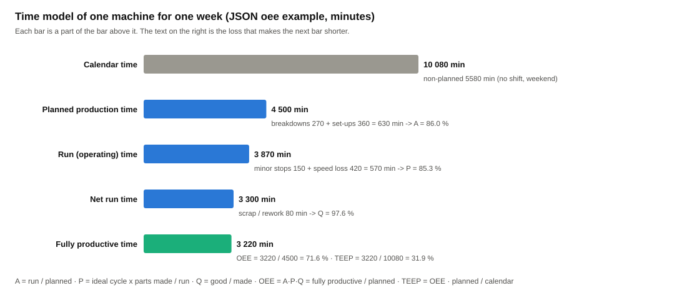

| Time class | Symbol | Definition | What takes it away from the class above |
|---|---|---|---|
| Calendar time | T_cal | all time: 7 days × 24 h = 10 080 min per week | – |
| Planned production time | T_plan | time in which the machine **should** produce (shifts, incl. unmanned shifts) | no shift, holidays, planned maintenance, breaks if the machine stops, no orders ("non-planned") |
| Run (operating) time | T_run | planned time minus **stops** | breakdowns, set-ups and adjustments (availability losses) |
| Net run time | T_net | time to make **all** parts at the ideal cycle time = t_ideal × n_total | minor stops, reduced speed (performance losses) |
| Fully productive time | T_full | time to make the **good** parts at the ideal cycle time = t_ideal × n_good | scrap, rework, start-up losses (quality losses) |

The **ideal cycle time** t_ideal is the best possible time per part for this machine and this part (the time of the NC program with
optimal feeds, tool changes and pallet change, without waiting). It is **not** the planned or average time. If you set t_ideal too
high, P can become larger than 100 % – a typical sign of a wrong ideal time.

ISO 22400-2 (KPIs for manufacturing operations management) uses the same idea with other names: planned busy time (PBT), actual
production time (APT), and the KPI "OEE index" = availability × effectiveness × quality ratio. VDI 3423 defines the availability of
machines from the time spent in fault. Use the definitions of **one** standard in one project and write them into the contract
(A1.9).

### A1.2 The OEE formulas

$$ T_{run} = T_{plan} - t_{down} - t_{setup} $$

$$ A = \frac{T_{run}}{T_{plan}}, \qquad P = \frac{t_{ideal} \cdot n_{total}}{T_{run}}, \qquad Q = \frac{n_{good}}{n_{total}} $$

$$ OEE = A \cdot P \cdot Q = \frac{t_{ideal} \cdot n_{good}}{T_{plan}} = \frac{T_{full}}{T_{plan}}, \qquad TEEP = OEE \cdot \frac{T_{plan}}{T_{cal}} = \frac{T_{full}}{T_{cal}} $$

Symbols and units: T in min; t_down = breakdown minutes, t_setup = set-up and adjustment minutes; t_ideal in min per part; n_total =
all parts made (good + scrap + rework); n_good = good parts at the first pass (right first time). A, P, Q, OEE and TEEP are
dimensionless (shown in %).

Two loss times that you need for the waterfall (JSON formula `oee`):

$$ t_{speed} = T_{run} - t_{ideal} \cdot n_{total} - t_{minor} \quad (\ge 0), \qquad t_{quality} = t_{ideal} \cdot (n_{total} - n_{good}) $$

The speed loss is not measured directly – it is "what remains" of the performance loss after the measured minor stops. If the
recorded minor stops are larger than the whole performance loss, the data are wrong (the web shows a warning).

### A1.3 Worked example – one machine, one week (JSON `oee`)

Inputs (example): calendar 10 080 min, planned 4 500 min (two shifts on five days minus breaks), breakdowns 270 min, set-ups 360 min,
minor stops 150 min, ideal cycle time 2.0 min per part, parts made 1 650, good parts 1 610.

| Step | Formula | Calculation | Result |
|---|---|---|---|
| 1 Run time | T_plan − t_down − t_setup | 4 500 − 270 − 360 | **3 870 min** |
| 2 Availability | T_run ÷ T_plan | 3 870 ÷ 4 500 | **A = 86.0 %** |
| 3 Net run time | t_ideal × n_total | 2.0 × 1 650 | 3 300 min |
| 4 Performance | T_net ÷ T_run | 3 300 ÷ 3 870 | **P = 85.27 %** |
| 5 Quality | n_good ÷ n_total | 1 610 ÷ 1 650 | **Q = 97.58 %** |
| 6 OEE | A × P × Q | 0.8600 × 0.8527 × 0.9758 | **OEE = 71.56 %** |
| 7 Check | T_full ÷ T_plan = t_ideal × n_good ÷ T_plan | 2.0 × 1 610 ÷ 4 500 = 3 220 ÷ 4 500 | 71.56 % ✓ |
| 8 TEEP | OEE × T_plan ÷ T_cal | 0.7156 × 4 500 ÷ 10 080 | **TEEP = 31.94 %** |
| 9 Speed loss | T_run − T_net − t_minor | 3 870 − 3 300 − 150 | 420 min |
| 10 Quality loss | t_ideal × (n_total − n_good) | 2.0 × 40 | 80 min |
| 11 Non-planned | T_cal − T_plan | 10 080 − 4 500 | 5 580 min |

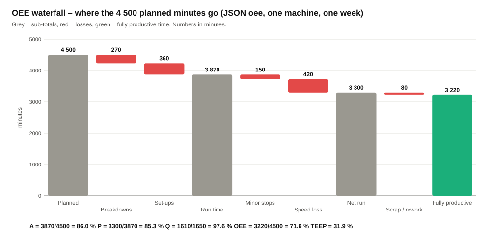

**How to read the result.** Of 4 500 planned minutes, only 3 220 minutes made good parts at the ideal speed. The biggest single loss
is the **speed loss (420 min)**, then **set-ups (360 min)**, then **breakdowns (270 min)**. So in this example the first project is
not maintenance but the process: why does the machine run 13 % slower than its ideal time? (feeds reduced by the operator, tool life
problems, long pallet changes, waiting for the probe cycle, program not optimised). The second project is SMED for the set-ups.

The **TEEP of 31.9 %** shows the real reserve: the machine is used for good parts in less than one third of the week. An FMS with
pallets and an unmanned third shift and weekend raises T_plan towards T_cal – this raises TEEP more than any other action. Example:
the same OEE in 7 680 planned minutes (three shifts on five days + Saturday) gives TEEP = 0.7156 × 7 680 ÷ 10 080 = 54.5 %.

### A1.4 Sensitivity – which loss is worth most?

Because OEE is a product, one point less in any factor costs about the same share of OEE. But the **effort** to win a point is very
different. Example: remove 100 min of each loss from the example week and see the gain (same 4 500 min planned):

| Action | New value | New OEE | Gain |
|---|---|---|---|
| 100 min fewer breakdowns (better maintenance) | A = 88.2 %, P = 83.1 %* | OEE unchanged if the parts made stay 1 650 | – |
| 100 min fewer breakdowns **and** 50 more parts (the time is used) | n_total 1 700, n_good 1 659 | 2.0 × 1 659 ÷ 4 500 = 73.7 % | +2.2 points |

\* This is the most important practical lesson about OEE: **OEE only rises if the won time is used for more good parts.** If the
machine has no more orders, a shorter breakdown only moves minutes from A to P. Always calculate OEE from the parts (t_ideal × n_good
÷ T_plan), not from the separate factors that you "improved" on paper.

### A1.5 The six big losses – causes and countermeasures

The six big losses come from TPM (Total Productive Maintenance, Nakajima, JIPM). Every loss belongs to one OEE factor.

| # | Loss | Factor | Typical causes in machining / assembly | Countermeasures | Responsible |
|---|---|---|---|---|---|
| 1 | Breakdowns (equipment failure) | A | spindle, axis drive, hydraulic clamp leak, tool magazine chain, coolant pump, sensor, electronics, software crash | preventive + predictive maintenance (vibration, temperature, current), root-cause analysis, spare parts, autonomous maintenance, design for reliability | maintenance |
| 2 | Set-up and adjustment | A | fixture change, program change, first-part measurement, tool presetting at the machine, waiting for the setter | SMED (external set-up), pallets and fixtures prepared offline, zero-point clamping, presetting, standard set-up sheet, family sequencing | production + industrial engineering |
| 3 | Minor stops (idling) – stops under a limit, often < 5 min | P | chip jams, probe errors, part not detected, door switch, feeder empty, light curtain interrupted | find the root cause (each short stop is small, the sum is big), chip conveyor + coolant filtration, sensor mounting, poka-yoke, 5S | production + maintenance |
| 4 | Reduced speed | P | feed override below 100 %, conservative program, worn tools, unstable process, slow pallet change, waiting for data | process optimisation, tool management, adaptive control, standard feeds, program review, measure t_ideal correctly | process engineering |
| 5 | Scrap and rework (process defects) | Q | dimension out of tolerance, burrs, porosity in castings, wrong clamping, tool breakage not detected | process capability (Cpk), in-process measurement, tool breakage detection, poka-yoke, SPC | quality |
| 6 | Start-up losses (reduced yield) | Q | first parts after a set-up, warm-up of the spindle, after a breakdown, after a weekend | warm-up programs, thermal compensation, first-part rules, stable process after restart | process engineering |

**Where to set the limit between breakdown and minor stop?** Choose one value per project (typical 5 min, sometimes 10 min) and write
it into the OEE definition. A stop of 4 min caused by a broken sensor is a minor stop; the same sensor fault with 40 min repair is a
breakdown. In the stop log of A2 the type is written in each event.

### A1.6 TPM – the eight pillars and where the losses are attacked

| Pillar | Content | Attacks losses |
|---|---|---|
| 1 Autonomous maintenance (Jishu Hozen) | operators clean, inspect, lubricate, tighten; they see abnormal states early; 7 steps from initial cleaning to autonomous management | 1, 3 |
| 2 Planned maintenance | preventive plan, condition monitoring, predictive maintenance, MTBF / MTTR analysis (A2) | 1 |
| 3 Focused improvement (Kobetsu Kaizen) | small teams attack the biggest loss of the loss tree (A1.8) with PDCA / 5 Why / Ishikawa | all |
| 4 Quality maintenance | conditions for zero defects: which machine state gives good parts? | 5, 6 |
| 5 Early equipment management | design and buy machines that are easy to maintain and set up (requirements from the stop log of the old machines) | 1, 2 |
| 6 Training and education | skills of operators, setters, maintenance technicians | all |
| 7 Safety, health, environment | zero accidents; safe maintenance (lock-out tag-out) | – |
| 8 TPM in administration | order release, material supply, planning losses (no orders, no material) | non-planned time |

**Autonomous maintenance in seven steps** (short): 1 initial cleaning (find abnormalities), 2 eliminate sources of contamination and
hard-to-reach places, 3 cleaning and lubrication standards, 4 general inspection (training), 5 autonomous inspection, 6 standardisation
(5S, visual management), 7 autonomous management. In an FMS the "operator" of the night shift is the system itself – therefore
autonomous maintenance is done by the day-shift operator of the load station and must be planned into his time (guide 62 F, staffing).

### A1.7 SMED – reducing set-up time

SMED (Single-Minute Exchange of Die, Shingo) reduces the set-up time in four steps:

1. **Observe and measure** the current set-up (video, list of every element with time).
2. **Separate internal and external work.** Internal = only possible when the machine stops (remove fixture). External = possible while
   the machine runs (get the next fixture, tools, program, gauge).
3. **Convert internal to external.** Pallets with fixtures prepared outside the machine (the FMS principle!), tool presetting, programs
   downloaded by the DNC, pre-heated moulds.
4. **Streamline both.** Zero-point clamping instead of bolts, quick couplings, standard heights, functional clamps, parallel work by two
   people, no adjustments (fixed positions), checklists.

**Worked example (example values):** fixture change on an HMC without pallet system = 45 min internal. After step 2: 15 min are
external (get fixture, tools, program). After step 3: fixture mounted on a spare pallet outside → the machine only changes the pallet
(APC 0.3 min) + loads the program + first-part probe cycle 3 min. Internal set-up 45 → about 4 min. With 8 set-ups per week this wins
8 × 41 = 328 min per week – almost exactly the 360 set-up minutes of the example week (A1.3). This is the reason why an FMS with
pallet pool has a high availability: **the set-up is external by design**.

The effect of set-ups on capacity **and** variability is calculated in B4.4.

### A1.8 OEE of a single machine vs OEE of an FMS

OEE is defined for **one machine**. For a system there are three useful views:

| View | Definition | Use |
|---|---|---|
| Machine OEE | per machine, as A1.2 | maintenance and process improvement of each machine |
| Bottleneck OEE | OEE of the bottleneck machine (group) | the **output of the system** is set by the bottleneck; a loss at the bottleneck is a loss of the whole system, a loss at a non-bottleneck often costs nothing |
| System OEE (line OEE) | t_ideal,bottleneck × good parts out of the system ÷ T_plan | management KPI of the whole FMS or line |

For an FMS with 3 identical machines and pallets, the machines are a **parallel group**: the system output = sum of the machine outputs.
The system OEE is then the average of the machine OEEs, weighted by planned time. For a **line** in series without buffers, the line
OEE is close to the **product** of the availabilities (C1) – much lower than each machine.

**Do not add the losses of the load station or the vehicle to the machine OEE.** If the machine waits for a pallet because the load
station is slow, this is "starved" time: it is a loss of the **system**, not of the machine. In the PackML state model (A1.9) it is the
state STARVED (or IDLE without order). Keep it separate – otherwise the maintenance team searches for a machine problem that is a
system problem.

### A1.9 OEE from machine signals – PackML states and the loss classes

Manual OEE data (paper lists) are always too optimistic and late. In an FMS the OEE is calculated **automatically** from the machine
state (module standard: every module has the PackML state model, guide 65 §4; the state is word 0 of the standard data block, guide 66).

| PackML state (number) | Time class | OEE loss |
|---|---|---|
| EXECUTE (6) with a part in the machine | run time | – (the part counter and t_ideal give P) |
| EXECUTE, but slower than t_ideal | run time | speed loss (calculated, not a state) |
| HELD (11) – internal problem, waiting for the operator (e.g. tool missing) | stop | minor stop if < limit, else breakdown |
| SUSPENDED (5) – external problem: no pallet (starved) or output blocked | stop of the system | **not** a machine loss: starved / blocked |
| STOPPED (2), ABORTED (9) after a fault | stop | breakdown (with alarm number = reason) |
| IDLE (4) without order | non-planned or "no order" | planning loss (TPM pillar 8) |
| Mode MAINTENANCE | planned maintenance or repair | planned maintenance (non-planned time) or breakdown |
| Mode MANUAL during a set-up | set-up | set-up and adjustment |
| COMPLETE (17) → RESETTING (15) | short transition | part of the cycle |

Signals you need per machine (data block words of guide 66 §5): state, mode, alarm number (reason), part counter good / scrap, program
number (part type, to look up t_ideal), pallet number. The MES (guide 71) or the twin (`twin/analytics.py`, guide 01 §4.7) adds up
the minutes per class every shift.

**Rules for automatic OEE:**
- Every stop longer than the minor-stop limit must get a **reason** (alarm number automatically, or the operator chooses it on the HMI
  when the machine restarts). "Unknown" may not be more than 5 % of the stop time.
- t_ideal per program in a master data table (from the NC program run time measured on a good machine, or from the CAM time + tool
  change + pallet change).
- Scrap counted at the measuring station (CMM, guide 63 B13) and assigned back to the machine that made the part (traceability,
  guide 15).
- Count the shift start by the calendar of the MES, not by the operator.

### A1.9.1 Program – OEE from a PackML state log

The following stdlib-Python function turns a state log of one machine and one shift into the OEE classes. It is the core of what the MES or
the twin does every shift (the real implementation adds reason codes, shift calendars and the t_ideal table per program).

```python
def oee_from_states(log, t_ideal, minor_limit=5.0):
    """log: list of (start_min, end_min, state, mode, good, scrap) rows of one machine in one shift.
    state: 'EXECUTE', 'HELD', 'SUSPENDED', 'STOPPED', 'IDLE'; mode: 'PROD', 'MAINT', 'MANUAL'."""
    cls = {"run": 0.0, "breakdown": 0.0, "setup": 0.0, "minor": 0.0, "starved": 0.0, "noplan": 0.0}
    good = scrap = 0
    for start, end, state, mode, g, s in log:
        d = end - start
        good += g
        scrap += s
        if mode == "MANUAL":
            cls["setup"] += d                      # set-up and adjustment
        elif mode == "MAINT" or state in ("STOPPED", "ABORTED"):
            cls["breakdown"] += d
        elif state == "EXECUTE":
            cls["run"] += d
        elif state == "HELD":
            cls["minor" if d < minor_limit else "breakdown"] += d
        elif state == "SUSPENDED":
            cls["starved"] += d                    # system loss, not a machine loss
        else:
            cls["noplan"] += d                     # IDLE without order
    plan = sum(cls.values()) - cls["noplan"]            # planned time of the shift
    plan_m = plan - cls["starved"]                      # machine view: starved time is not the machine's loss
    run = plan_m - cls["breakdown"] - cls["setup"]      # includes the minor stops (they are a P loss)
    A = run / plan_m
    P = t_ideal * (good + scrap) / run
    Q = good / (good + scrap)
    return {"A": A, "P": P, "Q": Q, "OEE_machine": A * P * Q,
            "OEE_system": t_ideal * good / plan, **cls}
```

**Worked example (example log of one shift of 450 min, t_ideal = 2.0 min):**

| From – to [min] | State | Mode | Good | Scrap | Class |
|---|---|---|---|---|---|
| 0 – 95 | EXECUTE | PROD | 44 | 1 | run |
| 95 – 98 | HELD | PROD | 0 | 0 | minor stop (3 min < 5) |
| 98 – 210 | EXECUTE | PROD | 52 | 0 | run |
| 210 – 250 | STOPPED | PROD | 0 | 0 | breakdown 40 min |
| 250 – 290 | IDLE | MANUAL | 0 | 0 | set-up 40 min |
| 290 – 400 | EXECUTE | PROD | 50 | 2 | run |
| 400 – 412 | SUSPENDED | PROD | 0 | 0 | starved 12 min (no pallet) |
| 412 – 450 | EXECUTE | PROD | 17 | 0 | run |

Result: planned 450 min; machine view plan = 450 − 12 = 438 min; run = 438 − 40 − 40 = 358 min (incl. the 3-min minor stop);
A = 358 ÷ 438 = **81.74 %**; P = 2.0 × 166 ÷ 358 = **92.74 %**; Q = 163 ÷ 166 = **98.19 %**; **machine OEE = 74.43 %**. System view (starved
time counts): 2.0 × 163 ÷ 450 = **72.44 %**. The 2-point difference is the loss caused by the system (pallet not ready) – it belongs to the
load station or the cell controller, not to the machine.

**Data checks to build in:** the sum of all classes must equal the shift length; P > 100 % means a wrong t_ideal or a counting error; a HELD
state without a reason code after the limit must trigger an operator prompt; the part counter must come from the machine (PLC), not from manual
entry.

### A1.10 Loss tree – from OEE to actions

A loss tree breaks the OEE gap (100 % − OEE) down into its branches, with minutes, so that every branch has an owner.

```
Planned time 4 500 min  (100 %)
├── Availability loss 630 min (14.0 %)
│   ├── Breakdowns 270 min (6.0 %)  → reasons from the stop log (A2.3): clamp leak, axis drive, magazine …
│   └── Set-ups 360 min (8.0 %)     → SMED (A1.7), sequence families (guide 62 B)
├── Performance loss 570 min (12.7 %)
│   ├── Minor stops 150 min (3.3 %) → chip jams, probe errors (Pareto, A2.3)
│   └── Speed loss 420 min (9.3 %)  → feeds, programs, tool life
├── Quality loss 80 min (1.8 %)
│   └── 40 bad parts × 2.0 min      → Cpk, poka-yoke
└── Fully productive 3 220 min (71.6 % = OEE)
```

The percentages are of the planned time, so the branches add up: 14.0 + 12.7 + 1.8 + 71.6 = 100 % (rounded). This is easier to
explain than the factors A, P, Q, which multiply.

### A1.11 Typical OEE values and how to write the OEE into a contract

| Situation | Typical OEE (example ranges) |
|---|---|
| "World class" (often quoted, Nakajima) | 85 % = A 90 % × P 95 % × Q 99.9 % (rounded) |
| Single CNC machine in a job shop, manual set-ups | 40–60 % |
| New FMS in year 1 (ramp-up) | 60–75 % |
| Mature FMS with pallet pool, unmanned shift | 75–85 % (TEEP 50–70 %) |
| Assembly line, mature | 70–85 % |
| Robot welding cell with turntable | 70–85 % |

**Contract rules (for the buyer, guide 61 B, guide 73):**
- Define the OEE formula, the time classes, t_ideal per part and the minor-stop limit in the specification (copy A1.2 and A1.9).
- Separate what the supplier is responsible for (machine faults, machine speed, process scrap from the machine) from what the factory
  is responsible for (no orders, no material, no operator, raw-part defects). The acceptance test measures **technical availability**
  (A2.2) and cycle time; the OEE in production is a joint target.
- Agree the measurement (automatic from the PackML states, A1.9) and the duration (for example 3 weeks after the end of ramp-up).

### A1.12 OEE in other domains (what changes)

| Domain | t_ideal is … | Typical big losses | Signal source for automatic OEE |
|---|---|---|---|
| Machining FMS | NC program time incl. tool and pallet change | set-ups (if not external), tool breakage, chip problems, waiting for pallets (system) | CNC state + PackML of the cell controller, part counter per program |
| Assembly line | takt of the bottleneck station (design cycle) | minor stops (feeders, screwdrivers), material missing, quality stops | station PLCs, carrier ID at each station |
| Robot welding | arc time + robot motion + table index | torch cleaning, wire / gas change, fixture problems, operator late | robot controller (arc on, program number), turntable PLC |
| Sheet metal (laser + tower) | cutting program time per sheet | sheet change, nozzle change, micro-joint problems, sorting | laser CNC states, tower PLC |
| Injection moulding | cycle time of the mould (closing, injection, cooling, opening) | mould change, start-up scrap, material drying, flash | machine controller (EUROMAP 77 / OPC UA interfaces), cycle counter |
| Painting line | conveyor speed × hook pitch (parts per hour at full hooks) | empty hooks, colour change, rework | line PLC, hook occupancy |

The **definition** stays the same (A1.2); only the source of t_ideal and the loss reasons change. Empty hooks or empty carriers in a line are a
**performance** loss of the line (parts per hour below the ideal) even when every machine "runs".

### A1.13 An OEE improvement project – 12 weeks (example)

| Week | Action | Effect on the example week (A1.3) |
|---|---|---|
| 1–2 | automatic OEE from states, reason codes, daily loss tree meeting (15 min at the board) | transparency; "unknown" stops from 20 % to < 5 % |
| 3–4 | focus loss 1 = speed (420 min): measure t_ideal per program, find feed overrides, worn tools | speed loss 420 → 250 min |
| 5–8 | focus loss 2 = set-ups (360 min): SMED workshop, second pallet with fixture for the two most frequent changes | set-ups 360 → 150 min |
| 7–10 | breakdowns (270 min): Pareto of the stop log, clamp seals on preventive plan, spare drive on stock | breakdowns 270 → 150 min |
| 9–12 | minor stops: chip conveyor adjustment, probe cleaning standard (autonomous maintenance) | minor stops 150 → 80 min |

If the won time is used for good parts (orders available): run time = 4 500 − 150 − 150 = 4 200 min, net time = 4 200 − 80 − 250 = 3 870 min
→ 1 935 parts at 2.0 min; with Q = 97.58 % about 1 888 good parts → OEE = 2.0 × 1 888 ÷ 4 500 = **83.9 %** (from 71.6 %). Each step is
measured with the same automatic OEE – otherwise nobody believes the gain.

### A1.14 OEE pitfalls

- **OEE as a target for operators only** – most losses (set-ups, breakdowns, missing material) are outside their control; use OEE to find losses,
  not to blame people.
- **Comparing OEE of different machines** with different t_ideal rules – compare loss minutes, not percentages.
- **Excluding "planned" stops generously** (meetings, cleaning, trials booked as non-planned) – OEE looks good, capacity is missing; TEEP shows it.
- **Averaging OEE percentages** of machines with different planned times – weight by planned time or compute from the summed minutes.
- **No link to money** – translate the biggest loss into parts per week and contribution margin to get the budget for the countermeasure.

---

## A2. Reliability: MTBF, MTTR and availability

### A2.1 Definitions (EN 13306 terms)

EN 13306 (maintenance terminology) defines failure, fault, up time, down time, and MTBF / MTTR as mean values. In this guide:

| Term | Symbol | Definition | Unit |
|---|---|---|---|
| Failure | – | the machine loses the ability to do its function (here: a stop with type "failure" in the log) | – |
| Number of failures | n_f | count of failure events in the observed time | – |
| Mean time to repair | MTTR | average duration of a failure (from stop to restart, includes waiting for the technician and spare parts) | min |
| Mean time between failures | MTBF | average up time between two failures | min or h |
| Mean time to failure | MTTF | same idea as MTBF for parts that are replaced (not repaired); in queueing (B4.3) MTTF = mean busy time to the next failure | min |
| Failure rate | λ_f | 1 ÷ MTBF | 1/h |
| Inherent availability | A_inh | MTBF ÷ (MTBF + MTTR) – only failures count | % |
| Operational availability | A_op | up time ÷ (up time + all down time), incl. set-ups or logistic delays as agreed | % |

Formulas (JSON formula `mtbf_mttr`):

$$ MTTR = \frac{\sum t_{failure}}{n_f}, \qquad MTBF = \frac{T_{prod} \cdot 60 - \sum t_{failure}}{n_f}, \qquad A_{inh} = \frac{MTBF}{MTBF + MTTR} $$

with T_prod = production time in hours (the time in which failures can happen), all durations in min.

Note: with these definitions A_inh = (T_prod·60 − Σ t_failure) ÷ (T_prod·60) – the share of the production time without failures.
The two ways give the same number, which is a good self-check.

### A2.2 Technical availability in acceptance tests (VDI 3423 idea)

VDI 3423 describes the availability of machines and systems for contracts: the observed time minus the time in fault **caused by the
supplier**, divided by the observed time. Faults caused by the user (operator error, no material, wrong raw parts, no energy) are not
counted against the supplier. This is the availability you write into the acceptance test (guide 61 tool `acceptance.py`, guide 73).
Typical requirement for a new FMS: technical availability ≥ 95 % (≥ 97 % for mature single machines) in a run of 2–3 weeks.

### A2.3 Worked example – stop log of one machine (JSON `stop_log`)

The log has 15 events in 160 h of production time (example): 7 failures, 3 set-ups, 5 minor stops.

| # | Type | Minutes | Reason |
|---|---|---|---|
| 1 | failure | 45 | Spindle overload / tool breakage |
| 2 | minor | 4 | Chip jam |
| 3 | failure | 120 | Pallet clamp hydraulic leak |
| 4 | setup | 35 | Fixture change VC10 -> VC30 |
| 5 | minor | 3 | Chip jam |
| 6 | failure | 25 | Coolant level low |
| 7 | minor | 5 | Probe error |
| 8 | failure | 60 | Tool magazine chain fault |
| 9 | setup | 30 | Fixture change VC30 -> VC20 |
| 10 | failure | 18 | Door interlock switch |
| 11 | minor | 4 | Chip jam |
| 12 | failure | 90 | Axis drive fault (X) |
| 13 | minor | 2 | Probe error |
| 14 | failure | 15 | Coolant level low |
| 15 | setup | 40 | Program prove-out new part |

**Step 1 – failures only:** n_f = 7; Σ t_failure = 45 + 120 + 25 + 60 + 18 + 90 + 15 = **373 min**.

**Step 2 – MTTR** = 373 ÷ 7 = **53.29 min**.

**Step 3 – MTBF** = (160 × 60 − 373) ÷ 7 = (9 600 − 373) ÷ 7 = 9 227 ÷ 7 = **1 318.14 min** (= 21.97 h).
Failure rate λ_f = 1 ÷ 21.97 h = 0.0455 per hour ≈ one failure per 2.7 shifts of 8 h.

**Step 4 – inherent availability** A_inh = 1 318.14 ÷ (1 318.14 + 53.29) = **96.11 %**.
Check: (9 600 − 373) ÷ 9 600 = 0.9611 ✓.

**Step 5 – other stop types:** set-ups 35 + 30 + 40 = 105 min (3 events); minor stops 4 + 3 + 5 + 4 + 2 = 18 min (5 events).
All stops = 373 + 105 + 18 = **496 min**. Operational availability including set-ups (minor stops count in P) =
(9 600 − 373 − 105) ÷ 9 600 = 95.02 %.

**Step 6 – Pareto of all stop minutes by reason** (sum per reason, sorted descending):

| Rank | Reason | Type | Events | Minutes | Share | Cumulative |
|---|---|---|---|---|---|---|
| 1 | Pallet clamp hydraulic leak | failure | 1 | 120 | 24.2 % | 24.2 % |
| 2 | Axis drive fault (X) | failure | 1 | 90 | 18.1 % | 42.3 % |
| 3 | Tool magazine chain fault | failure | 1 | 60 | 12.1 % | 54.4 % |
| 4 | Spindle overload / tool breakage | failure | 1 | 45 | 9.1 % | 63.5 % |
| 5 | Coolant level low | failure | 2 | 40 | 8.1 % | 71.6 % |
| 6 | Program prove-out new part | setup | 1 | 40 | 8.1 % | 79.6 % |
| 7 | Fixture change VC10 -> VC30 | setup | 1 | 35 | 7.1 % | 86.7 % |
| 8 | Fixture change VC30 -> VC20 | setup | 1 | 30 | 6.0 % | 92.7 % |
| 9 | Door interlock switch | failure | 1 | 18 | 3.6 % | 96.4 % |
| 10 | Chip jam | minor | 3 | 11 | 2.2 % | 98.6 % |
| 11 | Probe error | minor | 2 | 7 | 1.4 % | 100.0 % |

Ranks 5 and 6 have the same minutes (40). This guide keeps the order of the first appearance in the log (coolant before prove-out);
a tool may print them in the other order – the top 3 are not affected.

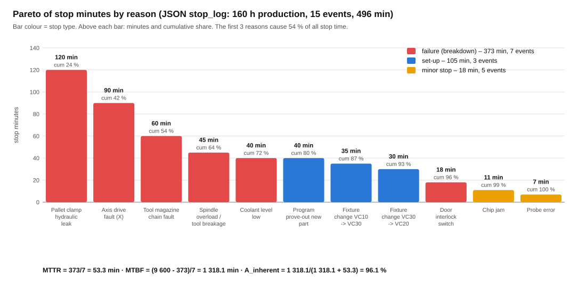

**Interpretation and actions:**
- The **top 3** reasons (clamp leak, axis drive, magazine chain) cause **54 %** of all stop time with only **3 of 15 events**. Each is a
  single long failure: the lever is **MTTR** (spare parts on site, diagnosis, trained technicians), not only MTBF.
- **Coolant level low** happened twice – a repeating, easy failure: a level sensor with early warning and an automatic refill
  (autonomous maintenance standard) removes it completely.
- **Chip jams** are small (11 min) but 3 events in 160 h – in an **unmanned** night shift one chip jam stops the machine for the whole
  night. Count minor stops also by **number**, not only by minutes, for unmanned operation.
- Make two Pareto charts in practice: by **minutes** (for availability) and by **number of events** (for unmanned reliability).

**Statistical warning.** 7 failures in 160 h is a very small sample. The 95 % confidence interval of a failure rate from n events is
wide (for n = 7 roughly from 0.4 to 2 times the observed rate, chi-square method). Collect at least 3–6 months, or 20–30 failures per
machine group, before you plan maintenance budgets or MTBF guarantees from the data.

### A2.4 Improving MTBF and MTTR

| Lever | Increases MTBF | Reduces MTTR |
|---|---|---|
| Design / buy (early equipment management) | robust components, sealed clamps, reduced number of parts, derating | modular units, quick-change, access, diagnosis in the HMI, standard parts |
| Preventive maintenance (time-based) | replace wear parts before failure (filters, seals, wipers) | – |
| Condition-based / predictive maintenance | spindle vibration, axis current, hydraulic pressure trend, temperature (guide 01 §4.9–4.10 health index and RUL) | repair planned in a non-planned window → zero breakdown minutes |
| Spare parts on site | – | removes waiting for parts (often 50–80 % of MTTR for electronics and drives) |
| Diagnosis | – | alarm texts with cause and action, fault trees, remote service access, trained technicians on each shift |
| Root-cause analysis (5 Why, Ishikawa, FMEA) | removes repeating failures | – |
| Autonomous maintenance | finds leaks, loose parts, dirt early | operators do first-level repairs |

**Rule of thumb for an FMS:** the **MTTR** matters more than the MTBF for the size of buffers and the number of pallets (Part C) and for
the waiting time (B4.3): a 6-hour breakdown hurts much more than 36 ten-minute stops with the same total time.

### A2.5 Spare parts – how many?

For a part with a known failure rate λ_f (failures per year for all machines that use it) and a replenishment lead time L (years), the
number of failures during the lead time is Poisson distributed with mean μ = λ_f × L. The stock s is chosen so that the probability of
no shortage reaches a service level (e.g. 95 %):

$$ P(X \le s) = \sum_{k=0}^{s} \frac{\mu^k e^{-\mu}}{k!} \ \ge \ \text{service level} $$

**Worked example (example values):** clamp cylinder seal kit, 3 machines × 4 failures per year = 12 per year, lead time 3 weeks =
0.0577 year → μ = 0.692. P(0) = e^−0.692 = 0.500; P(≤1) = 0.500 × (1 + 0.692) = 0.847; P(≤2) = 0.847 + 0.500 × 0.692²/2 = 0.967 ≥ 0.95 →
**keep 2 kits**. For an expensive part with long lead time (spindle, 16 weeks, 0.3 failures per year for 3 machines → μ = 0.092, P(0) =
0.912) the decision is economic: compare the cost of a spare spindle with the cost of 16 weeks without one machine (or an exchange
contract with the maker).

Classify spare parts (A / B / C by cost, and by criticality: does a failure stop the bottleneck?). Critical parts for the bottleneck
are always on stock or covered by a service contract with guaranteed delivery.

### A2.6 Availability of systems – series, parallel, k out of n

| Structure | Availability | Example (A = 95.24 % each) |
|---|---|---|
| n units in series (all needed, no buffer) | A_s = Π A_i | 3 in series: 0.9524³ = 86.4 % |
| n units in parallel, one is enough | A_p = 1 − Π (1 − A_i) | 2 in parallel: 1 − 0.0476² = 99.77 % |
| k out of n needed (identical units) | Σ (j = k … n) C(n, j) A^j (1 − A)^(n − j) | 2 of 3: 0.8638 + 0.1296 = 99.35 % |

**Capacity view of the FMS with 3 parallel HMCs (A = 1 200 ÷ 1 260 = 95.24 %), binomial distribution of the machines that are up:**

| Machines up | Probability | Capacity share |
|---|---|---|
| 3 | 0.9524³ = 86.38 % | 100 % |
| 2 | 3 × 0.9524² × 0.0476 = 12.96 % | 67 % |
| 1 | 3 × 0.9524 × 0.0476² = 0.65 % | 33 % |
| 0 | 0.0476³ = 0.011 % | 0 % |

Expected machines up = 3 × 0.9524 = 2.857 → expected capacity = 95.24 % of the nominal (the same as one machine: parallel machines do not raise
the **average** availability, they make the output **robust** – the system practically never stops completely; probability of a total stop
0.011 %). A line of 3 machines in series without buffers would be up only 86.4 % of the time. This is the reliability argument for the routing
flexibility of an FMS (guide 61 A2) – and for buffers in lines (Part C).

### A2.7 Wear-out and maintenance intervals – the Weibull distribution

MTBF alone assumes a constant failure rate (exponential, "random failures"). Wear parts (seals, bearings, wipers, ball screws) fail more often
when they get older. The **Weibull distribution** describes this with a shape k and a scale η:

$$ R(t) = e^{-(t/\eta)^k}, \qquad h(t) = \frac{k}{\eta}\left(\frac{t}{\eta}\right)^{k-1}, \qquad MTTF = \eta\,\Gamma\!\left(1 + \frac{1}{k}\right), \qquad B_{10} = \eta\,(-\ln 0.9)^{1/k} $$

R(t) = probability of no failure up to t (reliability), h(t) = failure rate at age t, B_10 = age at which 10 % have failed. k < 1: early failures
(burn-in, assembly faults); k = 1: random (exponential); k > 1: wear-out.

**Worked example (example values):** clamp cylinder seal with k = 2, η = 2 000 operating hours. MTTF = 2 000 × Γ(1.5) = 2 000 × 0.8862 =
**1 772 h**; B_10 = 2 000 × (0.1054)^0.5 = **649 h**; R(500 h) = e^(−0.0625) = **93.9 %**. The failure rate at 1 500 h (0.00075 per h) is three
times the rate at 500 h (0.00025 per h) – a preventive exchange makes sense here (planned in non-planned time, e.g. every 600 h ≈ B_10). For
k = 1 a preventive exchange would be useless: an old part is as good as a new one. Fit k and η from the failure times of the stop log (busy
hours per part) – with fewer than about 10 failures, take k from experience or the maker.

---

## A3. Capacity planning with OEE and growth

### A3.1 The capacity formula

Guide 62 (item 2D) calculated the machine count from the average load. Here the OEE enters:

$$ n_{machines} = \frac{D \cdot t_{unit}}{T_{plan} \cdot OEE_{plan}} $$

D = demand (units per year), t_unit = ideal time per unit (min ÷ 60 for h), T_plan = planned hours per machine per year, OEE_plan =
planned OEE (A × P × Q expected in that year). Round **up**, then check the utilisation u = n_needed ÷ n_installed.

Note on the use of OEE here: dividing by OEE includes availability, speed and scrap losses. Do not also add a separate scrap
allowance or an availability factor – that would count them twice.

### A3.2 Worked example – FMS for crankcases with growth (example values)

Machining time per pallet (mix average, guide 63 C1 and JSON `fms_sim`): t_m = 0.40 × 56 + 0.35 × 72 + 0.25 × 40 = **57.6 min**.
Planned time: 3 shifts × 7.5 h × 5 days × 48 weeks = **5 400 h per year**. Demand year 1: 12 000 pallets, growth 8 % per year.
Planned OEE: 75 % in year 1 (ramp-up), 80 % in year 2, 85 % from year 3.

| Year | Demand (pallets) | OEE_plan | Machines needed (exact) | Installed | Load of 3 machines | Load of 4 machines |
|---|---|---|---|---|---|---|
| 1 | 12 000 | 75 % | 12 000 × 57.6 ÷ 60 ÷ (5 400 × 0.75) = 2.844 | 3 | 94.8 % | 71.1 % |
| 2 | 12 960 | 80 % | 2.880 | 3 | 96.0 % | 72.0 % |
| 3 | 13 997 | 85 % | 2.927 | 3 | 97.6 % | 73.2 % |
| 4 | 15 117 | 85 % | 3.162 | 4 | 105.4 % ✗ | 79.0 % |
| 5 | 16 326 | 85 % | 3.415 | 4 | 113.8 % ✗ | 85.4 % |

One machine at OEE 85 % makes 5 400 × 0.85 × 60 ÷ 57.6 = 4 781 pallets per year (at 75 %: 4 219).

**Decision logic:**
1. **Open system (orders arrive randomly, no pallet pool):** the queueing rule of Part B says: do not plan the bottleneck above about
   80–85 % – otherwise lead times explode (B3). Then 3 machines are too few already in year 1.
2. **Closed system (FMS with pallet pool, release controlled by the MES):** the pallets decouple arrivals from the machines (B6). Here
   the machines can run at 90–95 % of their OEE capacity **if** there is a time reserve (Saturday shift, unmanned weekend hours) for
   peaks. Plan 3 machines for years 1–3 with the weekend as reserve, and the **4th machine in year 4**.
3. Therefore the **layout must keep the space for machine 4** (D4.11 expansion, D5 FMS pattern), the pallet pool must be extendable,
   and the cell controller and the load station must be sized for 4 machines (load station: 4 machines ÷ 60.48 min = 3.97 pallets/h <
   5.0 pallets/h ✓, see B6.2).

### A3.3 Capacity rules that connect Parts A, B and C

- Capacity = T_plan × OEE ÷ t_ideal – always with the **planned** OEE of that year (ramp-up!).
- Utilisation limit from queueing: about 80–85 % for open flow with high variability (B3), up to 90–95 % in a closed system with
  enough pallets (B6), and lower (70–80 %) for machines with long breakdowns or big set-ups (B4).
- A time reserve (shift, weekend) is cheaper than a machine, but it must be **real** (staff, energy, maintenance windows).
- Check the bottleneck shift by shift: with a mix change the bottleneck can move (guide 62 B6).
- Item 2 (web 2D, tool `capacity_plan.py`) gives the machine count; item 4 tells you whether the **system** reaches it.

---

# Part B – Queueing and variability (Factory Physics)

## B1. Basic laws

### B1.1 Words and symbols

| Term | Symbol | Meaning | Unit |
|---|---|---|---|
| Arrival rate | r_a or λ | parts (jobs, pallets) that arrive per time | 1/min, 1/h |
| Throughput | TH or X | parts that leave per time (long-run: TH = r_a if the system is stable) | 1/min, 1/h |
| Effective process time | t_e | mean time per part **including** breakdowns, set-ups and other detractors | min |
| Process rate | μ = 1/t_e | parts one server can make per time | 1/min |
| Number of parallel servers (machines) | m | – | – |
| Utilisation | u (or ρ) | share of time the servers are busy: u = r_a · t_e ÷ m | – |
| Work in process | WIP or L | parts in the system (waiting + in process) | parts |
| Queue length | L_q | parts waiting (not in process) | parts |
| Cycle time | CT or W | time from arrival to departure = waiting + process | min |
| Waiting time in queue | W_q or CT_q | time from arrival to the start of process | min |
| Coefficient of variation | c = σ ÷ mean | relative variability of a time; c² is the "squared coefficient of variation" (SCV) | – |
| c_a, c_e | – | c of the inter-arrival times, c of the effective process times | – |

**Classes of variability (Factory Physics):** low variability c < 0.75 (machining without breakdowns, c ≈ 0.1–0.5), moderate
0.75 ≤ c < 1.33 (exponential: c = 1), high c ≥ 1.33 (long breakdowns, big set-ups, random order releases).

### B1.2 Little's law

$$ WIP = TH \cdot CT \qquad (L = \lambda \cdot W) $$

**Idea of the proof.** Draw for every part a horizontal bar from its arrival to its departure over a long time T. The area of all bars
can be counted in two ways: (a) column by column = average number of parts in the system × T = WIP · T; (b) bar by bar = number of
parts × average bar length = (TH · T) · CT. Both are the same area → WIP = TH · CT. The law needs **no** assumption about distributions,
order of service or number of machines – only long-run averages of a stable system. Therefore it is the best **check** of every
simulation and every data set.

**Worked example (DES of item 4E, E4.2):** throughput 2.984 pallets/h = 0.04974 pallets/min, loop time 201.0 min →
WIP = 0.04974 × 201.0 = 10.0 = the number of pallets N = 10 ✓.

**Three uses of Little's law in practice:**
1. Lead time from WIP: WIP 600 parts in front of a line with TH 50 parts/h → CT = 12 h (no stopwatch needed).
2. WIP limit from a target lead time: target CT 4 h, TH 3 pallets/h → at most 12 pallets in the system (CONWIP, B6).
3. Check of data: if WIP, TH and CT measured by the MES do not fit together, one measurement is wrong.

### B1.3 Utilisation law and stability

$$ u = \frac{r_a \cdot t_e}{m} < 1 $$

If u ≥ 1 the queue grows without limit (in an open system). u is the share of time the machine is busy **with work** including its
breakdowns and set-ups (because t_e includes them). The utilisation of a machine is therefore not "the machine never stops" – an OEE of
70 % and a utilisation of 95 % can be true at the same time.

### B1.4 Bottleneck, raw process time, critical WIP

- **Bottleneck rate r_b** = rate of the station with the highest utilisation (lowest capacity m ÷ t_e) for the given mix.
- **Raw process time T_0** = sum of the effective process times along the route (no waiting).
- **Critical WIP W_0** = r_b · T_0 – the WIP at which an ideal line (no variability) reaches the full rate r_b with the minimum cycle
  time T_0 (Little's law applied to the ideal line).

These three numbers describe a line or closed system completely in the ideal case; B6 uses them for the FMS.

---

## B2. Exact queues: M/M/1 and M/M/m

### B2.1 Kendall notation

A/B/m: A = distribution of the inter-arrival times, B = distribution of the process times, m = servers. M = Markov = exponential
(c = 1), D = deterministic (c = 0), G = general (any c). M/M/1 = random arrivals, exponential process times, one machine. These models
have **exact** formulas. They are exact only if the times are really exponential – in machining they are not (c_e of 0.2–0.5 without
breakdowns). Use them for: service desks, maintenance technicians, single shared resources with random demand (crane, inspector,
forklift), and as a **reference** to check approximations and simulations.

### B2.2 M/M/1 – formulas

$$ \rho = \frac{\lambda}{\mu}, \quad L_q = \frac{\rho^2}{1-\rho}, \quad W_q = \frac{L_q}{\lambda}, \quad W = W_q + \frac{1}{\mu}, \quad L = \lambda W $$

Also: P_0 = 1 − ρ (probability the system is empty), P_n = (1 − ρ) ρ^n.

### B2.3 Worked example M/M/1 (JSON `mm1`)

A single measuring machine (CMM): parts arrive randomly at λ = 5.0 per hour; mean measuring time 10 min (exponential).

| Step | Formula | Calculation | Result |
|---|---|---|---|
| 1 Service rate | μ = 60 ÷ t_e | 60 ÷ 10 | 6.0 per hour |
| 2 Utilisation | ρ = λ ÷ μ | 5 ÷ 6 | **0.8333** |
| 3 Empty probability | P_0 = 1 − ρ | 1 − 0.8333 | 0.1667 |
| 4 Queue length | L_q = ρ² ÷ (1 − ρ) | 0.6944 ÷ 0.1667 | **4.1667 parts** |
| 5 Waiting time | W_q = L_q ÷ λ | 4.1667 ÷ 5 = 0.8333 h | **50.0 min** |
| 6 Time in system | W = W_q + 1/μ | 50 + 10 | **60.0 min** |
| 7 Parts in system | L = λ · W | 5 × 1.0 h | **5.0 parts** |

At 83 % utilisation a part waits **5 times** its measuring time. That is the effect of random arrivals and random process times.

### B2.4 M/M/m (Erlang C) – formulas

With m identical parallel servers, offered load a = λ ÷ μ (in "Erlang") and ρ = a ÷ m:

$$ P_0 = \left[ \sum_{k=0}^{m-1} \frac{a^k}{k!} + \frac{a^m}{m!\,(1-\rho)} \right]^{-1}, \qquad C(m,a) = \frac{a^m}{m!\,(1-\rho)}\,P_0 $$

$$ L_q = C \cdot \frac{\rho}{1-\rho}, \quad W_q = \frac{L_q}{\lambda}, \quad W = W_q + \frac{1}{\mu}, \quad L = \lambda W $$

C(m, a) is the **Erlang C** probability that an arriving part has to wait (all servers busy).

### B2.5 Worked example M/M/3 (JSON `mmm`)

Three identical inspection or washing stations in parallel, one common queue; λ = 10 per hour, mean time 15 min, m = 3.

| Step | Formula | Calculation | Result |
|---|---|---|---|
| 1 Service rate per server | μ = 60 ÷ 15 | | 4.0 per hour |
| 2 Offered load | a = λ ÷ μ | 10 ÷ 4 | **2.5 Erlang** |
| 3 Utilisation | ρ = a ÷ m | 2.5 ÷ 3 | **0.8333** |
| 4 Sum terms k = 0, 1, 2 | a^k ÷ k! | 1 + 2.5 + 3.125 | 6.625 |
| 5 Last term | a^m ÷ (m! (1 − ρ)) | 15.625 ÷ (6 × 0.1667) | 15.625 |
| 6 Empty probability | P_0 = 1 ÷ (6.625 + 15.625) | 1 ÷ 22.25 | **0.044944** |
| 7 Erlang C | C = 15.625 × 0.044944 | | **0.702247** (70 % of parts wait) |
| 8 Queue length | L_q = C ρ ÷ (1 − ρ) | 0.702247 × 5 | **3.5112 parts** |
| 9 Waiting time | W_q = L_q ÷ λ | 3.5112 ÷ 10 h | **21.07 min** |
| 10 Time in system | W = W_q + 15 | | **36.07 min** |
| 11 Parts in system | L = λ W | 10 × 36.07 ÷ 60 | **6.011 parts** |

**Pooling effect.** If the same three stations had **separate** queues (each gets λ/3 = 3.33 per hour, M/M/1 with ρ = 0.8333), each part
waits W_q = 75.0 min and stays W = 90.0 min – **3.6 times longer** than with one common queue (21.07 min) at the same utilisation.
This is the reason why an FMS with **any free machine** (routing flexibility, guide 61 A2) has much shorter waiting times than dedicated
machines: the pallet goes to the first free machine. It is also why the 4E model sends a pallet to "any free machine".

### B2.6 When exact formulas apply and when not

| Situation | Exact M/M/· formula? | Better |
|---|---|---|
| Random requests to a shared technician, crane, forklift, inspector | approximately yes (arrivals random, times variable) | M/M/1, M/M/m |
| Machining with breakdowns, set-ups | no (c_e ≠ 1) | Kingman / Sakasegawa (B3) |
| Arrivals from an upstream machine (not random) | no (c_a < 1) | Kingman with c_a from B5 |
| Closed system with fixed number of pallets | no (arrivals depend on the system) | closed laws, MVA (B6) |
| Blocking (finite buffers) | no | simulation (C2, E) |
| Few machines served by one operator (finite source) | M/M/1//N ("machine repairman") or MVA | B6, F3 |

---

## B3. Approximations for real processes: Kingman (VUT) and Sakasegawa

### B3.1 The VUT equation

For a station with general arrivals and general process times (G/G/1, Kingman) and its extension to m parallel machines (G/G/m,
Sakasegawa / Hopp & Spearman), the waiting time is approximately (JSON formula `kingman_sakasegawa`):

$$ W_q \approx \underbrace{\frac{c_a^2 + c_e^2}{2}}_{V} \cdot \underbrace{\frac{u^{\sqrt{2(m+1)}-1}}{m\,(1-u)}}_{U} \cdot \underbrace{t_e}_{T}, \qquad CT = W_q + t_e, \qquad WIP = r_a \cdot CT, \quad r_a = \frac{u\,m}{t_e} $$

**V × U × T** = variability × utilisation × time. This one line explains most of factory physics:
- **V**: waiting time is proportional to the **average** of the arrival and process variabilities. Halve both c² → half the waiting.
- **U**: for m = 1 the exponent is √4 − 1 = 1 → U = u ÷ (1 − u). It grows without limit when u → 1: 80 % → 4, 90 % → 9, 95 % → 19.
- **T**: waiting is measured in multiples of the process time. Long process times give long absolute queues.

**Check against the exact formulas.** For M/M/1 (c_a = c_e = 1, m = 1) the VUT equation is exact: 1 × (0.8333 ÷ 0.1667) × 10 = 50.0 min
(B2.3 ✓). For M/M/3 of B2.5: 1 × 0.8333^(√8 − 1) ÷ (3 × 0.1667) × 15 = **21.50 min** vs exact 21.07 min – an error of 2 %. That is
typical: Sakasegawa is good for planning (± 10–20 % in general).

### B3.2 Worked example – machine with breakdowns (JSON `queue`)

Inputs (example): u = 0.85, process time without failures t_0 = 10 min, c_0 = 0.5, arrival variability c_a = 1.0, MTTF = 600 min (busy
time), MTTR = 60 min, c_r = 1 (exponential repair times), m = 1.

| Step | Formula | Calculation | Result |
|---|---|---|---|
| 1 Availability | A = MTTF ÷ (MTTF + MTTR) | 600 ÷ 660 | **90.91 %** |
| 2 Effective process time | t_e = t_0 ÷ A | 10 ÷ 0.9091 | **11.00 min** |
| 3 Process variability with breakdowns | c_e² = c_0² + (1 + c_r²) A (1 − A) MTTR ÷ t_0 | 0.25 + 2 × 0.9091 × 0.0909 × 6 = 0.25 + 0.9917 | **1.2417** |
| 4 V | (c_a² + c_e²) ÷ 2 | (1 + 1.2417) ÷ 2 | 1.1209 |
| 5 U | u ÷ (1 − u) (m = 1) | 0.85 ÷ 0.15 | 5.6667 |
| 6 Waiting time | W_q = V · U · t_e | 1.1209 × 5.6667 × 11.0 | **69.87 min** |
| 7 Cycle time | CT = W_q + t_e | 69.87 + 11.00 | **80.87 min** (= 7.35 × t_e) |
| 8 Arrival rate | r_a = u m ÷ t_e | 0.85 ÷ 11.0 = 0.07727 per min | 4.64 per hour |
| 9 WIP | r_a · CT | 0.07727 × 80.87 | **6.25 parts** |

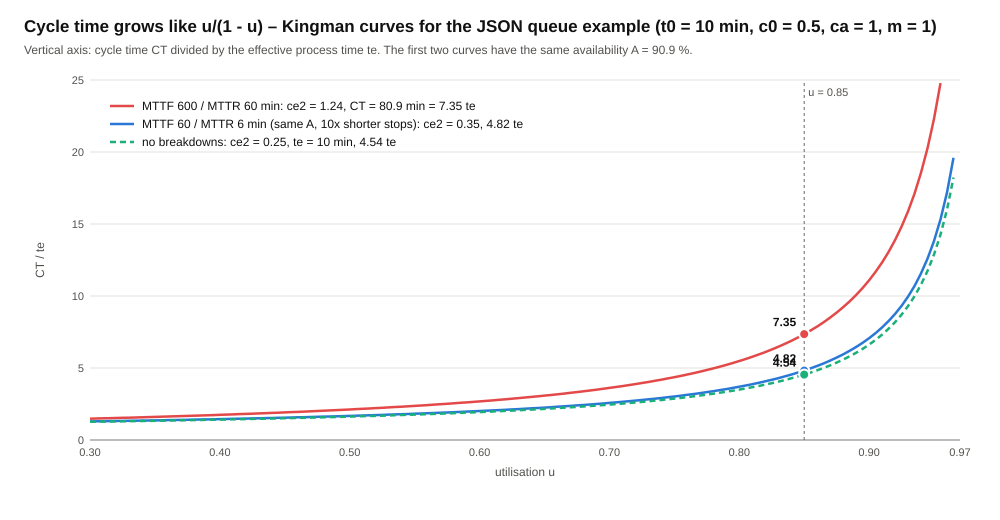

**Three scenarios at u = 0.85** (same t_0, c_0, c_a; JSON formula, web 4B):

| Scenario | A | t_e | c_e² | W_q | CT | CT ÷ t_e |
|---|---|---|---|---|---|---|
| MTTF 600 / MTTR 60 (the example) | 90.91 % | 11.0 min | 1.2417 | 69.87 min | 80.87 min | 7.35 |
| MTTF 60 / MTTR 6 (same A, 10 × shorter stops) | 90.91 % | 11.0 min | 0.3492 | 42.05 min | 53.05 min | 4.82 |
| no breakdowns | 100 % | 10.0 min | 0.2500 | 35.42 min | 45.42 min | 4.54 |

**CT ÷ t_e as a function of u** (the curves of the figure; m = 1):

| u | 0.50 | 0.60 | 0.70 | 0.80 | 0.85 | 0.90 | 0.95 |
|---|---|---|---|---|---|---|---|
| MTTF 600 / MTTR 60 | 2.12 | 2.68 | 3.62 | 5.48 | 7.35 | 11.09 | 22.30 |
| MTTF 60 / MTTR 6 | 1.67 | 2.01 | 2.57 | 3.70 | 4.82 | 7.07 | 13.82 |
| no breakdowns | 1.62 | 1.94 | 2.46 | 3.50 | 4.54 | 6.62 | 12.87 |

**Lessons:**
1. From u = 0.85 to 0.95 the cycle time triples (7.35 → 22.3 × t_e). **Plan bottlenecks at 80–85 %** in open systems.
2. The same availability with short stops costs only 4.82 instead of 7.35 × t_e: **frequent short stops are much better than rare long
   ones.**
3. Two machines with the same "average" capacity can have completely different lead times. Average-value planning (guide 62) cannot
   see this.

### B3.3 The same station as m = 3 parallel machines

Same data, but three machines in parallel (m = 3) with a common queue, u = 0.85: U = 0.85^(√8 − 1) ÷ (3 × 0.15) = 1.6510 →
W_q = 1.1209 × 1.6510 × 11.0 = **20.36 min**, CT = 31.36 min, r_a = 0.85 × 3 ÷ 11 = 0.2318 per min (13.9 per hour), WIP = 7.27 parts.
Three times the demand on three machines waits **3.4 times shorter** than one machine at the same utilisation – the pooling effect of
B2.5 again. Three machines with **separate** queues would each wait 69.87 min, like the single machine.

### B3.4 How to estimate c_a and c_e in a real factory

- **c_e**: from MES data of process times per part (same program): mean and standard deviation → c_0. Add breakdowns with B4.3 and
  set-ups with B4.4 – or measure t_e directly as "time between departures while the machine has work".
- **c_a**: from arrival times at the station: inter-arrival times → mean, σ → c_a. For a station fed by one upstream machine use B5.
  Released orders from an MRP run are often lumpy (c_a > 1); a CONWIP or pull release makes them smooth.
- **u**: from the MES: busy time (incl. failures and set-ups) ÷ planned time.
- Rule: if you have no data, use c_a = 1 (random) and c_0 = 0.3–0.5 for machining, then add breakdowns and set-ups with the formulas.

### B3.5 Program – the queue formulas in Python

```python
import math

def erlang_c(lam, te, m):
    a = lam * te
    rho = a / m
    last = a ** m / (math.factorial(m) * (1 - rho))
    p0 = 1 / (sum(a ** k / math.factorial(k) for k in range(m)) + last)
    c = last * p0
    lq = c * rho / (1 - rho)
    wq = lq / lam
    return {"P0": p0, "C": c, "Lq": lq, "Wq": wq, "W": wq + te, "L": lam * (wq + te)}

def kingman(u, t0, c0, ca, mttf, mttr, m=1, cr=1.0):
    A = mttf / (mttf + mttr) if mttf > 0 else 1.0
    te = t0 / A
    ce2 = c0 ** 2 + ((1 + cr ** 2) * A * (1 - A) * mttr / t0 if mttf > 0 else 0.0)
    wq = (ca ** 2 + ce2) / 2 * u ** (math.sqrt(2 * (m + 1)) - 1) / (m * (1 - u)) * te
    return {"A": A, "te": te, "ce2": ce2, "Wq": wq, "CT": wq + te}
```

`erlang_c(10/60, 15, 3)` returns P0 0.044944, C 0.702247, Lq 3.5112, Wq 21.07 min (B2.5); `kingman(0.85, 10, 0.5, 1.0, 600, 60)` returns
t_e 11.0, c_e² 1.2417, W_q 69.87 min, CT 80.87 min (B3.2). Rates and times must use the same time unit (here per minute and minutes). The tool
`queueing.py` (G1) contains the same formulas with input checks and tables.

---

## B4. Sources of variability

### B4.1 Overview

| Source | Natural or caused? | Effect on c_e or c_a | Countermeasure |
|---|---|---|---|
| Natural process variation (material, operator, tool wear) | natural | c_0 = 0.1–0.5 | standard work, automation |
| Random arrivals / order release | caused by planning | c_a ≈ 1 or > 1 | regular release, CONWIP, heijunka |
| Breakdowns (non-preemptive: they interrupt the part) | caused by equipment | c_e² + (1 + c_r²) A (1 − A) MTTR ÷ t_0 | short MTTR, preventive maintenance |
| Set-ups | caused by product change | B4.4 formula | SMED, families |
| Operator availability (machine waits for operator) | organisation | like breakdowns with "MTTR" = waiting time | staffing, multiple machine handling (F3) |
| Rework | quality | B4.5 | capability |
| Batching (parts move in lots) | planning | c_a of lots, wait-to-batch | small transfer lots |

### B4.2 Process variability

Natural variability is often small (machining c_0 = 0.05–0.3 for one program). The **mix** of different parts on one machine increases
the variability of the times seen by the queue: for a mix with shares p_i, means t_i and variances σ_i²:
t̄ = Σ p_i t_i, σ² = Σ p_i (σ_i² + t_i²) − t̄². Example (4E part mix, cv 0.15 each): shares 0.40 / 0.35 / 0.25, means 56 / 72 / 40 min →
t̄ = 57.6 min; Σ p_i (σ_i² + t_i²) = 0.40 (70.56 + 3 136) + 0.35 (116.64 + 5 184) + 0.25 (36 + 1 600) = 1 282.62 + 1 855.22 + 409.0 =
3 546.85 → σ² = 3 546.85 − 3 317.76 = 229.09, σ = 15.14 min, c = 0.263. The mix almost doubles the c of a single part (0.15).

### B4.3 Breakdowns – short vs long stops (JSON formula `breakdown_variability`)

$$ A = \frac{MTTF}{MTTF + MTTR}, \qquad t_e = \frac{t_0}{A}, \qquad c_e^2 = c_0^2 + (1 + c_r^2)\,A\,(1-A)\,\frac{MTTR}{t_0} $$

MTTF = mean **busy** time between failures (the machine only fails while working), c_r = coefficient of variation of the repair time
(1 for exponential repairs, 0 for constant repair times). The extra variability grows **linearly with MTTR ÷ t_0**: a repair that lasts
many process times is very bad.

**Worked comparison (t_0 = 10 min, c_0 = 0.5, c_r = 1):**

| MTTF / MTTR [min] | A | MTTR ÷ t_0 | c_e² | Class |
|---|---|---|---|---|
| 60 / 6 | 90.91 % | 0.6 | 0.25 + 2 × 0.9091 × 0.0909 × 0.6 = **0.349** | low |
| 600 / 60 (JSON `queue`) | 90.91 % | 6 | **1.242** | moderate |
| 6 000 / 600 | 90.91 % | 60 | **10.17** | very high |
| 1 200 / 60 | 95.24 % | 6 | **0.794** | moderate |

Same availability, 100 times longer stops → c_e² 29 times higher. At u = 0.85 this means a cycle time of about 4.8 × t_e vs about 70 ×
t_e. This is the mathematical reason for the rule in A2.4: **reduce MTTR first** (spare parts, diagnosis), and do long planned
maintenance in non-planned time.

### B4.4 Set-ups and lot size (JSON `setup_var`)

A set-up of mean t_s and variance σ_s² happens every N_s parts (Hopp & Spearman). Per part:

$$ t_e = t_0 + \frac{t_s}{N_s}, \qquad \sigma_e^2 = \sigma_0^2 + \frac{\sigma_s^2}{N_s} + \frac{N_s - 1}{N_s^2}\,t_s^2, \qquad c_e^2 = \frac{\sigma_e^2}{t_e^2} $$

The third term is the variability "some parts have a set-up, most have none".

**Worked example:** t_0 = 10 min, σ_0 = 5 min, t_s = 60 min, σ_s = 20 min.

| N_s | t_e = 10 + 60 ÷ N_s | σ_e² = 25 + 400 ÷ N_s + (N_s − 1) ÷ N_s² × 3 600 | c_e² = σ_e² ÷ t_e² | Set-up share of t_e |
|---|---|---|---|---|
| 5 | 22.0 min | 25 + 80 + 576 = 681.0 | 681 ÷ 484 = **1.4070** | 54.5 % |
| 10 | 16.0 min | 25 + 40 + 324 = 389.0 | 389 ÷ 256 = **1.5195** | 37.5 % |
| 20 | 13.0 min | 25 + 20 + 171 = 216.0 | 216 ÷ 169 = **1.2781** | 23.1 % |
| 40 | 11.5 min | 25 + 10 + 87.75 = 122.75 | 122.75 ÷ 132.25 = **0.9282** | 13.0 % |

**Effect on the queue** (tool convention `queueing.py setup --u 0.8`: the arrival rate is fixed so that u = 0.8 at N_s = 40, i.e.
r_a = 0.8 ÷ 11.5 = 0.06957 per min = 4.17 per hour; c_a = 1; then u = r_a × t_e for each N_s):

| N_s | u = r_a × t_e | W_q (Kingman, m = 1) | CT |
|---|---|---|---|
| 5 | 1.530 | unstable | – |
| 10 | 1.113 | unstable | – |
| 20 | 0.9043 | (1 + 1.2781) ÷ 2 × 9.455 × 13 = **140.00 min** | 153.00 min |
| 40 | 0.8000 | (1 + 0.9282) ÷ 2 × 4 × 11.5 = **44.35 min** | 55.85 min |

With small lots the set-ups **eat the capacity** (u > 1). With the same demand, N_s = 40 waits 3 times shorter than N_s = 20.

**But big lots are not free.** If parts are moved and processed in lots of k, every part must also wait until its lot is complete. The
**serial batching model** of Factory Physics (teaching extension, not in the JSON): parts arrive one by one at r_a, lots of k, lot time
t_e,lot = k t_0 + t_s, σ²_lot = k σ_0² + σ_s², lots arrive at r_a ÷ k with c_a² ÷ k:

$$ CT = \underbrace{\frac{k-1}{2\,r_a}}_{\text{wait to batch}} + \underbrace{\frac{c_a^2/k + c_{e,lot}^2}{2}\cdot\frac{u}{1-u}\cdot t_{e,lot}}_{\text{queue}} + \underbrace{k\,t_0 + t_s}_{\text{lot process}}, \qquad u = r_a\left(t_0 + \frac{t_s}{k}\right) $$

Example r_a = 3 parts per hour (0.05 per min), c_a = 1: lots below k = 7 are unstable (k = 5: u = 0.05 × (10 + 12) = 1.10). The minimum is
at **k = 9**: t_e,lot = 150 min, c²_lot = (9 × 25 + 400) ÷ 150² = 0.0278, u = 0.8333, wait to batch 80.0 min, queue 52.1 min, lot process
150 min → **CT = 282 min**. k = 20 gives 465 min, k = 40 gives 860 min.

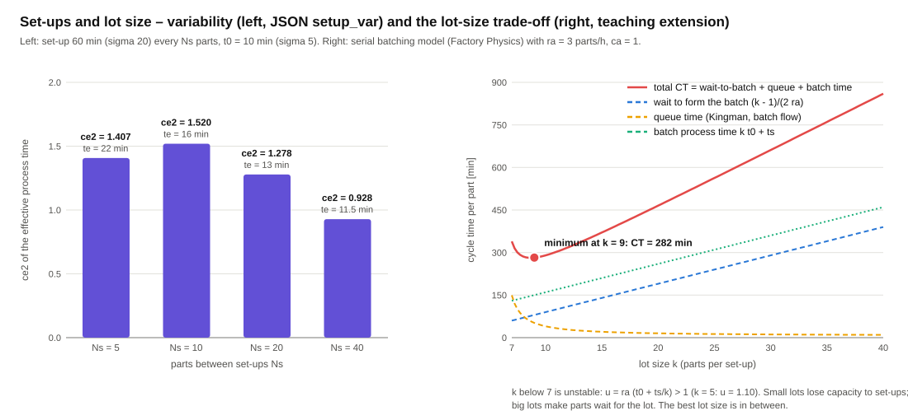

**Lessons:** (1) The lot size has an optimum between "capacity lost to set-ups" and "waiting for the lot". (2) SMED moves the optimum
to smaller lots – with t_s = 15 min the same calculation gives stable operation from k = 2. (3) In an FMS the "lot" is often one pallet
(set-up external, A1.7): lot size 1 at almost no capacity loss – the strongest argument for pallet systems in high-mix production.
(4) The twin shows the same effect in the order flow: big set-up batches caused **more** changeovers (guide 02 §7.2, §4.3).

### B4.5 Rework

If a share p of the parts must be processed again once (rework at the same machine, the reworked part has the same time t_0 and
variance σ_0²), then per good part:

$$ t_e = t_0\,(1 + p), \qquad \sigma_e^2 = (1+p)\,\sigma_0^2 + p\,(1-p)\,t_0^2, \qquad c_e^2 = \frac{(1+p)\,c_0^2 + p\,(1-p)}{(1+p)^2} $$

**Worked example (example values):** t_0 = 10 min, c_0 = 0.5, p = 5 %: t_e = 10.5 min, c_e² = (1.05 × 0.25 + 0.05 × 0.95) ÷ 1.1025 =
0.281 (instead of 0.25). The bigger effect is the **utilisation**: a machine planned at 85 % rises to 0.85 × 1.05 = 89.25 %, U = u ÷ (1 − u)
rises from 5.67 to 8.30 → the queue becomes about 47 % longer (+ the small rise of c_e²). Rework at the bottleneck is the most expensive quality loss in the system.

### B4.6 Arrival variability and the release

The arrival variability c_a² enters the queue with the same weight as c_e². For the machine of B3.2 (u = 0.85, c_e² = 1.2417, t_e = 11 min):

| Arrivals | c_a² | W_q | CT |
|---|---|---|---|
| perfectly regular (takt, CONWIP from a stable bottleneck) | 0 | 38.70 min | 49.70 min |
| smooth (paced release) | 0.25 | 46.49 min | 57.49 min |
| random (Poisson) | 1 | 69.87 min | 80.87 min |
| lumpy (weekly MRP release, batches) | 2 | 101.03 min | 112.03 min |

A lumpy release costs more than the breakdowns of this machine. Countermeasures: release by a fixed rhythm or by CONWIP cards (B6.6), level the
mix (heijunka), split big orders into transfer lots. In an FMS the MES releases pallets to the load station only when a pallet place is free –
a closed release by design.

---

## B5. Flow lines and the propagation of variability

### B5.1 Departure variability

The departures of a station are the arrivals of the next one. For a single machine (Hopp & Spearman, linking equation):

$$ c_d^2 = u^2\,c_e^2 + (1 - u^2)\,c_a^2 $$

(for m machines: c_d² = 1 + (1 − u²)(c_a² − 1) + u² (c_e² − 1) ÷ √m).

**Meaning:** a highly utilised machine passes **its own** variability downstream (u → 1: c_d² → c_e²); a lightly loaded machine passes
the **arrival** variability through (u → 0: c_d² → c_a²).

**Worked example (example values):** the machine of B3.2 (u = 0.85, c_e² = 1.2417, c_a² = 1): c_d² = 0.7225 × 1.2417 + 0.2775 × 1 =
0.8971 + 0.2775 = **1.175**. The next machine receives parts with c_a² = 1.175 – more variable than random arrivals. If the first
machine had short stops (c_e² = 0.349): c_d² = 0.7225 × 0.349 + 0.2775 = 0.530. For a downstream machine with c_e² = 0.25 the factor V
falls from (1.175 + 0.25) ÷ 2 = 0.7125 to (0.530 + 0.25) ÷ 2 = 0.390 – its queue becomes **45 % shorter**, although nothing was changed
at that machine.

### B5.2 Calculating a whole line

For a line of stations 1 … n with the same throughput r_a:
1. Station 1: c_a1 from the release; calculate u_1, c_e1², W_q1 (B3), then c_d1² (B5.1).
2. Station 2: c_a2² = c_d1²; repeat.
3. Total CT = Σ (W_qi + t_ei); total WIP = r_a × CT (Little).

This "linking equations" method is the core of rough-cut queueing tools ("rapid modelling"). It is valid for **unlimited**
buffers. With small buffers, blocking matters → Part C and simulation.

### B5.3 Practical consequences

- Reduce variability **at the start of the line** (release, first machine): it propagates.
- A high-variability machine at high utilisation hurts **twice**: own queue + bigger queue downstream.
- Variability must be "paid" with **buffer (WIP), capacity or time** – one of the three. Factory Physics calls this the variability
  buffering law. If you reduce WIP without reducing variability, you lose throughput or time.

---

## B6. Closed systems: CONWIP and FMS with pallets

### B6.1 Open vs closed

In an **open** system parts arrive from outside; WIP is the result. In a **closed** system the number of jobs is **fixed**: a new job
enters only when one leaves. Examples: an FMS with N pallets (a pallet always comes back to the load station), a CONWIP line (a card
system that keeps WIP constant), a robot cell with a fixed number of fixtures, carriers on a conveyor loop. In a closed system the WIP
N is the control variable and the **throughput** TH(N) is the result. There is no u > 1 instability: the queues are limited by N.

### B6.2 The laws for closed systems (JSON formula `closed_laws`)

For stations k with m_k servers and demand D_k per loop (minutes of work per pallet loop at that station):

$$ r_b = \min_k \frac{m_k}{D_k}, \qquad T_0 = \sum_k D_k, \qquad W_0 = r_b\,T_0 $$

$$ TH_{best}(N) = \min\left(\frac{N}{T_0},\ r_b\right), \qquad TH_{PWC}(N) = \frac{N}{W_0 + N - 1}\, r_b, \qquad TH_{worst}(N) = \frac{1}{T_0} $$

- **Best case:** no variability – below W_0 every pallet flows without waiting (TH = N ÷ T_0), above W_0 the bottleneck is always busy.
- **Worst case:** all pallets travel in one bunch – only one is in process at any time (TH = 1 ÷ T_0, whatever N).
- **Practical worst case (PWC):** a reference for "normal" (exponential-like) variability with balanced single-server stations. A real
  system **better** than PWC is "good", worse than PWC is "bad" (Factory Physics).
- Cycle time follows from Little: CT(N) = N ÷ TH(N).

**Worked example – the 4E FMS (JSON `mva`, `fms_sim`):** 1 load station 12 min; 1 vehicle, 2 moves × 1.5 min = 3 min per loop; 3 HMCs
with mean machining time 57.6 min and A = 1 200 ÷ 1 260 = 0.9524 → D = 57.6 ÷ 0.9524 = **60.48 min** per pallet.

| Station | m_k | D_k [min] | Capacity m_k ÷ D_k | per hour |
|---|---|---|---|---|
| Load station | 1 | 12.00 | 0.08333 per min | 5.00 |
| Vehicle (2 moves) | 1 | 3.00 | 0.3333 per min | 20.00 |
| Machines (3 HMC) | 3 | 60.48 | 0.04960 per min | **2.976 = r_b** |

T_0 = 12 + 3 + 60.48 = **75.48 min**; W_0 = 0.049603 × 75.48 = **3.744 pallets**; TH_worst = 60 ÷ 75.48 = 0.795 pallets/h.

### B6.3 Mean Value Analysis (MVA) with Seidmann (JSON formula `mva_seidmann`)

MVA calculates TH(N) **exactly** for a closed network with exponential times and single-server (or delay) stations. It uses the
**arrival theorem**: a pallet that arrives at a station sees the system as it is in steady state with **N − 1** pallets. So the time at
a single-server station is its demand × (1 + the queue it finds):

$$ R_k(n) = D_k\,\bigl(1 + Q_k(n-1)\bigr), \qquad X(n) = \frac{n}{\sum_k R_k(n) + \sum_d R_d}, \qquad Q_k(n) = X(n)\,R_k(n) $$

starting with Q_k(0) = 0, for n = 1, 2, … N. R_d = D_d for pure delay stations (infinite servers, no queue).

**Seidmann approximation for m servers:** a station with m servers and demand D is replaced by a single-server queue with demand D ÷ m
plus a pure delay D (m − 1) ÷ m. For the machines: queue part 60.48 ÷ 3 = 20.16 min, delay part 60.48 × 2 ÷ 3 = 40.32 min.

**Worked steps for n = 1 and n = 2:**
- n = 1: R = 12.000 (load), 3.000 (vehicle), 20.160 (machine queue), delay 40.32 → loop 75.48 min → X = 1 ÷ 75.48 per min = **0.7949
  per hour**. Q = X R: 0.1590, 0.0397, 0.2671.
- n = 2: R_load = 12 × 1.1590 = 13.908; R_veh = 3 × 1.0397 = 3.119; R_mach = 20.16 × 1.2671 = 25.545; + 40.32 → 82.892 min →
  X = 2 ÷ 82.892 = 0.024128 per min = **1.4477 per hour**.

**Full table (N = 1 … 15; times in min, X in pallets per hour; Q = mean number of pallets at the station incl. the one in process):**

| N | R_load | R_veh | R_mach,q | R_delay | loop time | X [1/h] | Q_load | Q_veh | Q_mach,q | best | PWC |
|---|---|---|---|---|---|---|---|---|---|---|---|
| 1 | 12.000 | 3.000 | 20.160 | 40.32 | 75.480 | 0.7949 | 0.159 | 0.040 | 0.267 | 0.7949 | 0.7949 |
| 2 | 13.908 | 3.119 | 25.545 | 40.32 | 82.892 | 1.4477 | 0.336 | 0.075 | 0.616 | 1.5898 | 1.2547 |
| 3 | 16.027 | 3.226 | 32.585 | 40.32 | 92.158 | 1.9532 | 0.522 | 0.105 | 1.061 | 2.3847 | 1.5544 |
| 4 | 18.261 | 3.315 | 41.545 | 40.32 | 103.440 | 2.3202 | 0.706 | 0.128 | 1.607 | 2.9762 | 1.7652 |
| 5 | 20.474 | 3.385 | 52.547 | 40.32 | 116.726 | 2.5701 | 0.877 | 0.145 | 2.251 | 2.9762 | 1.9216 |
| 6 | 22.524 | 3.435 | 65.538 | 40.32 | 131.817 | 2.7311 | 1.025 | 0.156 | 2.983 | 2.9762 | 2.0422 |
| 7 | 24.303 | 3.469 | 80.300 | 40.32 | 148.392 | 2.8303 | 1.146 | 0.164 | 3.788 | 2.9762 | 2.1381 |
| 8 | 25.757 | 3.491 | 96.525 | 40.32 | 166.093 | 2.8899 | 1.241 | 0.168 | 4.649 | 2.9762 | 2.2161 |
| 9 | 26.887 | 3.504 | 113.888 | 40.32 | 184.600 | 2.9252 | 1.311 | 0.171 | 5.553 | 2.9762 | 2.2808 |
| 10 | 27.730 | 3.513 | 132.099 | 40.32 | 203.662 | 2.9461 | 1.362 | 0.172 | 6.486 | 2.9762 | 2.3354 |
| 11 | 28.339 | 3.517 | 150.921 | 40.32 | 223.098 | 2.9583 | 1.397 | 0.173 | 7.441 | 2.9762 | 2.3820 |
| 12 | 28.767 | 3.520 | 170.176 | 40.32 | 242.784 | 2.9656 | 1.422 | 0.174 | 8.411 | 2.9762 | 2.4223 |
| 13 | 29.062 | 3.522 | 189.731 | 40.32 | 262.635 | 2.9699 | 1.439 | 0.174 | 9.391 | 2.9762 | 2.4575 |
| 14 | 29.263 | 3.523 | 209.490 | 40.32 | 282.595 | 2.9724 | 1.450 | 0.175 | 10.378 | 2.9762 | 2.4884 |
| 15 | 29.396 | 3.524 | 229.386 | 40.32 | 302.626 | 2.9740 | 1.457 | 0.175 | 11.370 | 2.9762 | 2.5159 |

Checks: (1) Little at N = 10: X × loop = 2.9461 ÷ 60 × 203.662 = 10.0 ✓. (2) Utilisation of the load station = X × 12 min = 0.0491 ×
12 = 58.9 % at N = 10; of each machine = X × 60.48 ÷ 3 = 99.0 %. (3) MVA reaches 95 % of r_b (2.827) at **N = 7** (2.8303).

### B6.4 MVA vs simulation vs laws

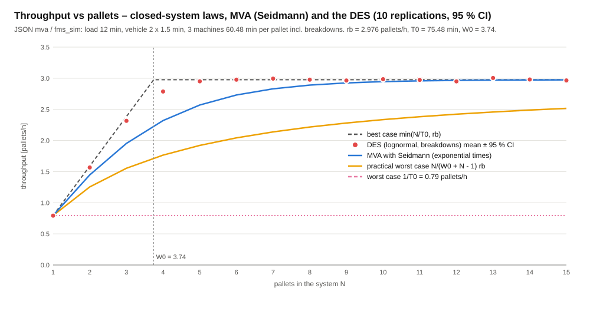

| N | best | PWC | MVA Seidmann | exact MVA (load-dependent) | DES exponential (200 days) | DES item 4E logic (lognormal, 14 days) |
|---|---|---|---|---|---|---|
| 1 | 0.795 | 0.795 | 0.795 | 0.795 | 0.797 ± 0.005 | 0.793 ± 0.006 |
| 3 | 2.385 | 1.554 | 1.953 | 2.249 | 2.247 ± 0.013 | 2.316 ± 0.024 |
| 5 | 2.976 | 1.922 | 2.570 | 2.761 | 2.770 ± 0.014 | 2.950 ± 0.018 |
| 8 | 2.976 | 2.216 | 2.890 | 2.934 | 2.932 ± 0.017 | 2.977 ± 0.029 |
| 10 | 2.976 | 2.335 | 2.946 | 2.962 | 2.963 ± 0.020 | 2.984 ± 0.032 |
| 15 | 2.976 | 2.516 | 2.974 | 2.975 | 2.988 ± 0.019 | 2.965 ± 0.028 |

(pallets per hour; DES = mean ± 95 % half width of 10 replications, seeds 1–10; see E3, E4.)

**What the table teaches:**
1. **Seidmann is an approximation.** For the 3-server machine group it is pessimistic in the middle range (N = 3: 1.953 vs exact 2.249).
   The exact load-dependent MVA (the machine station works at rate min(j, 3) ÷ D with j pallets present) agrees with an exponential
   simulation within its confidence interval at every N – this **validates** the simulation program (E4.3).
2. **Real times are less variable than exponential.** The item-4E model uses lognormal times with c = 0.15 (machining) and 0.3 (load)
   and a constant vehicle time. With less variability the curve lies **above** MVA and close to the best case: 95 % of the maximum at
   N = 5 instead of N = 7. The breakdowns (exponential, MTTR 60 min) are the main remaining variability.
3. **The laws bracket everything:** all curves lie between PWC and best case – a quick plausibility check for any simulation result.
4. Above about N = 6–7 extra pallets add **no** output, only waiting: loop time = N ÷ TH grows linearly (Little).

### B6.5 How many pallets? – the procedure

1. Calculate r_b, T_0, W_0 (B6.2). **N ≥ W_0** is the absolute minimum (here 3.74 → 4).
2. Calculate MVA (exact or Seidmann) as a "pessimistic" curve and the best case as "optimistic" curve. Read N for 95 % of r_b on both
   (here 5 … 7).
3. Simulate with real distributions (E4) and read N for 95 % (here 5).
4. Add pallets for functions that are not in the loop model:
   - **unmanned hours**: pallets needed = unmanned time × r_b (guide 63 B2.6: e.g. a night of 8 h × 2.98 = 24 pallets – usually the
     dominant requirement!);
   - pallets in set-up or waiting for fixture change, pallets in the washer or CMM if they are separate stations;
   - one or two spare pallets for maintenance.
5. Choose the **largest** of these numbers, then check the pallet **types** (fixtures per part family, guide 63 B2).

For the compressor FMS: loop requirement 5–7 pallets, unmanned night requirement about 24 → the pallet pool is sized by the unmanned
hours, not by the loop. The loop analysis shows that the manned shift alone would run well with 7 pallets.

### B6.6 CONWIP

CONWIP (constant work in process) applies the closed-system idea to a line without physical pallets: a card is attached to each job at
the release; a new job is released only when a card comes back from the end of the line. Advantages: WIP and lead time are controlled
(Little), the bottleneck is protected, variability of the release is removed (c_a of the line is the c_d of the bottleneck). Setting the
number of cards = setting N: use the same procedure as B6.5 (W_0, PWC, simulation). In the MES (guide 71) CONWIP is a release rule.
### B6.7 Program – MVA with Seidmann

```python
def mva(stations, N):
    """stations: list of (name, servers, demand_min). Returns list of X per hour for n = 1..N."""
    q_dem = [D / m for _, m, D in stations]                 # queueing part
    delay = sum(D * (m - 1) / m for _, m, D in stations)    # Seidmann delay part
    Q = [0.0] * len(stations)
    out = []
    for n in range(1, N + 1):
        R = [d * (1 + q) for d, q in zip(q_dem, Q)]
        X = n / (sum(R) + delay)
        Q = [X * r for r in R]
        out.append(X * 60)
    return out
```

`mva([("load", 1, 12.0), ("vehicle", 1, 3.0), ("machines", 3, 60.48)], 15)` returns 0.7949, 1.4477, 1.9532, … 2.9740 pallets per hour – the X
column of B6.3. The tool `mva_closed.py` adds the closed laws, the Q table and the N for 95 % of r_b. The loop runs in microseconds: you can
evaluate thousands of configurations (machines, load stations, times) before you start a simulation.

### B6.8 Worked mini-case – which resource to add?

Use the laws as a **screening tool** before any simulation (example values, base data of B6.2):

| Option | Capacities [pallets/h]: load / vehicle / machines | New r_b | Gain | Comment |
|---|---|---|---|---|
| Base | 5.00 / 20.0 / 2.976 | 2.976 | – | machines limit |
| 2nd load station | 10.0 / 20.0 / 2.976 | 2.976 | 0 % | no effect (E4.4 confirms) |
| MTTR 60 → 30 min | 5.00 / 20.0 / 3.049 | 3.049 | +2.4 % | A = 1 200 ÷ 1 230 = 97.56 % |
| 4th machine | 5.00 / 20.0 / 3.968 | 3.968 | +33 % | load station now at 79 % |
| 6 machines, 1 load station | 5.00 / 20.0 / 5.952 | 5.000 | +68 % | load station becomes the bottleneck |
| 6 machines, 2 load stations | 10.0 / 20.0 / 5.952 | 5.952 | +100 % | machines limit again |

Rule: add capacity **only at the bottleneck**; after each step re-calculate which station limits. The simulation is then used to find the
pallets and to quantify waiting (E4.4 experiment 3 confirms 4.99 and 5.97 pallets/h for the last two rows).

---

## B7. The laws of factory physics – summary for daily use

| Law (Hopp & Spearman) | Statement | Use |
|---|---|---|
| Little's law | WIP = TH × CT | lead time from WIP; WIP limits; data check (B1.2) |
| Conservation of material | in a stable system, output = input − scrap | balance check of data and simulation |
| Capacity law | in steady state, all plants release work at an average rate strictly less than their average capacity | never plan u = 100 % in open flow (B1.3) |
| Utilisation law | if a station increases utilisation without any other change, average WIP and cycle time increase in a highly nonlinear fashion | U = u ÷ (1 − u) (B3) |
| Variability law | increasing variability always degrades the performance of a production system | measure c_a, c_e; reduce variability first (B4) |
| Variability buffering law | variability is buffered by some combination of inventory, capacity and time | choose the buffer you want to pay (B5.3) |
| Buffer flexibility corollary | flexibility reduces the amount of variability buffering required | routing flexibility of an FMS, cross-trained operators (B2.5) |
| Variability placement law | variability early in a routing hurts more than late | stabilise release and first stations (B5) |
| Move batching law | cycle times over a segment are roughly proportional to the transfer batch sizes | small transfer lots, one-piece flow (B4.4) |
| Process batching law | minimal batch sizes for stability grow with set-up time; CT first falls, then rises with the batch size | lot-size optimum, SMED (B4.4) |
| CONWIP efficiency law | for a given level of throughput, a push system has more WIP on average than an equivalent CONWIP system | closed release (B6.6) |
| Bottleneck starvation | a bottleneck must never wait – an hour lost at the bottleneck is an hour lost for the system | buffers in front of the bottleneck (C1), bottleneck OEE (A1.8) |

(Wording shortened; see Factory Physics for the exact statements.)

**Worked example – push vs CONWIP (example values).** A line with r_b = 3.0 parts/h and T_0 = 6 h (W_0 = 18). With a push release at u = 0.95
the queueing formulas give CT of many days (U = 19). With CONWIP at N = 30 cards the PWC curve gives TH ≥ 30 ÷ (18 + 29) × 3.0 = 1.91 parts/h
as a pessimistic value and the best case 3.0; a real line typically reaches 2.6–2.8 parts/h with CT = N ÷ TH ≈ 11–12 h – controlled and
predictable. The CONWIP level is tuned like the pallet number (B6.5).

---

# Part C – Buffers

## C1. Why buffers – decoupling

Two machines in series without a buffer are **rigidly coupled**: when M1 stops, M2 runs out of parts (starved) after the current part;
when M2 stops, M1 cannot put its finished part anywhere and must stop too (blocked). A buffer of B places between them **decouples** the
two machines for a time: during a stop of M1, M2 can work B parts from the buffer; during a stop of M2, M1 can fill B empty places.

**Without a buffer**, two machines with availabilities A_1 and A_2 behave roughly like one machine with availability ≈ A_1 × A_2 (both
must be up at the same time). For n machines in series: A_line ≈ A^n. Example: 6 stations with A = 97 % → 0.97^6 = 83.1 %. With
**infinite** buffers, the line reaches the rate of its slowest station alone (min A_i ÷ t_i). Real buffers lie between these two limits.

A buffer also absorbs **cycle-time variability**: without a buffer every part waits for the slower of the two machines (E[max(t_1, t_2)]
> E[t]). Both effects appear in the simulation below.

**Price of a buffer:** space, conveyor or rack equipment, money in WIP, longer lead time (Little), more parts at risk when a quality
problem is found late. Therefore: **as small as possible, as large as necessary**.

Where buffers are needed most:
- around the **bottleneck** (in front: never starve it; behind: never block it),
- after machines with **long MTTR** (the buffer must bridge a typical repair),
- between machines with **different shift patterns** (e.g. manned load station, unmanned machines → the pallet pool, C4),
- before assembly when parts come from different lines (kits, guide 02 §3.6).

## C2. Two-machine line with breakdowns – simulation (JSON `buffer_line`, web 4C)

### C2.1 The model

- M1 → buffer with B places → M2; M1 always has raw material, M2 can always deliver (no other limits).
- Process times: lognormal, mean t_1 = t_2 = 1 min, c = 0.3.
- Breakdowns: time to failure exponential with MTTF = 100 min of **busy** time (a machine that is blocked or starved does not age);
  repair time exponential, MTTR = 10 min. A = 100 ÷ 110 = 90.91 %.
- "Blocking after service": M1 finishes its part, then waits if the buffer is full.
- Run length T = 30 000 min (500 h, about 2 750 failures per machine), no warm-up (the start effect is negligible at this length).
- Throughput = parts out of M2 ÷ T × 60 [parts/h]. Limit = slowest machine alone with its breakdowns = A ÷ t = 0.9091 × 60 = **54.55
  parts/h**.
- 10 replications (seeds 1–10) per buffer size → mean ± 95 % CI (E3).

### C2.2 Results

| Buffer places B | Mean TH [parts/h] | s | 95 % half width | CI | % of limit 54.55 |
|---|---|---|---|---|---|
| 0 | 44.13 | 0.29 | 0.21 | 43.92 – 44.34 | 80.9 % |
| 1 | 47.55 | 0.37 | 0.26 | 47.29 – 47.81 | 87.2 % |
| 2 | 49.21 | 0.66 | 0.48 | 48.73 – 49.69 | 90.2 % |
| 3 | 49.49 | 0.41 | 0.30 | 49.19 – 49.79 | 90.7 % |
| 5 | 50.07 | 0.33 | 0.24 | 49.83 – 50.31 | 91.8 % |
| 8 | 50.77 | 0.53 | 0.38 | 50.39 – 51.15 | 93.1 % |
| 10 | 50.89 | 0.45 | 0.32 | 50.57 – 51.21 | 93.3 % |
| 15 | 51.55 | 0.47 | 0.33 | 51.22 – 51.88 | 94.5 % |
| 20 | 51.97 | 0.44 | 0.32 | 51.65 – 52.29 | 95.3 % |

(Own Python implementation of the web 4C logic, `withFailures` with the carried time to failure, lognormal by Box–Muller; the same
numbers are printed by `tools/fmse/buffer_sim.py`.)

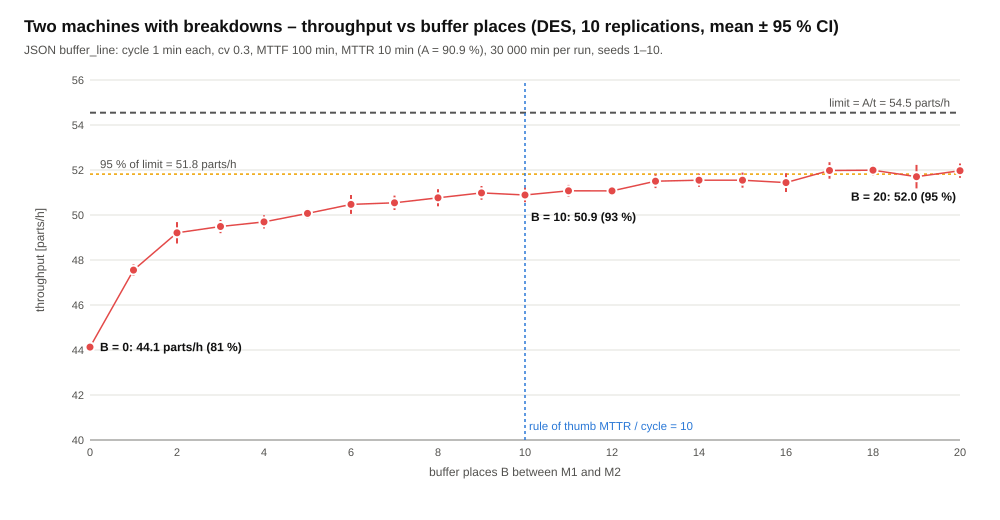

**What the results show:**
1. **No buffer costs 19 %** of the possible output (44.1 instead of 54.5 parts/h).
2. **The first places give the most:** B = 1 already wins 3.4 parts/h, B = 2 another 1.7. After that each place gives less and less
   (diminishing return).
3. **Rule of thumb B ≈ MTTR ÷ cycle = 10 ÷ 1 = 10 places** gives 93 % of the limit. 95 % needs about 17–20 places (the mean first
   exceeds 95 % = 51.82 at B = 17; the web, which averages only seeds 11 and 23, shows 18). The last few percent are expensive: they need
   a buffer that bridges the **long** repairs (exponential repairs: 14 % of repairs take longer than 2 × MTTR).
4. **Why is B = 0 below A² = 82.6 %?** Two effects: (a) cycle variability – without a buffer every part needs max(t_1, t_2): a check run
   with breakdowns switched off gives 51.5 parts/h at B = 0 (−14 % from cycle variability alone) and 59.5 at B = 10; (b) breakdowns – a
   check run with constant times (c = 0) gives 50.3 parts/h at B = 0, **more** than A² × 60 = 49.6, because a blocked or starved machine
   does not age (failures on busy time). Both effects together give 44.1.
5. The confidence intervals of neighbouring B values overlap above B ≈ 8: a single simulation run cannot tell 10 from 12 places. Decide
   with the economic value of the extra parts, not with the third decimal.

### C2.3 Buffer sizing procedure

1. Find the bottleneck and its neighbours. Collect MTTR and cycle times (A2, MES data).
2. First estimate: **B ≈ MTTR_neighbour ÷ cycle time of the bottleneck** (parts the bottleneck makes during one average repair of the
   neighbour). With very variable repairs (c_r > 1) take 1.5–2 ×.
3. Check the cost: places × (space + equipment + WIP value) vs. extra output × contribution margin.
4. Simulate the line with 3–5 candidate sizes and 10 replications each (E3); choose the smallest B whose CI reaches the target.
5. Put the buffer **physically** close to the bottleneck, visible (andon), with a FIFO rule.

### C2.4 Why the web, the tool and this guide can show slightly different numbers

The web 4C averages two seeds (11 and 23): B = 0 → 43.95, B = 10 → 51.16, B = 20 → 51.85 parts/h. This guide and `buffer_sim.py`
average seeds 1–10. All are estimates of the same true mean; differences inside about ± 0.5 parts/h are pure random noise. A check run
with a different random generator (Python Mersenne Twister instead of the web generator) gave B = 0: 43.99 ± 0.18, B = 10: 51.37 ± 0.27,
B = 20: 52.04 ± 0.36 – the CIs overlap with the table. Section E3.6 explains the general rule.

### C2.5 Economic buffer size (worked example)

Example values: one buffer place on the conveyor costs 1 500 EUR (equipment + space) + 200 EUR of WIP = 1 700 EUR one-time; the line works
4 000 h per year; the contribution margin of an extra part is 5 EUR (only if the demand needs the extra parts!).

| Step | Extra places | Extra output | Value per year | Cost one-time | Payback |
|---|---|---|---|---|---|
| B 3 → 10 | 7 | 50.89 − 49.49 = 1.40 parts/h → 5 600 parts | 28 000 EUR | 11 900 EUR | 0.4 year |
| B 10 → 20 | 10 | 51.97 − 50.89 = 1.08 parts/h → 4 320 parts | 21 600 EUR | 17 000 EUR | 0.8 year |

Both steps pay back – **if** the parts can be sold. If the demand is already met at B = 10, the step to 20 has no value at all (it only adds WIP
and lead time). The decision variable is not "throughput" but **profit at the required throughput**. Note the statistical uncertainty: the gain of
1.08 parts/h has a CI of about ± 0.45 parts/h (the two half widths combined as √(0.32² + 0.32²)) – the payback lies between about 0.5 and
1.4 years.

### C2.6 Buffers for unmanned operation

For an unmanned period T_u (night, weekend) the buffer must hold the work for the whole period, because nobody refills it: places ≥ T_u ×
rate of the consumer. Example: 8 h night × 2.98 pallets/h = 24 pallets (B6.5); a robot cell with 6 min per part and a 10 h night needs a part
magazine of 100 parts. Add the output side: finished parts need places too (in a pallet pool the same pallet place is used for raw and finished
– the pallet returns to its place). Check also the **tools** (tool life for the whole night, guide 63 B11) and the **chips** (bin volume, guide 63
B20): the machine stops at the first missing resource.

## C3. Buffer allocation in longer lines

For a line of n stations with a total budget of buffer places, **where** you put them matters:

- **Bowl phenomenon:** for a balanced line, slightly more capacity or buffer in the **middle** of the line gives more output than at the
  ends (Hillier & Boling).
- **Around the bottleneck:** buffers just before and after the bottleneck are worth most.
- **After unreliable stations:** proportional to their MTTR.
- **Uniform allocation is a good start** and rarely far from the optimum – the optimum is found by simulation (search over allocations).

**Worked simulation (example values, own scratch model with the same logic as 4C extended to 6 stations):** compressor head line with
station times 1.8 / 2.0 / 1.6 / **2.1** / 1.9 / 1.7 min (station 4 = bottleneck), lognormal c = 0.1, every station MTTF 160 min busy,
MTTR 5 min (A = 97.0 %), 900 min planned per day, 30 days × 10 replications. Demand: 380 heads per day. Limit of the bottleneck alone:
900 × 0.970 ÷ 2.1 = 415.6 per day.

| Buffers between the stations | Total places | Output [heads/day] mean ± 95 % CI | Demand 380 reached? |
|---|---|---|---|
| 0-0-0-0-0 | 0 | 365.4 ± 1.6 | no |
| 1-1-1-1-1 | 5 | 388.3 ± 0.9 | yes, tight |
| 2-2-2-2-2 | 10 | 399.1 ± 1.7 | yes |
| 3-3-3-3-3 (MTTR ÷ cycle ≈ 2.4 → 3) | 15 | 405.3 ± 0.9 | yes |
| 5-5-5-5-5 | 25 | 410.5 ± 1.8 | yes |
| 2-2-4-3-2 (more around the bottleneck) | 13 | 404.0 ± 1.4 | yes |

The 13 places placed around the bottleneck give practically the same output as 15 uniform places – 2 places (and 2 carriers) saved.
These numbers are teaching values from a scratch model, not from a tool of this project; use `buffer_sim.py` for two stations and a
simulation package (E6) for longer lines.

## C4. The pallet pool as buffer

In an FMS the **pallet pool is the buffer** – a closed buffer (B6): the number of pallets N limits WIP, and the rack places hold
finished and raw pallets. It decouples three things:

| Decoupling | Typical size of the need | Calculation |
|---|---|---|
| Load station (manned) vs machines (also unmanned) | pallets for the unmanned hours | unmanned time × r_b (guide 63 B2.6) |
| Breakdowns of one machine vs the others | the other machines continue automatically (routing flexibility) | B6, E4 |
| Variability of load times vs machine times | a few pallets above W_0 | MVA / simulation (B6.5) |

**Rack places ≥ pallets + empty places for exchange** (the stacker needs at least one free place per transfer station to swap). Plan
10–20 % extra places and expansion places for the next machine (A3.2, D5). The pallet pool also contains fixtures that are not in use –
count them in the places.

---

# Part D – Layout

## D1. Layout types in depth

### D1.1 The seven types (web 4D table)

| Type | How it looks | Material flow | Flexibility | Best for | Watch out |
|---|---|---|---|---|---|
| Process (functional) layout | same machines grouped: all lathes together, all mills together | long, crossing routes, big WIP | very high – any part | job shop, many different parts, low volume | transport effort, long lead time, hard to plan |
| Product (line) layout | machines in the order of the routing | short, straight, one direction | low – one family | high volume, few variants | one breakdown stops the line; balancing |
| Cellular layout (group technology) | one cell per part family (guide 62 item 2A), often U-shaped | short inside the cell | medium–high inside the family | medium volume / variety – the classic step before an FMS | exceptional parts between cells |
| FMS – linear (spine) | machines on one or both sides of a pallet pool / rail | any route via the transport line | high | FMS with 2–8 machines, expandable at the end | transport line is a single point of failure |
| FMS – loop | conveyor or AGV loop past all stations | one direction, any station | high | assembly systems, carriers, many stations | loop length = carriers + time; blocking |
| U-shape / cell | line bent into a U, entry and exit side by side | short walking, one operator serves several stations | medium | manual / semi-automatic cells, assembly | space for material supply inside the U |
| Fixed-position layout | product stays, people and tools come to it | no part transport | very high | very large products (machines, ships), final assembly of big units | logistics of tools and material to the site |

### D1.2 Selection criteria

| Criterion | Process | Product | Cellular | FMS linear | FMS loop | U-cell | Fixed |
|---|---|---|---|---|---|---|---|
| Variety (part numbers) | very high | low | medium | high | medium–high | medium | low |
| Volume per part | low | very high | medium | low–medium | medium | medium | very low |
| Routing similarity | none | identical | within family | flexible | similar | identical | – |
| Transport effort | high | very low | low | low (automatic) | low (automatic) | very low | special |
| WIP / lead time | high | low | low | low–medium | medium | low | – |
| Investment | low | high (dedicated) | medium | high | high | low–medium | – |
| Expansion | easy | difficult | by new cell | easy at the end | difficult (loop) | medium | – |

The **volume–variety matrix** of guide 61 (A3) chooses the system type; this table chooses the arrangement. A factory usually has a
**hybrid**: an FMS for the prismatic family (crankcases), cells for shafts, a line for assembly, a functional area for heat treatment and
grinding (shared, special environment).

### D1.3 Hybrid layout of the compressor factory (example)

```
 Receiving ─► Saw / prep ─► Turning cell ─┐          ┌─► Heat treat ─► Grinding ─┐
                          └► FMS (3 HMC) ─┴─► washer ─┴───────────────────────────┴─► Assembly line ─► Test ─► Shipping
```

### D1.4 The layout types in more depth

**Process (functional) layout.** All machines of one technology in one area (turning, milling, grinding, heat treatment). Every part travels
between areas according to its routing, usually by forklift in containers. Strengths: high utilisation of expensive machines, easy to replace a
machine, specialised staff. Weaknesses: long and crossing routes (large Σ f·d), long queues in front of every area (each area is a station with
random arrivals – B3), lead times of weeks. Use for: job shops, very high variety, shared special processes (heat treatment, plating, painting).

**Product (line) layout.** Machines in the order of the routing, connected by conveyors, often with takt. Strengths: shortest routes, low WIP,
simple control. Weaknesses: one breakdown stops the line (A_line ≈ Π A_i without buffers – C1), balancing losses, low flexibility, high
investment per product. Use for: high volume of few variants. Design tools: line balancing (guide 62), buffer allocation (C3).

**Cellular layout (group technology).** One cell per part family (guide 62: PFA, Opitz code), containing all machines the family needs, often
in a U. Strengths: short routes, one team responsible for complete parts, lower WIP than the functional layout. Weaknesses: machines duplicated
in several cells, exceptional parts must leave the cell, balancing between cells. The cell is the natural predecessor of an FMS: automate the
handling and add a pallet pool → FMC / FMS.

**FMS linear (spine).** Machines along one transport axis (stacker rail, RGV, conveyor) with the pallet pool on the same axis. Strengths:
expandable at the end, any machine reachable, central load area. Weakness: the transport axis is a single point of failure (stacker breakdown
stops the supply of all machines → keep pallets at the machines' APC and a fast repair concept). Dimension example: D5.1.

**FMS loop.** A closed conveyor or AGV loop past all stations; carriers circulate. Strengths: any station reachable, natural buffer on the loop.
Weaknesses: loop length and carrier number grow with the stations; blocking when the loop is full; difficult to expand. Typical for assembly
systems with many stations and for painting / testing loops.

**U-shape.** A line bent into a U so that entry and exit are close together; one operator can serve the first and the last station (balanced
manual work), short walking, good communication. Typical for manual and semi-automatic assembly and for small machining cells; material
supply from the outside of the U.

**Fixed-position layout.** The product stays (large machine, ship, aircraft, big press); people, tools and material come to it. Planning focus:
logistics of material to the site, crane coverage, access, sequence of the trades (often planned with project methods – CPM, guide 61).

## D2. Systematic Layout Planning (Muther)

### D2.1 The SLP procedure

```
 Input data P-Q-R-S-T ─► 1 Flow of materials (from-to) ─┐
                         2 Activity relationships (REL) ─┴► 3 Relationship diagram ─► 4 Space requirements ─► 5 Space available
                                                                                       │
              10 Detailed layout ◄─ 9 Selection ◄─ 8 Evaluation ◄─ 7 Alternatives ◄─ 6 Space relationship diagram
                                                                     (modifying considerations + practical limitations)
```

SLP works in **levels**: (I) location of the plant, (II) **general overall layout** (block layout of departments), (III) **detailed layout**
(each machine, aisle, utility), (IV) installation. Steps 1–9 are done for level II and repeated in detail for level III.

### D2.2 Input data P-Q-R-S-T

| Letter | Meaning | Example (compressor factory) | Source |
|---|---|---|---|
| **P** Product | what is made (parts, families, materials, sizes) | crankcases VC10/20/30, cylinders, shafts, heads | guide 62 ABC, part families |
| **Q** Quantity | volume per product | 12 000 pallets per year + growth 8 % | guide 62, A3 |
| **R** Routing | sequence of operations | saw → turn → heat treat → grind → assemble | process plans, guide 62 |
| **S** Supporting services | maintenance, tool room, quality lab, offices, toilets, canteen, chip collection, coolant | tool presetting next to the FMS, CMM room | guide 63 |
| **T** Timing | when, how fast, shifts, takt | 3 shifts, takt of the assembly line | A3, guide 62 |

A **P-Q chart** (Pareto of quantity per product) shows which products justify a flow layout (few products with high Q) and which need a
functional layout (many products with low Q).

### D2.3 Flow analysis – from-to matrix and transport effort (JSON `layout`, web 4D)

8 departments; flows f_ij in **loads per day** from i to j (example):

| From \ To | Rec | Saw | Turn | Mill | Heat | Grind | Asm | Ship |
|---|---|---|---|---|---|---|---|---|
| Receiving | – | 30 | 0 | 20 | 0 | 0 | 0 | 0 |
| Saw / prep | 0 | – | 25 | 5 | 0 | 0 | 0 | 0 |
| Turning | 0 | 0 | – | 0 | 15 | 10 | 5 | 0 |
| Milling | 0 | 0 | 0 | – | 5 | 5 | 15 | 0 |
| Heat treat | 0 | 0 | 0 | 0 | – | 20 | 0 | 0 |
| Grinding | 0 | 0 | 0 | 0 | 0 | – | 30 | 0 |
| Assembly | 0 | 0 | 0 | 0 | 0 | 0 | – | 50 |
| Shipping | 0 | 0 | 0 | 0 | 0 | 0 | 0 | – |

The departments are placed in a grid of 4 × 2 equal **slots** with a pitch of 20 m. Distance = rectilinear (aisles run in x and y):

$$ C = \sum_i \sum_j f_{ij}\,d_{ij}, \qquad d_{ij} = \bigl(|x_i - x_j| + |y_i - y_j|\bigr) \cdot \text{pitch} $$

Slots: 0 = (0,0), 1 = (1,0), 2 = (2,0), 3 = (3,0) in row 0; 4 = (0,1) … 7 = (3,1) in row 1. The **start layout** (department per slot
0…7) = Assembly, Receiving, Grinding, Saw / prep | Shipping, Heat treat, Turning, Milling.

**Cost of the start layout (step by step):**

| Flow | f [loads/day] | Slots | d [m] | f × d |
|---|---|---|---|---|
| Receiving → Saw / prep | 30 | 1 → 3 | 40 | 1 200 |
| Receiving → Milling | 20 | 1 → 7 | 60 | 1 200 |
| Saw / prep → Turning | 25 | 3 → 6 | 40 | 1 000 |
| Saw / prep → Milling | 5 | 3 → 7 | 20 | 100 |
| Turning → Heat treat | 15 | 6 → 5 | 20 | 300 |
| Turning → Grinding | 10 | 6 → 2 | 20 | 200 |
| Turning → Assembly | 5 | 6 → 0 | 60 | 300 |
| Milling → Heat treat | 5 | 7 → 5 | 40 | 200 |
| Milling → Grinding | 5 | 7 → 2 | 40 | 200 |
| Milling → Assembly | 15 | 7 → 0 | 80 | 1 200 |
| Heat treat → Grinding | 20 | 5 → 2 | 40 | 800 |
| Grinding → Assembly | 30 | 2 → 0 | 40 | 1 200 |
| Assembly → Shipping | 50 | 0 → 4 | 20 | 1 000 |
| **Total** | | | | **8 900 load·m/day** |

The improvement by pairwise exchange (CRAFT idea) is in D3.2: **8 900 → 5 600 load·m/day in 3 swaps (−37.1 %)**.

**How to build the from-to matrix from routings (small example, example values).** For each product p: loads per day = parts per day ÷
parts per load; add the loads to every step i → j of its routing: f_ij = Σ_p loads_p × [routing of p contains i → j].

| Product | Parts/day | Parts/load | Loads/day | Routing |
|---|---|---|---|---|
| Shaft | 480 | 40 | 12 | Saw → Turn → Grind → Asm |
| Housing | 150 | 10 | 15 | Saw → Mill → Asm |
| Flange | 300 | 25 | 12 | Saw → Turn → Mill → Asm |

Result: Saw→Turn 12 + 12 = 24; Turn→Grind 12; Grind→Asm 12; Saw→Mill 15; Turn→Mill 12; Mill→Asm 15 + 12 = 27. Use **loads** (what the
vehicle or the operator carries), not parts. If the load size changes between departments (e.g. small boxes after grinding), the in- and out-flows
of a department are not equal. The JSON example shows this: Turning receives 25 and sends 30 loads per day, Grinding receives 35 and sends 30.
Weight the flows by **handling effort** when loads differ much (e.g. a crane lift of a 2 t casting = 5 equivalent loads).

**Flow intensity ranking** (for the relationship chart): Assembly→Shipping 50; Receiving→Saw 30; Grinding→Assembly 30; Saw→Turning 25;
Receiving→Milling 20; Heat treat→Grinding 20; Turning→Heat treat 15; Milling→Assembly 15; … In SLP the flows are classed A/E/I/O by
intensity (e.g. the top 10 % of pairs = A) and combined with non-flow reasons in the REL chart.

### D2.4 Activity relationship chart (REL) – AEIOUX (JSON `layout.rel`)

The REL chart rates **every pair** of departments by how close they should be, for flow **and** non-flow reasons:

| Code | Meaning | Value for the SLP score | Lines in the diagram |
|---|---|---|---|
| A | absolutely necessary | 16 | 4 |
| E | especially important | 8 | 3 |
| I | important | 4 | 2 |
| O | ordinary closeness | 2 | 1 |
| U | unimportant | 0 | none |
| X | undesirable (keep apart) | −64 | zigzag |

Reasons are written with each rating (codes, e.g. 1 = material flow, 2 = shared personnel, 3 = shared equipment / utility, 4 = noise /
dust / heat, 5 = supervision, 6 = safety).

**Ratings of the example** (pairs not listed = U):

| Pair | Rating | Reason (example) |
|---|---|---|
| Receiving – Saw / prep | A | heavy bar stock flow (30 loads/day) |
| Receiving – Shipping | E | shared dock, shared forklifts and staff |
| Saw / prep – Turning | A | flow 25 |
| Saw / prep – Milling | I | flow 5 |
| Turning – Heat treat | E | flow 15 |
| Turning – Grinding | I | flow 10 |
| Milling – Assembly | E | flow 15 |
| Heat treat – Grinding | A | flow 20, hot parts, short route |
| Grinding – Assembly | A | flow 30, clean parts |
| Assembly – Shipping | A | flow 50 |
| Heat treat – Assembly | X | heat, scale, dirt vs clean assembly |
| Grinding – Saw / prep | X | saw vibration and chips vs precision grinding |
| Heat treat – Shipping | O | outdoor access for gas / quench oil supply near the dock |

**SLP score** (JSON formula `slp_score`): sum of the rating values of all **adjacent** pairs (adjacent = rectilinear slot distance 1).

**Start layout:** adjacent pairs and their ratings: Receiving–Heat treat U 0, Receiving–Grinding U 0, Receiving–Assembly U 0,
Saw–Milling I 4, **Saw–Grinding X −64**, Turning–Milling U 0, Turning–Heat treat E 8, Turning–Grinding I 4, Heat treat–Shipping O 2,
Assembly–Shipping A 16 → **score = −30**.

**Improved layout (after D3.2):** Receiving–Saw A 16, Receiving–Milling U 0, Saw–Turning A 16, Turning–Milling U 0, Turning–Heat treat
E 8, Milling–Grinding U 0, Heat treat–Grinding A 16, Heat treat–Shipping O 2, Grinding–Assembly A 16, Assembly–Shipping A 16 →
**score = +90** (5 × A, 1 × E, 1 × O; no X adjacent).

A full search over all 8! = 40 320 layouts (scratch check) gives: best possible SLP score 100 (but that layout costs 6 300 load·m/day);
lowest cost 5 500 load·m/day (4 mirror-equal layouts, SLP score 94). **The two goals – flow cost and closeness – are not the same.**
That is why SLP evaluates alternatives with several criteria (D2.8).

### D2.5 Relationship diagram

The relationship diagram draws the departments as nodes and the ratings as lines (4 lines for A … zigzag for X). It is arranged by hand
(or by CORELAP logic, D3.3) so that A-lines are short, X-lines long, and lines do not cross much.

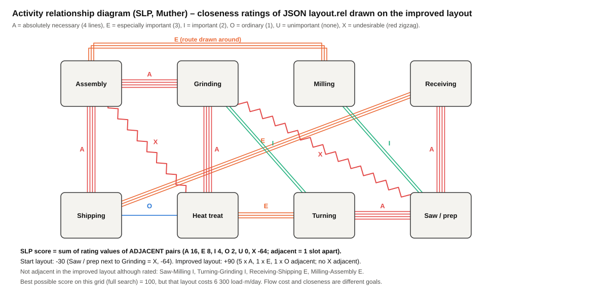

In the improved layout all A pairs are adjacent; the two X pairs are diagonal or far; four rated pairs are still not adjacent (Saw–Milling
I, Turning–Grinding I, Receiving–Shipping E, Milling–Assembly E). Receiving–Shipping E can be solved by putting the dock at one building
side for both (a common "dock side"), which the slot grid cannot show.

### D2.6 Space requirements (JSON `space`)

Department area (JSON formula `space`):

$$ A_{dept} = n_{machines} \cdot (A_{footprint} + A_{operator \& service}) \cdot (1 + a_{allowance}), \qquad A_{total} = \sum A_{dept} \cdot (1 + s_{aisle}) $$

The aisle share s_aisle = 25 % is taken of the **net** department area (convention of `layout_plan.py`).

| Department | Machines | Footprint [m²] | Operator + service [m²] | Allowance | Area = n × (fp + op) × (1 + a) [m²] |
|---|---|---|---|---|---|
| Turning | 4 | 12 | 10 | 30 % | 4 × 22 × 1.3 = **114.4** |
| Milling | 3 | 18 | 12 | 30 % | 3 × 30 × 1.3 = **117.0** |
| Grinding | 3 | 14 | 10 | 30 % | 3 × 24 × 1.3 = **93.6** |
| Heat treat | 1 | 40 | 20 | 20 % | 1 × 60 × 1.2 = **72.0** |
| Assembly | 6 | 8 | 8 | 40 % | 6 × 16 × 1.4 = **134.4** |
| **Net sum** | | | | | **531.4** |
| Aisles 25 % of net | | | | | **132.85** |
| **Total** | | | | | **664.25 m²** |

Note: if the 25 % were meant as the share of the **total** area (net = 75 %), the total would be 531.4 ÷ 0.75 = 708.5 m². Always write
which convention you use. Receiving, saw, shipping, stores, tool room, offices and social rooms are added separately in a real project.

**What the allowance covers:** material at the machine (input / output places), chip bins, tool trolleys, maintenance access (doors of
cabinets open, spindle change), small local stores. Typical: 20–50 % (more for manual assembly with material racks).

**Other methods to get space:** (a) **production centre method** (as above, per machine), (b) **converting** the present space with a
growth factor, (c) **space standards** per workplace (e.g. m² per assembly worker), (d) **roughed-out layout templates** (CAD blocks of
the machines with their service zones), (e) **ratio trend** (m² per unit of output). Use (a) + (d) for an FMS.

**Space available:** building grid (column distance, e.g. 20 m × 12 m), crane ways, existing foundations, fixed utilities. Compare required
vs available **early**: a 20 % gap is normal and is solved by modifications; a 50 % gap needs another building concept.

### D2.7 Space relationship diagram and alternative block layouts

The **space relationship diagram** draws the relationship diagram again with each department as a block of its real area (from D2.6).
Then you fit the blocks into the available building outline: **block layout alternatives**. Make 2–4 real alternatives that differ in
concept (e.g. "U-flow with dock on one side" vs "straight flow through the hall" vs "FMS along the long wall"), not small variants.

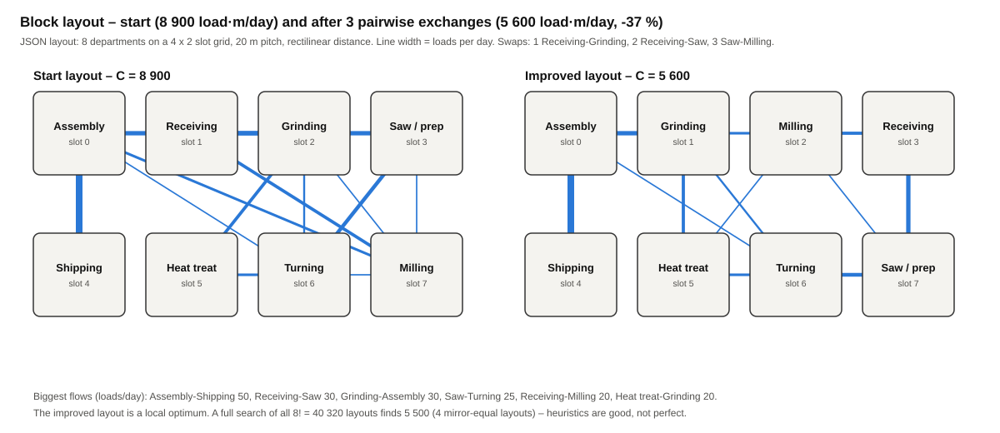

**Modifying considerations** (SLP): handling method (forklift, AGV, crane, conveyor), storage, site conditions, utilities, building
features, personnel needs, safety, future expansion. **Practical limitations**: cost, time, policy, existing buildings.

### D2.8 Evaluation of alternatives – weighted factor method + cost

Score each alternative per criterion (0–4 or 1–10), multiply by the weight, add. Example with three alternatives (example values):

| Criterion | Weight | Alt 1 – straight flow | Alt 2 – U-flow, dock one side | Alt 3 – FMS along the long wall |
|---|---|---|---|---|
| Transport effort Σ f·d (D2.3) | 25 | 3 | 4 | 3 |
| Closeness (SLP score) | 15 | 3 | 4 | 3 |
| Expansion (4th HMC, more assembly) | 20 | 2 | 3 | 4 |
| Building fit (columns, crane, floor) | 15 | 4 | 3 | 3 |
| Environment (clean / dirty, noise) | 10 | 3 | 3 | 4 |
| Investment (relocation, foundations) | 15 | 3 | 3 | 2 |
| **Weighted score** = Σ weight × score | 100 | **295** | **340** | **315** |

Calculation: Alt 1 = 25×3 + 15×3 + 20×2 + 15×4 + 10×3 + 15×3 = 75 + 45 + 40 + 60 + 30 + 45 = 295; Alt 2 = 100 + 60 + 60 + 45 + 30 + 45 =
340; Alt 3 = 75 + 45 + 80 + 45 + 40 + 30 = 315 (maximum possible = 100 × 4 = 400). Choose Alt 2 if its cost is acceptable; document why. Present the **cost** (investment + annual transport cost) separately from
the qualitative score, and do a sensitivity check: does the ranking change if a weight changes by ± 5?

**Annual transport cost** = Σ f·d [load·m/day] × days per year ÷ speed [m/h] × cost per vehicle hour. Example: 5 600 load·m/day ×
250 days ÷ (3 600 m/h × 0.5 effective share) × 45 EUR/h ≈ 35 000 EUR per year; the start layout (8 900) ≈ 55 600 EUR per year.

### D2.9 Detailed layout (SLP level III)

The block layout becomes a detailed layout with every machine, aisle, utility, foundation and safety zone (D4). Use CAD with machine
blocks from the makers (with their service zones and door openings), the building grid, the crane ways and the media routes. Check
with a 3-D walk-through (operators and maintenance staff) and with the material flow simulation (E).

### D2.10 How to run SLP with the team (practical workshop)

| Day | Session | Participants | Output |
|---|---|---|---|
| before | collect P-Q-R-S-T data, routings × volumes → from-to matrix; draft REL chart | planner | data pack |
| 1 morning | explain the method; agree the REL ratings and reasons pair by pair | production, logistics, maintenance, quality, safety, IT | agreed REL chart |
| 1 afternoon | relationship diagram on the wall with cards (departments as cards, A-lines as tape) | same | 2–3 diagram variants |
| 2 morning | space requirements and building outline; block layouts at scale (paper blocks or layout software, E6.2) | planner + team | 2–4 block alternatives |
| 2 afternoon | evaluation: Σ f·d (tool `layout_plan.py`), SLP score, weighted criteria, cost; sensitivity | team + management | ranked alternatives, decision or next steps |
| after | detailed layout of the chosen alternative (D4), check with simulation (E) | planner, suppliers | layout drawing |

Rules: rate relationships **before** anyone draws a layout (otherwise people defend their favourite layout); write the reason for every A and X;
keep the decision log.

## D3. Algorithms

### D3.1 Why heuristics

With n departments on n equal slots there are n! layouts: 8! = **40 320**, 10! = 3.6 million, 15! = 1.3 × 10¹². The problem (quadratic
assignment problem, QAP) is NP-hard. For 8 departments a computer can try all layouts (the scratch full search of D2.4 took seconds), but
for real problems with unequal areas and constraints heuristics are used: **improvement** methods (CRAFT: start from a layout, swap) and
**construction** methods (ALDEP, CORELAP: build a layout from the relationships).

### D3.2 CRAFT pairwise exchange – step by step (JSON formula `pairwise_exchange`)

Rule: in each iteration evaluate **every pair of slots** (i < j, in slot order), compute the cost after the swap, take the swap with the
**largest strict reduction** (on ties the first found), repeat until no swap reduces C (steepest descent).

**Iteration 1** (start C = 8 900). The best five of the 28 possible swaps:

| Swap (slots) | Departments | New C |
|---|---|---|
| 1 ↔ 2 | Receiving ↔ Grinding | **7 200** ← chosen |
| 1 ↔ 7 | Receiving ↔ Milling | 7 300 |
| 3 ↔ 5 | Saw / prep ↔ Heat treat | 7 700 |
| 5 ↔ 7 | Heat treat ↔ Milling | 7 700 |
| 1 ↔ 6 | Receiving ↔ Turning | 7 900 |

Layout after iteration 1: Assembly, Grinding, Receiving, Saw / prep | Shipping, Heat treat, Turning, Milling (C = 7 200).

**Iteration 2:**

| Swap (slots) | Departments | New C |
|---|---|---|
| 2 ↔ 3 | Receiving ↔ Saw / prep | **6 400** ← chosen (tie, found first) |
| 2 ↔ 7 | Receiving ↔ Milling | 6 400 |
| 6 ↔ 7 | Turning ↔ Milling | 6 500 |
| 3 ↔ 7 | Saw / prep ↔ Milling | 6 600 |
| 2 ↔ 6 | Receiving ↔ Turning | 6 900 |

Layout: Assembly, Grinding, Saw / prep, Receiving | Shipping, Heat treat, Turning, Milling (C = 6 400). Note the **tie**: the rule
"first found" decides. Another tie rule can lead to another local optimum – write the rule into the tool.

**Iteration 3:**

| Swap (slots) | Departments | New C |
|---|---|---|
| 2 ↔ 7 | Saw / prep ↔ Milling | **5 600** ← chosen |
| 0 ↔ 5 | Assembly ↔ Heat treat | 6 400 |
| 1 ↔ 4 | Grinding ↔ Shipping | 6 400 |
| 0 ↔ 4 | Assembly ↔ Shipping | 6 600 |
| 3 ↔ 7 | Receiving ↔ Milling | 6 600 |

Layout: Assembly, Grinding, Milling, Receiving | Shipping, Heat treat, Turning, Saw / prep (C = 5 600).

**Iteration 4:** the best swap (1 ↔ 4 Grinding ↔ Shipping) gives 5 800 > 5 600 → **stop**. Result: **3 swaps, 8 900 → 5 600
load·m/day (−37.1 %)**.

**Cost of the improved layout:** Receiving→Saw 30 × 20 = 600; Receiving→Milling 20 × 20 = 400; Saw→Turning 25 × 20 = 500;
Saw→Milling 5 × 40 = 200; Turning→Heat 15 × 20 = 300; Turning→Grinding 10 × 40 = 400; Turning→Assembly 5 × 60 = 300;
Milling→Heat 5 × 40 = 200; Milling→Grinding 5 × 20 = 100; Milling→Assembly 15 × 40 = 600; Heat→Grinding 20 × 20 = 400;
Grinding→Assembly 30 × 20 = 600; Assembly→Shipping 50 × 20 = 1 000 → **5 600** ✓.

**Local vs global optimum:** the full search finds 5 500 (12 of the 40 320 layouts cost ≤ 5 600). Pairwise exchange stopped 100 load·m/day
(1.8 %) above the optimum. Practical rule: run the exchange from **several start layouts** (random or engineering choices) and keep the
best – with 5–10 starts you nearly always find the optimum for 8–12 departments.

**Real CRAFT** also handles unequal department areas (it swaps only departments with equal area or a common border), uses the centroid
distance, and allows fixed departments (dock, heat treatment with its foundation). Variants: 3-way exchanges, simulated annealing,
genetic algorithms (in modern layout software, E6).

### D3.3 Construction methods – ALDEP and CORELAP (idea)

- **CORELAP** (computerised relationship layout planning): computes for every department its **total closeness rating** (TCR = sum of
  the values of its relationships); places the department with the highest TCR in the centre; then adds the department with the
  strongest relation to the placed ones, next to its partner, and so on. Result: a compact layout driven by the REL chart.
- **ALDEP** (automated layout design program): places a random first department, then the department with the highest relation to the
  last placed one (above a minimum level), filling the building in vertical strips ("sweep"); repeats many times and scores each layout
  with the REL values (like the SLP score); keeps the best.
- Both use the **REL chart** (qualitative), CRAFT uses the **from-to matrix** (quantitative). Good practice: construct with CORELAP-logic,
  improve with CRAFT, check with the SLP score and the practical constraints (D4).

**CORELAP example (JSON rel values):** TCR of each department = sum of its ratings: Grinding = A(Heat) 16 + A(Asm) 16 + I(Turn) 4 +
X(Saw) −64 = −28 … with X = −64 the X pairs dominate. CORELAP therefore uses the X rule separately ("never adjacent") and computes TCR from
A–O only: Grinding 16 + 16 + 4 = 36; Assembly A(Grind) 16 + A(Ship) 16 + E(Mill) 8 = 40; Saw A 16 + A 16 + I 4 = 36; Turning 16 + 8 + 4 =
28; Receiving 16 + 8 = 24; Shipping 16 + 8 + 2 = 26; Heat treat 8 + 16 + 2 = 26; Milling 4 + 8 = 12. Start with **Assembly** (40), add
Grinding and Shipping (A with Assembly), then Heat treat (A with Grinding), Saw / prep … – a layout close to the improved one of D3.2.

### D3.4 Program – cost and pairwise exchange

```python
def layout_cost(lay, flow, slots, pitch):
    at = {d: s for s, d in enumerate(lay)}
    return sum(flow[i][j] * (abs(slots[at[i]][0] - slots[at[j]][0]) + abs(slots[at[i]][1] - slots[at[j]][1])) * pitch
               for i in range(len(flow)) for j in range(len(flow)) if flow[i][j])

def pairwise_exchange(lay, flow, slots, pitch):
    lay = list(lay)
    steps = []
    while True:
        best, bi, bj = layout_cost(lay, flow, slots, pitch), -1, -1
        for i in range(len(lay)):
            for j in range(i + 1, len(lay)):
                lay[i], lay[j] = lay[j], lay[i]
                c = layout_cost(lay, flow, slots, pitch)
                if c < best - 1e-9:
                    best, bi, bj = c, i, j
                lay[i], lay[j] = lay[j], lay[i]
        if bi < 0:
            return lay, steps
        lay[bi], lay[bj] = lay[bj], lay[bi]
        steps.append((bi, bj, best))
```

With the JSON data `pairwise_exchange(start, flow, slots, 20)` returns the swaps (1, 2, 7 200), (2, 3, 6 400), (2, 7, 5 600) and the final layout
[6, 5, 3, 0, 7, 4, 2, 1] (department index per slot) – the steps of D3.2. To use several starts, call it with random permutations
(`random.sample(range(8), 8)`) and keep the cheapest result. The tool `layout_plan.py --craft` prints every iteration.

## D4. Detailed layout rules

### D4.1 Aisles – widths (JSON `aisle`)

JSON formula `aisle`: one-way aisle = w + 2c; two-way aisle = 2w + 3c; with w = width of the vehicle or the load (the larger), c = safety
clearance. AGV with people walking beside it: + 0.5 m protective clearance on each side where people walk (ISO 3691-4 idea).

Example inputs: forklift width 1.2 m, load width 1.2 m (pallet), c = 0.5 m, AGV width 1.0 m.

| Aisle | Formula | Calculation | Width |
|---|---|---|---|
| Forklift, one-way | w + 2c, w = max(1.2, 1.2) | 1.2 + 2 × 0.5 | **2.20 m** |
| Forklift, two-way | 2w + 3c | 2 × 1.2 + 3 × 0.5 | **3.90 m** |
| AGV, one-way (no people) | w + 2c | 1.0 + 1.0 | **2.00 m** |
| AGV, two-way (no people) | 2w + 3c | 2.0 + 1.5 | **3.50 m** |
| AGV, one-way, people on both sides | 2.00 + 2 × 0.5 | | **3.00 m** |
| AGV, two-way, people on both sides | 3.50 + 2 × 0.5 | | **4.50 m** |
| AGV, one-way, people on one side only | 2.00 + 0.5 | | 2.50 m |

**Other aisle rules (typical values – check national rules):**
- Pedestrian aisle alone: ≥ 1.0–1.2 m (more for main routes, escape routes per local workplace regulation).
- Narrow-aisle and stacker trucks: DIN 15185-1 gives minimum aisle widths and floor flatness for narrow-aisle storage systems; use the
  truck maker's working aisle data (right-angle stacking: truck length + load + clearance).
- Turning areas at aisle ends and crossings (forklift turning radius + load).
- AGV / AMR: ISO 3691-4 requires protective fields, speed limits and – where people can be present – sufficient clearance or reduced
  speed; mark AGV routes on the floor; no permanent storage in the clearance zone (guide 63 B8.9).
- Aisles must be **free**: no material on the aisle marking (5S); this is the most common violation in audits.

### D4.2 Service areas around machines

Every machine block in the CAD must show: footprint, door opening, operator area (≥ 1.0 m in front), maintenance access (cabinet doors open
90°, spindle and motor removal, coolant tank removal), chip conveyor exit and bin exchange, tool loading side, crane access for the heaviest
part to be changed. Ask the maker for the **installation drawing** with service zones (guide 26 installation).

### D4.3 Chips and coolant routes

- Chip conveyor outlets to one side (aisle side) – bins exchanged by forklift or a central chip conveyor in a floor channel (guide 63 B20).
- Central coolant system: pipes in a channel or on a bridge, return by gravity (slope 1–2 %) → plan floor channels **before** the floor is
  poured.
- Keep chips and coolant out of AGV routes (slippery floor, sensor dirt).

### D4.4 Foundations

Precision machines (grinding, large HMCs) may need individual foundations (vibration isolation, guide 26 foundation and alignment). A
foundation fixes the position for decades – put such machines where the layout will not change, and keep heavy presses or the saw (vibration
sources) away from grinding and measuring rooms (X relation in the REL chart).

### D4.5 Crane ways

Overhead cranes cover a bay; machines that need crane service (fixture change of heavy parts, spindle change, die change) must be inside the
crane hook area (hook approach limits at the ends and the sides!). An FMS with automatic pallet handling still needs a crane or a mobile crane
for maintenance.

### D4.6 Utilities

Electrical power (busbars, sub-distribution per area), compressed air (ring main), coolant, hydraulic power, extraction (oil mist, welding
fume), water, gas (heat treatment), network (OT network, guide 66 / guide 22 IT/OT). Rules: utility **corridors** along the columns or in
the roof, drops at the machines; spare capacity 20–30 %; separate power for sensitive equipment (CMM, IT).

### D4.7 Clean and dirty zones, temperature

- Dirty: saw, grinding (dust, sludge), heat treatment (heat, scale), welding (fume, spatter), painting (solvents).
- Clean: assembly, measuring (CMM room with temperature 20 ± 1 °C), electronics.
- Separate them by distance, walls or air locks; keep the flow from dirty to clean (washing station in between, guide 63 B12).

### D4.8 Noise

Workplace limits (EU directive 2003/10/EC: lower action value 80 dB(A), upper action value 85 dB(A), limit 87 dB(A) for the daily exposure –
check local law). Put noisy machines (presses, saws, compressors, shot blasting) in enclosures or separate halls; do not place offices or
assembly next to them.

### D4.9 Safety distances

- Robot cells and automated systems: guards with safety distances after ISO 13857 (reach over / through openings) and ISO 13855 (approach
  speed, stopping time → distance of light curtains and laser scanners); see guide 24 and guide 67.
- AGV clearance (D4.1), stacker crane area fenced (EN 528).
- Distance between machines for maintenance and escape.

### D4.10 Fire escape and fire protection

Escape routes with the maximum length to the next exit and minimum widths as required by the local building and workplace regulations (in
Germany ASR A2.3; typical maximum escape route length 35 m in normal rooms, up to more with sprinklers – **check the local rule**). Fire
compartments, sprinklers, fire walls between storage (AS/RS) and production, access for the fire brigade. Heat treatment and oil quench
need special fire protection.

### D4.11 Expansion space

Keep space for the next growth step **at the right place**: at the open end of an FMS spine (machine 4, A3.2), at the end of a line, next to
the dock. Mark it in the layout and do not let it fill up with "temporary" storage. A layout without expansion space forces a complete
re-layout at the first growth.

### D4.12 Layout check list (detailed level)

Flows short and without crossings · dock positions · aisles free and wide enough · machine service zones · chip and coolant routes · media
corridors · foundations · crane coverage · zones clean / dirty / noise · safety distances and guards · escape routes and fire compartments ·
light and windows (EN 12464-1) · expansion space · visual management (andon, boards) · places for material, empties, scrap, chips ·
offices and social rooms close to the floor.

## D5. FMS layout patterns with dimension examples

### D5.1 Linear pallet pool along the machines (most common for 2–8 HMCs)

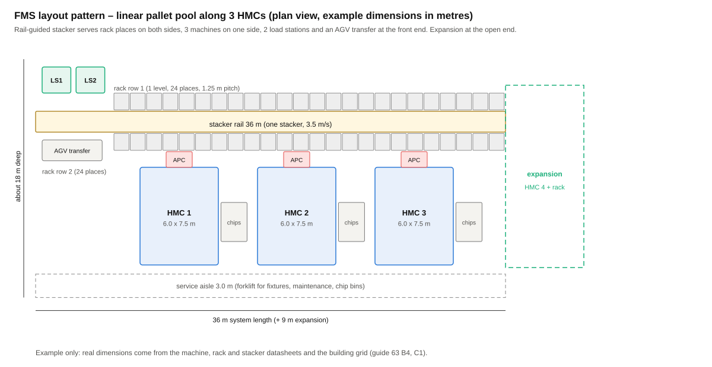

Example (compressor FMS, 3 HMCs): rail-guided stacker on a 36 m rail; rack places on both sides of the rail (2 rows × 24 places of 1.25 m
pitch = 48 places, single level here; multi-level racks give more places on the same floor); machines on one side with the APC facing the
rail; 2 load stations and an AGV transfer at the front end; service aisle of 3.0 m behind the machines (forklift for fixtures, chip bins,
maintenance); expansion space of 9 m at the open end for HMC 4 and more racks. Depth about 18 m including the service aisle.

**Dimension rules (example values – use datasheets):**
- Machine pitch along the rail = machine width + maintenance gap (here 6.0 + 3.0 = 9.0 m).
- Rail length = machines × pitch + load stations + transfer + end zones (buffers / stops) ≈ 36 m.
- Rack places: pallets (B6.5: about 24 for the unmanned night) + fixtures not in use + empty places for exchange + expansion → 48 places is
  realistic here.
- Stacker: one stacker serves about 20–40 moves per hour depending on length (guide 63 B4.6); here 2 moves per pallet × 3 pallets/h =
  6 moves per hour → low utilisation (the 4E vehicle utilisation of 15 % confirms this).

### D5.2 Other FMS patterns

| Pattern | Description | When | Dimension notes |
|---|---|---|---|
| Linear pool, machines on both sides | rail in the middle, machines left and right | 6–12 machines, short rail | rail length ≈ half; access aisles on both outer sides |
| Rotary / circular pallet store per machine | each machine with its own pallet tower or rotary store (FMC) | 1–2 machines, simple | store diameter 3–5 m beside the machine |
| AGV-served FMS | machines anywhere, AGVs carry pallets from a central load area | existing buildings, mixed machines | AGV aisles D4.1 (2.0–4.5 m), docking stations |
| Robot-served cell | robot in the middle, machines around (radius = robot reach) | small parts, 2–3 machines | reach circle 2–3.5 m; fence ISO 13857 |
| Loop conveyor (assembly) | carriers on a loop past stations | assembly systems | loop length = carriers × pitch; buffers on the loop |
| Gantry-loaded line | gantry above a row of machines | shafts, turning | gantry span 3–6 m, height clearance |

### D5.3 Load stations – where and how many

Load stations are manned: place them at the **front** of the system, near the material supply (raw parts, fixtures, tools) and the operator
area, with good light and ergonomic height (guide 63 B5). The number follows from the closed-system analysis: one load station at 12 min per
pallet can serve 5 pallets/h; at r_b = 2.98 pallets/h its utilisation is 60 % (B6.2, E4) – one is enough for 3 machines, one becomes the
bottleneck from about 5 machines (E4.4 experiment).
### D5.4 Dimension examples for the assembly line and the welding cells (example values)

| Item | Assembly line (F2) | Two welding cells (F3) |
|---|---|---|
| Stations / cells | 6 stations, 1.6 m pitch on a U of 2 × 5 m + return | 2 cells with turntable, each about 6 m × 5 m inside the fence |
| Operator area | 1.0–1.2 m in front of each station | load side 2.0 m deep between the two cells (shared walking zone) |
| Material supply | flow racks at the outside of the U, tugger-train aisle 3.0 m | parts and fixtures in flow racks at the load side, forklift aisle 3.9 m behind |
| Buffers | 2-2-4-3-2 places on the conveyor (C3) | – (turntable = 1 part buffer per cell) |
| Utilities | compressed air ring, 400 V busbar, network drops | welding power, gas supply, fume extraction duct, compressed air |
| Safety | guards at automatic stations, two-hand or light curtain at presses | fences (ISO 13857), light curtain or door at the turntable (ISO 13855), welding curtains |
| Zone | clean zone (no grinding next to it) | dirty zone (fume, spatter) – away from assembly and measuring |

---

# Part E – Simulation

## E1. When to simulate, and the concepts of discrete-event simulation

### E1.1 Formula or simulation?

| Question | Formulas are enough | Simulation needed |
|---|---|---|
| Average capacity, machine count | ✓ (guide 62, A3) | – |
| Queue at one station with general times | ✓ Kingman / Sakasegawa (B3) | if the result decides a big investment |
| Closed system, pallets, simple routing | ✓ laws + MVA (B6) as bounds | for the final number with real distributions |
| Finite buffers, blocking | – | ✓ (C2, C3) |
| Several part types with different routings, priorities, dispatching rules | – | ✓ |
| Shift patterns, unmanned hours, breaks, operator sharing | – | ✓ (F3) |
| Start-up, transient behaviour, ramp-up | – | ✓ |
| Control logic test (cell controller, MES rules) | – | ✓ (emulation, virtual commissioning) |

Rule: **first formulas, then simulation**. The formulas give bounds and a check value for the simulation (E4.3). A simulation without a
formula check is not trusted (and should not be).

### E1.2 Discrete-event simulation (DES) – the concepts

A DES model jumps from **event** to **event**; between events nothing changes.

| Concept | Meaning | In the 4E model |
|---|---|---|
| Entity | object that moves through the system | pallet (with part type) |
| Resource | object that serves entities, with capacity | load stations (L), vehicles (V), machines (m) |
| Attribute | data of an entity | part type, time of the last load-done |
| State variable | describes the system at a time | free load stations, free vehicles, machine busy, time to failure of each machine |
| Event | instant at which the state changes | loadDone, moveDone, machDone |
| Event list (future event list) | sorted list of planned events (heap) | heap ordered by (time, sequence number) |
| Simulation clock | current time; jumps to the next event | t |
| Queue | entities waiting for a resource, with a rule | loadQ, vehQ, machQ; FIFO or SPT at the machines |
| Random number generator | gives repeatable pseudo-random numbers U(0, 1) from a seed | mulberry32 in the web; the seed = replication number |
| Statistics | time-weighted averages (utilisation, queue length) and counts (throughput) | busy time integrals after the warm-up |

**The event loop** (every DES package works like this):

```
initialise state, clock t = 0, put first events into the event list
while event list not empty:
    take the earliest event (t_event, type, data); if t_event > end: stop
    update time-weighted statistics from the last event time to t_event
    t = t_event
    execute the event logic: change the state, start services (schedule their end events), move entities into queues
collect results
```

### E1.3 Random numbers and distributions

A pseudo-random generator produces a repeatable sequence U_1, U_2, … uniformly in [0, 1) from a **seed**. Same seed → same run (needed for
debugging and for common random numbers, E3.7). Other distributions are made by transformation:

| Distribution | Parameters | Generate from U | Mean, c | Use |
|---|---|---|---|---|
| Exponential | mean θ | x = −θ ln(1 − U) | θ, c = 1 | times between random events, failures (MTTF), repairs (MTTR) |
| Lognormal | mean μ_x, cv c | σ² = ln(1 + c²), μ = ln μ_x − σ²/2; z = √(−2 ln(1 − U_1)) cos(2π U_2) (Box–Muller); x = e^(μ + σ z) | μ_x, c | process, load and repair times (positive, right-skewed) |
| Normal | μ, σ | Box–Muller | – | only for small c (otherwise negative times!) |
| Triangular | min a, mode c, max b | inverse CDF | (a + b + c)/3 | expert estimates without data |
| Uniform | a, b | x = a + (b − a) U | (a + b)/2 | when only limits are known |
| Weibull | shape k, scale λ | x = λ (−ln(1 − U))^(1/k) | – | failure times with wear-out (k > 1) |
| Empirical | data table | pick a measured value (or interpolate the CDF) | as data | when you have many measurements and no fitting distribution |
| Constant | value | – | c = 0 | vehicle move time in 4E, takt-driven machines |

**Worked example – lognormal of part A (mean 56 min, c = 0.15):** σ² = ln(1 + 0.0225) = 0.02225, σ = 0.1492, μ = ln 56 − 0.02225 ÷ 2 =
4.0256 − 0.0111 = 4.0142. With U_1 = 0.3, U_2 = 0.8: z = √(−2 ln 0.7) × cos(1.6π) = 0.8446 × 0.3090 = 0.2610 → x = e^(4.0142 + 0.1492 ×
0.2610) = **57.58 min**. 95 % of the times lie between e^(μ ± 1.96σ) = 41.3 and 74.2 min. **Exponential example:** MTTR 60 min, U = 0.3 →
x = −60 ln 0.7 = 21.4 min. **Triangular example:** expert says "8 to 15 min, mostly 10" → mean (8 + 10 + 15) ÷ 3 = 11.0 min (not 10!).

### E1.4 How to fit distributions to data

1. **Collect** at least 30–100 values per time (MES, PLC time stamps of the PackML states, stopwatch for manual work). Remove obvious errors
   (but do not remove real long values – they are the variability!).
2. **Describe**: mean, standard deviation, c, min, max, histogram.
3. **Choose candidates** from physics: positive and skewed → lognormal, gamma, Weibull; random events → exponential; bounded expert estimate →
   triangular.
4. **Estimate parameters** (method of moments as above, or maximum likelihood – most packages have a "distribution fitter", e.g. Stat::Fit in
   some packages, ExpertFit, or Python/SciPy offline).
5. **Test the fit**: histogram vs density, Q-Q plot, Kolmogorov–Smirnov or chi-square test. With many data every test rejects; with few data
   every test accepts – look at the plots.
6. **If nothing fits**, use the empirical distribution.
7. **Breakdowns**: fit time to failure on **busy time** (not calendar time) and repair time separately; check for wear-out (Weibull k > 1).

### E1.5 Time advance – next event vs fixed increment

- **Next-event time advance** (4E, most DES packages): the clock jumps to the next event; nothing is computed in between. Efficient for systems
  with few events per hour (an FMS: a few hundred events per day).
- **Fixed-increment time advance** (the twin's engine, `twin/engine.py`, guide 01 §4.1, step 1 s): every step updates every machine. Simple,
  easy to couple with physics (temperature, power, vibration) and with real-time signals, but slower and with a time resolution of one step.
- **Hybrid / continuous** models (conveyors with speed, tanks, energy) combine both. Choose by the purpose: design study → next event;
  real-time twin and physics → fixed increment.

---

## E2. The simulation project (VDI 3633)

### E2.1 The procedure

VDI 3633 part 1 (simulation of systems in materials handling, logistics and production – fundamentals) describes the simulation study from
the task definition to the use of the results, with verification and validation (V&V) along the whole way.

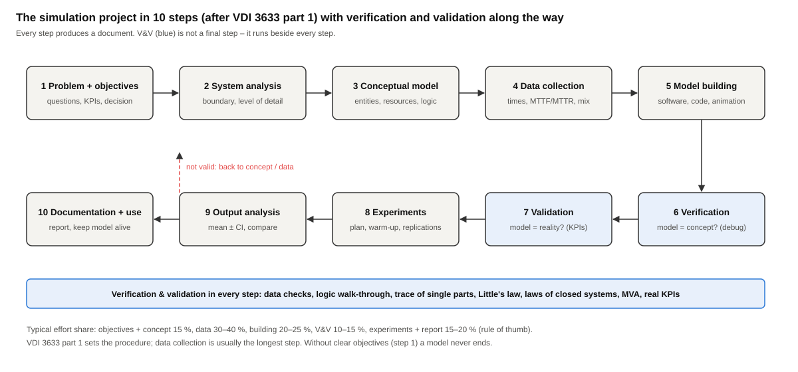

| Step | Content | Result document | Typical mistakes |
|---|---|---|---|
| 1 Problem and objectives | which decision? which KPIs (TH, lead time, utilisation, WIP, pallets)? which alternatives? accuracy needed? deadline, budget | task definition (1–2 pages), agreed with the decision maker | "model the whole factory" without a question |
| 2 System analysis | system boundary, level of detail (only what affects the KPIs), assumptions | system description | too much detail too early |
| 3 Conceptual model | entities, resources, logic, rules, flow chart, input / output list – software independent | conceptual model (verified by the experts of the process) | logic only in the head of the modeller |
| 4 Data collection | times, distributions, MTTF / MTTR, mix, shift calendar, layout distances | data list with sources and quality | data from catalogue instead of reality; averages only |
| 5 Model building | implementation in a simulation package or code | executable model, animation | building before the concept is agreed |
| 6 Verification | is the model the **concept**? (code correct?) | verification log | only "the animation looks fine" |
| 7 Validation | is the model **reality** (good enough for the purpose)? | validation report | no comparison with real or formula data |
| 8 Experiments | experiment plan, warm-up, run length, replications | experiment plan | one run per alternative |
| 9 Output analysis | mean ± CI, comparisons, sensitivity | result tables, charts | reporting one random number |
| 10 Documentation and use | report, decision, model handed over and kept alive | final report, model + data archive | model lost after the project |

### E2.2 Verification techniques

- Trace a single entity step by step (event log); compare with a hand calculation.
- Run with **deterministic** times, no breakdowns and one pallet: the loop time must be exactly load + 2 moves + machining = 12 + 3 +
  57.6 = 72.6 min (mix average). With breakdowns the mean loop time at N = 1 must approach T_0 = 75.48 min.
- Extreme values: infinite MTTF → no down time; one machine → utilisation of that machine = TH × t_e.
- **Little's law** in every run: N = TH × loop time.
- Balance checks: parts in = parts out + WIP change.
- Code review by a second person; animation as a debugging help (not as proof).

### E2.3 Validation techniques

- **Against theory** (E4.3): closed-system laws, MVA, Kingman – the simulation must lie between the bounds and agree with exact models where
  they apply.
- **Against reality** (existing system): run the model with the real data of a past month and compare TH, utilisation, WIP, lead time; the
  error should be within the accuracy agreed in step 1 (e.g. ± 5 % for TH).
- **Face validity**: the operators and planners look at the animation and the Gantt and say "yes, this is how it works" (or not).
- **Sensitivity**: if a small change of an uncertain input changes the decision, collect better data for that input.

### E2.4 Effort and roles

Typical effort shares (rule of thumb): objectives + concept 15 %, data 30–40 %, model building 20–25 %, V&V 10–15 %, experiments and report
15–20 %. A first FMS study for a supplier offer: 5–15 days; a detailed study with control logic: 20–60 days. Roles: the **decision maker**
(owns the question), the **process experts** (operators, planners, maintenance), the **modeller**, and the **data owner** (MES, IT).

### E2.5 Example – task definition for the FMS simulation study (filled template)

| Field | Content (example) |
|---|---|
| Decision | number of pallets, load stations and vehicles for the crankcase FMS (3 HMCs, expansion to 4) |
| KPIs | throughput [pallets/h], pallet loop time, utilisation of machines / load station / vehicle, queue at the load station |
| Alternatives | N = 1 … 15; L = 1 / 2; V = 1 / 2; MTTR 60 / 30 min; FIFO / SPT; m = 3 / 4 |
| Accuracy | throughput half width ≤ 1.5 % of the mean (95 % CI) |
| System boundary | from the load station (incl. operator) to the machines and back; washer and CMM outside (constant flow assumed) |
| Data | machining times per type (CAM + test cuts), load times (time study at a similar station), MTTF / MTTR (maker data × 0.8 safety factor), mix (sales plan) |
| Model | generic 4E model for the concept; detailed supplier model in P5 |
| Validation | closed laws, MVA, Little; later the real data of the ramp-up |
| Experiments | 14 days, warm-up 10 % (≤ 2 days), 10 replications, seeds 1–10 |
| Deliverables | result tables with mean ± CI, sweep chart, recommendation, model files |
| Deadline / effort | 5 working days |

---

## E3. Output analysis

### E3.1 Terminating vs non-terminating simulation

- **Terminating**: the run has a natural end (one shift, one order, the ramp-up week). Replicate the whole run; no warm-up problem.
- **Non-terminating (steady state)**: we want the long-run behaviour (an FMS in normal production). The start state (empty system, all
  pallets at the load station) is not typical → **warm-up** must be cut; then long runs or several replications.

### E3.2 Warm-up – Welch's method (JSON formula `welch`)

1. Make R replications (e.g. 10) of the output series (here: pallets finished per hour).
2. Average across replications for each hour: Ȳ_1, Ȳ_2, …
3. Smooth with a moving average of window w (here w = 12 h on each side).
4. The warm-up ends where the smoothed curve becomes flat.

**Example (4E FMS, N = 10, 14 days, seeds 1–10):** hourly finished pallets, averaged over 10 replications: hour 1: 0.2, hour 2: 2.7, hour 3:
3.0, then fluctuating around 2.9–3.0. The moving average (w = 12) is 2.72 at hour 0, 2.86 at hour 12, 2.98 at hour 15 and stays at 2.96–3.01
afterwards. The transient lasts about **15 hours**. The model cuts 10 % of the run, at most 2 days (here 14 × 1 440 × 0.1 = 2 016 min =
33.6 h) – about twice the observed transient: safe. Mean of hours 48–336: 2.983 pallets/h, equal to the replication mean of E3.4.

### E3.3 Run length and number of replications

- Run length: at least 10–20 × the longest "cycle" in the system – here the breakdowns: MTTF 1 200 min busy → about 17 failures per machine
  in 14 days. Longer runs make each replication more precise; more replications do the same and also give an honest variance estimate.
- Number of replications for a target half width h: start with R_0 = 10, compute s, then

$$ R \approx \left(\frac{t_{R-1,\,0.975}\cdot s}{h}\right)^2 $$

  Example (base run, s = 0.0444 pallets/h): h = 0.03 → R ≈ (2.262 × 0.0444 ÷ 0.03)² ≈ 11; h = 0.02 → about 21–25 (the t value falls with
  R; with z = 1.96: 19); h = 0.01 → about 76–100. Halving the half width needs **four times** the replications.

### E3.4 Confidence interval from replications (JSON formula `replications`)

$$ \bar{x} = \frac{1}{R}\sum_{r=1}^{R} x_r, \qquad s = \sqrt{\frac{1}{R-1}\sum (x_r - \bar{x})^2}, \qquad h = t_{R-1,\,0.975}\,\frac{s}{\sqrt{R}}, \qquad CI = \bar{x} \pm h $$

with t_9 = 2.262 for R = 10.

**Worked example – base case of item 4E (JSON `fms_sim`: m = 3, N = 10, L = 1, V = 1, load 12 min cv 0.3, move 1.5 min, MTTF 1 200, MTTR 60,
FIFO, 14 days, seeds 1–10):**

| Replication (seed) | TH [pallets/h] | Breakdown share | Load station util. | Loop time [min] |
|---|---|---|---|---|
| 1 | 2.966 | 3.7 % | 58.6 % | 202.7 |
| 2 | 2.983 | 4.4 % | 59.9 % | 200.8 |
| 3 | 3.036 | 4.2 % | 61.0 % | 197.7 |
| 4 | 3.029 | 3.4 % | 60.0 % | 197.8 |
| 5 | 2.989 | 5.1 % | 59.2 % | 200.3 |
| 6 | 2.973 | 6.0 % | 58.9 % | 201.8 |
| 7 | 2.907 | 6.0 % | 57.7 % | 205.9 |
| 8 | 2.920 | 5.2 % | 58.9 % | 205.4 |
| 9 | 3.019 | 3.8 % | 60.0 % | 198.6 |
| 10 | 3.019 | 3.5 % | 62.0 % | 199.0 |
| **Mean** | **2.984** | **4.53 %** | **59.6 %** | **201.0** |
| s | 0.0444 | 0.99 % | 1.26 % | 2.96 |
| Half width h = 2.262 s ÷ √10 | 0.0317 | 0.71 % | 0.90 % | 2.11 |
| **95 % CI** | **2.952 – 3.016** | 3.8 – 5.2 % | 58.7 – 60.5 % | 198.9 – 203.1 |

Calculation of the TH line: Σ x = 29.841 → x̄ = 2.9841; Σ (x − x̄)² = 0.01774 → s = √(0.01774 ÷ 9) = 0.0444; h = 2.262 × 0.0444 ÷ 3.162 =
0.0317.

**Seed 7 alone** gives 2.907 pallets/h – exactly the value the web shows with its default seed 7 (2.91). One run can be 2.6 % below the mean:
**never decide with one run**.

### E3.5 Interpreting the CI

"With 95 % confidence the true long-run mean throughput of this **model** lies between 2.952 and 3.016 pallets/h." It says nothing about the
error of the model against reality (that is validation, E2.3). The bottleneck rate r_b = 2.976 lies inside the CI – as expected, because the
machines are busy 100 % of the time at N = 10 and the throughput is then the machine capacity (the measured breakdown share of 4.53 % is a
bit below the theoretical 1 − A = 4.76 % in these 10 replications, so the mean TH is slightly above r_b).

### E3.6 Why web, tools and guide numbers differ slightly

1. **Different random generators** (web: mulberry32; a tool may use Python's Mersenne Twister) → different random streams → different
   samples of the same random model.
2. **Different seeds or numbers of replications** (web 4C: seeds 11 and 23; guide: seeds 1–10; web 4E: one seed).
3. **Floating-point library details** (logarithm, cosine) can change the last digits and, after thousands of events, the order of two events.
4. **Run length and warm-up** settings.

Rule: analytic numbers must match **exactly**; simulation numbers must match **statistically** – the 95 % CIs of the means must overlap.
Example: this guide's base case 2.984 ± 0.032 (mulberry32 port, seeds 1–10); the same model with the Python Mersenne Twister gives
2.978 ± 0.025 – overlap ✓. The tool `fms_sim.py` reports 2.984 ± 0.032 (same generator and seeds).

### E3.7 Comparing alternatives

- **CI overlap (simple):** if the CIs of two alternatives do not overlap, they are different. If they overlap, they may still be different –
  use the paired method.
- **Paired difference (better):** run both alternatives with the **same seeds** (common random numbers, CRN), compute the difference per
  seed d_r = x_r(B) − x_r(A), then the CI of the mean difference with the t formula. If the CI of d does not contain 0, the difference is
  significant.
- **CRN** reduce the variance of the difference when both alternatives use the random numbers "in the same way" (synchronisation). In
  simple models with one random stream the synchronisation is lost after the first different decision – the gain is then small.
- **Many alternatives:** Bonferroni correction (for k comparisons use 1 − 0.05 ÷ k per comparison) or ranking-and-selection procedures in the
  simulation packages.

**Worked example – SPT vs FIFO (base case, seeds 1–10):** mean difference d̄ = −0.028 pallets/h, s_d = 0.072, h = 2.262 × 0.072 ÷ √10 =
0.052 → CI [−0.080; +0.024] contains 0 → **no significant difference** (E4.4 explains why).

### E3.8 One long run instead of replications – batch means

For steady-state studies you can also make **one long run** (after the warm-up) and cut it into b batches of equal length (e.g. b = 20 batches
of 5 days). The batch means are treated like replications: x̄ ± t_{b−1, 0.975} × s ÷ √b. Batches must be long enough to be nearly independent
(check that neighbouring batch means are not correlated). Advantage: only one warm-up. Disadvantage: the correlation check. For an FMS with a
few days of correlation (long breakdowns) use batches of ≥ 3–5 days. Replications (E3.4) are simpler and therefore used in this guide and in the
tools.

### E3.9 Typical output-analysis mistakes

- Reporting one run (or the best run) instead of mean ± CI.
- Counting the warm-up (empty start) in the averages – the throughput looks too low, utilisation too low.
- Too short runs: fewer than ~10 breakdowns per machine per run → the breakdown share is very uncertain.
- Comparing alternatives with different random numbers and few replications – differences are noise (SPT example, E3.7).
- Using the CI of the model as the error of the prediction for reality (it is not – validation, E2.3).
- Showing only averages: for lead-time promises the **distribution** (e.g. 90 % quantile of the loop time) matters.
- Changing several inputs at once and then not knowing which one caused the effect (use E4.7).

---

## E4. The generic FMS model of item 4E

### E4.1 Logic and assumptions

**Closed loop:** every pallet cycles **load station → vehicle → machine (any free one) → vehicle → load station**.

| Element | Logic in the model |
|---|---|
| Start | all N pallets wait at the load station (empty system) |
| Load station (L servers) | takes the next pallet (FIFO), **assigns the part type** by the mix (random draw with the mix weights), load time lognormal (mean `load`, cv `loadCv`); at "load done" the pallet loop time is recorded (from the previous load done) |
| Vehicle (V servers) | one move = constant time `move`; FIFO list of transport requests (to machine / to load station) |
| Machines (m identical, any part) | when a pallet arrives, the first free machine takes it; when a machine becomes free it takes from the queue: FIFO, or SPT (shortest mean machining time of the part type) |
| Machining time | lognormal with the part's mean and cv |
| Breakdowns | only while machining: each machine carries its remaining time to failure (exponential, mean MTTF of **busy** time); if the failure comes before the end of the part, the part is interrupted, repair exponential (mean MTTR), then the part continues (preemptive-resume); a new time to failure is drawn after each repair |
| Statistics | after the warm-up (10 % of the run, ≤ 2 days): finished pallets (at machine end), time-weighted busy servers and queues, breakdown time (counted when the job starts) |
| Not in the model | shifts, breaks, operator availability, set-ups and fixture changes, tool shortages, washer / CMM, several operations per pallet, vehicle travel by distance, blocking at the machine (unlimited local buffer), priorities by due date |

**Simplifications to remember:** identical machines (full routing flexibility), one operation per pallet loop, constant vehicle time, no shift
calendar. For a supplier's final design a detailed model is needed (E6). For concept decisions (number of pallets, load stations, vehicles,
effect of MTTR) the generic model is very effective.

### E4.2 Base case results (JSON `fms_sim`)

Mean ± 95 % half width of 10 replications (seeds 1–10), 14 days each:

| KPI | Result | Check |
|---|---|---|
| Throughput | **2.984 ± 0.032 pallets/h** | r_b = 2.976 (inside the CI) |
| Machine utilisation (busy incl. breakdowns) | 100.0 % | N = 10 > W_0 – machines never starve |
| … of it breakdown | 4.53 ± 0.71 % | theory 1 − A = 60 ÷ 1 260 = 4.76 % |
| Load station utilisation | 59.6 ± 0.9 % | TH × 12 min = 2.984 ÷ 60 × 12 = 59.7 % ✓ |
| Vehicle utilisation | 14.9 ± 0.2 % | TH × 3 min = 14.9 % ✓ |
| Pallet loop time | 201.0 ± 2.1 min | Little: 10 ÷ 2.984 × 60 = 201.1 ✓ |
| Mean queue at the machines | 6.09 pallets | 10 − 3 in process − 0.16 at load − ≈ 0.75 in loading / transport |
| Mean queue at the load station | 0.16 pallets | – |
| Throughput by type | A 1.206, B 1.036, C 0.742 pallets/h | mix 40 / 35 / 25 % of 2.984 = 1.194 / 1.044 / 0.746 ✓ |

### E4.3 Validation against MVA and closed laws

1. **Bounds:** every simulated point lies between PWC and best case (B6.4 table and figure) ✓.
2. **Exact model:** with **exponential** load, move and machining times (mean 60.48 min, no separate breakdowns) the same simulation program
   reproduces the exact load-dependent MVA within the CI at N = 1, 3, 5, 8, 10, 15 (B6.4: e.g. N = 3: DES 2.247 ± 0.013 vs exact 2.249) ✓.
   This proves the event logic, the queues and the statistics.
3. **Single pallet:** N = 1 gives TH 0.793 ± 0.006 vs 1 ÷ T_0 = 0.795 ✓ (the small deficit comes from the lognormal mean of the load and
   machining times combined with the counting window).
4. **Little:** N = TH × loop time in every run ✓.
5. **Utilisation law:** load station and vehicle utilisations = TH × demand ✓.

### E4.4 Experiments

**Experiment 1 – pallet sweep (N = 1 … 15, 10 replications each):**

| N | TH [pallets/h] | Loop time [min] | Machine util. | Load station util. | MVA Seidmann |
|---|---|---|---|---|---|
| 1 | 0.793 ± 0.006 | 75.7 ± 0.6 | 26.8 % | 15.8 % | 0.795 |
| 2 | 1.566 ± 0.014 | 76.5 ± 0.7 | 52.7 % | 31.2 % | 1.448 |
| 3 | 2.316 ± 0.024 | 77.7 ± 0.8 | 77.9 % | 46.0 % | 1.953 |
| 4 | 2.786 ± 0.015 | 86.1 ± 0.5 | 93.6 % | 55.8 % | 2.320 |
| 5 | 2.950 ± 0.018 | 101.7 ± 0.6 | 99.3 % | 58.8 % | 2.570 |
| 6 | 2.977 ± 0.031 | 120.9 ± 1.3 | 100 % | 59.7 % | 2.731 |
| 7 | 2.994 ± 0.033 | 140.5 ± 1.6 | 100 % | 59.9 % | 2.830 |
| 8 | 2.977 ± 0.029 | 161.1 ± 1.6 | 100 % | 59.5 % | 2.890 |
| 9 | 2.964 ± 0.022 | 182.3 ± 1.4 | 100 % | 59.2 % | 2.925 |
| 10 | 2.984 ± 0.032 | 201.0 ± 2.1 | 100 % | 59.6 % | 2.946 |
| 11 | 2.973 ± 0.031 | 222.0 ± 2.3 | 100 % | 59.4 % | 2.958 |
| 12 | 2.949 ± 0.032 | 244.1 ± 2.9 | 100 % | 59.0 % | 2.966 |
| 13 | 3.004 ± 0.026 | 259.6 ± 2.2 | 100 % | 60.1 % | 2.970 |
| 14 | 2.979 ± 0.022 | 282.2 ± 2.3 | 100 % | 59.2 % | 2.972 |
| 15 | 2.965 ± 0.028 | 303.5 ± 3.0 | 100 % | 59.3 % | 2.974 |

Reading: 95 % of the maximum (0.95 × about 2.98 = 2.83) is reached at **N = 5**; from N = 6 the throughput is flat (all differences inside the
CIs) and the loop time grows by about 20 min per extra pallet (= 60 ÷ 2.98 min, Little). The "ups and downs" from N = 6 to 15 (2.949 … 3.004)
are random – the CIs overlap. **Why is the simulation above MVA for small N?** MVA assumes exponential times (c = 1); the model uses lognormal
times with c = 0.15 (machining) and 0.3 (load) and a constant move – much less variability, so fewer pallets are needed (B6.4).

**Experiment 2 – one more resource or better maintenance (N = 10 unless written):**

| Alternative | TH [pallets/h] | Loop [min] | Load station util. | Conclusion |
|---|---|---|---|---|
| Base (m 3, L 1, V 1, MTTR 60) | 2.984 ± 0.032 | 201.0 ± 2.1 | 59.6 % | machines are the bottleneck |
| + 1 load station (L = 2) | 2.947 ± 0.031 | 203.6 ± 2.1 | 29.5 % | no gain (CIs overlap) – the load station is not the bottleneck |
| + 1 vehicle (V = 2) | 2.997 ± 0.027 | 200.1 ± 1.7 | 59.7 % | no gain – vehicle was 15 % used |
| Shorter repairs: MTTR 30 min (MTTF 1 200) | **3.043 ± 0.016** | 197.2 ± 1.1 | 60.9 % | +2.0 %; theory r_b = 3 ÷ (57.6 ÷ (1 200 ÷ 1 230)) × 60 = 3.049 ✓ |
| Same A, shorter stops: MTTF 600 / MTTR 30 | 2.967 ± 0.036 | 202.3 ± 2.4 | 59.3 % | same as base: in a closed system with enough pallets only A matters for TH |
| Same A, long stops: MTTF 4 800 / MTTR 240 | 2.982 ± 0.052 | 201.2 ± 3.5 | 59.3 % | same mean, **wider CI** (more variable output per period) |
| SPT instead of FIFO | 2.956 ± 0.028 | 202.9 ± 2.0 | 59.2 % | no gain (paired CI contains 0, E3.7) |
| 4 machines (m = 4) | 3.971 ± 0.028 | 151.1 ± 1.0 | 79.5 % | +33 %; r_b = 4 ÷ 60.48 × 60 = 3.968 ✓ |
| 4 machines, N = 12 | 4.007 ± 0.028 | 179.7 ± 1.4 | 80.0 % | N = 10 is enough for 4 machines |
| Load cv 0.6 instead of 0.3 | 2.971 ± 0.021 | 202.0 ± 1.3 | 59.9 % | no effect at N = 10 (pallets buffer it) |
| Machining cv 0.4 instead of 0.15 | 2.979 ± 0.044 | 201.7 ± 3.1 | 59.2 % | no effect on the mean at N = 10 |

**Why SPT does not help here:** the part type is assigned at the load station by the mix, so in the long run the machines must process
exactly the mix – SPT only changes the **order** in the queue, not the work content. It shortens the waiting time of short parts and lengthens
that of long parts. In open systems with due dates SPT reduces the mean waiting time (guide 02 §3.7); in a closed FMS at full machine load it
cannot raise throughput.

**Experiment 3 – when does the load station become the bottleneck?**

| Alternative | TH [pallets/h] | Load station util. | Queue at load station | Bottleneck by the laws |
|---|---|---|---|---|
| 5 machines, N = 12, L = 1 | 4.898 ± 0.037 | 97.8 % | 3.22 | machines 4.96 vs load 5.00 – nearly balanced |
| 5 machines, N = 12, L = 2 | 4.948 ± 0.041 | 49.4 % | 0.07 | machines |
| 6 machines, N = 15, L = 1 | 4.992 ± 0.022 | 100 % | 8.43 | **load station 5.00** |
| 6 machines, N = 15, L = 2 | **5.973 ± 0.028** | 59.7 % | 0.14 | machines 5.95 |

With 6 machines the single load station caps the system at 5.0 pallets/h; the second load station gives **+19.7 %**. The laws (B6.2)
predicted this without simulation: compare m ÷ D_machine with L ÷ t_load. The simulation adds the exact numbers and the queue lengths.

### E4.5 How to use 4E for a real project

1. Enter your machines, part mix and times (guide 62), load and transport times (guide 63 B5, B8), MTTF / MTTR (A2 or the maker's data with a
   safety factor).
2. Calculate the laws first (r_b, T_0, W_0) – the web shows them under the sweep.
3. Run the **sweep**; read N for 95 %; repeat with 3–5 seeds (in the web: change the seed) or use `fms_sim.py --reps 10 --sweep`.
4. Change **one** resource at a time (L, V, m, MTTR) and look which resource becomes the bottleneck.
5. Look at the **Gantt** (first 16 h): red = breakdowns, gaps = machines waiting. Gaps at all machines together → too few pallets or slow load
   station (starved); gaps after red bars at one machine only → normal.
6. Report mean ± CI, not one number; write the assumptions of E4.1 into the report.

### E4.6 Program – a minimal closed-loop FMS simulation (stdlib Python)

The listing below is a **teaching version** of the 4E model in about 90 lines (Python standard library only). It uses Python's own random
generator (`random.Random`, `lognormvariate`, `expovariate`, `choices`), so its numbers are **statistically** equal, not identical, to the web and
`fms_sim.py` (E3.6). It shows the four building blocks of every DES: event list, state, event logic, statistics.

```python
import heapq, math, random, statistics

def lognormal(rnd, mean, cv):
    s2 = math.log(1 + cv * cv)
    return rnd.lognormvariate(math.log(mean) - s2 / 2, math.sqrt(s2))

def fms(N=10, m=3, L=1, V=1, load=12, load_cv=0.3, move=1.5, mttf=1200, mttr=60,
        parts=((40, 56, 0.15), (35, 72, 0.15), (25, 40, 0.15)), days=14, seed=1):
    rnd = random.Random(seed)
    T = days * 1440
    warm = min(0.1 * T, 2880)
    events, seq = [], 0
    def schedule(t, kind, data):
        nonlocal seq
        heapq.heappush(events, (t, seq, kind, data))
        seq += 1
    ttf = [rnd.expovariate(1 / mttf) for _ in range(m)]        # remaining busy time to the next failure
    busy = [False] * m
    free_L, free_V = L, V
    load_q, veh_q, mach_q = list(range(N)), [], []
    done = 0
    weights = [p[0] for p in parts]

    def machining(k, ptype):                                    # duration incl. repairs (preemptive-resume)
        left = lognormal(rnd, parts[ptype][1], parts[ptype][2])
        dur = 0.0
        while ttf[k] < left:
            dur += ttf[k]; left -= ttf[k]
            dur += rnd.expovariate(1 / mttr)
            ttf[k] = rnd.expovariate(1 / mttf)
        ttf[k] -= left
        return dur + left

    def start_all(t):
        nonlocal free_L, free_V
        while free_L and load_q:
            pal = load_q.pop(0); free_L -= 1
            ptype = rnd.choices(range(len(parts)), weights)[0]
            schedule(t + lognormal(rnd, load, load_cv), "load_done", (pal, ptype))
        while free_V and veh_q:
            job = veh_q.pop(0); free_V -= 1
            schedule(t + move, "move_done", job)
        for k in range(m):
            if not busy[k] and mach_q:
                pal, ptype = mach_q.pop(0); busy[k] = True
                schedule(t + machining(k, ptype), "mach_done", (pal, ptype, k))

    start_all(0.0)
    while events:
        t, _, kind, data = heapq.heappop(events)
        if t > T:
            break
        if kind == "load_done":
            free_L += 1
            veh_q.append(("to_machine", data))
        elif kind == "move_done":
            free_V += 1
            where, item = data
            if where == "to_machine":
                mach_q.append(item)
            else:
                load_q.append(item)
        else:                                                   # mach_done
            pal, ptype, k = data
            busy[k] = False
            if t > warm:
                done += 1
            veh_q.append(("to_load", pal))
        start_all(t)
    return done / (T - warm) * 60                               # pallets per hour
```

Results with seeds 1–10 (14 days): N = 10: **2.990 ± 0.034** pallets/h (web logic: 2.984 ± 0.032); N = 3: 2.312 ± 0.018 (2.316 ± 0.024);
N = 5: 2.968 ± 0.026 (2.950 ± 0.018). All CIs overlap – a practical demonstration of E3.6. Extensions as exercises: utilisation statistics
(time-weighted), SPT rule, shift calendar (no loading at night → the pallet pool empties), a washer after the machine, two operations per
pallet.

### E4.7 Design of experiments with a simulation model

When several factors may matter, do not change one factor at a time only. A **2^k factorial design** runs all combinations of k factors at two
levels (low / high) – e.g. k = 3: load stations (1 / 2), MTTR (60 / 30 min), pallets (6 / 10) = 8 configurations × 10 replications. The **main
effect** of a factor = mean of the runs at "high" − mean at "low"; an **interaction** shows that the effect of one factor depends on another
(e.g. a second load station helps only when there are many machines – E4.4 experiment 3). Steps: choose factors and levels, run all
combinations with the same seeds (CRN), compute effects with CIs, keep the factors with significant effects, then refine around the best point.
Most simulation packages (E6) include an experiment manager for this.

---

## E5. Digital twin vs simulation model

| Aspect | Simulation model (4E, Plant Simulation, …) | Digital twin of this project (Live factory, What-if) |
|---|---|---|
| Purpose | answer design questions **before** the system exists | mirror the **running** system, predict, optimise operation |
| Data | estimates, makers' data, past data | live data from the machines (PackML state, counters, sensors) + history |
| Time | runs much faster than real time; many replications | runs in real time (and faster for what-if) |
| Detail | as much as the question needs | close to the real control logic and physics |
| Life | often ends after the project (should not!) | lives with the factory |
| Output | mean ± CI of KPIs for alternatives | current state, alarms, OEE, forecasts, what-if with ± uncertainty |

In this twin: the **Live factory** tab is a specific DES with 1-s steps (`twin/engine.py`, guide 01 §4.1), breakdowns from MTBF / MTTR
(guide 01 §4.4), buffers (§4.6), OEE (§4.7) and bottleneck detection (§4.12); the **What-if** simulation runs the same engine several times
and reports ± uncertainty (§4.14) – the same replication idea as E3.4. The **FMS tab** (guide 02) compares dispatching and set-up rules on
the compressor machines.

**Life cycle:** concept simulation (4E) → detailed simulation by the supplier → **emulation / virtual commissioning** (the model is driven by
the real PLC and cell controller programs, guide 53 co-simulation) → digital twin in operation (fed with live data, updated MTTF / MTTR and
times) → planning model of the MES (weekly capacity check). Keep **one** model and update it, instead of building a new one for each phase.

---

## E6. Buy list – simulation and layout software

All facts below are general descriptions; editions, licence models, prices and offline capability change – **see the maker's website** and
ask for a quote. Price class = **estimate – ask for a quote** (A0 legend: € < 5 kEUR/year, €€ 5–20, €€€ 20–60, €€€€ > 60 kEUR per seat or
first licence). "Offline capable" = can run on a PC without internet after activation; many commercial licences need a licence server or a
periodic online check – **clarify this for the factory network** (guide 66, IT/OT).

### E6.1 Discrete-event simulation software

| Product (maker) | Type | Licence model (typical) | Offline capable? | Typical use | Price class |
|---|---|---|---|---|---|
| Tecnomatix Plant Simulation (Siemens) | object-oriented DES, 2-D / 3-D, own language SimTalk | perpetual or subscription, node-locked or network | ask the maker (licence server possible) | detailed production and logistics simulation, automotive standard libraries | €€€ |
| FlexSim (FlexSim Software Products) | 3-D DES, process flow + 3-D objects | perpetual / annual; trial or limited free version: see website | ask the maker | manufacturing, warehousing, healthcare; quick 3-D models | €€–€€€ |
| AnyLogic (The AnyLogic Company) | multi-method: DES, agent-based, system dynamics; Java | perpetual / subscription; free personal learning edition | desktop editions: ask the maker | supply chain, factory, AGV fleets, mixed models | €€–€€€€ |
| Simio (Simio LLC) | object-based DES, 3-D, scheduling edition | subscription / perpetual editions | ask the maker | simulation-based scheduling, digital twin of operations | €€–€€€ |
| Arena (Rockwell Automation) | flowchart DES (SIMAN), widely taught | editions incl. student version | ask the maker | process analysis, teaching, service systems | €€–€€€ |
| Visual Components (Visual Components) | 3-D layout + robot / line simulation, component libraries | editions (Essentials, Professional, Premium) | ask the maker | layout visualisation, robot cells, virtual commissioning (Premium) | €€–€€€ |
| ExtendSim (ANDRITZ) | block-based DES / continuous | editions | ask the maker | process and flow simulation, reliability | €–€€ |
| Emulate3D (Rockwell Automation) | 3-D emulation for material handling, PLC connection | editions | ask the maker | virtual commissioning of conveyors, AS/RS, AGV systems | €€€ |
| SimPy (open source, Python) | DES library for Python (process-based) | MIT licence, free | **yes** (pure Python) | custom models, research, offline tools like `fms_sim.py`-style models | free |
| JaamSim (open source) | DES with 3-D GUI, Java | Apache licence, free | **yes** | general DES without licence cost | free |
| Salabim (open source, Python) | DES library with animation | MIT licence, free | **yes** | Python models with animation | free |

### E6.2 Layout planning software

| Product (maker) | Type | Licence model (typical) | Offline capable? | Typical use | Price class |
|---|---|---|---|---|---|
| AutoCAD (Autodesk) | 2-D / 3-D CAD | subscription | ask the maker (named user with periodic online check) | building and layout drawings, blocks of machines | € –€€ |
| Factory Design Utilities (Autodesk, in Product Design & Manufacturing Collection) | factory layout with intelligent 3-D assets in AutoCAD / Inventor | subscription (collection) | ask the maker | 2-D/3-D factory layouts, asset libraries, collision checks | €€ |
| visTABLE (plavis) | layout planning with flow analysis (material flow, Sankey, distances) | licence editions | ask the maker | SLP-style planning, from-to analysis, quick layout variants with workshops | €–€€ |
| Siemens FactoryCAD / FactoryFLOW (Tecnomatix) | AutoCAD-based factory layout objects + material flow analysis | licence | ask the maker | detailed factory layout, flow distances, link to Plant Simulation | €€ |
| Visual Components (see E6.1) | 3-D layout with simulation | see above | ask the maker | layout + motion check | €€–€€€ |
| FreeCAD, LibreCAD (open source) | 3-D / 2-D CAD | free | **yes** | simple layout drawings without licence cost | free |
| Spreadsheet + `layout_plan.py` (this project) | from-to cost, CRAFT, SLP score, space, aisles | – | **yes** | concept phase, checks of supplier layouts | free |

### E6.3 What to specify when you order a simulation study

| Item | What to require |
|---|---|
| Question and KPIs | the decision, KPIs, alternatives, accuracy (E2.1 step 1) |
| Data | who provides which data, in which format; data list as part of the order |
| Model scope | system boundary, detail, control rules (dispatching, release, priorities, shift calendar) |
| Experiments | warm-up method, run length, **≥ 10 replications**, mean ± 95 % CI for every KPI |
| Validation | comparison with closed laws / MVA / Kingman and, if possible, real data (E2.3) |
| Deliverables | report, model file **and** a runtime or viewer licence, input data, documentation of the logic |
| Use after the project | the right to change and run the model, training, update for the digital twin (E5) |
| Offline | runtime licence that works on the offline factory PC (or a free viewer) |
---

# Part F – Complete worked cases

The three cases chain the chapters of this guide. All values are examples; the machining FMS uses the JSON data, the assembly line and the
welding cells use teaching values computed with the same formulas and with scratch simulations (marked).

## F1. Machining FMS – crankcases on 3 HMCs with a pallet pool

**Task.** Crankcases VC10 / VC20 / VC30 (part mix A 40 %, B 35 %, C 25 % of the pallets; machining 56 / 72 / 40 min per pallet, c = 0.15),
demand 12 000 pallets per year + 8 % per year, 3 shifts on 5 days, unmanned night operation wanted. Decide: number of machines, pallets, load
stations, vehicles; layout; OEE target; simulation evidence.

**Step 1 – OEE and capacity (A1, A3).** Planned OEE 75 % in year 1, 85 % from year 3. Mix machining time 57.6 min. Machines: 2.844 (year 1) →
**3 HMCs**, the 4th in year 4 (A3.2). Keep expansion space.

**Step 2 – reliability (A2).** Maker's data / similar machines: MTTF 1 200 min busy, MTTR 60 min → A = 95.24 %; machine demand per pallet
D = 57.6 ÷ 0.9524 = 60.48 min. Spare parts: seal kits and drives on site (A2.5) to keep MTTR at 60 min.

**Step 3 – closed laws (B6.2).** Load station 12 min (5.0/h), vehicle 2 × 1.5 min (20/h), machines 3 ÷ 60.48 min = **2.976 pallets/h =
r_b**; T_0 = 75.48 min; W_0 = 3.74 pallets.

**Step 4 – MVA and simulation (B6.3, E4).** MVA reaches 95 % of r_b at N = 7; the simulation with lognormal times at **N = 5**. Base case
N = 10: TH 2.984 ± 0.032 pallets/h, load station 59.6 %, vehicle 14.9 %, loop time 201 min.

**Step 5 – pallets (B6.5).** Loop requirement 5–7; unmanned night of 8 h × 2.98 = 24 pallets → **24 pallets + 2 spare = 26**; fixtures for
the 3 part types: 10 / 8 / 6 pallets (by the mix) plus spares (guide 63 B2). Rack places 48 (D5.1).

**Step 6 – load stations and vehicle (E4.4).** One load station (60 % used) is enough for 3–4 machines; from 5 machines plan a second one
(experiment 3). One stacker is enough (15 %).

**Step 7 – variability check (B3, B4).** The pallet pool protects the machines from the variability of the manned load station; the
remaining risk is long breakdowns: experiment "MTTF 4 800 / MTTR 240" has the same mean output but a wider CI → specify MTTR targets and spare
parts in the contract.

**Step 8 – layout (D2, D5).** Linear pallet pool, 36 m rail, machines on one side, load stations at the front near the fixture store, service
aisle 3.0 m behind the machines, chips to the service aisle, expansion of 9 m at the open end, CMM room (clean) separate, washer between FMS
and assembly. The FMS is a block in the hybrid factory layout (D1.3); its position in the block layout is "Milling".

**Step 9 – acceptance and OEE in operation (A1.9, A1.11).** Automatic OEE from PackML states; acceptance: technical availability ≥ 95 % over
3 weeks (VDI 3423 idea), throughput ≥ 2.83 pallets/h (95 % of r_b) in a 3-shift test with the agreed mix.

**Step 10 – documentation.** Laws, MVA table, simulation report (mean ± CI, 10 replications), pallet and rack calculation, layout drawing,
OEE definition – attached to the concept report (guide 61 P2 gate).

**Result summary:**

| Item | Value |
|---|---|
| Machines | 3 HMC (4th in year 4, space reserved) |
| Throughput (capacity) | r_b = 2.976 pallets/h; simulated 2.984 ± 0.032 at N = 10 |
| Pallets | 26 (24 for the unmanned night + 2 spare); loop alone needs 5–7 |
| Load stations / vehicles | 1 / 1 (60 % / 15 %) |
| Rack places | 48 |
| OEE target | 75 % year 1, 85 % from year 3 |
| Layout | linear pool, 36 m + 9 m expansion, about 18 m deep |

## F2. Assembly line – compressor heads

**Task (example values).** 380 heads per day in 2 shifts of 450 min (900 min planned). Six stations with mean times 1.8 / 2.0 / 1.6 / 2.1 / 1.9 /
1.7 min (after line balancing, guide 62 tool `line_balance.py`), each station A = 97 % (MTTF 160 min busy, MTTR 5 min), times c = 0.1 (manual
and semi-automatic). Questions: does the line reach the demand? how many buffer places and carriers? which layout?

**Step 1 – takt and bottleneck.** Takt = 900 ÷ 380 = **2.368 min**. Bottleneck station 4 with 2.1 min → 2.1 ÷ 2.368 = 88.7 % of the takt.
With A = 97 %: effective 2.1 ÷ 0.97 = 2.165 min = 91.4 % of the takt. Capacity limit of station 4 alone = 900 × 0.97 ÷ 2.1 = **415.6 per day**
(9 % above the demand).

**Step 2 – line without buffers (C1).** A^6 = 0.97^6 = 0.831 → 0.831 × 900 ÷ 2.1 = 356 per day (rough); scratch simulation 365.4 ± 1.6 per
day → **demand not reached**.

**Step 3 – buffer sizing (C2.3, C3).** MTTR ÷ cycle of the bottleneck = 5 ÷ 2.1 = 2.4 → 3 places per buffer. Scratch simulation (C3 table):
3 places everywhere → 405.3 ± 0.9 per day (✓, 6.6 % reserve); 2-2-4-3-2 (13 places, more around station 4) → 404.0 ± 1.4 ✓. Choose
**2-2-4-3-2**.

**Step 4 – carriers (closed loop).** The line is a loop with workpiece carriers (guide 63 B9): carriers = stations (6) + buffer places (13) +
return conveyor (about 1 carrier per 0.5 m on 4 m = 8) + 2 at the load / unload point = **29 carriers**; check with Little: WIP ≈ output rate ×
lead time.

**Step 5 – queueing check at the test station (B3).** The final leak test (1.9 min, c_e ≈ 0.1) receives the heads of the line plus 5 %
re-tests; arrivals from the line are fairly regular, but take c_a = 1 to be safe: λ = 380 ÷ 900 × 1.05 = 0.4433 per min, u = 0.4433 × 1.9 =
84.2 %; W_q = (1 + 0.01) ÷ 2 × 0.842 ÷ 0.158 × 1.9 = **5.1 min**, L_q = λ W_q = 2.3 heads → a buffer of 6 places in front of the test (about
3 × L_q). Sensitivity: if the test takes 2.1 min, u = 93.1 %, W_q = 14.3 min, L_q = 6.3 → plan a second test chamber or a faster test.

**Step 6 – layout (D1, D4).** U-shaped line (entry and exit near the material supermarket and the dock side), carrier return inside the U,
material supply from the outside by tugger train (aisle 3.0 m), one operator area per station ≥ 1.0 m, clean zone (no grinding next to it,
X relation Heat treat – Assembly).

**Step 7 – OEE and data.** Line OEE measured at the bottleneck station 4 (A1.8); PackML states of all stations; buffer levels as KPI (empty
buffer in front of station 4 = starving the bottleneck).

## F3. Two robot welding cells with a shared operator

**Task (example values).** Base frames are welded in robot cells with a two-station turntable: the robot welds side A (mean 8.0 min, c = 0.1)
while the operator unloads and loads side B (3.0 min, c = 0.2) + walking 0.5 min; table index 0.3 min. One operator should serve **two**
cells. Questions: robot waiting time, operator utilisation, output; what about three cells?

**Step 1 – deterministic check.** Cell cycle = weld + index = 8.3 min (if the operator is always ready) → 60 ÷ 8.3 = 7.23 frames per hour per
cell. Operator work per cell cycle = 3.0 + 0.5 = 3.5 min. Two cells: 2 × 3.5 = 7.0 min of work per 8.3 min → **u_op = 84.3 %**. Three cells:
10.5 min per 8.3 min → u > 1 → the operator is the bottleneck: maximum output = 60 ÷ 3.5 = 17.14 frames per hour for all cells together.

**Step 2 – the shared operator is a closed queue (B6).** Each cell "asks" for the operator after each index; the operator serves FIFO. With
randomness, a robot sometimes waits because the operator is still at the other cell (machine interference). Scratch simulation (20 days, 10
replications, warm-up 1 day):

| Cells per operator | Output [frames/h] all cells | per cell | Operator utilisation | Robot waiting share |
|---|---|---|---|---|
| 1 | 7.226 ± 0.010 | 7.226 | 42.2 % | 0.0 % |
| 2 | **14.440 ± 0.009** | 7.220 | **84.2 %** | 0.07 % |
| 3 | 17.140 ± 0.016 | 5.713 | 100 % | 20.9 % |

**Result:** two cells per operator lose almost nothing (0.07 % robot waiting, because the turntable gives the operator 8.3 min to do 3.5 min of
work at each cell); a third cell would add only 2.7 frames per hour and make the robots wait 21 % of the time.

**Step 3 – layout.** The two cells mirrored with the load sides facing each other, walking distance between the load sides ≤ 8 m (0.5 min with
material handling), fixtures and parts in flow racks at the operator side, fume extraction and welding curtains, safety: light curtain or
door with the turntable as separation (ISO 13855 distances), robot area fenced (guide 24, guide 67).

**Step 4 – OEE.** Robot cell OEE from the robot controller states (arc on time vs cycle, A1.9); typical losses: torch cleaning, wire change,
gas bottle change, fixture problems, operator late (robot waiting – visible as SUSPENDED / starved, not as a robot fault).

## F4. Implementation in a real factory – step by step

| Phase (guide 61 pipeline) | Capacity / layout / simulation work | Result |
|---|---|---|
| P0–P1 idea, requirements | demand, mix, routings (guide 62); OEE of the existing machines from the stop log (A2); first laws and Kingman checks (B) | rough machine count, bottleneck, utilisation targets |
| P2 concept | OEE plan per year (A3); MVA + 4E simulation for pallets, load stations, vehicles (B6, E4); SLP block layout with 2–4 alternatives (D2) | concept report with numbers ± CI, block layout, expansion strategy |
| P3 specification / tender | URS with OEE definition, technical availability, throughput test, MTTR targets, buffer and pallet numbers, simulation requirements (E6.3) | tender documents |
| P4 supplier evaluation | check the suppliers' layouts (aisles, service zones, D4) and simulations (laws, MVA, replications, E2.3) | evaluation matrix |
| P5 detailed engineering | detailed layout (D4), foundations, utilities, detailed simulation by the supplier, emulation of the control logic (E5) | approved layout drawing, validated model |
| P6 build, FAT / SAT | acceptance: technical availability (A2.2), throughput ≥ target (e.g. 95 % of r_b), cycle time per part | acceptance protocol |
| P7 ramp-up | automatic OEE from PackML states (A1.9), daily loss tree, weekly stop-log Pareto, MTTR actions | OEE curve towards the target |
| P8 operation | monthly MTBF / MTTR, OEE, capacity check with the model; model kept alive as planning twin (E5) | continuous improvement, data for the next project |

**Data to collect from day 1 of operation** (for the next decision and for the twin): PackML state log of every module, part counters good /
scrap per program, alarm numbers with durations, load / unload times per pallet, vehicle moves, pallet loop times, queue lengths (pallets
waiting at the machines and at the load station), shift calendar. With these data the 4E model or the detailed model can be **re-validated**
every quarter.

**How to check a supplier's simulation report in 15 minutes:**
1. Are the inputs (times, mix, MTTF / MTTR, shifts) your data? Are breakdowns included?
2. Calculate r_b, T_0, W_0 yourself (B6.2): does the reported throughput lie between PWC and the best case, and below r_b?
3. Little's law: WIP = TH × lead time for the reported numbers?
4. Utilisations = TH × demand per station?
5. Warm-up stated? Replications ≥ 10? Mean ± CI given?
6. Is the reported bottleneck the same as the one of the laws?
If one answer is "no", ask for a correction before you accept the layout or the pallet number.

---

# Part G – Programs, tools and reference

## G1. Offline Python tools (`tools/fmse/`)

All tools: Python 3 **standard library only**, run offline on the factory PC, read `tools/fmse/examples/item4_examples.json` by default (or
another file with `--examples`), print plain-text tables with the formulas filled in, can write CSV, and have `--selftest` (prints PASS / FAIL).
Run from the project folder. `python tools/fmse/run_all_selftests.py` runs the self-tests of all FMS-engineering tools. The two simulation tools
are ports of the web functions `runLine()` and `simFMS()` with the same random generator (mulberry32), lognormal and exponential samples and
statistics.

| Tool | Command | What it does | Chapter |
|---|---|---|---|
| OEE and losses | `python tools/fmse/oee_losses.py [--log] [--only-log] [--plan 4800 --down 200 …] [--csv f] [--selftest]` | A, P, Q, OEE, TEEP, waterfall (speed and quality loss); with `--log` the stop log: failures, MTTR, MTBF, A_inh, Pareto of all stop minutes | A1, A2 |
| Queueing | `python tools/fmse/queueing.py [mm1\|mmm\|gg\|breakdown\|setup\|curve\|all] [--lam --te --m --u --t0 --c0 --ca --mttf --mttr --cr --rate --step] [--csv f] [--selftest]` | M/M/1, M/M/m Erlang C, G/G/m Kingman / Sakasegawa, breakdown variability (3 scenarios), set-up variability table with W_q (`--u` = utilisation at the largest N_s, or `--rate`), CT ÷ t_e curve | B2–B4 |
| MVA closed | `python tools/fmse/mva_closed.py [--N 15] [--stations …] [--csv f] [--selftest]` | MVA with Seidmann table R_k, X, Q_k for N = 1 … N, closed laws r_b, T_0, W_0, best / PWC / worst, N for 95 % of r_b | B6 |
| Buffer simulation | `python tools/fmse/buffer_sim.py [--reps 10] [--seeds …] [--B …] [--t1 --t2 --cv --mttf --mttr --T] [--csv f] [--selftest]` | two-machine line with breakdowns, throughput mean ± 95 % CI for each B, % of the limit, MTTR ÷ cycle rule | C2 |
| FMS simulation | `python tools/fmse/fms_sim.py [--N 10 --reps 10] [--sweep [--nmax n]] [--welch] [--m --L --V --load --loadCv --move --mttf --mttr --days --rule FIFO\|SPT --seed-from] [--csv f] [--selftest]` | generic closed-loop FMS (port of 4E): KPIs mean ± CI, Little check, theory (r_b, T_0, W_0, best, PWC, MVA), sweep of N next to MVA and laws, Welch moving average | B6, E3, E4 |
| Layout planning | `python tools/fmse/layout_plan.py [--craft] [--slp] [--space] [--aisle] [--start …] [--csv f] [--selftest]` | from-to cost of a layout, pairwise exchange step by step (CRAFT idea), SLP score of start and improved layout, space requirement, aisle widths | D2–D4 |

**Expected key results with the example data (use them to check that your copy works):**

| Tool | Key result |
|---|---|
| `oee_losses.py` | run 3 870 min, A 86.0 %, P 85.27 %, Q 97.58 %, **OEE 71.56 %**, TEEP 31.94 %, speed loss 420 min, quality loss 80 min |
| `oee_losses.py --log` | 7 failures, 373 min, **MTTR 53.29 min, MTBF 1 318.14 min, A_inh 96.11 %**; Pareto top 3: pallet clamp leak 120, axis drive 90, tool magazine chain 60 (54.4 %); ties keep first appearance (Coolant 40 before Prove-out 40) |
| `queueing.py mm1` | ρ 0.8333, L_q 4.1667, W_q 50.0 min, W 60.0 min, L 5.0 |
| `queueing.py mmm` | a 2.5, P_0 0.044944, C 0.702247, L_q 3.5112, W_q 21.07 min, W 36.07 min, L 6.0112 |
| `queueing.py gg` | A 90.91 %, t_e 11.0 min, c_e² 1.2417, **W_q 69.87 min, CT 80.87 min**, WIP 6.25 |
| `queueing.py breakdown` | c_e² 1.2417 / 0.3492 / 0.25; W_q 69.87 / 42.05 / 35.42 min |
| `queueing.py setup --u 0.8` | t_e 22 / 16 / 13 / 11.5; σ_e² 681 / 389 / 216 / 122.75; c_e² 1.4070 / 1.5195 / 1.2781 / 0.9282; W_q: N_s 5 and 10 unstable, N_s 20 140.00 min, N_s 40 44.35 min |
| `mva_closed.py` | X(N) 0.7949, 1.4477, 1.9532, 2.3202, 2.5701, 2.7311, 2.8303, 2.8899, 2.9252, 2.9461, …, 2.9740 (N = 15); r_b 2.9762, T_0 75.48, W_0 3.744; 95 % of r_b at N = 7 |
| `buffer_sim.py` | B 0: 44.13 ± 0.21 (80.9 %), B 10: 50.89 ± 0.32 (93.3 %), B 20: 51.97 ± 0.32 (95.3 %) |
| `fms_sim.py` | TH 2.984 ± 0.032 pallets/h, breakdown 4.53 ± 0.71 %, load station 59.6 ± 0.9 %, vehicle 14.9 ± 0.2 %, loop 201.0 ± 2.1 min, machine queue 6.09 |
| `fms_sim.py --sweep` | N 3: 2.316 ± 0.024 (MVA 1.953), N 5: 2.950 ± 0.018 = 95 % of the maximum, flat from N 6 |
| `layout_plan.py --craft --slp` | 8 900 → 7 200 → 6 400 → **5 600** load·m/day (swaps slots 1↔2, 2↔3, 2↔7, −37.1 %); SLP score start −30, improved 90 |
| `layout_plan.py --space --aisle` | net 531.40 m², aisles 132.85 m², **total 664.25 m²**; forklift 2.20 / 3.90 m, AGV 2.00 / 3.50 m, AGV with people 3.00 / 4.50 m |

**How to use the tools with your own project:**
1. Copy `item4_examples.json` to your project folder, change the inputs (never the formulas), and pass it with `--examples file`; or change
   single values on the command line.
2. Use `oee_losses.py --log` monthly with the stop log exported from the MES (same format: type, minutes, reason).
3. Use `mva_closed.py` with your own stations (`--stations`) as the first check of pallet numbers, then `fms_sim.py --sweep`.
4. Keep the printed tables with the concept report and the simulation report (E2.1 step 10).

## G2. The web tab item 4 – which section supports which chapter

| Section (tab FMS engineering → 4) | What you do there | Chapter |
|---|---|---|
| 4A OEE waterfall | edit the week of one machine; waterfall of 9 bars; A, P, Q, OEE, TEEP; warning if minor stops > performance loss | A1 |
| 4B queueing | utilisation slider and process / breakdown inputs; CT ÷ t_e curves for your machine, 10× shorter stops and no breakdowns; W_q, CT, WIP at the slider value | B3, B4.3 |
| 4C buffer | inputs of the two machines; throughput for 0–20 places (mean of seeds 11 and 23), limit line, places for 95 %, MTTR ÷ cycle | C2 |
| 4D layout | 7 layout types; click two departments to swap, or "Improve (pairwise exchange)"; transport effort and number of possible layouts | D1, D2.3, D3.2 |
| 4E FMS simulation | machines, pallets, load stations, vehicles, times, MTTF / MTTR, rule, days, seed, part mix → KPIs, Gantt of the first 16 h, sweep with best case and PWC | B6, E4 |
| 4F loss analysis & reliability | stop log → MTBF, MTTR, A_inh, Pareto of stop minutes, countermeasure per loss, OEE time model, PackML state → loss table | A1, A2 |
| 4G exact queues | M/M/1 and M/M/m (Erlang C), table for m = 1…6 with Sakasegawa comparison, servers needed for a waiting-time target | B2, B3 |
| 4H variability sources | set-up table Ns → t_e, σ_e², c_e² and CT vs lot size, departure variability in a 3-station line, short vs long stops | B4, B5 |
| 4I closed systems & MVA | editable stations → MVA (Seidmann) table N = 1…15, X(N) chart with best / PWC / worst and the DES sweep points with CI | B6 |
| 4J simulation output analysis | replications with mean, s, half width, CI; Welch warm-up plot; comparison of two alternatives (CRN); run-length guidance | E3, E4 |
| 4K systematic layout planning | AEIOUX relationship chart, SLP score, relationship diagram, space and aisle calculators, cost C and score for start / improved layout | D2, D4.1 |
| 4L layout patterns & rules | FMS layout patterns with dimensions, checklist of detailed layout rules | D4, D5 |
| 4M simulation project & tools | VDI 3633 step checklist, data templates, V&V checks, simulation / layout software list | E2, E6 |

The web and the tools read the same example values; if you change one, change both. (Section titles checked against the finished tab on 2026-11-15.)

## G3. Standards and references

| Standard / reference | Title / content (short) | Used in |
|---|---|---|
| VDI 3633 (series, part 1) | Simulation of systems in materials handling, logistics and production – fundamentals (procedure, V&V, terms) | E2 |
| VDI 3423 | Availability of machines and plants – terms, definitions, time recording and calculation (for contracts) | A2.2 |
| ISO 22400-1 / -2 | Automation systems and integration – key performance indicators (KPIs) for manufacturing operations management (OEE index, availability, effectiveness, quality ratio, time model) | A1.1, A1.9 |
| EN 13306 | Maintenance – maintenance terminology (failure, fault, MTBF, MTTR, availability) | A2.1 |
| EN 15341 | Maintenance – maintenance key performance indicators | A2 |
| VDI 2815 (Blatt 1) | Terms for production planning and control (Begriffe für die Produktionsplanung und -steuerung) – reference for planning terms used with Factory Physics | B |
| Hopp & Spearman, *Factory Physics* (3rd ed.) | Little's law, VUT, variability, breakdowns, set-ups, batching, linking equations, closed systems, PWC | B, C |
| Kingman (1961), Sakasegawa (1977) | G/G/1 and G/G/m waiting-time approximations | B3 |
| Reiser & Lavenberg (1980); Seidmann et al. (1987) | Mean Value Analysis; approximation for multi-server stations | B6.3 |
| Muther, *Systematic Layout Planning* | SLP procedure, P-Q-R-S-T, REL chart AEIOUX, space relationship diagram | D2 |
| Tompkins et al., *Facilities Planning* | CRAFT, ALDEP, CORELAP, space requirements, aisles | D3, D4 |
| Law, *Simulation Modeling and Analysis* | input modelling, output analysis, warm-up (Welch), replications, comparisons | E1, E3 |
| Nakajima, *Introduction to TPM*; Shingo, *SMED* | six big losses, TPM pillars; set-up reduction | A1.5–A1.7 |
| ISO 3691-4 | Industrial trucks – safety requirements – driverless industrial trucks and their systems (clearances, protective fields) | D4.1 |
| DIN 15185-1 | Warehouse systems with guided industrial trucks – requirements on the ground, the warehouse and other requirements (narrow aisles) | D4.1 |
| EN 528 | Rail dependent storage and retrieval equipment – safety requirements | D4.9 |
| ISO 13855 / ISO 13857 | Positioning of safeguards (approach speeds) / safety distances to prevent reaching hazard zones | D4.9 |
| EN 12464-1 | Light and lighting – lighting of indoor work places | D4.12 |
| Directive 2003/10/EC | Noise at work (action values 80 / 85 dB(A), limit 87 dB(A)) | D4.8 |
| ASR A2.3 (Germany, example of a national rule) | Escape routes and emergency exits | D4.10 |

Standards are cited by number and title only; read the current edition – this guide does not copy their content.

## G4. Consolidated checklists

### G4.1 OEE and reliability
- [ ] OEE formula, time classes, t_ideal per part and minor-stop limit written down (A1.2, A1.5)
- [ ] OEE calculated from parts (t_ideal × n_good ÷ T_plan), not from "improved" factors (A1.4)
- [ ] Automatic data from PackML states; reasons for every stop > limit; "unknown" < 5 % (A1.9)
- [ ] Starved / blocked time separated from machine losses (A1.8)
- [ ] Loss tree with owners; biggest loss attacked first (A1.10)
- [ ] Stop log monthly: MTBF, MTTR, Pareto by minutes **and** by events (A2.3)
- [ ] Spare parts for bottleneck-critical parts calculated (A2.5)
- [ ] OEE plan per year in the capacity calculation (A3)

### G4.2 Queues and variability
- [ ] Utilisation of every station calculated with t_e (incl. breakdowns, set-ups, rework) (B1.3, B4)
- [ ] Bottlenecks in open flow ≤ 80–85 % (B3)
- [ ] c_a and c_e estimated from data; long MTTR identified (B3.4, B4.3)
- [ ] Lot sizes checked against set-up capacity and waiting (B4.4)
- [ ] Closed systems: r_b, T_0, W_0, MVA, PWC calculated before simulation (B6)

### G4.3 Buffers and pallets
- [ ] Buffers around the bottleneck and after long-MTTR stations, ≈ MTTR ÷ cycle as start (C2.3)
- [ ] Buffer sizes confirmed by simulation with ≥ 10 replications (C2)
- [ ] Pallets = max(loop requirement, unmanned hours × r_b, + set-up / spare) (B6.5, C4)
- [ ] Rack places ≥ pallets + exchange places + fixtures + expansion (C4, D5.1)

### G4.4 Layout
- [ ] P-Q-R-S-T data collected (D2.2)
- [ ] From-to matrix from real routings × volumes; Σ f·d of each alternative (D2.3)
- [ ] REL chart with reasons; SLP score; X pairs separated (D2.4)
- [ ] Space per department with allowance; aisle convention written (D2.6)
- [ ] 2–4 real alternatives; weighted evaluation + cost; sensitivity of weights (D2.8)
- [ ] Pairwise exchange from several starts; result checked against constraints (D3)
- [ ] Aisles, service zones, chips / coolant, foundations, crane, utilities, zones, noise, safety, escape routes, expansion (D4)

### G4.5 Simulation
- [ ] Task definition with question, KPIs, alternatives, accuracy (E2.1)
- [ ] Conceptual model agreed with the process experts before building (E2.1)
- [ ] Data list with sources; distributions fitted on busy time (E1.4)
- [ ] Verification: trace, deterministic run, Little, balances (E2.2)
- [ ] Validation: closed laws, MVA, real data (E2.3, E4.3)
- [ ] Warm-up (Welch), run length, ≥ 10 replications, mean ± CI (E3)
- [ ] Alternatives compared with paired differences / CRN (E3.7)
- [ ] Model and data handed over; runtime licence for the offline PC; model kept alive (E5, E6.3)

### G4.6 Review of a supplier's layout and simulation
- [ ] Inputs are our data (times, mix, MTTF / MTTR, shifts, unmanned hours) – data list attached
- [ ] Throughput between PWC and best case and below r_b; bottleneck equal to the laws (B6.2)
- [ ] Little's law and utilisation law hold for the reported KPIs (B1)
- [ ] Warm-up, run length, ≥ 10 replications, mean ± CI reported (E3)
- [ ] Pallet number covers the unmanned hours (B6.5, C2.6)
- [ ] Layout: aisles (D4.1), service zones (D4.2), chips / coolant (D4.3), safety distances (D4.9), escape routes (D4.10), expansion (D4.11)
- [ ] Model file + runtime licence for the offline PC delivered (E6.3)

## G5. Common mistakes (summary)

| Mistake | Result | Better |
|---|---|---|
| Plan the bottleneck at 95 % utilisation in an open system | long, unpredictable lead times | ≤ 85 % (B3), or closed system with pallets and time reserve (A3.2) |
| Average values only | system looks fine on paper, fails in reality | queueing formulas + simulation (B, E) |
| t_ideal too high or unclear | P > 100 % or hidden speed loss | measure t_ideal per program (A1.1) |
| OEE improved "on paper" by factor | no more good parts | OEE from parts (A1.4) |
| Starved time booked as machine loss | maintenance searches for a non-existing machine fault | PackML SUSPENDED = system loss (A1.8, A1.9) |
| MTBF from 7 failures taken as a guarantee | wrong budgets | ≥ 20–30 failures or months of data (A2.3) |
| Ignoring MTTR size | long breakdowns block everything, high c_e² | short repairs, spare parts, buffers ≥ MTTR ÷ cycle (A2.4, B4.3, C2) |
| More pallets "to be safe" | WIP and lead time grow, no more output | sweep, stop where the curve flattens; size for unmanned hours (B6.5) |
| Small lots without SMED | capacity lost to set-ups (u > 1) | SMED first, then smaller lots (A1.7, B4.4) |
| One simulation run | random result taken as truth (seed 7: −2.6 %) | ≥ 10 replications, mean ± CI (E3) |
| Comparing alternatives by single runs | "improvements" that are noise (SPT) | paired differences, CI (E3.7) |
| Simulation without formula check | errors in the model not found | laws, MVA, Little (E4.3) |
| Layout only by flow numbers | columns, utilities, safety, expansion forgotten | Σ f·d first, then SLP evaluation and D4 rules |
| Pairwise exchange from one start | local optimum taken as optimum | several starts (D3.2) |
| Aisle width without people clearance | AGV stops, safety risk | ISO 3691-4 idea: +0.5 m where people walk (D4.1) |
| No expansion space | complete re-layout at the first growth | reserve at the open end (D4.11) |
| Model lost after the project | new model for every question | keep the model, update to the twin (E5) |

## G6. Limits

- The queueing formulas (Kingman, Sakasegawa, linking equations) are approximations (planning accuracy about ± 10–20 %); exact formulas
  (M/M/·, MVA) assume exponential times.
- MVA with Seidmann is an approximation for multi-server stations (pessimistic in the middle range, B6.4).
- The 4E model is generic: identical machines, one operation per loop, constant vehicle time, no shifts, breaks, set-ups, tool shortages,
  washer or CMM, no blocking at the machines. Use a detailed model for the final design.
- The buffer model has two machines only; the 6-station line (C3) and the welding cells (F3) are scratch teaching models, not project tools.
- Pairwise exchange works on equal-size slots; real layouts have unequal areas and fixed departments.
- The SLP score and the weighted evaluation depend on ratings and weights chosen by people – document them and test the sensitivity.
- Software facts in E6 are general and change; check the maker's website.
- All numbers are examples; no real project, catalogue or supplier data.

## G7. Glossary

| Term | Meaning |
|---|---|
| **A, P, Q** | availability, performance, quality rate – the three factors of OEE |
| **A_inh, A_op** | inherent availability (failures only), operational availability (as agreed) |
| **ALDEP, CORELAP** | construction methods for layouts from the relationship chart |
| **Arrival theorem** | an arriving job sees the closed system as in steady state with N − 1 jobs (basis of MVA) |
| **B_10** | age at which 10 % of the units have failed (Weibull) |
| **Batch means** | output analysis with one long run cut into batches |
| **Blocking / starving** | a machine cannot release its part (output full) / has no part to work on |
| **Bottleneck rate r_b** | capacity of the most utilised station (jobs per time) |
| **c, c²** | coefficient of variation (σ ÷ mean), its square (SCV) |
| **CI** | confidence interval; here mean ± t · s ÷ √R |
| **Closed system** | system with a fixed number of jobs (pallets, cards) |
| **CONWIP** | constant work in process – release a job only when one leaves |
| **CONWIP efficiency** | CONWIP has less WIP than push for the same throughput |
| **CRAFT** | improvement method for layouts by pairwise exchange |
| **Critical WIP W_0** | r_b × T_0; the WIP an ideal system needs for full rate |
| **CRN** | common random numbers – same seeds for compared alternatives |
| **CT, W_q** | cycle time (waiting + process), waiting time in the queue |
| **DES** | discrete-event simulation |
| **DOE** | design of experiments (factorial designs, main effects, interactions) |
| **Erlang C** | probability that an arriving job must wait in M/M/m |
| **From-to matrix** | table of material flows between departments |
| **Heijunka** | levelling of mix and volume over time |
| **k-out-of-n** | system that works if at least k of n units work |
| **Kingman / VUT** | waiting time ≈ variability × utilisation × time |
| **Little's law** | WIP = TH × CT |
| **Loss tree** | breakdown of the OEE gap into loss minutes with owners |
| **MTBF, MTTF, MTTR** | mean time between failures, to failure, to repair |
| **MVA** | Mean Value Analysis – exact algorithm for closed queueing networks |
| **Next-event time advance** | DES clock jumps from event to event |
| **OEE, TEEP** | overall equipment effectiveness, total effective equipment performance |
| **PackML** | standard machine state model (ISA-TR88.00.02), used for automatic OEE |
| **PWC** | practical worst case – reference curve for "normal" variability in closed systems |
| **REL chart** | activity relationship chart with AEIOUX ratings |
| **Replication** | one independent simulation run with its own seed |
| **Seidmann approximation** | m-server station replaced by a single server D/m plus a delay D(m − 1)/m (for MVA) |
| **Serial batching** | parts wait to form a lot, then the lot is processed |
| **SLP** | Systematic Layout Planning (Muther) |
| **SMED** | single-minute exchange of die – set-up reduction |
| **T_0** | raw process time – sum of the process times without waiting |
| **t_e, t_0** | effective process time (with detractors), natural process time |
| **TPM** | Total Productive Maintenance |
| **u, ρ** | utilisation |
| **V&V** | verification (model = concept) and validation (model = reality) |
| **Warm-up** | start period of a simulation that is not counted (Welch method) |
| **Weibull distribution** | failure-time model with shape k (wear-out if k > 1) and scale η |
| **Welch method** | graphical warm-up detection with a moving average of replication-averaged output |
| **WIP** | work in process |

## G8. How the numbers were checked

- All analytic results (OEE, stop log, M/M/1, Erlang C, Kingman / Sakasegawa, breakdown and set-up variability, closed laws, MVA, layout cost
  and pairwise exchange, SLP score, space, aisles) were re-calculated with Python from `tools/fmse/examples/item4_examples.json` (`_formulas`)
  and compared with the outputs of `oee_losses.py`, `queueing.py`, `mva_closed.py` and `layout_plan.py` (all equal at the printed decimals).
- The simulation results were produced with an own Python port of `runLine()` and `simFMS()` of `web/fmse4.js` (same event logic, the
  mulberry32 generator ported bit by bit, Box–Muller lognormal, carried time to failure), 10 replications with seeds 1–10. They agree with
  `buffer_sim.py` and `fms_sim.py` and reproduce the web value of seed 7 (2.907 → web 2.91) and the web 4C values for seeds 11 / 23. A second
  run with the Python Mersenne Twister generator gave overlapping confidence intervals (C2.4, E3.6).
- The exact load-dependent MVA and the exponential validation runs (B6.4, E4.3), the full search over 40 320 layouts (D2.4, D3.2), the
  serial-batching curve (B4.4), the 6-station line (C3) and the welding cells (F3) are scratch calculations for teaching; they are not in the
  JSON and not in the tools.
- The figures with numbers (time model, waterfall, Pareto, queue curves, set-up trade-off, MVA vs laws, buffer curve, block layouts, SLP
  diagram) were generated by a script from the same values.

## G9. Figures of this guide

| File | Content | Source |
|---|---|---|
| `img/64_time_model.svg` | calendar → planned → run → net → fully productive time with losses | JSON `oee` (computed) |
| `img/64_oee_waterfall.svg` | waterfall of the six big losses, A, P, Q, OEE, TEEP | JSON `oee` (computed) |
| `img/64_stop_pareto.svg` | Pareto of stop minutes by reason, MTBF, MTTR, A_inh | JSON `stop_log` (computed) |
| `img/64_queue_curve.svg` | CT ÷ t_e vs u for three breakdown scenarios | JSON `queue` (computed) |
| `img/64_setup_tradeoff.svg` | c_e² vs N_s; lot-size trade-off (serial batching) | JSON `setup_var` + teaching extension |
| `img/64_mva_vs_laws.svg` | best / PWC / worst, MVA Seidmann, DES mean ± CI vs N | JSON `mva`, `fms_sim` (computed, DES 10 replications) |
| `img/64_buffer_curve.svg` | throughput vs buffer places, mean ± CI, limit, 95 %, MTTR ÷ cycle | JSON `buffer_line` (DES 10 replications) |
| `img/64_block_layout.svg` | start (8 900) and improved (5 600) block layouts with flows | JSON `layout` (computed) |
| `img/64_slp_relationship.svg` | relationship diagram AEIOUX on the improved layout, SLP scores | JSON `layout.rel` (computed) |
| `img/64_sim_project.svg` | simulation project in 10 steps with V&V (VDI 3633) | E2 |
| `img/64_fms_layout_pattern.svg` | plan view of a linear pallet pool FMS with example dimensions | D5.1 |

## G10. Exercises with solutions

Try each exercise first, then check with the solution (all values are examples).

**1 – OEE.** Calendar 10 080 min, planned 2 400 min, breakdowns 120 min, set-ups 90 min, ideal cycle 1.5 min, 1 200 parts made, 1 176 good.
Solution: run 2 190 min; A = 2 190 ÷ 2 400 = 91.25 %; P = 1.5 × 1 200 ÷ 2 190 = 82.19 %; Q = 1 176 ÷ 1 200 = 98.0 %; OEE = 1.5 × 1 176 ÷ 2 400 =
**73.5 %**; TEEP = 1 764 ÷ 10 080 = **17.5 %**. Biggest loss: performance (minor stops + speed = 2 190 − 1 800 = 390 min) → process work first.

**2 – MTBF / MTTR.** 5 failures with 200 min in total in 100 h of production. Solution: MTTR = 40 min; MTBF = (6 000 − 200) ÷ 5 = **1 160 min**;
A_inh = 1 160 ÷ 1 200 = **96.67 %**.

**3 – M/M/1.** λ = 4 per hour, mean service 12 min (exponential). Solution: μ = 5 per hour, ρ = 0.8, L_q = 0.64 ÷ 0.2 = 3.2, W_q = 3.2 ÷ 4 h =
**48 min**, W = 60 min, L = 4.

**4 – Erlang C.** m = 2, λ = 6 per hour, service 15 min. Solution: a = 1.5, ρ = 0.75; P_0 = 1 ÷ (1 + 1.5 + 1.5² ÷ (2 × 0.25)) = 1 ÷ 7 = 0.1429;
C = 4.5 ÷ 7 = 0.6429; L_q = 0.6429 × 3 = 1.929; W_q = 1.929 ÷ 6 h = **19.3 min**.

**5 – Kingman.** u = 0.9, t_0 = 5 min, c_0 = 0.3, c_a = 1, no breakdowns, m = 1. Solution: W_q = (1 + 0.09) ÷ 2 × 9 × 5 = **24.5 min**, CT =
29.5 min. At u = 0.8: (1.09 ÷ 2) × 4 × 5 = 10.9 min – the last 10 % of utilisation more than double the waiting.

**6 – Closed laws.** Load station 10 min (1), 2 machines with 40 min each, vehicle 4 min per loop (1). Solution: capacities 6, 3, 15 per hour →
r_b = **3.0 per hour** (machines); T_0 = 54 min; W_0 = 0.05 × 54 = **2.7**; at N = 5: best min(5 ÷ 54 × 60, 3) = 3.0, PWC = 5 ÷ (2.7 + 4) × 3 =
**2.24** per hour.

**7 – Buffer.** Neighbour MTTR 15 min, bottleneck cycle 1.5 min. Solution: first estimate 15 ÷ 1.5 = **10 places**; then simulate 6 / 10 / 15 places
with 10 replications and decide by cost (C2.3, C2.5).

**8 – Aisle.** AGV width 1.2 m, two-way traffic, people on both sides, c = 0.5 m. Solution: 2 × 1.2 + 3 × 0.5 + 2 × 0.5 = **4.9 m**.

**9 – Confidence interval.** Throughputs of 10 replications: 5.1, 4.9, 5.3, 5.0, 4.8, 5.2, 5.1, 4.9, 5.0, 5.2. Solution: mean 5.05, s = 0.158,
h = 2.262 × 0.158 ÷ √10 = **0.113** → CI 4.94 – 5.16. For h = 0.05 you need about (2.262 × 0.158 ÷ 0.05)² ≈ 51 replications (fewer with the
smaller t of more replications, about 40–45).

**10 – Layout.** Why does the improved layout of D3.2 (5 600) still have Receiving and Shipping far apart although the REL chart says E? Solution:
the from-to matrix has no flow between them; the E rating comes from shared dock and staff – a non-flow reason that the cost function does not
see. Solve it with a common dock side in the block layout (D2.5) and document the trade-off in the evaluation (D2.8).
