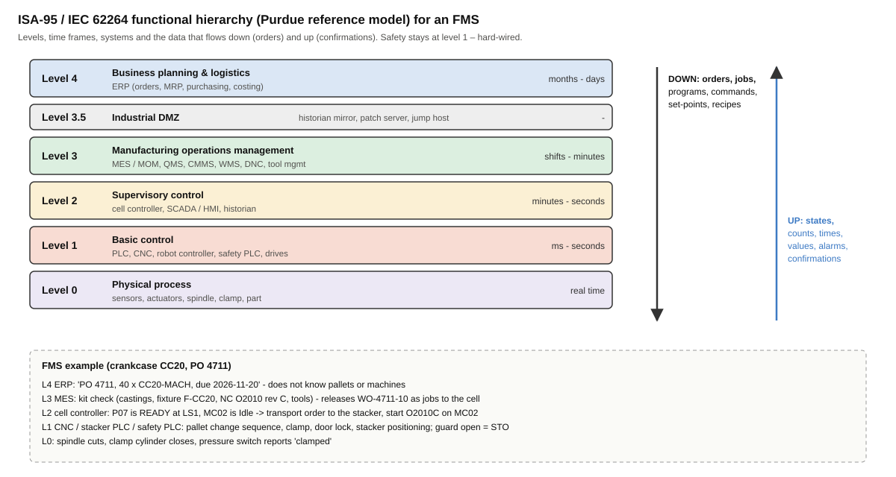
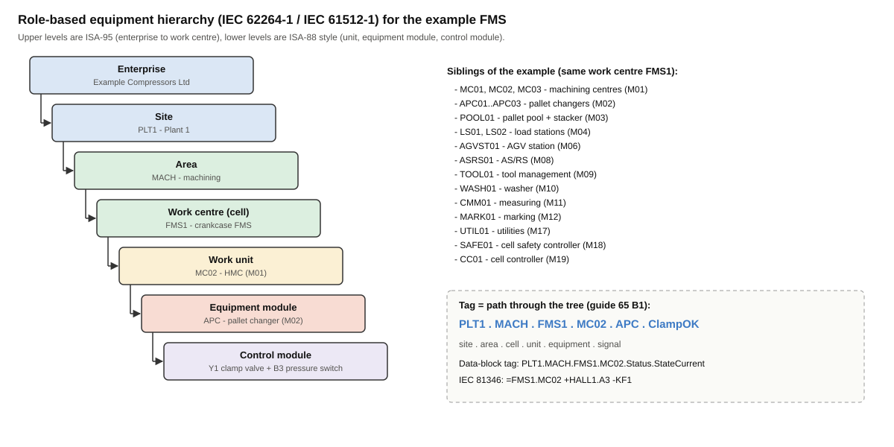
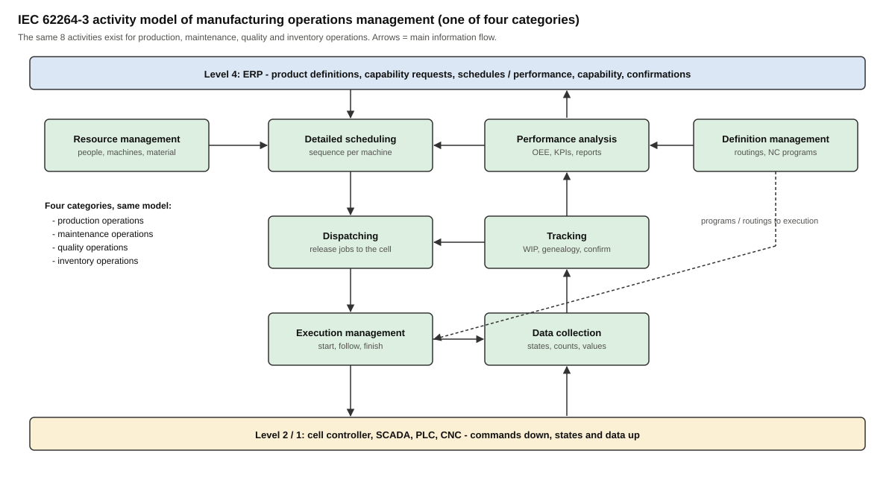
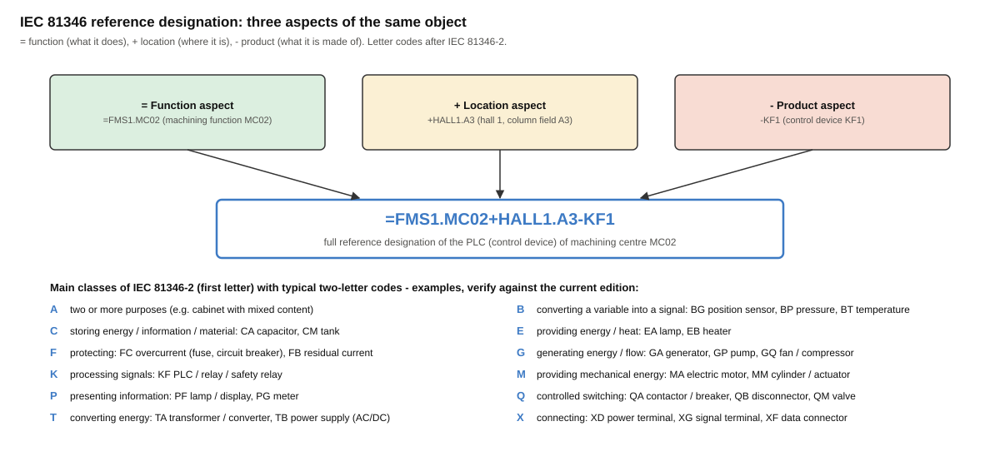
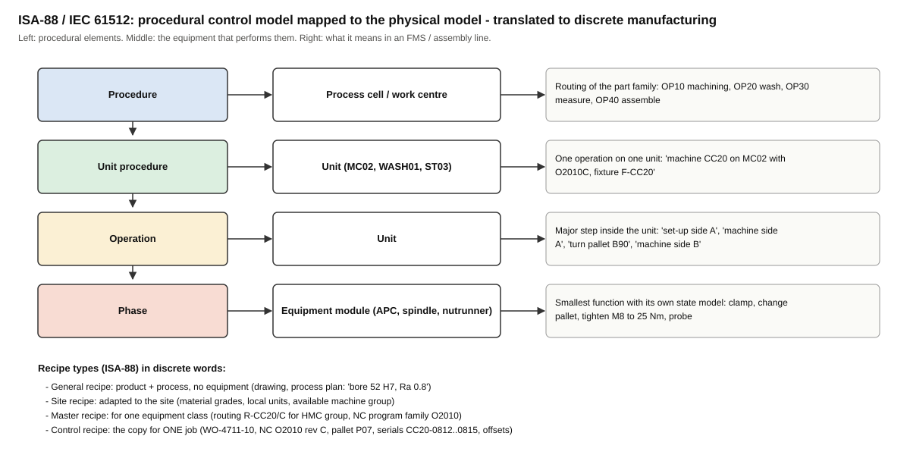
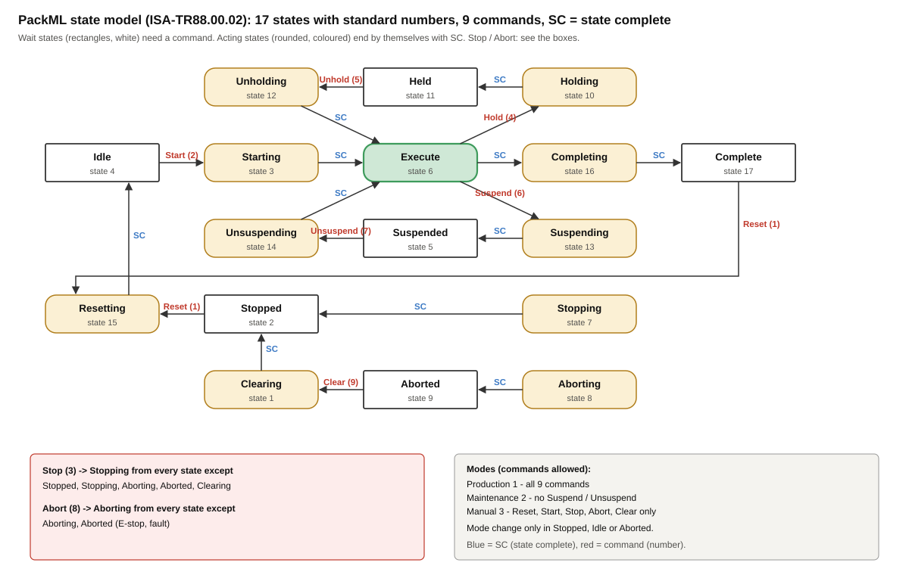
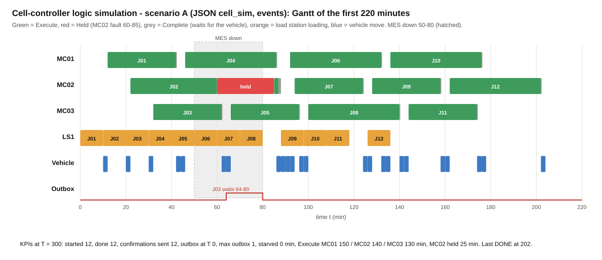
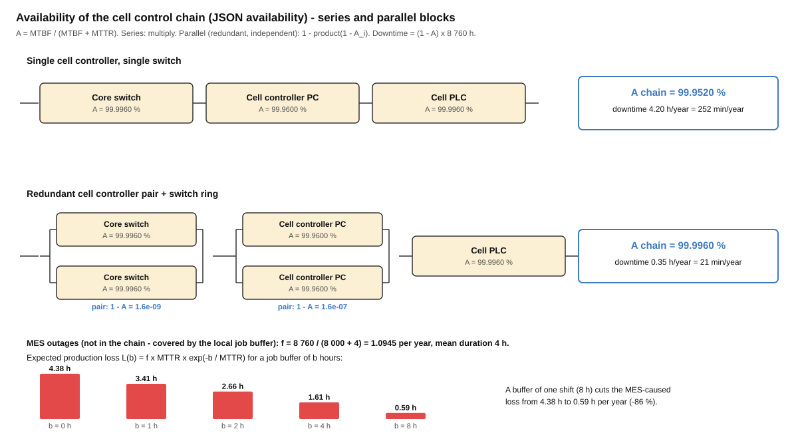
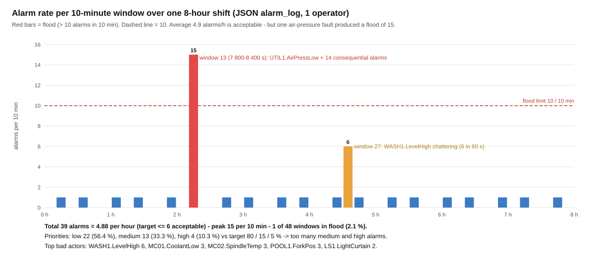
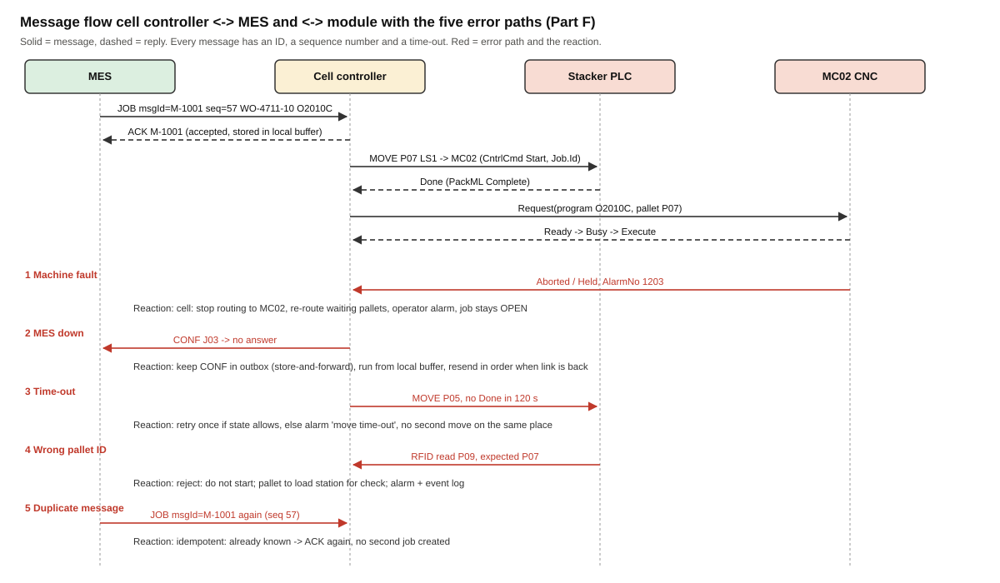

# 65 – Control architecture: ISA-95, naming, ISA-88 / PackML, cell controller, alarms, message flows (textbook)

> Tab **FMS engineering → item 5** (`/?feitem=5#fmse`). Contract: guide 60.
> State: **November 2026** (rewritten as a full textbook). Previous items: guide 61 (FMS types, pipeline, module standard),
> guide 62 (product → process → machines), guide 63 (elements catalogue), guide 64 (capacity, layout, simulation).
> Next: guide 66 (communication).
> **All numbers in this guide are examples or typical ranges.** They are not data from a real project, a real catalogue or a
> real supplier. All worked results use the shared file `tools/fmse/examples/item5_examples.json` with the rules written in its
> `_formulas` and `cell_sim._rules` sections. Everything in that file is **deterministic**: the Python tools in `tools/fmse/`, the
> web tab and this guide must give **identical** results – including the cell-controller message log, line by line. Every number
> and every log line in this guide was re-calculated with Python (G8 explains how).
> Standards named for orientation: IEC 62264 (ISA-95), IEC 61512 (ISA-88), ISA-TR88.00.02 (PackML), IEC 81346, ISA-18.2 /
> IEC 62682, EEMUA 191, ISA-101, IEC 61131-3, VDI/VDE/NAMUR 2658 (MTP), IEC 62443, IEEE 1588. **Use the current editions** – this
> guide explains the ideas in simple words, it does not replace the standard texts.

## How to use this guide

Guides 61–64 decided **what** to build: system type, processes, machines, elements, capacity, layout. From item 5 on, the question
is **how to control it**. Before anybody draws a circuit or writes a PLC program, the project needs a **control architecture**:

1. **Which system does which job** – ERP, MES, cell controller, SCADA, PLC, CNC, safety PLC (Part A: ISA-95).
2. **How every object is named** – so that PLC, SCADA, MES, historian, drawings and FAT list use the same name (Part B).
3. **Which states and commands every module has** – so the cell controller can drive a machining centre, a washer and a stacker
   in the same way (Part C: ISA-88 and PackML).
4. **How the cell controller works** – job buffer, routing, store-and-forward, time-outs, restart, deadlock (Part D).
5. **How the operator sees the system** – alarms, HMI, time stamps (Part E).
6. **Which messages flow between the levels**, and what happens when something goes wrong (Part F).

```
 ERP (L4) ── production order ──► MES (L3) ── job ──► cell controller (L2) ── command ──► PLC / CNC (L1) ──► machine (L0)
     ▲                                ▲                     ▲                                │
     └── confirmation (yield, hours) ─┴── confirmation ─────┴── state, counts, alarms ───────┘
            Part A: levels + messages     Part D: cell controller     Part C: PackML     Part B: one name for every object
```

The guide has eight parts:

1. **Part A – ISA-95 / IEC 62264 in depth**: functional hierarchy (levels 0–4 with time frames and systems), role-based equipment
   hierarchy, the object models (personnel, equipment, physical asset, material, process segment, product definition, production
   capability, schedule, performance), the Part 3 activity model of manufacturing operations (4 categories × 8 activities), B2M
   transactions with B2MML / JSON messages for the crankcase example, and the decision matrix "who decides what".
2. **Part B – Naming and designation**: the tag naming rule with the JSON test tags checked one by one, data dictionary, positive
   logic, IEC 81346 reference designation with the letter codes, one object through all systems, and the generated data-block tag
   list of the FMS kit.
3. **Part C – ISA-88 and PackML**: physical and procedural model, recipe types translated to discrete manufacturing, the PackML state
   model in depth (17 states, 9 commands, SC, Stop / Abort scope, modes), PackTags, the 6 JSON scenarios traced step by step, OEE from
   PackML states, and a Structured Text skeleton (preview of guides 69 / 70).
4. **Part D – Cell controller design**: functions, robustness patterns (local job buffer, store-and-forward, time-outs, idempotent
   messages, heartbeat, restart and reconciliation, deadlock), the JSON cell-controller logic simulation (scenarios A and B with the
   full rules and the log), architecture variants with a weighted decision, availability of the control chain and the MES-buffer loss.
5. **Part E – Operator interface**: alarm management after ISA-18.2 / IEC 62682 (life cycle, priority matrix, classes), KPI analysis of
   the JSON alarm log, HMI design after ISA-101, time synchronisation, event log and audit trail.
6. **Part F – Message flows**: the 16-step pallet flow with message contents, the five error paths as sequence diagrams, and the
   message catalogue template.
7. **Part G – Complete cases**: machining FMS, assembly line, robot welding cells – architecture, decision matrix, variant, availability.
8. **Part H – Programs and reference**: the offline Python tools, the web tab, buy list (SCADA / HMI, cell control platforms, FMS
   software of machine builders), standards, glossary, checklists, common mistakes, limits, how the numbers were checked, figures,
   exercises with solutions.

Read Part A and Part C first – they are the language of every later guide (66 communication, 69 PLC principles, 70 PLC library,
71 MES, 72 ERP). Use Parts B, D and E as a handbook when you write the URS, review a supplier's concept or design the cell
controller. Part F is the template for your interface specification. Part G shows the complete chain in three projects.

**Running use case** (the same as in guides 61–64): the **compressor factory** of this twin – crankcases VC10 / VC20 / VC30 on three
horizontal machining centres (HMC) with a pallet pool, a stacker, load stations, a washer and a CMM (FMS kit, guide 61 §D4.2,
guide 63 §C1), plus the compressor head assembly line and the base-frame welding cells. Production order **PO 4711: 40 × crankcase
CC20**, routing R-CC20/C, NC program O2010 revision C, fixture F-CC20.

**Notation used everywhere:** numbers with a space as thousands separator (8 760), decimal point (0.85). Times in minutes (min) in
the cell simulation, hours (h) in availability calculations, seconds (s) in the alarm log. "Example" means a teaching value.
Code, tags and messages are written in `monospace`. Results are rounded for printing; the calculations use full precision.

**Unit codes in this guide** follow the JSON naming section: `MC01`–`MC03` (machining centres, module M01), `APC01`–`APC03` (M02),
`POOL01` (M03), `LS01`, `LS02` (M04), `AGVST01` (M06), `ASRS01` (M08), `TOOL01` (M09), `WASH01` (M10), `CMM01` (M11), `MARK01` (M12),
`UTIL01` (M17), `SAFE01` (M18), `CC01` (M19). The web tab (5B, 5D) and guides 05 / 06 / 15 still use `HMC01`–`HMC03` for the same
machines – see B1.7 for how the two naming schemes relate.

**Price classes in the buy list** (software licences, 2025–2026 level, strongly dependent on edition, tags, clients and region) =
**estimate – ask for a quote**: € < 5 kEUR · €€ 5–20 kEUR · €€€ 20–60 kEUR · €€€€ > 60 kEUR (per server, runtime or first licence).
Product names are **examples of products that exist – not a recommendation**. Features, prices and licence terms change: **see the
maker's website** – this guide never invents product facts.

## Contents

**Part A – ISA-95 / IEC 62264 in depth**
- A0 Purpose and where in the twin
- A1 The functional hierarchy (Purdue model): levels 0–4, time frames, systems, data up and down
- A2 The role-based equipment hierarchy with the FMS example
- A3 The object models: personnel, equipment, physical asset, material, process segment, product definition, production
  capability, production schedule, production performance – with FMS examples
- A4 The Part 3 activity model: production, maintenance, quality and inventory operations × 8 activities
- A5 Business-to-manufacturing transactions: verbs, B2MML and JSON messages for PO 4711
- A6 Who decides what – the extended decision matrix

**Part B – Naming and designation**
- B1 The tag naming rule, the 6 JSON test tags, data dictionary, positive logic
- B2 IEC 81346 reference designation: aspects, letter codes, examples for the FMS
- B3 One object through PLC, SCADA, MES, historian, drawings and FAT list
- B4 The data-block tag list generated for the FMS kit

**Part C – ISA-88 and PackML**
- C1 ISA-88 physical model, procedural control model and recipe types – translated to discrete manufacturing
- C2 The PackML state model in depth: states, commands, SC, Stop / Abort scope, modes, meaning per module type
- C3 PackTags complete: Command, Status, Admin
- C4 The 6 JSON scenarios traced step by step
- C5 OEE from PackML states
- C6 Implementation notes: Structured Text skeleton, unit / machine / line coordination

**Part D – Cell controller design**
- D1 Functions of the cell controller
- D2 Robustness patterns: job buffer, store-and-forward, time-outs, idempotency, heartbeat, restart, deadlock
- D3 The cell-controller logic simulation (JSON `cell_sim`): rules, log, KPIs, scenario B and the lesson
- D4 Architecture variants and a weighted decision
- D5 Availability of the control chain, MES-buffer loss, redundancy concepts

**Part E – Operator interface**
- E1 Alarm management after ISA-18.2 / IEC 62682: life cycle, priority matrix, alarm classes
- E2 KPI analysis of the JSON alarm log and what to do
- E3 HMI design after ISA-101
- E4 Time synchronisation, event log and audit trail

**Part F – Message flows**
- F1 The 16-step pallet flow with message contents · F2 Error paths as sequence diagrams · F3 Message catalogue template

**Part G – Complete cases**
- G1 Machining FMS · G2 Assembly line · G3 Robot welding cells · G4 Implementation in a real factory – step by step

**Part H – Programs, tools and reference**
- H1 Offline Python tools · H2 The web tab item 5 · H3 Buy list · H4 Standards · H5 Checklists · H6 Common mistakes · H7 Limits ·
  H8 Glossary · H9 How the numbers were checked · H10 Figures · H11 Exercises with solutions

---

# Part A – ISA-95 / IEC 62264 in depth

## A0. Purpose and where in the twin

### A0.1 Purpose

A flexible manufacturing system is not one machine. It is 10–30 modules from 3–10 suppliers, plus software from 2–5 more: ERP,
MES, tool management, DNC, SCADA, cell controller, PLCs, CNCs, robot controllers, a safety PLC. If nobody decides **which system
does which job**, three things happen in every project:

1. **Gaps** – nobody checks that the right NC program revision is in the machine; nobody confirms scrap to the ERP.
2. **Overlaps** – the MES and the cell controller both try to decide which pallet goes to which machine; the result is a fight.
3. **Wrong placement** – a decision is made too high (the MES decides in seconds what the PLC must decide in milliseconds) or too low
   (a PLC programmer hard-codes a production sequence that the planner must be able to change).

The control architecture prevents this. It is a **document** (5–20 pages plus diagrams) that is written in phase P2/P3 of the
project (guide 61 §B), becomes part of the URS, and is confirmed by every supplier. This guide teaches its content.

### A0.2 Where in the twin

| Part of the tab | What you can do there | Chapter of this guide |
|---|---|---|
| **5A** ISA-95 pyramid | click a level: systems, time frame, functions, data down / up, FMS example; decision matrix with a quiz | A1, A6 |
| **5B** Hierarchy | example tree enterprise → control module; tag-name builder | A2, B1 |
| **5C** PackML | live state machine: commands, modes, auto state-complete, state numbers, PackTags, log | C2, C3, C4 |
| **5D** Message flow | 16 steps of one pallet from ERP order to ERP confirmation, with real message text | F1 |
| **5E** Variants | 5 ways to place the cell logic, with strengths and weaknesses | D4 |
| 5F ISA-95 operations model | MOM activity grid (4 × 8), object models, B2M verbs, B2MML-style XML / JSON message builder | A3, A4, A5 |
| 5G Naming & IEC 81346 | tag validator, generated data-block tag list (297, CSV), IEC 81346 designation builder | B1, B2, B4 |
| 5H PackML in depth | scenario runner with trace, full transition table, state meaning per module type, PackTags, state → OEE loss, ST skeleton | C2–C6 |
| 5I ISA-88 & recipes | procedural trees (crankcase pallet, assembly), recipe types, control-recipe builder | C1 |
| 5J Cell-controller logic | scenario A / B / own values, animated plant + Gantt + synchronised log (identical to the tool), KPIs | D1–D3 |
| 5K Architecture availability | components, variant builder, downtime, MES-buffer loss curve | D5 |
| 5L Alarm management | alarm-log KPIs, histogram, priority mix, bad actors, ISA-18.2 checklist, priority matrix, ISA-101 levels | E1–E3 |
| 5M Robustness patterns | time-out / retry, duplicate-ID demo, store-and-forward, heartbeat, restart checklist, deadlock demo, message catalogue | D2, F |

Worked examples elsewhere in the twin: Communication tab and guide 07 (protocols), SCADA tab and guide 06 (alarms, HMI, tag
database), PLC layer and guide 05 (PackML in the line PLC, chapter 20; alarm handling, chapter 23), MES / ERP tabs and guide 04
(orders, confirmations), guide 15 (numbering and identification, IEC 81346 in depth).

### A0.3 What you can do after this guide

- Draw the architecture diagram of any FMS with levels, systems, networks and owners of each decision.
- Write the naming, state-model and interface rules into the URS so that every supplier delivers the same interface.
- Specify (integrator role) or review (owner role) a cell controller: functions, robustness, behaviour when MES is down.
- Calculate the availability of the control chain and decide about redundancy with numbers.
- Analyse an alarm log and run an alarm rationalisation.
- Write the message catalogue of every interface, including the error reactions, and test it at FAT.

---

## A1. The functional hierarchy (Purdue model)



### A1.1 Where the model comes from

The **Purdue Enterprise Reference Architecture** (Purdue University, early 1990s) divided a factory into levels by **time frame** and
**type of decision**. ISA-95 (international: **IEC 62264**) took the levels as the **functional hierarchy** and defined the boundary
between level 4 (business) and level 3 (manufacturing operations) in detail – that boundary is the main subject of the standard.
Levels 0–2 are described only roughly; for them ISA-88 (IEC 61512) and PackML give more detail (Part C).

The parts of IEC 62264 (check the current editions):

| Part | Title (short) | What you use it for |
|---|---|---|
| IEC 62264-1 | Models and terminology | levels, equipment hierarchy, object models, the 12 functions of the enterprise-control interface |
| IEC 62264-2 | Objects and attributes for enterprise-control integration | attribute lists of each object (what a "material lot" contains) |
| IEC 62264-3 | Activity models of manufacturing operations management | the 4 categories × 8 activities (A4) – the "MES functional model" |
| IEC 62264-4 | Objects models and attributes for MOM integration | work master, job order, work schedule, work performance – messages inside level 3 and to level 2 |
| IEC 62264-5 | Business-to-manufacturing transactions | verbs and transaction patterns (A5) |
| IEC 62264-6 | Messaging service model | how messages are transported (newer part) |

ANSI/ISA-95.00.01 … .00.08 are the American parts with the same content (and some newer parts). **B2MML** (MESA International) is a
free set of XML schemas that implements the ISA-95 objects; it is the most common "ISA-95 format" in real ERP ⇄ MES interfaces.

### A1.2 The five levels

| Level | Name | Time frame | Typical systems | Main question | In the FMS |
|---|---|---|---|---|---|
| 4 | Business planning & logistics | months, weeks, days, shifts | ERP (SAP S/4HANA, Microsoft Dynamics, proAlpha, …), PLM, CRM | **what** and **how much**, by **when**, at what **cost**? | releases PO 4711: 40 × CC20, due 20 Nov; buys castings; values stock |
| 3 | Manufacturing operations management (MOM) | days, shifts, hours, minutes, seconds | MES, QMS / LIMS, CMMS, WMS, DNC, tool management, scheduling (APS) | **how** is it produced: which job, which resources, which program, which quality? | detailed schedule, kit check, release of WO-4711-10, genealogy per serial, SPC, OEE |
| 2 | Supervisory control (monitoring, supervisory and automated control) | minutes, seconds | cell controller, SCADA / HMI, historian, batch manager | **which** pallet to **which** machine **now**; show alarms | routes P07 to MC02, starts O2010C, sends pallet to washer, shows alarms |
| 1 | Basic control (sensing and manipulating) | seconds, milliseconds | PLC, CNC, robot controller, safety PLC, drives, IO-Link masters | **how** does the module move, step by step, safely? | APC sequence, clamp, door lock, stacker positioning, NC program execution, STO |
| 0 | Physical process | real time (physics) | sensors, actuators, the machine, the part | – | spindle cuts, cylinder clamps, pressure switch reports "clamped" |

**Simple rule to remember:** each level up is about **10–100 times slower** and sees **10–100 times less detail**. The ERP wants
"PO 4711, op 10: 4 good, 0 scrap, 0.95 h" – not 10 000 sensor values. The PLC wants "start program 2010 on pallet 7" – not the
customer's name.

### A1.3 Data down and data up

| Interface | Down (orders, commands) | Up (feedback) | Typical rate | Typical protocol (guide 66) |
|---|---|---|---|---|
| L4 → L3 | production orders, BOM, routing, due dates, material master, demand changes | confirmations: good / scrap quantity, consumption, hours, order status, stock movements | minutes to hours, event driven | B2MML / IDoc / REST JSON, file, message queue |
| L3 → L2 | jobs (work order operation → pallets), NC programs, recipes, tool lists, release / hold | job state, start / end, good / scrap, serials, measured values, downtime reasons | seconds to minutes | OPC UA, REST, MQTT, database interface |
| L2 → L1 | start commands with program / job number, transport orders, set-points, mode | PackML state, handshake bits, counters, alarms, process values | 10 ms – 1 s | PROFINET, EtherNet/IP, Modbus TCP, OPC UA |
| L1 → L0 | outputs to valves, contactors, drives | sensors, encoders, safety devices | 1–10 ms (motion: µs) | hard-wired, IO-Link, fieldbus |

**Aggregation**: every level condenses the data on the way up. Example for one pallet cycle of 57.2 min on MC02:

| Level | What it stores about this cycle |
|---|---|
| L1 (CNC) | ~3 400 s of axis positions, spindle load every 8 ms, 38 tool changes, 1 pallet change |
| L2 (historian, cell controller) | spindle load every 1 s (3 432 values), state changes (Starting 08:12:03, Execute 08:12:41, Complete 09:09:15), tool life per tool |
| L3 (MES) | job WO-4711-10 / pallet P07: start 08:12, end 09:09, 57.2 min, 4 OK, serials CC20-0812…0815, machine MC02, program O2010C |
| L4 (ERP) | PO 4711 op 10: yield 4, scrap 0, 0.95 machine hours, cost centre 4310 |

### A1.4 Level 3.5 – the industrial DMZ

Modern architectures add a **level 3.5** between office IT (level 4) and plant OT (level 3) – an **industrial demilitarised zone**
with firewalls on both sides. Nothing talks directly from level 4 into level 3 or lower; every connection terminates in the DMZ
(API gateway, historian mirror, patch server, remote-access jump host). This is the zone model of IEC 62443 (guide 66 §6E). For the
control architecture the rule is simple: **draw the DMZ in the architecture diagram from the first day** – adding it later changes
every interface.

### A1.5 Common confusions

| Confusion | Correct view |
|---|---|
| "SCADA is level 3" | SCADA is level 2 (supervisory). It can **feed** level 3, but it is not the MES. |
| "The cell controller is part of the MES" | Functionally level 2 (seconds, live states). Physically it can run on the MES server or be a module of the MES product – the **function** still belongs to level 2 and must work when the level-3 part is down. |
| "The CNC is level 2 because it has a screen" | The CNC is level 1 (it executes the program and the axes). Its HMI is a local operator panel. |
| "ISA-95 says MES must do X" | ISA-95 describes **functions**, not products. Which product does which function is a project decision (A4.6). |
| "Level 0 is not important for the architecture" | Level 0 decides the IO list, the safety functions and the quality of every signal above. Bad sensors = bad OEE data at level 3. |

### A1.6 Worked example – place the systems of the compressor factory

| System | Level | Reason |
|---|---|---|
| ERP (orders, MRP, costing) | 4 | business decisions, weeks of horizon |
| MES (scheduling, kit check, genealogy, OEE) | 3 | shift / hour horizon, combines resources |
| Tool management with presetter (TOOL01) | 3 (data) + 1 (presetter device) | tool data, life, kits = level 3; the presetter measurement is a device |
| DNC / NC program management | 3 | version control and release |
| WMS / AS/RS management (ASRS01) | 3 (stock) + 1 (crane PLC) | stock places are level 3; crane motion level 1 |
| Cell controller CC01 | 2 | pallet routing in seconds |
| SCADA / HMI, historian | 2 | supervision, alarms, trends |
| Stacker PLC (POOL01), washer PLC, load-station IO | 1 | sequences, interlocks |
| CNCs of MC01–MC03 | 1 | program execution, pallet change |
| Safety PLC SAFE01 | 1 | safety functions – hard-wired / safety bus only |
| CMM software (CMM01) | 1 (measurement) + 3 (results to QMS / SPC) | measuring program is local; results go up |

### A1.7 Checklist – functional hierarchy

- [ ] Every system of the project is placed on a level (one row per system, with the reason).
- [ ] Systems that span levels (tool management, WMS, CMM) are split into their level functions.
- [ ] Level 3.5 (DMZ) is drawn; no direct connection from level 4 into levels 0–3.
- [ ] Data down / up per interface is listed (table A1.3 for your project).
- [ ] Safety functions are all at level 1 and do not depend on any level-2 or level-3 system.

---

## A2. The role-based equipment hierarchy



### A2.1 The levels of the hierarchy

IEC 62264-1 defines the **role-based equipment hierarchy**: equipment is grouped by the **role** it plays in production, not by its
mechanical construction. The upper levels come from ISA-95, the lower levels (unit, equipment module, control module) from ISA-88:

| Level | Definition (simple words) | FMS example | Assembly example | Welding example |
|---|---|---|---|---|
| Enterprise | the company | Example Compressors Ltd | same | same |
| Site | one factory location | PLT1 – Plant 1 | PLT1 | PLT1 |
| Area | a department with its own products / processes | MACH – machining | ASSY – assembly | WELD – welding |
| Work centre | a group of equipment that does one job; 4 types (below) | FMS1 – crankcase FMS (work cell) | ASM1 – head assembly line (production line) | WC1, WC2 – welding cells (work cell) |
| Work unit | one piece of equipment with its own state model | MC02 – machining centre | ST03 – screwing station | RB01 – welding robot cell |
| Equipment module | a functional group inside the unit that can do a minor task | APC – pallet changer; tool magazine; door | nutrunner spindle; part fixture | turntable; torch cleaner |
| Control module | the smallest group of sensors / actuators controlled together | clamp valve Y1 + pressure switch B3 | press-fit valve + position sensor | turntable drive M1 + position switches |

**The four types of work centre** in IEC 62264-1 and their work units:

| Work centre type | Work unit type | Use | FMS world |
|---|---|---|---|
| Process cell | unit | batch production (ISA-88) | rarely; heat treatment, washing in batches |
| Production unit | unit | continuous production | rarely; coating line |
| Production line | work cell | repetitive, discrete flow | assembly line ASM1 with stations |
| Work cell | work unit | discrete, flexible routing | FMS1, robot welding cells |
| Storage zone | storage unit | material storage | AS/RS, pallet pool racks, tool store |

### A2.2 Why "role-based" matters

The same physical machine can play different roles: a machining centre can be a **work unit** of FMS1 today and a stand-alone work
centre after a re-layout. The hierarchy follows the **role in production**, so that:

1. The MES knows which resources can do which process segment (A3.5) – "group HMC of FMS1".
2. Tags, alarms and OEE are rolled up correctly (MC02 → FMS1 → MACH → PLT1).
3. A machine moved to another cell gets a new path, but its **asset** (A3.3, serial number, maintenance history) stays the same.

### A2.3 Rules for building the hierarchy in a project

| Rule | Why | Example |
|---|---|---|
| One tree for the whole site, owned by one person (automation lead) | different trees in MES and SCADA can never be joined | tree in an Excel / database with a version |
| A unit = something with **its own PackML state** | the cell controller commands units | MC02, WASH01, POOL01 are units; the door of MC02 is not |
| Equipment module = has its own sequence but no own job | it is commanded by its unit | APC of MC02 (commanded by the CNC), stacker fork |
| Control module = what one function block in the PLC controls | links the tree to the PLC library (guide 70) | FB_Valve "Y1 clamp", FB_Motor "M1 rotary" |
| Fixed-length codes, numbered | lists sort correctly | `MC01`, not `MC1` |
| No location in the equipment tree | location is a separate aspect (IEC 81346 `+`, B2) | MC02 keeps its code when moved to hall 2 |
| Pallets, fixtures, tools are **not** in the equipment tree | they are material / physical assets that move | pallet P07 = physical asset with an ID, tracked by the cell controller |

**Modelling choice – the APC.** The JSON naming list has `APC01`–`APC03` as their own units (module M02), but the test tag
`PLT1.MACH.FMS1.MC02.APC.ClampOK` uses the APC as an equipment module of MC02. Both are allowed: if the APC is controlled by the CNC
(most HMCs), it is an **equipment module** of the machine; if it is a separate pallet changer with its own PLC and own PackML state
(retro-fitted APC, rotary pallet buffer), it is a **unit**. Decide once per project and write it into the naming rule.

### A2.4 The complete tree of the FMS kit (example)

```
Example Compressors Ltd (Enterprise)
└─ PLT1 Plant 1 (Site)
   ├─ MACH Machining (Area)
   │  ├─ FMS1 crankcase FMS (Work centre: work cell)
   │  │  ├─ MC01, MC02, MC03   machining centres (M01)  ── APC, tool magazine, door, coolant, chip conveyor (equipment modules)
   │  │  ├─ APC01..APC03       pallet changers (M02)    ── modelled as units in the JSON kit
   │  │  ├─ POOL01             pallet pool + stacker (M03) ── travel axis, hoist, fork, rack places
   │  │  ├─ LS01, LS02         load stations (M04)      ── clamp, RFID reader, light curtain, release button
   │  │  ├─ AGVST01            AGV station (M06)        ── roller conveyor, dock sensors
   │  │  ├─ ASRS01             AS/RS (M08)              ── crane, rack
   │  │  ├─ TOOL01             tool management (M09)    ── presetter, tool store
   │  │  ├─ WASH01             washer (M10)             ── pump, heater, tank, dryer
   │  │  ├─ CMM01              measuring machine (M11)
   │  │  ├─ MARK01             marking (M12)            ── laser, code reader
   │  │  ├─ UTIL01             utilities (M17)          ── compressed air, coolant central, extraction
   │  │  ├─ SAFE01             cell safety controller (M18)
   │  │  └─ CC01               cell controller (M19)
   │  └─ TRN2 turning cell 2 (Work centre: work cell)
   ├─ ASSY Assembly (Area)
   │  └─ ASM1 head assembly line (Work centre: production line) ── ST01..ST08 stations (M13), TS01, TS02 test (M14)
   ├─ WELD Welding (Area)
   │  └─ WC1, WC2 robot welding cells (Work centre: work cell) ── RB01, RB02 (M15), LS (M04)
   └─ STOR Storage (Area)
      └─ WH1 raw material store (Work centre: storage zone)
```

Count of the FMS kit (JSON `naming.units`): 13 unit types, **18 unit instances** – the basis of the data-block tag list in B4.

### A2.5 Common mistakes with the hierarchy

| Mistake | Result | Better |
|---|---|---|
| Hierarchy by supplier ("everything from maker X is one unit") | one supplier's pallet pool and washer share one state | hierarchy by role: one unit per state model |
| Location in the code (`H1MC02`) | code changes when the machine moves; history lost | location in the `+` aspect only |
| Different depth per supplier (one delivers control modules, one only units) | SCADA screens and alarms inconsistent | the URS fixes the depth: unit + equipment module + control module |
| Pallets in the equipment tree | pallet appears "at" a fixed place in SCADA although it moves | pallets are tracked objects with an ID (A3.3) |

---

## A3. The object models

IEC 62264-1 / -2 describe the information exchanged between levels 3 and 4 as **object models** – groups of objects with attributes.
You do not need to memorise the UML diagrams. You need to know **what each model contains** so that the MES, the ERP and the cell
controller exchange the same content. The models come in a pattern of **three views**:

| View | Question | Example |
|---|---|---|
| **Definition** (how to make it) | which process, which resources are needed in principle? | process segment "machining OP10 crankcase", product segment for CC20 |
| **Capability** (what is possible) | which resources are available, when? | MC01–MC03 available 3 shifts, 21 h/day; 6 pallets; 2 fixtures F-CC20 |
| **Schedule** (what is requested) | what must be produced, when? | production request: 40 × CC20 by 20 Nov |
| **Performance** (what happened) | what was really produced, with which resources? | production response: 40 × CC20, 1 scrap, 38.4 machine hours |

### A3.1 Personnel model

| Object | Content | FMS example |
|---|---|---|
| Personnel class | a group of people with the same qualification | "FMS operator", "setter", "maintenance electrician", "CMM inspector" |
| Person | one person with ID and classes | operator 1043, classes FMS operator + load station |
| Qualification test specification / result | test that proves a capability, with date and validity | "load station training F-CC20", valid until 2027-06 |
| Personnel capability | who is available when | 2 operators in shift 1, 1 in shift 2, none in shift 3 (unmanned) |

Use in the FMS: the load-station HMI only lets qualified operators release a pallet (log-in with badge); the MES records **who**
clamped which serial (genealogy); unmanned shifts are planned from the personnel capability.

### A3.2 Equipment model

| Object | Content | FMS example |
|---|---|---|
| Equipment class | a type of equipment with common properties | "HMC 500 mm pallet", "washer", "load station" |
| Equipment | one element of the role-based hierarchy (A2) | MC02 (class HMC 500), work unit of FMS1 |
| Equipment property | attributes with values | spindle max 12 000 rpm, pallet 500 × 500 mm, max part 400 kg, tool places 120 |
| Equipment capability test | test of a capability | machine capability study (Cmk), geometric accuracy test |
| Equipment capability | what the equipment can do and when | MC02 available 21 h/day, planned maintenance Wednesday 06:00–08:00 |

### A3.3 Physical asset model

The **physical asset** is the real object with a serial number; the **equipment** is the role it plays. One asset can play
different roles over time; one role can be filled by a replacement asset.

| Object | Content | FMS example |
|---|---|---|
| Physical asset class | type of physical object | "HMC model X500", "spindle unit 12k" |
| Physical asset | one real object with serial number, maker, location, history | HMC serial 50213-07, installed 2026, spindle serial SP-8811 |
| Equipment asset mapping | which asset plays which equipment role, from – to | asset 50213-07 = equipment MC02 since 2026-05-01 |

**Why it matters:** maintenance history (CMMS) belongs to the **asset** (the spindle with 18 000 h), OEE and production history
belong to the **equipment** (MC02). When the spindle is exchanged, MC02's OEE continues, the old spindle's history goes with it to
the repair shop. **Pallets, fixtures and tools** are physical assets too: pallet P07 (RFID tag E200-…), fixture F-CC20-02, tool
T12 with its life counter.

### A3.4 Material model

| Object | Content | FMS example |
|---|---|---|
| Material class | group of materials | "grey cast iron castings", "crankcase machined" |
| Material definition | one material (item) with properties | CC20-CAST (casting), CC20-MACH (machined crankcase), EN-GJL-250 |
| Material lot | an amount of one material with a lot ID and properties | heat number H-26-0412, 120 castings, supplier lot |
| Material sublot | a part of a lot, often one piece or one container | serial CC20-0812, box B-2231 |
| Material test specification / result | test with limits and results | hardness test, bore Ø52 H7 measured 52.012 OK |

Genealogy in the FMS: serial CC20-0812 (sublot) came from heat H-26-0412 (lot), machined on MC02 with O2010C, pallet P07, fixture
F-CC20-02, tool T12 (life 61 %), measured on CMM01 – the MES links material, equipment and physical asset with the job.

### A3.5 Process segment model

A **process segment** is a business view of a production step: "what resources does this kind of step need?" – independent of the
product. It is the level at which the ERP and the MES agree about capacity and cost.

| Object | Content | FMS example |
|---|---|---|
| Process segment | a step with its resource needs per unit | "HMC machining" needs 1 HMC (class HMC 500), 0.1 operator, 1 pallet with fixture |
| Personnel / equipment / material segment specification | which classes and amounts | equipment class HMC 500, qty 1; personnel class FMS operator 0.1; material consumed: casting 1; produced: machined part 1 |
| Process segment parameter | parameters of the step | coolant concentration 6–8 %, max cycle 90 min |
| Segment dependency | order between segments | "washing" after "HMC machining", "CMM" after "washing" (start-after-end) |

### A3.6 Product definition model

The **product definition** says how to make one specific product – the "routing + BOM + recipe" of a product, expressed with
**product segments** that refer to process segments.

| Object | Content | FMS example (CC20) |
|---|---|---|
| Product definition | product, version, BOM, list of product segments | CC20-MACH version C, routing R-CC20/C |
| Product segment | one step for this product, with times and resources | OP10 HMC machining: 57.2 min per pallet of 4 = 14.3 min per part, NC O2010 rev C, fixture F-CC20 |
| Product parameter | product-specific parameters | bore Ø52 H7, Ra 0.8, tightening torques |
| Manufacturing bill | material consumed and produced | 1 × CC20-CAST → 1 × CC20-MACH |

ISA-95 **Part 4** adds the level-3 internal view: the **work master** (the detailed "how" for one work type, e.g. the full operation
OP10 with program, tool list, fixture, inspection plan) and the **work directive** (the copy of the work master for one job). This
is exactly the ISA-88 idea of master recipe → control recipe (C1.4).

### A3.7 Production capability model

What the plant **can** do: committed, available and unattainable capacity per resource and time.

| Capacity class | Meaning | MC02 example (week 47, 120 h calendar) |
|---|---|---|
| Committed | already planned for orders | 78 h |
| Available | free and usable | 27 h |
| Unattainable | not usable (maintenance, no shift, breakdowns expected) | 15 h |

The MES publishes capability so that the ERP or APS can promise dates that the shop floor can keep.

### A3.8 Production schedule model

| Object | Content | Example |
|---|---|---|
| Production schedule | a collection of requests for a time span | week 47 schedule of area MACH |
| Production request | one request (≈ ERP production order) | PO 4711: 40 × CC20-MACH, start 2026-11-16, due 2026-11-20, priority 2 |
| Segment requirement | requirement per segment with times, resources | OP10 on FMS1: 10 pallets × 4, earliest start 16 Nov 06:00 |
| Material / equipment / personnel requirement | specific resources | 40 × CC20-CAST from heat H-26-0412; fixture F-CC20 ×2 |

### A3.9 Production performance model

| Object | Content | Example |
|---|---|---|
| Production performance | a collection of responses for a time span | performance report week 47, area MACH |
| Production response | the result of one production request | PO 4711: 39 good, 1 scrap, status COMPLETED |
| Segment response | result per segment with actual times and resources | OP10: start 16 Nov 06:14, end 18 Nov 21:40, machine hours 38.4 (MC01 13.0, MC02 12.6, MC03 12.8) |
| Material / equipment / personnel actual | what was really used | material produced 39 × CC20-MACH (serials), consumed 40 × CC20-CAST, scrap 1 (reason: porosity) |

### A3.10 Summary table – which model answers which question

| Question in the project | Model | Owner system (typical) |
|---|---|---|
| Who may release a pallet at LS01? | Personnel | MES / HR |
| Which machines can run CC20? | Equipment + process segment | MES |
| Where is spindle SP-8811 now and how many hours does it have? | Physical asset | CMMS |
| Which heat number is in serial CC20-0812? | Material (lot / sublot) | MES (genealogy) |
| How long does OP10 take, with which program and fixture? | Product definition / work master | PLM → MES |
| Can we deliver 40 more CC20 next week? | Production capability | MES → ERP / APS |
| What must FMS1 produce this week? | Production schedule | ERP → MES |
| What was produced, with which scrap and hours? | Production performance | MES → ERP |

---

## A4. The Part 3 activity model of manufacturing operations management



### A4.1 Four categories, eight activities

IEC 62264-3 divides manufacturing operations management (level 3) into **four categories**: **production**, **maintenance**,
**quality** and **inventory** operations. Each category has the **same eight activities** (generic activity model):

| Activity | What it does (simple words) |
|---|---|
| 1 Resource management | keeps the list of people, equipment, material that can be used, and their availability |
| 2 Definition management | keeps the "how to" information: routings, work masters, NC programs, test plans, maintenance procedures |
| 3 Detailed scheduling | makes the sequence: which job on which resource, when |
| 4 Dispatching | releases work to the shop floor at the right moment (when resources are ready) |
| 5 Execution management | makes sure the work is done as defined: starts, supervises, finishes, reacts to deviations |
| 6 Data collection | collects data from level 2 / 1 and from people |
| 7 Tracking | follows the work and the material: where is it, what happened, genealogy, confirmations |
| 8 Performance analysis | analyses KPIs (OEE, scrap rate, MTBF, stock turns) and reports them |

The arrows of the model: ERP requests → **detailed scheduling** (with resources and definitions) → **dispatching** → **execution
management** (with level 2) → **data collection** → **tracking** → **performance analysis** → back to the ERP and to scheduling.

### A4.2 Production operations – the 8 activities in the FMS

| Activity | FMS example | System that does it (typical) |
|---|---|---|
| Resource management | MC01–MC03 available, MC02 maintenance Wednesday; 6 pallets, 2 fixtures F-CC20; operators per shift | MES (resource module) |
| Definition management | routing R-CC20/C, work master OP10 with NC O2010 rev C, tool list T1–T38, fixture F-CC20, inspection plan | PLM / MES / DNC |
| Detailed scheduling | sequence of WO-4711-10, WO-4720-10, … on group HMC; set-up of fixtures minimised | MES scheduler or APS |
| Dispatching | release WO-4711-10 to FMS1 only after kit check (castings, fixture, program, tools) – job by job into the cell's buffer | MES (dispatch) → cell controller |
| Execution management | cell controller starts jobs, MES follows the state; deviations (machine down) → re-dispatch | cell controller (L2) + MES |
| Data collection | PackML states, counters, cycle times, alarms, measured values from CMM | SCADA / historian / MES connector |
| Tracking | job states, serial genealogy, pallet positions, confirmation per operation | MES (WIP tracking) |
| Performance analysis | OEE per machine, throughput, lead time, schedule adherence | MES / BI |

### A4.3 Maintenance operations

| Activity | FMS example | System |
|---|---|---|
| Maintenance resource management | electricians, mechanics, spare parts (spindle, ball screw, RFID heads) | CMMS |
| Maintenance definition management | maintenance plans: lubrication every 500 h, spindle check every 2 000 h, ballbar test every 6 months | CMMS |
| Detailed maintenance scheduling | plan of work orders per week, coordinated with the production schedule | CMMS + MES |
| Maintenance dispatching | release work order to a technician when the machine is free | CMMS |
| Maintenance execution management | technician executes, records work, locks out the machine (Maintenance mode, C2.6) | CMMS (mobile) |
| Maintenance data collection | operating hours, spindle hours, counters, vibration from the machines | SCADA / MES → CMMS |
| Maintenance tracking | status of work orders, history per asset | CMMS |
| Maintenance analysis | MTBF, MTTR, cost per machine, bad actors | CMMS / BI |

### A4.4 Quality operations

| Activity | FMS example | System |
|---|---|---|
| Quality test resource management | CMM01, gauges, calibrated instruments, inspectors | QMS / MES |
| Quality test definition management | inspection plan for CC20: bore Ø52 H7 every 10th part, all features first part | QMS / CAQ |
| Detailed quality test scheduling | which pallets go to the CMM (1 in 10), first-article after program change | MES / cell controller rule |
| Quality test dispatching | send measuring job to CMM01 with program and serial | cell controller → CMM |
| Quality test execution management | CMM runs, operator checks NOK result | CMM / QMS |
| Quality test data collection | measured values per feature and serial | CMM → QMS |
| Quality test tracking | results linked to serial and job; NOK → block lot | QMS / MES |
| Quality performance analysis | SPC charts, Cpk, scrap Pareto | QMS |

### A4.5 Inventory operations

| Activity | FMS example | System |
|---|---|---|
| Inventory resource management | AS/RS places, AGVs, boxes, pallets | WMS |
| Inventory definition management | storage rules, transport rules (castings in zone A, finished in zone C) | WMS |
| Detailed inventory scheduling | transport plan for the shift (material calls ahead of jobs) | WMS / MES |
| Inventory dispatching | transport order "box B-2231 to LS01" to the AS/RS and AGV | WMS → AGV fleet manager |
| Inventory execution management | AS/RS retrieves, AGV moves, confirmations | AS/RS PLC, AGV fleet |
| Inventory data collection | scans, RFID reads, place sensors | WMS |
| Inventory tracking | where is every box / pallet / lot | WMS / MES |
| Inventory analysis | stock accuracy, transport times, AGV utilisation | WMS / BI |

### A4.6 Mapping activities to products – a project table

ISA-95 does not say which product does which activity. Make a table for every project (example for the FMS):

| Activity (production) | ERP | MES | Cell controller | SCADA | Tool mgmt / DNC | Decision |
|---|---|---|---|---|---|---|
| Detailed scheduling | rough | **yes** | – | – | – | MES (or APS) |
| Dispatching | – | **job release** | **pallet routing** | – | – | split: MES releases jobs, cell routes pallets |
| Execution management | – | follows | **yes** | shows | provides programs | cell controller |
| Data collection | – | yes | yes | **yes** (historian) | tool data | SCADA / historian is the single collector; MES reads aggregates |
| Tracking | order level | **serials** | pallets | – | tools | MES for serials, cell for pallets |
| Performance analysis | cost | **OEE** | – | trends | – | MES |

**Rule:** one activity, **one owner**. Where two systems share an activity (dispatching), write the exact split (MES = which job is
allowed; cell controller = which pallet goes to which machine now).

---

## A5. Business-to-manufacturing transactions

### A5.1 The verbs of IEC 62264-5

IEC 62264-5 defines **transactions**: a message is a **verb** plus a **noun** (the object, e.g. ProductionSchedule). The verbs come
in pairs (request / reply):

| Verb | Reply | Pattern | Meaning | FMS example |
|---|---|---|---|---|
| GET | SHOW | pull | "give me the current data" | ERP: GET ProductionCapability of FMS1 week 47 → MES: SHOW ProductionCapability |
| PROCESS | ACKNOWLEDGE | push | "here is new data – process it" | ERP: PROCESS ProductionSchedule (PO 4711) → MES: ACKNOWLEDGE (accepted / rejected) |
| CHANGE | RESPOND | push | "change existing data" | ERP: CHANGE ProductionSchedule (PO 4711 due date 19 Nov) → MES: RESPOND (accepted / modified / rejected) |
| CANCEL | (none) | push | "delete / cancel" – no reply | ERP: CANCEL ProductionSchedule PO 4711 |
| SYNC | (RESPOND optional) | publish | "this is the new state – keep your copy in sync" (Add / Change / Delete) | MES: SYNC ProductionPerformance (PO 4711 completed) → ERP |
| RESPOND | – | reply | answer to CHANGE (or SYNC) | MES: RESPOND "due date not possible, earliest 20 Nov 14:00" |
| ACKNOWLEDGE | – | reply | answer to PROCESS | MES: ACKNOWLEDGE "PO 4711 accepted" |
| SHOW | – | reply | answer to GET | MES: SHOW current capability |

**Patterns:**
- **Pull** (GET / SHOW) – the receiver asks when it needs data. Simple, but the data can be old.
- **Push** (PROCESS / ACKNOWLEDGE, CHANGE / RESPOND, CANCEL) – the owner sends a command and expects an answer.
- **Publish** (SYNC) – the owner informs all subscribers about changes. Used for master data (material definitions) and for
  performance (confirmations).

### A5.2 The 12 functions of the enterprise-control interface (what crosses L4 ⇄ L3)

IEC 62264-1 lists the business functions that exchange data with manufacturing; in practice the content is:

| Data from L4 to L3 | Data from L3 to L4 |
|---|---|
| production schedule (orders, quantities, dates) | production performance (yield, scrap, hours, status) |
| product definitions (routing, BOM, versions) | production capability (available capacity) |
| material master and lots (receipts) | material consumption, stock movements, WIP |
| maintenance requests | maintenance responses, asset history |
| quality requirements, release decisions | quality results, test certificates |
| cost centres, personnel classes | personnel actual times |

### A5.3 B2MML example – production schedule PO 4711 (ERP → MES)

B2MML messages wrap the noun in an `ApplicationArea` (sender, time) and a `DataArea` (verb + noun). The listing is simplified and
B2MML-style – **check the element names against the schema version you use** (the schema has changed between versions, e.g. from
"Production…" to "Operations…" elements).

```xml
<ProcessProductionSchedule releaseID="1.0">
  <ApplicationArea>
    <Sender><LogicalID>ERP-PLT1</LogicalID></Sender>
    <CreationDateTime>2026-11-15T14:02:11Z</CreationDateTime>
    <BODID>ERP-20261115-000731</BODID>               <!-- message ID: used for duplicate detection -->
  </ApplicationArea>
  <DataArea>
    <Process/>
    <ProductionSchedule>
      <ID>SCH-MACH-2026-W47</ID>
      <ProductionRequest>
        <ID>PO-4711</ID>
        <Priority>2</Priority>
        <SegmentRequirement>
          <ID>PO-4711-OP10</ID>
          <ProcessSegmentID>HMC-MACHINING</ProcessSegmentID>
          <EarliestStartTime>2026-11-16T06:00:00+01:00</EarliestStartTime>
          <LatestEndTime>2026-11-20T14:00:00+01:00</LatestEndTime>
          <EquipmentRequirement><EquipmentID>FMS1</EquipmentID></EquipmentRequirement>
          <MaterialProducedRequirement>
            <MaterialDefinitionID>CC20-MACH</MaterialDefinitionID>
            <Quantity><QuantityString>40</QuantityString><UnitOfMeasure>pcs</UnitOfMeasure></Quantity>
          </MaterialProducedRequirement>
          <MaterialConsumedRequirement>
            <MaterialDefinitionID>CC20-CAST</MaterialDefinitionID>
            <Quantity><QuantityString>40</QuantityString><UnitOfMeasure>pcs</UnitOfMeasure></Quantity>
          </MaterialConsumedRequirement>
        </SegmentRequirement>
      </ProductionRequest>
    </ProductionSchedule>
  </DataArea>
</ProcessProductionSchedule>
```

The MES answers with `AcknowledgeProductionSchedule` containing the same BODID reference and "Accepted" (or "Rejected" with a reason,
e.g. "unknown material CC20-MACH version C").

### A5.4 JSON example – the same order as REST

Many modern interfaces use JSON over HTTPS with the **same content**. Keep the ISA-95 names – then the mapping stays clear.

```json
{
  "messageId": "ERP-20261115-000731",
  "verb": "PROCESS",
  "noun": "ProductionSchedule",
  "sender": "ERP-PLT1",
  "created": "2026-11-15T14:02:11Z",
  "productionRequest": {
    "id": "PO-4711", "priority": 2,
    "segmentRequirements": [{
      "id": "PO-4711-OP10", "processSegment": "HMC-MACHINING", "equipment": "FMS1",
      "earliestStart": "2026-11-16T06:00:00+01:00", "latestEnd": "2026-11-20T14:00:00+01:00",
      "materialProduced": [{"material": "CC20-MACH", "qty": 40, "uom": "pcs"}],
      "materialConsumed": [{"material": "CC20-CAST", "qty": 40, "uom": "pcs"}]
    }]
  }
}
```

### A5.5 JSON example – job order (MES → cell controller, IEC 62264-4 idea)

Inside level 3 and down to level 2 the MES sends **job orders** (one job = one work unit of work, here one pallet load). The JSON
`cell_sim` jobs (`J01`…`J12` with program and machining time) are a simplified version of this message.

```json
{
  "messageId": "MES-JO-000057",
  "seq": 57,
  "verb": "PROCESS",
  "noun": "JobOrder",
  "jobOrder": {
    "id": "WO-4711-10-P03",
    "workOrder": "WO-4711-10", "productionRequest": "PO-4711", "operation": "OP10",
    "workMaster": "WM-CC20-OP10-C",
    "program": "O2010C", "fixture": "F-CC20", "partsPerPallet": 4,
    "allowedEquipment": ["MC01", "MC02", "MC03"],
    "plannedMachiningMin": 57.2,
    "material": {"material": "CC20-CAST", "lot": "H-26-0412", "qty": 4},
    "releaseState": "READY", "priority": 2,
    "earliestStart": "2026-11-16T06:00:00+01:00"
  }
}
```

The cell controller answers `ACKNOWLEDGE` with the same `messageId`, and later reports the job state with `SYNC JobResponse`.

### A5.6 JSON example – job response / confirmation (cell → MES) and production performance (MES → ERP)

```json
{
  "messageId": "CC01-CONF-000231",
  "seq": 231,
  "verb": "SYNC",
  "noun": "JobResponse",
  "jobResponse": {
    "jobOrder": "WO-4711-10-P03", "state": "COMPLETED",
    "equipment": "MC02", "pallet": "P07", "program": "O2010C",
    "start": "2026-11-16T08:12:41+01:00", "end": "2026-11-16T09:09:53+01:00", "runMin": 57.2,
    "good": 4, "scrap": 0,
    "serials": ["CC20-0812", "CC20-0813", "CC20-0814", "CC20-0815"]
  }
}
```

```xml
<SyncProductionPerformance releaseID="1.0">
  <ApplicationArea><Sender><LogicalID>MES-PLT1</LogicalID></Sender>
    <CreationDateTime>2026-11-18T21:45:00Z</CreationDateTime><BODID>MES-PERF-004711</BODID></ApplicationArea>
  <DataArea>
    <Sync><ActionCriteria><ActionExpression actionCode="Change"/></ActionCriteria></Sync>
    <ProductionPerformance>
      <ID>PERF-PO-4711</ID>
      <ProductionResponse>
        <ID>PO-4711</ID>
        <ProductionRequestID>PO-4711</ProductionRequestID>
        <SegmentResponse>
          <ID>PO-4711-OP10</ID>
          <ActualStartTime>2026-11-16T06:14:00+01:00</ActualStartTime>
          <ActualEndTime>2026-11-18T21:40:00+01:00</ActualEndTime>
          <ProductionData><ID>MachineHours</ID><Value><ValueString>38.4</ValueString><UnitOfMeasure>h</UnitOfMeasure></Value></ProductionData>
          <MaterialProducedActual><MaterialDefinitionID>CC20-MACH</MaterialDefinitionID>
            <Quantity><QuantityString>39</QuantityString><UnitOfMeasure>pcs</UnitOfMeasure></Quantity></MaterialProducedActual>
          <MaterialConsumedActual><MaterialDefinitionID>CC20-CAST</MaterialDefinitionID><MaterialLotID>H-26-0412</MaterialLotID>
            <Quantity><QuantityString>40</QuantityString><UnitOfMeasure>pcs</UnitOfMeasure></Quantity></MaterialConsumedActual>
        </SegmentResponse>
      </ProductionResponse>
    </ProductionPerformance>
  </DataArea>
</SyncProductionPerformance>
```

### A5.7 Rules for every B2M interface

| Rule | Why |
|---|---|
| Every message has a unique **message ID** and a **creation time** | duplicate detection (idempotency, D2.4), audit |
| Every push gets an explicit reply (ACKNOWLEDGE / RESPOND) | the sender knows the message was processed, not only received |
| Confirmations are **cumulative or numbered**, never "delta without number" | a lost or duplicated delta corrupts stock and cost |
| Master data (materials, routings) are synchronised **before** orders that use them | "unknown material" rejections |
| One interface specification per system pair, with a message catalogue (F3) | everybody tests against the same document |
| Test with "receiver down" and "message twice" at FAT | the two most common real failures |

Tool: `python tools/fmse/isa95_msg.py --xml` / `--json` prints the example messages of this chapter (H1).

---

## A6. Who decides what – the extended decision matrix

### A6.1 The rule

> **Decide at the lowest level that has the needed information and the needed time.**
> **Safety is always level 1 – hard-wired or safety PLC – never dependent on a network, a PC or the MES.**

Why "lowest level": lower levels react faster, keep running when higher levels are down, and need less communication. Why "has the
information": a PLC cannot decide the job sequence, because it does not know due dates and set-ups. Why "has the time": the MES
cannot decide in 10 ms whether the stacker may move.

### A6.2 The matrix (web 5A + extensions)

| Decision | Level | System | Why there |
|---|---|---|---|
| Which customer orders to make this month | 4 | ERP | needs sales, stock and finance data; weeks of horizon |
| How much raw material to buy and when | 4 | ERP (MRP) | BOM × demand, stock, supplier lead times |
| Sequence of work orders on each machine group this shift | 3 | MES scheduler | needs due dates, real machine states, set-ups |
| Release a job only when material, fixture, program and tools are ready (kit check) | 3 | MES | combines data from WMS, tool management, DNC |
| Which NC program version to run | 3 | MES / DNC | version control and release; executed by the CNC (level 1) |
| Which pallet goes to which free machine **now** | 2 | cell controller | seconds-level decision with the live state of all modules |
| Which pallet the stacker serves first when two requests wait | 2 | cell controller | priority rules, live states |
| Send a pallet to the CMM (1 in 10, first part after program change) | 2 (rule from 3) | cell controller | rule defined by QMS (L3), executed live by the cell |
| Show an alarm and let the operator acknowledge | 2 | SCADA / HMI | operator interface for the whole cell |
| Stacker route, speed, positioning | 1 | stacker PLC | millisecond motion control, local sensors |
| Open door, unclamp, change pallet – the sequence | 1 | PLC / CNC of the machine | fast, local interlocks |
| Count tool life, call sister tool | 1 | CNC | real time, per cut; data copied to tool management (L3) |
| Stop all motion when a guard door opens | 1 | safety PLC / hard-wired | must never depend on a network or a PC |
| Part OK / NOK from measured values | 3 (inline gauge: 1) | MES / QMS | needs limits, history, traceability |
| OEE and downtime reasons | 3 | MES | calculated from level-1/2 signals over shifts |
| Preventive maintenance order | 3 | CMMS | counters, plan, spare parts; costs go to the ERP |
| Block a material lot after a quality alarm | 3 | QMS / MES | traceability, release authority |
| Retry a failed transport once | 2 | cell controller | knows the physical state, seconds |
| Reject a pallet with the wrong RFID ID | 2 (check) + 1 (read) | cell controller + load station | the ID must match the job; reading is local |
| Change a machine to Maintenance mode | 1 (key switch) + 2 (shown) | machine PLC + SCADA | mode selection is a local, safety-related act |

### A6.3 How to fill the matrix for your project (procedure)

1. List all decisions of the process – walk through one pallet (Part F) and one breakdown, one quality problem, one maintenance job.
2. For each decision ask: **What information is needed? How fast must it be decided? What happens if the deciding system is
   down?**
3. Place it at the lowest level that has the information and the time.
4. If two systems claim it, split it into two decisions with a clear boundary (A4.6).
5. Check: every safety decision at level 1; no decision at level 3 that needs < 1 s; no decision at level 1 that needs order data.
6. Put the matrix into the URS and the interface specifications; review it at the design review with all suppliers.

### A6.4 Worked mini-case – "the MES wants to route pallets"

A modern MES offers "direct machine dispatching". Should it replace the cell controller?

| Question | Answer in the FMS |
|---|---|
| Information needed | live PackML state of 3 machines, stacker, load stations; pallet positions; tool state |
| Time | decision within 1–5 s after a machine becomes Idle (a 2-min vehicle move per pallet makes 5 s irrelevant, 60 s not) |
| Effect of MES down | if the MES routes, the cell stops at every MES restart (several per year, A availability in D5) |
| Decision | keep routing at level 2 (cell controller); the MES releases jobs into a **local job buffer** (D2.1) |

The same analysis for a simple cell with **one** machine and long cycles (4 h) can give the opposite answer – MES-driven is fine
when the buffer of the machine (pallets in the rack) covers the MES outages (D4).

### A6.5 Checklist – decision matrix

- [ ] Every decision of the pallet flow, a breakdown, a quality deviation and a maintenance job is in the matrix.
- [ ] Each row has exactly one owner system and a reason.
- [ ] No safety function in any level-2 or level-3 system.
- [ ] Behaviour when the deciding system is down is written for every level-2 and level-3 decision.
- [ ] The matrix is part of the URS; suppliers confirm it.

---

# Part B – Naming and designation

## B1. The tag naming rule

### B1.1 Why one naming rule

In a typical FMS project the same signal "clamp of the pallet changer of machine 2 is closed" appears in **eight places**: the PLC
program, the CNC PLC (machine builder), the SCADA tag database, the historian, the MES equipment model, the circuit diagram, the IO
list and the FAT test list. If each supplier invents a name (`APC2_CLP`, `M2.Spann.OK`, `HMC-02 clamp closed`, `DI 4.3`), then:

- commissioning engineers spend days mapping names,
- alarms in SCADA cannot be linked to the drawing page,
- the MES cannot roll up OEE by cell, because machine names differ,
- maintenance cannot find the sensor in the field.

The solution: **one naming rule, written into the URS before the first supplier starts**, checked by a tool (B1.6) at every
delivery.

### B1.2 The rule of this guide (JSON `_formulas.tag`)

```
tag = site . area . cell . unit . equipment . signal
      PLT1 . MACH . FMS1 . MC02 . APC       . ClampOK
```

| Rule | Text | Reason |
|---|---|---|
| R1 Structure | exactly 6 parts joined by `.` | the path through the equipment tree (A2) – rolls up automatically |
| R2 Characters | parts 1–5 only `A–Z a–z 0–9`; the signal (part 6) also `A–Z a–z 0–9`, plus **at most one `_` followed by a unit suffix** (`SpindleLoad_pct`, `Torque_Nm`, `LastCycle_s`) | works in every PLC, SCADA, OPC UA, MQTT, SQL and file system; the unit suffix keeps the engineering unit visible |
| R3 Unit code | unit = unit code (letters) + **2-digit number** | fixed length – lists sort `MC01, MC02 … MC10` correctly |
| R4 Length | total length ≤ `max_len` = **48** characters | many HMI / SCADA fields and older PLC symbol tables are limited; 48 is the smallest round limit that fits the generated data-block tags (B1.2a) |
| R5 Positive logic | the signal must not start with a negative word `Not`, `No`, `Non`, `Un` followed by an upper-case letter or the end | `DoorClosed = 1` means closed; no double negation in logic and alarms |
| R6 Unique | duplicates are errors | one name = one signal |

Example values of the JSON: site `PLT1`, area `MACH`, cell `FMS1`, max_len 48, unit codes MC, APC, POOL, LS, AGVST, ASRS, TOOL,
WASH, CMM, MARK, UTIL, SAFE, CC.

**B1.2a – Why 48 characters.** The JSON first used 40 characters. The generated data-block tags (B4) showed the problem: the
standard member names of guide 66 §8 are long (`Admin.ProdProcessedCount`, `Status.UnitModeCurrent`), and with the longest unit code
the tag `PLT1.MACH.FMS1.AGVST01.Admin.ProdProcessedCount` has **47 characters**. With a 40-character limit, 63 of the 297
standard tags would fail – a naming rule that rejects the project's own standard interface is useless. Two choices exist: shorten
the member names in every module (and break the link to the PackTag names of C3) or raise the limit. The JSON changelog
(2026-11-15) raised the limit to **48** (47 + one reserve character) and kept the PackTag-like names. Before you copy this value
into a real URS, check that every tool of the project (PLC symbol table, SCADA tag name, historian, MES equipment property, alarm
text field) accepts 48 characters.

**Why the negative-word rule needs "followed by an upper-case letter or the end":** `NotOK` and `NoPart` are negative (bad), but
`Node`, `Nozzle`, `Unit` and `Unload` are normal words – the next letter is lower case, so they pass. `Un` alone at the end is also
caught.

### B1.3 Signal names – the vocabulary

| Signal type | Pattern | Examples | Notes |
|---|---|---|---|
| Binary state (sensor) | noun + state adjective | `ClampOK`, `DoorClosed`, `PalletPresent`, `AirPressOK` | 1 = the named state is true |
| Command (output) | `Cmd` + verb | `CmdClamp`, `CmdDoorOpen`, `CmdStart` | written by the controller |
| Feedback of an actuator | noun + position | `ArmUp`, `ArmDown`, `ForkHome` | one signal per end position |
| Analogue value | noun + `_` + unit | `SpindleLoad_pct`, `AirPress_bar`, `Torque_Nm`, `LastCycle_s` | the only allowed use of `_` (R2) |
| Set point | `Sp` + noun | `SpTempWash`, `SpPressClamp` | writable parameter |
| Limit | noun + `Hi`, `HiHi`, `Lo`, `LoLo` | `TankLevelHi`, `AirPressLo` | parameter or alarm |
| Counter | noun + `Cnt` | `GoodCnt`, `CycleCnt` | |
| Alarm | noun + condition | `ClampPressLow`, `SpindleTempHigh` | an alarm is a condition, not a state |

**Underscore rule (R2):** `_` is allowed only once, only in the signal, and only in front of a unit suffix. `Spindle_Load_pct`
(two `_`) and `Clamp_OK` (no unit) are errors in a strict check – write `SpindleLoad_pct` and `ClampOK`. The data-block tags of B4
follow the same rule: `PLT1.MACH.FMS1.MC01.NC.SpindleLoad_pct` is valid.

### B1.4 The 6 JSON test tags checked one by one

| No. | Tag | Length | Verdict | Reason |
|---|---|---|---|---|
| 1 | `PLT1.MACH.FMS1.MC02.APC.ClampOK` | 31 | **OK** | 6 parts, legal characters, unit MC + 02, positive logic, 31 ≤ 48 |
| 2 | `PLT1.MACH.FMS1.MC2.Door.Closed` | 30 | **error** | unit `MC2` – the number must have 2 digits (`MC02`) (R3) |
| 3 | `PLT1.MACH.FMS1.LS01.LightCurtain.NotOK` | 38 | **error** | signal starts with the negative word `Not` + upper case (R5) – name the good state instead, e.g. `.LC.Clear` (see the note) |
| 4 | `PLT1.MACH.FMS1.POOL01.Fork.Pos-Ok` | 33 | **error** | illegal character `-` in `Pos-Ok` (R2) – use `PosOK` |
| 5 | `PLT1.MACH.FMS1.WASH01.Tank.LevelHighHighAlarmWithDelay` | 54 | **error** | length 54 > 48 (R4) – use `LevelHiHi`; the delay is a property of the alarm, not part of the name |
| 6 | `PLT1.MACH.FMS1.MC02.APC.ClampOK` | 31 | **error** | duplicate of tag 1 (R6) |

Result: **1 OK, 5 errors** (one error each). Note for tag 3: `.LightCurtain.OK` would be legal, but a signal called only `OK` is
weak – the reader of an alarm list sees "OK" without context. Prefer a signal that names the state: `LightCurtainClear` or put the
whole meaning in the signal (`PLT1.MACH.FMS1.LS01.Safety.LightCurtainClear`, 43 characters – too long; so
`PLT1.MACH.FMS1.LS01.LC.Clear` with `LC` defined in the data dictionary).

Order of the checks in the tool (the verdict does not depend on it, the list of reasons does): parts and characters, unit code,
length, negative word, duplicate. A tag can have several errors; all are reported.

### B1.5 Data dictionary

The naming rule needs a **data dictionary** – the list of all allowed codes and abbreviations with their meaning. Without it, every
engineer invents abbreviations again.

| Code | Type | Meaning | Example tag |
|---|---|---|---|
| `PLT1` | site | Plant 1 | – |
| `MACH` | area | machining | – |
| `FMS1` | cell | crankcase FMS | – |
| `MC` | unit code | machining centre (module M01) | `PLT1.MACH.FMS1.MC02…` |
| `APC` | unit / equipment code | automatic pallet changer (M02) | `…MC02.APC.ClampOK` |
| `POOL` | unit code | pallet pool + stacker (M03) | `…POOL01.Fork.Home` |
| `LS` | unit code | load / unload station (M04) | `…LS01.Clamp.PressOK` |
| `LC` | equipment code | light curtain | `…LS01.LC.Clear` |
| `OK` | suffix | state is good (1 = good) | `ClampOK` |
| `Hi`, `HiHi`, `Lo`, `LoLo` | suffix | limits | `LevelHiHi` |
| `Cmd` | prefix | command | `CmdClamp` |
| `Sp` | prefix | set point | `SpTemp` |
| `Cnt` | suffix | counter | `GoodCnt` |
| `Pct`, `Bar`, `DegC`, `Rpm`, `Mm` | suffix | engineering unit | `SpindleLoadPct`, `AirPressBar` |

Each row of the real dictionary also has: owner, date added, allowed data type (BOOL, INT, REAL), default engineering unit, and the
alarm class if it is an alarm.

### B1.6 Positive logic – why and how

**Positive logic** means: the name says what 1 (TRUE) means, and 1 is the good / active state that the name describes.

| Bad (negative) | Good (positive) | Why better |
|---|---|---|
| `NotClamped` | `Clamped` / `ClampOK` | `IF NOT NotClamped` is a double negation – a classic source of bugs |
| `NoAir` | `AirPressOK` | the alarm is "AirPressOK = 0" – clear meaning |
| `DoorNotClosed` | `DoorClosed` | |
| `UnLocked` | `Locked` | |

**Wire-break safety is a different question.** A safety-related or important input is wired **normally closed** (NC) so that a
broken wire gives 0 = "not OK". The name stays positive: `AirPressOK` (NC contact, 1 = pressure present, broken wire = 0 = alarm).
Positive naming and fail-safe wiring fit together perfectly.

### B1.7 Relationship to guides 05, 06 and 15 (two naming schemes)

Guides 05, 06 and 15 (compressor factory, line PLC and SCADA) use the scheme **`<Area>_<Line>_<Machine>_<Signal>[_Suffix]`**, e.g.
`MCH_L2_HMC01_SpindleTemp`, with suffixes `_Sp`, `_Cmd`, `_Fb`, `_Ok`, `_Cnt`. This guide (FMS engineering, any factory) uses
**`site.area.cell.unit.equipment.signal`** with dots, e.g. `PLT1.MACH.FMS1.MC02.APC.ClampOK`.

| Aspect | Guides 05 / 06 / 15 | Guide 65 (JSON rule) |
|---|---|---|
| Separator | `_` | `.` |
| Levels | area, line, machine, signal (+ suffix) | site, area, cell, unit, equipment module, signal |
| Machine code | `HMC01` | `MC01` |
| Suffix style | `_Ok`, `_Sp`, `_Cmd` | inside the signal: `ClampOK`, `SpTemp`, `CmdClamp` |
| Purpose | one plant, existing twin documents | template for new FMS projects with several sites and cells |

Both follow the same principles (path through the tree, fixed-length codes, positive logic, one name everywhere). For a **real
project choose one** and use it in every document. A mechanical conversion is possible: `MCH_L2_HMC01_SpindleTemp` ↔
`PLT1.MACH.FMS1.MC01.Spindle.Temp`. Do not mix both in one plant.

### B1.8 Program – tag check (stdlib Python)

```python
import re
RULE = dict(site="PLT1", area="MACH", cell="FMS1", max_len=48,
            negative=["Not", "No", "Non", "Un"],
            codes={"MC", "APC", "POOL", "LS", "AGVST", "ASRS", "TOOL", "WASH", "CMM", "MARK", "UTIL", "SAFE", "CC"})

def check(tag, seen):
    err, parts = [], tag.split(".")
    if len(parts) != 6:
        err.append(f"{len(parts)} parts, need 6")
    for k, p in enumerate(parts):
        pat = r"[A-Za-z0-9]+(_[A-Za-z0-9]+)?" if k == 5 else r"[A-Za-z0-9]+"   # signal: one _unit allowed
        if not re.fullmatch(pat, p):
            err.append(f"illegal character in '{p}'")
    if len(parts) >= 4:
        m = re.fullmatch(r"([A-Z]+)(\d{2})", parts[3])
        if not m or m.group(1) not in RULE["codes"]:
            err.append(f"unit '{parts[3]}' is not code + 2 digits")
    if len(tag) > RULE["max_len"]:
        err.append(f"length {len(tag)} > {RULE['max_len']}")
    for w in RULE["negative"]:
        if re.match(w + r"([A-Z]|$)", parts[-1]):
            err.append(f"negative word '{w}'")
    if tag in seen:
        err.append("duplicate")
    seen.add(tag)
    return err or ["OK"]

seen = set()
for t in ["PLT1.MACH.FMS1.MC02.APC.ClampOK", "PLT1.MACH.FMS1.MC2.Door.Closed",
          "PLT1.MACH.FMS1.LS01.LightCurtain.NotOK", "PLT1.MACH.FMS1.POOL01.Fork.Pos-Ok",
          "PLT1.MACH.FMS1.WASH01.Tank.LevelHighHighAlarmWithDelay", "PLT1.MACH.FMS1.MC02.APC.ClampOK"]:
    print(len(t), t, check(t, seen))
```

Output:

```
31 PLT1.MACH.FMS1.MC02.APC.ClampOK ['OK']
30 PLT1.MACH.FMS1.MC2.Door.Closed ["unit 'MC2' is not code + 2 digits"]
38 PLT1.MACH.FMS1.LS01.LightCurtain.NotOK ["negative word 'Not'"]
33 PLT1.MACH.FMS1.POOL01.Fork.Pos-Ok ["illegal character in 'Pos-Ok'"]
54 PLT1.MACH.FMS1.WASH01.Tank.LevelHighHighAlarmWithDelay ['length 54 > 48']
31 PLT1.MACH.FMS1.MC02.APC.ClampOK ['duplicate']
```

The project tool is `python tools/fmse/tag_namer.py --check` (H1). Run it on every tag list a supplier delivers – before FAT.

### B1.9 How to introduce the rule in a real project

1. Write the rule and the data dictionary (2–4 pages) in phase P2; put it into the URS as a binding appendix.
2. Ask every supplier to confirm in the offer ("naming rule appendix N accepted without deviation").
3. Supplier delivers the tag list (CSV) with the detailed design; you run the check; deviations go back.
4. At FAT: SCADA tag database, PLC symbol table and IO list are checked again with the same tool.
5. Changes after FAT only through the data-dictionary owner (management of change).

---

## B2. IEC 81346 reference designation



### B2.1 The idea

The tag name identifies a **signal**. The **reference designation** after IEC 81346-1 identifies an **object** (a motor, a PLC, a
sensor, a cabinet) in drawings, in the field and in the maintenance system. IEC 81346 looks at every object from three **aspects**:

| Prefix | Aspect | Question | Example |
|---|---|---|---|
| `=` | function | **what does it do?** (its purpose in the system) | `=FMS1.MC02` – part of the machining function MC02 in FMS1 |
| `+` | location | **where is it?** | `+HALL1.A3` – hall 1, column field A3 (or `+CAB01` – cabinet 1) |
| `-` | product | **what is it?** (the component) | `-KF1` – control device no. 1 (the PLC) |

Full designation (JSON `naming.iec81346_example`): **`=FMS1.MC02+HALL1.A3-KF1`** = the PLC (control device KF1) of machining centre
MC02 in FMS1, located in hall 1, field A3.

Rules of thumb:
- The **function** aspect is used for engineering (circuit diagrams by function).
- The **location** aspect is used for installation and maintenance (where do I find it?).
- The **product** aspect is used for purchasing and spare parts (what is it, which type?).
- Not every document needs all three; a circuit diagram page often shows `=FMS1.MC02` in the title block and only `-KF1` at the
  symbol.

### B2.2 Letter codes of IEC 81346-2

IEC 81346-2 classifies objects by their **purpose** with a letter (main class) and a second letter (subclass). The table lists the
main classes with typical two-letter codes used in machine and plant engineering. **These are examples – check the current edition
(the 2019 edition changed several codes compared with older editions and with the old IEC 60750 / DIN 40719 letters).**

| Class | Purpose (simple words) | Typical codes (examples) | FMS objects |
|---|---|---|---|
| A | two or more purposes | – | a cabinet section with mixed content |
| B | converting a variable into a signal (sensing) | BG position / proximity, BP pressure, BT temperature, BF flow, BL level | pallet present sensor, clamp pressure switch B3, tank level |
| C | storing energy, information or material | CA capacitor, CM tank / container | coolant tank, buffer capacitor |
| E | providing light or heat | EA lamp, EB heater | cabinet light, washer heater |
| F | protecting | FC overcurrent (fuse, circuit breaker), FB residual current | motor protection, fuses |
| G | generating energy / flow | GA generator, GP pump, GQ fan / compressor | coolant pump, washer pump, extraction fan |
| K | processing signals | KF PLC, relay, safety relay, controller | cell PLC, safety PLC, CNC control unit |
| M | providing mechanical energy | MA electric motor, MM cylinder / actuator | stacker drive, conveyor motor, clamp cylinder |
| P | presenting information | PF indicator lamp / display, PG meter | stack light, HMI panel, pressure gauge |
| Q | controlled switching of energy or material | QA contactor / power switch, QB disconnector, QM valve | contactors, main switch, clamp valve Y1 |
| R | restricting / limiting | RA resistor / choke, RN check valve | brake resistor, throttle |
| S | converting manual action into a signal | SF push button, SJ key switch | release button LS01, mode selector |
| T | converting energy / signals | TA transformer / converter, TB power supply AC/DC | 24 V power supply, frequency converter |
| W | guiding / transporting | WD power cable, WG signal cable | cables, bus cables |
| X | connecting | XD power terminal, XG signal terminal, XF data connector | terminal strips, PROFINET connectors |

The old practice "Y1 = valve, S5 = switch, B3 = sensor" (used in the web tree 5B) is still common in machine documentation; IEC
81346 replaces it with QM1, SF5, BP3. Decide in the URS which one the suppliers must use.

### B2.3 Examples for the FMS

| Object | Function aspect | Location aspect | Product aspect | Full |
|---|---|---|---|---|
| PLC of MC02 | `=FMS1.MC02` | `+HALL1.A3` | `-KF1` | `=FMS1.MC02+HALL1.A3-KF1` |
| Clamp pressure switch of APC of MC02 | `=FMS1.MC02.APC` | `+HALL1.A3` | `-BP3` | `=FMS1.MC02.APC+HALL1.A3-BP3` |
| Clamp valve | `=FMS1.MC02.APC` | `+HALL1.A3` | `-QM1` | `=FMS1.MC02.APC-QM1` |
| Stacker travel motor | `=FMS1.POOL01.TRAVEL` | `+HALL1.B1` | `-MA1` | `=FMS1.POOL01.TRAVEL+HALL1.B1-MA1` |
| Frequency converter of the stacker | `=FMS1.POOL01.TRAVEL` | `+CAB03` | `-TA1` | `=FMS1.POOL01.TRAVEL+CAB03-TA1` |
| Light curtain of load station 1 | `=FMS1.LS01.SAFETY` | `+HALL1.C2` | `-BG11` | `=FMS1.LS01.SAFETY-BG11` |
| Release push button LS01 | `=FMS1.LS01` | `+HALL1.C2` | `-SF1` | `=FMS1.LS01-SF1` |
| Safety PLC | `=FMS1.SAFE01` | `+CAB01` | `-KF1` | `=FMS1.SAFE01+CAB01-KF1` |
| Washer heater | `=FMS1.WASH01` | `+HALL1.D4` | `-EB1` | `=FMS1.WASH01-EB1` |

**Link to the tag name:** the function aspect `=FMS1.MC02.APC` corresponds to the tag path `PLT1.MACH.FMS1.MC02.APC`. Use the same
codes in both – then the tag `PLT1.MACH.FMS1.MC02.APC.ClampOK` points directly to the sensor `=FMS1.MC02.APC-BP3` in the drawing.

**Relationship to guide 15:** guide 15 §3.12 / §17 explains IEC 81346 in depth for the compressor plant with the example
`=MCH.L2.HMC01 +CAB01 -QA3` (function = area + line + machine, location = cabinet). The JSON example here uses the cell code
(`=FMS1.MC02`) and a hall grid location (`+HALL1.A3`). Both are valid applications of the standard; choose one function structure per
project.

### B2.4 Rules for reference designation in the URS

- The function structure is the equipment hierarchy (A2) – same codes.
- The location structure: building → hall → grid field, or cabinet → mounting plate; defined by the owner.
- Product letter codes after IEC 81346-2 (state the edition), numbered per function (`-BP1`, `-BP2` …).
- Every field device carries a label with at least function + product (`=FMS1.MC02.APC-BP3`).
- Spare parts list and CMMS use the same designations (link to the asset, A3.3).

---

## B3. One object through all systems

The test of a good naming concept: **follow one object** from the drawing to the ERP. Example: the clamp pressure switch of the APC
of machining centre 2.

| System | Name / address of the same object | Who creates it |
|---|---|---|
| Circuit diagram | `=FMS1.MC02.APC-BP3`, page `=FMS1.MC02/12`, terminal `-XG2:14` | electrical designer (guide 68) |
| IO list | row: `=FMS1.MC02.APC-BP3` · input `%I12.3` · tag `PLT1.MACH.FMS1.MC02.APC.ClampOK` · NC contact · 24 V | electrical designer |
| PLC symbol | `PLT1_MACH_FMS1_MC02_APC_ClampOK` (if the PLC does not allow `.`) or a structured variable `MC02.APC.ClampOK` in a UDT | PLC programmer (guide 70) |
| PLC data block / OPC UA | `ns=2;s=PLT1.MACH.FMS1.MC02.APC.ClampOK` | PLC programmer |
| SCADA tag | `PLT1.MACH.FMS1.MC02.APC.ClampOK`, alarm `MC02.ClampPressLow` (priority 2) | SCADA engineer |
| Historian | tag `PLT1.MACH.FMS1.MC02.APC.ClampOK`, store on change | SCADA / IT |
| MES equipment model | equipment `PLT1/MACH/FMS1/MC02`, property "APC clamp OK" (only if used) | MES engineer |
| CMMS | asset `=FMS1.MC02.APC-BP3` · type "pressure switch 0–100 bar, maker X" · spare part no. | maintenance |
| FAT list | step "T-MC02-APC-03: remove pressure at `-BP3` → alarm `MC02.ClampPressLow`, APC stops in step 30" | integrator / owner |
| Alarm number (guide 66 data block) | `Admin.AlarmNo` = module range × 1000 + n, e.g. 1203 for MC02 | PLC programmer |

**The rule in one sentence:** every system uses the **same codes in the same order**; only the separator may change when a system
does not accept dots (`.` → `_` or `/`). A tool can convert automatically – a human must never translate names by hand.

**Separators by system** (example):

| System | Form |
|---|---|
| Tag name (master) | `PLT1.MACH.FMS1.MC02.APC.ClampOK` |
| PLC symbol (no dots allowed) | `PLT1_MACH_FMS1_MC02_APC_ClampOK` |
| OPC UA browse path | `PLT1/MACH/FMS1/MC02/APC/ClampOK` |
| MQTT topic | `plt1/mach/fms1/mc02/apc/clampok` (lower case is common in MQTT; keep the same order) |
| File / database key | `PLT1.MACH.FMS1.MC02.APC.ClampOK` |

---

## B4. The data-block tag list generated for the FMS kit

### B4.1 The rule (JSON `_formulas.datablock_tags`)

Every unit has the **standard data block** of guide 66 §8 (words 0–19 identical in every module) plus a **module part** from word 20.
From these two lists the tag list of the whole cell is generated automatically:

- For every unit instance (from `naming.units`: unit code + 2-digit number, e.g. `MC01`): the **15 standard items** of the data block.
  Each item name has the form `group.item` (e.g. `Status.StateCurrent`); the **group takes the place of the equipment part** →
  6-part tag `site.area.cell.unit.group.item`, e.g. `PLT1.MACH.FMS1.MC01.Status.StateCurrent`.
- Plus the **module part** of that module code (guide 66 / `web/fmse6_data.js` `EXTRA`), if defined – names like `NC.ProgramNo` give
  the group `NC`.
- **All generated tags must pass the tag rule of B1** (6 parts, characters, unit format, ≤ 48, positive logic, unique).

The 15 standard items (guide 66 §8): `Status.StateCurrent`, `Status.UnitModeCurrent`, `Command.CntrlCmd`, `Command.Bits`,
`Status.Bits`, `Command.UnitMode`, `Admin.AlarmNo`, `Admin.WarningNo`, `Admin.ProdProcessedCount`, `Admin.ProdDefectiveCount`,
`Job.Id`, `Job.PalletId`, `Status.LastCycle_s`, `Status.Heartbeat`, `Command.Heartbeat`.

Module parts defined: M01 (4 items: `NC.ProgramNo`, `NC.SpindleLoad_pct`, `NC.ToolLifeMin_pct`, `NC.DoorClosed`), M03 (4: `Move.From`,
`Move.To`, `Move.PalletAt`, `Rack.FreePlaces`), M04 (3: `LS.OperatorRelease`, `LS.PartsOnPallet`, `LS.SerialFirst`), M06 (2:
`Dock.ReadyToGive`, `Dock.AGVPresent`), M11 (3: `Meas.ProgramNo`, `Meas.ResultOK`, `Meas.FeaturesOut`); also M13 and M15 (not in this
kit).

### B4.2 Result for the FMS kit

| Unit type (module) | Instances | Items per instance | Tags |
|---|---|---|---|
| MC (M01) | MC01–MC03 | 15 + 4 = 19 | 57 |
| APC (M02) | APC01–APC03 | 15 | 45 |
| POOL (M03) | POOL01 | 15 + 4 = 19 | 19 |
| LS (M04) | LS01, LS02 | 15 + 3 = 18 | 36 |
| AGVST (M06) | AGVST01 | 15 + 2 = 17 | 17 |
| ASRS (M08) | ASRS01 | 15 | 15 |
| TOOL (M09) | TOOL01 | 15 | 15 |
| WASH (M10) | WASH01 | 15 | 15 |
| CMM (M11) | CMM01 | 15 + 3 = 18 | 18 |
| MARK (M12) | MARK01 | 15 | 15 |
| UTIL (M17) | UTIL01 | 15 | 15 |
| SAFE (M18) | SAFE01 | 15 | 15 |
| CC (M19) | CC01 | 15 | 15 |
| **Total** | **18 units** | | **297 tags** (270 standard + 27 module part) |

Check result: **all 297 tags valid**; longest tag `PLT1.MACH.FMS1.AGVST01.Admin.ProdProcessedCount` with **47 characters** (limit 48,
B1.2a); the `_` appears only in the unit-suffix signals `LastCycle_s`, `SpindleLoad_pct`, `ToolLifeMin_pct`.

### B4.3 Excerpt (first 19 tags = unit MC01, and the last 5)

```
PLT1.MACH.FMS1.MC01.Status.StateCurrent
PLT1.MACH.FMS1.MC01.Status.UnitModeCurrent
PLT1.MACH.FMS1.MC01.Command.CntrlCmd
PLT1.MACH.FMS1.MC01.Command.Bits
PLT1.MACH.FMS1.MC01.Status.Bits
PLT1.MACH.FMS1.MC01.Command.UnitMode
PLT1.MACH.FMS1.MC01.Admin.AlarmNo
PLT1.MACH.FMS1.MC01.Admin.WarningNo
PLT1.MACH.FMS1.MC01.Admin.ProdProcessedCount
PLT1.MACH.FMS1.MC01.Admin.ProdDefectiveCount
PLT1.MACH.FMS1.MC01.Job.Id
PLT1.MACH.FMS1.MC01.Job.PalletId
PLT1.MACH.FMS1.MC01.Status.LastCycle_s
PLT1.MACH.FMS1.MC01.Status.Heartbeat
PLT1.MACH.FMS1.MC01.Command.Heartbeat
PLT1.MACH.FMS1.MC01.NC.ProgramNo
PLT1.MACH.FMS1.MC01.NC.SpindleLoad_pct
PLT1.MACH.FMS1.MC01.NC.ToolLifeMin_pct
PLT1.MACH.FMS1.MC01.NC.DoorClosed
...
PLT1.MACH.FMS1.CC01.Job.Id
PLT1.MACH.FMS1.CC01.Job.PalletId
PLT1.MACH.FMS1.CC01.Status.LastCycle_s
PLT1.MACH.FMS1.CC01.Status.Heartbeat
PLT1.MACH.FMS1.CC01.Command.Heartbeat
```

Order of the list: units in the order of `naming.units` and instance number; inside a unit the 15 standard items in the order of
guide 66 §8, then the module part.

### B4.4 What the list teaches

1. **297 tags from 18 units** – just for the standard interface. With signal tags (sensors, alarms, process values: typically 50–300
   per machine) the FMS easily reaches 3 000–6 000 SCADA tags. This number drives SCADA and historian licences (H3) and the network
   load (guide 66).
2. **The rule must fit the standard:** with the first limit of 40 characters, 63 of the 297 standard tags failed. A naming rule must
   be tested against the generated tag list **before** it goes into the URS – this is how the limit 48 was found (B1.2a).
3. **One structure for signals and data block:** because the data-block group (`Status`, `Command`, `Admin`, `Job`, `NC`, `Move` …)
   sits in the equipment position, SCADA and MES browse both the same way: `…MC01.APC.ClampOK` and `…MC01.Status.StateCurrent` are
   both "unit MC01, group, item".
4. **Generated, not typed:** the list is produced by a script from two tables (units, block). A change in the block definition
   updates all 18 units consistently – this is the main benefit of a module standard.

Tool: `python tools/fmse/tag_namer.py --generate` prints the list; `--csv tags.csv` writes it as CSV for the SCADA import (H1).

### B4.5 Program – generate and check the list

```python
SITE, AREA, CELL = "PLT1", "MACH", "FMS1"
UNITS = [("M01", "MC", 3), ("M02", "APC", 3), ("M03", "POOL", 1), ("M04", "LS", 2), ("M06", "AGVST", 1),
         ("M08", "ASRS", 1), ("M09", "TOOL", 1), ("M10", "WASH", 1), ("M11", "CMM", 1), ("M12", "MARK", 1),
         ("M17", "UTIL", 1), ("M18", "SAFE", 1), ("M19", "CC", 1)]
BLOCK = ["Status.StateCurrent", "Status.UnitModeCurrent", "Command.CntrlCmd", "Command.Bits", "Status.Bits",
         "Command.UnitMode", "Admin.AlarmNo", "Admin.WarningNo", "Admin.ProdProcessedCount",
         "Admin.ProdDefectiveCount", "Job.Id", "Job.PalletId", "Status.LastCycle_s", "Status.Heartbeat",
         "Command.Heartbeat"]
EXTRA = {"M01": ["NC.ProgramNo", "NC.SpindleLoad_pct", "NC.ToolLifeMin_pct", "NC.DoorClosed"],
         "M03": ["Move.From", "Move.To", "Move.PalletAt", "Rack.FreePlaces"],
         "M04": ["LS.OperatorRelease", "LS.PartsOnPallet", "LS.SerialFirst"],
         "M06": ["Dock.ReadyToGive", "Dock.AGVPresent"],
         "M11": ["Meas.ProgramNo", "Meas.ResultOK", "Meas.FeaturesOut"]}
tags = [f"{SITE}.{AREA}.{CELL}.{code}{k:02d}.{item}"
        for mod, code, n in UNITS for k in range(1, n + 1) for item in BLOCK + EXTRA.get(mod, [])]
seen = set()
bad = [t for t in tags if check(t, seen) != ["OK"]]          # check() from B1.8
print(len(tags), max(len(t) for t in tags), len(bad))       # 297 47 0
```

---

# Part C – ISA-88 and PackML

## C1. ISA-88: physical model, procedural model, recipes – translated to discrete manufacturing



### C1.1 Why a batch standard matters for an FMS

ISA-88 (international: **IEC 61512**) was written for **batch** processes (chemicals, food, pharma). It separates **what to make**
(the recipe) from **the equipment that makes it**, and it gives every piece of equipment a **state model**. Exactly these two ideas
solve the main problems of flexible discrete manufacturing:

1. New part number = new recipe (NC programs, parameters), **not** new PLC code.
2. Every module offers the same states and commands, so the cell controller can treat a washer and a machining centre the same way.

PackML (C2) is the application of the ISA-88 state idea to machines; the module standard of this tab (guide 61 §C) is the
application of the ISA-88 physical model.

Parts of IEC 61512 (check the current editions): part 1 models and terminology; part 2 data structures and language guidelines;
part 3 general and site recipe models; part 4 batch production records.

### C1.2 The physical model

| ISA-88 level | Meaning | Discrete translation | FMS example |
|---|---|---|---|
| Enterprise, site, area | as ISA-95 | same | Example Compressors, PLT1, MACH |
| Process cell | equipment for one or more batches | work cell / line | FMS1 |
| Unit | equipment that carries out major processing activities on one batch at a time | machine / station with its own job | MC02, WASH01, ST03 |
| Equipment module | functional group that performs a minor processing activity | sub-function with its own sequence | APC, tool changer, nutrunner spindle |
| Control module | sensors + actuators controlled as one | device FB in the PLC | clamp valve + pressure switch, motor + drive |

### C1.3 The procedural control model

| Procedural element | Batch meaning | Discrete meaning | FMS example |
|---|---|---|---|
| Procedure | strategy for making one batch | routing of one part / job through the cell | OP10 machining → OP20 wash → OP30 measure (1 in 10) → unload |
| Unit procedure | ordered set of operations on one unit | the work on one machine / station for one job | "machine pallet P07 (4 × CC20) on MC02 with O2010C" |
| Operation | major processing step in a unit, usually ends at a safe state | major step inside the unit | "rough side A", "turn B90", "finish side B", "in-process probing" |
| Phase | smallest element that does a process-oriented task; has its own state model | function of an equipment module | "change pallet", "clamp", "tighten M8 to 25 Nm", "probe bore A" |

**Where each element runs** in the FMS:

| Element | Runs in | Commanded by |
|---|---|---|
| Procedure (routing) | MES (definition) + cell controller (execution) | MES job order |
| Unit procedure | cell controller → unit (PackML Start with job / program number) | cell controller |
| Operation | NC program (sub-program) / station PLC step chain | unit itself |
| Phase | CNC / PLC function block of the equipment module | unit's sequence |

**Example – assembly station ST03 (screwing):** unit procedure = "assemble head H20 serial 4711"; operations = "place cover",
"tighten 6 screws", "check torque results"; phases = "pick screw", "tighten screw n to 25 Nm / 45° ± 15°", "release". The tightening
parameters (25 Nm, angle window) are the **recipe parameters** – the PLC code is the same for every head type.

### C1.4 Recipe types and recipe contents

| Recipe type | Batch meaning | Discrete translation | Example CC20 |
|---|---|---|---|
| General recipe | product + process, independent of site and equipment | product drawing + process plan | "bore Ø52 H7, Ra 0.8, material EN-GJL-250" |
| Site recipe | adapted to one site (materials, units, local rules) | process plan for this plant | "OP10 on HMC group, coolant emulsion 7 %" |
| Master recipe | for one equipment class; enough detail to make a batch | routing + work master + NC program family + fixture | R-CC20/C, work master WM-CC20-OP10-C, NC O2010 rev C, fixture F-CC20 |
| Control recipe | copy of the master recipe for **one** batch, with actual values | job order / work directive with all actual data | WO-4711-10-P03: O2010C, pallet P07, fixture F-CC20-02, serials CC20-0812…0815, tool offsets, lot H-26-0412 |

Contents of a recipe (ISA-88): **header** (ID, version, author, status), **formula** (parameters: inputs, process parameters,
outputs), **equipment requirements** (equipment class / properties), **procedure** (the steps), **other information** (safety notes).

| Recipe content | Discrete example |
|---|---|
| Header | WM-CC20-OP10, revision C, released 2026-10-02 by process engineer, status RELEASED |
| Formula – inputs | 1 × CC20-CAST per position, 4 positions |
| Formula – process parameters | NC program O2010 rev C, cutting data inside the program, probing tolerance ±0.01 mm, coolant 6–8 % |
| Formula – outputs | 4 × CC20-MACH |
| Equipment requirements | HMC class 500, 4th axis, tool list T1–T38, fixture F-CC20, CMM program CMM-CC20-A |
| Procedure | OP10 → wash → measure (1 in 10) |
| Other | "first part after program change → 100 % CMM" |

### C1.5 What this means for the module standard

- PLC programs contain **no part-specific code** – part data comes as recipe parameters (program number, parameter set number,
  torque table) with the job.
- The cell controller receives **control recipes** (job orders) from the MES and passes the relevant parameters to the units.
- A new part = new master recipe in the MES + new NC program in the DNC – no change in PLCs or cell controller (if the module
  capabilities fit).

---

## C2. The PackML state model in depth



### C2.1 Background

**PackML** (Packaging Machine Language) was developed by the OMAC user group for packaging machines and published by ISA as
**ISA-TR88.00.02** (technical report, based on ISA-88 part 5 "make2pack" ideas). It defines a **standard state model**, **unit
modes** and a set of **standard tags (PackTags)**. Although it comes from packaging, it fits every automated machine: the states
answer the same questions everywhere – is it producing, waiting, paused, stopped, faulted? The OPC UA companion specification
**OPC 30050 (PackML)** maps the model to OPC UA.

### C2.2 The 17 states with standard numbers

| No. | State | Kind | Ends by | Meaning (general) |
|---|---|---|---|---|
| 1 | Clearing | acting | SC → Stopped | resetting faults after Abort; acknowledging |
| 2 | Stopped | wait | Reset → Resetting | powered, not running, ready for Reset |
| 3 | Starting | acting | SC → Execute | start-up steps: warm-up, close door, clamp |
| 4 | Idle | wait | Start → Starting | ready, waiting for Start (next job) |
| 5 | Suspended | wait | Unsuspend → Unsuspending | waiting for an **external** condition (no material from upstream, no space downstream); machine itself OK |
| 6 | Execute | acting (production) | SC → Completing (job done); Hold / Suspend | doing its job: machining, moving, washing |
| 7 | Stopping | acting | SC → Stopped | controlled stop: end the cycle or move to a safe position |
| 8 | Aborting | acting | SC → Aborted | fast stop on a fault or E-stop |
| 9 | Aborted | wait | Clear → Clearing | stopped after a fault; needs Clear |
| 10 | Holding | acting | SC → Held | going to Held because of an **internal** condition |
| 11 | Held | wait | Unhold → Unholding | paused by an internal reason (material missing at the machine, tool missing, operator request) |
| 12 | Unholding | acting | SC → Execute | resuming |
| 13 | Suspending | acting | SC → Suspended | going to Suspended (external reason) |
| 14 | Unsuspending | acting | SC → Execute | resuming when the external condition is gone |
| 15 | Resetting | acting | SC → Idle | homing, initialising, checking |
| 16 | Completing | acting | SC → Complete | finishing steps: unclamp, open door, report |
| 17 | Complete | wait | Reset → Resetting | job done, waits for Reset (next job) |

**Acting states** (names ending with "-ing", and Execute) perform an action and end by themselves with **SC = state complete**.
**Wait states** (Stopped, Idle, Suspended, Held, Complete, Aborted) wait for a command. Execute is special: it is the producing state;
it ends with SC when the job is done (→ Completing) or is left by Hold / Suspend / Stop / Abort.

### C2.3 The 9 commands with numbers

| No. | Command | Allowed from | Leads to |
|---|---|---|---|
| 1 | Reset | Stopped, Complete | Resetting |
| 2 | Start | Idle | Starting |
| 3 | Stop | every state except Stopped, Stopping, Aborting, Aborted, Clearing | Stopping |
| 4 | Hold | Execute | Holding |
| 5 | Unhold | Held | Unholding |
| 6 | Suspend | Execute | Suspending |
| 7 | Unsuspend | Suspended | Unsuspending |
| 8 | Abort | every state except Aborting, Aborted | Aborting |
| 9 | Clear | Aborted | Clearing |

The twin and the JSON use the **simplified edge list** of `web/fmse5_data.js` above (35 accepted state-command pairs + 11 SC
transitions; `packml_sim.py --table` prints the full table). The complete ISA-TR88.00.02 model contains some further transitions –
if your machine builder follows the full model, the interface sheet lists the extra transitions (check the edition you follow).

### C2.4 Stop and Abort – the scope ("envelopes")

| Command | Scope | Why the exceptions |
|---|---|---|
| Stop | from **every** state except Stopped, Stopping, Aborting, Aborted, Clearing | already stopped or stopping; during an abort sequence a controlled stop makes no sense; Clearing ends in Stopped anyway |
| Abort | from **every** state except Aborting and Aborted | always possible – a fault or E-stop must win in any state |

**Important:** the PackML Abort is the **state machine's reaction** to an E-stop or a fault. The E-stop itself (removal of energy,
STO, safe stop) is done by the **safety system** (SAFE01, guide 67) – hard-wired or by the safety PLC. The standard PLC only follows
with "Aborting" so that its state matches reality.

### C2.5 SC – state complete

- SC is not a command from outside; it is the event "the acting state has finished its work" (signal from the unit's own sequence).
- In the JSON scenarios and the web 5C, `SC` is written as a pseudo-command to make the traces readable.
- **SC in a wait state is rejected** (nothing to complete).
- Time-out: every acting state needs a **maximum time**; if SC does not come in time, the unit raises an alarm (e.g. "Resetting
  time-out 120 s") and normally goes to Aborting.

### C2.6 Unit modes

| No. | Mode | Purpose | Commands allowed (JSON / web 5C) |
|---|---|---|---|
| 1 | Production | normal automatic production | all 9: Reset, Start, Stop, Hold, Unhold, Suspend, Unsuspend, Abort, Clear |
| 2 | Maintenance | authorised person runs the machine for maintenance, test cycles, partial functions | Reset, Start, Stop, Hold, Unhold, Abort, Clear (no Suspend / Unsuspend) |
| 3 | Manual | jog, single steps, set-up under safe conditions (reduced speed, enabling device) | Reset, Start, Stop, Abort, Clear (no Hold / Unhold / Suspend / Unsuspend) |

Rules:
- **Mode change only in Stopped, Idle or Aborted** (JSON rule). A mode change during Execute is refused.
- A command not allowed in the current **mode** is rejected, even if the state would allow it.
- User-defined modes (e.g. "Changeover", "Cleaning", "Dry cycle") are allowed by PackML with further numbers; define them in the
  interface sheet.
- The **physical** mode selection (key switch, enabling device) is part of the safety concept (guide 67); the PackML mode follows it.

### C2.7 Meaning of each state for typical module types

| State | HMC (M01) | APC (M02) | Stacker / pallet pool (M03) | Robot cell (M05) | Washer (M10) | Assembly station (M13) | AGV station (M06) |
|---|---|---|---|---|---|---|---|
| Resetting | reference axes, tool in spindle check, door closed | home position, clamps checked | reference travel, fork home, place sensors checked | robot to home, gripper check | tank level / temperature check, pumps test | fixtures home, nutrunner self-test | rollers stopped, position empty check |
| Idle | waits for job (program + pallet) | waits for pallet change request | waits for move order | waits for part / program | waits for basket / pallet | waits for carrier + recipe | waits for AGV or pallet |
| Starting | spindle warm-up, coolant on, program loaded | lift / rotate start | travel to source | robot to pick position | close door, heat to set point | clamp carrier, read RFID | dock lock, rollers ready |
| Execute | NC program runs | pallet change sequence | move pallet from → to | load / unload / weld | wash, rinse, dry | screwing / press-fit sequence | transfer pallet AGV ⇄ station |
| Completing | spindle stop, door open, pallet ready | lock in end position | pallet set down, fork back | robot to home | drain, open door | unclamp, write results | release dock lock |
| Complete | cycle done, waits for Reset | change done | move done | job done | wash done | station result written | transfer done |
| Holding / Held | tool broken / missing, chip conveyor full, operator pause (feed hold at end of block) | clamp pressure low at the station | fork sensor doubt, operator pause | gripper part lost, tip dress needed | detergent low | screw feeder empty | – (rare) |
| Suspending / Suspended | no pallet available (starved) or rack full (blocked) | no pallet coming | no free target place | no part supplied, output full | no basket, output blocked | no carrier (starved) / downstream full (blocked) | no AGV coming |
| Stopping | finish block / cycle, park axes | finish change | finish move to safe position | robot to home | finish cycle, drain | finish screw, unclamp | stop rollers at safe position |
| Aborting / Aborted | E-stop, servo alarm, spindle overload | clamp fault, overtravel | drive fault, collision sensor | robot collision, E-stop | pump overload, heater over-temperature | nutrunner fault, light curtain during motion | dock fault, AGV error |

**Held versus Suspended – the most important distinction for OEE:**
- **Held** = the reason is **inside** the unit (its own material, tool, operator) → counts as a loss of **this** unit.
- **Suspended** = the reason is **outside** (upstream starved / downstream blocked) → the unit is OK; the loss belongs to the
  neighbour or to the system (C5).

---

## C3. PackTags complete

PackTags are the **standard data** a PackML unit offers on the network. They are grouped in **Command** (written by the
supervisor), **Status** (read by the supervisor) and **Admin** (data for SCADA / MES / OEE). The names follow ISA-TR88.00.02; the
twin's data block (guide 66 §8, B4) contains a compact subset.

### C3.1 Command tags (supervisor → unit)

| PackTag | Type | Use |
|---|---|---|
| `Command.UnitMode` | INT | requested mode (1 Production, 2 Maintenance, 3 Manual, user modes) |
| `Command.UnitModeChangeRequest` | BOOL | rising edge: execute the mode change |
| `Command.MachSpeed` | REAL | requested speed (packaging: parts / min; FMS: often not used or feed override %) |
| `Command.Parameter[]` | array (ID, name, unit, value) | general parameters (e.g. wash temperature set point) |
| `Command.RemoteInterface[]` | array | data from upstream / downstream units (number, command, parameters) – used for coordination |
| `Command.Product[]` | array (product ID, process variables, ingredients) | product-specific parameters = recipe (program number, torque table) |
| `Command.CntrlCmd` | INT | the command 1–9 (C2.3) |
| `Command.CmdChangeRequest` | BOOL | rising edge: execute `CntrlCmd` |

### C3.2 Status tags (unit → supervisor)

| PackTag | Type | Use |
|---|---|---|
| `Status.UnitModeCurrent` | INT | current mode |
| `Status.UnitModeRequested` | INT | requested mode (echo) |
| `Status.UnitModeChangeInProcess` | BOOL | mode change running |
| `Status.StateCurrent` | INT | current state 1–17 |
| `Status.StateRequested` | INT | state requested by the last command |
| `Status.StateChangeInProcess` | BOOL | transition running |
| `Status.MachSpeed` | REAL | speed set point in use |
| `Status.CurMachSpeed` | REAL | actual speed |
| `Status.EquipmentInterlock.Blocked` | BOOL | downstream blocked (reason for Suspended) |
| `Status.EquipmentInterlock.Starved` | BOOL | upstream starved (reason for Suspended) |
| `Status.Parameter[]`, `Status.RemoteInterface[]`, `Status.Product[]` | arrays | echo / actual values of parameters and products |

### C3.3 Admin tags (unit → SCADA / MES)

| PackTag | Type | Use |
|---|---|---|
| `Admin.Parameter[]` | array | administrative parameters |
| `Admin.Alarm[]` | array (ID, value, message, time) | active alarms – same numbering scheme in all units |
| `Admin.AlarmExtent` | INT | size of the alarm array |
| `Admin.AlarmHistory[]` | array | last alarms with time |
| `Admin.StopReason` | structure (ID, value) | **first-out** reason of the last stop – the key for downtime analysis |
| `Admin.Warning[]` | array | active warnings |
| `Admin.ModeCurrentTime[]`, `Admin.ModeCumulativeTime[]` | arrays | time in each mode (current, cumulative) |
| `Admin.StateCurrentTime[,]`, `Admin.StateCumulativeTime[,]` | 2-D arrays (mode × state) | time in each state per mode – **OEE comes directly from these** |
| `Admin.ProdConsumedCount[]` | array | material consumed |
| `Admin.ProdProcessedCount[]` | array | parts processed |
| `Admin.ProdDefectiveCount[]` | array | defective parts |
| `Admin.AccTimeSinceReset` | DINT | accumulated time since counter reset |
| `Admin.MachDesignSpeed` | REAL | design (ideal) speed – the basis of the performance rate |
| `Admin.PACDateTime` | date-time | controller clock (time stamps, E4) |

### C3.4 The compact subset of the module data block

The module standard of this tab uses a compact 20-word block (guide 66 §8) instead of the full arrays, because Modbus TCP and small
PLCs must handle it:

| Data block item | PackTag it represents |
|---|---|
| `Status.StateCurrent`, `Status.UnitModeCurrent` | same |
| `Command.CntrlCmd`, `Command.UnitMode` | same |
| `Command.Bits` bit 0 `CmdChangeRequest` | `Command.CmdChangeRequest` (and mode change request) |
| `Status.Bits` (Ready, Busy, Done, Fault, Warning, Auto, PartPresent, HS.Ready) | simplified status + handshake (guide 69) |
| `Admin.AlarmNo`, `Admin.WarningNo` | first entry of `Admin.Alarm[]` / `Admin.Warning[]` |
| `Admin.ProdProcessedCount`, `Admin.ProdDefectiveCount` | first entry of the arrays |
| `Job.Id`, `Job.PalletId` | `Command.Product[]` / `RemoteInterface[]` content |
| `Status.LastCycle_s` | (extension) |
| `Status.Heartbeat`, `Command.Heartbeat` | (extension – communication supervision, D2.5) |

**State times** (`Admin.StateCumulativeTime`) are not in the compact block – the SCADA / historian calculates them from the state
changes with time stamps (E4). If the PLC can do it, add them in the module part.

### C3.5 PackTags over OPC UA

With OPC UA (guide 66) the tags appear as nodes: `Objects/MC02/Status/StateCurrent` (NodeId `ns=2;s=MC02.Status.StateCurrent`).
OPC 30050 defines a standard object type for PackML. A cell controller that knows the standard browses any unit the same way.

---

## C4. The 6 JSON scenarios traced step by step

### C4.1 The rules (JSON `_formulas.packml`)

- State machine of ISA-TR88.00.02 exactly as in `web/fmse5_data.js` (STATES numbers, CMDS numbers, EDGES including SC).
- Stop allowed from every state except Stopped, Stopping, Aborting, Aborted, Clearing → Stopping.
- Abort allowed from every state except Aborting, Aborted → Aborting.
- Commands allowed per mode = `MODES` (C2.6).
- A command not allowed in the current state or mode is **rejected**: state unchanged, log "rejected".
- `SC` completes an acting state; `SC` in a wait state is rejected.
- Mode change only in Stopped, Idle, Aborted (not used in the 6 scenarios – each scenario has one fixed mode).
- **Start state:** every scenario starts in **Stopped (2)** (power on).

### C4.2 Scenario 1 – Normal job (mode Production)

| Step | Command | Before | After | Result |
|---|---|---|---|---|
| 1 | Reset | Stopped (2) | Resetting (15) | accepted |
| 2 | SC | Resetting (15) | Idle (4) | accepted |
| 3 | Start | Idle (4) | Starting (3) | accepted |
| 4 | SC | Starting (3) | Execute (6) | accepted |
| 5 | SC | Execute (6) | Completing (16) | accepted |
| 6 | SC | Completing (16) | Complete (17) | accepted |
| 7 | Reset | Complete (17) | Resetting (15) | accepted |
| 8 | SC | Resetting (15) | Idle (4) | accepted |

End state **Idle (4)**, no command rejected. This is the normal cycle of every job: the cell controller sends Start with a job, the
unit runs, reports Complete; the cell controller (or the unit automatically) sends Reset for the next job.

### C4.3 Scenario 2 – Hold for missing material (mode Production)

| Step | Command | Before | After | Result |
|---|---|---|---|---|
| 1 | Reset | Stopped (2) | Resetting (15) | accepted |
| 2 | SC | Resetting (15) | Idle (4) | accepted |
| 3 | Start | Idle (4) | Starting (3) | accepted |
| 4 | SC | Starting (3) | Execute (6) | accepted |
| 5 | Hold | Execute (6) | Holding (10) | accepted |
| 6 | SC | Holding (10) | Held (11) | accepted |
| 7 | Unhold | Held (11) | Unholding (12) | accepted |
| 8 | SC | Unholding (12) | Execute (6) | accepted |

End state **Execute (6)**, nothing rejected. Example: the screw feeder of an assembly station is empty (internal) → Hold; operator
refills → Unhold. The time in Held is a loss of this station.

### C4.4 Scenario 3 – Suspend, no pallet coming (mode Production)

| Step | Command | Before | After | Result |
|---|---|---|---|---|
| 1 | Reset | Stopped (2) | Resetting (15) | accepted |
| 2 | SC | Resetting (15) | Idle (4) | accepted |
| 3 | Start | Idle (4) | Starting (3) | accepted |
| 4 | SC | Starting (3) | Execute (6) | accepted |
| 5 | Suspend | Execute (6) | Suspending (13) | accepted |
| 6 | SC | Suspending (13) | Suspended (5) | accepted |
| 7 | Unsuspend | Suspended (5) | Unsuspending (14) | accepted |
| 8 | SC | Unsuspending (14) | Execute (6) | accepted |

End state **Execute (6)**, nothing rejected. Example: the washer waits for the next basket because the HMCs are slower (external) →
Suspended. The time is **not** the washer's loss.

### C4.5 Scenario 4 – E-stop and recovery (mode Production)

| Step | Command | Before | After | Result |
|---|---|---|---|---|
| 1 | Reset | Stopped (2) | Resetting (15) | accepted |
| 2 | SC | Resetting (15) | Idle (4) | accepted |
| 3 | Start | Idle (4) | Starting (3) | accepted |
| 4 | SC | Starting (3) | Execute (6) | accepted |
| 5 | Abort | Execute (6) | Aborting (8) | accepted |
| 6 | SC | Aborting (8) | Aborted (9) | accepted |
| 7 | Clear | Aborted (9) | Clearing (1) | accepted |
| 8 | SC | Clearing (1) | Stopped (2) | accepted |
| 9 | Reset | Stopped (2) | Resetting (15) | accepted |
| 10 | SC | Resetting (15) | Idle (4) | accepted |

End state **Idle (4)**, nothing rejected. Note the recovery path: Aborted → **Clear** (fault removed, acknowledged) → Stopped →
**Reset** (homing) → Idle. The job that was running must be **reconciled** by the cell controller (D2.6): is the part scrap,
re-work, or can the program continue from a restart block?

### C4.6 Scenario 5 – Wrong commands (mode Production)

| Step | Command | Before | After | Result |
|---|---|---|---|---|
| 1 | Start | Stopped (2) | Stopped (2) | **rejected** – Start is only allowed in Idle |
| 2 | Reset | Stopped (2) | Resetting (15) | accepted |
| 3 | SC | Resetting (15) | Idle (4) | accepted |
| 4 | Unhold | Idle (4) | Idle (4) | **rejected** – Unhold is only allowed in Held |

End state **Idle (4)**; rejected: **Start, Unhold**. The unit must reject wrong commands **without** changing state and report the
rejection (e.g. `Status.StateRequested` unchanged, a warning "command not allowed"). The cell controller must log the rejection –
a rejected command is always a logic error in the supervisor.

### C4.7 Scenario 6 – Manual mode limits (mode Manual)

| Step | Command | Before | After | Result |
|---|---|---|---|---|
| 1 | Reset | Stopped (2) | Resetting (15) | accepted |
| 2 | SC | Resetting (15) | Idle (4) | accepted |
| 3 | Start | Idle (4) | Starting (3) | accepted |
| 4 | SC | Starting (3) | Execute (6) | accepted |
| 5 | Hold | Execute (6) | Execute (6) | **rejected** – Hold not allowed in mode Manual |
| 6 | Suspend | Execute (6) | Execute (6) | **rejected** – Suspend not allowed in mode Manual |
| 7 | Stop | Execute (6) | Stopping (7) | accepted |
| 8 | SC | Stopping (7) | Stopped (2) | accepted |

End state **Stopped (2)**; rejected: **Hold, Suspend** (by the mode, although the state Execute would allow them).

### C4.8 Summary

| Scenario | Mode | End state | Rejected commands |
|---|---|---|---|
| 1 Normal job | Production | Idle (4) | – |
| 2 Hold for missing material | Production | Execute (6) | – |
| 3 Suspend (no pallet coming) | Production | Execute (6) | – |
| 4 E-stop and recovery | Production | Idle (4) | – |
| 5 Wrong commands | Production | Idle (4) | Start, Unhold |
| 6 Manual mode limits | Manual | Stopped (2) | Hold, Suspend |

Tool: `python tools/fmse/packml_sim.py --scenario all --table` prints the same tables (H1).

### C4.9 Program – the PackML engine (stdlib Python)

```python
STATES = dict(Clearing=1, Stopped=2, Starting=3, Idle=4, Suspended=5, Execute=6, Stopping=7, Aborting=8, Aborted=9,
              Holding=10, Held=11, Unholding=12, Suspending=13, Unsuspending=14, Resetting=15, Completing=16, Complete=17)
EDGES = [("Stopped", "Resetting", "Reset"), ("Resetting", "Idle", "SC"), ("Idle", "Starting", "Start"),
         ("Starting", "Execute", "SC"), ("Execute", "Completing", "SC"), ("Completing", "Complete", "SC"),
         ("Complete", "Resetting", "Reset"), ("Execute", "Holding", "Hold"), ("Holding", "Held", "SC"),
         ("Held", "Unholding", "Unhold"), ("Unholding", "Execute", "SC"), ("Execute", "Suspending", "Suspend"),
         ("Suspending", "Suspended", "SC"), ("Suspended", "Unsuspending", "Unsuspend"), ("Unsuspending", "Execute", "SC"),
         ("Stopping", "Stopped", "SC"), ("Aborting", "Aborted", "SC"), ("Aborted", "Clearing", "Clear"),
         ("Clearing", "Stopped", "SC")]
MODES = dict(Production=["Reset", "Start", "Stop", "Hold", "Unhold", "Suspend", "Unsuspend", "Abort", "Clear"],
             Maintenance=["Reset", "Start", "Stop", "Hold", "Unhold", "Abort", "Clear"],
             Manual=["Reset", "Start", "Stop", "Abort", "Clear"])
NO_STOP = {"Stopped", "Stopping", "Aborting", "Aborted", "Clearing"}

def step(state, cmd, mode):
    """returns (new_state, reason) ; reason None = accepted"""
    if cmd == "SC":
        nxt = [t for f, t, c in EDGES if f == state and c == "SC"]
        return (nxt[0], None) if nxt else (state, "SC in a wait state")
    if cmd not in MODES[mode]:
        return state, f"not allowed in mode {mode}"
    if cmd == "Stop":
        return (state, f"not allowed in {state}") if state in NO_STOP else ("Stopping", None)
    if cmd == "Abort":
        return (state, f"not allowed in {state}") if state in ("Aborting", "Aborted") else ("Aborting", None)
    nxt = [t for f, t, c in EDGES if f == state and c == cmd]
    return (nxt[0], None) if nxt else (state, f"not allowed in {state}")

state = "Stopped"
for cmd in ["Start", "Reset", "SC", "Unhold"]:            # scenario 5
    new, why = step(state, cmd, "Production")
    print(f"{cmd:8} {state}({STATES[state]}) -> {new}({STATES[new]})  {why or 'accepted'}")
    state = new
```

Output of scenario 5:

```
Start    Stopped(2) -> Stopped(2)  not allowed in Stopped
Reset    Stopped(2) -> Resetting(15)  accepted
SC       Resetting(15) -> Idle(4)  accepted
Unhold   Idle(4) -> Idle(4)  not allowed in Idle
```

Order of the checks: SC first (it is not a mode command), then mode, then Stop / Abort scope, then the edge list. The order only
changes the **reason text**, never the result.

---

## C5. OEE from PackML states

### C5.1 State → loss mapping

Guide 64 Part A defines OEE = availability × performance × quality. With PackML the time split comes **automatically** from the
state times (`Admin.StateCumulativeTime` or historian state changes):

| PackML state (Production mode) | Time category (guide 64 A1) | OEE loss | Whose loss |
|---|---|---|---|
| Execute | run time | – (performance / quality losses inside Execute come from counters) | – |
| Starting, Completing, Resetting | run time or set-up, by project rule | often "minor stops" or set-up; define it | unit |
| Held, Holding, Unholding | down time – internal stop | availability: breakdown / minor stop (by duration) | **this unit** |
| Suspended, Suspending, Unsuspending | not this unit's loss: starved / blocked | system loss (planning, neighbour) | upstream / downstream / logistics |
| Aborted, Aborting, Clearing | down time – fault | availability: breakdown | this unit |
| Stopped, Stopping | planned stop or unplanned stop – by reason | planned: not in planned time; unplanned: availability | depends on `Admin.StopReason` |
| Idle | waiting for job | system loss (no job, no pallet ready) | cell controller / MES / logistics |
| Complete | waiting for unload / Reset | blocked (pallet not taken away) | transport |
| any state in Maintenance / Manual mode | maintenance / set-up time | planned maintenance or set-up | unit |

**Performance** = ideal cycle × processed count ÷ run time (Execute time); **quality** = (processed − defective) ÷ processed, from
`ProdProcessedCount` and `ProdDefectiveCount`.

### C5.2 Worked example – MC02 in the cell simulation (scenario A)

From the cell-controller simulation (D3), MC02 over the 300 minutes of scenario A:

| Category | Minutes | Source |
|---|---|---|
| Execute | 140 | jobs J02 (40), J07 (30), J09 (30), J12 (40) |
| Held (fault 60–85) | 25 | event FAULT at 60, REPAIRED at 85 |
| Complete (waiting for the vehicle) | 1 + 0 + 0 + 0 = 1 | J02 done at 87, vehicle took it at 88 |
| Idle (no pallet / not yet started) | 300 − 140 − 25 − 1 = 134 (incl. the first 22 min and the time after 202) | rest |

Availability of MC02 in the planned 300 min (if all 300 min are planned production time and Idle counts as system loss):
own losses = Held 25 min → machine availability (own) = (300 − 25) ÷ 300 = **91.7 %**; utilisation (Execute share) = 140 ÷ 300 =
**46.7 %**. The large Idle time is a **system** loss (only 12 jobs in the example, one load station) – PackML shows immediately that
MC02 is not the problem; the load station and the job supply are.

### C5.3 Rules for reliable OEE from states

1. Time-stamp every state change **in the PLC** (source time stamp), not when SCADA polls (E4).
2. Use `Admin.StopReason` (first-out) to split Stopped / Aborted into reasons.
3. Define in the interface sheet which state means which loss (table C5.1 per module type).
4. Suspended must really mean "external": a unit that goes to Suspended for its own problems falsifies the OEE of the neighbours.
5. Count parts with `ProdProcessedCount` / `ProdDefectiveCount`, never from state changes.

---

## C6. Implementation notes

### C6.1 Structured Text skeleton (IEC 61131-3) – preview of guides 69 / 70

The listing shows the PackML core of a unit function block: command handling with mode check, the state machine, SC from the
unit's own sequence, the Stop / Abort scope, mode change rules and time-outs. It is a **skeleton** – guide 70 gives the complete
function block of every module.

```iecst
TYPE E_PackState : (CLEARING := 1, STOPPED := 2, STARTING := 3, IDLE := 4, SUSPENDED := 5, EXECUTE := 6,
    STOPPING := 7, ABORTING := 8, ABORTED := 9, HOLDING := 10, HELD := 11, UNHOLDING := 12,
    SUSPENDING := 13, UNSUSPENDING := 14, RESETTING := 15, COMPLETING := 16, COMPLETE := 17);
END_TYPE
TYPE E_PackCmd : (NONE := 0, RESET := 1, START := 2, STOP := 3, HOLD := 4, UNHOLD := 5,
    SUSPEND := 6, UNSUSPEND := 7, ABORT := 8, CLEAR := 9);
END_TYPE

FUNCTION_BLOCK FB_PackML
VAR_INPUT
    iCntrlCmd      : INT;        // Command.CntrlCmd 1..9
    xCmdChangeReq  : BOOL;       // Command.CmdChangeRequest (rising edge)
    iUnitModeReq   : INT;        // Command.UnitMode 1 Prod, 2 Maint, 3 Manual
    xModeChangeReq : BOOL;       // rising edge
    xSC            : BOOL;       // state complete from the unit's own sequence
    xFault         : BOOL;       // any abort-class fault (from the unit)
    xSafetyOK      : BOOL;       // from the safety PLC (read only)
    tMaxActing     : TIME := T#120S;   // time-out of acting states
END_VAR
VAR_OUTPUT
    eState         : E_PackState := STOPPED;   // Status.StateCurrent
    iModeCurrent   : INT := 1;                 // Status.UnitModeCurrent
    xCmdRejected   : BOOL;                     // last command rejected (warning)
    xTimeout       : BOOL;                     // acting state too long (alarm)
END_VAR
VAR
    rtCmd, rtMode  : R_TRIG;
    eCmd           : E_PackCmd;
    tonActing      : TON;
    xAllowed       : BOOL;
END_VAR

rtCmd(CLK := xCmdChangeReq);
rtMode(CLK := xModeChangeReq);
xCmdRejected := FALSE;

// ---- 1 mode change: only in Stopped, Idle, Aborted
IF rtMode.Q THEN
    IF (eState = STOPPED OR eState = IDLE OR eState = ABORTED) AND iUnitModeReq >= 1 AND iUnitModeReq <= 3 THEN
        iModeCurrent := iUnitModeReq;
    ELSE
        xCmdRejected := TRUE;
    END_IF
END_IF

// ---- 2 command: mode check, then state check
IF rtCmd.Q THEN
    eCmd := INT_TO_ENUM(iCntrlCmd);          // conversion depends on the PLC brand
    CASE iModeCurrent OF
        1: xAllowed := TRUE;                                                 // Production: all
        2: xAllowed := NOT (eCmd = SUSPEND OR eCmd = UNSUSPEND);             // Maintenance
        3: xAllowed := eCmd = RESET OR eCmd = START OR eCmd = STOP OR eCmd = ABORT OR eCmd = CLEAR;  // Manual
    ELSE
        xAllowed := FALSE;
    END_CASE
    IF NOT xAllowed THEN
        xCmdRejected := TRUE;
    ELSIF eCmd = ABORT THEN
        IF eState <> ABORTING AND eState <> ABORTED THEN eState := ABORTING; ELSE xCmdRejected := TRUE; END_IF
    ELSIF eCmd = STOP THEN
        IF NOT (eState = STOPPED OR eState = STOPPING OR eState = ABORTING OR eState = ABORTED OR eState = CLEARING) THEN
            eState := STOPPING;
        ELSE
            xCmdRejected := TRUE;
        END_IF
    ELSE
        CASE eState OF
            STOPPED:   IF eCmd = RESET     THEN eState := RESETTING;    ELSE xCmdRejected := TRUE; END_IF
            COMPLETE:  IF eCmd = RESET     THEN eState := RESETTING;    ELSE xCmdRejected := TRUE; END_IF
            IDLE:      IF eCmd = START     THEN eState := STARTING;     ELSE xCmdRejected := TRUE; END_IF
            EXECUTE:   IF eCmd = HOLD      THEN eState := HOLDING;
                       ELSIF eCmd = SUSPEND THEN eState := SUSPENDING;  ELSE xCmdRejected := TRUE; END_IF
            HELD:      IF eCmd = UNHOLD    THEN eState := UNHOLDING;    ELSE xCmdRejected := TRUE; END_IF
            SUSPENDED: IF eCmd = UNSUSPEND THEN eState := UNSUSPENDING; ELSE xCmdRejected := TRUE; END_IF
            ABORTED:   IF eCmd = CLEAR     THEN eState := CLEARING;     ELSE xCmdRejected := TRUE; END_IF
        ELSE
            xCmdRejected := TRUE;            // command in an acting state
        END_CASE
    END_IF
END_IF

// ---- 3 faults always win (Abort scope)
IF (xFault OR NOT xSafetyOK) AND eState <> ABORTING AND eState <> ABORTED THEN
    eState := ABORTING;
END_IF

// ---- 4 SC ends acting states
IF xSC THEN
    CASE eState OF
        RESETTING:    eState := IDLE;
        STARTING:     eState := EXECUTE;
        EXECUTE:      eState := COMPLETING;
        COMPLETING:   eState := COMPLETE;
        HOLDING:      eState := HELD;
        UNHOLDING:    eState := EXECUTE;
        SUSPENDING:   eState := SUSPENDED;
        UNSUSPENDING: eState := EXECUTE;
        STOPPING:     eState := STOPPED;
        ABORTING:     eState := ABORTED;
        CLEARING:     eState := STOPPED;
    END_CASE                                  // SC in a wait state: ignored
END_IF

// ---- 5 time-out of acting states (Execute has its own job time-out in the unit)
tonActing(IN := eState = RESETTING OR eState = STARTING OR eState = COMPLETING OR eState = HOLDING OR
               eState = UNHOLDING OR eState = SUSPENDING OR eState = UNSUSPENDING OR eState = STOPPING OR
               eState = CLEARING, PT := tMaxActing);
xTimeout := tonActing.Q;
END_FUNCTION_BLOCK
```

Notes for the implementation:
- `xSC` comes from the unit's **own step chain** (e.g. "homing done" in Resetting). The FB does not know the process.
- In ABORTING, the unit must stop motion itself; SC comes when everything has stopped.
- The time-out does not change the state automatically here – the unit decides (alarm, then Abort). Write the rule into the
  interface sheet.
- `INT_TO_ENUM` stands for the brand-specific conversion (in many PLCs the enum is an INT and the line is not needed).
- State changes need a **time stamp** (E4) – add a "state changed" pulse and the PLC clock.

### C6.2 Unit, machine and line coordination

PackML is defined per **unit**. An FMS has many units; coordination happens on two levels:

| Level | Mechanism | Example |
|---|---|---|
| Unit ⇄ unit (hand-over) | **handshake** (Ready → Request → Busy → Done) with time-outs, via the cell controller or direct `RemoteInterface` | stacker places pallet on MC02's APC: stacker asks "ReadyToTake?", APC answers, transfer, both confirm (guide 69) |
| Cell controller → units | cell controller sends Start + job to a unit in Idle, Reset after Complete; reads states | route P07 to MC02, start O2010C |
| Line / cell state | the cell controller derives a **cell state** from the unit states (e.g. cell Execute if ≥ 1 unit Execute; cell Held if the stacker is Held) | SCADA overview, MES OEE of the cell |
| Cell-wide commands | cell Stop → Stop to all units in a defined order; cell Abort comes from the safety system | end of shift: stop load stations first, finish pallets in machines, stop stacker last |

**Propagation rules** (write them in the cell controller specification):
1. A unit's Abort does **not** abort the whole cell automatically – only the safety zone concerned (guide 67). The cell controller
   stops routing to the aborted unit and continues with the others (D2).
2. Suspended propagates naturally: if the stacker is Held, the machines become Suspended (starved) when their pallets are done.
3. Cell Stop = controlled sequence; never a broadcast "all units Stop at once" while pallets are in transfer.
4. Mode change of a unit to Maintenance removes it from routing (it is "not available" for the cell controller).

---

# Part D – Cell controller design

## D1. Functions of the cell controller

The **cell controller** (module M19, unit `CC01`) is the level-2 software that coordinates the modules of a cell. It receives jobs
from the MES, decides **which pallet goes where now**, gives orders to the transport system and the machines, collects the results
and confirms them back. It is the "brain" of the FMS – and therefore the system whose failure behaviour must be designed most
carefully (D2, D5).

### D1.1 Function list

| Function | What it does | Inputs | Outputs | FMS example |
|---|---|---|---|---|
| Job management | receives job orders, stores them in the **local job buffer**, keeps job states (RECEIVED, READY, LOADING, ON PALLET, RUNNING, DONE, CONFIRMED, ABORTED) | MES job orders | ACKNOWLEDGE, job states | WO-4711-10-P03 received 06:00, buffer 3 jobs |
| Routing / dispatching | chooses the next machine for a READY pallet by rules (first free, shortest queue, priority, due date, tool availability) | PackML states, job, allowed machines | route decision, reservation | P07 READY, MC02 Idle + tools OK → reserve MC02 |
| Pallet / fixture management | knows every pallet: ID, fixture, place, content (job, serials), state; fixture assignment | RFID reads, transport confirmations | pallet table | P07 = fixture F-CC20-02, at LS01, 4 × CC20, READY |
| Load-station interplay (kit check at the cell) | tells the operator what to clamp, checks the scan (pallet ID, fixture, serials), releases the pallet | job, scans | operator instructions, READY | "clamp 4 × CC20 on P07"; wrong fixture → reject |
| Transport orders | creates orders for stacker / AGV / conveyor, sequences them, supervises time-outs | route decisions | move orders (from, to, pallet) | MOVE P07 LS01 → MC02 |
| Tool check | before routing: are all tools of the program in the machine with enough life? (with tool management) | tool list of the program, tool data of the CNC | OK / missing tools list | O2010C needs T1–T38; T12 life 61 % OK |
| Program check | is the right program revision in the machine (or downloaded by DNC)? | DNC state | OK / download request | O2010 rev C present on MC02 |
| Machine start | starts the unit with job data (handshake, PackML Start) | route, pallet at machine | Start + program number | `CntrlCmd = 2`, `Job.Id`, `NC.ProgramNo = 2010` |
| Quality routing | decides inspection (1 in 10, first part, after tool change) | QMS rules | route to CMM01 | P07 selected for CMM |
| Data collection | cycle times, results, serials, alarms per job | unit data blocks | job response, historian | cycle 57.2 min, 4 OK |
| Confirmation | sends job responses to the MES (store-and-forward) | job results | SYNC JobResponse | CONF J01 sent at t = 44 (D3) |
| Fault handling | reacts to unit faults: stop routing to the unit, re-route, alarm, keep job state | PackML Aborted / Held, time-outs | alarms, re-route | MC02 Held → no new pallets to MC02 |
| Manual mode / overrides | lets an authorised operator move pallets, block places, change priorities, take a unit out of routing | HMI commands | logged overrides | "block MC03 for maintenance 06:00–08:00" |
| Restart recovery | after a restart: rebuild the state from the persistent store and the physical reality (D2.6) | database, unit states, RFID | consistent state | pallet P05 found at MC03 although DB says "moving" |

### D1.2 What the cell controller does **not** do

| Not in the cell controller | Belongs to | Why |
|---|---|---|
| Safety functions (door locks, E-stop, light curtains) | safety PLC SAFE01 (level 1) | must not depend on a PC (A6) |
| Motion sequences of a unit (APC steps, stacker positioning) | unit PLC / CNC | milliseconds, local interlocks |
| Long-term scheduling, order sequence over days | MES / APS | needs due dates, set-ups, capacity |
| NC program editing and release | CAM / DNC (level 3) | version control |
| Genealogy archive, SPC | MES / QMS | long-term storage, statistics |

### D1.3 Routing rules – the most important design decision

| Rule | Description | When good | Risk |
|---|---|---|---|
| First free machine (lowest index) | READY pallet goes to the lowest-numbered Idle machine | simple, deterministic, used in the JSON simulation | uneven machine use (MC01 gets more) |
| Longest idle / round robin | the machine idle longest gets the next pallet | even wear, even tool use | – |
| Shortest expected finish | choose the machine where the pallet finishes first (queue + time) | different machine speeds | needs good time data |
| Priority / due date first | among READY pallets, highest priority first | rush orders | low-priority starvation – add ageing |
| Tool-aware | only machines with all tools and enough life | many tools, sister tools | needs live tool data |
| Set-up aware | prefer machines that already have the fixture / tools | fixtures on machines (not on pallets) | complexity |

Write the rule in the specification **with a tie-breaker** (e.g. "lowest index"). Without a tie-breaker two runs can give different
results – testing and fault finding become impossible.

---

## D2. Robustness patterns

A cell controller that works in the sunshine case is easy. A cell controller that keeps the cell running when the MES is down, a
message is lost, a PLC restarts or a pallet is put back by hand is hard. These patterns are the difference.

### D2.1 Local job buffer

**Problem:** the MES (level 3) is down for an update, a crash or a network problem (typical 1–2 times per year unplanned plus
planned updates; D5).
**Pattern:** the cell controller keeps a **buffer of released jobs** locally (persistent: database or file, survives a restart). The
MES fills the buffer ahead; the cell works from the buffer.

| Design question | Typical answer |
|---|---|
| Size in jobs or hours? | in **hours of production** (e.g. 4–8 h = one shift); converted to jobs with the average job time |
| Who fills it? | MES pushes (PROCESS JobOrder) whenever the buffer is below the target; or cell pulls (GET) |
| What when the MES changes a job that is in the buffer? | CHANGE / CANCEL allowed only while the job is not started; reply RESPOND with the actual state |
| What when the buffer is empty and MES down? | cell continues with pallets already loaded, then load station starves (D3 scenario B); operator emergency mode with paper job list (manual release) |
| Persistence | write job + state to disk **before** ACKNOWLEDGE |

**Sizing formula** (D5.4): expected production loss per year L(b) = f × MTTR × e^(−b ÷ MTTR). With the example MES (f = 1.09 outages
per year, MTTR = 4 h) a buffer of 8 h reduces the loss from 4.38 h to 0.59 h per year.

### D2.2 Store-and-forward of confirmations

**Problem:** the cell must confirm finished jobs, but the MES is not reachable.
**Pattern:** confirmations go into a persistent **outbox**. A sender sends them **in order** when the link is up; an entry is
removed only after the receiver's ACKNOWLEDGE. In the JSON simulation the outbox holds CONF J03 from t = 64 to t = 80 (scenario A) and
up to 6 confirmations in scenario B (D3).

Rules:
1. Persistent outbox (survives restart).
2. Strict order per job (a "DONE" must not overtake "STARTED").
3. Each entry has a message ID and a sequence number (D2.4).
4. Alarm when the outbox is older than a limit (e.g. 30 min) – somebody must know that the MES is not informed.
5. Size the outbox for the longest outage (in scenario B: 6 entries after 90 min; in a real FMS with serial-level messages, hundreds).

### D2.3 Time-outs and retries

Every request needs a **time-out**; every time-out needs a defined **reaction**.

| Interaction | Example time-out | Reaction on time-out |
|---|---|---|
| Heartbeat of a unit (data block word 18) | 3 s (guide 66 §8) | unit "communication lost" → no new orders to it, alarm; unit continues its current cycle locally |
| Acknowledge of a command (CmdChangeRequest → state change) | 2 s | repeat once; then alarm "command not accepted" |
| Acting state (Resetting, Starting …) | 30–300 s per state | alarm "state time-out", unit decides Abort |
| Transport move (stacker / AGV) | expected time × 2, e.g. 120 s for a 60 s move | do **not** blindly repeat – check the physical state (D2.6); alarm |
| Machining job (Execute) | planned time × 1.5 | warning to operator (tool problem? feed override?) – never automatic abort |
| MES reply (ACKNOWLEDGE) | 10 s | keep in outbox, retry with back-off (10 s, 30 s, 60 s, then every 5 min) |
| Operator at load station | 15 min | reminder on HMI and andon; no automatic action |

**Retry only idempotent actions.** "Send confirmation again" is safe if the receiver detects duplicates (D2.4). "Move pallet again"
is **not** safe – the first move might have happened.

### D2.4 Idempotent messages – message IDs and sequence numbers

**Idempotent** = doing it twice has the same effect as doing it once. Networks and retries create duplicates; the receiver must
recognise them.

| Mechanism | How | Example |
|---|---|---|
| Message ID | unique ID per message (sender + counter or UUID); receiver stores processed IDs (e.g. last 10 000 or last 7 days) | JOB `MES-JO-000057` received twice → second time only ACKNOWLEDGE again, no new job |
| Sequence number | per sender-receiver pair, increasing by 1 | receiver expects 58, gets 60 → 59 missing → ask for resend (or alarm) |
| Business key | the content has its own key | confirmation for job `WO-4711-10-P03` state DONE already booked → ignore |
| Absolute values instead of deltas | send "good = 4 for this job" (absolute), not "+4" | a duplicate cannot double the count |
| State-based commands | "set state to X" rather than "toggle" | a repeated Start in Execute is rejected by PackML (C4.6), not executed twice |

Tool demo: `python tools/fmse/isa95_msg.py --selftest` includes the idempotency check (same message ID twice → second ignored) (H1).

### D2.5 Heartbeat

Both partners increment a counter every second (`Status.Heartbeat` from the unit, `Command.Heartbeat` from the cell controller; guide
66 §8). Each side checks that the partner's counter changes; no change for 3 s = communication lost.

| Side | Reaction to lost heartbeat |
|---|---|
| Unit (PLC) | finish the current step safely; do not accept new orders; no new pallet change; keep job data; show "cell controller lost" |
| Cell controller | mark unit "not available"; no new routing to it; alarm; keep pallets assigned |

Why not just use the TCP connection state? A connection can be "open" while the partner's program hangs. The heartbeat proves the
**application** is alive.

### D2.6 Restart recovery and reconciliation with the physical state

**Problem:** after a crash or power loss, the cell controller's database says "P05 is moving from LS01 to MC03", but the stacker
actually finished the move, or stopped half-way, or the operator moved the pallet by hand.

**Pattern – reconcile before you resume:**
1. Load the persistent state (jobs, pallets, places, open orders, outbox).
2. Read the physical reality from every unit: PackML state, `Job.PalletId` at machines, rack place sensors, RFID reads at stations,
   stacker position and fork load.
3. Compare. Typical differences and rules:

| Database says | Reality says | Rule |
|---|---|---|
| P05 moving LS01 → MC03 | P05 on MC03 APC (RFID) | complete the move in the DB, continue |
| P05 moving | stacker fork loaded, between places | alarm, operator decides (finish move in manual mode) – never automatic |
| P05 at rack place 12 | place 12 empty, P05 not found | pallet "lost" – alarm, block place, operator search |
| MC02 running job J07 | MC02 Aborted, part half machined | job ABORTED; operator decides: restart block, rework, scrap; confirm as such |
| job J09 READY at LS01 | LS01 empty | job back to buffer (not loaded) |
| outbox has CONF J05 | MES already has J05 (duplicate detection) | send anyway – idempotency makes it safe |

4. Only when all differences are resolved: switch the cell to Automatic.
5. Log every correction with operator ID (audit trail, E4).

**Design rule:** every state transition is written to the persistent store **before** the command is sent ("write-ahead"), and the
confirmation of the physical action updates it after. Then the database is never "ahead" of an unknown action without knowing it.

### D2.7 Deadlock in pallet systems

**Deadlock** = a set of resources wait for each other in a circle; nobody can move. Four conditions must all be true (Coffman):
mutual exclusion (one pallet per place), hold and wait (a pallet holds its place while waiting for the next), no pre-emption (a
pallet cannot be pushed out), **circular wait**. Breaking any one condition prevents deadlock; in pallet systems you break
**hold-and-wait** or **circular wait** by rules.

**Example – a small FMS with 2 machines and 1 load station, no rack:**

| Time | MC01 | MC02 | LS01 | Request |
|---|---|---|---|---|
| t0 | P1 (OP10 done, next: LS01 unload) | P2 (OP10 done, next: MC01 for OP20) | P3 (loaded, next: MC02) | P1 wants LS01 (occupied by P3); P3 wants MC02 (occupied by P2); P2 wants MC01 (occupied by P1) |

Circle: P1 → LS01 (P3) → MC02 (P2) → MC01 (P1). Nobody moves – the cell stops although every unit is OK.

**Rules that prevent it:**

| Rule | How it breaks the circle | Cost |
|---|---|---|
| **Keep free places**: never fill the last free buffer place with a new pallet (number of pallets in the system ≤ places − 1) | there is always one place to move to | one place unused |
| **Reserve before move**: a pallet may leave only when its **next** place is reserved for it | no pallet holds a place while waiting for a place it cannot get | slightly lower utilisation |
| **Release at the load station only if the whole route is possible** (banker's algorithm idea) | a new pallet enters only if all its next steps can be completed with the free capacity | calculation in the cell controller |
| Central rack / pallet pool with enough places | the pool is a "parking" for every pallet – the circle can always be broken via the pool | rack places (guide 63, guide 64 C4) |

In the JSON simulation deadlock cannot happen: the machines return pallets only to the load-station queue (unlimited), and the
vehicle serves requests FIFO. In a real FMS with limited stations and multi-step routings, **write the deadlock rules into the cell
controller specification and test them in the simulation (guide 64 E4) and at FAT** with a "full cell" test.

**Livelock and starvation** are related: pallets keep moving but no work is done (two pallets swapping places), or a low-priority
pallet never gets a machine. Countermeasure: ageing (priority rises with waiting time) and limits on moves without processing.

### D2.8 Summary – robustness checklist

- [ ] Local job buffer, persistent, sized in hours from D5.4.
- [ ] Persistent outbox for confirmations, in order, acknowledged removal, age alarm.
- [ ] Time-out and reaction for every interaction (table D2.3 filled).
- [ ] Message IDs and sequence numbers on every message; duplicate detection at every receiver.
- [ ] Heartbeat both directions, 3 s, reaction defined on both sides.
- [ ] Restart: write-ahead, reconciliation procedure, no automatic resume with differences.
- [ ] Deadlock rules (free place, reserve before move) written and tested with a full cell.
- [ ] Manual fallback per module, documented and trained.

---

## D3. The cell-controller logic simulation (JSON `cell_sim`)

The JSON contains a small but complete model of the cell-controller logic: MES → job buffer → load station → vehicle → machines →
confirmations → MES, with an MES outage and a machine fault. It is deterministic; tool, web and guide give the **same log line by
line**.



### D3.1 The data

| Item | Value (example) |
|---|---|
| Simulated time T | 300 min, steps of 1 min (t = 0 … 300) |
| Load / unload time at the load station | 10 min per pallet |
| Vehicle move | 2 min per move |
| Local job buffer | max 3 jobs |
| Pallets | P1 … P6 (all start in the load-station queue in this order) |
| Machines | MC01, MC02, MC03 (start Idle) |
| Jobs at the MES | 12: J01 O2010C 30 min, J02 O2020B 40, J03 O2010C 30, J04 O2030A 40, J05 O2010C 30, J06 O2020B 40, J07 O2010C 30, J08 O2030A 40, J09 O2010C 30, J10 O2020B 40, J11 O2010C 30, J12 O2020B 40 (total 420 min machining) |
| Scenario A events | 50 MES_DOWN, 60 FAULT MC02, 80 MES_UP, 85 REPAIRED MC02 |
| Scenario B events | 50 MES_DOWN, 60 FAULT MC02, 85 REPAIRED MC02, 140 MES_UP (MES down 90 min) |

### D3.2 The rules in simple words (JSON `cell_sim._rules`)

In every minute t the four steps run **in this order**:

1. **External events** of minute t (sorted by time, then list order).
   - FAULT m: machine marked faulted (cannot be routed to). If it is executing: store remaining = end − t, clear end, state **Held**;
     otherwise keep its state. Log `t FAULT m <state>`.
   - REPAIRED m: clear the fault mark; if a remaining time is stored: end = t + remaining, state **Execute**; otherwise keep the
     state. Log `t REPAIRED m <state>`.
   - MES_DOWN / MES_UP switch the MES link (log `t MES_DOWN` / `t MES_UP`).
2. **Completions** with end = t, in this order: vehicle move, then machines by index, then load station.
   - Vehicle arrives at a machine → machine starts: state Execute, end = t + machining time of the pallet's job; log `START`.
   - Vehicle arrives at the load station → pallet appended to the load-station queue; confirmation CONF(job) into the **outbox**;
     log `ARRIVE_LS`.
   - Machine end → state Complete (pallet waits at the machine); log `DONE`; vehicle request (pallet → LS).
   - Load-station end → pallet READY (it holds its job); log `LOADED`.
3. **MES** – if the link is up: send every confirmation of the outbox in order (log `SEND_CONF` each); then, if the job buffer has
   fewer than 3 jobs and jobs remain at the MES, receive **one** job (log `JOB`). If down: nothing.
4. **Decisions**, in this order:
   - (a) Load station: if free, queue not empty and job buffer not empty → first pallet of the queue + first job of the buffer,
     end = t + 10, log `LOAD`. **Starved minute:** if the load station is (still) free, its queue is not empty, the buffer is empty
     and the MES still has jobs → count 1 starved minute.
   - (b) READY pallets (in READY order): if a machine is Idle, not reserved and not faulted → reserve the lowest-index such machine,
     vehicle request (pallet → machine), log `ROUTE`.
   - (c) Vehicle: if free and requests exist → first request (FIFO by creation), end = t + 2, log `MOVE`. A machine becomes Idle and
     unreserved again when the MOVE takes its pallet away (at the start of the move).

**KPIs at T:** jobs started (START), jobs completed (DONE), confirmations sent, outbox at T, max outbox, starved minutes of the load
station, Execute minutes per machine, held minutes of MC02.

**Measurement conventions** (agreed between tool, web and guide – the JSON text leaves them open, see H9):
- Execute and Held minutes = the machine state **after all four steps** of each minute t (t = 0 … 300).
- Max outbox = outbox size measured **after step 2** (completions) and before sending in step 3 – so a confirmation that is
  created and sent in the same minute counts as 1.
- Starved minute = counted in step 4(a) **only when the load station is free** (not loading), its queue is not empty, the buffer is
  empty and the MES still has jobs left.
- Log line format: `t EVENT object details` – `t JOB Jxx`, `t LOAD Px Jxx`, `t LOADED Px Jxx`, `t ROUTE Px MCxx`,
  `t MOVE Px LS->MCxx`, `t MOVE Px MCxx->LS`, `t START MCxx Px Jxx`, `t DONE MCxx Px Jxx`, `t ARRIVE_LS Px Jxx`, `t SEND_CONF Jxx`,
  `t MES_DOWN`, `t MES_UP`, `t FAULT MC02 Held`, `t REPAIRED MC02 Execute`.

### D3.3 Scenario A – the log (first 54 lines and the key events)

The complete log of scenario A has **124 lines**. The first 54 lines (t = 0 … 85) contain all the interesting events:

```
0 JOB J01
0 LOAD P1 J01
1 JOB J02
2 JOB J03
3 JOB J04
10 LOADED P1 J01
10 LOAD P2 J02
10 ROUTE P1 MC01
10 MOVE P1 LS->MC01
11 JOB J05
12 START MC01 P1 J01
20 LOADED P2 J02
20 LOAD P3 J03
20 ROUTE P2 MC02
20 MOVE P2 LS->MC02
21 JOB J06
22 START MC02 P2 J02
30 LOADED P3 J03
30 LOAD P4 J04
30 ROUTE P3 MC03
30 MOVE P3 LS->MC03
31 JOB J07
32 START MC03 P3 J03
40 LOADED P4 J04
40 LOAD P5 J05
41 JOB J08
42 DONE MC01 P1 J01
42 MOVE P1 MC01->LS
43 ROUTE P4 MC01
44 ARRIVE_LS P1 J01
44 SEND_CONF J01
44 MOVE P4 LS->MC01
46 START MC01 P4 J04
50 MES_DOWN
50 LOADED P5 J05
50 LOAD P6 J06
60 FAULT MC02 Held
60 LOADED P6 J06
60 LOAD P1 J07
62 DONE MC03 P3 J03
62 MOVE P3 MC03->LS
63 ROUTE P5 MC03
64 ARRIVE_LS P3 J03
64 MOVE P5 LS->MC03
66 START MC03 P5 J05
70 LOADED P1 J07
70 LOAD P3 J08
80 MES_UP
80 LOADED P3 J08
80 SEND_CONF J03
80 JOB J09
81 JOB J10
82 JOB J11
85 REPAIRED MC02 Execute
```

How to read the key moments:

| t | What happens | Rule |
|---|---|---|
| 0–3 | the buffer fills one job per minute (J01 at t = 0 is loaded at once, so J02–J04 fill the buffer to 3) | step 3: max one job per step |
| 10 | P1 loaded, routed to MC01 (lowest free index), vehicle moves in the same minute | 4(b), 4(c) |
| 12 | MC01 starts J01, end 42 | step 2: vehicle completion → START |
| 42–43 | MC01 done; the MOVE takes P1 away at 42, so MC01 is Idle again; P4 (READY since 40) is routed at 43 | Idle at start of MOVE; 4(b) runs before 4(c), so P4 sees MC01 free only in the next minute |
| 44 | P1 arrives at LS → CONF J01 into the outbox and sent in the same minute (MES up) | steps 2 and 3 |
| 50 | MES down – the buffer still holds J06, J07, J08 | |
| 60 | MC02 fault while executing J02 (end was 62) → Held, remaining 2 min | step 1 |
| 64 | P3 arrives at LS → CONF J03 **stays in the outbox** (MES down) | store-and-forward |
| 70 | last buffered job J08 loaded – buffer empty, but the queue has no pallet waiting yet, so no starved minute | |
| 80 | MES up: CONF J03 sent, then J09 received; J10, J11 in the next minutes | step 3 |
| 85 | MC02 repaired → Execute, end = 85 + 2 = 87 | step 1 |
| 87 | MC02 DONE J02 (25 min later than without the fault) | |

The rest of the log continues in the same pattern (selected lines): `88 ARRIVE_LS P4 J04`, `88 SEND_CONF J04`, `88 LOAD P4 J09`,
`92 START MC01 P6 J06`, `94 START MC02 P1 J07`, `100 START MC03 P3 J08`, `128 START MC02 P4 J09`, `136 START MC01 P2 J10`,
`144 START MC03 P5 J11`, `162 START MC02 P1 J12`, `176 DONE MC01 P2 J10`, `202 DONE MC02 P1 J12`, `204 SEND_CONF J12` (last line).

### D3.4 Scenario A – KPIs

| KPI | Value |
|---|---|
| Jobs started | 12 |
| Jobs completed | 12 |
| Confirmations sent | 12 |
| Outbox at T | 0 |
| Max outbox | 1 (CONF J03 from t = 64 to 80) |
| Starved minutes of the load station | 0 |
| Execute minutes MC01 / MC02 / MC03 | 150 / 140 / 130 (sum 420 = all machining) |
| Held minutes MC02 | 25 (t = 60 … 84) |
| Last DONE | t = 202 |

**Lesson A:** a 30-min MES outage is invisible to production – the 3-job buffer covers it; only one confirmation is delayed by 16 min.
The machine fault costs MC02 25 min, and the routing keeps the other machines busy: each machine gets 4 jobs (MC01: J01, J04, J06, J10;
MC02: J02, J07, J09, J12; MC03: J03, J05, J08, J11 – see the Gantt).

### D3.5 Scenario B – MES down 90 min (50 → 140)

| KPI | Scenario A | Scenario B |
|---|---|---|
| Jobs started / completed / confirmations sent | 12 / 12 / 12 | 12 / 12 / 12 |
| Outbox at T | 0 | 0 |
| Max outbox | 1 | **6** (CONF J03, J04, J02, J05, J07, J06 – all sent at t = 140) |
| Starved minutes of the load station | 0 | **52** (t = 88 … 139) |
| Execute minutes MC01 / MC02 / MC03 | 150 / 140 / 130 | 180 / 110 / 130 |
| Held minutes MC02 | 25 | 25 |
| Last DONE | 202 | **226** (+24 min) |

What happens in B: the buffer is empty after t = 70 (J08 loaded). At t = 88 pallet P4 comes back to the load station; from then on the
load station has pallets to load but **no job** – it is starved for 52 minutes. Pallets P1, P6, P3 come back at 126, 134, 142 and
also wait. The machines run out of work (MC02 idle from 124 to 162, MC03 from 140 to 172). At t = 140 the MES comes back: six
confirmations go out at once, then the jobs J09–J12 arrive one per minute and the cell restarts. The Execute minutes shift between
machines (MC01 180, MC02 110) because the routing finds different machines free.

Log lines of B around the restart (t = 140 … 143):

```
140 MES_UP
140 DONE MC03 P3 J08
140 SEND_CONF J03
140 SEND_CONF J04
140 SEND_CONF J02
140 SEND_CONF J05
140 SEND_CONF J07
140 SEND_CONF J06
140 JOB J09
140 LOAD P4 J09
140 MOVE P3 MC03->LS
141 JOB J10
142 ARRIVE_LS P3 J08
142 SEND_CONF J08
142 JOB J11
143 JOB J12
```

Note the **order** of the confirmations: J03, J04, J02, J05, J07, J06 – the order in which the pallets came back to the load station,
not the job number order. The MES must accept confirmations in any job order (but in sequence-number order per sender).

### D3.6 The lesson: buffer size versus MES outage

The tool option `--buffer` repeats scenario B with other buffer sizes (same rules, only `job_buffer_max` changed):

| Job buffer (jobs) | Starved minutes | Last DONE | Execute MC01 / MC02 / MC03 |
|---|---|---|---|
| 3 (JSON) | 52 | 226 | 180 / 110 / 130 |
| 4 | 42 | 212 | 150 / 130 / 140 |
| 5 | 32 | 202 | 150 / 140 / 130 |
| 6 | 14 | 202 | 150 / 140 / 130 |
| 7 | 0 | 202 | 150 / 140 / 130 |
| 8 | 0 | 202 | 150 / 140 / 130 |

With **7 jobs** the 90-min outage has no effect at all. Rule of thumb: buffer (jobs) ≈ outage duration ÷ job consumption interval. The 3
machines need on average 35 min per job (420 min ÷ 12 jobs), so the cell consumes one job every 35 ÷ 3 ≈ 11.7 min; a 90-min outage
needs ≈ 90 ÷ 11.7 ≈ 7.7 jobs. Pallets that are already loaded when the outage starts cover a part of it, so 7 is enough here. In a real project size the buffer in **hours** (D5.4) and check it with the simulation.

Tool: `python tools/fmse/cell_controller_sim.py --scenario a --log` (and `--scenario b`, `--buffer N`, `--csv f`) (H1).

### D3.7 Program – the cell-controller logic (stdlib Python, same rules)

```python
import json
CS = json.load(open("tools/fmse/examples/item5_examples.json", encoding="utf-8"))["cell_sim"]

def run(events, buffer_max=CS["job_buffer_max"]):
    T, LM, MM, M = CS["T"], CS["load_min"], CS["move_min"], CS["machines"]
    tjob = {j: (prog, mins) for j, prog, mins in CS["jobs"]}
    mc = {m: dict(state="Idle", end=None, res=None, fault=False, rem=None, pallet=None) for m in M}
    queue, ls, ready, reqs, veh = list(CS["pallets"]), None, [], [], None
    pjob, buf, mes_jobs, mes_up, outbox = {}, [], [j[0] for j in CS["jobs"]], True, []
    log, K = [], dict(started=0, done=0, sent=0, max_out=0, starved=0)
    exe, held = {m: 0 for m in M}, {m: 0 for m in M}
    evs = sorted(enumerate(events), key=lambda e: (e[1][0], e[0]))
    for t in range(T + 1):
        for _, (et, kind, obj) in evs:                       # 1 external events
            if et != t: continue
            if kind == "FAULT":
                m = mc[obj]; m["fault"] = True
                if m["state"] == "Execute": m["rem"], m["end"], m["state"] = m["end"] - t, None, "Held"
                log.append(f"{t} FAULT {obj} {m['state']}")
            elif kind == "REPAIRED":
                m = mc[obj]; m["fault"] = False
                if m["rem"] is not None: m["end"], m["rem"], m["state"] = t + m["rem"], None, "Execute"
                log.append(f"{t} REPAIRED {obj} {m['state']}")
            else:
                mes_up = kind == "MES_UP"; log.append(f"{t} {kind}")
        if veh and veh[2] == t:                              # 2 completions: vehicle
            p, dest, _ = veh; veh = None
            if dest == "LS":
                queue.append(p); outbox.append(pjob[p]); log.append(f"{t} ARRIVE_LS {p} {pjob[p]}")
            else:
                m = mc[dest]; m.update(state="Execute", end=t + tjob[pjob[p]][1], pallet=p)
                K["started"] += 1; log.append(f"{t} START {dest} {p} {pjob[p]}")
        for name in M:                                       #   machines by index
            m = mc[name]
            if m["state"] == "Execute" and m["end"] == t:
                m.update(state="Complete", end=None); K["done"] += 1
                log.append(f"{t} DONE {name} {m['pallet']} {pjob[m['pallet']]}"); reqs.append((m["pallet"], name, "LS"))
        if ls and ls[2] == t:                                #   load station
            ready.append(ls[0]); log.append(f"{t} LOADED {ls[0]} {ls[1]}"); ls = None
        K["max_out"] = max(K["max_out"], len(outbox))        # measured after step 2
        if mes_up:                                           # 3 MES
            while outbox:
                K["sent"] += 1; log.append(f"{t} SEND_CONF {outbox.pop(0)}")
            if len(buf) < buffer_max and mes_jobs:
                buf.append(mes_jobs.pop(0)); log.append(f"{t} JOB {buf[-1]}")
        if ls is None and queue and buf:                     # 4a load station
            p, j = queue.pop(0), buf.pop(0); pjob[p] = j; ls = (p, j, t + LM); log.append(f"{t} LOAD {p} {j}")
        if ls is None and queue and not buf and mes_jobs:
            K["starved"] += 1
        for p in list(ready):                                # 4b routing
            free = [n for n in M if mc[n]["state"] == "Idle" and mc[n]["res"] is None and not mc[n]["fault"]]
            if free:
                mc[free[0]]["res"] = p; ready.remove(p); reqs.append((p, "LS", free[0]))
                log.append(f"{t} ROUTE {p} {free[0]}")
        if veh is None and reqs:                             # 4c vehicle
            p, src, dest = reqs.pop(0); veh = (p, dest, t + MM)
            if dest == "LS": mc[src].update(state="Idle", res=None, pallet=None)
            log.append(f"{t} MOVE {p} {src}->{dest}")
        for n in M:                                          # state after all 4 steps
            exe[n] += mc[n]["state"] == "Execute"; held[n] += mc[n]["state"] == "Held"
    K.update(outbox_T=len(outbox), execute=exe, held=held)
    return log, K

log, K = run(CS["events"])
print(len(log), K)
```

Output (scenario A): `124 {'started': 12, 'done': 12, 'sent': 12, 'max_out': 1, 'starved': 0, 'outbox_T': 0, 'execute': {'MC01': 150,
'MC02': 140, 'MC03': 130}, 'held': {'MC01': 0, 'MC02': 25, 'MC03': 0}}`. With `run(CS["events_b"])`: max_out 6, starved 52, execute
180 / 110 / 130, held 25. The log is identical to the tool `cell_controller_sim.py` line by line (checked, H9).

### D3.8 From the teaching model to a real cell controller

| Teaching model | Real cell controller |
|---|---|
| 1-min steps, fixed times | event driven, real PackML states and handshakes |
| one load station, one vehicle, unlimited queue | several stations, stacker + AGV, limited rack places → deadlock rules (D2.7) |
| machines Idle / Execute / Held / Complete | full PackML incl. Aborted, Suspended, modes |
| job = program + time | job order with fixture, tools, inspection, serials (A5.5) |
| routing: lowest free index | rule set D1.3 + tool / program checks |
| outbox in memory | persistent store, IDs, sequence numbers, acknowledged removal |
| no restart | reconciliation (D2.6) |

The value of the teaching model: it makes the **interaction** of buffer, outbox, fault and routing visible and testable – the same
reason why a real project should run its cell-controller logic against a simulation model (virtual commissioning) before FAT.

---

## D4. Architecture variants and a weighted decision

### D4.1 The five variants (web 5E)

| Variant | How | Strengths | Weaknesses | Use when |
|---|---|---|---|---|
| Central cell controller (FMS host) | one PC / server program decides routing, transport, job start for all modules; modules are "servants" with a standard interface | clear responsibility, global optimisation, one place for logic | single point of failure (needs redundancy / manual fallback), special software | classic FMS with pallet pool, 3–10 machines |
| Line / cell PLC as controller | a (bigger) PLC runs the cell logic, talks to module PLCs and CNCs | robust, PLC skills in house, no PC software | limited data handling (orders, many part types), scheduling = simple rules | small cells, fixed flows, assembly lines |
| Machine builder's FMS software | turnkey FMS manager from the machine / pallet pool supplier | proven, fast start, includes tool management | lock-in to one supplier; interfaces to MES / other brands limited | FMC / FMS of one machine brand |
| MES-driven (no separate cell controller) | MES dispatches directly to machines and transport via OPC UA / REST | fewer layers, one data model | MES must handle second-level timing; risky if network / server slow | simple cells with slow cycles, modern MES |
| Distributed / service-oriented (skills, plug & produce, MTP) | each module offers skills ("Machine(program)", "Move(from,to)") via OPC UA; an orchestrator combines them; MTP (VDI/VDE/NAMUR 2658) idea | re-use, easy to add modules, vendor-neutral | standards still young in discrete manufacturing; needs good engineering | greenfield systems, frequent re-configuration |

### D4.2 Common rules for all variants

1. Every module offers the same PackML states + commands and the standard data block (C2, C3, guide 66 §8).
2. Hand-overs use a handshake with time-outs (guide 69).
3. Safety is never in the cell controller (A6).
4. The cell keeps running for a while if MES / ERP are down (local job buffer, D2.1).
5. There is a manual fallback for each module.

### D4.3 Skills and MTP in a few words

**MTP** (Module Type Package, VDI/VDE/NAMUR 2658) comes from the process industry: each module (a "process equipment assembly") is
delivered with a file that describes its **services** (with a state machine very similar to PackML), its HMI and its data. The
orchestration layer imports the MTP and can use the module without programming the module's internals. In discrete manufacturing
the same idea is called **skills** or **capabilities** (e.g. OPC UA "skills" work in the machinery community). For an FMS this means:
the stacker offers the skill `Move(from, to, pallet)`, the machine `Machine(program, pallet)`, the washer `Wash(program)` – the cell
controller becomes an orchestrator of skills. It is the logical next step of the module standard of this tab; check the maturity of
the products you want to use before you choose it.

### D4.4 Weighted decision example – machining FMS (example scores)

Criteria and weights (sum 100) and scores 1 (bad) … 5 (very good) for the crankcase FMS (3 HMCs of **one** brand, pallet pool,
3 part families, MES planned) – **example values**:

| Criterion | Weight | Central cell controller | Cell PLC | Machine builder FMS software | MES-driven | Distributed / skills |
|---|---|---|---|---|---|---|
| Robustness / availability | 25 | 3 | 4 | 4 | 2 | 3 |
| Fit to pallet-pool FMS with many part types | 20 | 5 | 2 | 5 | 3 | 4 |
| Investment + licences | 15 | 3 | 4 | 3 | 4 | 2 |
| Vendor independence / MES integration | 15 | 3 | 2 | 2 | 5 | 3 |
| In-house skills / maintainability | 15 | 4 | 2 | 5 | 3 | 4 |
| Expandability | 10 | 4 | 3 | 2 | 4 | 5 |
| **Weighted score** (Σ weight × score ÷ 100) | 100 | **3.65** | 2.90 | **3.70** | 3.30 | 3.40 |

Calculation for the central cell controller: (25 × 3 + 20 × 5 + 15 × 3 + 15 × 3 + 15 × 4 + 10 × 4) ÷ 100 = (75 + 100 + 45 + 45 + 60
+ 40) ÷ 100 = **3.65**.

**Sensitivity:** with investment weight 10 and vendor independence 20 (the owner wants freedom to add a second brand later), the
scores become 3.65 (central) and 3.65 (machine builder) – a **tie**. Decision rule for a tie: use the knock-out questions:

| Knock-out question | Central | Machine builder |
|---|---|---|
| Can it drive a CMM, washer and AGV station of other makers through the standard data block? | yes (we specify it) | ask – often only with an extra interface package |
| Does it accept job orders from our MES (A5.5) and send confirmations (A5.6)? | yes (we specify it) | ask for the interface description |
| Who maintains it after 10 years? | integrator / in-house | machine builder (service contract) |

**Result of the example:** machine builder FMS software if all knock-out questions are answered "yes" in writing; otherwise central
cell controller. Typical real outcome for one-brand FMS: the machine builder's software, with a contractual interface to the MES.

### D4.5 Variant check list

- [ ] Variant chosen with a weighted matrix and documented sensitivity.
- [ ] Owner of the cell logic named (integrator / machine builder / in-house).
- [ ] Interface to MES specified (job order, confirmation, buffer behaviour).
- [ ] Interface to third-party modules specified (data block, handshake).
- [ ] Source code / configuration escrow or access for 10+ years agreed.

---

## D5. Availability of the control chain, MES-buffer loss, redundancy



### D5.1 Formulas (JSON `_formulas.availability`)

- Component: **A = MTBF ÷ (MTBF + MTTR)**.
- Series (all needed): **A = A₁ × A₂ × …**
- Parallel (redundant, independent, perfect switch-over): **A = 1 − (1 − A₁) × (1 − A₂) × …**; for n identical units 1 − (1 − A)ⁿ.
- Downtime per year = (1 − A) × 8 760 h.

### D5.2 Components (JSON, example values)

| Component | MTBF (h) | MTTR (h) | A | Unavailability 1 − A | Downtime (h/year) | Failures per year |
|---|---|---|---|---|---|---|
| MES server | 8 000 | 4 | 0.999500 | 5.0 × 10⁻⁴ | 4.378 | 1.09 |
| Core switch | 50 000 | 2 | 0.999960 | 4.0 × 10⁻⁵ | 0.350 | 0.18 |
| Cell controller PC | 20 000 | 8 | 0.999600 | 4.0 × 10⁻⁴ | 3.503 | 0.44 |
| Cell PLC | 100 000 | 4 | 0.999960 | 4.0 × 10⁻⁵ | 0.350 | 0.09 |
| Safety PLC | 150 000 | 4 | 0.999973 | 2.7 × 10⁻⁵ | 0.234 | 0.06 |
| Machine PLC / CNC | 30 000 | 6 | 0.999800 | 2.0 × 10⁻⁴ | 1.752 | 0.29 |

Example calculation, cell controller PC: A = 20 000 ÷ 20 008 = 0.999600; downtime = 0.000400 × 8 760 = **3.50 h/year**.

### D5.3 The two variants of the control chain

The **control chain** = the components whose failure stops the whole cell: core switch → cell controller PC → cell PLC (series).
The MES is **not** in the chain because the local job buffer covers its outages (D5.4); the safety PLC and the machine PLCs are not in
the chain of the example because they stop a zone or one machine, not the cell control (in a real study add them per zone).

| Variant | Block | A of the block | Downtime of the block (min/year) |
|---|---|---|---|
| **1 Single cell controller, single switch** | core switch ×1 | 0.99996000 | 21.0 |
| | cell controller PC ×1 | 0.99960016 | 210.2 |
| | cell PLC ×1 | 0.99996000 | 21.0 |
| | **chain** | **0.9995202** | **252 min = 4.20 h/year** |
| **2 Redundant cell controller pair + switch ring** | core switch ×2 | 1 − 1.6 × 10⁻⁹ | 0.001 |
| | cell controller PC ×2 | 1 − 1.6 × 10⁻⁷ | 0.08 |
| | cell PLC ×1 | 0.99996000 | 21.0 |
| | **chain** | **0.9999598** | **21 min = 0.35 h/year** |

Calculation variant 1: 0.99996000 × 0.99960016 × 0.99996000 = 0.9995202 → (1 − 0.9995202) × 8 760 = 4.20 h/year.
Calculation variant 2, PC pair: 1 − (0.00039984)² = 1 − 1.599 × 10⁻⁷; chain = 0.99999999840 × 0.99999984 × 0.99996000 = 0.9999598 →
0.35 h/year.

**Interpretation:** redundancy reduces the control-chain downtime from 4.2 h to 0.35 h per year – a reduction of 3.85 h. After
redundancy, the **single cell PLC** dominates (21 of 21.1 min). Is it worth it? With a cell contribution of e.g. 600 EUR per hour
(example), 3.85 h × 600 = 2 310 EUR per year. A second industrial PC, a virtualisation / failover licence and engineering may cost
10–30 kEUR → payback 5–13 years: **not worth it for availability alone** in this example – but often justified by **planned**
downtime (patching one node while the other runs) and by unmanned shifts where 8 h MTTR becomes 14 h (nobody there). Calculate with
your values.

**Assumptions to state** (they flatter redundancy): independent failures (no common cause such as the same power supply or the same
software bug), perfect and instant switch-over, failed unit repaired with the same MTTR. Real redundant pairs reach less – a
software bug crashes both nodes.

### D5.4 MES outages and the local job buffer (JSON `_formulas.mes_buffer`)

Model: MES outages happen with rate **f = 8 760 ÷ (MTBF + MTTR)** per year; their duration is exponential with mean MTTR. A local
job buffer of **b hours** keeps production running during the first b hours of an outage. Probability that an outage is longer than
b: **P = e^(−b ÷ MTTR)**. Expected production loss per year: **L(b) = f × MTTR × e^(−b ÷ MTTR)**.

With the example MES: f = 8 760 ÷ 8 004 = **1.0945 outages per year**, MTTR = 4 h.

| Buffer b (h) | P(outage > b) | Outages per year longer than b | Expected loss L (h/year) | Reduction vs b = 0 |
|---|---|---|---|---|
| 0 | 1.0000 | 1.09 | **4.378** | – |
| 1 | 0.7788 | 0.85 | **3.409** | −22 % |
| 2 | 0.6065 | 0.66 | **2.655** | −39 % |
| 4 | 0.3679 | 0.40 | **1.611** | −63 % |
| 8 | 0.1353 | 0.15 | **0.592** | −86 % |

Example calculation b = 4 h: 1.0945 × 4 × e^(−1) = 4.378 × 0.3679 = **1.61 h/year**.

**Why the loss falls slowly at first:** with exponential durations many outages are short, but the long ones carry most of the lost
time. A buffer of one MTTR (4 h) removes 63 %; two MTTR (8 h) remove 86 %. Practical answer: **one shift of buffer** (8 h) is the
common recommendation – it also covers planned MES updates at night.

Note: b = 0 gives L = f × MTTR = the MES downtime 4.378 h/year – without a buffer every MES minute is a production minute lost.

Tool: `python tools/fmse/arch_availability.py` prints D5.2–D5.4 (`--buffers 0,1,2,4,8,16` for other buffer sizes) (H1).

### D5.5 Redundancy concepts

| Concept | How | Switch-over | Typical use |
|---|---|---|---|
| Cold standby | spare device on the shelf / installed but off; manual exchange and restore of software / data | minutes to hours | panel PCs, switches, I/O modules (MTTR from 8 h to 1 h) |
| Warm standby | second system running, data replicated periodically; switch-over by script or operator | seconds to minutes; recent data may be lost | cell controller with database replication, SCADA server |
| Hot standby | both systems run, state synchronised continuously; automatic, bumpless switch-over | < 1 s (PLC: ms) | redundant PLCs (H-systems), redundant SCADA servers |
| PLC redundancy | two CPUs with synchronisation link; I/O switched | ms, bumpless | process industry, critical utilities; rare in FMS cells |
| Server virtualisation with high availability | VMs on a 2–3 host cluster with shared / replicated storage; a failed host's VMs restart on another host | 1–5 min (restart) or seconds (fault tolerance mode) | MES, SCADA, cell controller, historian servers |
| Network rings | ring topology with a redundancy protocol: **MRP** (Media Redundancy Protocol, IEC 62439-2, PROFINET, ≤ 200 ms or faster variants), **RSTP** (Rapid Spanning Tree, IEEE 802.1w/802.1D, ~1 s order, depends on size), vendor rings (fast ring protocols) | ms to ~1 s | cell network, plant backbone |
| Dual network (PRP / HSR) | every frame sent on two networks (IEC 62439-3) | zero switch-over time | high-end; rare in FMS |
| Redundant power | two power supplies with diode / redundancy module, UPS for PCs and switches | none | always for the cell controller, switches, PLC 24 V |

**Practical package for an FMS** (example): UPS for cell controller, switches and PLC 24 V; switch ring with MRP or RSTP; cell
controller as a VM on a 2-host cluster (or warm standby PC with replicated database); cold-standby spares for panel PCs, switches,
RFID heads; documented restore procedure (tested once a year). Hot-standby PLC only for utilities that stop the whole hall (e.g.
central coolant).

### D5.6 Availability checklist

- [ ] Control chain defined (which failures stop the whole cell), drawn as a series / parallel diagram.
- [ ] MTBF / MTTR per component from supplier data or own history – MTTR includes travel and spare-part time (unmanned shifts!).
- [ ] Availability per variant calculated; money value of the difference compared with the cost.
- [ ] Common-cause failures considered (power, software, same switch, same rack).
- [ ] MES buffer sized with L(b); one shift as starting point.
- [ ] Restore of every PC from backup tested; spare parts on site.

---

# Part E – Operator interface

## E1. Alarm management after ISA-18.2 / IEC 62682

### E1.1 What an alarm is

An **alarm** is an audible and / or visible means of telling the operator about an equipment malfunction, a process deviation or an
abnormal condition **that requires a response** (definition idea of ISA-18.2). The last part is the key: **no required operator
action → no alarm**. Everything else is an event (log), a message, a status or a warning on a detail screen.

| Notification type | Operator action? | Example in the FMS | Where shown |
|---|---|---|---|
| Alarm | yes, within a defined time | air pressure low, clamp pressure low on a running pallet, washer level high-high | alarm list, banner, horn (by priority) |
| Alert / warning | no immediate action; awareness | tool life < 10 %, filter change due in 50 h | detail screen, shift report |
| Event / message | no | pallet P07 moved to MC02, job started, mode changed | event log, historian |
| Prompt | yes, as part of the normal process | "clamp 4 × CC20 on P07" at LS01 | station HMI, not in the alarm list |

### E1.2 The alarm management life cycle (ISA-18.2 / IEC 62682)

| Stage | Name | Content | FMS deliverable |
|---|---|---|---|
| A | Philosophy | the rules: definition of an alarm, priorities, classes, colours, KPIs, roles, MOC | alarm philosophy document (10–30 pages), part of the URS |
| B | Identification | find candidate alarms: from risk analysis (guide 61 risk register), HAZOP-like reviews, supplier lists, incidents | list of candidates per module |
| C | Rationalisation | for each candidate: is it really an alarm? consequence, time to respond, priority, cause, operator action, set point, class | **master alarm database** (one row per alarm) |
| D | Detailed design | set points, deadbands, on- / off-delays, suppression logic (state-based, flood), HMI display | design documents, PLC / SCADA configuration |
| E | Implementation | configure, test, train operators | FAT / SAT alarm tests |
| F | Operation | alarms in use: acknowledge, shelve (with time limit and reason), out-of-service with permit | operating procedures |
| G | Maintenance | alarms out of service for repair / calibration, tested after | maintenance procedures |
| H | Monitoring & assessment | KPIs: rate, peak, floods, chattering, stale, priority distribution, bad actors (E2) | weekly / monthly KPI report |
| I | Management of change (MOC) | every change of an alarm (set point, priority, new / deleted) is reviewed and documented | MOC form, updated master database |
| J | Audit | periodic check that the practice follows the philosophy | audit report (e.g. every 2–3 years) |

The cycle is closed: monitoring (H) finds bad actors → rationalisation again (C) → change via MOC (I).

### E1.3 Priority matrix – consequence × time to respond

Priority comes from two questions: **How bad is the consequence if the operator does not act?** and **How much time does the operator
have?** (example matrix – define your own in the philosophy).

| Consequence ↓ / time to respond → | < 5 min | 5–15 min | 15–30 min | > 30 min |
|---|---|---|---|---|
| Severe: personal injury risk, major equipment damage, whole cell stops | **1 high** | **1 high** | 2 medium | 3 low |
| Major: one machine stops, scrap of a pallet, quality escape | **1 high** | 2 medium | 2 medium | 3 low |
| Minor: performance loss, one part rework | 2 medium | 3 low | 3 low | no alarm (alert) |
| None / negligible | no alarm | no alarm | no alarm | no alarm |

**Important:** safety functions are not "alarms with high priority" – they are automatic (safety PLC). An alarm tells the operator
**after** the safety function acted (e.g. "guard door MC02 opened during cycle – machine stopped").

Target distribution (ISA-18.2 / EEMUA 191 guidance, for 3 priorities): **low ≈ 80 %, medium ≈ 15 %, high ≈ 5 %** of the configured
**and** of the annunciated alarms. If most alarms are "high", priority means nothing.

| Priority (JSON code) | Colour + shape (example, never colour alone) | Sound | Expected response |
|---|---|---|---|
| 1 high | red, square "1" | continuous horn | immediate |
| 2 medium | orange / amber, triangle "2" | intermittent tone | within 15 min |
| 3 low | yellow, inverted triangle "3" | single tone or none | within the shift |

### E1.4 Alarm classes

Classes group alarms with the same management requirements (from the philosophy):

| Class | Requirements | FMS examples |
|---|---|---|
| Safety-related | documented, tested periodically, changes only with safety review | guard door open during cycle, light curtain interrupted, safety PLC fault |
| Environmental | permit-relevant, reported | coolant leak sensor, extraction fault |
| Quality-critical | linked to lot blocking | CMM NOK, torque NOK, clamp pressure low during machining |
| Equipment protection | normal management | spindle temperature high, hydraulic oil temperature, vibration high |
| Operational | normal management | tool life end, chip conveyor full, AGV dock time-out, washer temperature low |

### E1.5 Design techniques against nuisance alarms

| Problem | Technique | Example |
|---|---|---|
| Chattering (on / off repeatedly) | deadband, on-delay / off-delay | washer level high: deadband 20 mm, on-delay 5 s |
| Consequential alarms (one cause, many alarms) | first-out, state-based suppression | air pressure low → suppress clamp-pressure and APC-fault alarms of the machines that follow (they are consequences) |
| Alarms of stopped equipment | state-based suppression (by PackML state / mode) | MC03 in Maintenance mode → its process alarms suppressed |
| Standing (stale) alarms | review; out-of-service with permit | "CMM probe error" active for 24 h – repair or take out of service officially |
| Duplicate alarms (PLC + SCADA + CNC) | one source per alarm in the master database | spindle temperature alarm only from the CNC, not again calculated in SCADA |
| Alarm floods | flood suppression, alarm groups, operator flood view | E2 window 13 |

---

## E2. KPI analysis of the JSON alarm log



### E2.1 The data and the rules (JSON `alarm_log`, `_formulas.alarm_kpi`)

One 8-hour shift (28 800 s), 1 operator, **39 alarm activations** with time (s), tag and priority (1 high, 2 medium, 3 low). Rules:
- Count per **10-minute window** [0, 600), [600, 1 200) … → 48 windows.
- Average alarms per hour per operator.
- Peak = largest count in a 10-min window.
- **Flood window** = more than 10 alarms in the window; % of windows in flood.
- Priority distribution vs target 80 / 15 / 5 %.
- **Chattering tag** = the same tag with ≥ 3 activations within any 60 s (inclusive).
- Top-5 bad actors by count (ties: first appearance).
- Targets: ≤ 6 alarms/h average (≈ 1 per 10 min) = acceptable; ≤ 12 = manageable.

### E2.2 Results

| KPI | Value | Target | Verdict |
|---|---|---|---|
| Total alarms | 39 in 8 h | – | – |
| Average rate | 39 ÷ 8 = **4.875 per hour** | ≤ 6 acceptable, ≤ 12 manageable | acceptable |
| Average per 10 min | 0.81 | ≈ 1 | acceptable |
| Peak 10-min count | **15** (window 13 = 7 800–8 400 s = 02:10–02:20 into the shift) | ≤ 10 | **flood** |
| Flood windows | **1 of 48 = 2.08 %** of the time | < ~1 % | too high |
| Alarms inside floods | 15 of 39 = **38.5 %** | as low as possible | very high – one event made 38 % of all alarms |
| Priority low / medium / high | 22 / 13 / 4 = **56.4 % / 33.3 % / 10.3 %** | 80 / 15 / 5 % | too many medium and high |
| Chattering tags | **WASH1.LevelHigh** (6 activations in 60 s: 16 200 … 16 260 s) | none | bad |
| Top-5 bad actors | WASH1.LevelHigh 6, MC01.CoolantLow 3, MC02.SpindleTemp 3, POOL1.ForkPos 3, LS1.LightCurtain 2 | – | – |

Counts per window (only non-zero windows; window i = [600·i, 600·i + 600) s):

| Window | 1 | 3 | 6 | 8 | 11 | **13** | 16 | 18 | 21 | 23 | 26 | **27** | 28 | 31 | 33 | 36 | 38 | 41 | 43 | 46 |
|---|---|---|---|---|---|---|---|---|---|---|---|---|---|---|---|---|---|---|---|---|
| Alarms | 1 | 1 | 1 | 1 | 1 | **15** | 1 | 1 | 1 | 1 | 1 | **6** | 1 | 1 | 1 | 1 | 1 | 1 | 1 | 1 |

All other 28 windows have 0 alarms.

### E2.3 What the numbers mean – and what to do

**1 – The average hides the problem.** 4.9 alarms/h looks "acceptable", but the operator experienced one flood of 15 alarms in 10
minutes, plus a chattering alarm. Always report peak and flood KPIs, never only the average.

**2 – The flood (window 13) is one root cause.** Sequence: `7800 UTIL1.AirPressLow (1)` → 20 s later `MC01/MC02/MC03/POOL1/LS1
.ClampPressLow (2)` → `APC01/02/03.Fault (2)` → `MC01/02/03.FeedHold (3)` → `POOL1.Stopped (3)` → `CC1.JobAborted (3)` (and an
unrelated `WASH1.TempLow` at 8 100). 14 of the 15 alarms are **consequences** of the compressed-air failure.
**Action:** state-based / first-out suppression: when `UTIL1.AirPressLow` is active, suppress the clamp-pressure, APC-fault and
feed-hold alarms of the units supplied by that air network (still logged as events). The operator sees **one** high-priority alarm
with the action "check compressor / main air valve". Result: the flood window drops to 2 alarms.

**3 – Chattering (window 27).** `WASH1.LevelHigh` 6 times in 60 s = the level sensor switches around the limit (waves in the tank).
**Action:** deadband (e.g. 20 mm) and on-delay (e.g. 10 s), or a filtered analogue level with a limit. Check whether "level high" needs
an operator action at all (the washer controls its level) – maybe only "level high-high" is an alarm.

**4 – Priority distribution 56 / 33 / 10 % instead of 80 / 15 / 5 %.** Too many medium and high alarms. Candidates for
re-rationalisation: `MC02.SpindleTemp` (priority 2, 3 times – if the machine protects itself, priority 3 or alert), `POOL1.ForkPos`
(priority 1, 3 times – a recurring high-priority alarm is either a real equipment problem to repair or a wrong priority),
`AGVST1.DockTimeout` (priority 2).

**5 – Bad actors with periodic pattern.** `MC01.CoolantLow`, `MC02.SpindleTemp`, `POOL1.ForkPos`, `LS1.LightCurtain`, `CMM1.ProbeError`
appear every 12 000 s (≈ 3.3 h) – a pattern that points to a maintenance or process cause (coolant top-up not in the shift routine,
fork position sensor dirty). **Action:** maintenance order + root-cause analysis; bad actors are the cheapest improvement.

**6 – Tag names.** The alarm log uses short names (`POOL1`, `LS1`, `APC01`) that do **not** follow the unit rule of B1 (`POOL01`,
`LS01`). In a real system the alarm source must be the same unit code as the tag (B3) – otherwise the alarm KPI cannot be joined with
the OEE and the maintenance history.

### E2.4 Program – alarm KPIs (stdlib Python)

```python
from collections import Counter
def alarm_kpi(alarms, shift_s=28800, operators=1):
    n_win = shift_s // 600
    win = [0] * n_win
    for t, _, _ in alarms:
        win[t // 600] += 1
    flood = [i for i, c in enumerate(win) if c > 10]
    prio = Counter(p for _, _, p in alarms)
    times = {}
    for t, tag, _ in alarms:
        times.setdefault(tag, []).append(t)
    chatter = [g for g, ts in times.items() if any(sum(a <= x <= a + 60 for x in ts) >= 3 for a in ts)]
    first = {}
    for i, (_, g, _) in enumerate(alarms):
        first.setdefault(g, i)
    count = Counter(g for _, g, _ in alarms)
    top5 = sorted(count.items(), key=lambda kv: (-kv[1], first[kv[0]]))[:5]
    return dict(rate_h=len(alarms) / (shift_s / 3600) / operators, peak=max(win),
                flood_pct=100 * len(flood) / n_win, in_flood=sum(win[i] for i in flood),
                low=100 * prio[3] / len(alarms), medium=100 * prio[2] / len(alarms), high=100 * prio[1] / len(alarms),
                chatter=chatter, top5=top5)
```

With the JSON alarm list: `rate_h 4.875, peak 15, flood_pct 2.08, in_flood 15, low 56.4, medium 33.3, high 10.3, chatter
['WASH1.LevelHigh'], top5 [('WASH1.LevelHigh', 6), ('MC01.CoolantLow', 3), ('MC02.SpindleTemp', 3), ('POOL1.ForkPos', 3),
('LS1.LightCurtain', 2)]`. Tool: `python tools/fmse/alarm_kpi.py` (H1).

**Relationship to guide 06:** guide 06 (SCADA, §10 / §20) uses the same rate targets (≈ 6/h acceptable, ≈ 12/h manageable, flood
> 10 per 10 min) but defines chattering as "3 or more activations within 600 s" for the twin's SCADA. The JSON rule here uses 60 s.
Both are project choices – write **one** definition into your alarm philosophy.

---

## E3. HMI design after ISA-101

### E3.1 The idea of a high-performance HMI

**ANSI/ISA-101.01** describes the life cycle and design of HMIs. The "high-performance HMI" idea: the screen shows **information**,
not data. In normal operation the screen is calm (grey); only abnormal situations attract attention with colour. Operators detect
problems faster and make fewer mistakes than with colourful 3-D mimic displays.

### E3.2 Display hierarchy – levels 1 to 4

| Level | Purpose | FMS content | Typical number of screens |
|---|---|---|---|
| 1 – Overview | the whole area of responsibility at a glance; KPIs; is everything normal? | FMS1: state of all 18 units (PackML state as small tiles), pallets in system, jobs in buffer, outbox age, active alarms by priority, OEE of the shift | 1 per operator position |
| 2 – Unit / process area control | operate one part of the cell | pallet pool + stacker with rack places; load station LS01 with job and pallet; machine group MC01–MC03 | 5–15 |
| 3 – Detail | one unit or equipment module in detail, faceplates, diagnostics | MC02: program, spindle load, tool life, APC state, handshakes, data block words 0–24 | 1 per unit (18) |
| 4 – Support / diagnostics | help, trends, procedures, interlock diagrams, documents | alarm help text with cause and action, trend of clamp pressure, I/O diagnosis, circuit page link (`=FMS1.MC02.APC-BP3`) | as needed |

**Navigation rules:** every screen reachable in ≤ 3 clicks; the same position of the navigation bar on every screen; level 1 always
one click away; alarm list always one click away; from an alarm directly to the level-3 faceplate and the level-4 help.

### E3.3 Colour and graphics rules

| Rule | Example |
|---|---|
| Grey background and grey equipment in normal state | machine tiles grey with text "Execute" |
| Colour only for abnormal states and alarms; alarm colours reserved for alarms | red only for priority-1 alarms – never for "motor running" |
| Never colour alone: add shape, text or number (colour-blind operators, ~8 % of men) | alarm symbol = shape + priority number |
| Show values with context (analogue indicator with normal range) | spindle load bar with normal band 20–70 % |
| Trends instead of single numbers for important values | washer temperature trend last 2 h |
| Consistent faceplates for all units of the same type (module standard) | the same PackML faceplate for all 18 units |
| Text in the operator's language; tag names visible on level 3–4 for maintenance | "Clamp pressure low (PLT1.MACH.FMS1.MC02.APC.ClampOK)" |
| Minimal animation; no 3-D, no photos on level 1–2 | – |

### E3.4 The PackML faceplate (standard for every unit)

| Field | Content |
|---|---|
| Header | unit code + name (`MC02 – machining centre 2`), mode (Production / Maintenance / Manual) |
| State | PackML state name + number, time in state |
| Job | `Job.Id`, `Job.PalletId`, program |
| Commands | buttons Reset, Start, Stop, Hold, Unhold, Suspend, Unsuspend, Abort, Clear – **only the allowed ones enabled** (state + mode + user rights) |
| Counters | processed, defective, last cycle |
| Alarms | active alarm number + text, link to help |
| Communication | heartbeat OK / lost |

### E3.5 HMI style guide in the URS

Give every supplier the **same HMI style guide** (5–15 pages): colours, symbols, fonts, faceplates, navigation, alarm display, user
levels, language. Otherwise the machine HMIs of four suppliers look like four different worlds, and the operator of the FMS must learn
all of them. Guide 06 §5.4, §11.6 has the SCADA-side details.

---

## E4. Time synchronisation, event logging and audit trail

### E4.1 Why time matters

The sequence of events after a fault ("air pressure low at 07:10:00.120, clamp pressure low at 07:10:00.480, APC fault at
07:10:01.010") is only correct if all clocks agree. With unsynchronised clocks (± 2 min drift between PLC, SCADA and MES is common
without sync), the first-out analysis, the OEE split and the genealogy become wrong.

### E4.2 NTP and PTP

| Protocol | Accuracy (typical) | Use in the FMS |
|---|---|---|
| **NTP** (Network Time Protocol) | 1–10 ms in a LAN (depends on load and implementation) | PCs, servers, SCADA, MES, PLCs with NTP client, CNCs, robot controllers |
| **SNTP** (simple NTP client) | similar, less filtering | small devices, HMIs |
| **PTP – IEEE 1588** (Precision Time Protocol) | < 1 µs with hardware time stamping and PTP-aware switches | motion synchronisation, high-speed event recording, TSN networks; rarely needed for FMS supervision |

**Architecture (example):** one plant time source (GPS / DCF77 receiver or the IT time server, in the DMZ) → NTP server in the
manufacturing zone → all level-2/3 systems and PLCs as NTP clients. All systems store **UTC** internally; displays show local time.
Daylight-saving changes must not create duplicate or missing hours in the historian.

### E4.3 Source time stamps

Time-stamp an event **where it happens**:
- PLC time stamp for state changes and alarms (`Admin.PACDateTime`, OPC UA SourceTimestamp).
- The SCADA receive time is only a fallback – polling every 500 ms adds up to 500 ms error and changes the order of fast events.
- Sequence-of-events resolution needed: FMS supervision 10–100 ms; electrical protection 1 ms.

### E4.4 Event log and audit trail

| Log | Content | Retention (example) | Who reads |
|---|---|---|---|
| Event log (cell controller) | every job state change, route decision, move, start, done, confirmation, with time and IDs | 1 year online, archive 10 years if traceability requires | engineers, MES reconciliation |
| Alarm journal (SCADA) | activation, acknowledge (who), return, shelve (who, reason, duration) | 1–2 years | alarm KPI (E2), audit |
| Audit trail (operator and engineering actions) | who changed what, when, old value, new value, reason: set points, overrides, mode changes, recipe / program releases, manual pallet moves, user management | as required by quality system / customer (automotive, aerospace, medical often 10–15 years) | quality, audit |
| Communication log | messages to / from MES with message IDs (D2.4) | 30–90 days | interface fault finding |

**Requirements for an audit trail:** user identification (personal log-in, no group accounts), time stamp from the synchronised
clock, old and new value, reason for safety- or quality-related changes, records cannot be changed or deleted by users, regular
backup. In regulated industries (e.g. medical devices, pharma) additional rules for electronic records and signatures apply – check
the requirements of your customers.

### E4.5 Checklist – operator interface

- [ ] Alarm philosophy approved before configuration; priorities by matrix; target distribution 80 / 15 / 5.
- [ ] Master alarm database with cause, consequence, action, priority, class for every alarm.
- [ ] Consequential-alarm suppression for utilities (air, coolant, power) and for units in Maintenance / Manual.
- [ ] Alarm KPI report weekly: rate, peak, floods, chattering, stale, priority distribution, top-10 bad actors.
- [ ] HMI style guide in the URS; display hierarchy levels 1–4; PackML faceplate for every unit.
- [ ] NTP for all systems, UTC internally, PLC source time stamps.
- [ ] Audit trail with personal log-in for all overrides and changes.

---

# Part F – Message flows

## F1. The 16-step pallet flow with message contents

The web section 5D shows one pallet from the ERP order to the ERP confirmation. The table adds the **message type, transport, time-out
and error reaction** of each step (example values). Lanes: ERP (L4), MES (L3), cell controller CC01 (L2), SCADA (L2), AS/RS / WMS (L3),
stacker PLC POOL01 (L1), load station LS01 (L1), machine MC02 (L1, web: HMC-02), CMM01 (L1).

| Step | From → to | Message (example content) | Type / transport | Time-out | Error reaction |
|---|---|---|---|---|---|
| 1 | ERP → MES | PROCESS ProductionSchedule `{"po":"4711","item":"CC20-MACH","qty":40,"due":"2026-11-20","routing":"R-CC20/C"}` | HTTPS REST / B2MML (A5) | 30 s for ACKNOWLEDGE | ERP retries with the same message ID; MES deduplicates |
| 2 | MES internal | schedule + kit check: castings 40 in AS/RS, fixture F-CC20 ×2, NC O2010 rev C released, tools T1–T38 in MC01/02 → release WO-4711-10 | – | – | kit incomplete → job not released, planner informed |
| 3 | MES → CC01 | PROCESS JobOrder `{"wo":"WO-4711-10","pallets":10,"fixture":"F-CC20","program":"O2010C","machines":["MC01","MC02"]}` | OPC UA method / REST | 10 s ACKNOWLEDGE | store in local buffer before ACK; MES resends on time-out (idempotent) |
| 4 | CC01 → AS/RS | transport order `{"item":"CC20-CAST","qty":4,"to":"LS01"}` → retrieves box B-2231 | REST / OPC UA | 5 min for delivery | alarm "material late"; job stays READY-waiting |
| 5 | CC01 → POOL01 | write `Job.Cmd=MOVE, From=RACK-12, To=LS01, Pallet=P07` → PackML Execute → Complete | data block (Modbus / OPC UA) | 2 × expected move time | do not repeat blindly; check fork / place sensors (D2.6) |
| 6 | operator at LS01 | HMI prompt "clamp 4 × CC20 on P07 (F-CC20)"; scan pallet RFID P07; scan serials CC20-0812…0815; clamp pressure OK; release button | local HMI | 15 min reminder | wrong fixture / pallet → reject at once (F2.4) |
| 7 | LS01 → CC01 | `{"pallet":"P07","wo":"WO-4711-10","serials":["CC20-0812",…],"state":"READY"}` | data block + string area | – | serial already used → alarm, block pallet |
| 8 | CC01 → POOL01 | MC02 Idle + tools OK + program present → MOVE P07 LS01 → MC02/APC | data block | 2 × move time | as step 5 |
| 9 | CC01 ⇄ MC02 | handshake: cell sets Request(program O2010C, pallet P07) → CNC Ready → Busy → PackML Execute | data block + handshake bits | 10 s per handshake step | handshake time-out alarm; no start |
| 10 | MC02 → SCADA / historian | State=Execute · spindle 18 % load · tool T12 life 61 % | OPC UA subscription | heartbeat 3 s | communication lost → unit grey on HMI |
| 11 | MC02 → CC01 | `{"machine":"MC02","pallet":"P07","result":"DONE","cycle_min":57.2,"parts_ok":4}` → Complete → Reset → Idle | data block | job time-out = 1.5 × planned | long cycle → warning to operator |
| 12 | CC01 → POOL01 | rule 1 in 10 measured → P07 selected → MOVE MC02 → WASH01 → CMM01 | data block | as step 5 | CMM down → pallet to rack, inspection later (rule) |
| 13 | CMM01 → MES | `{"serial":"CC20-0812","bore_A":{"value":52.012,"tol":"52.000/+0.030","ok":true}, …}` → SPC | file / REST / QIF | – | NOK → lot block in MES, pallet held |
| 14 | LS01 | unclamp 4 parts → box to AS/RS (finished WIP) · pallet P07 back to rack | local | – | – |
| 15 | CC01 → MES | SYNC JobResponse `{"wo":"WO-4711-10","good":4,"scrap":0,"machine":"MC02","run_min":57.2}` → genealogy | OPC UA / REST, **outbox** | 10 s ACK | store-and-forward (D2.2) |
| 16 | MES → ERP | SYNC ProductionPerformance `{"po":"4711","op":"10","yield":4,"scrap":0,"hours":0.95}` → stock + cost | HTTPS / B2MML | 60 s ACK | MES outbox, retry; ERP deduplicates by message ID |

## F2. Error paths as sequence diagrams



Notation in the text diagrams: `──►` message, `◄ ─ ─` reply, `✗` lost / no answer, `[ ]` internal action.

### F2.1 Machine fault during machining

```
MES            CC01                       MC02 CNC                 SCADA / operator
 │               │ ── Start(O2010C, P07) ──►│                          │
 │               │◄─ ─ Execute ─ ─ ─ ─ ─ ─ ─│                          │
 │               │                          │ [spindle overload]       │
 │               │◄─ ─ Aborted, AlarmNo 1203 ┤ ─ ─ alarm ─ ─ ─ ─ ─ ─ ─►│ priority 1
 │               │ [MC02 not routable;      │                          │
 │               │  job J = ABORTED-OPEN;   │                          │
 │               │  re-route READY pallets  │                          │
 │               │  to MC01 / MC03]         │                          │
 │◄─ SYNC JobResponse(J, ABORTED) ─ (outbox) │                          │
 │               │                          │ [repair, Clear, Reset]   │ operator decides: restart block /
 │               │◄─ ─ Idle ─ ─ ─ ─ ─ ─ ─ ─ │                          │ rework / scrap → entered at HMI
 │               │ [MC02 routable again]    │                          │
```

Rules: the job is never silently lost – it stays OPEN until the operator decides; the part status (rework / scrap) goes to the MES
with the operator ID; the pallet remains assigned.

### F2.2 MES down

```
MES          CC01                                   LS01 / machines
 ✗ (down)     │ [jobs from local buffer]              │
              │ ── LOAD, ROUTE, START as normal ─────►│
              │◄─ DONE ──────────────────────────────┤
 ✗ ◄── CONF J03 (no ACK) │ [CONF stays in outbox,     │
              │  retry with back-off; age alarm after 30 min]
 ── (up) ─────│                                       │
 │◄── CONF J03 (seq 231) ─┤                           │
 │ ─ ─ ACK 231 ─ ─ ─ ─ ─ ►│ [remove from outbox]      │
 │ ── JOB J09 ───────────►│ [buffer refill]           │
```

This is exactly scenario A / B of D3: the outbox grows during the outage and empties in order when the MES returns.

### F2.3 Time-out of a transport

```
CC01                               POOL01 (stacker)
 │ ── MOVE P05 LS01 → MC03 (msg 7781) ──►│
 │◄─ ─ Execute ─ ─ ─ ─ ─ ─ ─ ─ ─ ─ ─ ─ ─ │
 │        ... 120 s, no Complete ...     │
 │ [time-out: read state + sensors]      │
 │ ── read Move.PalletAt, fork load ────►│
 │◄─ ─ Held, fork loaded, at place 7 ─ ─ │
 │ [alarm "move time-out POOL01",        │
 │  NO automatic second MOVE]            │  operator: fix, Unhold → move continues
 │◄─ ─ Complete (P05 at MC03) ─ ─ ─ ─ ─ ─│
```

Rule: a physical action is **never** repeated blindly – first read the physical state (D2.3, D2.6).

### F2.4 Wrong pallet ID

```
CC01                         LS01 (RFID)                operator
 │ [expects P07 for job WO-4711-10-P03]                   │
 │◄── pallet scanned: P09 ───┤                            │
 │ [P09 ≠ P07 → reject]      │                            │
 │ ── reject, show "wrong pallet: P09, expected P07" ────►│
 │ [event log + warning; no READY]                        │ correct pallet or job re-assignment by
 │◄── P07 scanned, serials OK ┤                            │ authorised user (audit trail)
 │ [READY]                   │                            │
```

Same rule for a wrong fixture, a serial that already exists, or an RFID read failure (then manual entry only with a second check).

### F2.5 Duplicate message

```
MES                                CC01
 │ ── JOB msgId=MES-JO-000057 seq 57 ──►│ [new: store job, ACK]
 │ ✗ ◄─ ─ ACK 57 (lost) ─ ─ ─ ─ ─ ─ ─ ─ │
 │ [time-out: resend same message]      │
 │ ── JOB msgId=MES-JO-000057 seq 57 ──►│ [ID known → do NOT create a second job]
 │◄─ ─ ACK 57 (again) ─ ─ ─ ─ ─ ─ ─ ─ ─ │
```

Without duplicate detection the cell would produce the job twice – 4 extra crankcases and a wrong stock in the ERP.

## F3. Message catalogue template

Every interface (MES ⇄ cell, cell ⇄ each unit type, cell ⇄ AS/RS, MES ⇄ ERP) gets a catalogue. One row per message:

| ID | Sender | Receiver | Trigger | Content (fields) | Transport | Reply | Time-out | Retry | Error reaction |
|---|---|---|---|---|---|---|---|---|---|
| MC-01 | MES | CC01 | job released (kit check OK) | messageId, seq, jobOrder (id, wo, program, fixture, partsPerPallet, allowedEquipment, plannedMin, material, priority) | OPC UA method `AddJob` | ACKNOWLEDGE (accepted / rejected + reason) | 10 s | 3 × with same messageId, then alarm in MES | CC01 rejects unknown program → MES alarm "program not in DNC" |
| MC-02 | MES | CC01 | job changed / cancelled | messageId, seq, jobOrder id, change (priority, quantity) or cancel | OPC UA method | RESPOND (accepted / not possible: state) | 10 s | 3 × | job already running → RESPOND "not possible – RUNNING" |
| CM-01 | CC01 | MES | job state change (STARTED, DONE, ABORTED) | messageId, seq, jobResponse (job, state, equipment, pallet, start, end, good, scrap, serials) | OPC UA / REST via outbox | ACKNOWLEDGE | 10 s | back-off 10 / 30 / 60 s, then 5 min | outbox age > 30 min → alarm |
| CU-01 | CC01 | unit (any) | route + pallet at unit | `CntrlCmd=2`, `Job.Id`, `Job.PalletId`, module part (e.g. `NC.ProgramNo`), `CmdChangeRequest` edge | data block | state change Starting / Execute | 2 s | 1 × | rejected → log logic error, alarm |
| UC-01 | unit | CC01 | state change | `StateCurrent`, `Status.Bits`, counters, `LastCycle_s` | data block (subscription / poll 100–500 ms) | – | heartbeat 3 s | – | heartbeat lost → unit not available |
| CA-01 | CC01 | AS/RS | material needed for job | messageId, item, qty, destination, due time | REST | ACKNOWLEDGE + later DONE | 10 s / 5 min | 3 × | late → alarm, job waits |

**Rules for the catalogue:**
1. Every field with data type, unit, range, mandatory / optional.
2. Every message with ID and sequence number (D2.4).
3. Every time-out with a reaction – "no reaction" is not allowed.
4. Version number of the catalogue; changes only via MOC.
5. The FAT test list contains every row **plus** the error reactions (receiver down, message twice, wrong content).

---

# Part G – Complete cases

Each case runs through the same steps: architecture diagram → decision matrix → variant choice → availability → naming / state model
→ special points. All values are examples.

## G1. Machining FMS – crankcases on 3 HMCs with a pallet pool

### G1.1 Architecture

```
L4   ERP ───────────────────────────────── (HTTPS via DMZ API gateway, B2MML / JSON: orders, confirmations)
                                    │
L3.5 DMZ: API gateway · historian mirror · patch server · jump host
                                    │
L3   MES (scheduling, kit check, genealogy, OEE) · DNC · tool management (TOOL01) · WMS (ASRS01) · QMS / SPC
                                    │  OPC UA (job orders, confirmations, states)   ← local job buffer 8 h in CC01
L2   CC01 cell controller (VM, 2-host cluster)  ·  SCADA server + 2 clients  ·  historian
                                    │  cell network ring (MRP), standard data block per unit (Modbus TCP / OPC UA)
L1   MC01–MC03 CNC + PLC (APC01–03 inside) · POOL01 stacker PLC · LS01/LS02 IO + RFID + HMI · WASH01 PLC · CMM01 PC ·
     AGVST01 IO · MARK01 · UTIL01 PLC                 ║ SAFE01 safety PLC (PROFIsafe / hard-wired, own zone, no remote write)
L0   axes, spindles, clamps, stacker drives, sensors, light curtains, door locks
```

### G1.2 Decision matrix (excerpt for this project)

| Decision | Owner | Note |
|---|---|---|
| Order sequence per week / shift | MES scheduler | from ERP orders, due dates |
| Job release (kit check: castings, fixture F-CC20, NC O2010 rev C, tools) | MES | job by job into the CC01 buffer |
| Pallet → machine now | CC01 | rule: first free machine with program + tools, tie-break lowest index |
| CMM sampling (1 in 10, first part after program / tool change) | QMS rule, executed by CC01 | |
| Pallet change sequence | CNC of MC01–MC03 | APC is an equipment module of the machine |
| Stacker motion | POOL01 PLC | |
| Guard doors, light curtains, E-stop | SAFE01 + machine safety | never CC01 |
| OEE, downtime reasons | MES from PackML state times | historian as data source |

### G1.3 Variant

Weighted decision of D4.4: machine builder FMS software 3.70, central cell controller 3.65 (tie 3.65 / 3.65 with more weight on
vendor independence). Chosen (example): **central cell controller** supplied by the integrator, because the CMM and the washer come
from other makers and the owner wants to add a turning cell later; the machine builder delivers the machines with the standard data
block (PackML + module part M01).

### G1.4 Availability

| Item | Value |
|---|---|
| Control chain variant 1 (single switch, single CC PC, cell PLC) | A = 0.9995202, 4.20 h/year |
| Control chain variant 2 (switch ring, CC pair, cell PLC) | A = 0.9999598, 0.35 h/year |
| Chain + one machine (for "machine MC02 available to the cell", variant 1 × machine PLC / CNC) | A = 0.9993203, 5.95 h/year |
| MES buffer 8 h | MES-caused loss 0.59 h/year instead of 4.38 h |
| Choice (example) | variant 1 hardware + cell controller as VM on the existing 2-host cluster of the plant (warm restart in ~5 min) + 8 h job buffer + UPS |

### G1.5 Naming and state model

- Units: MC01–MC03, APC01–APC03 (or APC as equipment module – decided: equipment module, because the CNC controls it), POOL01, LS01,
  LS02, AGVST01, ASRS01, TOOL01, WASH01, CMM01, MARK01, UTIL01, SAFE01, CC01 → 297 data-block tags (B4).
- PackML for every unit; meaning table C2.7 in every interface sheet; CNC states mapped to PackML in the M01 interface (guide 70).
- Alarm philosophy with air-pressure first-out suppression (E2.3).

### G1.6 Special points

- Unmanned third shift: the job buffer and the pallet pool (6 pallets loaded at the end of shift 2) decide how long the cell runs;
  the MES outage risk at night is covered by the 8 h buffer.
- Deadlock: pallet pool with rack places > pallets; reserve-before-move rule for washer and CMM routes.
- FAT: run the 16-step flow (F1) with the real MES test system, plus the five error paths (F2) and a restart with pallets in motion
  (D2.6).

## G2. Assembly line – compressor heads

### G2.1 Architecture

```
L4  ERP ── orders, BOM, confirmations
L3  MES (sequence of head types, serial genealogy, torque / test results, SPC) · QMS
        │ OPC UA / REST: order sequence, recipe numbers, results per serial
L2  line PLC as controller (variant "cell PLC") · SCADA / andon · historian
        │ PROFINET: carrier conveyor (M07), stations ST01–ST08 (M13), test stations TS01, TS02 (M14), marking (M12)
L1  station PLCs / IO · nutrunner controllers · leak / function testers · RFID on carriers   ║ safety PLC (light curtains, two-hand)
```

### G2.2 Decision matrix (excerpt)

| Decision | Owner |
|---|---|
| Sequence of head types per shift (mixed-model sequence) | MES |
| Recipe per station (torque table, test program) | MES → line PLC by recipe number with the carrier RFID |
| Carrier release to the next station | line PLC (handshake, guide 69) |
| Tightening OK / NOK | nutrunner controller (level 1), result to MES |
| Rework decision for NOK heads | operator + MES (rework station) |
| Stop line at light-curtain break | safety PLC |

### G2.3 Variant and availability

Variant: **line / cell PLC as controller** (fixed flow, short cycles of 60–90 s, simple rules; the MES gives sequence and recipes).
Control chain: core switch × line PLC = 0.99996 × 0.99996 = **0.9999200**, downtime **0.70 h/year** (example). MES buffer: the line
needs the next head type and its serial – buffer of the **sequence for one shift** (e.g. 400 heads) in the line PLC or an edge PC;
recipes stored locally in the PLC (all recipe numbers present), so an MES outage does not stop the line.

### G2.4 ISA-88 view

Recipe = head type (H10, H20, H30) with parameter sets per station (master recipe); control recipe = serial + type + actual results.
Unit procedures = station operations; phases = tighten, press, leak test. PackML per station; the line state = derived (C6.2).

### G2.5 Special points

- Data volume: 10–20 torque / angle curves per head → historian / MES storage sizing (guide 66).
- Traceability: carrier RFID ↔ serial ↔ results; a wrong carrier ID must stop the station (F2.4).
- Alarm KPIs per station operator (several operator positions → rate per position, E2).

## G3. Robot welding cells – base frames

### G3.1 Architecture

```
L4  ERP ── orders
L3  MES (orders, weld program release, seam data, traceability per frame)
        │ OPC UA / REST
L2  SCADA / HMI (cell overview) · no separate cell controller: the cell PLC does the logic (variant "cell PLC")
        │ PROFINET
L1  per cell: cell PLC · robot controller (M15) · welding power source · turntable (2 sides) · load station side A/B (M04)
        ║ safety PLC per cell: light curtain / scanner at the turntable, door interlocks, robot safety functions
```

### G3.2 Decision matrix (excerpt)

| Decision | Owner |
|---|---|
| Which frame type next | MES (order sequence), operator confirms at load side |
| Weld program selection | cell PLC sends program number to the robot (recipe), program released by MES / robot programming |
| Turntable rotation | cell PLC after both sides "ready" (operator released, robot finished) |
| Seam monitoring OK / NOK | power source / robot (level 1), data to MES |
| Operator protection during rotation | safety PLC |

### G3.3 Variant and availability

Variant: **cell PLC** per cell, MES-fed. Chain per cell (example): cell PLC × robot controller (values of "Machine PLC / CNC") =
0.99996 × 0.99980 = **0.9997600**, **2.10 h/year**; with the shared core switch 0.9997201, 2.45 h/year. The two cells are
independent – one cell down halves the output, not zero. MES buffer: program numbers and the order list for one shift in the cell
PLC / HMI.

### G3.4 Special points

- The operator is in the loop (loading side A while the robot welds side B) – the PackML states of the load side matter for OEE
  (Suspended = waiting for the operator is a system loss, not the robot's).
- Shared operator for two cells (guide 64 F3) – the HMI must show both cells and call the operator by priority.
- Welding data (current, voltage, wire feed per seam) are quality records → audit trail and retention (E4.4).

## G4. Implementation in a real factory – step by step

| Phase (guide 61) | Control-architecture task | Deliverable |
|---|---|---|
| P1 Idea / requirements | list systems that exist (ERP, MES, SCADA), IT/OT rules, naming practice in the plant | as-is architecture sketch |
| P2 Concept | architecture diagram (A1), decision matrix (A6), variant decision (D4), availability estimate (D5) | control architecture document v1 |
| P3 URS / tender | naming rule + data dictionary (B1), IEC 81346 rule (B2), PackML + data block per module (C2, C3), alarm philosophy (E1), HMI style guide (E3), message catalogues (F3), buffer + robustness requirements (D2) | URS appendices; supplier confirmation |
| P4 Detailed design | interface sheets per module, cell controller specification (functions D1, rules D1.3, deadlock D2.7, restart D2.6), master alarm database, tag lists generated + checked (B4) | FDS / SDS, interface sheets |
| P5 Build / virtual commissioning | cell controller tested against a simulation model (D3 idea, guide 64 E4); PackML scenarios tested per unit (C4) | test reports |
| P6 FAT | 16-step flow (F1) with real MES test system; error paths (F2); MES down 1 shift; restart with pallets in motion; alarm floods; tag check | FAT protocol |
| P7 SAT / ramp-up | same tests in the plant; time sync; alarm KPI baseline (E2); OEE from states (C5) verified against manual records | SAT protocol, KPI baseline |
| P8 Operation | monthly alarm KPI report, MOC for alarms / tags / messages, yearly restore test, audit every 2–3 years | KPI reports, audit |

---

# Part H – Programs, tools and reference

## H1. Offline Python tools (`tools/fmse/`)

All tools use only the Python 3 standard library, run offline, read `tools/fmse/examples/item5_examples.json` (option `--examples` for
another file) and have a `--selftest`. `python tools/fmse/run_all_selftests.py` runs the self-tests of all FMS-engineering tools.

| Tool | Command line (main options) | What it prints | Chapter |
|---|---|---|---|
| `packml_sim.py` | `python tools/fmse/packml_sim.py [--scenario all\|N] [--table] [--mode M --cmds "Reset,SC,Start"] [--csv f] [--selftest]` | the 6 JSON scenarios step by step (before, after, accepted / rejected + reason); `--table` the full transition table (35 accepted state-command pairs + 11 SC transitions), mode rules | C2, C4 |
| `tag_namer.py` | `python tools/fmse/tag_namer.py [--check TAG …] [--check-file f] [--generate] [--csv f] [--selftest]` | check of the JSON test tags (or your tags / file) with reasons; IEC 81346 example; `--generate` the 297 data-block tags; `--csv` export | B1, B2, B4 |
| `cell_controller_sim.py` | `python tools/fmse/cell_controller_sim.py [--scenario a\|b] [--log] [--csv f] [--buffer N] [--mes-down …] [--selftest]` | KPIs, text Gantt, `--log` the message log line by line (124 lines in A and in B); `--buffer` other buffer sizes | D3 |
| `arch_availability.py` | `python tools/fmse/arch_availability.py [--buffers 0,1,2,4,8] [--csv f] [--selftest]` | component A and downtime, both variants, MES-buffer loss table | D5 |
| `alarm_kpi.py` | `python tools/fmse/alarm_kpi.py [--csv-in f] [--shift-h H] [--operators N] [--csv f] [--selftest]` | rate, peak, floods, priority distribution, chattering, top-5, text histogram, verdict | E2 |
| `isa95_msg.py` | `python tools/fmse/isa95_msg.py [--xml\|--json] [--job Jxx] [--out dir] [--csv f] [--selftest]` | B2MML-style messages for the cell-sim jobs: production schedule, job order, acknowledge, performance; message list with IDs and sequence numbers; validator; idempotency demo | A5, D2.4 |

Typical session:

```
python tools/fmse/packml_sim.py --scenario all --table
python tools/fmse/tag_namer.py --check PLT1.MACH.FMS1.MC02.APC.ClampOK PLT1.MACH.FMS1.MC2.Door.Closed
python tools/fmse/tag_namer.py --generate --csv fms1_tags.csv
python tools/fmse/cell_controller_sim.py --scenario b --log
python tools/fmse/cell_controller_sim.py --scenario b --buffer 7
python tools/fmse/arch_availability.py --buffers 0,1,2,4,8,16
python tools/fmse/alarm_kpi.py --csv-in my_shift_alarms.csv
python tools/fmse/isa95_msg.py --json --job J03
```

Notes:
- `isa95_msg.py` sends the performance message as **ShowProductionPerformance** after each `SEND_CONF` of scenario A; A5.6 shows the
  same content as a **SYNC** (publish) message. Both patterns exist in IEC 62264-5 (D2.4, A5.1) – agree one per interface.
- The message times of `isa95_msg.py` come from the cell simulation with a fixed start 2026-11-20T06:00:00Z, so its output is
  deterministic.
- Use the tools with **your** data: copy the JSON, change the units / jobs / alarm log, run with `--examples my.json`.

## H2. The web tab item 5 – which section supports which chapter

| Web section | Content | Chapters |
|---|---|---|
| 5A ISA-95 levels | pyramid, level details, decision matrix with quiz | A1, A6 |
| 5B Hierarchy | equipment tree, tag-name builder | A2, B1 |
| 5C PackML | live state machine, modes, PackTags, log | C2, C3, C4 |
| 5D Message flow | 16-step pallet flow, animated sequence | F1 |
| 5E Variants | 5 architecture variants | D4 |
| Deep sections (item-5 redo) | JSON calculations: PackML scenarios, tag check + generated data-block list, availability + MES buffer, alarm KPIs, cell-controller simulation A / B with log | B1, B4, C4, D3, D5, E2 |

The web uses `HMC-02` / `HMC02` in 5B and 5D (older texts); the deep sections and this guide use the JSON unit codes `MC01`–`MC03`
(B1.7).

## H3. Buy list – SCADA / HMI, cell-control platforms, FMS software

**Reading the list:** product names are examples of products that exist – not a recommendation. Price classes (notation of "How to use this guide":
€ < 5 kEUR · €€ 5–20 kEUR · €€€ 20–60 kEUR · €€€€ > 60 kEUR) are **estimates – ask for a quote**; licences depend on tags, clients,
servers, options and region. "Offline capable" = runs in a plant network without internet after activation; licence activation
methods differ (dongle, file, online) – **see the maker's website** and ask for offline activation in the offer.

### H3.1 SCADA / HMI platforms

| Product (maker) | Licence model (typical, check) | Offline capable? | Typical use in an FMS | Price class |
|---|---|---|---|---|
| SIMATIC WinCC Unified (Siemens) | runtime licences by power tags / clients, engineered in TIA Portal; panel and PC variants | yes (on-premises) | SCADA / HMI in Siemens-based cells, machine HMIs | €€ – €€€ |
| SIMATIC WinCC Open Architecture (Siemens) | server / client / options, large distributed systems | yes | large plants, many sites | €€€ – €€€€ |
| AVEVA InTouch HMI / AVEVA System Platform (AVEVA) | runtime by tags / clients; subscription and perpetual models exist – see maker's website | yes | plant SCADA, multi-vendor | €€ – €€€€ |
| Ignition (Inductive Automation) | per server with modules; unlimited tags and clients is the maker's well-known model – check current terms | yes | SCADA, MES-like modules, OPC UA / MQTT, web clients | €€ – €€€ |
| FactoryTalk View SE / ME, FactoryTalk Optix (Rockwell Automation) | runtime by displays / clients / server | yes | Rockwell-based plants | €€ – €€€ |
| TwinCAT HMI (Beckhoff) | engineering free / runtime licences by clients / targets – see maker's website | yes | HMI on Beckhoff PCs, web-based | € – €€ |
| CODESYS Visualization / CODESYS HMI (CODESYS Group) | per device runtime licence | yes | HMI on CODESYS-based controllers / panels | € |
| zenon (COPA-DATA) | runtime by tags / clients, modules | yes | SCADA / HMI, energy, process and discrete | €€ – €€€ |

What to specify when you buy SCADA: number of tags (B4 × 10–20 for signals), number of clients and servers, redundancy option, alarm
management features (shelving, state-based suppression, KPI reports – E1), historian, OPC UA client / server, MQTT, audit trail, user
management with plant directory, HMI style-guide support (faceplates, templates), long-term support and upgrade policy.

### H3.2 Cell-control platforms (to build your own cell controller)

| Platform | Type | Offline? | Typical use | Price class |
|---|---|---|---|---|
| Industrial PLC (Siemens S7-1500, Rockwell ControlLogix, Beckhoff TwinCAT, CODESYS-based controllers) | PLC as cell controller (variant "cell PLC") | yes | assembly lines, small cells, robot cells | € – €€ hardware + engineering |
| Ignition / other SCADA with scripting and database | SCADA platform with logic + SQL | yes | central cell controller for small / medium FMS | €€ – €€€ |
| Custom application (C# / Java / Python) on an industrial PC or VM, with SQL database and OPC UA SDK | software development by the integrator | yes | central cell controller with full freedom | engineering effort (often €€€ – €€€€) |
| MES products with cell / machine integration (e.g. MES modules of the big vendors) | MES-driven variant | yes (on-premises editions) | simple cells, slow cycles | €€€ – €€€€ |

### H3.3 FMS cell-control software of machine and automation makers

| Maker | Product (as named by the maker) | Typical use | Offline? | Price class |
|---|---|---|---|---|
| Fastems | MMS (Manufacturing Management Software) | FMS with Fastems pallet / robot systems, multi-brand machine tools | yes (on-premises) – check | €€€ – €€€€ with the automation |
| DMG MORI | cell / pallet system control software with their pallet pools and CELOS – see maker's website | DMG MORI FMC / FMS | see maker's website | usually part of the system price |
| Mazak | Palletech / FMS control software – see maker's website | Mazak FMS | see maker's website | usually part of the system price |
| Other machine and automation makers (e.g. Makino, Liebherr, Okuma, Starrag, Roeders, Erowa) | their own cell controllers for pallet / robot systems – see maker's website | FMC / FMS of that maker | see maker's website | ask for a quote |

**Questions for every FMS software offer** (use as tender appendix): multi-brand machines? standard data block / OPC UA / umati
interface? job order and confirmation interface to our MES (A5)? local job buffer and behaviour when MES is down (D2.1)? redundancy /
restore? tool data management included? licence model and yearly costs? source / configuration access for 10+ years? references of
FMS with mixed brands?

## H4. Standards and references

| Standard | Title (short) | Used in this guide for | Chapter |
|---|---|---|---|
| IEC 62264-1 … -5 (and -6) / ANSI/ISA-95 | enterprise-control system integration: models, objects, activity model, MOM objects, B2M transactions, messaging | levels, equipment hierarchy, object models, activity model, verbs | Part A |
| B2MML (MESA International) | XML schemas for ISA-95 objects | message examples | A5 |
| IEC 61512-1 … -4 / ANSI/ISA-88 | batch control: models, data structures, recipes, records | physical / procedural model, recipe types | C1 |
| ISA-TR88.00.02 | machine and unit states (PackML) | state model, modes, PackTags | C2–C4 |
| OPC 30050 | OPC UA for PackML | PackTags over OPC UA | C3.5 |
| IEC 81346-1 / -2 | structuring principles and reference designations; classification of objects (letter codes) | reference designation | B2 |
| ANSI/ISA-18.2 / IEC 62682 | management of alarm systems | alarm life cycle, KPIs | E1, E2 |
| EEMUA 191 | alarm systems guide | benchmark alarm rates | E2 |
| ANSI/ISA-101.01 | HMI for process automation systems | display hierarchy, high-performance HMI | E3 |
| IEC 61131-3 | PLC programming languages | Structured Text skeleton | C6 |
| VDI/VDE/NAMUR 2658 | Module Type Package (MTP) | distributed / skills variant | D4.3 |
| IEC 62443 (series) | security for industrial automation and control systems | zones, conduits, DMZ | A1.4 |
| IEC 62439-2 / -3 | MRP; PRP / HSR | network redundancy | D5.5 |
| IEEE 802.1w / 802.1D | (Rapid) Spanning Tree | network redundancy | D5.5 |
| IEEE 1588 | Precision Time Protocol | time synchronisation | E4 |
| RFC 5905 | NTP version 4 | time synchronisation | E4 |
| Other guides | 04 MES / ERP · 05 PLC (PackML ch. 20, alarms ch. 23) · 06 SCADA (alarms, HMI) · 07 communication · 15 numbering (IEC 81346) · 61–64 · 66 communication (data block §8) | cross-references | – |

Use the current editions; the guide explains ideas, the standards contain the binding definitions.

## H5. Consolidated checklists

### H5.1 Architecture

- [ ] Architecture diagram with levels 0–4, DMZ, systems, networks, owners.
- [ ] Every system placed on a level; split systems that span levels.
- [ ] Activity table (A4.6): one owner per MOM activity.
- [ ] Decision matrix (A6) in the URS; safety only at level 1.
- [ ] B2M interfaces with verbs, message IDs, replies, master-data order (A5.7).

### H5.2 Naming

- [ ] Tag rule + data dictionary + IEC 81346 rule in the URS (B1, B2).
- [ ] Rule tested against the generated data-block tag list (B4) – limit fits.
- [ ] One object followed through all systems (B3) at the design review.
- [ ] Tag check tool run on every supplier delivery and at FAT.

### H5.3 State model

- [ ] PackML states, commands, modes and the meaning table (C2.7) in every interface sheet.
- [ ] PackTags / data block per unit; state times for OEE (C3, C5).
- [ ] The 6 scenarios of C4 tested on every unit at FAT (including rejected commands).
- [ ] Unit / cell coordination and propagation rules written (C6.2).

### H5.4 Cell controller

- [ ] Function list (D1.1) and routing rules with tie-breaker (D1.3).
- [ ] Robustness checklist D2.8 complete.
- [ ] Logic tested against a simulation model (virtual commissioning) incl. MES down and machine fault (D3).
- [ ] Variant decision with weighted matrix and knock-out questions (D4).
- [ ] Availability and buffer sized with numbers (D5).

### H5.5 Operator interface and messages

- [ ] Alarm philosophy, master alarm database, KPI report (E1, E2).
- [ ] HMI style guide, display hierarchy, PackML faceplate (E3).
- [ ] NTP, UTC, source time stamps, audit trail (E4).
- [ ] Message catalogue per interface with time-outs and error reactions (F3); 16-step flow and 5 error paths in the FAT (F1, F2).

## H6. Common mistakes

| Mistake | Result | Better | Chapter |
|---|---|---|---|
| Every supplier with its own state names | cell controller needs special code per machine; OEE not comparable | PackML for every module | C2 |
| Safety via the cell PC / network | not compliant, dangerous | safety PLC / hard-wired, level 1 | A6, C2.4 |
| MES makes second-level decisions | slow; cell stops when the server is slow | cell controller at level 2 | A6.4 |
| ERP talks to machines | no traceability, no kit check | ERP → MES → cell | A1 |
| Different names in PLC, SCADA, drawings | errors at commissioning and maintenance | one tag rule, generated lists | B1, B3 |
| Naming rule not tested against the standard interface | the rule rejects its own data-block tags | test with the generated list (B4) | B1.2a |
| No "server down" plan | production stops at every IT update | local job buffer + store-and-forward | D2.1, D2.2 |
| Confirmations as deltas without IDs | duplicates double the stock; losses are invisible | absolute values + message IDs + sequence numbers | D2.4 |
| Blind retry of a physical move | collision, two pallets on one place | check physical state first | D2.3, F2.3 |
| Automatic resume after restart | database and reality differ → wrong pallet machined | reconciliation before Automatic | D2.6 |
| Pallet system without free places | deadlock with all units OK | keep a free place, reserve before move | D2.7 |
| Routing without tie-breaker | non-reproducible behaviour, impossible fault finding | deterministic rule | D1.3 |
| Every signal an alarm | floods, operator ignores alarms | alarm only with required action; rationalisation | E1 |
| Reporting only the average alarm rate | floods and chattering hidden | peak, flood %, chattering, bad actors | E2 |
| Colour as the only alarm indication | colour-blind operators miss alarms | colour + shape + number | E3 |
| Clocks not synchronised | wrong sequence of events, wrong OEE split | NTP, UTC, source time stamps | E4 |
| Redundancy decided by feeling | money spent where it does not help (single PLC still dominates) | availability calculation per variant | D5 |

## H7. Limits

- ISA-95 is a **functional** model; real products often cover several levels and activities. The model does not tell you which
  product to buy.
- PackML comes from packaging; machine tools have their own CNC states (e.g. program running / feed hold / reset) – they must be
  **mapped** to PackML in the M01 interface (guide 70). The simplified edge list of the twin omits some transitions of the full
  ISA-TR88.00.02 model (C2.3).
- B2MML element names in this guide are simplified and B2MML-style; check the schema version (A5.3). The tool `isa95_msg.py` is also
  not schema-validated.
- IEC 81346-2 letter codes in B2.2 are typical examples; check the current edition before you use them in drawings.
- The cell-controller simulation is a teaching model: 1-min steps, one load station, one vehicle, unlimited queue, no deadlock
  possible, FIFO vehicle. It shows the interaction of buffer, outbox and faults – not the performance of a real FMS (guide 64 E4 for
  that).
- Availability formulas assume independent failures and perfect switch-over; real redundancy is worse (common cause). MTBF / MTTR
  values are examples.
- The MES-buffer formula assumes exponential outage durations and that the buffer is always full at the start of an outage.
- Alarm KPI targets (6 / 12 per hour, 80 / 15 / 5 %) are guidance values for continuous operator positions; adjust in your
  philosophy. The chattering window (60 s here, 600 s in guide 06) is a project choice.
- The naming rule (48 characters, `_` only for a unit suffix) is the rule of this example kit; your tools may have other limits.

## H8. Glossary

| Term | Meaning |
|---|---|
| **Acting state** | PackML state that performs an action and ends by itself with SC (Resetting, Starting, Execute, Completing, Holding, …) |
| **Alarm** | indication to the operator of a condition that requires a response |
| **Alarm flood** | more alarms than an operator can handle; here > 10 per 10 min |
| **APS** | advanced planning and scheduling software |
| **Audit trail** | record of who changed what, when, from which value to which |
| **B2M** | business to manufacturing – the L4 ⇄ L3 interface |
| **B2MML** | Business To Manufacturing Markup Language – XML schemas for ISA-95 objects (MESA) |
| **Bad actor** | alarm that occurs very often; top of the frequency list |
| **Cell controller** | level-2 software / PLC that coordinates the modules of a cell (M19) |
| **Chattering alarm** | alarm that switches on and off repeatedly in a short time; here ≥ 3 activations in 60 s |
| **Control chain** | components whose failure stops the whole cell |
| **Control recipe** | the recipe copy for one job, with actual values |
| **Data dictionary** | list of allowed codes and abbreviations of the naming rule |
| **Deadlock** | circular wait – resources block each other permanently |
| **DMZ** | demilitarised zone (level 3.5) between office IT and plant OT |
| **DNC** | distributed numerical control – NC program management and download |
| **Equipment module** | functional group inside a unit (APC, tool changer, nutrunner) |
| **Heartbeat** | counter incremented every second to prove that the partner application is alive |
| **High-performance HMI** | HMI design with calm grey screens, colour only for abnormal situations (ISA-101 idea) |
| **Idempotent** | doing it twice has the same effect as once |
| **ISA-18.2 / IEC 62682** | standards for the management of alarm systems |
| **ISA-88 / IEC 61512** | batch control standard: physical model, procedural model, recipes, states |
| **ISA-95 / IEC 62264** | enterprise-control integration: levels, objects, activities, transactions |
| **ISA-101** | HMI design standard |
| **Job order** | IEC 62264-4 object: one unit of work released to the shop floor |
| **Kit check** | check that material, fixture, program and tools are ready before a job is released |
| **Master recipe** | recipe for one equipment class (routing + work master + program family) |
| **MES / MOM** | manufacturing execution system / manufacturing operations management (level 3) |
| **MRP (network)** | Media Redundancy Protocol for ring networks (IEC 62439-2); not to confuse with MRP = material requirements planning |
| **MTP** | Module Type Package (VDI/VDE/NAMUR 2658) – description of a module's services for orchestration |
| **NTP / PTP** | Network Time Protocol / Precision Time Protocol (IEEE 1588) |
| **Outbox** | persistent queue of messages waiting to be sent (store-and-forward) |
| **PackML** | standard machine state model, modes and tags (ISA-TR88.00.02) |
| **PackTags** | standard data tags of a PackML unit (Command, Status, Admin) |
| **Phase** | smallest procedural element with its own state model (ISA-88) |
| **Physical asset** | the real object with a serial number (vs equipment = its role) |
| **Positive logic** | the name says what 1 means, and 1 is the named (good) state |
| **Process segment** | business view of a production step and its resource needs (ISA-95) |
| **Rationalisation** | review of each alarm: is it needed, priority, cause, action, set point |
| **Reference designation** | IEC 81346 identifier with = function, + location, − product aspects |
| **Reconciliation** | comparison of the stored state with the physical state after a restart |
| **RSTP** | Rapid Spanning Tree Protocol (IEEE 802.1w) |
| **SC** | state complete – automatic end of an acting state |
| **Sequence number** | number per sender-receiver pair, increasing by 1, to detect lost and duplicate messages |
| **Shelving** | temporary suppression of an alarm by the operator, with time limit and reason |
| **Store-and-forward** | keep messages locally until the receiver confirms them |
| **Unit** | equipment with its own state model and job (machine, station) |
| **Unit mode** | PackML operating mode: Production, Maintenance, Manual (+ user modes) |
| **Wait state** | PackML state that waits for a command (Stopped, Idle, Held, Suspended, Complete, Aborted) |
| **Work centre** | equipment group of a work cell, production line, process cell, production unit or storage zone |

## H9. How the numbers were checked

- All JSON-based results (PackML scenarios C4, tag checks B1.4, data-block list B4, availability D5, MES buffer D5.4, alarm KPIs E2,
  cell simulation D3) were calculated with independent stdlib-Python scripts written from the JSON rules (the listings in B1.8, B4.5,
  C4.9, D3.7, E2.4 are condensed versions) and compared with the project tools `packml_sim.py`, `tag_namer.py`,
  `cell_controller_sim.py`, `arch_availability.py`, `alarm_kpi.py`: all values identical. The cell-controller logs of scenarios A and B
  (124 lines each) are identical line by line with `cell_controller_sim.py --log`. All tool self-tests pass (`run_all_selftests.py`).
- **Conventions agreed where the JSON text leaves room** (cell simulation): log line texts (D3.2); Execute / Held minutes = state
  after all four steps of each minute; max outbox measured after step 2 before sending; starved minute only when the load station is
  free. With "starved also while loading", scenario A would give 1 and B 54 starved minutes – the agreed rule gives 0 and 52.
- **Naming rule change:** the first JSON version had max_len 40 and 5-part data-block tags with `_` (`…MC01.Status_StateCurrent`);
  the changelog of 2026-11-15 set max_len 48, 6-part data-block tags (`…MC01.Status.StateCurrent`) and `_` only for a unit suffix in the
  signal (B1.2a). This guide uses the new rule.
- The buffer sweep of D3.6 (buffer 3–8) uses the tool option `--buffer` (same rules) and was re-calculated with the D3.7 listing.
- The weighted decision (D4.4), the case availabilities of G2 / G3 and the MC02 state split (C5.2) are scratch calculations for
  teaching; they are not in the JSON.
- The figures with numbers (cell-sim Gantt, availability chain, alarm histogram) were generated by a script from the same JSON and the
  same rules.

## H10. Figures of this guide

| File | Content | Source |
|---|---|---|
| `img/65_purdue.svg` | ISA-95 functional hierarchy, time frames, data up / down, FMS example | A1 |
| `img/65_equipment_hierarchy.svg` | role-based equipment hierarchy with the FMS kit, tag path | A2, B1 |
| `img/65_mom_activity_model.svg` | IEC 62264-3 activity model (8 activities) | A4 |
| `img/65_iec81346.svg` | IEC 81346 aspects and IEC 81346-2 main classes | B2 |
| `img/65_isa88_procedural.svg` | ISA-88 procedural model mapped to equipment and discrete meaning, recipe types | C1 |
| `img/65_packml_states.svg` | PackML state model with state and command numbers, Stop / Abort scope, modes | C2 |
| `img/65_cell_sim_gantt.svg` | Gantt of cell-sim scenario A (machines, load station, vehicle, outbox) + KPIs | JSON `cell_sim` (computed) |
| `img/65_availability_chain.svg` | control chain variants and MES-buffer loss | JSON `availability` (computed) |
| `img/65_alarm_histogram.svg` | alarms per 10-min window with flood limit and KPIs | JSON `alarm_log` (computed) |
| `img/65_message_errors.svg` | sequence diagram with the five error paths | F2 |

## H11. Exercises with solutions

Try each exercise first, then check with the solution (all values are examples).

**1 – Levels.** Place: tool presetter software with tool database; robot controller; AGV fleet manager; historian. Solution: tool
database = level 3 (presetter measurement device = level 1); robot controller = level 1; AGV fleet manager = level 2 (supervisory
control of the transport system; transport orders come from WMS / cell controller); historian = level 2 (data collection; a mirror
in level 3.5 for office users).

**2 – MOM activity.** "The MES sends job WO-4711-10 to FMS1 only when the fixture is free." Which activity and category? Solution:
dispatching, production operations (with resource management providing the fixture state).

**3 – B2M verb.** The ERP wants to move the due date of PO 4711. Which verb and reply? Solution: CHANGE ProductionSchedule →
RESPOND (accepted / modified / rejected). A new order would be PROCESS → ACKNOWLEDGE.

**4 – Tag check.** Check `PLT1.MACH.FMS1.CMM01.Probe.NoContact` and `PLT1.MACH.FMS1.MC03.Spindle.Load_pct`. Solution: first: negative
word `No` + upper case → error (name the good state, e.g. `Contact` / `ProbeOK`); second: 6 parts, `_pct` is an allowed unit suffix,
length 36 ≤ 48 → OK.

**5 – Data-block tags.** How many data-block tags has an FMC kit with 1 MC, 1 APC, 1 POOL, 1 LS, 1 MARK, 1 SAFE, 1 CC? Solution:
7 units × 15 = 105 + MC 4 + POOL 4 + LS 3 = **116** tags.

**6 – PackML.** Mode Maintenance, start Stopped: Reset, SC, Start, SC, Suspend, Hold, SC, Unhold, SC. Solution: Resetting, Idle,
Starting, Execute; Suspend **rejected** (mode); Hold → Holding; SC → Held; Unhold → Unholding; SC → **Execute**. One rejection.

**7 – OEE from states.** A washer in 8 h: Execute 5.0 h, Suspended 2.2 h, Held 0.3 h, Aborted 0.5 h. Which losses belong to the washer?
Solution: Held + Aborted = 0.8 h (own availability loss → A_own = 7.2 ÷ 8 = 90 %); Suspended 2.2 h is a system loss (no baskets from
upstream) – improve the machines or the routing, not the washer.

**8 – Availability.** Cell controller PC MTBF 20 000 h, MTTR 8 h in shifts 1–2, but 14 h when it fails in unmanned shift 3 (one third
of the failures). Solution: mean MTTR = (2 × 8 + 14) ÷ 3 = 10 h; A = 20 000 ÷ 20 010 = 0.999500; downtime 4.38 h/year instead of
3.50 h – unmanned shifts make MTTR, and therefore redundancy and spares on site, more important.

**9 – MES buffer.** f = 1.0945 per year, MTTR 4 h. What buffer halves the loss of b = 0? Solution: e^(−b ÷ 4) = 0.5 → b = 4 × ln 2 =
**2.77 h**.

**10 – Cell simulation.** In scenario A, why is MC01 routed P4 at t = 43 and not at t = 42 when it finishes J01? Solution: at t = 42
MC01 becomes Complete (step 2) and only becomes Idle when the vehicle MOVE takes P1 away – that happens in step 4(c), after the routing
step 4(b). So the routing sees MC01 Idle only in the next minute (t = 43).

**11 – Cell simulation B.** Why does the load station starve from t = 88 although the MES went down at t = 50? Solution: the buffer
held 3 jobs; the last buffered job (J08) was loaded at t = 70; the first pallet that came back to the load station afterwards was P4
at t = 88 – from then on there was a pallet but no job. With 7 buffered jobs no starvation (D3.6).

**12 – Alarm KPI.** A shift has 60 alarms in 8 h, of which 25 in one 10-min window, priorities 40 low / 15 medium / 5 high. Solution:
7.5 per hour (above 6: manageable, not acceptable); peak 25 (flood); 1 flood window of 48 = 2.1 %; 41.7 % of all alarms in the flood;
priority 66.7 / 25 / 8.3 % – too many medium and high. First action: root cause of the flood (consequential alarms), then
re-rationalise medium alarms.

**13 – Deadlock.** 3 machines, 1 load station, no rack, 4 pallets, every pallet visits load station → machine → load station. Can it
deadlock? Solution: yes, if all 4 places (3 machines + LS) are occupied and every pallet waits for another occupied place (e.g. LS
occupied by a loaded pallet that wants a machine, all machines hold finished pallets that want the LS). Rule: maximum pallets = places
− 1 = 3, or a buffer place / rack.

**14 – Variant.** A cell with one 5-axis machine, 12 pallets in a rack, cycles 2–6 h, a modern MES. Which variant? Solution: MES-driven
or machine builder's software is reasonable: decisions are rare (every few hours), the 12 loaded pallets are a natural buffer of
24–72 h, so MES outages hardly matter – the D5.4 loss with b = 24 h is ≈ 1.0945 × 4 × e^(−6) ≈ 0.01 h/year.
