# 66 – Communication: networks, fieldbuses, Modbus / OPC UA / MQTT / REST, IP plan, security, the module data block (textbook)

> Tab **FMS engineering → item 6** (`/?feitem=6#fmse`). Contract: guide 60.
> State: **November 2026** (rewritten as a full textbook). Previous items: guide 61 (FMS types, pipeline, module standard M01–M22),
> guide 62 (product → process → machines), guide 63 (elements catalogue), guide 64 (capacity, layout, simulation), guide 65 (control
> architecture: ISA-95, naming, PackML, cell controller). Next: guide 67.
> **All numbers in this guide are examples or typical ranges.** They are not data from a real project, a real catalogue or a
> real supplier. All worked results use the shared file `tools/fmse/examples/item6_examples.json` with the rules written in its
> `_formulas` and `handshake_sim._rules` sections. Everything in that file is **deterministic**: the Python tools in `tools/fmse/`, the
> web tab and this guide must give **identical** results – including the handshake log, line by line. Every number and every log
> line in this guide was re-calculated with Python (K9 explains how).
> Standards named for orientation: IEEE 802.3 (Ethernet), IEEE 802.1Q (VLAN, priority), IEEE 802.1D/802.1w (bridging, RSTP),
> IEC 62439 (MRP, PRP, HSR), IEEE 1588 / IEC 61588 (PTP), IEC 61158 / IEC 61784 (fieldbuses, PROFINET, EtherCAT, EtherNet/IP,
> CC-Link IE), IEC 61784-3 (functional safety communication), IEC 61131-9 (IO-Link), IEC 62541 (OPC UA), Modbus Application Protocol
> V1.1b3 and Modbus Messaging on TCP/IP V1.0b, MQTT 3.1.1 / 5.0 (OASIS), Eclipse Sparkplug 3.0, ANSI/MTC1.4 (MTConnect), RFC 9110
> (HTTP semantics), IEC 62443 (industrial security), ISO/IEC 11801 and TIA-568 (cabling), IEC 61918 (installation of
> industrial networks). **Use the current editions** – this guide explains the ideas in simple words, it does not replace the
> standard texts.

## How to use this guide

Guides 61–64 decided **what** to build. Guide 65 decided **who controls what** and **which states, names and messages** every
module has. This guide answers the next question: **how do the bits really travel** from a sensor to the PLC, from the PLC to the
cell controller, from the cell controller to the MES and from the cell to the historian – fast enough, reliably and securely.

Communication is the part of an FMS project where most **commissioning time** is lost. Typical reasons, seen in many projects:

1. Two suppliers read the same register map differently (word order, 0-based or 1-based addresses).
2. Nobody planned the IP addresses; two devices get the same address on the first day of integration.
3. A network loop or a broadcast storm stops all PLCs of a cell.
4. A module does not notice that the cell controller is dead – and waits for ever, or worse, continues with old data.
5. The IT department forbids the network concept two weeks before start of production.

Each of these problems is **preventable with method and numbers**. That is what this guide teaches.

```
 sensor ──IO-Link──► IO ──PROFINET / EtherCAT──► machine PLC ──Modbus TCP / OPC UA──► cell controller ──OPC UA / REST──► MES ──REST──► ERP
   L0                L1                            L1                                     L2                                L3              L4
                                                  └──────────────── data block words 0–19 (Part H) ───────┘   └─ MQTT / historian (data out) ─►
          Part B: fieldbuses inside the machine       Part C: client/server + IT protocols          Part G: zones, conduits, firewalls
                                Part A: Ethernet, IP, switches, cables underneath everything
```

The guide has eleven parts:

1. **Part A – Network foundations for factory engineers**: layer models, the Ethernet frame byte by byte (the 84-byte minimum),
   switches, VLANs, IPv4 and subnetting by hand with the JSON examples, ARP, routing, TCP / UDP and ports, DHCP, DNS, time
   synchronisation (NTP / PTP), redundancy (RSTP, MRP, PRP / HSR), the physical layer (copper, connectors, fibre, link budget,
   EMC) and switch selection.
2. **Part B – Fieldbuses inside machines and cells**: IO-Link, PROFINET in depth (names, GSDML, conformance classes, RT / IRT,
   update time, watchdog, I-device, shared device, MRP, diagnostics), EtherCAT, EtherNet/IP, CC-Link IE and the safety protocols
   (black channel, PROFIsafe).
3. **Part C – Client / server and IT protocols**: Modbus TCP in depth (all JSON frames decoded byte by byte, exceptions, word
   order), OPC UA in depth (address space, services, subscriptions, security, companion specifications), MTConnect, MQTT and
   Sparkplug B, HTTP REST with MES API examples, domain standards.
4. **Part D – Choosing a protocol per link**: the decision method, the rules of web section 6B and four complete factory rule sets.
5. **Part E – Calculations**: every `net_calc` case of the JSON worked in full – PROFINET load, EtherCAT cycle, Modbus polling,
   historian volume, latency incl. worst case, IO-Link, OPC UA load, MQTT load, fibre budget.
6. **Part F – IP / VLAN plan and device names**: the full IP plan of the FMS kit, PROFINET names, subnet table, overlap and
   duplicate checks, documentation and change process.
7. **Part G – Security after IEC 62443**: concepts, risk assessment of the JSON threats, zone SL-T, firewall rule design with the
   17 JSON flows evaluated, the rule audit, remote access, certificates, patching, back-ups, logging, the offline factory.
8. **Part H – The standard module data block in depth**: words 0–19, encoding, the MC02 example as registers and as the exact
   FC03 response frame, the 4-phase job handshake and the heartbeat, the four JSON handshake scenarios with complete logs,
   mapping to PROFINET / OPC UA / MQTT, the interface sheet, Structured Text skeletons, relation to the `fmsctl` register map V1.2.
9. **Part I – Commissioning and diagnostics**: tools, Wireshark filters, interface FAT / SAT procedure, troubleshooting trees,
   typical faults and fixes.
10. **Part J – Three complete cases**: Siemens-standard FMS (PROFINET + OPC UA), a plant that allows **only Modbus TCP + HTTP**,
    a mixed-brand assembly line with OPC UA / umati and MQTT Sparkplug.
11. **Part K – Programs and reference**: the offline Python tools, the web tab, buy list, standards, checklists, common mistakes,
    limits, glossary, how the numbers were checked, figures, exercises with solutions.

**How to read it.** If you are new to networks, read Part A completely – every later part uses its words (frame, MAC, VLAN,
subnet, port, latency). If you already know IT networks, start with Part B and Part C and use Part A as a reference. Parts E, F,
G and H are **work procedures**: open them when you size a network, make an IP plan, write the firewall rules or write an
interface sheet. Part I is for the commissioning engineer on the shop floor. Part J shows everything together in three projects.

**Running use case** (the same as in guides 61–65): the **compressor factory** of this twin – crankcases on three horizontal
machining centres with a pallet pool, a stacker, load stations, a washer and a CMM (FMS kit "FMS (3 HMCs + pool + AGV)"), plus the
compressor head assembly line (cell `ASM1`). Site 1, plant `PLT1`, area `MACH`, cell `FMS1`, cell VLAN 101.

**Naming used everywhere** (item-5 standard, guide 65 B1): tags `site.area.cell.unit.group.signal`, for example
`PLT1.MACH.FMS1.MC02.Status.StateCurrent` – maximum **48 characters**, unit code = up to **5 letters + 2 digits**: `MC01`–`MC03`
(machining centres, module M01), `APC01`–`APC03` (M02), `POOL01` (M03), `LS01`, `LS02` (M04), `AGVST01` (M06), `WASH01` (M10),
`CMM01` (M11), `MARK01` (M12), `UTIL01` (M17), `SAFE01` (M18), `CC01` (cell controller, M19), `SCADA01` (M20), `NET01` (network,
M22). Inside one cell the short form `FMS1.MC02` is used (IP list, drawings). Sparkplug B uses group `FMS1` and edge node `CC1`
(JSON `naming`); the JSON MQTT example uses group `PLT1` in its topic – both forms appear and are explained in C4.

**Notation.** Numbers with a space as thousands separator (70 001 in text, `70001` in code), decimal point (0.85). Hex bytes are
written upper case, separated by one space: `00 01 00 00 00 06`. `0x` marks a hex number in text (`0x0062` = 98). Bit 0 = least
significant bit (LSB). Data rates: bit/s with SI prefixes (100 Mbit/s = 100 000 000 bit/s); data sizes: bytes (B), kB = 1 000 B,
GB = 10⁹ B. Times: µs (microseconds), ms, s; a handshake **tick** = 100 ms. Results are rounded for printing; the calculations use
full precision.

**Price classes in the buy list** (hardware 2025–2026 level, strongly dependent on brand, ports and region) = **estimate – ask for a
quote**: € < 500 EUR · €€ 500–2 000 EUR · €€€ 2 000–10 000 EUR · €€€€ > 10 000 EUR per device or licence. Product families named
are **examples of products that exist – not a recommendation**. Features change: **see the maker's website** – this guide never
invents product facts.

## Contents

**Part A – Network foundations for factory engineers**
- A0 Purpose and where in the twin
- A1 Layer models: OSI and TCP/IP – where each factory protocol sits
- A2 The Ethernet frame byte by byte – MAC, 802.1Q tag, EtherType, FCS, the 84-byte minimum
- A3 Switches: store-and-forward, MAC table, managed features, IGMP snooping, storm control, port mirroring
- A4 VLANs: why, how, trunk and access ports, the VLAN plan of a factory
- A5 IPv4 addressing and subnetting – the JSON subnets worked by hand
- A6 ARP, routing, gateways, NAT
- A7 TCP and UDP, ports, connections, retransmissions
- A8 DHCP or fixed addresses, DNS, PROFINET DCP
- A9 Time synchronisation: NTP and PTP
- A10 Redundancy: STP / RSTP, MRP, PRP / HSR, link aggregation – recovery times
- A11 Physical layer: copper cables, the 100 m channel, connectors (RJ45, M12 D / X), fibre, link budget, shielding, grounding, EMC
- A12 Selecting switches for an FMS

**Part B – Fieldbuses inside machines and cells**
- B1 IO-Link · B2 PROFINET in depth · B3 EtherCAT · B4 EtherNet/IP · B5 CC-Link IE · B6 Safety protocols (black channel, PROFIsafe)

**Part C – Client / server and IT protocols**
- C1 Modbus TCP in depth · C2 OPC UA in depth · C3 MTConnect · C4 MQTT and Sparkplug B · C5 HTTP REST and MES APIs ·
  C6 Domain standards (Euromap, IPC-CFX, Hermes)

**Part D – Choosing a protocol per link**
- D1 Protocol families · D2 The decision method · D3 The rules of web 6B · D4 Four factory rule sets worked through

**Part E – Calculations**
- E1 PROFINET load · E2 EtherCAT cycle · E3 Modbus TCP polling · E4 Historian volume · E5 Latency and worst case ·
  E6 IO-Link cycle per COM rate · E7 OPC UA load · E8 MQTT load · E9 Fibre link budget · E10 Summary table

**Part F – IP / VLAN plan and device names**
- F1 Rules of the plan · F2 The full IP plan of the FMS kit · F3 PROFINET device names · F4 Subnet table, overlap and duplicate
  check · F5 Documentation and change process

**Part G – Security after IEC 62443**
- G1 Concepts · G2 Roles and life cycle · G3 Zones and conduits · G4 Risk assessment method · G5 The JSON threats worked ·
  G6 Firewall rule design and the 17 JSON flows · G7 Rule audit and fixes · G8 Remote access · G9 Certificates and PKI ·
  G10 Patching, back-ups, logging, USB · G11 The offline factory

**Part H – The standard module data block in depth**
- H1 Why one block · H2 Words 0–19 and the module part · H3 Encoding and the MC02 example · H4 The job handshake and the heartbeat ·
  H5 The four JSON handshake scenarios with complete logs · H6 Mapping to PROFINET, OPC UA, MQTT · H7 The interface sheet ·
  H8 Structured Text skeletons · H9 Relation to the `fmsctl` register map V1.2

**Part I – Commissioning and diagnostics**
- I1 Tools · I2 Wireshark · I3 Interface FAT / SAT procedure per module · I4 Troubleshooting trees · I5 Typical faults and fixes

**Part J – Three complete cases**
- J1 Siemens-standard FMS · J2 "Only Modbus TCP + HTTP" plant · J3 Mixed-brand assembly line with OPC UA / umati + MQTT ·
  J4 Implementation in a real factory – step by step

**Part K – Programs, tools and reference**
- K1 Offline Python tools · K2 The web tab item 6 · K3 Buy list · K4 Standards · K5 Checklists · K6 Common mistakes · K7 Limits ·
  K8 Glossary · K9 How the numbers were checked · K10 Figures · K11 Exercises with solutions

---

# Part A – Network foundations for factory engineers

## A0. Purpose and where in the twin

### A0.1 Purpose

A mechanical engineer usually sees a network as "the yellow and green cables". An FMS engineer must see it as a **machine**: it
has a capacity (bit/s), a cycle time (µs to s), a failure mode (cable break, loop, overload) and a maintenance plan. This part
explains the network machine from the cable up to the IP address – with exactly the depth you need to **specify**, **check** and
**commission** an FMS network. You do not need to become a network administrator. You need to be able to:

1. Read a network drawing and an IP list and see mistakes in them.
2. Calculate whether a network is fast enough (Part E).
3. Talk with the IT department and the machine suppliers in their words.
4. Find the cause when "the communication does not work" on site (Part I).

### A0.2 Where in the twin

| Part of the tab | What you can do there | Chapter of this guide |
|---|---|---|
| **6A** Protocol map | 16 protocols: level, type, cycle, data model, ecosystem, use, pros / cons | B, C, D1 |
| **6B** Selector | 7 questions → recommended protocol per link with reason | D2, D3, D4 |
| **6C** Calculators | PROFINET load, EtherCAT cycle, Modbus TCP poll cycle, historian / MQTT volume | E1–E4 |
| **6D** IP plan | site + kit + cell → device list with tags and IP addresses, zone table, CSV export | F1, F2 |
| **6E** Security | zones / conduits diagram (click conduits), flow tester with 10 typical flows | G3, G6 |
| **6F** Data block | standard block of a module mapped to Modbus registers, PROFINET bytes, OPC UA nodes, MQTT topics | H2, H6 |
| 6G Network calculators + subnet lab | all JSON `net_calc` cases incl. latency, IO-Link, OPC UA, MQTT, fibre; CIDR calculator, overlap and duplicate check | A5, E, F4 |
| 6H Modbus frame lab | build / decode request and response frames, exceptions, word-order demo (70001, 1834.5) | C1, H3 |
| 6I Handshake & heartbeat simulator | scenarios A–D of the JSON with timing diagram and log (identical to the tool) | H4, H5 |
| 6J Interface sheet + names generator | interface sheet per module, IP plan with PROFINET device names, CSV | F2, F3, H7 |
| 6K Firewall rule tester + risk assessment | the 17 flows against the rule table (first match), rule audit, threat risk and zone SL-T | G4–G7 |
| 6L Protocol deep cards | frame structure, addressing, timing, diagnostics and pitfalls of each protocol | B, C |
| 6M Commissioning & troubleshooting | tool list, Wireshark filters, interface test procedure, fault trees | I |
| 6N Cases | the three complete cases of Part J | J |

Worked examples elsewhere in the twin: Communication tab and guide 07 (protocols by layer, messages), Ball screw factory item 4
(Modbus TCP + HTTP only plant), `fmsctl/` (the real FMS control system of the compressor project with register map V1.2, H9),
guide 65 (naming B1, PackML C2, cell controller D, heartbeat and time-outs D2.3).

### A0.3 What you can do after this guide

- Draw the network architecture of any FMS with zones, VLANs, subnets, firewalls and redundancy.
- Choose the protocol for every link and defend the choice with rules and numbers.
- Calculate load, cycle time, latency, data volume and fibre budget.
- Make the complete IP plan and the PROFINET device names of a cell.
- Write the firewall rules, do a simple IEC 62443 risk assessment and audit a rule table.
- Write the interface sheet of a module, including handshake, heartbeat and word order, and test it at FAT.
- Find the cause of a communication fault on site with ping, ARP, Wireshark and a Modbus / OPC UA / MQTT client.

---

## A1. Layer models: OSI and TCP/IP

### A1.1 Theory

Communication is split into **layers**. Each layer does one job and uses the layer below it. The **OSI model** (ISO/IEC 7498)
has 7 layers; the **TCP/IP model** used in practice has 4. Engineers mix both: "layer 2 switch", "layer 3 router", "layer 7
protocol".

| OSI layer | Name | Job | TCP/IP layer | Factory examples |
|---|---|---|---|---|
| 7 | Application | meaning of the data | Application | Modbus PDU, OPC UA services, MQTT, HTTP, PROFINET IO application |
| 6 | Presentation | coding, encryption | Application | TLS, OPC UA binary encoding, JSON, protobuf (Sparkplug) |
| 5 | Session | dialogue, sessions | Application | OPC UA session, MQTT session |
| 4 | Transport | end-to-end delivery, ports | Transport | TCP (Modbus TCP 502, OPC UA 4840, MQTT 1883/8883, HTTPS 443), UDP (EtherNet/IP IO 2222, NTP 123, PTP 319/320) |
| 3 | Network | addressing across networks, routing | Internet | IPv4, IPv6, ICMP (ping) |
| 2 | Data link | frames on one network, MAC addresses | Link | Ethernet, VLAN 802.1Q, PROFINET RT (EtherType 0x8892), EtherCAT (0x88A4) |
| 1 | Physical | bits on the medium | Link | twisted pair 100BASE-TX, 1000BASE-T, fibre 100BASE-FX, M12 connectors |

### A1.2 How it works – encapsulation

When the cell controller reads a Modbus register, each layer **wraps** the data of the layer above (encapsulation):

```
 Modbus PDU            03 00 00 00 14                                     5 B   (layer 7)
 + MBAP header         00 01 00 00 00 06 01                               7 B   (layer 7, Modbus TCP)
 + TCP header          source port 50123, destination port 502, seq, ack  20 B  (layer 4)
 + IPv4 header         source 10.1.101.17, destination 10.1.101.11        20 B  (layer 3)
 + Ethernet header     destination MAC, source MAC, (VLAN tag), EtherType 14 (18) B (layer 2)
 + FCS                 CRC-32                                             4 B
 = frame on the cable  12 + 20 + 20 + 14 + 4 = 70 B (untagged) – plus preamble and gap on the wire
```

A 12-byte Modbus request becomes a 70-byte frame. This overhead is why small cyclic data on TCP/IP is "expensive" and why
PROFINET RT and EtherCAT skip layers 3 and 4 (they put their data directly into the Ethernet frame).

### A1.3 Why it matters for design

| Fact | Consequence |
|---|---|
| Layer-2 protocols (PROFINET RT, EtherCAT) have no IP header | **cannot be routed** – they stay inside one VLAN / one line. Real-time traffic never crosses a router or firewall. |
| Layer-3 protocols (Modbus TCP, OPC UA, MQTT, HTTP) have IP addresses | can be routed between VLANs – and **filtered by firewalls** (Part G). |
| Layer-7 meaning is not checked by a normal firewall | a firewall that allows port 502 allows **all** Modbus functions, including writes. A deep packet inspection (DPI) firewall can allow FC03 and block FC06 / FC16 (G6). |
| Each layer adds time | a TCP request-response costs more time than a cyclic PROFINET frame (E3 vs E1). |

### A1.4 Common mistakes and checklist

| Mistake | Better |
|---|---|
| "The PLC is on the network, so the MES can read the PROFINET IO" | PROFINET IO is layer 2 inside the cell; the MES reads via OPC UA / Modbus TCP from a controller |
| Firewall rule "allow 502" as security for writes | DPI firewall or writes only from the cell controller (G6) |

- [ ] For each protocol on the drawing: layer 2 only (not routable) or IP (routable, filterable)?
- [ ] No layer-2 real-time traffic planned through a router / firewall.

---

## A2. The Ethernet frame byte by byte

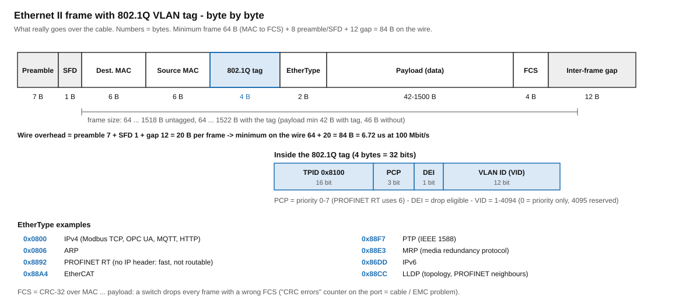

### A2.1 The fields

| Field | Bytes | Content | Meaning for the engineer |
|---|---|---|---|
| Preamble | 7 | `55 55 55 55 55 55 55` | bit pattern for clock synchronisation of the receiver |
| Start frame delimiter (SFD) | 1 | `D5` | "frame starts now" |
| Destination MAC | 6 | e.g. `00 1B 1B 12 34 56`; `FF FF FF FF FF FF` = broadcast; first byte odd = multicast | who must receive the frame |
| Source MAC | 6 | the sender's burned-in address | first 3 bytes = maker (OUI) – helps to identify a device in a capture |
| 802.1Q tag (optional) | 4 | TPID `81 00` + 16 bits TCI: PCP (3 bits), DEI (1), VLAN ID (12) | priority 0–7 and VLAN 1–4094 |
| EtherType | 2 | `08 00` IPv4, `08 06` ARP, `88 92` PROFINET RT, `88 A4` EtherCAT, `88 F7` PTP, `88 E3` MRP, `88 CC` LLDP | what is inside |
| Payload | 46–1500 (42–1500 with tag) | the data of the layer above | short payloads are padded to the minimum |
| FCS | 4 | CRC-32 | errors detected → frame dropped |
| Inter-frame gap | 12 (time) | silence of 96 bit times | the cable is idle between frames |

**Frame size** (destination MAC to FCS): minimum **64 B**, maximum **1518 B** (1522 B with tag). **On the wire** every frame
also needs preamble + SFD (8 B) and the gap (12 B) = **20 B extra**.

### A2.2 Worked example – the minimum frame on the wire

1. Minimum frame = 6 + 6 + 2 + 46 + 4 = **64 B** (untagged). With a tag: 6 + 6 + 4 + 2 + 42 + 4 = 64 B (padding shrinks to 42).
2. On the wire: 64 + 8 + 12 = **84 B** = 672 bits.
3. At 100 Mbit/s: t = 672 ÷ 100 000 000 = **6.72 µs** per minimum frame (this is `t_tx` in E5).
4. Maximum frame rate on one 100 Mbit/s link: 1 ÷ 6.72 µs = **148 810 frames/s**.
5. Maximum frame on the wire: 1518 + 20 = **1538 B** → 1538 × 8 ÷ 100 Mbit/s = **123.04 µs**. This is the "one big frame blocks
   the port" time used in E5.

**Lesson:** a PROFINET device with 32 bytes of IO still sends a 64-byte frame (84 B on the wire). For small data the frame
overhead dominates – that is why the PROFINET formula in E1 starts with `max(64, …)`.

### A2.3 Priority (PCP) and why it is not magic

The 3-bit PCP field gives 8 priority classes. PROFINET RT frames use priority 6, PTP often 7, normal IT traffic 0. A switch with
priority queues sends high-priority frames first. **But:** a frame that is already being sent is never interrupted. A 1538-byte
office frame that has just started blocks the port for 123 µs, even for a priority-6 frame (worst case in E5). Only time-slot
methods (PROFINET IRT, TSN 802.1Qbv) remove this waiting time.

### A2.4 Common mistakes and checklist

| Mistake | Result | Better |
|---|---|---|
| "100 Mbit/s = 12.5 MB/s of data" for small frames | load underestimated by 2–5 × | count frames × 84 B minimum (E1) |
| Ignoring CRC error counters on switch ports | intermittent faults not found | read port statistics weekly / at SAT (I4) |
| Jumbo frames enabled in the cell | some devices drop them | standard 1518 / 1522 B in OT networks |

- [ ] Frame-based calculation (not byte-based) for cyclic traffic.
- [ ] Priority (PCP) configured on all switches for real-time traffic; IT traffic not in priority 6 / 7.

---

## A3. Switches

### A3.1 How a switch works

A **switch** connects devices on layer 2. It learns which MAC address is behind which port (**MAC table**) from the source
address of every frame it receives, then sends each frame only to the port of the destination.

| Situation | What the switch does |
|---|---|
| Destination MAC known | forward to that port only |
| Destination unknown ("unknown unicast") | flood to all ports of the VLAN |
| Broadcast `FF FF FF FF FF FF` | flood to all ports of the VLAN |
| Multicast | flood to all ports – **unless IGMP snooping** is on (then only to ports that joined the group) |
| FCS wrong | drop, count a CRC error |

**Store-and-forward**: the switch receives the whole frame, checks the FCS, then forwards. Delay per switch ≈ frame time + a few
µs processing (the JSON uses `t_sw` = 3 µs plus the frame time, E5). **Cut-through** starts forwarding after the destination MAC
(lower delay, but forwards broken frames); PROFINET devices with built-in 2-port switches typically use cut-through.

### A3.2 Managed and unmanaged switches

| Feature | Unmanaged | Managed | Why it matters in an FMS |
|---|---|---|---|
| VLANs | no | yes | separation of zones / cells (A4) |
| Priority queues (QoS) | sometimes fixed | configurable | real-time before IT traffic |
| IGMP snooping | no | yes | EtherNet/IP and other multicast traffic does not flood the cell |
| Storm control | no | yes | limits broadcast / multicast / unknown unicast to e.g. 1–5 % of the link – a loop or faulty device cannot kill the cell |
| Redundancy (RSTP, MRP) | no | yes | ring topologies (A10) |
| Port statistics, SNMP, LLDP | no | yes | diagnostics, topology, PROFINET conformance class B (B2) |
| Port mirroring | no | yes | Wireshark capture without a TAP (I2) |
| Port security / 802.1X | no | yes | unknown devices cannot join (G) |
| Configuration back-up | – | yes | replace a failed switch in minutes (G10) |

**Rule of this guide:** unmanaged switches only **inside** a machine for a few devices. Every switch between modules, in the
cell backbone and above is **managed**.

### A3.3 Worked example – a broadcast storm

A maintenance technician connects both ends of a patch cable into the same unmanaged switch: a **loop**. A broadcast (e.g. an
ARP request) is flooded out of both looped ports, comes back on the other, is flooded again – for ever. Within milliseconds the
links are 100 % full. PLCs miss their watchdogs, the cell stops.

- With **RSTP** or **MRP** on managed switches the loop is detected and one port is blocked.
- With **storm control** at 2 % broadcast, a looped 100 Mbit/s port passes at most 2 Mbit/s broadcast – the rest is dropped and
  the real-time traffic survives.
- The JSON threat "Network loop / broadcast storm" (G5) has exactly this countermeasure.

### A3.4 Checklist

- [ ] All switches between modules managed; configuration backed up.
- [ ] Storm control on all edge ports; IGMP snooping on where multicast is used.
- [ ] Unused ports disabled (G10).
- [ ] Port statistics (CRC errors, drops) read at SAT and in maintenance.

---

## A4. VLANs

### A4.1 Theory

A **VLAN** (virtual LAN, IEEE 802.1Q) splits one physical switch network into several logical networks. Devices in different
VLANs cannot talk to each other on layer 2 – only through a router / firewall (layer 3). Each VLAN normally gets **one IP
subnet**.

| Port type | Frames | Use |
|---|---|---|
| Access port (untagged) | belongs to one VLAN; the device sends normal frames | PLC, HMI, PC |
| Trunk port (tagged) | carries several VLANs, each frame has a tag with the VLAN ID | switch ⇄ switch, switch ⇄ firewall |
| Native VLAN | untagged frames on a trunk | set to an unused VLAN for security |

### A4.2 The VLAN plan of a factory (this guide's standard)

| VLAN | Zone | Subnet (site 1) | Content |
|---|---|---|---|
| 10 | Enterprise / office (L4) | 10.1.10.0/24 | ERP, office PCs – managed by IT |
| 20 | Industrial DMZ (L3.5) | 10.1.20.0/24 | historian mirror, patch server, jump host, API proxy |
| 30 | Manufacturing operations (L3) | 10.1.30.0/24 | MES, SCADA servers, DNC, tool management, WMS, NTP, syslog |
| 40 | Engineering | 10.1.40.0/24 | engineering workstations, back-up server |
| 101 | Cell FMS1 (L1–2) | 10.1.101.0/24 | cell controller, PLCs, CNCs, HMIs (Part F) |
| 102 | Cell ASM1 (L1–2) | 10.1.102.0/24 | assembly line |

Rule: **third octet = VLAN number** (for VLAN > 255: VLAN mod 256, F1). A technician who sees `10.1.101.151` knows: site 1, cell
VLAN 101, a CNC (range .150–.199).

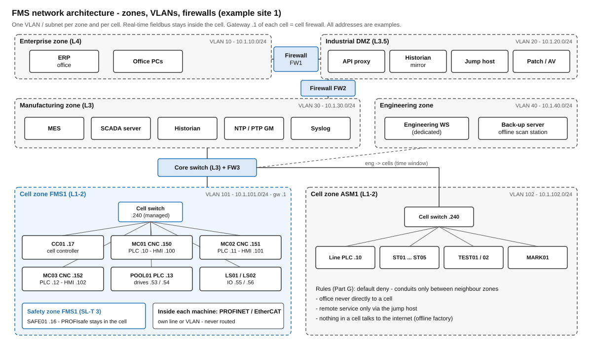

### A4.3 Use case – why a VLAN per cell

- A broadcast storm in cell ASM1 does not reach FMS1.
- The firewall between the manufacturing zone and the cell controls who may talk to the cell (G6).
- Each cell can be commissioned by a different supplier without address conflicts with the rest of the plant.
- The cell can run **alone** when the core network is down (offline robustness, G11).

### A4.4 Common mistakes and checklist

| Mistake | Better |
|---|---|
| All PLCs of the plant in one VLAN "because it is simple" | one VLAN per cell, routing only through firewalls |
| VLAN 1 (default) used for production | VLAN 1 unused; native VLAN on trunks = unused VLAN |
| PROFINET IO controllers and devices in different VLANs | PROFINET IO needs one layer-2 domain – same VLAN |

- [ ] VLAN plan written before the switch order; same numbers in every document.
- [ ] Trunks carry only the VLANs they need.

---

## A5. IPv4 addressing and subnetting

### A5.1 Theory

An IPv4 address is **32 bits**, written as 4 decimal bytes: `10.1.101.151`. A **prefix** `/p` says how many leading bits are the
**network part**; the rest is the **host part**.

```
 mask        = p ones followed by (32 − p) zeros
 network     = ip AND mask
 broadcast   = network OR (NOT mask)
 usable hosts = 2^(32 − p) − 2          (p ≤ 30; network and broadcast address are not usable)
 first host  = network + 1,  last host = broadcast − 1
 overlap     = one subnet contains the network address of the other
```

**Private ranges** (RFC 1918) – use them inside the factory, never public addresses: `10.0.0.0/8`, `172.16.0.0/12`,
`192.168.0.0/16`. Many devices are delivered with `192.168.0.x` or `192.168.1.x` – change them all to the plan (F).

| Prefix | Mask | Hosts | Typical use |
|---|---|---|---|
| /30 | 255.255.255.252 | 2 | point-to-point link between two routers |
| /27 | 255.255.255.224 | 30 | small machine network |
| /26 | 255.255.255.192 | 62 | quarter of a /24 |
| /25 | 255.255.255.128 | 126 | half of a /24 |
| /24 | 255.255.255.0 | 254 | **one cell** (this guide's standard) |
| /23 | 255.255.254.0 | 510 | big zone (two /24 joined) |

### A5.2 Worked example 1 – `10.1.101.0/24` (JSON subnet 1)

1. Mask: 24 ones → `11111111.11111111.11111111.00000000` = **255.255.255.0**.
2. Network: 10.1.101.0 AND 255.255.255.0 = **10.1.101.0**.
3. Broadcast: network OR 0.0.0.255 = **10.1.101.255**.
4. Hosts: 2^(32−24) − 2 = 256 − 2 = **254**; first **10.1.101.1** (the gateway in our plan), last **10.1.101.254**.

### A5.3 Worked example 2 – `10.1.101.64/26` (JSON subnet 2)

1. Mask: 26 ones → last byte `11000000` = 192 → **255.255.255.192**.
2. Last byte of the address: 64 = `01000000`. 64 AND 192 = `01000000` = 64 → network **10.1.101.64**.
3. Host bits = last 6 bits. Broadcast last byte = 64 OR `00111111` (63) = 127 → **10.1.101.127**.
4. Hosts: 2^6 − 2 = **62**; first **10.1.101.65**, last **10.1.101.126**.

### A5.4 Worked example 3 – `10.1.30.0/23` (JSON subnet 3)

1. Mask: 23 ones → third byte `11111110` = 254 → **255.255.254.0**.
2. Third byte 30 = `00011110`; 30 AND 254 = 30 → network **10.1.30.0**.
3. Broadcast: third byte 30 OR 1 = 31, fourth byte 255 → **10.1.31.255**.
4. Hosts: 2^9 − 2 = **510**; first **10.1.30.1**, last **10.1.31.254**.

**Warning:** a /23 starting at 10.1.30.0 also contains 10.1.31.x. If the plan has VLAN 31 somewhere with 10.1.31.0/24, the two
overlap. Our plan does not use /23 for exactly this reason – one /24 per VLAN keeps the rule "third octet = VLAN" clean.

### A5.5 Worked example 4 – `192.168.10.130/25` (JSON subnet 4)

1. Mask: 25 ones → last byte `10000000` = 128 → **255.255.255.128**.
2. Last byte 130 = `10000010`; 130 AND 128 = 128 → network **192.168.10.128**. The written address has host bits set: it is a
   **host address with its prefix** (a device setting), not the network address. Write subnets in the plan always as the network
   address (`192.168.10.128/25`).
3. Broadcast: 128 OR 127 = 255 → **192.168.10.255**.
4. Hosts: 2^7 − 2 = **126**; first **192.168.10.129**, last **192.168.10.254**.

### A5.6 Summary of the JSON subnets

| CIDR | Mask | Network | Broadcast | Usable hosts | First | Last | Note |
|---|---|---|---|---|---|---|---|
| 10.1.101.0/24 | 255.255.255.0 | 10.1.101.0 | 10.1.101.255 | 254 | 10.1.101.1 | 10.1.101.254 | cell FMS1 |
| 10.1.101.64/26 | 255.255.255.192 | 10.1.101.64 | 10.1.101.127 | 62 | 10.1.101.65 | 10.1.101.126 | inside the /24 above! |
| 10.1.30.0/23 | 255.255.254.0 | 10.1.30.0 | 10.1.31.255 | 510 | 10.1.30.1 | 10.1.31.254 | spans two "VLAN octets" |
| 192.168.10.130/25 | 255.255.255.128 | 192.168.10.128 | 192.168.10.255 | 126 | 192.168.10.129 | 192.168.10.254 | host bits set in the written form |

The overlap and duplicate checks of the JSON plan follow in F4.

### A5.7 Common mistakes and checklist

| Mistake | Result | Better |
|---|---|---|
| Wrong mask on one device (/16 instead of /24) | it thinks remote devices are local, sends ARP instead of using the gateway – no answer | mask from the plan, checked at SAT |
| Default gateway missing | device works in the cell but nobody from outside reaches it | gateway .1 on every routed device |
| Factory default 192.168.0.1 left on a device | conflict when the second identical device is connected | change all addresses before integration |
| Overlapping subnets | routing goes to the wrong place | overlap check (F4) |

- [ ] Every subnet written as network/prefix; no overlaps (F4).
- [ ] Mask and gateway in the IP list for every device.

---

## A6. ARP, routing, gateways, NAT

### A6.1 ARP – from IP address to MAC address

Inside one subnet, a device needs the **MAC** of the destination. It sends an **ARP request** (broadcast): "who has 10.1.101.11?
tell 10.1.101.17". The owner answers with its MAC. The result is cached (ARP table, typically 1–20 min). Command `arp -a` shows
the table (I1).

**Why it matters:** a duplicate IP address shows up as **two MACs answering** the same ARP request; the ARP cache of the client
flips between them and the connection works "sometimes" (I4). Wireshark filter: `arp.duplicate-address-detected`.

### A6.2 Routing and the default gateway

A device compares the destination address with its own subnet (`destination AND mask == my network?`):

- **yes** → send directly (ARP for the destination MAC);
- **no** → send to the **default gateway** (ARP for the gateway MAC); the router / firewall forwards.

Worked example: CC01 (10.1.101.17/24) talks to the MES (10.1.30.20). 10.1.30.20 AND 255.255.255.0 = 10.1.30.0 ≠ 10.1.101.0 →
send to gateway 10.1.101.1 (cell firewall) → firewall checks the rule (G6) → forwards into VLAN 30.

### A6.3 NAT – when two cells have the same addresses

**Network address translation** maps addresses at a router. **1:1 NAT** is used when a machine builder delivers every machine
with the same internal network (e.g. 192.168.0.0/24 inside each machine): the machine's router shows the machine to the cell
network as `10.1.101.150` and translates. Use it only where necessary: NAT hides the real addresses, complicates diagnostics
and breaks protocols that carry IP addresses inside their data (some FTP / OPC UA discovery cases).

### A6.4 Checklist

- [ ] Gateway of each cell = the cell firewall `.1`.
- [ ] No two devices in the same routed network with the same address; machine-internal networks behind NAT documented.

---

## A7. TCP and UDP, ports

### A7.1 Theory

| | TCP | UDP |
|---|---|---|
| Connection | yes (3-way handshake SYN, SYN-ACK, ACK) | no |
| Delivery | guaranteed, in order; lost segments re-sent | best effort, no re-send |
| Header | 20 B (+ options) | 8 B |
| Typical use | Modbus TCP, OPC UA, MQTT, HTTP, S7 | EtherNet/IP IO (2222), NTP (123), PTP (319/320), syslog (514), SNMP (161), DHCP (67/68) |

A **port** (16 bits, 0–65535) addresses the application inside a device. The server listens on a known port; the client uses a
random high port.

| Service | Port | Transport |
|---|---|---|
| Modbus TCP | 502 (the JSON simulator uses 1502 – no admin rights needed on a PC) | TCP |
| OPC UA binary | 4840 (common default; many servers use other ports) | TCP |
| MQTT / MQTT over TLS | 1883 / 8883 | TCP |
| HTTP / HTTPS | 80 / 443 | TCP |
| S7 communication (ISO-on-TCP) | 102 | TCP |
| EtherNet/IP explicit / implicit | 44818 TCP / 2222 UDP | TCP / UDP |
| RDP / SSH | 3389 / 22 | TCP |
| NTP / syslog / SNMP | 123 / 514 / 161 | UDP |

**Never use port 8080 in the plant tools of this twin** – it is reserved on this project's machines (project rule).

### A7.2 How TCP behaves when something goes wrong

- A lost segment is re-sent after the **retransmission time-out** (starts at about 200 ms – 1 s, doubles each time). A Modbus
  request that suffers one loss can take 200 ms or more instead of 9 ms. That is why the Modbus time-out of the interface sheet is
  500 ms (H7) and not 20 ms.
- If the server is gone, the client only notices when a send fails or a time-out expires. **TCP alone does not detect a dead
  partner quickly** – that is the job of the application heartbeat (H4).
- Many PLC Modbus servers allow only a few connections (e.g. 4–8). A client that opens a new connection per request and never
  closes them fills the server – "connection refused" after a few minutes (I5).

### A7.3 Checklist

- [ ] Every TCP service, port and direction in the conduit list (G6).
- [ ] Application time-outs ≥ 2–3 × the worst normal response time; heartbeat for dead-partner detection.
- [ ] Number of connections per server checked against the server limit.

---

## A8. DHCP or fixed addresses, DNS, PROFINET DCP

### A8.1 Fixed addresses for OT

| Method | Where | Why |
|---|---|---|
| **Fixed (static) address** in the device | PLCs, CNCs, robots, drives, HMIs, switches, servers | address never changes; written in drawings and PLC projects; works when the DHCP server is down |
| DHCP with reservation (MAC → IP) | industrial PCs, cameras in some plants | central management; but if the server is down, the device may not start |
| DHCP pool | commissioning laptops (range .200–.239) | temporary devices |
| PROFINET DCP | PROFINET devices | the IO controller assigns name and IP to the device at start-up (B2) |

**Rule of this guide:** all production devices fixed (or DCP from the IO controller). DHCP only for the temporary range.

### A8.2 DNS

DNS translates names (`mes01.plt1.local`) to addresses. Useful at level 3 and above (certificates use names, G9). Inside the cell,
devices use IP addresses – a PLC must not stop because the DNS server is down. If OPC UA certificates contain host names, the
cell controller needs a reliable local DNS or a hosts file.

---

## A9. Time synchronisation: NTP and PTP

### A9.1 Why time matters

Alarms, events and quality records from 30 devices must be put in the right **order** (guide 65 E4). A 2-second error between two
clocks makes a root-cause analysis wrong. Motion and measurement need µs or better.

| Method | Standard | Typical accuracy | Use |
|---|---|---|---|
| NTP | RFC 5905 | 1–10 ms in a LAN (worse over many hops) | PCs, servers, PLC clocks, HMIs, event time stamps |
| SNTP | simple NTP client | 10–100 ms | small devices |
| PTP | IEEE 1588 / IEC 61588 | < 1 µs with PTP-aware switches (transparent / boundary clocks) | motion, measurement, sequence-of-events, TSN |
| Fieldbus clocks | EtherCAT DC, PROFINET IRT | < 1 µs inside the bus | axes synchronisation |

### A9.2 Design rules

1. One **time source** for the plant (a GNSS-disciplined NTP / PTP grandmaster in the manufacturing zone, or the domain
   controller). Offline factory: a GNSS antenna clock or a stable local server – no internet time.
2. All devices in UTC; local time only for display.
3. NTP flows from cells to the NTP server are allowed in the firewall (JSON rule R12, flow "Cell PLC → NTP server" = allow).
4. PTP only where needed and with PTP-aware switches; otherwise switch delays make PTP no better than NTP.

---

## A10. Redundancy

### A10.1 Methods and recovery times

| Method | Standard | Topology | Recovery time after a link failure (typical / specified) | Use |
|---|---|---|---|---|
| STP | IEEE 802.1D | any | 30–50 s | do not use in OT |
| RSTP | IEEE 802.1w / 802.1D-2004 | any (mesh, rings) | typically < 1 s to a few s, depends on size | IT-like backbones, level 3 |
| Vendor fast rings | various | ring | 10–50 ms (maker data) | single-brand backbones |
| MRP | IEC 62439-2 | ring, up to 50 devices (default) | max **200 ms** default class; classes 500 / 200 / 30 / 10 ms | PROFINET rings in cells (B2) |
| MRPD | IEC 62439-2 + PROFINET IRT | ring | **0 ms** (frames sent both ways) | IRT motion rings |
| PRP | IEC 62439-3 | two independent networks, every frame sent on both | **0 ms** | critical systems, safety-relevant data |
| HSR | IEC 62439-3 | ring, frames sent both directions | **0 ms** | substations, some motion |
| Link aggregation (LACP) | IEEE 802.1AX | parallel links | < 1 s | switch-to-switch capacity + redundancy |

### A10.2 How to choose – compare the recovery time with the watchdog

**Rule:** the recovery time must be **shorter than the watchdog time** of the protocol that runs over the network, otherwise the
devices fail during the switch-over.

Worked example: PROFINET device with update time 2 ms and watchdog factor 3 → watchdog **6 ms** (B2.6). MRP recovery 200 ms >
6 ms → during a ring break the device **will** lose its connection (station failure, then automatic reconnect after the ring is
healed – typical 1–3 s). Options: increase the watchdog for devices on the ring (e.g. 2 ms × 100 = 200 ms – only acceptable if the
process can live with it), use MRPD / IRT (0 ms), or accept that a ring break causes a short stop **but no long outage** (the
usual decision for cell backbones). For Modbus TCP / OPC UA the application time-outs (500 ms, heartbeat 3 s) are longer than
200 ms – MRP is fully sufficient.

### A10.3 Checklist

- [ ] Recovery time of the chosen method < watchdog / time-out of every protocol on that network (or the short stop accepted).
- [ ] Only one redundancy protocol per ring; MRP manager defined.
- [ ] Ring break tested at SAT (pull a cable, watch the diagnostics, I3).

---

## A11. Physical layer

### A11.1 Copper cables

| Category | Bandwidth | Ethernet speed | Use |
|---|---|---|---|
| Cat5e | 100 MHz | 100 Mbit/s, 1 Gbit/s | PROFINET (2-pair 100 Mbit/s cables), most field devices |
| Cat6 | 250 MHz | 1 Gbit/s (10 Gbit/s short) | backbones |
| Cat6A | 500 MHz | 10 Gbit/s up to 100 m | server rooms, backbones, cameras |
| Cat7 / Cat8 | 600 / 2000 MHz | special | rarely in OT |

**The 100 m channel rule (ISO/IEC 11801, TIA-568, IEC 61918):** one copper channel between two active devices = at most **100 m**,
typically **90 m permanent link + 10 m patch cords**. Each switch regenerates the signal and starts a new 100 m. In PROFINET
installations the same 100 m limit applies per segment between two ports.

| Cable type | Use |
|---|---|
| 2-pair (4-wire, AWG 22) PROFINET cable, green | 100 Mbit/s field installation, M12 D-coded or RJ45 |
| 4-pair (8-wire) | 1 Gbit/s and more, M12 X-coded or RJ45 |
| Flexible / trailing (drag-chain) cable | moving parts: stacker, gantry, AGV station; specify bending cycles (e.g. several million) |
| Torsion cable | robot dress packs |
| Oil-resistant / UL-listed jacket | inside machine tools (coolant!) |

### A11.2 Connectors

| Connector | Protection | Pins / coding | Speed | Use |
|---|---|---|---|---|
| RJ45 (office type) | IP20 | 8 | up to 10 Gbit/s | inside cabinets |
| RJ45 in IP65/IP67 housing (push-pull or screw) | IP65/67 | 8 | up to 10 Gbit/s | field, where RJ45 is a standard |
| M12 **D-coded** | IP67 | 4 | 100 Mbit/s | field devices, PROFINET, EtherCAT, EtherNet/IP |
| M12 **X-coded** | IP67 | 8 | 1 / 10 Gbit/s | cameras, gigabit field devices |
| M8 | IP67 | 4 | 100 Mbit/s | small sensors / drives |
| M12 A-coded | IP67 | 4/5/8 | – (not Ethernet) | IO-Link, 24 V sensors (B1) |
| LC / SC | – | fibre | – | fibre panels, SFP modules |

**Mistake to avoid:** an M12 A-coded cable fits mechanically nowhere into a D-coded socket – but mixing D and X-coded parts or
using non-shielded M12 cables in a machine tool leads to errors that look like "software problems".

### A11.3 Fibre

| Type | Core | Wavelength | Typical attenuation | Reach (100 Mbit/s – 1 Gbit/s) | Use |
|---|---|---|---|---|---|
| Multimode OM3 / OM4 | 50 µm | 850 nm (1300 nm) | ≈ 3.0–3.5 dB/km at 850 nm | up to about 2 km at 100 Mbit/s, 0.5–1 km at 1 Gbit/s (check transceiver data) | inside a hall, between hall switch and cell cabinets |
| Singlemode OS2 | 9 µm | 1310 / 1550 nm | ≈ 0.4 / 0.3 dB/km | 10 km and more | between buildings |
| POF (plastic) | 980 µm | 650 nm | high | ≈ 50 m (PROFINET) | inside machines, EMC-heavy zones |
| PCF (glass core, plastic cladding) | 200 µm | 650 nm | medium | ≈ 100 m (PROFINET) | field installation |

**Why fibre:** no EMC problems, no ground loops between buildings or between a welding cell and the rest, longer distances,
lightning protection between buildings.

### A11.4 Link budget – the JSON fibre example worked

A fibre link works if the light that arrives is stronger than the receiver needs, with a **margin** for ageing, dirt and repairs.

```
 loss   = length_km × attenuation_dB_per_km + connectors × connector_loss + splices × splice_loss
 budget = tx_min_dBm − rx_sensitivity_dBm          (weakest transmitter, worst receiver)
 margin = budget − loss                              OK if margin ≥ 3 dB
```

JSON case: multimode OM3 850 nm between the hall switch and the cell cabinet, 0.3 km, 3.5 dB/km, 4 connectors at 0.75 dB,
2 splices at 0.1 dB, transmitter minimum −9.5 dBm, receiver sensitivity −17.0 dBm.

| Step | Calculation | Result |
|---|---|---|
| Fibre | 0.3 × 3.5 | 1.05 dB |
| Connectors | 4 × 0.75 | 3.00 dB |
| Splices | 2 × 0.1 | 0.20 dB |
| **Loss** | 1.05 + 3.00 + 0.20 | **4.25 dB** |
| **Budget** | −9.5 − (−17.0) | **7.50 dB** |
| **Margin** | 7.50 − 4.25 | **3.25 dB → OK** (≥ 3 dB) |

**Lesson:** on short links the **connectors** dominate (3.0 of 4.25 dB). Two extra patch panels (4 more connectors × 0.75 dB =
3 dB) would make the margin 0.25 dB – not OK. Clean every connector before plugging in (dirt adds 0.5–1 dB); measure the loss with
a light source and power meter at SAT and write it into the documentation (I3).

### A11.5 Shielding, grounding, EMC, separation from power cables

| Rule | Why |
|---|---|
| Use shielded (S/FTP or SF/UTP) cables in machines and near drives | frequency converters and spindle drives produce strong high-frequency fields |
| Connect the shield **at both ends** to the equipotential bonding (PROFINET installation guideline) | the shield works against high-frequency noise only when it is grounded at both ends |
| Install an **equipotential bonding conductor** (e.g. ≥ 10 mm² Cu, parallel to the cable) between cabinets | otherwise equalising currents flow through the shield → errors, heating; if bonding is impossible → fibre |
| **Separate data cables from power cables**: own tray or tray with metal separator; typical distances ≥ 10 cm to 230/400 V power, ≥ 20–30 cm to motor cables of frequency converters without divider; cross at 90° | inductive and capacitive coupling (check IEC 61918, EN 50174-2 and the maker's installation guideline for exact values) |
| Motor cables of drives shielded, 360° shield clamp at both ends | the drive is the noise source – fix it at the source |
| No data cable in the same conduit as welding current cables | welding cells: fibre between the cell and the rest |
| Ferrites / filters only as a last resort | they hide the root cause |

**Use case – the welding cell.** In cell ASM1 a robot welding station is added. During welding the Modbus connection to the
station PLC drops every few minutes. Root cause: the copper cable from the station runs 15 m in the same tray as the welding
return cable, and the station has no bonding to the line cabinet. Fix: fibre (two media converters, a few hundred euros) and a
bonding conductor; the drops disappear.

### A11.6 Checklist – physical layer

- [ ] Copper segments ≤ 100 m; cable type per location (flexible, oil-resistant).
- [ ] Connectors per location (IP20 in cabinets, IP67 in the field), coding D / X correct.
- [ ] Fibre link budget calculated with margin ≥ 3 dB and measured at SAT.
- [ ] Shields at both ends + equipotential bonding; separation from power and drive cables.
- [ ] Cable test certificate (channel test) for every installed copper link.

---

## A12. Selecting switches for an FMS

### A12.1 The decision table

| Question | Options | Rule of thumb |
|---|---|---|
| Where? | cabinet (DIN rail, IP20), field (IP67), 19" server rack | inside cell cabinets: DIN-rail industrial switches |
| Managed? | unmanaged / managed / layer 3 | managed everywhere between modules (A3.2) |
| Ports | number, copper / SFP fibre, speed | count devices + 20–30 % spare; fibre uplinks between cabinets |
| PROFINET | conformance class B (diagnostics, LLDP, SNMP, MRP) or C (IRT) | PROFINET cells: certified CC-B switch; CC-C only for IRT |
| Redundancy | MRP, RSTP, vendor ring | MRP for PROFINET rings, RSTP / LACP in the backbone |
| Time | PTP transparent / boundary clock | only where PTP is used |
| Power | 24 V DC redundant inputs, PoE for cameras / APs | redundant 24 V in the cell cabinet |
| Environment | temperature range, vibration, approvals | machine cabinets can reach 50–55 °C |
| Security | port security, 802.1X, SSH / HTTPS management, signed firmware, logging | IEC 62443-4-2 certified components where SL-T 2–3 (G) |

### A12.2 Worked example – switches of cell FMS1

Devices from the IP plan (F2): 31 entries, of which 2 are the switch and firewall themselves → 29 devices to connect. Spread over
four cabinets: cell cabinet (CC01, safety PLC, utilities PLC, SCADA client, firewall, core switch), pool cabinet (stacker PLC,
2 drives, HMI), load-station desk (2 IO + 2 HMI), machine connection points (each MC: CNC, PLC, HMI, APC IO).

| Location | Devices | Switch | Ports |
|---|---|---|---|
| Cell cabinet | 6 + uplinks to 3 machines, pool, load stations | managed, MRP manager, 2 × SFP fibre uplink to the hall | 16 copper + 2 SFP |
| Each machine (× 3) | CNC, PLC, HMI, APC IO = 4 | managed, MRP client (ring) | 8 copper |
| Pool cabinet | 4 | managed, MRP client | 8 copper |
| Load-station desk | 4 + AGV station IO | managed | 8 copper |

The machine-internal PROFINET of each machine tool stays on the machine builder's own network (A4.4, B2); only the machine PLC /
CNC interface ports are in the cell VLAN.

### A12.3 Checklist

- [ ] Port count with ≥ 20 % spare; fibre between cabinets where distance or EMC requires.
- [ ] Switch features match the protocols: IGMP snooping (EtherNet/IP), CC-B (PROFINET), MRP, QoS.
- [ ] Management access only from the engineering zone; default passwords changed; configuration saved.

---

# Part B – Fieldbuses inside machines and cells

A fieldbus connects a controller with its IO, drives and other controllers **cyclically**: the same data is exchanged every
cycle, whether it changed or not. In an FMS the fieldbus lives **inside a module** (machine, stacker, load station) and sometimes
**between the PLCs of one cell**. It does not leave the cell (A1.3).

## B1. IO-Link (IEC 61131-9)

### B1.1 What it is

IO-Link is a **point-to-point** link between an **IO-Link master** (a module on the fieldbus with 4–16 ports) and one **device**
(sensor, valve terminal, RFID head, light, small drive). It uses the normal 3-wire sensor cable (unshielded, max **20 m**) and
standard M12 A-coded connectors. It is not a network – one device per port.

| Pin (M12, port class A) | Function |
|---|---|
| 1 | L+ 24 V |
| 2 | DI / DO (class A) – or extra 24 V actuator power (class B, with pin 5) |
| 3 | L− 0 V |
| 4 | C/Q – communication (IO-Link) or switching signal (SIO mode) |

**SIO mode:** without communication the device works as a normal switching sensor. **IO-Link mode:** the master wakes the device
and exchanges data.

### B1.2 Data types

| Data | How | Example |
|---|---|---|
| **Process data (PD)** | cyclic, up to 32 B in and 32 B out | distance 2 B, switching bits; valve outputs |
| **On-request data (OD)** | small acyclic channel inside each cycle (1–32 B per cycle) | carries ISDU and events piece by piece |
| **ISDU** (indexed service data unit) | acyclic read / write of parameters by index / subindex | switching point, filter, product name (index 0x12), serial number (0x15) |
| **Events** | device reports warnings / errors | "lens dirty", "temperature too high" |
| **IODD** | XML device description (+ pictures, texts) | the engineering tool shows parameters in plain text |
| **Data storage** | the master keeps a copy of the device parameters | replace a broken sensor with a new one of the same type → master writes the parameters automatically |

### B1.3 Transmission rates and cycle time

| COM rate | Baud | Time per UART byte (11 bits) |
|---|---|---|
| COM1 | 4 800 bit/s | 2.29 ms |
| COM2 | 38 400 bit/s | 0.286 ms |
| COM3 | 230 400 bit/s | 0.048 ms |

Each byte is sent as a UART character of **11 bits** (start, 8 data, parity, stop). One **M-sequence** = the master message
(M-sequence control MC + checksum CKT + output PD) and the device answer (OD + input PD + checksum CKS). The JSON uses an
approximate formula (E6 works it in full):

```
 master_bytes = 2 + pd_out          (MC + CKT + output process data)
 device_bytes = od + pd_in + 1      (on-request data + input process data + CKS)
 bits         = 11 × (master_bytes + device_bytes) + 10      (+10 bit times for turn-around / idle)
 t_msg        = bits ÷ baud
 cycle        = max(t_msg, device_min_cycle)
```

JSON device: 2 B process data in, 0 B out, 1 B OD, minimum cycle 1.0 ms → 76 bits per message → **COM1 15.83 ms, COM2 1.98 ms,
COM3 1.00 ms** (COM3 message time 0.33 ms is shorter than the device minimum, so the device limits it). E6 shows the steps.

### B1.4 How to design with IO-Link

1. Use IO-Link for **smart** devices: distance / pressure / flow sensors with values, valve terminals (one cable instead of 16),
   RFID heads at load stations, signal towers, clamping pressure monitoring of fixtures.
2. Keep simple proximity switches as standard 24 V inputs (cheaper) – or on IO-Link hubs (16 inputs on one port).
3. Check the **cycle**: a COM2 device at 2–3 ms is fine for monitoring and slow positioning, not for fast counting.
4. Activate **data storage** on every port – it turns a sensor change into a 2-minute job without a laptop.
5. Write the IO-Link port, device and IODD version into the IO list (guide 65 B naming: `PLT1.MACH.FMS1.LS01.Clamp.Pressure_bar`).

### B1.5 Use case in an FMS

Load station LS01: an IO-Link master with 8 ports reads the fixture clamping pressure (pressure sensor, 2 B), the pallet RFID head
(read / write tag ID, 32 B), a valve terminal (16 valves, 2 B out) and a signal tower. Without IO-Link: 30+ wires and an analog
card; with IO-Link: 4 cables, and the RFID head and pressure sensor are replaced without parameter work thanks to data storage.

### B1.6 Common mistakes and checklist

| Mistake | Better |
|---|---|
| Data storage not activated | activate it on every port; test a sensor replacement at FAT |
| Device on a 30 m cable | max 20 m; place the master closer (IP67 master in the field) |
| Expecting 1 ms from a COM2 device | check the device minimum cycle and COM rate (E6) |

- [ ] IODD files of all devices archived with the project; data storage on; port assignment in the IO list.

---

## B2. PROFINET in depth (IEC 61158 / IEC 61784-2)

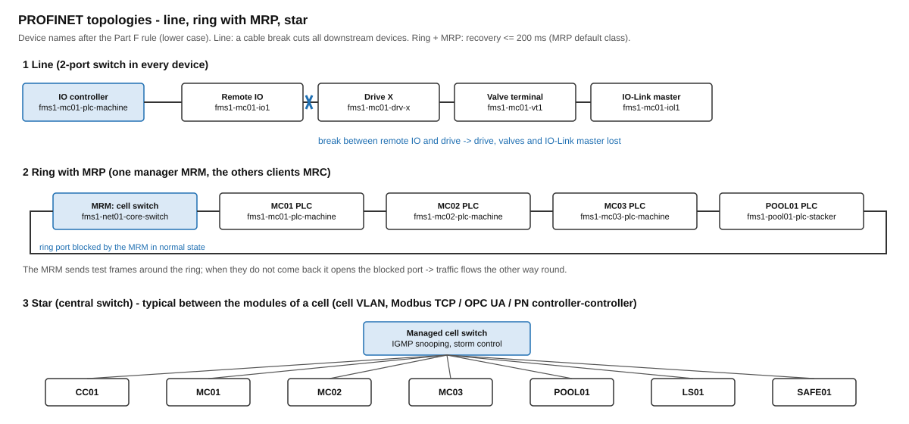

### B2.1 Roles and the principle

| Role | Meaning | Example |
|---|---|---|
| **IO controller** | the PLC that owns the IO | machine PLC, stacker PLC |
| **IO device** | remote IO, drive, valve terminal, IO-Link master, robot interface | ET-type remote IO, drive with PROFINET |
| **IO supervisor** | engineering / diagnostics PC | engineering laptop |

PROFINET IO is **provider / consumer**: the controller sends output frames to each device, each device sends input frames to the
controller, each with its own **update time**. Cyclic RT frames are layer-2 Ethernet frames with EtherType `0x8892` and VLAN
priority 6. Parameters, alarms and diagnostics use acyclic services over UDP/IP. Start-up and naming use **DCP** (discovery and
configuration protocol, layer 2).

### B2.2 Device names – the most important commissioning item

A PROFINET device is identified by its **device name** (station name), not by its IP address. At start-up the controller looks
for a device with the configured name (DCP "identify"), then gives it the configured IP address.

**Rules for the name** (DNS-compatible, from the PROFINET specification):

| Rule | Example |
|---|---|
| only lower-case letters `a–z`, digits `0–9`, `-` and `.` | `fms1-mc01-plc-machine` |
| each label (part between dots) ≤ 63 characters, total ≤ 240 | – |
| a label must not start or end with `-` | `-mc01` is wrong |
| must not start with `port-xyz` or `port-xyz-abcde` (reserved for topology) | `port-001` is wrong |
| must not look like an IP address `n.n.n.n` | `10.1.101.10` as name is wrong |

**This guide's rule** (JSON `profinet_name`): name = lower-case `<cell>-<unit>-<slug>`, slug = device name in lower case with every
run of characters outside `a-z0-9` replaced by one `-`, leading / trailing `-` removed.

Worked example: cell `FMS1`, unit `MC01`, device "PLC (machine)":
1. Lower case: `plc (machine)`.
2. Runs outside a-z0-9: " (" → `-`, ")" at the end → `-` → `plc-machine-`.
3. Remove trailing `-` → `plc-machine`.
4. Name: `fms1-mc01-plc-machine` (21 characters, one label, OK).

All names of the FMS kit are in F3. The name is set into a new device once with the engineering tool or a DCP tool ("assign
device name"), or automatically through **topology** (the controller knows "the device at port 2 of fms1-mc01-io1 is
fms1-mc01-drv-x" – device replacement without a PC).

### B2.3 GSDML

The **GSDML** file (General Station Description Markup Language, XML) describes a device: modules, submodules, IO data lengths,
parameters, diagnostics texts, supported update times, conformance class. It is imported into the controller's engineering tool.
**Rule:** archive the exact GSDML version used for each device with the project; a newer GSDML can change module IDs.

### B2.4 Conformance classes

| Class | Contains | Infrastructure | Use |
|---|---|---|---|
| **CC-A** | RT cyclic communication, alarms, basic diagnostics, IT services (web, SNMP optional) | IEEE 802.3 switches allowed | simple applications |
| **CC-B** | CC-A + network diagnostics (SNMP), **topology (LLDP)**, MRP ring redundancy (optional), device replacement without PC | certified PROFINET switches | **standard for FMS cells** |
| **CC-C** | CC-B + **IRT** (isochronous real time, bandwidth reservation, cycle down to 31.25 µs) | IRT-capable switches | motion, synchronised axes |
| **CC-D** | PROFINET over TSN | TSN switches | new installations, future |

Write the required conformance class into the URS ("all devices and switches PROFINET CC-B, netload class III").

### B2.5 RT and IRT, send clock, update time

- **Send clock**: base cycle of the controller, typically **1 ms** (RT also supports e.g. 250 µs–4 ms depending on the controller).
- **Reduction ratio**: 1, 2, 4, 8, … 512 → **update time** = send clock × reduction ratio (e.g. 1 ms × 2 = 2 ms; up to 512 ms).
- **RT**: frames with priority; jitter depends on other traffic (E5).
- **IRT**: a reserved time slot in every cycle only for IRT frames; all switches synchronised (PTCP); jitter < 1 µs. Needs CC-C
  devices and planning of the topology in the tool.

Choose the update time from the **process**, not "as fast as possible": IO of a load station 4–8 ms; valve terminal of a fixture
4 ms; drives without motion control 2–4 ms; synchronised axes 0.5–1 ms IRT; robot interface 4–8 ms.

### B2.6 Watchdog and data hold time

**Watchdog time = update time × watchdog factor** (default factor 3). If the controller receives no valid frame from a device for
this time (or the device none from the controller), the connection is lost: the device sets its outputs to the **substitute
values** (normally 0 = safe state) and the controller reports a station failure.

| Update time | Factor | Watchdog | Comment |
|---|---|---|---|
| 2 ms | 3 | 6 ms | normal |
| 8 ms | 3 | 24 ms | IO of a load station |
| 2 ms | 100 | 200 ms | survives an MRP ring recovery (A10.2), but reacts slowly to real failures |

### B2.7 PLC-to-PLC coupling: I-device, shared device, PN/PN coupler

| Method | How | When |
|---|---|---|
| **I-device** | a PLC is IO controller for its own IO **and** IO device for a higher controller; transfer areas (e.g. 64 B in / 64 B out) configured in both projects (with a GSDML exported from the I-device) | module PLC ⇄ cell PLC in the same PROFINET network, same brand family |
| **PN/PN coupler** | a hardware box with two PROFINET interfaces; each side is an IO device of its own controller | two separate networks / two suppliers, decoupled engineering |
| **Shared device** | one IO device, several controllers each own some submodules | a remote IO with standard modules for the machine PLC and F-modules for the safety PLC |
| **Shared input** | several controllers read the same input | rare |

The **standard data block** of Part H can be transferred through an I-device or PN/PN coupler with exactly the byte layout of H6
(module outputs = controller inputs).

### B2.8 MRP in PROFINET

PROFINET uses MRP (A10) for rings: one **media redundancy manager (MRM)**, normally the cell switch or the PLC, all other ring
devices are **clients (MRC)**. Maximum recovery time **200 ms** in the default configuration, ring up to 50 devices. All devices
in the ring must support MRP (CC-B with MRP option). Use case: the machine PLCs and the pool PLC of FMS1 on a ring (figure above);
a cable cut by a forklift between MC02 and MC03 causes no stop for Modbus TCP / OPC UA traffic.

### B2.9 Diagnostics and topology

- **Alarms**: diagnostic alarms (wire break, short circuit, module pulled) go to the controller with channel and error code.
- **LLDP** topology: every device knows its neighbour (name + port); the engineering tool and the web server show the real
  topology and compare it with the planned one.
- **SNMP** port statistics (CC-B).
- Free commissioning tools exist that scan a PROFINET network, show names, IPs, topology and allow name assignment (e.g. the
  Siemens tool PRONETA) – **see the maker's website**. Wireshark dissects `pn_io`, `pn_dcp`, `pn_rt` (I2).

### B2.10 Worked example – a machine tool network

MC01 has a machine PLC (IO controller) with: 2 remote IO stations (32 B each), 4 drives (20 B each), 1 valve terminal (8 B),
1 IO-Link master (32 B), the APC IO (16 B). Update time 2 ms for drives, 4 ms for the rest. Worst case all at 2 ms with the
maximum of 32 B → 9 devices × 84 B on the wire × 8 ÷ 0.002 s = 3.02 Mbit/s = **3 %** of 100 Mbit/s – far below 50 % (E1). The
load is never the problem in a single machine; **topology, names and watchdogs** are.

### B2.11 Common mistakes and checklist

| Mistake | Result | Better |
|---|---|---|
| Device name typed differently in project and device | device not found, "station failure" | names generated from the IP list (F3), assigned with a tool, checked at FAT |
| Two devices with the same name | random behaviour | DCP scan before commissioning; unique names per network |
| PROFINET routed through a firewall | does not work (layer 2) | PLC-PLC across cells via OPC UA / Modbus TCP |
| Long lines with 20+ devices in a line, no ring | one cable break stops everything downstream | ring with MRP or star |
| Update time 1 ms for everything | high load, no benefit | update time per device from the process |

- [ ] Conformance class and update times in the URS; GSDML versions archived.
- [ ] Names follow F3; topology configured; MRP manager defined; watchdog factor checked against ring recovery.

---

## B3. EtherCAT (IEC 61158 type 12)

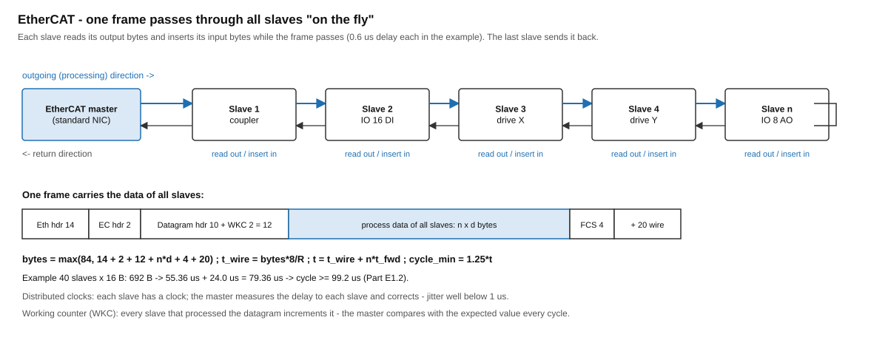

### B3.1 Principle – "processing on the fly"

The master sends **one Ethernet frame** (EtherType `0x88A4`) that passes through all slaves in a line. Each slave has an EtherCAT
slave controller (ESC) that **reads its outputs and inserts its inputs while the frame passes** – with a delay of well below 1 µs
per slave (the JSON uses 0.6 µs). The last slave returns the frame (the return path goes through the same slaves). One frame
carries the data of all slaves → very high efficiency, cycles of 50 µs–1 ms.

| Element | Meaning |
|---|---|
| Datagram | header 10 B + data + working counter 2 B; commands like LRW (logical read-write) address the process image |
| Working counter (WKC) | each slave that processed the datagram increments it; master compares with the expected value every cycle → detects a missing slave immediately |
| Distributed clocks (DC) | each slave has a clock; the master measures the propagation delay to each slave and synchronises all clocks to well below 1 µs jitter (Sync0 signal for drives) |
| ESI file | XML slave description (EtherCAT slave information), like GSDML |
| CoE | CANopen over EtherCAT: object dictionary, SDO (acyclic parameters), PDO (cyclic mapping), drive profile CiA 402 |
| FoE, EoE, SoE | file access (firmware), Ethernet tunnelled over EtherCAT, servo profile (SERCOS) |
| State machine | INIT → PRE-OP → SAFE-OP → OP (OP = outputs active) |
| Addressing | auto-increment (position) or configured station address / alias (fixed ID, recommended in machines with options) |

### B3.2 Topology and redundancy

Line, tree (with junction slaves), star via junctions, and **cable redundancy**: the last slave connects back to a second port
of the master; a cable break turns the line into two lines fed from both ends (switch-over within one cycle).

### B3.3 Cycle time

Formula and the two JSON cases in E2: 40 slaves × 16 B → frame 692 B → **79.36 µs** round trip → shortest cycle **99.2 µs**; 100 IO
terminals × 8 B → **160.2 µs**. Both allow motion at 250 µs.

### B3.4 Use in an FMS

EtherCAT is the bus **inside** a machine or a test bench: Beckhoff-based machines, fast motion with many axes, high-speed
measurement (test station for compressors: pressure, vibration at kHz rates). It is not a plant network: a non-EtherCAT device in
the line breaks the principle; the cell connection is through the machine PC / PLC (OPC UA, Modbus TCP, ADS) – the standard data
block (Part H) is mapped there.

### B3.5 Common mistakes and checklist

| Mistake | Better |
|---|---|
| Auto-increment addressing in a machine with optional modules → wrong slave mapping | configured station alias per slave |
| A normal switch inserted in an EtherCAT line | EtherCAT junctions only, or EoE for IT devices |
| DC not activated for drives | DC + Sync0 for synchronised axes |

- [ ] ESI versions archived; expected topology configured; WKC errors monitored.

---

## B4. EtherNet/IP (CIP, IEC 61158 type 2)

### B4.1 Principle

EtherNet/IP carries the **Common Industrial Protocol (CIP)** over standard TCP/UDP/IP.

| Messaging | Transport | Use |
|---|---|---|
| **Implicit (I/O)** | UDP port 2222, cyclic at the **RPI** (requested packet interval, e.g. 2–100 ms) | IO, drives, PLC-PLC produced / consumed tags |
| **Explicit** | TCP port 44818, request / response | parameters, diagnostics, messages (MSG instruction) |

Objects: Identity, Assembly (the IO data block), Connection Manager, TCP/IP, Ethernet Link. Device description: **EDS** file.
Redundancy: **DLR** (device level ring, recovery about 3 ms in a typical ring – see maker data), or RSTP. Options: CIP Safety, CIP
Motion, CIP Sync (IEEE 1588).

### B4.2 Unicast and multicast – why IGMP snooping

Implicit connections can be **multicast** (one producer, several consumers). Without IGMP snooping a switch floods multicast to
every port → every device in the VLAN receives every IO frame. Rules: use **unicast** connections where only one consumer exists
(default in newer controllers), enable **IGMP snooping and an IGMP querier** in every VLAN with multicast.

### B4.3 Worked example – packets per second

A cell PLC scans 20 adapters with RPI 10 ms, one input and one output connection each:
packets/s = 20 × (1 000 ÷ 10) × 2 = **4 000 packets/s** at the scanner. If the scanner module is specified for e.g. 10 000 packets/s
(example value – check the data sheet) the load is 40 %. Halving all RPIs to 5 ms gives 8 000 = 80 % – too high; keep fast RPIs only
for devices that need them.

### B4.4 Checklist

- [ ] RPI per device from the process; packets/s of every scanner and adapter checked against data sheets.
- [ ] IGMP snooping + querier where multicast is used; DLR / RSTP decided.

---

## B5. CC-Link IE

CC-Link IE (CLPA, Mitsubishi ecosystem) exists as **CC-Link IE Field** (1 Gbit/s, cyclic link devices), **CC-Link IE Field
Basic** (100 Mbit/s over UDP, software stack, for simple devices), **CC-Link IE Control** (controller network) and **CC-Link IE
TSN** (time-sensitive networking, 1 Gbit/s / 100 Mbit/s). Cyclic data are exchanged as link devices: RX/RY (bits) and RWr/RWw
(words). Device description: **CSP+**. Use it when the plant standard is Mitsubishi; the FMS-level interface (cell controller,
MES) is again OPC UA, Modbus TCP or SLMP (Mitsubishi's message protocol) – the standard data block of Part H can be placed in RWr /
RWw words in the same order as the Modbus registers.

---

## B6. Safety protocols – the black channel

### B6.1 The idea

A safety signal (e-stop, door lock, light curtain) may be sent over a normal network only if the **safety layer** detects every
communication error itself. The network (cables, switches, standard chips) is a **black channel**: it is not trusted at all.
IEC 61784-3 lists the errors and the measures:

| Communication error | Measure in the safety layer |
|---|---|
| Corruption (bit errors) | CRC over data + hidden parameters (addresses, IDs) |
| Repetition, loss, insertion, wrong order | consecutive number (counter) in every telegram |
| Delay | watchdog time – the receiver goes to the safe state if no valid new telegram arrives in time |
| Masquerade (standard telegram looks like a safety telegram) | CRC with safety-specific start value, connection ID |
| Wrong address (telegram reaches the wrong device) | unique F-source / F-destination address included in the CRC |

| Protocol | Over | Typical use |
|---|---|---|
| PROFIsafe | PROFINET, PROFIBUS | Siemens and PI devices |
| FSoE (Safety over EtherCAT) | EtherCAT (and other buses) | Beckhoff and ETG devices |
| CIP Safety | EtherNet/IP | Rockwell and ODVA devices |
| CC-Link IE Safety | CC-Link IE | Mitsubishi |

### B6.2 PROFIsafe in practice

| Parameter | Meaning | Rule |
|---|---|---|
| F-destination address (F_Dest_Add) | address of the F-device, set by DIP switch or by software in the device **and** in the project | unique in the whole network (and across networks connected by routers / couplers); checked at every start |
| F-source address | address of the F-host (safety PLC) | set by the tool |
| F_WD_Time | watchdog time of the F-device | longer than the worst normal telegram round trip incl. F-PLC cycle; typical 100–200 ms |
| CRC | over data and parameters | automatic |
| Consecutive number | counter | automatic |

**Residual error idea:** the standard demands that the probability of an **undetected** dangerous communication error stays below
1 % of the SIL target (e.g. < 10⁻⁹ per hour of the 10⁻⁷ per hour for SIL 3). The protocol design (CRC length, counter, watchdog)
gives this, proven by the device certificate. The engineer's job: use certified devices, set unique F-addresses, set the watchdog,
calculate the safety reaction time and **validate**.

### B6.3 Worked example – watchdog and reaction time

Light curtain at the load station LS01 → F-input module → PROFIsafe → safety PLC → PROFIsafe → F-output → contactor of the
pallet-changer drive. Example values: sensor 15 ms, F-input watchdog 100 ms, F-PLC cycle 2 × 10 ms, F-output watchdog 100 ms,
contactor 30 ms. Worst-case safety reaction time = 15 + 100 + 20 + 100 + 30 = **265 ms** (the vendor tool calculates the exact
value). Every 100 ms more reaction time adds 1 600 mm/s × 0.1 s = **160 mm** to the safety distance after ISO 13855 (approach speed
1 600 mm/s) – long watchdogs cost floor space.

### B6.4 Between modules: networked safety or hard-wired?

| Option | Pros | Cons | Choose when |
|---|---|---|---|
| Hard-wired dual channel (e-stop chain, door signals between modules) | simple, independent of networks and brands | wiring, limited diagnostics | modules from different suppliers / brands; plants with "only Modbus TCP + HTTP" (D3) |
| Networked safety (PROFIsafe / CIP Safety / FSoE) | fewer wires, diagnostics, flexible zones | same safety family in all modules, validation effort | single-brand cells, many safety signals |

**Rule:** safety signals never on Modbus TCP, OPC UA, MQTT or HTTP – these have no safety layer. The safety zone of the cell
(G3) contains the safety PLC; from outside only **read** access to status (JSON rule R09).

### B6.5 Checklist

- [ ] Safety concept decided per interface (hard-wired / networked) and written into the URS.
- [ ] F-addresses unique, documented, checked; watchdogs and reaction times calculated and validated.
- [ ] No safety function depends on a non-safety protocol.

---

# Part C – Client / server and IT protocols

Fieldbuses move IO every few milliseconds inside a machine. Between **systems** – module PLC ⇄ cell controller, CNC ⇄ MES,
cell ⇄ historian – the data is different: states, jobs, counters, alarms, values that change seldom. Here we use **client /
server** (request – response) and **publish / subscribe** protocols over TCP/IP. They can be routed and filtered (A1.3).

## C1. Modbus TCP in depth

### C1.1 Why Modbus TCP still matters

Modbus (1979, today maintained by the Modbus Organization) is the simplest industrial protocol: every PLC, CNC gateway, energy
meter, robot controller and SCADA system can speak it, and it is free. Many plants – like the Ball screw factory of this twin –
allow **only Modbus TCP and HTTP** between systems. Its weaknesses: **no data model** (only numbered registers), **no security**,
**polling only**, and the eternal **word-order confusion**. A good engineer knows exactly how it works byte by byte, so that the
weaknesses are controlled by the interface sheet (H7).

### C1.2 Data model

| Table | Object | Access | Function codes | Old 1-based numbering |
|---|---|---|---|---|
| Coils | 1 bit | read / write | FC01 read coils, FC05 write single coil, FC15 write multiple coils | 0xxxx (00001…) |
| Discrete inputs | 1 bit | read | FC02 | 1xxxx (10001…) |
| Input registers | 16 bit | read | FC04 | 3xxxx (30001…) |
| **Holding registers** | 16 bit | read / write | **FC03** read, **FC06** write single, **FC16** write multiple, FC23 read/write multiple | 4xxxx (40001…) |

**This guide's standard** uses **holding registers only** (words 0–19 + module part, Part H): every client supports FC03 / FC06 /
FC16, one table is easier to document and test.

**Addressing – the first trap.** The **PDU address** in the frame is **0-based** (0…65535). Documentation often uses the
**1-based** "4xxxx" numbering: holding register 40001 = PDU address 0. Some PLCs show "%MW0" or "DB10.DBW0" for the same word.
Write all three in the interface sheet (H6, H7). Web 6F shows "holding register (1-based)" and "PDU address (0-based)" side by side.

### C1.3 The frame: MBAP header + PDU

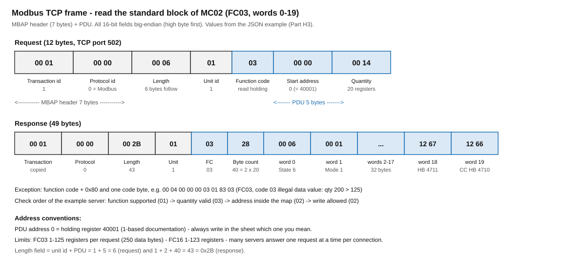

| Part | Bytes | Content |
|---|---|---|
| Transaction id | 2 | chosen by the client, copied by the server → the client matches responses to requests |
| Protocol id | 2 | always `00 00` = Modbus |
| Length | 2 | number of bytes that **follow**: unit id + PDU |
| Unit id | 1 | address of the device behind a gateway (C1.8); for a direct TCP device normally 1 or 255 (ignored by many) |
| PDU | 1 + n | function code + data |

All 16-bit fields are **big-endian** (high byte first). The JSON rules (`_formulas.modbus_frames`):

```
 FC03 request  : 03 start(2) qty(2)                    response : 03 bytecount(1) data(2 × qty)
 FC06 request  : 06 addr(2) value(2)                   response : identical echo
 FC16 request  : 10 start(2) qty(2) bytecount(1) data  response : 10 start(2) qty(2)
 exception     : (fc + 0x80) code(1)
 limits        : FC03 qty 1–125, FC16 qty 1–123 (else code 03)
```

### C1.4 The JSON frames decoded byte by byte

The server is module **MC02** (module M01, unit id 1, base 0) with the JSON values; its map has 20 + 5 = **25 registers** (words
0–24). The register contents are derived in H3. All six frames below are produced identically by `modbus_codec.py` and web 6H.

**Frame 1 – read the standard block (words 0–19), transaction 1, FC03.**

Request (12 bytes):

```
 00 01 00 00 00 06 01 03 00 00 00 14
 │     │     │     │  │  │     └── quantity 0x0014 = 20 registers
 │     │     │     │  │  └──────── start address 0x0000 = word 0 (= 40001)
 │     │     │     │  └─────────── function code 03 = read holding registers
 │     │     │     └────────────── unit id 1
 │     │     └──────────────────── length 6 = unit id (1) + PDU (5)
 │     └────────────────────────── protocol id 0
 └──────────────────────────────── transaction id 1
```

Response (49 bytes):

```
 00 01 00 00 00 2B 01 03 28 00 06 00 01 00 00 00 00 00 62 00 01 00 00 00 00 00 00 05 84 00 00 00 17 00 01 11 71 00 00 00 03 44 E5 50 00 12 67 12 66
```

| Bytes | Meaning |
|---|---|
| `00 01` `00 00` | transaction 1 (copied), protocol 0 |
| `00 2B` | length 43 = unit id 1 + FC 1 + byte count 1 + 40 data bytes |
| `01` `03` | unit 1, FC03 (no error: the function code is returned unchanged) |
| `28` | byte count 40 = 2 × 20 registers |
| `00 06` | word 0 StateCurrent = 6 (Execute) |
| `00 01` | word 1 UnitModeCurrent = 1 (Production) |
| `00 00` `00 00` | words 2–3 Command.CntrlCmd = 0, Command.Bits = 0 |
| `00 62` | word 4 Status.Bits = 0x0062 = 98 = Busy (bit 1) + Auto (bit 5) + PartPresent (bit 6) |
| `00 01` | word 5 Command.UnitMode = 1 |
| `00 00` `00 00` | words 6–7 AlarmNo = 0, WarningNo = 0 |
| `00 00 05 84` | words 8–9 ProdProcessedCount = 0x00000584 = 1 412 |
| `00 00 00 17` | words 10–11 ProdDefectiveCount = 0x17 = 23 |
| `00 01 11 71` | words 12–13 Job.Id = 0x00011171 = 70 001 |
| `00 00 00 03` | words 14–15 Job.PalletId = 3 |
| `44 E5 50 00` | words 16–17 LastCycle_s = REAL 0x44E55000 = 1 834.5 s |
| `12 67` | word 18 Status.Heartbeat = 0x1267 = 4 711 |
| `12 66` | word 19 Command.Heartbeat = 0x1266 = 4 710 |

**Frame 2 – command Start: CntrlCmd = 2 and CmdChangeRequest (words 2–3), transaction 2, FC16.**

```
 request : 00 02 00 00 00 0B 01 10 00 02 00 02 04 00 02 00 01
 response: 00 02 00 00 00 06 01 10 00 02 00 02
```

Request: length 0x0B = 11 = unit 1 + FC 1 + start 2 + qty 2 + byte count 1 + data 4; `10` = FC16; start `00 02`; quantity `00 02`;
byte count `04`; data `00 02` (CntrlCmd = 2 = Start, PackML command number, guide 65 C2) and `00 01` (Command.Bits bit 0 =
CmdChangeRequest). Response: FC16 echoes start and quantity – "2 words written from word 2". Both words have direction "in"
→ write allowed.

**Frame 3 – job download: Job.Id 70 002 + PalletId 4 (words 12–15), transaction 3, FC16.**

```
 request : 00 03 00 00 00 0F 01 10 00 0C 00 04 08 00 01 11 72 00 00 00 04
 response: 00 03 00 00 00 06 01 10 00 0C 00 04
```

70 002 = 0x00011172 → high word `00 01` = 1, low word `11 72` = 4 466 (JSON values [1, 4466, 0, 4]); PalletId 4 = `00 00 00 04`.
Length 0x0F = 15 = 7 + 8 data bytes. Words 12–13 are "in", 14–15 "in/out" → write allowed.

**Frame 4 – too many registers (qty 200), transaction 4.**

```
 request : 00 04 00 00 00 06 01 03 00 00 00 C8
 response: 00 04 00 00 00 03 01 83 03
```

Quantity 0xC8 = 200 > 125 → exception: function code 0x03 + 0x80 = **0x83**, code **03 illegal data value**. Length 3 = unit +
FC + code.

**Frame 5 – address outside the map, transaction 5.**

```
 request : 00 05 00 00 00 06 01 03 03 E8 00 0A
 response: 00 05 00 00 00 03 01 83 02
```

Start 0x03E8 = 1 000, quantity 10 is valid, but words 1 000–1 009 are outside the 25-register map → **code 02 illegal data
address**.

**Frame 6 – write to a read-only word (StateCurrent), transaction 6, FC06.**

```
 request : 00 06 00 00 00 06 01 06 00 00 00 05
 response: 00 06 00 00 00 03 01 86 02
```

Word 0 has direction "out" (written only by the module) → **0x86 code 02**. A successful FC06 would echo the request unchanged.

### C1.5 Exception codes and the check order

| Code | Name | Typical cause |
|---|---|---|
| 01 | Illegal function | function not supported (e.g. FC01 on a server with holding registers only) |
| 02 | Illegal data address | address outside the map; **write to a read-only word** (this standard) |
| 03 | Illegal data value | quantity 0, > 125 (FC03) or > 123 (FC16), byte count ≠ 2 × quantity |
| 04 | Server device failure | internal error while processing |
| 06 | Server device busy | long operation in progress |
| 0A / 0B | Gateway path unavailable / target device failed to respond | Modbus TCP → RTU gateway problems (C1.8) |

**Order of the checks in the example server** (JSON rule, also in `modbus_codec.py --serve`): (1) function supported → else 01;
(2) quantity valid → else 03; (3) address range inside the map → else 02; (4) write allowed → else 02. The order matters: a FC03
request with qty 200 **and** start 1 000 gets code **03**, not 02. Write the check order into the interface sheet so that a
client test gives the same answer on every module.

### C1.6 Word order – ABCD, CDAB, BADC, DCBA

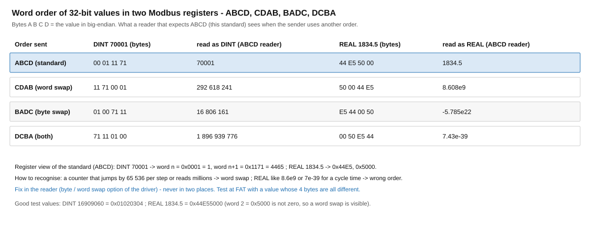

A register is 16 bits. A 32-bit value (DINT, REAL) needs **two registers**, and nothing in Modbus says which comes first.
Call the four bytes of the big-endian value A B C D:

| Name | Register n | Register n+1 | Who uses it |
|---|---|---|---|
| **ABCD** "big-endian", high word first | A B | C D | **this standard**, many PLCs |
| CDAB "word swap", low word first | C D | A B | many older devices, some meters |
| BADC "byte swap" | B A | D C | rare |
| DCBA "little-endian" | D C | B A | some PC software |

**The JSON demo** (`word_order_demo`): DINT 70 001 = bytes `00 01 11 71`; REAL 1 834.5 = IEEE 754 `44 E5 50 00`. What a reader that
expects ABCD reads when the sender uses another order:

| Sent as | DINT registers | read as DINT | REAL registers | read as REAL |
|---|---|---|---|---|
| ABCD | `0001 1171` | **70 001** | `44E5 5000` | **1 834.5** |
| CDAB | `1171 0001` | 292 618 241 | `5000 44E5` | 8.607995 × 10⁹ |
| BADC | `0100 7111` | 16 806 161 | `E544 0050` | −5.784935 × 10²² |
| DCBA | `7111 0100` | 1 896 939 776 | `0050 E544` | 7.429085 × 10⁻³⁹ |

**How to recognise a wrong word order on site:** a counter that reads millions, or jumps by 65 536 per part (word swap); a REAL
cycle time of 8.6 × 10⁹ s or 7 × 10⁻³⁹ s. **How to test at FAT:** write a known value whose four bytes are all different (e.g.
DINT 16 909 060 = 0x01020304) and check it in the client. **REAL encoding:** 1 834.5 = 1.7915… × 2¹⁰ → sign 0, exponent 10 + 127 =
137 = `10001001`, mantissa 0.7915… → `0 10001001 11001010101000000000000` = 0x44E55000.

### C1.7 Polling performance

A Modbus client asks every server in turn. The poll cycle is calculated in E3 (web default: 20 devices × 60 registers, 8 ms
response, 1 ms RTT, 4 parallel connections → **45 ms**; with one connection **180 ms**; 15 modules × 200 registers with 5
connections → 2 requests per device → **54 ms**). Rules:

1. Read the whole block in **one** FC03 (≤ 125 registers) instead of 20 single reads.
2. Poll in **parallel** connections (one per server, or a pool).
3. Write only on change (commands, job download), never cyclically – except the heartbeat (FC06 every second).
4. Time-out per request 500 ms (A7.2); after 3 failed polls in a row or heartbeat unchanged for 3 s → communication lost (H4).

### C1.8 Modbus RTU and gateways

Modbus RTU runs on RS-485 serial lines (9 600–115 200 bit/s, one master, up to 247 slaves, CRC-16). Old devices (meters,
temperature controllers, older drives) are connected through a **Modbus TCP ↔ RTU gateway**: the client sends Modbus TCP to the
gateway's IP; the **unit id** selects the RTU slave address. Pitfalls: RTU is slow (a 60-register read at 19 200 bit/s takes
≈ (8 + 125) bytes × 11 bits ÷ 19 200 ≈ 76 ms + device time), and the gateway answers 0x0A / 0x0B when a slave is missing.

### C1.9 Security of Modbus TCP

Modbus TCP has no authentication and no encryption. Anybody who reaches port 502 can write. Countermeasures (G6): Modbus only
inside the cell zone; **writes only from the cell controller** (DPI firewall rule R06 / R07: FC03 / FC04 allowed from the
manufacturing zone, writes denied); "Modbus/TCP Security" (TLS, port 802) exists in the specification but few devices support it.

### C1.10 Common mistakes and checklist

| Mistake | Result | Better |
|---|---|---|
| 0-based / 1-based confusion | every value shifted by one register | sheet with both numberings; FAT test with known values |
| Word order not agreed | wrong counters and REALs | ABCD written in the sheet; test with 0x01020304 |
| Polling every register separately | slow cycle (20 × 9 ms per device) | one FC03 for the block |
| A new TCP connection per request | server runs out of connections | persistent connection, reconnect only after error |
| No heartbeat | dead partner not detected | words 18 / 19 + 3 s time-out (H4) |

- [ ] Interface sheet with addresses (both numberings), types, word order, direction, check order, time-outs.
- [ ] All six JSON-type test frames (read, write, job download, three exceptions) run against every module at FAT (I3).

---

## C2. OPC UA in depth (IEC 62541)

### C2.1 What OPC UA adds

OPC UA (Unified Architecture) is a client / server (and pub / sub) protocol **with an information model**: data has names, types,
units, structure and relations, and the protocol has **built-in security**. It is the standard for PLC / CNC ⇄ cell controller,
SCADA and MES in most new plants, and the base of the companion specifications (umati, PackML, Euromap 77, robotics).

### C2.2 The address space

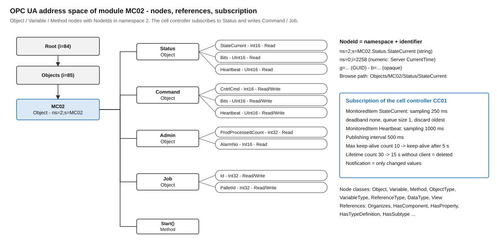

Everything in a server is a **node**. Nodes are connected by **references**.

| Node class | Meaning | FMS example |
|---|---|---|
| Object | a thing | `MC02`, `MC02/Status` |
| Variable | a value with data type, access level, time stamp, status code | `StateCurrent` (Int16) |
| Method | a function that a client can call | `Start()`, `LoadJob(jobId, palletId)` |
| ObjectType / VariableType | type definitions (classes) | `ModuleType` with Status, Command, Admin, Job |
| ReferenceType | kind of relation | Organizes, HasComponent, HasProperty, HasTypeDefinition |
| DataType | data types incl. structures and enumerations | `PackMLStateEnum` |
| View | a subset of the address space | "maintenance view" |

**NodeId** = namespace index + identifier: `ns=2;s=MC02.Status.StateCurrent` (string), `ns=0;i=2258` (numeric, the server's current
time), GUID or opaque forms. Namespace 0 is the OPC UA base; servers add their own namespaces (the index can change between
servers – clients should resolve the namespace **URI**, not hard-code the index). The **browse path** `Objects/MC02/Status/StateCurrent`
is the human-readable path (web 6F shows both).

Each Variable has attributes: `Value`, `DataType`, `ValueRank`, `AccessLevel` (read / write / history), `MinimumSamplingInterval`;
each value comes with a **StatusCode** (Good / Uncertain / Bad) and **time stamps** (source and server). A Bad status tells the
client "do not trust this value" – something Modbus cannot express.

### C2.3 Services

| Service set | Services | Use in an FMS |
|---|---|---|
| Discovery | FindServers, GetEndpoints | the client finds endpoints and security options |
| SecureChannel | OpenSecureChannel, CloseSecureChannel | encrypted channel with certificates |
| Session | CreateSession, ActivateSession (user identity), CloseSession | one session per client application |
| View | Browse, BrowseNext, TranslateBrowsePathsToNodeIds | find nodes by path |
| Attribute | Read, Write, HistoryRead | read values, write commands / jobs |
| Method | Call | call `Start()` or `LoadJob(...)` with arguments and get a result |
| MonitoredItem / Subscription | CreateSubscription, CreateMonitoredItems, Publish, Republish | server pushes changed values (no polling) |

Endpoint URL: `opc.tcp://10.1.101.17:4840` (binary TCP; port 4840 is common, servers may use others).

### C2.4 Subscriptions – sampling, publishing, queue, deadband

A client does not poll. It creates a **subscription** with **monitored items**:

| Parameter | Belongs to | Meaning | Typical FMS value |
|---|---|---|---|
| Sampling interval | monitored item | how often the server checks the value | states 100–250 ms, counters 1 s, temperatures 5–10 s |
| Queue size | monitored item | how many changes are kept between two publishes | 1 (latest value) for states; > 1 if every change counts (e.g. events) |
| Discard oldest | monitored item | which change is dropped when the queue is full | true |
| Deadband | monitored item | absolute or percent change needed to report | analog values: e.g. 0.5 °C or 1 % |
| Data change trigger | monitored item | Status / StatusValue / StatusValueTimestamp | StatusValue |
| Publishing interval | subscription | how often the server sends a notification message (with all changes) | 250–1 000 ms |
| Max keep-alive count | subscription | publishing intervals without data before an empty keep-alive message | 10 (→ 5 s at 500 ms) |
| Lifetime count | subscription | publishing intervals without client contact before the server deletes the subscription (≥ 3 × keep-alive) | 30 (→ 15 s) |

**Load** (E7): the JSON case – 600 items (15 modules × 40) sampled every 250 ms, 20 % change per sample, 15 subscriptions at 500 ms
→ 480 notifications/s, 30 publish messages/s → **151.2 kbit/s**. Small compared with 100 Mbit/s, but the CPU of a small PLC server
limits the number of monitored items (check the maker's limit, often a few hundred to a few thousand items).

### C2.5 Security – modes, policies, certificates, trust lists

| Item | Options | This guide's rule |
|---|---|---|
| Message security mode | None, Sign, **SignAndEncrypt** | SignAndEncrypt between zones; Sign at minimum inside the cell |
| Security policy | e.g. Basic256Sha256, Aes128_Sha256_RsaOaep, Aes256_Sha256_RsaPss (older Basic128Rsa15 / Basic256 are deprecated) | a current policy supported by all partners |
| Application authentication | X.509 **application instance certificate** per application (client and server); the certificate contains the ApplicationUri | CA-signed by a plant CA (G9); self-signed only for tests |
| Trust list | folders trusted / rejected / issuers on each side | a new client is **rejected** until its certificate is trusted |
| User authentication | anonymous, user name + password, user certificate, token | no anonymous write access; roles (operator, engineer) |
| Certificate management | manual copy, or GDS (global discovery server) push / pull | GDS or a documented manual process with expiry dates |

**Typical commissioning problem:** "BadSecurityChecksFailed" or "BadCertificateUntrusted" – the server has put the client
certificate into its rejected folder. Move it to trusted (after checking the thumbprint), reconnect (I5). Certificates **expire**
(often 1–5 years) – put the expiry dates into the maintenance plan, otherwise the cell stops on the day the certificate expires.

### C2.6 Companion specifications

| Specification | Domain | Main content |
|---|---|---|
| OPC UA for Machinery (OPC 40001) | all machines | identification, machine state building blocks |
| **umati / OPC UA for Machine Tools** (OPC 40501) | CNC machine tools | MachineTool, Monitoring (spindle, axes, channels), Production (jobs, programs), Notification (alarms) |
| OPC UA for Robotics (OPC 40010) | industrial robots | motion devices, controllers, safety states |
| **PackML** (OPC 30050, from ISA-TR88.00.02) | packaging / any state machine | PackML state machine, PackTags (Status, Command, Admin) – the base of our data block |
| **Euromap 77** (OPC 40077) | injection moulding | machine, job, cycle parameters |
| Euromap 83 | plastics, general | general machine data |
| AutoID (OPC 30010) | RFID, code readers | read / write tag results |

**Rule:** where a companion specification exists for a module type, ask the supplier for it (umati for the CNCs, AutoID for the
RFID readers). Where none exists, use the standard data block as an OPC UA object type (H6) with the PackML names.

### C2.7 Worked example – the cell controller reads MC02

1. CC01 calls GetEndpoints on `opc.tcp://10.1.101.151:4840` → server offers SignAndEncrypt / Basic256Sha256.
2. OpenSecureChannel with CC01's certificate; the CNC trusts it (it is in the trusted folder since FAT).
3. CreateSession / ActivateSession with user `cc01-svc`.
4. TranslateBrowsePathsToNodeIds for `Objects/MC02/Status/StateCurrent` etc. → NodeIds (the namespace index is resolved from the
   URI).
5. CreateSubscription (publishing 500 ms) with monitored items StateCurrent, Status.Bits, AlarmNo (sampling 250 ms, queue 1) and
   Heartbeat (1 000 ms).
6. A change of StateCurrent from 6 (Execute) to 17 (Complete) arrives in the next publish message, at most ≈ 250 + 500 ms later.
7. Job download: Write `Job.Id` = 70 002 and `Job.PalletId` = 4, then Write `Command.Bits` with HS.Request (or Call
   `LoadJob(70002, 4)` if the module offers a method – a method is atomic, better than several writes).

### C2.8 Common mistakes and checklist

| Mistake | Better |
|---|---|
| Security mode None "for commissioning", never changed | SignAndEncrypt from FAT on; certificates part of the delivery |
| Hard-coded namespace index `ns=2` in the client | resolve the namespace URI at connect |
| Thousands of monitored items on a small PLC | count items; group; slower sampling for slow values |
| Certificates expire unnoticed | expiry list in maintenance plan; GDS |

- [ ] Endpoint, security mode / policy, user, certificate owner and expiry in the interface sheet.
- [ ] Subscription parameters (sampling, publishing, queue, deadband) per item group.
- [ ] Companion specification used where available.

---

## C3. MTConnect (ANSI/MTC1.4)

MTConnect is a **read-only** standard for machine-tool data: an **agent** (HTTP server, often on the CNC or a small PC) answers
requests with XML or JSON in a standard vocabulary (axes, spindle speed and load, program, execution state, alarms, part count).
An **adapter** connects the CNC to the agent (often with the simple SHDR text protocol).

| Request | Answer |
|---|---|
| `/probe` | the device model: components and data items |
| `/current` | latest value of every data item |
| `/sample?from=n&count=m` | time series from the agent's buffer (sequence numbers) |
| `/assets` | tools, fixtures, programs as assets |

Use: OEE and monitoring of CNCs from **different brands** with one vocabulary (US / Asian machine tools often offer it; European ones
more often umati). It cannot send jobs or commands – those go via the CNC's own interface or the cell controller. The agent's
default HTTP port is commonly 5000; in this project never 8080. For the "only Modbus TCP + HTTP" plant (J2) an MTConnect-style
HTTP agent is an allowed way to read CNC data.

---

## C4. MQTT and Sparkplug B

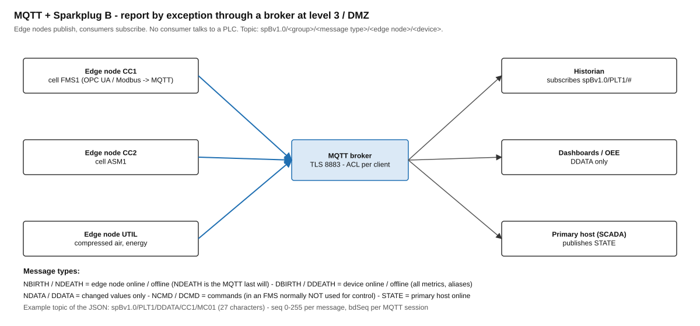

### C4.1 MQTT principle

MQTT (OASIS standard, versions 3.1.1 and 5.0) is **publish / subscribe through a broker**. Clients never talk to each other
directly: a **publisher** sends a message to a **topic** on the broker; every client that **subscribed** to the topic gets it. One
outgoing TCP connection per client (port 1883, with TLS **8883**) – this is why IT likes it: firewalls only need "client → broker".

| Feature | Meaning | FMS use |
|---|---|---|
| Topic | text path, `/` separated: `plant/FMS1/MC02/state` | the namespace |
| Wildcards (subscribe only) | `+` = one level, `#` = all levels below | historian subscribes `spBv1.0/PLT1/#` |
| **QoS 0** | at most once (PUBLISH, no answer) | frequent values where the next value replaces a lost one |
| **QoS 1** | at least once (PUBLISH → PUBACK; duplicates possible) | normal data, events (receiver must tolerate duplicates) |
| **QoS 2** | exactly once (PUBLISH → PUBREC → PUBREL → PUBCOMP) | rarely; costs 4 messages |
| Retain | broker keeps the last message of a topic and gives it to new subscribers | last known state, Sparkplug STATE |
| Last will (LWT) | message the broker publishes when a client disappears without DISCONNECT | "edge node offline" (Sparkplug NDEATH) |
| Keep-alive | client sends PINGREQ if idle; the broker drops the client after 1.5 × keep-alive without traffic | e.g. 30 s → offline detected after 45 s |
| Clean / persistent session | persistent: broker stores subscriptions and QoS 1/2 messages while the client is away | consumers that must not lose data |
| MQTT 5 additions | session expiry, message expiry, reason codes, user properties, shared subscriptions | load-balanced consumers |
| Security | TLS (server certificate, optional client certificates), user / password, **ACL per client** (which topics it may publish / subscribe) | mandatory in a plant |

### C4.2 Why plain MQTT is not enough – Sparkplug B

Plain MQTT says nothing about topic structure, payload format or whether a value is current. **Sparkplug B** (Eclipse Sparkplug,
version 3.0) adds:

| Element | Content |
|---|---|
| Topic namespace | `spBv1.0/<group_id>/<message_type>/<edge_node_id>[/<device_id>]` |
| Payload | Google protobuf: time stamp, sequence number, list of **metrics** (name or alias, data type, value, time stamp) |
| NBIRTH | edge node comes online: publishes **all** its node metrics, incl. `bdSeq` |
| DBIRTH | a device behind the edge node comes online: all its metrics with data types (and aliases) |
| NDATA / DDATA | **only changed** metrics (report by exception) |
| NDEATH | edge node offline – registered as the MQTT **last will** at connect, with the same `bdSeq` as the NBIRTH |
| DDEATH | a device went offline (published by the edge node) |
| NCMD / DCMD | commands to the edge node / device (e.g. `Node Control/Rebirth`) |
| STATE | the **primary host application** (e.g. SCADA) announces it is online: topic `spBv1.0/STATE/<host_id>`, retained (Sparkplug 3.0) |
| seq | 0–255 per edge node, +1 on every message (NBIRTH = 0); a gap → the host requests a rebirth |
| bdSeq | birth / death sequence per MQTT session; links NDEATH to the right NBIRTH |

Because every consumer gets the BIRTH (all metrics + types) and DEATH messages, it always knows **what exists and whether the data
is current** – the "state awareness" that plain MQTT lacks.

### C4.3 Topic naming in this guide

- JSON `naming`: Sparkplug group = `FMS1` (the cell), edge node = `CC1` (the cell controller acts as edge node), device = the unit:
  `spBv1.0/FMS1/DDATA/CC1/MC02`, metric `Status/StateCurrent` (web 6F, H6).
- The JSON MQTT load example uses `spBv1.0/PLT1/DDATA/CC1/MC01` (group = plant). Both are valid Sparkplug topics; a plant decides
  **one** rule (group = cell is recommended here – one group per cell keeps ACLs simple). Both topics have **27 characters**, so the
  load result of E8 is the same.
- The **unified namespace (UNS)** idea: all current data of the plant is available in one broker structure that follows the
  ISA-95 hierarchy (site / area / cell / unit). With Sparkplug the hierarchy is group / edge / device; the item-5 tag
  `PLT1.MACH.FMS1.MC02.Status.StateCurrent` maps to group `FMS1`, device `MC02`, metric `Status/StateCurrent`.

### C4.4 Worked example – load of the broker

E8: 20 edge nodes × 1 message/s, 50 metrics × 12 B, topic 27 characters, header 10 B → message 641 B; broker in 12 820 B/s, out to 3
subscribers 38 460 B/s → **410.24 kbit/s**. Tiny for the network; the broker CPU and the number of connections are the real limits.

### C4.5 Where MQTT belongs in an FMS

| Use | MQTT? |
|---|---|
| Data out to historian, dashboards, OEE, energy, a unified namespace | **yes** – many consumers, no load on PLCs |
| Module ⇄ cell controller handshakes | **no** – use the data block on Modbus TCP / OPC UA / fieldbus (H) |
| Commands to machines (DCMD) | normally **no** – commands go through the cell controller; if used, only with a security and safety concept |
| Cell devices to an internet / cloud broker | **no** – offline factory; the JSON flow "Cell PLC → Cloud broker mqtts" is **denied by R14** (G6). A broker in the DMZ or level 3 is the outward point. |

### C4.6 Common mistakes and checklist

| Mistake | Better |
|---|---|
| Free topic names per supplier | Sparkplug B or a written topic standard |
| QoS 2 everywhere | QoS 0 / 1 with sequence checks |
| No ACL: every client may publish everywhere | ACL per client certificate / user |
| Broker without TLS | TLS 8883, certificates from the plant CA |

- [ ] Broker location (level 3 / DMZ), TLS, ACL, retained STATE, LWT / NDEATH configured.
- [ ] Topic and metric names derived from the item-5 tags.

---

## C5. HTTP REST and MES APIs

### C5.1 Principle

HTTP (RFC 9110) is request / response between a client and a server. **REST** is a style: the API exposes **resources** (nouns,
URLs) and uses HTTP **methods** (verbs) on them. Payload normally JSON. It is the standard between MES ⇄ ERP, MES ⇄ WMS / AGV fleet
manager / label printers, and – in "only Modbus TCP + HTTP" plants – between the cell controller and the MES (J2).

| Method | Meaning | Idempotent? | Example |
|---|---|---|---|
| GET | read | yes | `GET /api/v1/cells/FMS1/jobs?state=released` |
| POST | create / trigger | **no** (unless an idempotency key is used) | `POST /api/v1/jobs/70002/confirmations` |
| PUT | replace a resource | yes | `PUT /api/v1/units/MC02/mode` with `{"mode": 1}` |
| PATCH | change parts | not necessarily | `PATCH /api/v1/jobs/70002` with `{"priority": 2}` |
| DELETE | remove / cancel | yes | `DELETE /api/v1/jobs/70003` (cancel if not started) |

**Idempotent** = repeating the request has the same effect (guide 65 D2.4). After a time-out the client does not know whether the
POST arrived → send it again with the same **Idempotency-Key** header (or a message id in the body); the server recognises the
duplicate and answers with the first result.

| Status code | Meaning | Client reaction |
|---|---|---|
| 200 OK / 201 Created / 202 Accepted / 204 No Content | success (202 = accepted, processing later) | continue |
| 400 Bad Request / 422 Unprocessable | wrong JSON / wrong content | do not retry; log; alarm |
| 401 Unauthorized / 403 Forbidden | not authenticated / not allowed | check credentials / roles |
| 404 Not Found | resource does not exist | check id |
| 409 Conflict | state conflict (job already started) | read the resource, decide |
| 429 Too Many Requests | rate limit | wait (Retry-After), retry |
| 500 / 502 / 503 / 504 | server / proxy error, unavailable, time-out | retry with back-off (10 s, 30 s, 60 s …) – store-and-forward (guide 65 D2.2) |

### C5.2 Design rules

1. **Version** in the path: `/api/v1/...`; breaking changes → `/api/v2/` while v1 stays alive.
2. Describe the API in an **OpenAPI** document; payloads with **JSON Schema** (types, required fields, enums); validate on both sides.
3. Use the item-5 names and ISA-95 objects (guide 65 A5) in the JSON.
4. Time stamps in UTC ISO 8601 (`2026-11-20T06:03:12.400Z`).
5. **Push** from server to client: Server-Sent Events (SSE, one-way text stream over HTTP) or WebSocket (two-way); or webhooks
   (server calls a client URL). For an FMS cell controller SSE is simple and firewall-friendly.
6. **Authentication**: HTTPS only (TLS 443); bearer tokens (OAuth2 / OpenID Connect from the plant identity server) or
   client certificates (mTLS) for machine-to-machine; never basic auth without TLS.
7. Paging for lists (`?limit=100&after=...`), ETag / If-Match for safe updates (409 / 412 on conflict).

### C5.3 MES API examples (cell controller CC01 ⇄ MES)

Get released jobs:

```http
GET /api/v1/cells/FMS1/jobs?state=released&limit=10 HTTP/1.1
Host: mes01.plt1.local
Authorization: Bearer eyJ...
Accept: application/json
```

```json
HTTP/1.1 200 OK
Content-Type: application/json

{"items": [
  {"jobId": 70002, "order": "PO-4711", "operation": "0020", "material": "CC20",
   "ncProgram": "O2010", "ncRevision": "C", "fixture": "F-CC20", "palletId": 4,
   "quantity": 1, "dueUtc": "2026-11-20T09:00:00Z", "state": "released"}],
 "next": null}
```

Confirm a finished job (idempotent with a key):

```http
POST /api/v1/jobs/70001/confirmations HTTP/1.1
Host: mes01.plt1.local
Idempotency-Key: CC01-70001-DONE-1
Content-Type: application/json

{"unit": "PLT1.MACH.FMS1.MC02", "result": "OK", "good": 1, "scrap": 0,
 "cycleTime_s": 1834.5, "startUtc": "2026-11-20T06:03:12.400Z", "endUtc": "2026-11-20T06:33:46.900Z"}
```

```json
HTTP/1.1 201 Created
Location: /api/v1/jobs/70001/confirmations/1
{"accepted": true, "duplicate": false}
```

The same POST repeated after a time-out returns `200 OK {"accepted": true, "duplicate": true}` – no double booking.

Push of new jobs (SSE):

```http
GET /api/v1/cells/FMS1/events HTTP/1.1
Accept: text/event-stream
```

```
event: job.released
id: 5512
data: {"jobId": 70003, "palletId": 5}
```

On reconnect the client sends `Last-Event-ID: 5512` and the server continues from there.

### C5.4 Common mistakes and checklist

| Mistake | Better |
|---|---|
| POST without idempotency → double confirmations after retries | Idempotency-Key / message id |
| Polling GET every 100 ms | SSE / WebSocket push, or polling every 5–10 s |
| No versioning | `/api/v1/`, OpenAPI document |
| HTTP without TLS inside the plant | HTTPS with plant certificates |

- [ ] OpenAPI + JSON Schema delivered; status codes and retry rules written; time-outs and back-off defined.

---

## C6. Domain standards

| Standard | Domain | Technology | Content |
|---|---|---|---|
| Euromap 63 | injection moulding (old) | file exchange | job, parameters via files |
| Euromap 77 / 83 | injection moulding / plastics | OPC UA companion specs | machine, jobs, cycle data (C2.6) |
| **IPC-CFX** (IPC-2591) | electronics assembly | AMQP 1.0 messages, JSON | standard message dictionary (units processed, faults, materials) |
| **IPC-HERMES-9852** ("Hermes") | electronics assembly | TCP + XML between neighbour machines | board hand-over (board available, machine ready, transport finished) – replaces the old SMEMA wires |
| VDMA / umati family | machine tools, robotics, many machine types | OPC UA | see C2.6 |
| MTP (VDI/VDE/NAMUR 2658) | process modules | OPC UA + description file | modular plants (guide 65) |

**Rule:** if the FMS includes machines of a domain with its own standard (moulding, SMT), use that standard for the machine ⇄ MES
link and map it to the standard data block in the cell controller – do not force the supplier to drop his domain standard.

---

# Part D – Choosing a protocol per link

## D1. Protocol families

| Family | Protocols | Job | Typical time |
|---|---|---|---|
| Sensor link | IO-Link | smart sensors, valve terminals, RFID heads | 2–10 ms |
| Cyclic real-time fieldbus | PROFINET, EtherCAT, EtherNet/IP, CC-Link IE | IO, drives, PLC ⇄ PLC inside machine / cell | 0.05–10 ms |
| Safety layer | PROFIsafe, FSoE, CIP Safety | safety signals over the fieldbus ("black channel") | bus + watchdog |
| Client / server | Modbus TCP (no model), OPC UA (model), MTConnect / umati (machine-tool model) | jobs, states, values between controllers and supervisory systems | 10 ms – 1 s |
| IT messaging | MQTT (+ Sparkplug B), HTTP REST, B2MML | MES, ERP, historian, dashboards, cloud | 0.1 s – minutes |
| Domain standards | Euromap 77 / 83 (moulding), IPC-CFX / Hermes (electronics) | machines of one industry ⇄ MES | ≈ 1 s |

Web 6A lists 16 protocols with level, type, cycle, data model, ecosystem, use, pros and cons; web 6L adds a deep card per protocol.

## D2. The decision method

A protocol is chosen **per link**, not per project. The method has six steps:

1. **List the links** of the architecture (guide 65 A1): sensor → IO; PLC ⇄ IO / drives; motion; safety between modules;
   module ⇄ cell controller; CNC → cell / MES; SCADA ⇄ PLC; MES ⇄ ERP; data out (historian, dashboards).
2. **Collect the plant rules** (from the customer's IT / OT standard, phase P1 of guide 61): PLC brand standard, allowed protocols,
   security rules (no cloud, DMZ), spare-part and skills policy.
3. **Write the technical requirement of each link**: cycle / latency (E), data volume, determinism, safety, number of consumers,
   who writes (one owner of commands).
4. **Apply the rules** of D3 → a first choice per link.
5. **Check with numbers** (Part E) and with the suppliers (which protocols do their controllers offer? which companion specs?).
6. **Write the result into the URS** (protocol per link, conformance classes, data block, security) and into every supplier's
   specification.

| Requirement | Points to |
|---|---|
| < 1 ms, synchronised axes | EtherCAT DC, PROFINET IRT, CIP Motion – inside the machine |
| 1–10 ms cyclic IO | PROFINET RT, EtherNet/IP, EtherCAT, CC-Link IE (company standard) |
| Safety | PROFIsafe / CIP Safety / FSoE (single family) or hard-wired |
| 10–500 ms states, jobs, handshakes between systems | standard data block on PLC-PLC fieldbus coupling, Modbus TCP or OPC UA |
| Semantic model, security, many clients | OPC UA (+ companion spec) |
| Many consumers of the same data, outward data | MQTT Sparkplug B via a broker at level 3 / DMZ |
| Business transactions (orders, confirmations) | HTTP REST / JSON with ISA-95 content |

## D3. The rules of web 6B

Web 6B asks 7 questions: company PLC standard (Siemens, Rockwell, Beckhoff, Mitsubishi, Omron, Delta, mixed), "only Modbus TCP +
HTTP allowed?", fast motion needed?, networked safety wanted?, CNCs of several brands?, data to cloud / many consumers?, ERP
interface type. It derives:

| Brand | Fieldbus (FB) | Safety | Motion |
|---|---|---|---|
| Siemens | PROFINET RT | PROFIsafe | PROFINET IRT |
| Rockwell (Allen-Bradley) | EtherNet/IP | CIP Safety | CIP Motion |
| Beckhoff | EtherCAT | FSoE (Safety over EtherCAT) | EtherCAT (distributed clocks) |
| Mitsubishi | CC-Link IE | CC-Link IE Safety | CC-Link IE TSN / SSCNET |
| Omron | EtherNet/IP (EtherCAT for motion) | FSoE / CIP Safety | EtherCAT |
| Delta | EtherCAT / Modbus TCP | FSoE | EtherCAT |
| Mixed / other | PROFINET or EtherNet/IP (choose one plant-wide) | PROFIsafe or CIP Safety (with the chosen bus) | EtherCAT |

| Link | Default choice | If "only Modbus TCP + HTTP" |
|---|---|---|
| Sensor → IO | IO-Link + simple 24 V IO | same |
| PLC ⇄ IO / drives (inside a module) | company PLC standard bus (FB) | machine builder's choice – stays inside the module |
| Fast motion | MO of the brand (if needed) | inside the machine |
| Safety between modules | SAFE of the brand if wanted, else hard-wired | **hard-wired** dual channel |
| Module ⇄ cell controller | OPC UA (jobs, data) + FB PLC-PLC coupling for fast handshakes | **Modbus TCP – standard data block** |
| CNC → cell controller / MES | umati or MTConnect (several brands), maker's OPC UA (one brand) | CNC → Modbus TCP gateway or HTTP agent (MTConnect-style JSON) |
| SCADA ⇄ PLC | OPC UA (or native driver of the brand); writes via cell controller | Modbus TCP (read; writes only via the cell controller) |
| MES ⇄ ERP | REST / JSON (B2MML content), or XML messages, or file exchange (plan upgrade) | HTTP REST |
| Data out (historian, dashboards) | OPC UA → historian; MQTT Sparkplug via DMZ broker if many consumers | HTTP (SSE / REST) gateway → historian; MQTT only from the DMZ outwards |

## D4. Four factory rule sets worked through

### D4.1 Plant 1 – "Siemens plant"

Rules: Siemens PLCs everywhere, PROFINET, PROFIsafe allowed, CNCs of two brands, MES with REST, historian via OPC UA, no cloud.

| Link | Choice | Reason / numbers |
|---|---|---|
| Sensors | IO-Link masters on PROFINET | data storage, RFID at load stations |
| Inside modules | PROFINET RT CC-B, update 2–8 ms | E1: 30 devices × 32 B at 2 ms = 10.1 % load |
| Motion | PROFINET IRT only in the stacker (2 synchronised axes) | CC-C devices in the stacker only |
| Safety between modules | PROFIsafe, shared device for F-modules at the load stations | single family; validation in the safety plan |
| Module ⇄ cell | I-device / PN-PN coupler with the standard data block for handshakes (ms); OPC UA for jobs and data | H6 byte layout |
| CNC → cell / MES | umati (both CNC brands offer it) | one vocabulary |
| SCADA | OPC UA / native S7 driver, read; writes only via CC01 | rule R05–R07 |
| MES ⇄ ERP | REST / JSON | C5 |
| Data out | OPC UA → historian on level 3 | no cloud |

### D4.2 Plant 2 – "Rockwell plant"

Rules: Allen-Bradley PLCs, EtherNet/IP, CIP Safety, one CNC brand with its own OPC UA server, data to many dashboards.

| Link | Choice | Note |
|---|---|---|
| Inside modules | EtherNet/IP, RPI 5–20 ms, unicast where possible | IGMP snooping + querier in every cell VLAN (B4.2) |
| Safety | CIP Safety | |
| Module ⇄ cell | produced / consumed tags with the standard data block layout (fast handshake) + OPC UA for jobs | |
| CNC | maker's OPC UA server | one brand |
| Data out | MQTT Sparkplug B via a broker in the DMZ | many consumers (E8: 410 kbit/s for 20 edges) |
| Packets per second | B4.3: 4 000 pps at the cell PLC scanner | check data sheet |

### D4.3 Plant 3 – "Beckhoff machines, mixed cell"

Rules: the machine builder uses Beckhoff PCs with EtherCAT; the cell controller is a Linux PC; the plant has no PLC standard.

| Link | Choice | Note |
|---|---|---|
| Inside machines | EtherCAT (DC for axes) | E2: 40 slaves × 16 B → 99.2 µs minimum cycle |
| Safety | FSoE inside machines; hard-wired between modules (different suppliers) | B6.4 |
| Module ⇄ cell | OPC UA server of the machine PC with the standard data block as object type; or Modbus TCP server (a software function on the PC) | H6 |
| Data out | OPC UA → historian | |

### D4.4 Plant 4 – "only Modbus TCP + HTTP"

Rules (like the Ball screw factory of this twin): between systems **only Modbus TCP and HTTP**, no OPC UA, no MQTT, no networked
safety between suppliers.

| Link | Choice | Note |
|---|---|---|
| Inside modules | machine builder's own bus – stays inside the module | not visible to the plant |
| Safety between modules | hard-wired dual channel | |
| Module ⇄ cell | **Modbus TCP, standard data block** (Part H): words 0–19 + module part | E3: 20 modules × 60 registers, 4 connections → 45 ms |
| CNC → cell | CNC Modbus TCP gateway or HTTP agent with JSON | C3 |
| SCADA | Modbus TCP read; writes only via CC01 | DPI firewall R06 / R07 |
| Cell ⇄ MES, MES ⇄ ERP | HTTP REST with the API of C5.3 | idempotency keys |
| Data out | HTTP (REST / SSE) gateway → historian | no MQTT |

J2 works this plant out completely.

---

# Part E – Calculations

All formulas are the JSON `_formulas`; the first four are the calculators of web 6C with the same verdict texts. `net_calc.py`
prints every case (`python tools/fmse/net_calc.py`), web 6G shows them with editable inputs. All results are **examples**.

## E1. PROFINET cyclic load

### E1.1 Formula

```
 frame = max(64, io + 10 + 22)          io = cyclic data per device and direction [B]; 10 = PROFINET overhead
                                          (frame id, cycle counter, data / transfer status, IOxS status bytes – simplified);
                                          22 = Ethernet header 14 + VLAN tag 4 + FCS 4
 wire  = frame + 20                       + preamble / SFD 8 + inter-frame gap 12
 bps   = dev × wire × 8 ÷ (cyc_ms ÷ 1000)   bandwidth per direction at the controller port
 load  = bps ÷ (spd_Mbit × 10⁶)           verdict OK if load < 0.5 (guideline: cyclic real-time traffic < 50 % per port)
```

### E1.2 Case 1 – web default: 30 devices, 32 B, 2 ms, 100 Mbit/s

1. frame = max(64, 32 + 10 + 22) = max(64, 64) = **64 B**.
2. wire = 64 + 20 = **84 B**.
3. bps = 30 × 84 × 8 ÷ 0.002 = 20 160 ÷ 0.002 = **10.08 Mbit/s**.
4. load = 10.08 ÷ 100 = **10.1 %** → **OK – below 50 %**.

### E1.3 Case 2 – big drives + robots at 1 ms: 60 devices, 250 B, 1 ms, 100 Mbit/s

1. frame = max(64, 250 + 32) = **282 B**; wire = **302 B**.
2. bps = 60 × 302 × 8 ÷ 0.001 = **144.96 Mbit/s**.
3. load = **145.0 %** → **Too high – longer update time, fewer devices per port, 1 Gbit/s backbone, or split into lines.**

What helps (same formula, extra scratch values – not JSON cases): update time 4 ms → 36.24 Mbit/s = 36.2 % (OK); three lines of 20
devices at 1 ms → 48.32 Mbit/s = 48.3 % per line (just OK, no reserve); 1 Gbit/s controller port → 14.5 % (needs a controller and
devices that support it – most PROFINET field devices are 100 Mbit/s). **Lesson:** first ask whether 1 ms is really needed for all
60 devices; usually only a few drives need it.

### E1.4 Use, mistakes, checklist

Use it for every PROFINET controller port and for each uplink that carries several machines' cyclic traffic (a backbone switch
port that carries 3 machines = sum of the three). Mistake: calculating with bytes instead of frames (A2.4). Checklist: [ ] load per
controller port < 50 %; [ ] uplinks summed; [ ] update times from the process.

## E2. EtherCAT cycle

### E2.1 Formula

```
 bytes      = max(84, 14 + 2 + 12 + dev × bytes_per_slave + 4 + 20)   Ethernet header + EtherCAT header + datagram header/WKC
                                                                       + process data + FCS + wire overhead
 t_wire_us  = bytes × 8 ÷ spd_Mbit
 t_us       = t_wire_us + dev × fwd_us                                 + forwarding delay of every slave
 cycle_min  = 1.25 × t_us                                              + 25 % master margin
 verdict    < 250 µs → fast enough for motion at 250 µs ; < 1 000 µs → 1 ms cycle possible ; else several frames / segments
```

### E2.2 Case 1 – web default: 40 slaves × 16 B, 100 Mbit/s, 0.6 µs

1. bytes = 14 + 2 + 12 + 40 × 16 + 4 + 20 = 28 + 640 + 24 = **692 B**.
2. t_wire = 692 × 8 ÷ 100 = **55.36 µs**.
3. forwarding = 40 × 0.6 = **24.0 µs** → t = **79.36 µs**.
4. cycle_min = 1.25 × 79.36 = **99.2 µs** → **Fast enough for motion at 250 µs**.

### E2.3 Case 2 – 100 IO terminals × 8 B

1. bytes = 28 + 800 + 24 = **852 B** → t_wire = **68.16 µs**; forwarding 100 × 0.6 = **60.0 µs** → t = **128.16 µs**.
2. cycle_min = **160.2 µs** → **Fast enough for motion at 250 µs**.

**Lesson:** with many small slaves the **forwarding delay** (60 µs) is almost as large as the wire time (68 µs) – the number of
slaves, not the bytes, drives the cycle.

## E3. Modbus TCP polling

### E3.1 Formula

```
 req      = ceil(regs ÷ 125)                       FC03 reads at most 125 registers
 tr       = rtt + resp                    [ms]     one transaction
 cycle    = ceil(dev ÷ max(1, conn)) × req × tr    [ms]  conn = parallel connections of the client
 updates/s = 1000 ÷ cycle
 sizes    = request 12 B ; response 9 + 2 × min(regs, 125) B   (TCP payload)
 verdict  ≤ 100 ms good for states and handshakes ; ≤ 500 ms OK for monitoring ; else too slow
```

### E3.2 Case 1 – web default: 20 devices × 60 registers, 8 ms, RTT 1 ms, 4 connections

1. req = ceil(60 ÷ 125) = **1**; tr = 1 + 8 = **9 ms**.
2. cycle = ceil(20 ÷ 4) × 1 × 9 = 5 × 9 = **45 ms**; updates = 1 000 ÷ 45 = **22.2 /s**.
3. sizes: request 12 B, response 9 + 120 = **129 B**.
4. Verdict: **Good for states and handshakes (≤ 100 ms)**.

### E3.3 Case 2 – one connection only

cycle = 20 × 1 × 9 = **180 ms**, **5.6 /s** → **OK for monitoring, slow for handshakes – more parallel connections.** Same network,
same devices – only the client design is worse. This is the most common cause of a "slow" Modbus cell.

### E3.4 Case 3 – 15 modules, 200 registers each, 5 connections

1. req = ceil(200 ÷ 125) = **2** (e.g. 125 + 75 registers).
2. cycle = ceil(15 ÷ 5) × 2 × 9 = 3 × 18 = **54 ms**, **18.5 /s**; response size for the first request 9 + 250 = **259 B**.
3. Verdict: **Good for states and handshakes**.

**Effect on the handshake (H5):** the handshake simulation uses a poll period of 100 ms per tick. A poll cycle of 45–54 ms fits
inside one tick; with 180 ms each handshake step would take two ticks → a job cycle overhead of about 12 ticks instead of 6.

## E4. Historian volume

### E4.1 Formula

```
 vps     = tags × rate                          values per second
 net     = vps × bytes × 8 ÷ 1000     [kbit/s]  before compression
 GB_day  = vps × bytes × 86 400 × comp ÷ 10⁹    comp = share really stored (deadband / compression)
 total   = GB_day × days ;  verdict < 500 GB → fits a normal server disk (plan × 2 for back-up)
```

### E4.2 Case 1 – web default: 3 000 tags, 1 /s, 16 B, 730 days, 30 %

1. vps = **3 000 /s**; net = 3 000 × 16 × 8 ÷ 1 000 = **384 kbit/s**.
2. GB/day = 3 000 × 16 × 86 400 × 0.3 ÷ 10⁹ = **1.24 GB** (1.24416).
3. total = 1.24416 × 730 = **908 GB** → **Large – lower rates for slow signals, deadband, aggregate old data.**

### E4.3 Case 2 – everything at 100 ms, no deadband

vps = **30 000 /s**; net **3 840 kbit/s**; **41.47 GB/day**; **30 275 GB** in 2 years → **Large**. Thirty times case 1: the rate and the
deadband decide everything. Practical rule: states and counters on change, temperatures every 10 s with deadband, vibration
spectra only on request.

## E5. Latency and worst case

### E5.1 Formula

```
 t_tx    = wire_bytes × 8 ÷ R
 base    = (hops + 1) × t_tx + hops × t_sw + length_m × 5 ns/m     store-and-forward in every switch + switch processing + cable
 worst   = base + hops × max_wire_bytes × 8 ÷ R                    one maximum frame already being sent at each egress port
```

Priority does not pre-empt a frame that is already in transmission; IRT / TSN time slots remove the last term.

### E5.2 JSON case – a PROFINET line of 10 devices with 2-port switches

84 B frame, 100 Mbit/s, 10 hops, 3 µs per switch, 200 m cable, maximum frame 1 538 B on the wire.

| Step | Calculation | µs |
|---|---|---|
| t_tx | 84 × 8 ÷ 100 Mbit/s | 6.72 |
| (hops + 1) × t_tx | 11 × 6.72 | 73.92 |
| hops × t_sw | 10 × 3 | 30.00 |
| cable | 200 m × 5 ns/m | 1.00 |
| **base latency** | | **104.92** |
| + hops × one max frame ahead | 10 × 1 538 × 8 ÷ 100 Mbit/s = 10 × 123.04 | 1 230.40 |
| **worst case** | | **1 335.32** |

**Lesson:** the base latency through 10 devices is ≈ 0.1 ms, but if every port is just sending a full-size IT frame the last device
sees its frame up to **1.34 ms** late. For RT at 2–8 ms this jitter is harmless; for a 1 ms synchronised application it is not →
IRT or EtherCAT, and keep IT traffic (cameras, file transfers) out of the machine line.

## E6. IO-Link cycle per COM rate

JSON device: process data in 2 B, out 0 B, OD 1 B, device minimum cycle 1.0 ms.

1. master_bytes = 2 + 0 = **2**; device_bytes = 1 + 2 + 1 = **4**.
2. bits = 11 × (2 + 4) + 10 = **76 bits**.

| COM | Baud | t_msg = 76 ÷ baud | cycle = max(t_msg, 1.0 ms) | limited by |
|---|---|---|---|---|
| COM1 | 4 800 | 15.833 ms | **15.833 ms** | line |
| COM2 | 38 400 | 1.979 ms | **1.979 ms** | line |
| COM3 | 230 400 | 0.330 ms | **1.000 ms** | device |

**Lesson:** at COM3 the device, not the line, is the limit. The IO-Link cycle adds to the fieldbus update time of the master: a
COM2 sensor read by a PROFINET master at 4 ms gives values that are up to ≈ 6 ms old.

## E7. OPC UA subscription load

```
 notifications/s = items ÷ (sampling_ms ÷ 1000) × change_ratio
 messages/s      = subscriptions ÷ (publishing_ms ÷ 1000)
 bytes/s         = notifications/s × bytes_per_notification + messages/s × overhead_per_message
 kbit/s          = bytes/s × 8 ÷ 1000
```

JSON case (cell controller subscribes 15 modules × 40 items):

1. notifications/s = 600 ÷ 0.25 × 0.2 = **480 /s**.
2. messages/s = 15 ÷ 0.5 = **30 /s**.
3. bytes/s = 480 × 30 + 30 × 150 = 14 400 + 4 500 = **18 900 B/s**.
4. **151.2 kbit/s** – 0.15 % of 100 Mbit/s. The network is no problem; check the **server item limits** and CPU load of each PLC (C2.4).

## E8. MQTT Sparkplug load

```
 msg_bytes = 2 + (len(topic) + 2) + metrics_per_msg × bytes_per_metric + sparkplug_header
 in msgs/s = edges × rate ;  in B/s = in msgs/s × msg_bytes ;  out B/s = in B/s × subscribers
 total kbit/s = (in + out) × 8 ÷ 1000
```

JSON case: 20 edges × 1 /s, topic `spBv1.0/PLT1/DDATA/CC1/MC01` (**27** characters), 50 metrics × 12 B, header 10 B, 3 subscribers.

1. msg = 2 + (27 + 2) + 50 × 12 + 10 = 2 + 29 + 600 + 10 = **641 B**.
2. in = 20 msgs/s × 641 = **12 820 B/s**; out = × 3 = **38 460 B/s**.
3. total = (12 820 + 38 460) × 8 ÷ 1 000 = **410.24 kbit/s**.

## E9. Fibre link budget

Worked in A11.4: loss **4.25 dB**, budget **7.50 dB**, margin **3.25 dB → OK** (≥ 3 dB).

## E10. Summary table of all `net_calc` results

| Case | Key result | Verdict |
|---|---|---|
| pn 1 (30 × 32 B, 2 ms) | frame 64 B, wire 84 B, 10.08 Mbit/s, 10.1 % | OK |
| pn 2 (60 × 250 B, 1 ms) | frame 282 B, wire 302 B, 144.96 Mbit/s, 145.0 % | too high |
| ec 1 (40 × 16 B) | 692 B, 55.36 + 24.0 = 79.36 µs, cycle 99.2 µs | motion at 250 µs |
| ec 2 (100 × 8 B) | 852 B, 68.16 + 60.0 = 128.16 µs, cycle 160.2 µs | motion at 250 µs |
| mb 1 (20 × 60, 4 conn) | 1 request, 9 ms, 45 ms, 22.2 /s, 12 / 129 B | handshakes OK |
| mb 2 (1 conn) | 180 ms, 5.6 /s | monitoring only |
| mb 3 (15 × 200, 5 conn) | 2 requests, 54 ms, 18.5 /s, 12 / 259 B | handshakes OK |
| hi 1 (3 000 × 1 /s, 30 %) | 3 000 /s, 384 kbit/s, 1.24 GB/day, 908 GB | large (≥ 500 GB) |
| hi 2 (3 000 × 10 /s, 100 %) | 30 000 /s, 3 840 kbit/s, 41.47 GB/day, 30 275 GB | large |
| latency | t_tx 6.72 µs, base 104.92 µs, worst 1 335.32 µs | – |
| IO-Link | 76 bits; COM1 15.833, COM2 1.979, COM3 1.000 ms (device-limited) | – |
| OPC UA | 480 notif/s, 30 msg/s, 18 900 B/s, 151.2 kbit/s | – |
| MQTT | 641 B, in 12 820 B/s, out 38 460 B/s, 410.24 kbit/s | – |
| fibre | loss 4.25 dB, budget 7.50 dB, margin 3.25 dB | OK |

---

# Part F – IP / VLAN plan and device names

## F1. Rules of the plan

1. **One VLAN / subnet per zone** (enterprise 10, DMZ 20, manufacturing 30, engineering 40) and **one per cell** (101, 102 …).
2. Cell subnet `10.<site>.<third>.0/24` with **third octet = VLAN mod 256**; gateway **.1** = cell firewall.
3. **Fixed ranges per device type** in every cell (web `RANGES`):

| Range | Group | Devices |
|---|---|---|
| .10 – .49 | 0 | PLCs, safety PLCs, cell controller |
| .50 – .99 | 1 | remote IO, drives, valve terminals, IO-Link masters |
| .100 – .149 | 2 | HMIs, industrial PCs, cameras |
| .150 – .199 | 3 | CNCs, robot controllers, measuring machines |
| .200 – .239 | 4 | spare / temporary (commissioning laptops) |
| .240 – .253 | 5 | switches, firewalls, wireless APs |

4. **Units** get the item-5 code: UNIT code of the module + 2-digit counter per module in the kit (`M01` → `MC01`, `MC02` …).
5. Each device of the module (web `MODDEV`) takes the **next free address of its range group**, in kit order; beyond the range end
   → "range full!" (then the cell needs a second subnet or a bigger range).
6. **Tag** in the IP list = `<cell>.<unit>` (short form of the item-5 tag; full form `PLT1.MACH.FMS1.MC02`).
7. Real-time fieldbus traffic stays inside the machine or the cell VLAN – **never routed**.
8. The same last octet for the same device type in every cell makes service easy (the CNC of MC01 is `.150` in every FMS cell).

This is exactly the algorithm of web 6D (`drawIP`) and of `ip_plan.py`.

## F2. The full IP plan of the FMS kit

JSON `ip_plan`: kit "FMS (3 HMCs + pool + AGV)" = modules M01 × 3, M02 × 3, M03, M04 × 2, M06, M10, M11, M12, M17, M18, M19, M20, M22;
site 1, cell FMS1, VLAN 101 → subnet **10.1.101.0/24**, gateway **10.1.101.1**.

Step by step for the first module: M01 → unit `MC01`; its devices in MODDEV order: CNC (group 3) → first free .150; PLC (machine)
(group 0) → .10; HMI (group 2) → .100. Second M01 → `MC02`: CNC .151, PLC .11, HMI .101. And so on.

| # | Tag | Device | Module | IP address | PROFINET device name |
|---|---|---|---|---|---|
| 1 | `FMS1.MC01` | CNC | M01 | `10.1.101.150` | `fms1-mc01-cnc` |
| 2 | `FMS1.MC01` | PLC (machine) | M01 | `10.1.101.10` | `fms1-mc01-plc-machine` |
| 3 | `FMS1.MC01` | HMI | M01 | `10.1.101.100` | `fms1-mc01-hmi` |
| 4 | `FMS1.MC02` | CNC | M01 | `10.1.101.151` | `fms1-mc02-cnc` |
| 5 | `FMS1.MC02` | PLC (machine) | M01 | `10.1.101.11` | `fms1-mc02-plc-machine` |
| 6 | `FMS1.MC02` | HMI | M01 | `10.1.101.101` | `fms1-mc02-hmi` |
| 7 | `FMS1.MC03` | CNC | M01 | `10.1.101.152` | `fms1-mc03-cnc` |
| 8 | `FMS1.MC03` | PLC (machine) | M01 | `10.1.101.12` | `fms1-mc03-plc-machine` |
| 9 | `FMS1.MC03` | HMI | M01 | `10.1.101.102` | `fms1-mc03-hmi` |
| 10 | `FMS1.APC01` | IO (APC) | M02 | `10.1.101.50` | `fms1-apc01-io-apc` |
| 11 | `FMS1.APC02` | IO (APC) | M02 | `10.1.101.51` | `fms1-apc02-io-apc` |
| 12 | `FMS1.APC03` | IO (APC) | M02 | `10.1.101.52` | `fms1-apc03-io-apc` |
| 13 | `FMS1.POOL01` | PLC (stacker) | M03 | `10.1.101.13` | `fms1-pool01-plc-stacker` |
| 14 | `FMS1.POOL01` | Drive travel | M03 | `10.1.101.53` | `fms1-pool01-drive-travel` |
| 15 | `FMS1.POOL01` | Drive hoist | M03 | `10.1.101.54` | `fms1-pool01-drive-hoist` |
| 16 | `FMS1.POOL01` | HMI | M03 | `10.1.101.103` | `fms1-pool01-hmi` |
| 17 | `FMS1.LS01` | IO + RFID | M04 | `10.1.101.55` | `fms1-ls01-io-rfid` |
| 18 | `FMS1.LS01` | HMI | M04 | `10.1.101.104` | `fms1-ls01-hmi` |
| 19 | `FMS1.LS02` | IO + RFID | M04 | `10.1.101.56` | `fms1-ls02-io-rfid` |
| 20 | `FMS1.LS02` | HMI | M04 | `10.1.101.105` | `fms1-ls02-hmi` |
| 21 | `FMS1.AGVST01` | Station IO | M06 | `10.1.101.57` | `fms1-agvst01-station-io` |
| 22 | `FMS1.WASH01` | PLC (washer) | M10 | `10.1.101.14` | `fms1-wash01-plc-washer` |
| 23 | `FMS1.CMM01` | CMM PC | M11 | `10.1.101.153` | `fms1-cmm01-cmm-pc` |
| 24 | `FMS1.MARK01` | Marking laser | M12 | `10.1.101.154` | `fms1-mark01-marking-laser` |
| 25 | `FMS1.MARK01` | Code reader | M12 | `10.1.101.106` | `fms1-mark01-code-reader` |
| 26 | `FMS1.UTIL01` | PLC (utilities) | M17 | `10.1.101.15` | `fms1-util01-plc-utilities` |
| 27 | `FMS1.SAFE01` | Safety PLC | M18 | `10.1.101.16` | `fms1-safe01-safety-plc` |
| 28 | `FMS1.CC01` | Cell controller | M19 | `10.1.101.17` | `fms1-cc01-cell-controller` |
| 29 | `FMS1.SCADA01` | SCADA client | M20 | `10.1.101.107` | `fms1-scada01-scada-client` |
| 30 | `FMS1.NET01` | Core switch | M22 | `10.1.101.240` | `fms1-net01-core-switch` |
| 31 | `FMS1.NET01` | Firewall | M22 | `10.1.101.241` | `fms1-net01-firewall` |

**31 devices**; first row `FMS1.MC01` CNC `10.1.101.150`, last row `FMS1.NET01` Firewall `10.1.101.241`. Next free address per group
after the kit: .18 (PLCs), .58 (IO), .108 (HMIs / PCs), .155 (CNCs / robots), .200 (temporary), .242 (network). No range is full.
The firewall has the cell-side address .241 in the list **and** the gateway address .1 (its routed interface) – write both.

Zone table (web 6D): VLAN 10 `10.1.10.0/24`, 20 `10.1.20.0/24`, 30 `10.1.30.0/24`, 40 `10.1.40.0/24`, cell FMS1 VLAN 101
`10.1.101.0/24` – 31 devices, gateway 10.1.101.1.

**Commands:** `python tools/fmse/ip_plan.py` (this table, PROFINET names, subnets, checks); `--csv ip_plan_FMS1.csv`; other kits:
`--kit "FMC (1 HMC + rack)" --cell FMC2 --vlan 102 --site 1`.

## F3. PROFINET device names

Rule (B2.2): `<cell>-<unit>-<slug>` in lower case. All 31 names are in the F2 table; all are valid (only a-z, 0-9, `-`; one label;
the longest, `fms1-mark01-marking-laser`, has 25 characters ≤ 63; none starts with `port-`).

Notes for real projects:
- Only devices that are really **PROFINET IO devices** need a name in the PROFINET project (e.g. the APC IO, the drives, the
  load-station IO). The table generates names for all devices so that the same unique name can be used as **host name** in DNS,
  in the switch's LLDP view and in the asset list.
- A PLC that is an IO controller and an I-device has one interface name. If a device has two interfaces (machine network +
  cell network), add the interface: `fms1-mc01-plc-machine` (cell side) and the machine builder's own name inside the machine.
- Write the name on the device label next to the IP address.

## F4. Subnet table, overlap check, duplicate check

### F4.1 The JSON plan subnets

| Subnet | Network | Broadcast | Hosts |
|---|---|---|---|
| 10.1.10.0/24 | 10.1.10.0 | 10.1.10.255 | 254 |
| 10.1.20.0/24 | 10.1.20.0 | 10.1.20.255 | 254 |
| 10.1.30.0/24 | 10.1.30.0 | 10.1.30.255 | 254 |
| 10.1.101.0/24 | 10.1.101.0 | 10.1.101.255 | 254 |
| 10.1.101.128/25 | 10.1.101.128 | 10.1.101.255 | 126 |
| 10.1.102.0/24 | 10.1.102.0 | 10.1.102.255 | 254 |

**Overlap check** (rule: one subnet contains the other's network address), every pair (15 pairs): only **10.1.101.0/24 and
10.1.101.128/25 overlap** – the /24 (.0–.255) contains .128. Somebody planned a separate "machine subnet" .128/25 inside the cell
subnet. Fix: delete the /25 (the cell uses one /24 with ranges), or – if two subnets are really needed – split into
10.1.101.0/25 and 10.1.101.128/25 and change all masks. A route for the /25 would otherwise "steal" the CNC addresses .150–.199.

### F4.2 The JSON device list

| Device | IP | In subnet(s) |
|---|---|---|
| FMS1.MC01 CNC | 10.1.101.150 | 10.1.101.0/24 **and** 10.1.101.128/25 (overlap!) |
| FMS1.MC02 CNC | 10.1.101.151 | 10.1.101.0/24 and 10.1.101.128/25 |
| FMS1.POOL01 PLC | 10.1.101.10 | 10.1.101.0/24 |
| FMS1.CC01 Cell controller | 10.1.101.10 | 10.1.101.0/24 |
| FMS1.LS01 HMI | 10.1.101.100 | 10.1.101.0/24 |

**Duplicate check:** `10.1.101.10` is used by **FMS1.POOL01 PLC and FMS1.CC01 Cell controller** – a duplicate. Symptoms on site:
both work alone, together the connection to one of them "sometimes" fails (ARP cache flips, A6.1). The generated plan (F2) gives
POOL01 PLC .13 and CC01 .17 – a hand-made list without the algorithm produced the error. **Lesson:** never type IP lists by hand;
generate them, run the duplicate and overlap check, and scan the network at SAT (`arp -a`, I1).

## F5. Documentation and change process

| Document | Content | Owner |
|---|---|---|
| IP list (CSV / database) | tag, device, module, IP, mask, gateway, VLAN, PROFINET name, MAC (after installation), switch + port, firmware | integrator, later plant OT |
| VLAN / zone table | VLAN, zone, subnet, gateway, firewall | plant OT / IT |
| Network drawing | switches, links, ports, fibre / copper, ring, zones (figure A4) | integrator |
| Conduit list / firewall rules | G6 table | plant OT / IT security |
| Switch configurations | exported files, versioned | plant OT |

**Change process:** (1) request (who, why, which device); (2) next free address from the generator / list (never "pick one");
(3) update list, drawing, firewall rules if needed; (4) review (OT + IT); (5) implement; (6) verify (scan, ping, protocol test);
(7) archive the new version. Every address change goes through the list **first**.

**Checklist – Part F**
- [ ] IP plan generated with the rules, exported, in the documentation; tags match item-5 naming.
- [ ] No overlap, no duplicates, no "range full".
- [ ] PROFINET names generated, assigned, on labels.
- [ ] Change process agreed with IT.

---

# Part G – Security after IEC 62443

## G1. Concepts

IEC 62443 is the international series for **industrial automation and control system (IACS) security**. Its main ideas:

| Concept | Meaning |
|---|---|
| **Defence in depth** | several independent layers (physical, network zones, device hardening, accounts, monitoring) – one failure does not open everything |
| **Foundational requirements FR1–FR7** | FR1 identification and authentication control · FR2 use control (authorisation) · FR3 system integrity · FR4 data confidentiality · FR5 restricted data flow · FR6 timely response to events · FR7 resource availability |
| **Security level SL 0–4** | protection against: SL1 casual / accidental violation; SL2 intentional with simple means, low resources, generic skills; SL3 intentional with sophisticated means, moderate resources, IACS-specific skills; SL4 same with extended resources |
| **SL-T** (target) | the level a zone needs (from the risk assessment) |
| **SL-C** (capability) | the level a component / system can reach when properly configured (product certificates IEC 62443-4-2) |
| **SL-A** (achieved) | the level really reached in the installed system (checked in audits) |
| **Zone** | a group of assets with the same security requirements |
| **Conduit** | a controlled communication path between zones |

**Rule:** SL-A ≥ SL-T for every zone; choose components with SL-C ≥ SL-T.

| Part | Content | Who reads it |
|---|---|---|
| 62443-2-1 | security programme of the asset owner | plant |
| 62443-2-4 | requirements for service providers / integrators | integrator |
| 62443-3-2 | risk assessment, zones and conduits | plant + integrator |
| 62443-3-3 | system requirements per SL (FR1–FR7) | integrator |
| 62443-4-1 | secure development life cycle of products | suppliers |
| 62443-4-2 | component requirements per SL | suppliers |

## G2. Roles and life cycle

| Role | Responsibility in the FMS project |
|---|---|
| **Asset owner** (the factory) | security policy, risk acceptance, operation, patching, incident response |
| **System integrator** (FMS integrator / you) | zones and conduits, risk assessment with the owner, configuration of firewalls / accounts, security FAT / SAT, documentation |
| **Product supplier** (PLC, CNC, switch makers) | secure products (SL-C), patches, security advisories |
| **Service provider / maintenance** | remote access according to the owner's rules |

The security work follows the project phases: requirements in the URS (P1), zone model and risk assessment (P2/P3), design and
configuration (P4), security FAT / SAT (P5/P6), operation (patching, monitoring, audits).

## G3. Zones and conduits of the FMS

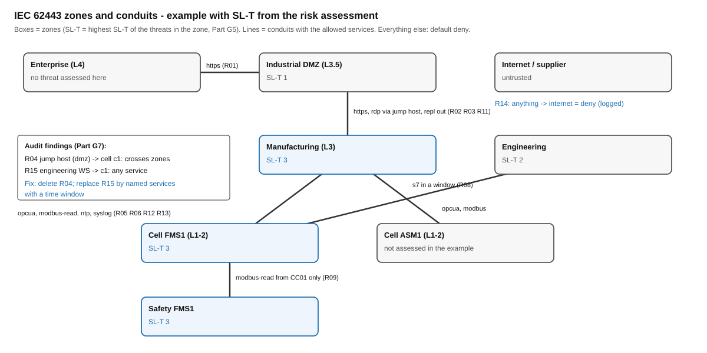

| Zone (JSON id) | Content | SL-T (G5) |
|---|---|---|
| Enterprise L4 (`ent`) | ERP, office | – (no threat assessed in the example; typical SL1) |
| Industrial DMZ L3.5 (`dmz`) | historian mirror, patch server, jump host, API proxy | SL1 from the example threats (typical SL2) |
| Manufacturing L3 (`mfg`) | MES, SCADA, DNC, NTP, syslog | **SL3** |
| Engineering (`eng`) | engineering workstations, back-up server | SL2 |
| Cell FMS1 L1–2 (`c1`) | cell controller, PLCs, CNCs, HMIs | **SL3** |
| Cell ASM1 L1–2 (`c2`) | assembly line | – (not assessed in the example) |
| Safety FMS1 (`saf`) | safety PLC, safety IO | **SL3** |
| Internet / supplier (`inet`) | outside world | untrusted |

**Neighbours** (JSON): ent–dmz, dmz–mfg, mfg–c1, mfg–c2, eng–c1, eng–c2, c1–saf. Conduits exist **only between neighbours**. The office
never talks to a cell directly; the internet never talks to anything inside.

Basic rules (from the original guide, still valid): default deny; conduits only between neighbouring zones; office → cell never
direct; remote service only via jump host (MFA, time-limited, recorded); write access to modules only through the cell
controller; safety parameters never remote; cell devices never talk to the internet; historian replicates outward one-way;
personal accounts, USB control, back-ups, patch plan.

## G4. Risk assessment method (simplified IEC 62443-3-2)

1. **Define the system under consideration** (the FMS with its zones, G3).
2. **List threats** per zone: who could do what (malware, insider, supplier, mistake), through which entry point.
3. **Rate likelihood L (1–5) and consequence C (1–5)** before countermeasures (consequence: safety, production loss, quality,
   environment, data).
4. **Risk = L × C**; class **high ≥ 15**, **medium 8–14**, **low ≤ 7**.
5. **SL-T from the initial class**: high → 3, medium → 2, low → 1. **Zone SL-T = max SL-T of the threats of the zone.**
6. **Countermeasures**, each with "points" of likelihood reduction; **residual L = max(1, L − sum of points)**; residual risk =
   residual L × C (same classes).
7. **Accept** (owner) or add countermeasures until all residual risks are acceptable (here: low).
8. **Document and repeat** after changes, at least every few years.

(The real standard defines the steps in more detail – detailed risk assessment, consequence categories, unmitigated / mitigated
risk – and the factory's own risk matrix may differ. The method here is the JSON teaching version.)

## G5. The JSON threats worked

| # | Threat | Zone | L | C | Risk | Class | SL-T | Countermeasures (points) | Res. L | Res. risk | Res. class |
|---|---|---|---|---|---|---|---|---|---|---|---|
| 1 | Ransomware from the office reaches MES / SCADA | mfg | 4 | 5 | 20 | high | 3 | DMZ + default-deny firewalls (2), patching + offline back-ups (1) = 3 | 1 | 5 | low |
| 2 | Supplier remote access misused | c1 | 3 | 4 | 12 | medium | 2 | jump host, MFA, recorded sessions (2) | 1 | 4 | low |
| 3 | Infected USB stick on an HMI | c1 | 4 | 4 | 16 | high | 3 | USB port control (2), application whitelisting (1) = 3 | 1 | 4 | low |
| 4 | Unauthorised Modbus write to a module | c1 | 3 | 5 | 15 | high | 3 | DPI firewall: writes only from the cell controller (2) | 1 | 5 | low |
| 5 | Safety PLC parameter changed | saf | 3 | 5 | 15 | high | 3 | local password + safety checksum monitoring (2) | 1 | 5 | low |
| 6 | Spoofed MES job (wrong NC program) | mfg | 2 | 4 | 8 | medium | 2 | OPC UA Sign & Encrypt + certificates (1) | 1 | 4 | low |
| 7 | Network loop / broadcast storm | c1 | 3 | 3 | 9 | medium | 2 | managed switches: storm control + ring protocol (1) | 2 | 6 | low |
| 8 | Engineering laptop with malware | eng | 3 | 4 | 12 | medium | 2 | dedicated engineering workstations (1), offline virus scan station (1) = 2 | 1 | 4 | low |
| 9 | Historian data copied by outsiders | dmz | 3 | 2 | 6 | low | 1 | read-only mirror, no plant access (1) | 2 | 4 | low |

Worked line 1: risk = 4 × 5 = 20 ≥ 15 → high → SL-T 3; points 2 + 1 = 3; residual L = max(1, 4 − 3) = 1; residual risk 1 × 5 = 5 ≤ 7 →
low. Line 7: residual L = max(1, 3 − 1) = 2 → 2 × 3 = 6 → low.

**Zone SL-T** (max over the threats of the zone): **mfg SL3** (threats 1, 6), **c1 SL3** (2, 3, 4, 7), **saf SL3** (5), **eng SL2** (8),
**dmz SL1** (9); ent, c2 and inet have no threat in the example list.

**Reading the result:** all residual risks are low – but only **if** the countermeasures are really implemented and maintained.
A high consequence (C = 5) never becomes small; only the likelihood goes down. Therefore threats 1, 4 and 5 keep a residual risk of
5 – they need monitoring and tested recovery (back-ups, G10). The SL-T 3 of cell and manufacturing zones means: components and
configuration that resist intentional, IACS-skilled attacks (IEC 62443-3-3 SL3 requirements: e.g. unique user accounts, multifactor
authentication for remote access, network segmentation with deny-by-default, integrity checks, audit logs).

## G6. Firewall rule design and the 17 JSON flows

### G6.1 How a rule table works

Each rule: `[id, source zone, source host, destination zone, destination host, service, action, note]`. Rules are checked **top
down, the first match wins**; a field matches if it is equal or `*`; **no match → default deny** (rule id `DEFAULT`). Flows inside one
zone are not filtered by the zone firewall (they need switch / host measures).

| Id | Source | Destination | Service | Action | Note |
|---|---|---|---|---|---|
| R01 | ent / * | dmz / API proxy | https | allow | ERP → MES API proxy |
| R02 | dmz / API proxy | mfg / MES server | https | allow | proxy → MES |
| R03 | dmz / Jump host | mfg / * | rdp | allow | remote service, MFA, time window, recorded |
| R04 | dmz / Jump host | c1 / * | rdp | allow | remote service directly into the cell |
| R05 | mfg / * | c1 / * | opcua | allow | MES / SCADA ⇄ cell controller, CNC |
| R06 | mfg / * | c1 / * | modbus-read | allow | SCADA monitoring (DPI firewall sees FC03 / FC04) |
| R07 | mfg / * | c1 / * | modbus-write | deny | writes only through the cell controller |
| R08 | eng / Engineering WS | c1 / * | s7 | allow | PLC programming in an approved window |
| R09 | c1 / Cell controller | saf / * | modbus-read | allow | safety status read only |
| R10 | * / * | saf / * | * | deny | no other access to the safety zone |
| R11 | mfg / Historian | dmz / Historian mirror | repl | allow | one-way replication outwards |
| R12 | c1 / * | mfg / NTP server | ntp | allow | time synchronisation |
| R13 | c1 / * | mfg / Syslog server | syslog | allow | security / event logs |
| R14 | * / * | inet / * | * | deny | nothing to the internet (logged) |
| R15 | eng / Engineering WS | c1 / * | * | allow | temporary "allow all" left after commissioning |

### G6.2 The 17 flows evaluated

| # | Source (zone) | Destination (zone) | Service | Verdict | Rule | Why |
|---|---|---|---|---|---|---|
| 1 | Office PC (ent) | Cell PLC (c1) | s7 | **deny** | DEFAULT | no rule ent → c1 |
| 2 | ERP server (ent) | API proxy (dmz) | https | allow | R01 | |
| 3 | API proxy (dmz) | MES server (mfg) | https | allow | R02 | |
| 4 | MES server (mfg) | Cell controller (c1) | opcua | allow | R05 | |
| 5 | SCADA server (mfg) | MC02 CNC (c1) | opcua | allow | R05 | |
| 6 | SCADA server (mfg) | Stacker PLC (c1) | modbus-write | **deny** | R07 | R05 / R06 do not match the service; R07 matches |
| 7 | SCADA server (mfg) | Stacker PLC (c1) | modbus-read | allow | R06 | |
| 8 | Supplier laptop (inet) | Robot controller (c1) | rdp | **deny** | DEFAULT | no rule from inet |
| 9 | Jump host (dmz) | Robot controller (c1) | rdp | allow | **R04** | audit finding (G7) |
| 10 | Engineering WS (eng) | Cell PLC (c1) | s7 | allow | R08 | R08 before R15 |
| 11 | Cell PLC (c1) | Cloud broker (inet) | mqtts | **deny** | R14 | offline factory |
| 12 | Historian (mfg) | Historian mirror (dmz) | repl | allow | R11 | |
| 13 | Office PC (ent) | Safety PLC (saf) | modbus-write | **deny** | R10 | |
| 14 | Cell controller (c1) | Safety PLC (saf) | modbus-read | allow | R09 | R09 before R10 |
| 15 | Cell PLC (c1) | NTP server (mfg) | ntp | allow | R12 | |
| 16 | Office PC (ent) | MES server (mfg) | https | **deny** | DEFAULT | the office reaches MES only via the DMZ proxy |
| 17 | Engineering WS (eng) | Safety PLC (saf) | s7 | **deny** | R10 | safety only locally (G3) |

Result: **10 allowed, 7 denied** (3 by DEFAULT: flows 1, 8, 16; by rules: R07, R14, R10, R10). Rules not hit by any test flow: R03,
R13, R15 – write test flows for them too (e.g. "Jump host → MES rdp", "Cell PLC → Syslog syslog").

**Order matters:** flow 14 is allowed only because R09 stands **before** R10. If somebody sorts the table and moves R10 up, the cell
controller loses the safety status. Flow 6 is denied because R07 stands after R05 / R06 and the service field is specific.

### G6.3 Service definitions in a real firewall

| Service name | Real definition |
|---|---|
| https | TCP 443 |
| opcua | TCP 4840 (or the server's port), ideally with an OPC UA-aware inspection |
| modbus-read / modbus-write | TCP 502 + **DPI**: function codes 03 / 04 = read; 05 / 06 / 15 / 16 / 23 = write |
| s7 | TCP 102 (vendor protocol, DPI options exist) |
| rdp | TCP 3389 (only from the jump host) |
| ntp / syslog | UDP 123 / UDP 514 (or TCP 6514 with TLS) |
| repl | the historian's replication port (maker data) |
| mqtts | TCP 8883 |

## G7. Rule audit and fixes

Audit rules (JSON): an **allow** rule whose zones are **not neighbours** → finding "crosses zones"; an **allow** rule with service
`*` → finding "any service".

| Rule | Finding | Why it is dangerous | Fix |
|---|---|---|---|
| **R04** dmz Jump host → c1 rdp | **crosses zones** (dmz and c1 are not neighbours) | a compromised jump host reaches every cell device directly; bypasses the manufacturing zone controls | delete R04. Remote service into a cell: jump host → a **terminal server in the manufacturing / engineering zone** (R03), from there an engineering conduit with a time window and recording; or a dedicated maintenance conduit through the cell firewall that is **enabled only on request** (switch on the cabinet, time-limited) |
| **R15** eng Engineering WS → c1 any | **any service** | "temporary allow all after commissioning" = every protocol, including file shares and remote desktop | delete R15; R08 (s7) already covers PLC programming; add named services only if needed (e.g. HTTPS to the HMI web server), with the time window |

After the fixes flow 9 (jump host → robot controller rdp) becomes **deny (DEFAULT)**, and flow 10 stays allowed by R08. Run the audit
after every change (`python tools/fmse/net_security.py`, web 6K).

## G8. Remote access

| Rule | Detail |
|---|---|
| Only through the jump host in the DMZ | never a supplier VPN or a mobile router directly into a machine |
| Personal accounts + **MFA** | no shared "service" account |
| **Time window** | access enabled by the plant for the agreed time only (ticket) |
| **Recorded** sessions | video / keystroke recording on the jump host |
| Least privilege | the supplier reaches only his machine, only with the needed protocol |
| Offline factory variant | no internet at all: the supplier comes on site, or the plant provides a supervised connection on request that is physically disconnected afterwards |

The JSON threat 2 (supplier remote access misused, c1) has exactly these countermeasures (2 points) → residual low.

## G9. Certificates and PKI

OPC UA, HTTPS, MQTT over TLS and some switch management need **X.509 certificates**.

| Item | Rule |
|---|---|
| Plant CA | an offline root CA + an issuing CA in the manufacturing zone; the root key on a removable medium in a safe |
| Certificate content | application URI / host name / IP in subject alternative name; key length / algorithm per current policy |
| Validity | 1–5 years; **expiry list** in the maintenance plan; renew 1–2 months before |
| Trust | servers trust the issuing CA (not every single certificate) → new clients are accepted when signed by the CA |
| Revocation | CRLs published to the devices (offline: copied regularly) |
| Distribution | GDS (OPC UA) or a documented manual process |

## G10. Patching, back-ups, logging, USB, hardening

| Topic | Practice |
|---|---|
| Patching | patch server in the DMZ; test patches on a test system / one machine first; maintenance windows; supplier approval for CNC / HMI PCs |
| Back-ups | PLC / CNC / HMI / switch configurations and PC images; **offline copies** (not reachable from the network – ransomware); test a restore every year |
| Logging | syslog from firewalls, switches, servers to the syslog server (R13); alarm on unusual events (new device, many denies, login failures) |
| USB | USB ports disabled or controlled; offline virus scan station ("kiosk") for files; application whitelisting on HMIs (threat 3) |
| Hardening | default passwords changed, unused services and ports off, management only from the engineering zone, firmware signed and current |
| Accounts | personal accounts, roles, no shared admin passwords; leavers removed |
| Asset inventory | the IP list (F) + firmware versions = the base for vulnerability management |

## G11. The offline factory

This project's rule: **nothing in a cell talks to the internet**, every function runs on an offline factory PC.

| Need | Offline solution |
|---|---|
| Time | local NTP / PTP grandmaster with GNSS antenna (A9) |
| Patches, virus signatures | downloaded in the IT network, scanned, transferred via the DMZ patch server |
| Supplier service | on site, or supervised temporary connection (G8) |
| Licences | offline activation files / dongles (ask in the offer) |
| Dashboards | historian + web server at level 3, no cloud |
| Software tools | stdlib Python tools of this twin, local web page – no CDN |

Flow 11 of G6 ("Cell PLC → Cloud broker mqtts") is denied by R14 – and it should never be requested in the first place.

**Checklist – Part G**
- [ ] Zones, conduits, neighbours drawn and approved by IT / OT security.
- [ ] Risk assessment done with the owner; SL-T per zone; components with SL-C ≥ SL-T.
- [ ] Rule table: default deny, specific services, order checked, all flows tested, audit clean (no crossing, no any-service).
- [ ] Remote access via jump host with MFA, time window, recording.
- [ ] PKI, expiry list, back-ups offline, logging, USB control, hardening, patch process.

---

# Part H – The standard module data block in depth

## H1. Why one block for every module

An FMS cell has 10–20 modules from several suppliers (FMS kit: 16 units with a data block). If every supplier invents his own
register map, the cell controller, SCADA, MES connector and historian need **special code for every module**, and every
commissioning starts with a week of "which register is the state?". The **standard module data block** solves this:

- **Words 0–19 are identical in every module** (state, mode, command, handshake bits, alarms, OEE counters, job, pallet, cycle
  time, heartbeats) – based on PackML / PackTags (guide 65 C2, C3).
- **Module-specific data starts at word 20** (program number, spindle load, fork position …).
- The **same block** is mapped onto Modbus TCP registers, PROFINET bytes, OPC UA nodes and MQTT Sparkplug metrics (H6) – the
  meaning never changes, only the transport.
- The **same 4-phase handshake and heartbeat** (H4) are used for every job in every module.

The block is a **project standard of this guide** (from PackML / PackTags), not an official standard. Use it as the template of
your URS; if a plant already has its own standard (like the `fmsctl` register map V1.2 of the compressor project, H9), map the two.

## H2. Words 0–19 and the module part

### H2.1 The standard part

Direction is seen **from the module**: "out" = written by the module, read by the cell controller; "in" = written by the cell
controller.

| Word | Name | Type | Dir | Meaning |
|---|---|---|---|---|
| 0 | Status.StateCurrent | INT | out | PackML state 1–17 (item 5) |
| 1 | Status.UnitModeCurrent | INT | out | 1 Production · 2 Maintenance · 3 Manual |
| 2 | Command.CntrlCmd | INT | in | PackML command 1–9 |
| 3 | Command.Bits | WORD | in | bit0 CmdChangeRequest · bit1 HS.Request · bit2 HS.Ack · bit3 FaultReset · bit8–15 spare |
| 4 | Status.Bits | WORD | out | bit0 Ready · bit1 Busy · bit2 Done · bit3 Fault · bit4 Warning · bit5 Auto · bit6 PartPresent · bit7 HS.Ready |
| 5 | Command.UnitMode | INT | in | requested mode |
| 6 | Admin.AlarmNo | INT | out | active alarm number (0 = none), module range × 1000 + n |
| 7 | Admin.WarningNo | INT | out | active warning number |
| 8–9 | Admin.ProdProcessedCount | DINT | out | 2 words – counter for OEE |
| 10–11 | Admin.ProdDefectiveCount | DINT | out | 2 words |
| 12–13 | Job.Id | DINT | in | job / work order number from the cell controller |
| 14–15 | Job.PalletId | DINT | in/out | pallet / carrier ID (RFID) |
| 16–17 | Status.LastCycle_s | REAL | out | 2 words, IEEE 754 |
| 18 | Status.Heartbeat | UINT | out | +1 every second – the partner checks it (time-out 3 s) |
| 19 | Command.Heartbeat | UINT | in | +1 every second from the cell controller |

### H2.2 Code tables used in the block

| PackML state (word 0) | | PackML command (word 2) | |
|---|---|---|---|
| 1 Clearing | 10 Holding | 1 Reset | 6 Suspend |
| 2 Stopped | 11 Held | 2 Start | 7 Unsuspend |
| 3 Starting | 12 Unholding | 3 Stop | 8 Abort |
| 4 Idle | 13 Suspending | 4 Hold | 9 Clear |
| 5 Suspended | 14 Unsuspending | 5 Unhold | (0 = no command) |
| 6 Execute | 15 Resetting | | |
| 7 Stopping | 16 Completing | | |
| 8 Aborting | 17 Complete | | |
| 9 Aborted | | | |

**Command protocol** (guide 65 C2): the cell controller writes CntrlCmd and sets CmdChangeRequest (bit 0 of word 3) in the **same**
FC16 write (frame 2 of C1.4: `00 02` + `00 01`); the module executes the command if allowed in the current state and mode, then the
cell controller clears CmdChangeRequest after it sees the new state (or after a time-out of e.g. 2 s, guide 65 D2.3).
(Corrected 2026-11-15: the command numbers above are the item 5 numbers used by `web/fmse5_data.js` and `packml_sim.py`;
an earlier version of this table had Abort = 5 … Unsuspend = 8. Alternative used in the item 9 PLC example (guide 69 E4.1):
the module clears CntrlCmd and CmdChangeRequest itself after it has evaluated the command. Choose ONE of the two in the
interface sheet – never let both sides clear the bit.)

**Alarm numbers:** module range × 1000 + n, e.g. M01 alarms 1001–1999, M03 3001–3999 – the number alone tells the module type.

### H2.3 The module part (word 20 +)

| Module | Word | Name | Type | Dir | Meaning |
|---|---|---|---|---|---|
| M01 machine tool | 20–21 | NC.ProgramNo | DINT | in | program to run |
| | 22 | NC.SpindleLoad_pct | INT | out | |
| | 23 | NC.ToolLifeMin_pct | INT | out | lowest remaining tool life |
| | 24 | NC.DoorClosed | BOOL → WORD bit0 | out | + bit1 PalletClamped, bit2 ReadyForLoad |
| M03 pallet pool | 20 | Move.From | INT | in | place number |
| | 21 | Move.To | INT | in | place number |
| | 22 | Move.PalletAt | INT | out | current place of the fork |
| | 23 | Rack.FreePlaces | INT | out | |
| M04 load station | 20 | LS.OperatorRelease | WORD bit0 | out | + bit1 LightCurtainOK, bit2 ClampPressureOK |
| | 21 | LS.PartsOnPallet | INT | out | |
| | 22–31 | LS.SerialFirst | STRING[20] | out | 10 words |
| M06 AGV station | 20 | Dock.ReadyToGive | WORD bit0 | out | + bit1 ReadyToTake, bit2 TransferActive, bit3 TransferDone |
| | 21 | Dock.AGVPresent | WORD bit0 | in | + bit1 AGVReadyToTransfer |
| M11 measuring | 20 | Meas.ProgramNo | INT | in | |
| | 21 | Meas.ResultOK | WORD bit0 | out | + bit1 NOK, bit2 ResultValid |
| | 22 | Meas.FeaturesOut | INT | out | number of features out of tolerance |
| M13 assembly | 20 | Asm.RecipeNo | INT | in | |
| | 21–22 | Asm.Torque_Nm | REAL | out | 2 words |
| | 23–24 | Asm.Angle_deg | REAL | out | 2 words |
| | 25 | Asm.ResultOK | WORD bit0 | out | |
| M15 welding | 20 | Weld.JobNo | INT | in | robot + power source job |
| | 21–22 | Weld.ArcOnTime_s | REAL | out | 2 words |
| | 23 | Weld.TableSide | INT | out | 1 = A at robot, 2 = B |

Modules without an EXTRA entry (M02, M10, M12, M17, M18, M19 …) have only words 0–19 until their module part is defined with the PLC
library (guide 70). The kit interface sheet (`datablock_map.py`, web 6J) covers **16 units** (M20 SCADA and M22 network have no data
block) with **267 rows**; the longest tag is `PLT1.MACH.FMS1.AGVST01.Admin.ProdProcessedCount` (**47** characters ≤ 48); all 267 tags
pass the item-5 tag rule.

### H2.4 Tags

Each block item has the full item-5 tag with **6 parts** (group and signal keep their dot): `PLT1.MACH.FMS1.MC02.Status.StateCurrent`,
`PLT1.MACH.FMS1.MC02.Job.Id`, `PLT1.MACH.FMS1.MC01.NC.SpindleLoad_pct`. The same name (without the site / area / cell prefix) is the
OPC UA browse path and the Sparkplug metric (H6).

## H3. Encoding and the MC02 example

### H3.1 Encoding rules (JSON `modbus_encode`)

| Type | Registers | Encoding | Example |
|---|---|---|---|
| INT | 1 | 16-bit two's complement (−32 768 … 32 767) | 6 → `0006`; −1 → `FFFF` |
| UINT, WORD | 1 | 16-bit unsigned (0 … 65 535) | 4 711 → `1267` |
| DINT | 2 | 32-bit two's complement, **high word first** ("ABCD") | 70 001 → `0001 1171` |
| REAL | 2 | IEEE 754 single, high word first | 1 834.5 → `44E5 5000` |
| STRING[20] | 10 | ASCII, first character in the high byte, padded with 0 | "SN" → `534E …` |
| BOOL in a WORD | 1 | bit n of the word, bit 0 = LSB | DoorClosed = bit 0 |

Inside each register: **big-endian** bytes (high byte first) – as in every Modbus frame.

### H3.2 The JSON values of MC02 → 25 registers

Server MC02 (module M01, unit id 1, base 0). Values (JSON `datablock.values`): StateCurrent 6 (Execute), UnitModeCurrent 1, CntrlCmd 0,
Command.Bits 0, Status.Bits 98, Command.UnitMode 1, AlarmNo 0, WarningNo 0, ProdProcessedCount 1 412, ProdDefectiveCount 23, Job.Id
70 001, PalletId 3, LastCycle_s 1 834.5, Status.Heartbeat 4 711, Command.Heartbeat 4 710; module part words 20–24 = 0.

| Word | Name | Value | Register (hex) | Register (dec) |
|---|---|---|---|---|
| 0 | Status.StateCurrent | 6 | `0006` | 6 |
| 1 | Status.UnitModeCurrent | 1 | `0001` | 1 |
| 2 | Command.CntrlCmd | 0 | `0000` | 0 |
| 3 | Command.Bits | 0 | `0000` | 0 |
| 4 | Status.Bits | 98 | `0062` | 98 |
| 5 | Command.UnitMode | 1 | `0001` | 1 |
| 6 | Admin.AlarmNo | 0 | `0000` | 0 |
| 7 | Admin.WarningNo | 0 | `0000` | 0 |
| 8–9 | Admin.ProdProcessedCount | 1 412 | `0000 0584` | 0, 1 412 |
| 10–11 | Admin.ProdDefectiveCount | 23 | `0000 0017` | 0, 23 |
| 12–13 | Job.Id | 70 001 | `0001 1171` | 1, 4 465 |
| 14–15 | Job.PalletId | 3 | `0000 0003` | 0, 3 |
| 16–17 | Status.LastCycle_s | 1 834.5 | `44E5 5000` | 17 637, 20 480 |
| 18 | Status.Heartbeat | 4 711 | `1267` | 4 711 |
| 19 | Command.Heartbeat | 4 710 | `1266` | 4 710 |
| 20–21 | NC.ProgramNo | 0 | `0000 0000` | 0, 0 |
| 22 | NC.SpindleLoad_pct | 0 | `0000` | 0 |
| 23 | NC.ToolLifeMin_pct | 0 | `0000` | 0 |
| 24 | NC.DoorClosed | 0 | `0000` | 0 |

Registers (decimal): `[6, 1, 0, 0, 98, 1, 0, 0, 0, 1412, 0, 23, 1, 4465, 0, 3, 17637, 20480, 4711, 4710, 0, 0, 0, 0, 0]`.

**Decoding Status.Bits = 98:** 98 = 64 + 32 + 2 = `0000 0000 0110 0010` → bit 1 **Busy**, bit 5 **Auto**, bit 6 **PartPresent**; Ready (bit
0), Done (bit 2), Fault (3), Warning (4), HS.Ready (7) are 0. Plausible for a machine in Execute.

**Job.Id 70 001:** 70 001 = 65 536 × 1 + 4 465 → high word 1, low word 4 465 = 0x1171.

### H3.3 The exact FC03 response frame

The JSON frame 1 (read words 0–19, transaction 1):

```
 request : 00 01 00 00 00 06 01 03 00 00 00 14
 response: 00 01 00 00 00 2B 01 03 28 00 06 00 01 00 00 00 00 00 62 00 01 00 00 00 00 00 00 05 84 00 00 00 17 00 01 11 71 00 00 00 03 44 E5 50 00 12 67 12 66
```

49 bytes = 7 (MBAP) + 1 (FC) + 1 (byte count 0x28 = 40) + 40 data bytes. Decoded field by field in C1.4.

**Extra (not a JSON frame):** reading all 25 registers (start 0, qty 25) with transaction 7 gives
`00 07 00 00 00 06 01 03 00 00 00 19` → response `00 07 00 00 00 35 01 03 32` + the 40 bytes above + `00 00 00 00 00 00 00 00 00 00`
(words 20–24): length 0x35 = 53, byte count 0x32 = 50, 59 bytes in total.

### H3.4 Try it with real sockets

`modbus_codec.py` contains a real **Modbus TCP module simulator** (stdlib `socket`):

```
python tools/fmse/modbus_codec.py --serve 1502                    (MC02 block on 127.0.0.1:1502, heartbeat +1 per second)
python tools/fmse/modbus_codec.py --poll 127.0.0.1 1502 --count 10 --write-hb   (second window: poll words 0–19 every second)
```

The poller shows the decoded values and "heartbeat OK / lost": stop the server with Ctrl+C and after 3 s the poller reports the loss
– scenario B of H5 live. Any Modbus client (I1) can connect to port 1502 as well. Port 8080 is never used.

## H4. The job handshake and the heartbeat

### H4.1 Why a handshake

The cell controller and the module are two independent computers that see each other only through **polled** data (100 ms tick
here). A single "start" bit is not safe: the module may miss a short pulse, or the cell controller may not know whether the module
really took the job. The **4-phase handshake** with level signals guarantees that each side has **seen** the other side's signal
before it continues – it works with any poll period and survives restarts.

### H4.2 The signals

| Signal | Written by | In the block | Meaning |
|---|---|---|---|
| CC.Request | cell controller | word 3 bit 1 HS.Request | "a new job is ready in Job.Id / PalletId" |
| CC.JobId | cell controller | words 12–13 Job.Id | the job |
| CC.Ack | cell controller | word 3 bit 2 HS.Ack | "I have seen Done" |
| CC.HB | cell controller | word 19 Command.Heartbeat | +1 per second |
| MOD.Ready | module | word 4 bit 0 | idle, can accept a job |
| MOD.HSReady | module | word 4 bit 7 | "I have taken the job" |
| MOD.Busy | module | word 4 bit 1 | job running |
| MOD.Done | module | word 4 bit 2 | job finished |
| MOD.HB | module | word 18 Status.Heartbeat | +1 per second |

**Rule: each side writes only its own signals** (CC image / MOD image). There is never a bit that both sides write.

### H4.3 The four phases

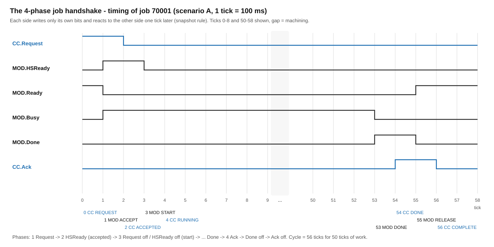

| Phase | Cell controller | Module |
|---|---|---|
| 1 Request | sees Ready = 1, Busy = 0 → writes JobId, sets **Request = 1** | – |
| 2 Accept | – | sees Request = 1 → copies JobId, **HSReady = 1**, Busy = 1, Ready = 0 |
| 3 Release / start | sees HSReady = 1 → **Request = 0** | sees Request = 0 → **HSReady = 0**, starts the job |
| (running) | sees HSReady = 0 → waits for Done | executes |
| 4 Done / Ack | sees Done = 1 → **Ack = 1** (books the job) | sets **Done = 1**, Busy = 0 when finished; sees Ack = 1 → **Done = 0**, Ready = 1 |
| (end) | sees Done = 0 → **Ack = 0**, job complete | – |

Every signal change is answered by the other side **one tick later** – the handshake is self-timing.

### H4.4 The heartbeat

Each side increments its heartbeat word **every second** (period 10 ticks) and watches the partner's word. If the partner's value has
not changed for **3 s** (30 ticks) the link is declared lost:

- **Cell controller** (COMM_LOSS): Request = 0, Ack = 0, state OFFLINE, no new jobs to this module, alarm. When the heartbeat moves
  again: COMM_OK and **resynchronisation** from the module's bits (Done → book the job; Busy → wait for Done; else → idle and put the
  open job back to the front of the queue).
- **Module** (CC_LOSS): if idle, Ready = 0 (accepts no job); a running job **continues** and finishes; Done waits until the cell
  controller is back and acknowledges.

**Detection delay:** between 2.1 s and 3.0 s here (+ one poll period in a real system) – figure H5.2. Why not 0.5 s? A busy network,
an OPC UA reconnect or a PLC program download can delay a value for 1–2 s; false comm-loss alarms would stop the cell for nothing.

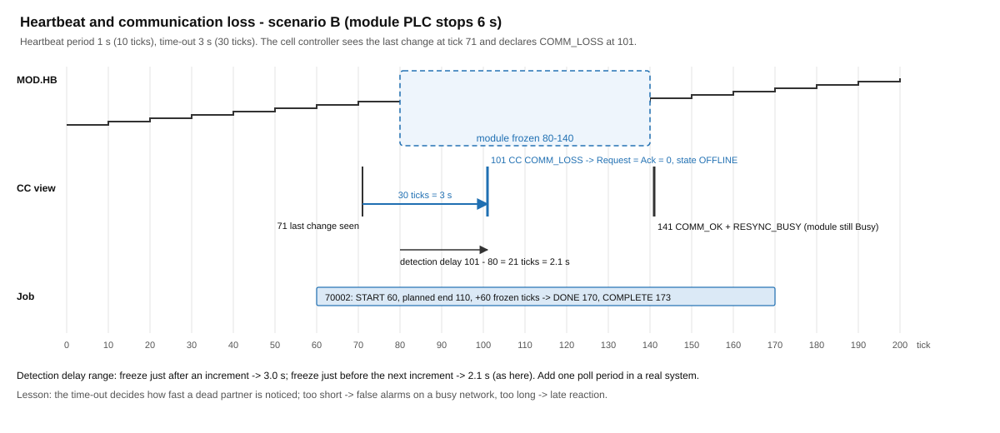

### H4.5 The simulation rules (JSON `handshake_sim._rules`)

Parameters: K = 250 ticks, tick = 100 ms, HS time-out 20 ticks (2 s), job time-out 80 ticks (8 s), heartbeat period 10 ticks,
heartbeat time-out 30 ticks.

1. **Ticks** k = 0 … 250. Two actors: CC and MOD. CC image: Request, Ack, JobId, HB. MOD image: Ready, Busy, Done, HSReady, HB, JobId.
   Initial: CC all 0; MOD Ready = 1, others 0; MOD state IDLE; CC state S0; watch timers last = 0, seen = 0.
2. **One-tick delay:** at the start of tick k each actor takes a snapshot of the other side's image (= end of tick k − 1) and decides
   **only** on the snapshot; what it writes is visible to the other side at tick k + 1. Order in a tick (and in the log): **1 events,
   2 MOD, 3 CC.**
3. **Events:** MOD_FREEZE (module does nothing, image and HB frozen, remember start f); MOD_RESUME (runs again; last = k, seen =
   snapshot CC.HB; if EXEC: end = end + (k − f)); CC_FREEZE / CC_RESUME (same for the CC; it continues in its stored state);
   IGNORE_REQ_ON / OFF (module does not accept requests); CC_RESET (if CC is in ERR → S0).
4. **MOD:** (a) heartbeat +1 when k > 0 and k mod 10 = 0; (b) watch CC heartbeat: change → last = k; 30 ticks without change →
   CC_LOSS (if IDLE: Ready = 0); change again → CC_OK (if IDLE: Ready = 1); (c) **one** transition per tick: IDLE + not lost + not
   ignoring + Request → ACCEPT (JobId, HSReady = 1, Busy = 1, Ready = 0); ACCEPT + Request = 0 → EXEC (HSReady = 0, end = k + 50);
   EXEC + k ≥ end → DONE (Busy = 0, Done = 1); DONE + Ack → IDLE (Done = 0, Ready = 1 unless lost).
5. **CC:** (a) heartbeat; (b) watch MOD heartbeat: 30 ticks → COMM_LOSS (Request = Ack = 0, OFFLINE unless ERR, nothing else this
   tick); change again → COMM_OK and if OFFLINE: RESYNC_DONE (Done → Ack = 1, S4) / RESYNC_BUSY (Busy → S3) / RESYNC_IDLE (S0, open
   job back to the front of the queue); nothing else this tick; while lost nothing else.
6. **CC states** (success checked **before** the time-out): S0 WAIT_READY → (jobs left, Ready, not Busy) REQUEST → S1 WAIT_ACCEPT →
   (HSReady) ACCEPTED → S2 WAIT_RELEASE → (HSReady = 0) RUNNING → S3 WAIT_DONE → (Done) DONE, Ack = 1 → S4 WAIT_DONE_CLEAR → (Done = 0)
   COMPLETE, Ack = 0 → S0. Time-outs: S1 / S2 / S4 after 20 ticks (HS_TIMEOUT; in S1 the job goes back to the front of the queue),
   S3 after 80 ticks (JOB_TIMEOUT) → ERR (waits for CC_RESET).

## H5. The four JSON handshake scenarios with complete logs

All logs are identical line by line with `python tools/fmse/handshake_sim.py --scenario X --log` and web 6I.

### H5.1 Scenario A – normal, 3 jobs (27 lines)

```
0 CC REQUEST 70001
1 MOD ACCEPT 70001
2 CC ACCEPTED 70001
3 MOD START 70001
4 CC RUNNING 70001
53 MOD DONE 70001
54 CC DONE 70001
55 MOD RELEASE 70001
56 CC COMPLETE 70001
57 CC REQUEST 70002
58 MOD ACCEPT 70002
59 CC ACCEPTED 70002
60 MOD START 70002
61 CC RUNNING 70002
110 MOD DONE 70002
111 CC DONE 70002
112 MOD RELEASE 70002
113 CC COMPLETE 70002
114 CC REQUEST 70003
115 MOD ACCEPT 70003
116 CC ACCEPTED 70003
117 MOD START 70003
118 CC RUNNING 70003
167 MOD DONE 70003
168 CC DONE 70003
169 MOD RELEASE 70003
170 CC COMPLETE 70003
```

**KPIs:** completed 70001 @ 56, 70002 @ 113, 70003 @ 170; final CC state S0; 0 HS / 0 job time-outs.

**Reading it:** at k = 0 the CC sees the initial Ready = 1 and requests. Each step answers the previous one a tick later. The job runs
from START (3) to DONE (53) = 50 ticks; the full cycle REQUEST → COMPLETE takes **56 ticks**, then the next REQUEST follows one tick
later (57) → **57 ticks per job** = 50 work + 7 handshake. **Overhead 7 ticks = 0.7 s per job** with a 100 ms poll – negligible for a
30-minute machining job, important for a 10-second assembly station (there: faster poll, or fieldbus coupling).

### H5.2 Scenario B – module PLC stops for 6 s (cable pulled / PLC STOP) (32 lines)

```
0 CC REQUEST 70001
1 MOD ACCEPT 70001
2 CC ACCEPTED 70001
3 MOD START 70001
4 CC RUNNING 70001
53 MOD DONE 70001
54 CC DONE 70001
55 MOD RELEASE 70001
56 CC COMPLETE 70001
57 CC REQUEST 70002
58 MOD ACCEPT 70002
59 CC ACCEPTED 70002
60 MOD START 70002
61 CC RUNNING 70002
80 EVENT MOD_FREEZE
101 CC COMM_LOSS
140 EVENT MOD_RESUME
141 CC COMM_OK
141 CC RESYNC_BUSY 70002
170 MOD DONE 70002
171 CC DONE 70002
172 MOD RELEASE 70002
173 CC COMPLETE 70002
174 CC REQUEST 70003
175 MOD ACCEPT 70003
176 CC ACCEPTED 70003
177 MOD START 70003
178 CC RUNNING 70003
227 MOD DONE 70003
228 CC DONE 70003
229 MOD RELEASE 70003
230 CC COMPLETE 70003
```

**KPIs:** completed 70001 @ 56, 70002 @ 173, 70003 @ 230; final S0; no time-outs; **comm-loss detection delay = 101 − 80 = 21 ticks =
2.1 s**.

**Lessons:**
1. The module's last heartbeat increment was at k = 70 (value 7); the freeze at 80 came just before the next increment. The CC saw the
   change at 71 (one-tick delay) and declared COMM_LOSS 30 ticks later at **101**. If the freeze had come right after an increment
   (e.g. at 71), the delay would have been 30 ticks = 3.0 s – so detection takes **2.1–3.0 s**.
2. During the loss the CC was OFFLINE: it sent nothing and did **not** time out the job (job time-out is not active while lost) – no
   false ERR.
3. On return (140) the module's heartbeat moved at once (k = 140 is a heartbeat tick), the CC saw it at **141** → COMM_OK and
   **RESYNC_BUSY** (the module still showed Busy = 1) → state S3 waiting for Done. No job was lost or repeated.
4. The frozen module continued the job after the resume with the end shifted by the frozen time: end 110 + 60 = 170 → DONE at 170. In
   reality a PLC in STOP would abort the machining – the module would then show Fault / Aborted and the operator decides; the
   handshake itself stays consistent either way.
5. Total loss: 70003 completes at 230 instead of 170 = the 60 frozen ticks.

### H5.3 Scenario C – module does not answer the request (32 lines)

```
0 CC REQUEST 70001
1 MOD ACCEPT 70001
2 CC ACCEPTED 70001
3 MOD START 70001
4 CC RUNNING 70001
50 EVENT IGNORE_REQ_ON
53 MOD DONE 70001
54 CC DONE 70001
55 MOD RELEASE 70001
56 CC COMPLETE 70001
57 CC REQUEST 70002
77 CC HS_TIMEOUT S1 70002
100 EVENT IGNORE_REQ_OFF
120 EVENT CC_RESET
120 CC REQUEST 70002
121 MOD ACCEPT 70002
122 CC ACCEPTED 70002
123 MOD START 70002
124 CC RUNNING 70002
173 MOD DONE 70002
174 CC DONE 70002
175 MOD RELEASE 70002
176 CC COMPLETE 70002
177 CC REQUEST 70003
178 MOD ACCEPT 70003
179 CC ACCEPTED 70003
180 MOD START 70003
181 CC RUNNING 70003
230 MOD DONE 70003
231 CC DONE 70003
232 MOD RELEASE 70003
233 CC COMPLETE 70003
```

**KPIs:** completed 70001 @ 56, 70002 @ 176, 70003 @ 233; final S0; **1 HS time-out**, 0 job time-outs.

**Lessons:**
1. The fault (module ignores requests, e.g. a wrong mode, a door open, a program error in the accept logic) starts at 50 but has no
   effect on the running job 70001 – the module finishes and releases normally.
2. Request 70002 at 57 gets no HSReady → **HS_TIMEOUT S1 at 77** (20 ticks = 2 s), Request = 0, job **back to the front of the queue**,
   state **ERR** – the CC does not try again by itself (a module that ignores requests needs a human look).
3. The fault is gone at 100, but nothing happens until the **operator reset** at 120 (CC_RESET). Then the **same job 70002** is
   requested again (retry after HS time-out) in the same tick and runs normally – nothing lost, nothing doubled.
4. Lost time = 120 − 57 = 63 ticks; 70003 completes at 233 instead of 170.
5. Design choice: an automatic retry after a few seconds would shorten the stop, but could also hammer a module with a real problem;
   this standard uses ERR + operator reset with an alarm text "MC02 does not accept job 70002 (HS time-out S1)".

### H5.4 Scenario D – cell controller stops for 5 s (31 lines)

```
0 CC REQUEST 70001
1 MOD ACCEPT 70001
2 CC ACCEPTED 70001
3 MOD START 70001
4 CC RUNNING 70001
53 MOD DONE 70001
54 CC DONE 70001
55 MOD RELEASE 70001
56 CC COMPLETE 70001
57 CC REQUEST 70002
58 MOD ACCEPT 70002
59 CC ACCEPTED 70002
60 MOD START 70002
61 CC RUNNING 70002
100 EVENT CC_FREEZE
110 MOD DONE 70002
121 MOD CC_LOSS
150 EVENT CC_RESUME
150 CC DONE 70002
151 MOD CC_OK
151 MOD RELEASE 70002
152 CC COMPLETE 70002
153 CC REQUEST 70003
154 MOD ACCEPT 70003
155 CC ACCEPTED 70003
156 MOD START 70003
157 CC RUNNING 70003
206 MOD DONE 70003
207 CC DONE 70003
208 MOD RELEASE 70003
209 CC COMPLETE 70003
```

**KPIs:** completed 70001 @ 56, 70002 @ 152, 70003 @ 209; final S0; no time-outs; **module detection delay = 121 − 100 = 21 ticks =
2.1 s** (MOD CC_LOSS).

**Lessons:**
1. The **module finishes its job** while the cell controller is dead (DONE at 110) and then **waits** with Done = 1 – it does not
   forget the result, it does not start anything new.
2. The module detects the loss at **121** (CC heartbeat last changed at 90, seen at 91, + 30). Because the module is in DONE (not IDLE),
   Ready is not touched; if it had been idle, Ready = 0 would block new jobs.
3. The cell controller itself never declared COMM_LOSS – it was frozen, and on resume (150) it re-initialises its watch timer. In its
   stored state S3 it sees Done = 1 at once → **DONE 70002 at 150**. Its job time-out (80 ticks after RUNNING at 61 = 141) had expired,
   but the rule checks **success before time-out**, so no false JOB_TIMEOUT.
4. The module sees the CC heartbeat again at 151 → CC_OK, and in the same tick sees Ack = 1 → RELEASE. Cycle continues.
5. Cost: 70003 completes at 209 instead of 170 = 39 ticks; the machine was idle with a finished pallet from 110 to 151 – this is why a
   cell controller needs high availability (guide 65 D5).

### H5.5 Summary

| Scenario | Lines | Completed (job @ tick) | Final | HS t/o | Job t/o | Loss detection |
|---|---|---|---|---|---|---|
| A normal | 27 | 70001 @ 56, 70002 @ 113, 70003 @ 170 | S0 | 0 | 0 | – |
| B module stops 6 s | 32 | 70001 @ 56, 70002 @ 173, 70003 @ 230 | S0 | 0 | 0 | CC COMM_LOSS 21 ticks = 2.1 s |
| C module ignores request | 32 | 70001 @ 56, 70002 @ 176, 70003 @ 233 | S0 | 1 | 0 | – |
| D cell controller stops 5 s | 31 | 70001 @ 56, 70002 @ 152, 70003 @ 209 | S0 | 0 | 0 | MOD CC_LOSS 21 ticks = 2.1 s |

**The design rules proven by the scenarios:** level signals + one writer per signal; heartbeat in both directions; time-outs in
every waiting state with defined reactions; success checked before time-out; no time-out while the link is lost; resynchronisation
from the partner's state after a loss; the module never loses a result.

## H6. Mapping to PROFINET, OPC UA and MQTT

The same block on four transports (web 6F `drawMap`, `datablock_map.py --module M01 --unit MC02`), for MC02, base 0, PROFINET start
byte 0:

| Word | Holding reg. | Name | Type | Dir | PROFINET (controller view) | OPC UA NodeId | UA type | Sparkplug metric / type |
|---|---|---|---|---|---|---|---|---|
| 0 | `40001` | `Status.StateCurrent` | INT | out | `%IB0…1` | `ns=2;s=MC02.Status.StateCurrent` | Int16 | `Status/StateCurrent` DDATA |
| 1 | `40002` | `Status.UnitModeCurrent` | INT | out | `%IB2…3` | `ns=2;s=MC02.Status.UnitModeCurrent` | Int16 | `Status/UnitModeCurrent` DDATA |
| 2 | `40003` | `Command.CntrlCmd` | INT | in | `%QB0…1` | `ns=2;s=MC02.Command.CntrlCmd` | Int16 | `Command/CntrlCmd` DCMD |
| 3 | `40004` | `Command.Bits` | WORD | in | `%QB2…3` | `ns=2;s=MC02.Command.Bits` | UInt16 | `Command/Bits` DCMD |
| 4 | `40005` | `Status.Bits` | WORD | out | `%IB4…5` | `ns=2;s=MC02.Status.Bits` | UInt16 | `Status/Bits` DDATA |
| 5 | `40006` | `Command.UnitMode` | INT | in | `%QB4…5` | `ns=2;s=MC02.Command.UnitMode` | Int16 | `Command/UnitMode` DCMD |
| 6 | `40007` | `Admin.AlarmNo` | INT | out | `%IB6…7` | `ns=2;s=MC02.Admin.AlarmNo` | Int16 | `Admin/AlarmNo` DDATA |
| 7 | `40008` | `Admin.WarningNo` | INT | out | `%IB8…9` | `ns=2;s=MC02.Admin.WarningNo` | Int16 | `Admin/WarningNo` DDATA |
| 8–9 | `40009` | `Admin.ProdProcessedCount` | DINT | out | `%IB10…13` | `ns=2;s=MC02.Admin.ProdProcessedCount` | Int32 | `Admin/ProdProcessedCount` DDATA |
| 10–11 | `40011` | `Admin.ProdDefectiveCount` | DINT | out | `%IB14…17` | `ns=2;s=MC02.Admin.ProdDefectiveCount` | Int32 | `Admin/ProdDefectiveCount` DDATA |
| 12–13 | `40013` | `Job.Id` | DINT | in | `%QB6…9` | `ns=2;s=MC02.Job.Id` | Int32 | `Job/Id` DCMD |
| 14–15 | `40015` | `Job.PalletId` | DINT | in/out | `%IB18 / %QB10` | `ns=2;s=MC02.Job.PalletId` | Int32 | `Job/PalletId` DDATA |
| 16–17 | `40017` | `Status.LastCycle_s` | REAL | out | `%IB22…25` | `ns=2;s=MC02.Status.LastCycle_s` | Float | `Status/LastCycle_s` DDATA |
| 18 | `40019` | `Status.Heartbeat` | UINT | out | `%IB26…27` | `ns=2;s=MC02.Status.Heartbeat` | UInt16 | `Status/Heartbeat` DDATA |
| 19 | `40020` | `Command.Heartbeat` | UINT | in | `%QB14…15` | `ns=2;s=MC02.Command.Heartbeat` | UInt16 | `Command/Heartbeat` DCMD |
| 20–21 | `40021` | `NC.ProgramNo` | DINT | in | `%QB16…19` | `ns=2;s=MC02.NC.ProgramNo` | Int32 | `NC/ProgramNo` DCMD |
| 22 | `40023` | `NC.SpindleLoad_pct` | INT | out | `%IB28…29` | `ns=2;s=MC02.NC.SpindleLoad_pct` | Int16 | `NC/SpindleLoad_pct` DDATA |
| 23 | `40024` | `NC.ToolLifeMin_pct` | INT | out | `%IB30…31` | `ns=2;s=MC02.NC.ToolLifeMin_pct` | Int16 | `NC/ToolLifeMin_pct` DDATA |
| 24 | `40025` | `NC.DoorClosed` | BOOL → WORD bit0 | out | `%IB32…33` | `ns=2;s=MC02.NC.DoorClosed` | UInt16 | `NC/DoorClosed` DDATA |

Rules behind the table:
- **Modbus:** holding register = "4" + (base + word + 1) in 4 digits (1-based); PDU address = base + word.
- **PROFINET:** module outputs ("out") are the controller's **inputs** `%IB`, "in" are **outputs** `%QB`; "in/out" occupies both
  (PalletId: `%IB18…21` and `%QB10…13`); counters grow by 2 bytes per word in block order. Totals for M01: **34 input bytes, 20 output
  bytes** – set the I-device transfer areas or the PN/PN coupler to at least these sizes (plus spare, e.g. 64 / 32). PROFINET is
  big-endian, so a DINT in `%ID10` has the same byte order as the Modbus ABCD registers.
- **OPC UA:** browse path `Objects/MC02/<group>/<item>`, NodeId `ns=2;s=MC02.<name>`; types INT → Int16, DINT → Int32, REAL → Float,
  WORD / UINT → UInt16, STRING → String; access "in" Read/Write, "out" Read (subscribe). Better than flat variables: an
  ObjectType `StandardModuleType` with the groups, and methods for jobs.
- **MQTT Sparkplug B:** metric = name with the first "." replaced by "/"; topic `spBv1.0/FMS1/DDATA/CC1/MC02` for out and in/out,
  `.../DCMD/...` for in. The cell controller (edge node CC1) publishes the block of each module as a Sparkplug **device**. DCMD
  topics exist in the mapping for completeness; in this standard commands are **not** sent over MQTT (C4.5).

## H7. The interface sheet

Every module gets one interface sheet – a contract between the module supplier and the integrator, signed before the PLC
programming starts and tested at FAT (I3). `datablock_map.py --module M01 --unit MC02 --md sheet.md --csv sheet.csv` and web 6J
generate the register part; the head is filled in by hand.

```
INTERFACE SHEET  –  module M01 Machine tool interface  –  unit FMS1.MC02 (PLT1.MACH.FMS1.MC02)        version 1.0 / date / signatures
1  Partners            module supplier: ............   integrator: ............   cell controller: FMS1.CC01
2  Network             IP 10.1.101.11 (PLC) / 10.1.101.151 (CNC), mask 255.255.255.0, gateway 10.1.101.1, VLAN 101,
                       PROFINET name fms1-mc02-plc-machine, switch port: cell switch port ..
3  Protocol            Modbus TCP server on the module PLC, TCP 502, unit id 1, max connections ≥ 2
                       (alternatives: OPC UA endpoint opc.tcp://10.1.101.11:4840, SignAndEncrypt, user cc01-svc;
                        PROFINET I-device 64 B in / 32 B out)
4  Addressing          holding registers only; PDU address 0 = 40001 = word 0; base 0; map size 25 registers (0–24)
5  Encoding            INT / UINT / WORD 1 register; DINT, REAL 2 registers HIGH WORD FIRST (ABCD); REAL IEEE 754;
                       bit 0 = LSB; STRING ASCII, high byte first
6  Access              read FC03 (1–125 registers); write FC06 / FC16 only to words with direction in or in/out;
                       check order: function (01) → quantity (03) → address (02) → write allowed (02)
7  Timing              cell controller polls words 0–24 every 100 ms (one FC03); request time-out 500 ms;
                       3 consecutive failed polls → communication fault
8  Heartbeat           word 18 module +1 / s; word 19 cell controller +1 / s (FC06); time-out 3 s on both sides;
                       reaction: CC → no new jobs, alarm, resync; module → Ready = 0 if idle, running job continues
9  Handshake           4-phase: Request (w3.b1) → HSReady (w4.b7) → Request 0 → HSReady 0 → … Done (w4.b2) → Ack (w3.b2) →
                       Done 0 → Ack 0; HS time-out 2 s per phase; job time-out = planned time × 1.5 (example 8 s in the sim)
10 Commands            CntrlCmd (w2) + CmdChangeRequest (w3.b0) in one FC16; PackML command list; accepted per state / mode table
11 Alarms              AlarmNo 1001–1999 (module range 1); alarm text list attached
12 Register table      (generated: word, register 4xxxx, PDU address, name, type, direction, meaning, item-5 tag)
13 Module part         words 20–24 as H2.3 (M01)
14 Test cases (FAT)    I3 list: read block, known values, word order 0x01020304, write command, job download, three exceptions,
                       heartbeat loss both directions, handshake normal + time-out, cable pull, PLC restart
15 Open points         .....
```

## H8. Structured Text skeletons (IEC 61131-3)

These skeletons show the logic; they compile with small adaptations in common IEC 61131-3 environments (bit access and timer
instances differ between brands). Bit masks are used instead of brand-specific bit syntax. They are the base for the PLC library of
guide 70.

### H8.1 Module side

```iecst
FUNCTION_BLOCK FB_ModuleHandshake
(* Module side of the standard data block: heartbeat, CC watchdog, 4-phase job handshake.
   Words: 3 Command.Bits (in), 4 Status.Bits (out), 12-13 Job.Id (in), 18 Status.Heartbeat (out), 19 Command.Heartbeat (in) *)
VAR_INPUT
    CmdBits      : WORD;   (* word 3 : bit1 HS.Request, bit2 HS.Ack *)
    CmdHeartbeat : UINT;   (* word 19 *)
    JobIdIn      : DINT;   (* words 12-13 *)
    JobFinished  : BOOL;   (* from the machine sequence: job done *)
    Pulse1s      : BOOL;   (* TRUE for one cycle every second *)
    AcceptAllowed: BOOL;   (* mode Production, Auto, no fault, door closed ... *)
END_VAR
VAR_OUTPUT
    StatusBits   : WORD;   (* word 4 *)
    Heartbeat    : UINT;   (* word 18 *)
    StartJob     : BOOL;   (* one-cycle pulse to the machine sequence *)
    ActiveJobId  : DINT;
    CcLost       : BOOL;
END_VAR
VAR
    State        : INT := 0;          (* 0 IDLE, 1 ACCEPT, 2 EXEC, 3 DONE *)
    Ready        : BOOL := TRUE;
    Busy, Done, HSReady : BOOL;
    Request, Ack : BOOL;
    LastCcHb     : UINT;
    TonCcHb      : TON;
END_VAR

(* 1 own heartbeat: +1 per second, UINT wraps 65535 -> 0 *)
IF Pulse1s THEN
    Heartbeat := Heartbeat + 1;
END_IF;

(* 2 watch the cell-controller heartbeat: unchanged for 3 s -> lost *)
TonCcHb(IN := (CmdHeartbeat = LastCcHb), PT := T#3S);
IF CmdHeartbeat <> LastCcHb THEN
    LastCcHb := CmdHeartbeat;
END_IF;
CcLost := TonCcHb.Q;

(* 3 read the command bits *)
Request := (CmdBits AND 16#0002) <> 0;
Ack     := (CmdBits AND 16#0004) <> 0;
StartJob := FALSE;

(* 4 handshake state machine: at most one transition per cycle *)
CASE State OF
    0: (* IDLE *)
        Ready := NOT CcLost AND AcceptAllowed;
        IF Ready AND Request THEN
            ActiveJobId := JobIdIn;
            HSReady := TRUE; Busy := TRUE; Ready := FALSE;
            State := 1;
        END_IF;
    1: (* ACCEPT: wait until the CC has seen HSReady and dropped Request *)
        IF NOT Request THEN
            HSReady := FALSE;
            StartJob := TRUE;               (* machine sequence starts the job *)
            State := 2;
        END_IF;
    2: (* EXEC *)
        IF JobFinished THEN
            Busy := FALSE; Done := TRUE;
            State := 3;
        END_IF;
    3: (* DONE: keep the result until the CC acknowledges - also while CcLost *)
        IF Ack THEN
            Done := FALSE;
            State := 0;
        END_IF;
END_CASE;

(* 5 write the status bits: bit0 Ready, bit1 Busy, bit2 Done, bit7 HS.Ready (others set elsewhere) *)
StatusBits := (StatusBits AND 16#FF78)
              OR BOOL_TO_WORD(Ready)
              OR SHL(BOOL_TO_WORD(Busy), 1)
              OR SHL(BOOL_TO_WORD(Done), 2)
              OR SHL(BOOL_TO_WORD(HSReady), 7);
END_FUNCTION_BLOCK
```

### H8.2 Cell-controller side

```iecst
FUNCTION_BLOCK FB_CellHandshake
(* Cell-controller side for ONE module. Called every poll (100 ms) after the read of words 0-24. *)
VAR_INPUT
    StatusBits   : WORD;   (* word 4 of the module *)
    ModHeartbeat : UINT;   (* word 18 *)
    PollOK       : BOOL;   (* last FC03 answered *)
    Pulse1s      : BOOL;
    NextJobValid : BOOL;   (* job queue not empty *)
    NextJobId    : DINT;
    OperatorReset: BOOL;
END_VAR
VAR_OUTPUT
    CmdBits      : WORD;   (* word 3 to write (bit1 Request, bit2 Ack) *)
    JobIdOut     : DINT;   (* words 12-13 *)
    Heartbeat    : UINT;   (* word 19, written with FC06 every second *)
    TakeJob      : BOOL;   (* pulse: remove NextJobId from the queue *)
    ReturnJob    : BOOL;   (* pulse: put the current job back to the FRONT of the queue *)
    JobComplete  : BOOL;   (* pulse: book CurrentJob as complete *)
    CommLost     : BOOL;
    State        : INT := 0; (* 0 S0, 1 S1, 2 S2, 3 S3, 4 S4, 90 OFFLINE, 99 ERR *)
END_VAR
VAR
    Request, Ack : BOOL;
    MReady, MBusy, MDone, MHSReady : BOOL;
    CurrentJob   : DINT;
    LastModHb    : UINT;
    TonHb        : TON;
    TonState     : TON;           (* state timer, restarted on every state change *)
    PrevState    : INT := -1;
    HsTimeout    : TIME := T#2S;
    JobTimeout   : TIME := T#8S;  (* example; real: planned job time x 1.5 *)
END_VAR

IF Pulse1s THEN Heartbeat := Heartbeat + 1; END_IF;

MReady   := (StatusBits AND 16#0001) <> 0;
MBusy    := (StatusBits AND 16#0002) <> 0;
MDone    := (StatusBits AND 16#0004) <> 0;
MHSReady := (StatusBits AND 16#0080) <> 0;
TakeJob := FALSE; ReturnJob := FALSE; JobComplete := FALSE;

(* heartbeat watch *)
TonHb(IN := (ModHeartbeat = LastModHb), PT := T#3S);
IF ModHeartbeat <> LastModHb THEN LastModHb := ModHeartbeat; END_IF;

IF TonHb.Q AND NOT CommLost THEN                 (* COMM_LOSS *)
    CommLost := TRUE; Request := FALSE; Ack := FALSE;
    IF State <> 99 THEN State := 90; END_IF;
ELSIF CommLost AND NOT TonHb.Q THEN              (* COMM_OK + RESYNC *)
    CommLost := FALSE;
    IF State = 90 THEN
        IF MDone THEN Ack := TRUE; State := 4;   (* RESYNC_DONE *)
        ELSIF MBusy THEN State := 3;             (* RESYNC_BUSY *)
        ELSE ReturnJob := TRUE; State := 0;      (* RESYNC_IDLE *)
        END_IF;
    END_IF;
ELSIF NOT CommLost THEN
    (* state timer *)
    TonState(IN := (State = PrevState), PT := T#1H);
    PrevState := State;
    CASE State OF
        0: IF NextJobValid AND MReady AND NOT MBusy THEN
               CurrentJob := NextJobId; TakeJob := TRUE;
               JobIdOut := CurrentJob; Request := TRUE; State := 1;
           END_IF;
        1: IF MHSReady THEN Request := FALSE; State := 2;
           ELSIF TonState.ET >= HsTimeout THEN Request := FALSE; ReturnJob := TRUE; State := 99;  (* HS_TIMEOUT S1 *)
           END_IF;
        2: IF NOT MHSReady THEN State := 3;
           ELSIF TonState.ET >= HsTimeout THEN State := 99;                                        (* HS_TIMEOUT S2 *)
           END_IF;
        3: IF MDone THEN Ack := TRUE; State := 4;                                                  (* success first *)
           ELSIF TonState.ET >= JobTimeout THEN State := 99;                                       (* JOB_TIMEOUT *)
           END_IF;
        4: IF NOT MDone THEN Ack := FALSE; JobComplete := TRUE; State := 0;                        (* COMPLETE *)
           ELSIF TonState.ET >= HsTimeout THEN Ack := FALSE; State := 99;                          (* HS_TIMEOUT S4 *)
           END_IF;
        99: IF OperatorReset THEN State := 0; END_IF;                                              (* ERR *)
    END_CASE;
END_IF;

CmdBits := (CmdBits AND 16#FFF9) OR SHL(BOOL_TO_WORD(Request), 1) OR SHL(BOOL_TO_WORD(Ack), 2);
END_FUNCTION_BLOCK
```

Notes: (1) the state timer restarts when the state changes (IN is FALSE for one call); (2) the CC writes word 3 only when it changes
and word 19 every second; (3) a real cell controller (often a PC application, `fmsctl`) implements the same states in its own
language – the `handshake_sim.py` rules are the reference test.

## H9. Relation to the `fmsctl` register map V1.2

### H9.1 Two maps, two purposes

| | Guide 66 standard block | `fmsctl` register map V1.2 (`fmsctl/spec/regmap.py`) |
|---|---|---|
| Scope | **general standard for any FMS** (teaching, URS template) | **one project**: the compressor FMS of this twin |
| Base | PackML / PackTags | factory design guides 43 / 47 (map V1.1) + event block + type blocks |
| Size | words 0–19 + module part (25 registers for M01) | 450 registers (0–449) with gaps |
| Handshake | 4-phase **level** bits (Request / HSReady / Done / Ack) | **toggle-bit** handshake: cmd.ctl bit0 REQ toggle, hs.status bit0 ACK = REQ, DONE toggle, cmd.seq / hs.ackSeq, hs.result |
| Heartbeat | word 18 (module), word 19 (CC), 3 s | reg 3 hdr.heartbeat (module), reg 226 cmd.gwHeartbeat (gateway), PLC watchdog 5 s |
| Conventions | holding registers, 0-based, 32-bit high word first (ABCD), REAL IEEE 754 | the same: FC03 (also FC04), 0-based, UINT32 / REAL high word first, ASCII20 = 10 registers, writes only to 200–226 and 400–449, others → exception 02 |

Both share the important conventions (0-based, ABCD, REAL IEEE 754, exception 02 for forbidden writes), so a client library
(`modbus_codec.py`-style encoding) serves both.

### H9.2 Mapping table

| Standard block (guide 66) | V1.2 register | Conversion |
|---|---|---|
| Status.StateCurrent (PackML 1–17) | 6 std.stateCode (0 OFF, 1 IDLE, 2 RUN, 3 SETUP, 4 DOWN, 5 BLOCKED, 6 STARVED) | table: Execute 6 → RUN 2; Idle 4 → IDLE 1; Held 11 / Aborted 9 / Stopped 2 → DOWN 4; Suspended 5 → BLOCKED 5 or STARVED 6 (from the reason); Resetting / Starting → IDLE 1 |
| Status.UnitModeCurrent (1 Prod, 2 Maint, 3 Manual) | 5 std.mode (0 manual, 1 auto, 2 set-up, 3 maintenance) | 1 → 1, 2 → 3, 3 → 0 |
| Status.Bits bit3 Fault | 4 std.status bit3 alarm | copy |
| Admin.AlarmNo | 7 std.alarm | copy (number ranges per project) |
| Admin.ProdProcessedCount | 20 std.good + 22 std.scrap | processed = good + scrap |
| Admin.ProdDefectiveCount | 22 std.scrap | copy |
| Status.LastCycle_s | 24 std.lastCycle_s (REAL) | copy |
| Status.Heartbeat (w18) | 3 hdr.heartbeat | copy (both +1 / s, wrap 65535 → 0) |
| Command.Heartbeat (w19) | 226 cmd.gwHeartbeat | copy; time-out 3 s vs PLC watchdog 5 s – agree one value per project |
| Job.Id (DINT) | 400 job.id (UINT32) | copy (positive ids only) |
| Job done result | 390 job.idDone, 392 job.result, 394 job.cycle_s | V1.2 has an explicit result block – richer than the standard block |
| HS.Request / HSReady / Done / Ack | 200 cmd.code, 201 cmd.seq, 202 cmd.ctl bit0 REQ toggle; 8 hs.status (ACK toggle, BUSY, DONE toggle, REJECT, READY), 9 hs.ackSeq, 10 hs.result | different principle: an adapter in the cell controller translates "level 4-phase" into "write data, toggle REQ, wait ACK = REQ, wait DONE toggle" |

### H9.3 How to map one onto the other

1. Keep **one internal model** in the cell controller – the standard block names (or the item-5 tags).
2. Write **one driver / adapter per map**: "standard block over Modbus", "V1.2 over Modbus", "standard block over OPC UA". The adapter
   converts codes (state, mode), counters and the handshake principle.
3. Test each adapter with the same scenarios: H5 A–D for the level handshake, the `fmsctl` tests (`fmsctl/tests/`) for V1.2.
4. Never convert in two places (e.g. once in a gateway and again in the cell controller) – word-order and code errors double.
5. For a new project: take the standard block as URS template; if the customer has a map like V1.2, use his map and keep the
   standard names inside.

**Checklist – Part H**
- [ ] Every module implements words 0–19 + a documented module part; interface sheet signed.
- [ ] Word order, numbering, time-outs, heartbeat, check order written in every sheet.
- [ ] Handshake tested with normal run, HS time-out, comm loss in both directions, restart (H5 A–D on the real modules).
- [ ] Mapping to the transport (Modbus / PROFINET / OPC UA / MQTT) generated, not typed.

---

# Part I – Commissioning and diagnostics

## I1. Tools

| Tool | What for | Typical command / use |
|---|---|---|
| `ping` | is the device reachable on IP? | `ping 10.1.101.11` (Windows: `-n 100` for a longer test; look for losses and time jumps) |
| `arp -a` | which MAC answers for which IP (duplicates, wrong device) | `arp -a` after a ping; compare the MAC vendor with the device |
| `tracert` / `traceroute` | which router / firewall is on the path, where it stops | `tracert 10.1.30.20` |
| `ipconfig` / `ip addr` | own address, mask, gateway of the laptop | set the laptop into the temporary range .200–.239 |
| Port test | is a TCP port open (firewall, service running)? | PowerShell: `Test-NetConnection 10.1.101.11 -Port 502` |
| **Wireshark** | see every frame (I2) | capture on a mirror port or a TAP |
| Modbus client | read / write registers, see exceptions | any Modbus TCP client tool; this twin: `python tools/fmse/modbus_codec.py --poll 10.1.101.11 502` (read only unless `--write-hb`) |
| OPC UA client | browse the address space, subscribe, check certificates and security | any OPC UA client (several free ones exist) |
| MQTT client | subscribe `spBv1.0/FMS1/#`, check BIRTH / DEATH / seq | any MQTT client; Sparkplug payloads need a protobuf-aware viewer |
| PROFINET scanner | names, IPs, topology, assign names (DCP) | engineering tool or a free scanner (B2.9) |
| Switch web / CLI | port status, errors, MAC table, VLANs, MRP state | management access from the engineering zone |
| Cable tester / certifier | channel test (length, NEXT, return loss) | after installation, report in the documentation |
| Light source + power meter | fibre loss | compare with the link budget (A11.4) |

## I2. Wireshark

### I2.1 Where to capture

A switch sends a frame only to the destination port – a laptop on another port sees nothing. Use **port mirroring** (SPAN) on a
managed switch (copy the traffic of the PLC port to the laptop port) or a passive **TAP** in the cable. For PROFINET lines a TAP is
preferred (no extra load, exact timing).

### I2.2 Useful display filters

| Filter | Shows |
|---|---|
| `mbtcp` or `modbus` | Modbus TCP frames (MBAP / PDU decoded) |
| `modbus.func_code == 3` | only FC03 reads |
| `modbus.func_code >= 128` (or `mbtcp && modbus.exception_code`) | exception responses |
| `tcp.port == 502 && tcp.analysis.retransmission` | lost / re-sent Modbus segments |
| `pn_io` / `pn_dcp` / `pn_rt` | PROFINET IO (alarms, records), DCP (names, identify), cyclic RT |
| `eth.type == 0x8892` | all PROFINET RT frames |
| `pn_dcp.suboption_device_nameofstation` | DCP frames with device names |
| `ecat` | EtherCAT frames (on a TAP in the line) |
| `opcua` | OPC UA binary (with encryption only headers are readable) |
| `mqtt` / `mqtt.msgtype == 3` | MQTT / only PUBLISH |
| `mqtt.topic contains "DDEATH"` | Sparkplug device death messages |
| `arp.duplicate-address-detected` | duplicate IP addresses |
| `lldp` | neighbour information (topology) |
| `ptp` | PTP messages |
| `tcp.flags.reset == 1` | refused / aborted connections |
| `ip.addr == 10.1.101.11` | everything to / from one device |

### I2.3 Worked example – reading a capture

Capture on the mirror port of MC02's PLC, filter `mbtcp`:
- Request every 100 ms from 10.1.101.17 (CC01), `Trans 1…n, Func 3, Ref 0, Word Count 25`, response after ≈ 6–8 ms – OK.
- Every second an FC06 to register 19 (heartbeat) – OK.
- Suddenly responses with `Func 131` (0x83), exception code 2 → somebody changed the base address in the client to 1000 (frame 5
  of C1.4). Fix the client configuration.

## I3. Interface FAT / SAT test procedure per module

Run at **FAT** (supplier's site, module alone, with a laptop as "cell controller") and again at **SAT** (on site, with the real cell
controller). Record the results in the interface sheet (H7, item 14).

| # | Test | How | Expected | Done |
|---|---|---|---|---|
| 1 | Network | ping, `arp -a`, IP / mask / gateway / name as in the IP list | reply, correct MAC, no duplicate | |
| 2 | Port and connections | port test 502 (or 4840); open 2 parallel connections | both accepted | |
| 3 | Read block | FC03 words 0–24 (frame 1) | 25 registers, plausible values | |
| 4 | Known values | supplier sets StateCurrent, counters, Job, LastCycle to agreed values | decoded correctly in the client | |
| 5 | Word order | DINT test value 16 909 060 (0x01020304) and REAL 1 834.5 | read 16 909 060 and 1 834.5 (ABCD) | |
| 6 | Command | FC16 CntrlCmd = 2 + CmdChangeRequest (frame 2) | state changes Idle → Starting → Execute | |
| 7 | Job download | FC16 words 12–15 (frame 3) | module shows job 70 002, pallet 4 | |
| 8 | Exceptions | qty 200; start 1 000; write to word 0 (frames 4–6) | codes 03, 02, 02 in this order | |
| 9 | Heartbeat module → CC | watch word 18 for 10 s | +1 per second, wraps 65535 → 0 | |
| 10 | Heartbeat CC → module | stop writing word 19 | module: CC lost after 3 s, Ready = 0 if idle | |
| 11 | Handshake normal | one job with the 4 phases (H5 A) | log like scenario A | |
| 12 | HS time-out | module in a mode that does not accept (H5 C) | CC HS_TIMEOUT after 2 s, job back to queue | |
| 13 | Cable pull during a job | pull the module cable for 6 s (H5 B) | CC COMM_LOSS after 2.1–3 s, RESYNC_BUSY, job completes once | |
| 14 | PLC restart | restart the module PLC while idle | reconnect, Ready again, no ghost job | |
| 15 | Security | write from a non-CC address (SAT, through the firewall) | denied (R07) | |
| 16 | Load | full cell polling (SAT) | poll cycle ≤ 100 ms (E3) | |

## I4. Troubleshooting trees

### I4.1 No communication at all

```
 No communication with device X
 ├─ Link LED on the port?  no → cable, connector, port disabled, wrong speed/duplex, fibre Tx/Rx swapped
 ├─ ping OK?               no → IP / mask wrong? laptop in the same subnet? VLAN of the switch port? firewall (ICMP)?
 │                                arp -a shows a MAC?  no → device not in this VLAN / no IP;  yes but wrong vendor → duplicate IP
 ├─ port open? (Test-NetConnection -Port 502 / 4840)  no → service disabled, wrong port, firewall rule, max connections reached
 ├─ protocol answer?      Modbus exception → address / quantity / unit id; OPC UA "BadCertificateUntrusted" → trust list;
 │                         MQTT CONNACK refused → user / ACL / client id
 └─ PROFINET: device found by DCP scan? no → name missing / different; two devices with the same name; GSDML / module mismatch
```

### I4.2 Intermittent communication

```
 Works, but drops every few minutes / hours
 ├─ switch port counters: CRC / alignment errors rising? yes → cable, connector, EMC (A11.5), shield / bonding
 ├─ duplicate IP? (arp -a flips, Wireshark arp.duplicate-address-detected) → fix the IP list (F4)
 ├─ loop / storm? broadcast rate high, MRP / RSTP topology changes in the log → loop, wrong ring configuration
 ├─ connections exhausted? server refuses after some time → client opens new connections without closing
 ├─ watchdog too short? PROFINET station failures at ring recovery → watchdog vs recovery time (A10.2)
 └─ time-dependent? at shift start (many clients), during back-ups, when the welding starts → load or EMC
```

### I4.3 Wrong values

```
 Values arrive but are wrong
 ├─ all values shifted by one word → 0-based / 1-based confusion
 ├─ 32-bit values huge or tiny → word order (C1.6)
 ├─ negative numbers wrong → INT read as UINT (or the other way)
 ├─ bits wrong → bit numbering (bit 0 = LSB), byte swap inside the WORD
 ├─ value frozen → module program stopped (check heartbeat), client reads a cached value, OPC UA status Bad / Uncertain
 └─ wrong device → same values at two IPs? unit id behind a gateway?
```

### I4.4 Slow communication

```
 Updates slow / handshakes take seconds
 ├─ poll design: one connection, many single-register reads? → one FC03 per block, parallel connections (E3)
 ├─ device response time high? (Wireshark: request → response delay) → PLC cycle / communication load setting
 ├─ TCP retransmissions? → losses on the network (I4.2)
 ├─ OPC UA: sampling / publishing intervals too long, queue size 1 hides changes, too many monitored items
 └─ network load: PROFINET load > 50 %, cameras in the machine VLAN, broadcast traffic (E1, A3)
```

## I5. Typical faults and fixes

| Symptom | Cause | Fix |
|---|---|---|
| New device not reachable after replacement | spare part has factory IP 192.168.0.1 / no PROFINET name | set IP / name from the IP list; for PROFINET use topology-based naming |
| Counter jumps by 65 536 | word order CDAB vs ABCD | driver option "word swap" in **one** place |
| Every value shifted | 1-based address used as PDU address | base address = register − 40001 |
| Modbus "connection refused" after an hour | client leaks connections | reuse connections; server max connections |
| OPC UA connect fails after a server update | new server certificate not trusted / client certificate in rejected folder | trust after thumbprint check |
| OPC UA stops on a certain date | certificate expired | renew; expiry list (G9) |
| PROFINET station failures when a ring cable is pulled | watchdog 6 ms < MRP recovery 200 ms | accept short stop or longer watchdog / MRPD (A10.2) |
| Whole cell stops, all LEDs flash | loop / broadcast storm | find the loop (MAC flapping in switch log), RSTP / MRP, storm control |
| Values OK in the cell, missing at MES | firewall rule missing / wrong order | test the flow (G6), check the hit counter of the rule |
| Sparkplug host shows all metrics stale | edge node lost the broker; NDEATH | broker connection, TLS certificate, ACL |
| Drops when welding starts | EMC on copper | fibre, bonding, separation (A11.5) |
| Duplicated job confirmations at MES | POST retried without idempotency | Idempotency-Key (C5) |

---

# Part J – Three complete cases

## J1. Siemens-standard FMS with PROFINET + OPC UA

**Plant:** compressor factory, cell FMS1 (FMS kit), Siemens PLC standard, MES with OPC UA client and REST, historian at level 3.

| Item | Decision |
|---|---|
| Architecture | figure A4: VLAN 101 for FMS1, cell firewall .1, managed cell switch .240 as MRP manager, ring with MC01–MC03 and POOL01 PLCs |
| Inside machines | machine builders' PROFINET RT CC-B, update 2–8 ms (load ≈ 3 % per machine, B2.10); stacker IRT for 2 axes |
| Safety | PROFIsafe within each module; between modules (e-stop, load-station light curtain) PROFIsafe via the safety PLC SAFE01 with shared devices; F-addresses unique list |
| Module ⇄ CC01 | OPC UA (SignAndEncrypt, plant CA) for jobs and data – the standard block as `StandardModuleType` objects (H6); fast handshake signals via PN/PN couplers with the H6 byte layout (34 B in / 20 B out for M01) |
| CNCs | umati server on each CNC → CC01 and MES read the same model |
| SCADA | OPC UA read; commands only through CC01 (R05–R07) |
| Data out | OPC UA → historian; 600 items / 15 subscriptions ≈ 151 kbit/s (E7) |
| IP / names | F2 table, PROFINET names F3 |
| Security | zones G3, SL-T 3 for cell and manufacturing; rule table G6 after the G7 fixes |
| Time | NTP from the manufacturing zone (R12); PTP not needed |

**Numbers:** PROFINET per machine ≈ 3 %; ring recovery 200 ms → PN/PN coupler watchdogs set to 3 × 8 ms = 24 ms → a ring break causes
a short coupler failure and automatic reconnect – accepted and written into the URS ("a ring break may cause a short stop of the
handshake, no data loss"); OPC UA handshake latency ≈ sampling 250 ms + publishing 500 ms worst case → the fast handshake therefore
runs over the couplers. **Commissioning risk:** certificates and names – both generated from lists and checked at FAT.

## J2. A plant that allows ONLY Modbus TCP + HTTP

**Plant:** like the Ball screw factory of this twin. IT rule: between systems only Modbus TCP (inside cells) and HTTP(S) (to
MES / ERP); no OPC UA, no MQTT, no networked safety between suppliers.

| Link | Implementation |
|---|---|
| Module ⇄ CC01 | **Modbus TCP, standard block** words 0–19 + module part, one FC03 per module per 100 ms, FC06 heartbeat every second, FC16 for commands / jobs; 4-phase handshake (H4) |
| Polling | 16 units with a block: CC01 with 4 parallel connections; E3 case 1 logic → ceil(16 ÷ 4) × 1 × 9 ms = 36 ms (scratch value for 16 units, same formula) |
| CNC data | CNC Modbus gateway, or an HTTP agent on the CNC PC with MTConnect-style JSON (C3) – read only |
| Safety | hard-wired dual channel between modules (B6.4) |
| SCADA | Modbus TCP read through the cell firewall (DPI: FC03 / FC04 allowed, writes denied – R06 / R07) |
| CC01 ⇄ MES | HTTPS REST API of C5.3: GET released jobs, POST confirmations with Idempotency-Key, SSE events for new jobs; store-and-forward outbox when MES is down (guide 65 D2.2) |
| MES ⇄ ERP | HTTPS REST with ISA-95 content |
| Data out | CC01 offers an HTTP REST / SSE endpoint for the historian collector (no MQTT) |
| Security | Modbus never leaves the cell zone except the SCADA reads through DPI; HTTP only HTTPS with plant certificates; tokens per client |

**Flow of one job (all in this plant's two protocols):**
1. MES → CC01: SSE `job.released {jobId 70002, palletId 4}` (HTTPS).
2. CC01 → MC02: FC16 words 12–15 (frame 3) + FC16 word 3 with HS.Request (bit 1).
3. MC02 → CC01 (polled FC03): Status.Bits HSReady → CC01 clears Request → MC02 starts; Busy … Done.
4. CC01 → MC02: FC16 word 3 HS.Ack; MC02 clears Done; CC01 clears Ack.
5. CC01 → MES: POST `/api/v1/jobs/70002/confirmations` with `Idempotency-Key: CC01-70002-DONE-1`, counters from words 8–11 and
   LastCycle_s from words 16–17.

**Why it works well:** one register map for all modules, one client library, one test procedure (I3); Modbus weaknesses controlled by
the interface sheet (word order, numbering, check order), by the heartbeat and by the firewall. **What you lose:** no semantic model,
no built-in security in the cell – compensated by zone isolation and DPI.

## J3. Mixed-brand assembly line with OPC UA / umati + MQTT Sparkplug for data out

**Plant:** compressor head assembly line ASM1 (VLAN 102): a line PLC (Rockwell), 5 assembly stations from two suppliers (one
Beckhoff-based, one Siemens-based), 2 test benches (PC-based), a marking laser, a CNC deburring machine with umati; many consumers of
data (OEE dashboards, energy, quality analytics) at level 3.

| Link | Implementation |
|---|---|
| Inside stations | each supplier's bus (EtherCAT in the Beckhoff stations, PROFINET in the Siemens stations, EtherNet/IP for the line conveyor) – stays inside |
| Safety | hard-wired between stations (different families); line e-stop chain |
| Stations ⇄ line PLC (fast, 10 s cycle) | EtherNet/IP produced / consumed tags or Modbus TCP with the standard block (handshake overhead 0.7 s at 100 ms poll is too much for a 10 s cycle → 20 ms poll or fieldbus coupling) |
| Stations, test benches ⇄ line controller / MES | OPC UA with the standard block as object type; test results via OPC UA methods |
| CNC deburring | umati |
| Marking / code reading | OPC UA AutoID |
| Data out | the line controller is a **Sparkplug edge node** (group `ASM1`, edge `CC2`); devices = stations; broker at level 3 with TLS and ACL; consumers: historian, dashboards, energy app (primary host = SCADA with STATE) |
| Load | E8 logic: 20 edges × 641 B/s, 3 subscribers ≈ 410 kbit/s – no problem |
| Security | broker only reachable from level 3 and from the edge nodes; no DCMD used; nothing to the internet (R14) |

**Lessons:** in a mixed line the **standard block** is the common language above the brand buses; OPC UA gives the model and the
security; MQTT Sparkplug decouples the many data consumers from the PLCs (the PLCs are read once by the edge node, not by every
dashboard).

## J4. Implementation in a real factory – step by step

| Phase (guide 61) | Communication work | Output |
|---|---|---|
| P1 requirements | collect plant rules (6B questions), IT security policy, existing standards (register maps like V1.2) | rule list, URS chapter "communication" |
| P2 concept | protocol per link (D), architecture drawing with zones / VLANs (A4, G3), first calculations (E) | concept document |
| P3 specification | IP plan (F), interface sheets per module (H7), conduit list + rules (G6), risk assessment (G5), switch selection (A12) | specifications to suppliers |
| P4 design / build | suppliers implement the block; integrator configures switches, firewalls, PKI, cell controller adapters | configurations, PLC programs |
| P5 FAT | interface test per module (I3 1–14) with a laptop and `modbus_codec.py --poll` / OPC UA client | FAT protocol |
| P6 installation / SAT | cable and fibre tests (A11), IP scan, full cell polling, firewall flow tests (G6), security FAT / SAT, handshake scenarios on real modules | SAT protocol |
| P7 operation | IP list and rules under change control, patching, back-ups, certificate expiry, port statistics | maintenance plan |

---

# Part K – Programs, tools and reference

## K1. Offline Python tools (`tools/fmse/`)

All tools use only the Python 3 standard library, run offline, read `tools/fmse/examples/item6_examples.json` (option `--examples` for
another file), print the JSON example when called without options, offer `--json` output and have a `--selftest`.
`python tools/fmse/run_all_selftests.py` runs the self-tests of all FMS-engineering tools. Kit tables (KITS, MODDEV, RANGES, ZONES,
BLOCK, EXTRA, UNIT) are read directly from `web/fmse6_data.js` / `web/fmse6.js`, so the tools and the web page cannot drift apart.

| Tool | Command line (main options; `--help` for all) | What it prints | Chapter |
|---|---|---|---|
| `net_calc.py` | `python tools/fmse/net_calc.py [pn\|ec\|mb\|hi\|latency\|iolink\|opcua\|mqtt\|fibre] [case options] [--json] [--selftest]`, e.g. `net_calc.py pn --dev 30 --io 32 --cyc 2 --spd 100`, `net_calc.py latency --hops 10 --wire 84 --R 100 --tsw 3 --length 200 --maxwire 1538` | all JSON `net_calc` cases with steps and verdicts (no sub-command = all) | A2, A11.4, E |
| `ip_plan.py` | `python tools/fmse/ip_plan.py [--cidr CIDR …] [--kit KIT --site N --cell CODE --vlan V] [--csv f] [--json] [--selftest]` | subnet calculator, overlap and duplicate check of the JSON plan, kit IP plan with tags and PROFINET names (31 devices for the JSON kit), CSV | A5, F |
| `modbus_codec.py` | `python tools/fmse/modbus_codec.py [--module M --unit U --base B --set NAME=VALUE] [--decode HEX --start N] [--serve [PORT]] [--poll HOST PORT --count N --write-hb] [--json] [--selftest]` | MC02 block encoded (25 registers), word-order demo, the 6 JSON frames with request / response hex, decoder; **real Modbus TCP module simulator** (`--serve`, default 127.0.0.1:1502) and poller with heartbeat check (`--poll`) | C1, H3 |
| `datablock_map.py` | `python tools/fmse/datablock_map.py [--kit KIT \| --module M --unit U] [--base B] [--pn-start N] [--md f] [--csv f] [--full] [--json] [--selftest]` | interface sheet rows: word, register, PDU address, PROFINET byte, OPC UA NodeId / type, Sparkplug topic / metric, item-5 tag (kit: 16 units, 267 rows, longest tag 47 characters) | H2, H6, H7 |
| `handshake_sim.py` | `python tools/fmse/handshake_sim.py [--scenario A\|B\|C\|D] [--log] [--exec N] [--events "k:KIND,…"] [--jobs 1,2,3] [--json] [--csv f] [--selftest]` | KPIs of the 4 scenarios; `--log` the log line by line (27 / 32 / 32 / 31 lines); own scenarios | H4, H5 |
| `net_security.py` | `python tools/fmse/net_security.py [--flow "src host,src zone,dst host,dst zone,service"] [--md f] [--csv f] [--risk-csv f] [--json] [--selftest]` | 17 flows with verdict and rule (10 allow / 7 deny), rule audit (R04, R15), risk table, zone SL-T | G5–G7 |

Typical session:

```
python tools/fmse/net_calc.py
python tools/fmse/net_calc.py mb --dev 16 --regs 25 --resp 8 --rtt 1 --conn 4
python tools/fmse/ip_plan.py --csv ip_plan_FMS1.csv
python tools/fmse/ip_plan.py --cidr 10.1.101.0/24 10.1.101.128/25
python tools/fmse/modbus_codec.py
python tools/fmse/modbus_codec.py --serve 1502                        (window 1)
python tools/fmse/modbus_codec.py --poll 127.0.0.1 1502 --count 10    (window 2)
python tools/fmse/datablock_map.py --module M01 --unit MC02 --md mc02_sheet.md
python tools/fmse/handshake_sim.py --scenario B --log
python tools/fmse/net_security.py --flow "Jump host,dmz,MES server,mfg,rdp"
python tools/fmse/run_all_selftests.py
```

Use the tools with **your** data: copy the JSON, change the cases, kit, values, rules or threats, run with `--examples my.json`.

## K2. The web tab item 6 – which section supports which chapter

| Web section | Content | Chapters |
|---|---|---|
| 6A Protocol map | 16 protocols with level, type, cycle, model, ecosystem, use, pros / cons | B, C, D1 |
| 6B Selector | 7 questions → protocol per link | D2–D4 |
| 6C Calculators | PROFINET, EtherCAT, Modbus, historian | E1–E4 |
| 6D IP plan | kit → device list, zones, ranges, CSV | F1, F2 |
| 6E Security | zones / conduits diagram, 10 typical flows | G3, G6 |
| 6F Data block | block on Modbus / PROFINET / OPC UA / MQTT | H2, H6 |
| 6G Network calculators + subnet lab | all `net_calc` cases, CIDR, overlap, duplicates | A5, E, F4 |
| 6H Modbus frame lab | frame builder / decoder, exceptions, word order | C1, H3 |
| 6I Handshake & heartbeat simulator | scenarios A–D, timing diagram, log | H4, H5 |
| 6J Interface sheet + names generator | interface sheet per module, IP plan with PROFINET names, CSV | F2, F3, H7 |
| 6K Firewall rule tester + risk assessment | 17 flows, audit, risk table, zone SL-T | G4–G7 |
| 6L Protocol deep cards | per protocol: frame, addressing, timing, diagnostics, pitfalls | B, C |
| 6M Commissioning & troubleshooting | tools, filters, test procedure, fault trees | I |
| 6N Cases | the three cases | J |

## K3. Buy list – network and communication equipment

**Reading the list:** product families are examples of products that exist – not a recommendation. Price classes (€ < 500 EUR · €€
500–2 000 · €€€ 2 000–10 000 · €€€€ > 10 000 per device / licence) are **estimates – ask for a quote**. "Offline capable" = configurable
and operable without internet. Check features, certificates (PROFINET CC-B / CC-C, IEC 62443-4-2) and offline licence activation on
the **maker's website**.

| Item | What to specify | Example product families | Price class |
|---|---|---|---|
| Unmanaged DIN-rail switch (inside a machine only) | 5–8 ports, 24 V, temperature range | Siemens SCALANCE XB-000, Phoenix Contact FL SWITCH SFNB, Hirschmann SPIDER, Moxa EDS-200 | € |
| Managed DIN-rail switch (cell, machines) | 8–24 ports, SFP, VLAN, QoS, IGMP snooping, storm control, MRP / RSTP, PROFINET CC-B, SNMP / LLDP, redundant 24 V | Siemens SCALANCE XC-200, Phoenix Contact FL SWITCH 2000, Hirschmann RS / BOBCAT, Moxa EDS-500 / -G500, Belden, Cisco IE | €€ |
| IRT / TSN-capable switch | PROFINET CC-C or TSN | SCALANCE XC-200 / XF-200BA (IRT), vendor TSN lines | €€–€€€ |
| Layer-3 core / hall switch | routing between VLANs, 10 G uplinks, redundancy | Cisco IE / Catalyst IE, Hirschmann DRAGON / GREYHOUND, SCALANCE XR-500 / XM-400 | €€€ |
| Industrial firewall (cell / zone) | stateful, VLAN, VPN, **DPI for Modbus / S7 / OPC UA**, logging, IEC 62443 | Phoenix Contact mGuard, Siemens SCALANCE S, Hirschmann EAGLE, Moxa EDR, Fortinet FortiGate Rugged, Cisco ISA / Secure Firewall | €€–€€€ |
| Jump host / remote-access server | DMZ server with MFA, session recording | software on a server (several products) | €€–€€€ |
| PROFINET / PN-PN coupler | two PN interfaces, transfer area size | Siemens PN/PN coupler, Softing, Helmholz | €€ |
| Modbus TCP ↔ RTU gateway | RS-485, unit-id routing | Moxa MGate, Anybus, Phoenix Contact | € |
| Protocol gateway (fieldbus ↔ Modbus TCP / OPC UA) | the standard block on both sides | HMS Anybus, Softing, Hilscher netTAP | €–€€ |
| IO-Link master | 4–16 ports, PROFINET / EtherNet/IP / EtherCAT, IP67 | ifm, Balluff, SICK, Pepperl+Fuchs, Murrelektronik, Turck | €–€€ |
| MQTT broker (on-premise) | TLS, ACL, Sparkplug support, clustering | Eclipse Mosquitto (open source), HiveMQ, EMQX | free – €€€ |
| OPC UA server / gateway software | for PCs or old PLCs | various (Kepware, Softing, Matrikon …) | €€ |
| Copper cable, connectors | 2-pair PROFINET type A / B / C (flexible), 4-pair Cat6A, M12 D / X, RJ45 IP67 | many makers | per metre / piece |
| Fibre, SFP, media converters | OM3 / OS2, LC, SFP 100 / 1000 Base-FX / LX | many makers | € per piece |
| TAP (network test access point) | passive or aggregating, 100 / 1000 Mbit/s | Profitap, Garland, Hilscher netANALYZER (PROFINET) | €–€€ |
| Cable certifier / tester | channel test to ISO / TIA | Fluke Networks, Softing, Ideal | €€€ |
| Fibre power meter + light source | 850 / 1300 / 1310 / 1550 nm | many makers | €–€€ |
| Laptop tools | Wireshark (free), Modbus client, OPC UA client, MQTT client, PROFINET scanner | free or € | free – € |
| Time server | NTP / PTP grandmaster with GNSS antenna | Meinberg, Microchip, Hirschmann | €€–€€€ |

## K4. Standards and references

| Standard / document | Topic |
|---|---|
| IEEE 802.3 | Ethernet physical and MAC layer |
| IEEE 802.1Q | VLANs, priority (PCP), TSN extensions (Qbv, Qbu …) |
| IEEE 802.1D / 802.1w, 802.1AX | bridging, STP / RSTP, link aggregation |
| IEC 62439-2 / -3 | MRP; PRP / HSR |
| IEEE 1588 / IEC 61588 | PTP; RFC 5905 NTP |
| IEC 61158, IEC 61784-1 / -2 | fieldbus and real-time Ethernet profiles (PROFINET, EtherCAT, EtherNet/IP, CC-Link IE) |
| IEC 61784-3 | functional safety communication profiles (PROFIsafe, FSoE, CIP Safety) |
| IEC 61131-9 | IO-Link (SDCI) |
| IEC 61131-3 | PLC programming languages (Structured Text, H8) |
| PROFINET guidelines (PI) | installation, design, commissioning; conformance classes |
| ETG.1000 series | EtherCAT specification |
| ODVA CIP / EtherNet/IP specification | CIP, EtherNet/IP |
| Modbus Application Protocol V1.1b3; Modbus Messaging on TCP/IP V1.0b; MODBUS/TCP Security | Modbus |
| IEC 62541 | OPC UA; companion specifications OPC 40001 (Machinery), OPC 40501 (Machine Tools / umati), OPC 40010 (Robotics), OPC 30050 (PackML), OPC 40077 (Euromap 77), OPC 30010 (AutoID) |
| ANSI/MTC1.4 | MTConnect |
| OASIS MQTT 3.1.1 / 5.0; Eclipse Sparkplug 3.0 | MQTT, Sparkplug B |
| RFC 9110 / 9112, OpenAPI, JSON Schema, RFC 8446 (TLS 1.3) | HTTP, REST, APIs, TLS |
| ISA-TR88.00.02 (PackML), IEC 61512 (ISA-88), IEC 62264 (ISA-95) | states, PackTags, levels (guide 65) |
| IPC-2591 (CFX), IPC-HERMES-9852, Euromap 63 / 77 / 83 | domain standards |
| IEC 62443-2-1, -2-4, -3-2, -3-3, -4-1, -4-2 | industrial security |
| ISO/IEC 11801, TIA-568, EN 50173 / 50174, IEC 61918, IEC 61784-5 | cabling, installation of industrial networks |
| ISO 13855 | safety distances (B6.3) |

## K5. Consolidated checklists

**Architecture and protocols**
- [ ] Protocol per link written in the URS; company rules respected (D).
- [ ] Real-time traffic not routed; layer-2 protocols stay in their VLAN / line (A1.3).
- [ ] Load / cycle / latency / volume checks done (E); verdicts OK or decisions documented.

**Network**
- [ ] Managed switches between modules; storm control, IGMP snooping, QoS, redundancy configured (A3, A10, A12).
- [ ] Recovery times vs watchdogs checked (A10.2).
- [ ] Cabling: ≤ 100 m copper, correct connectors, shielding and bonding, separation, certificates; fibre budget ≥ 3 dB (A11).
- [ ] Time sync from one local source (A9).

**Addresses and names**
- [ ] IP / VLAN plan generated, exported; no overlap, no duplicates (F).
- [ ] PROFINET names generated and assigned; tags match item-5 naming (F3, H2.4).

**Security**
- [ ] Zones, conduits, risk assessment, SL-T approved by IT / OT (G3–G5).
- [ ] Rule table: default deny, specific services, order checked, all flows tested, audit clean (G6, G7).
- [ ] Remote access, PKI, patching, back-ups, logging, USB, hardening (G8–G10); no cell device talks to the internet (G11).

**Data block and interfaces**
- [ ] Every module implements words 0–19 + documented module part; interface sheet signed (H7).
- [ ] Word order, numbering, time-outs, heartbeat, check order written in every sheet.
- [ ] Interface FAT / SAT tests 1–16 passed (I3), incl. handshake scenarios A–D on real modules.

## K6. Common mistakes

| Mistake | Result | Better |
|---|---|---|
| Different register maps per supplier | special code for every module | standard data block (H) |
| 32-bit word order not agreed | wrong counters / REAL values at commissioning | "high word first" in the sheet, test at FAT (C1.6) |
| No heartbeat | cell controller does not notice a dead link | heartbeat words + 3 s time-out (H4) |
| Flat network, everything in one subnet | broadcast storms, no security | VLAN per zone / cell, firewalls (A4, G) |
| Supplier VPN directly into a machine | uncontrolled access | jump host in the DMZ, MFA, recorded (G8) |
| MQTT used for control commands | no determinism, security risk | commands via cell controller (C4.5) |
| Historian at 100 ms for all tags | disk full, slow queries | rate per signal type, deadband (E4) |
| IP list typed by hand | duplicates, overlaps | generate + check (F) |
| PROFINET names typed by hand | devices not found | generated names (F3) |
| "Allow all" rule left after commissioning | open door | audit (G7), time-limited rules |
| Watchdog shorter than ring recovery | station failures on every ring break | compare (A10.2) |
| Single-pulse start signals | missed jobs, double jobs | 4-phase level handshake (H4) |
| Certificates without expiry list | cell stops on expiry day | PKI with expiry list (G9) |
| Copper between buildings / welding cells | EMC drops, ground loops | fibre (A11) |

## K7. Limits

- Load formulas are simplified (no acyclic traffic, simplified PROFINET overhead, idealised switch latency). For IRT / TSN, large
  EtherNet/IP systems and safety reaction times use the vendor's planning tool.
- The IO-Link, OPC UA and MQTT load formulas are approximations for sizing, not protocol-exact byte counts.
- The handshake simulation models one module and one cell controller with ideal polling (one tick = one poll, no lost polls, no
  network delay beyond the one-tick snapshot). A real cell adds poll jitter, request time-outs and several modules.
- Security: the zone model and the risk method are a teaching version; a real IEC 62443 risk assessment and the IT department's rules
  decide. SL-T values here come from example threats only.
- The data block is a project standard of this guide (based on PackML / PackTags), not an official standard.
- Prices, product families and protocol features change – check current data sheets and standards.

## K8. Glossary

| Term | Meaning |
|---|---|
| **802.1Q tag** | 4 bytes in an Ethernet frame with priority (PCP) and VLAN ID |
| **ABCD / CDAB** | word order of a 32-bit value in two registers: high word first / low word first |
| **ACL** | access control list (e.g. which MQTT topics a client may use) |
| **ARP** | finds the MAC address for an IP address in the same subnet |
| **Black channel** | a network that the safety protocol does not trust; the safety layer detects all errors itself |
| **Broadcast storm** | broadcasts circulating in a loop until the network is full |
| **CIDR / prefix** | `a.b.c.d/p` notation; p = number of network bits |
| **Conformance class** | PROFINET feature level CC-A / B / C / D |
| **Conduit** | controlled communication path between security zones |
| **Cyclic / acyclic** | data sent every cycle / only on request |
| **Client / server, publish / subscribe** | request-response vs broker-based distribution |
| **DCP** | PROFINET discovery and configuration protocol (names, IP) |
| **Deadband** | minimum change before a new value is reported |
| **DMZ** | demilitarised zone – buffer network between office and plant |
| **DPI** | deep packet inspection – firewall that understands the protocol content (e.g. Modbus function codes) |
| **Distributed clocks** | EtherCAT clock synchronisation of all slaves |
| **EtherType** | 2-byte field saying which protocol is inside a frame |
| **F-address** | unique PROFIsafe address of a safety device |
| **FCS** | frame check sequence (CRC-32) of an Ethernet frame |
| **GSDML / ESI / EDS / IODD / CSP+** | device description files of PROFINET / EtherCAT / EtherNet/IP / IO-Link / CC-Link IE |
| **Handshake (4-phase)** | Request → Accept → Release → … Done → Ack with level signals, one writer per signal |
| **Heartbeat** | counter that changes regularly to prove a link is alive |
| **I-device** | a PLC that is also an IO device of another controller |
| **IGMP snooping** | switch function that sends multicast only to ports that joined the group |
| **Jump host** | controlled server in the DMZ for remote access |
| **Last will (LWT)** | MQTT message published by the broker when a client disappears |
| **MBAP header** | the 7-byte Modbus TCP header (transaction, protocol, length, unit id) |
| **MRP** | media redundancy protocol for rings (IEC 62439-2) |
| **NodeId** | identifier of an OPC UA node (namespace + identifier) |
| **PDU** | protocol data unit (Modbus: function code + data) |
| **PKI** | public key infrastructure – CA, certificates, trust, revocation |
| **QoS (MQTT)** | delivery guarantee 0 / 1 / 2 |
| **RPI** | requested packet interval of EtherNet/IP IO connections |
| **SL, SL-T / SL-C / SL-A** | IEC 62443 security level: target / capability / achieved |
| **Sparkplug B** | specification for MQTT topics, payloads and state in industry |
| **Subscription** | OPC UA mechanism: the server sends changed values at the publishing interval |
| **TAP** | test access point – passive tap in a cable for captures |
| **umati** | OPC UA companion specification for machine tools |
| **Unit id** | Modbus TCP address byte, used by gateways for RTU slaves |
| **Update time / watchdog** | PROFINET cycle of a device / time without data before the connection is lost |
| **VLAN** | virtual LAN – separate network on the same switches |
| **Word order** | order of the two 16-bit registers of a 32-bit value |
| **Zone** | group of assets with the same security need (IEC 62443) |

## K9. How the numbers were checked

- All JSON-based results – `net_calc` cases (E), subnets (A5), overlap / duplicate checks (F4), kit IP plan and PROFINET names (F2,
  F3), MC02 encoding and the six frames (C1.4, H3), word-order demo (C1.6), risk table and zone SL-T (G5), firewall verdicts and audit
  (G6, G7), PROFINET / OPC UA / MQTT mapping (H6) and the four handshake scenarios (H5) – were calculated with independent stdlib-Python
  scratch scripts written from the JSON `_formulas` and `handshake_sim._rules`, then compared with the project tools `net_calc.py`,
  `ip_plan.py`, `modbus_codec.py`, `datablock_map.py`, `handshake_sim.py` and `net_security.py`: **all values identical**. The four
  handshake logs (27, 32, 32 and 31 lines) are identical line by line with `handshake_sim.py --scenario X --log`.
- Exercise answers in K11 that use own inputs were calculated with the tools' own-value options (e.g. `net_calc.py pn --dev 12 …`,
  `handshake_sim.py --exec 30 --events ""`, `net_security.py --flow …`, `ip_plan.py --cidr …`).
- Scratch values marked as such (E1.3 alternatives, J2 16-unit poll cycle, B2.10, B4.3, B6.3, A12.2) are teaching calculations, not
  JSON cases.
- The figures with numbers (handshake timing, heartbeat timeline, word order, Modbus frame, EtherCAT example) use the same results.

## K10. Figures of this guide

| File | Content | Chapter |
|---|---|---|
| `img/66_ethernet_frame.svg` | Ethernet II frame with 802.1Q tag, 84-byte minimum, EtherTypes | A2 |
| `img/66_network_architecture.svg` | zones, VLANs, firewalls, cell FMS1 with addresses | A4, F |
| `img/66_profinet_topology.svg` | line, ring with MRP, star; PROFINET names | B2 |
| `img/66_ethercat_frame.svg` | processing on the fly, frame structure, cycle example | B3, E2 |
| `img/66_modbus_frame.svg` | Modbus TCP request / response bytes of frame 1, exception | C1 |
| `img/66_word_order.svg` | ABCD / CDAB / BADC / DCBA with 70 001 and 1 834.5 | C1.6 |
| `img/66_opcua_address_space.svg` | address space of MC02, NodeIds, subscription | C2 |
| `img/66_mqtt_sparkplug.svg` | edge nodes, broker, consumers, Sparkplug message types | C4 |
| `img/66_zones_conduits.svg` | IEC 62443 zones with SL-T, conduits with rules, audit findings | G3, G7 |
| `img/66_handshake_timing.svg` | timing diagram of the 4-phase handshake (scenario A, job 70001) | H4 |
| `img/66_heartbeat_loss.svg` | heartbeat and comm-loss timeline of scenario B | H4, H5.2 |

## K11. Exercises with solutions

Try each exercise first, then check with the solution (all values are examples).

**1 – Minimum frame.** How long does a minimum Ethernet frame occupy a 1 Gbit/s link? Solution: 84 B × 8 = 672 bits ÷ 10⁹ = **0.672 µs**.

**2 – Subnet.** Give mask, network, broadcast, hosts, first and last of `10.1.102.96/27`. Solution: 255.255.255.224; 10.1.102.96;
10.1.102.127; 30 hosts; 10.1.102.97 – 10.1.102.126.

**3 – Overlap.** Do `10.1.30.0/23` and `10.1.31.0/24` overlap? Solution: yes – the /23 covers 10.1.30.0–10.1.31.255 and contains
10.1.31.0.

**4 – PROFINET load.** 12 devices with 64 B at 4 ms, 100 Mbit/s. Solution: frame max(64, 96) = 96 B, wire 116 B, 12 × 116 × 8 ÷ 0.004 =
**2.78 Mbit/s = 2.8 %** → OK.

**5 – Modbus poll.** 12 modules × 25 registers, response 5 ms, RTT 1 ms, 3 connections. Solution: 1 request, 6 ms, ceil(12 ÷ 3) × 6 =
**24 ms**, 41.7 updates/s → good for handshakes.

**6 – Latency.** 5 hops, 84 B, 100 Mbit/s, 3 µs per switch, 100 m, max frame 1 538 B. Solution: base = 6 × 6.72 + 15 + 0.5 = **55.82 µs**;
worst = 55.82 + 5 × 123.04 = **671.02 µs**.

**7 – Build a frame.** Read words 20–24 of MC02 (unit 1) with transaction id 16. Request and response? Solution: request
`00 10 00 00 00 06 01 03 00 14 00 05`; response `00 10 00 00 00 0D 01 03 0A 00 00 00 00 00 00 00 00 00 00` (length 13 = 1 + 1 + 1 + 10,
byte count 10, all words 0).

**8 – Exception.** An FC16 write of 124 registers to MC02 starting at word 0. Which answer? Solution: quantity > 123 → `90 03`
(function 0x10 + 0x80 = 0x90, code 03) – the quantity check comes before the address check.

**9 – Word order.** A client reads registers `1171 0001` for Job.Id and decodes ABCD. What does it show and what is the real value?
Solution: 292 618 241; the server sends CDAB – the real value is 70 001.

**10 – PROFINET name.** Cell `ROB2`, unit `ROB01`, device "Robot controller". Solution: `rob2-rob01-robot-controller`.

**11 – Firewall.** Evaluate "Engineering WS (eng) → Cell PLC (c1) rdp" with the JSON rules, before and after the G7 fixes. Solution:
before: **allow by R15** (any service) – exactly the danger of R15; after deleting R15: **deny (DEFAULT)**.

**12 – Risk.** Threat in cell c1 with L = 4, C = 3 and one countermeasure of 2 points. Solution: risk 12 → medium → SL-T 2; residual
L = 2 → residual risk 6 → low. The zone c1 stays SL-T 3 (max over its threats).

**13 – Fibre.** Singlemode 2 km at 0.4 dB/km, 4 connectors × 0.5 dB, 4 splices × 0.1 dB, transmitter −15 dBm, receiver −28 dBm.
Solution: loss 0.8 + 2.0 + 0.4 = 3.2 dB; budget 13.0 dB; margin **9.8 dB** → OK.

**14 – IO-Link.** Device with 4 B in, 2 B out, OD 2 B, minimum cycle 1.0 ms. Cycle at COM2 and COM3? Solution: master 4 B, device 7 B,
bits 11 × 11 + 10 = 131; COM2 131 ÷ 38 400 = **3.411 ms**; COM3 0.569 ms → device-limited **1.0 ms**.

**15 – Handshake timing.** Scenario A with 30 execution ticks per job. When do the jobs complete? Solution: REQUEST → COMPLETE takes
30 + 6 = 36 ticks, the next request follows one tick later: **36, 73, 110** (`handshake_sim.py --scenario A --exec 30 --events "" --log`).

**16 – Detection delay.** Scenario B with the freeze at tick 75 instead of 80 (resume 140). Detection delay and completion of 70002?
Solution: last module heartbeat increment at 70, seen at 71, COMM_LOSS at 101 → **26 ticks = 2.6 s**; the job end shifts by 65 frozen
ticks (110 → 175) → 70002 completes at **178**.

**17 – Interface sheet.** Which three items cause most commissioning errors and how do you prevent them? Solution: word order (write
ABCD, test 0x01020304), 0- / 1-based addressing (write both numberings, test known values), heartbeat / time-outs (write values and
reactions, test cable pull) – all in the interface sheet H7 and FAT tests I3.

**18 – Protocol choice.** A plant allows only Modbus TCP and HTTP. How does the MES get job confirmations without double bookings when
the network drops? Solution: CC01 posts confirmations via HTTPS REST with an Idempotency-Key and keeps them in a persistent outbox until
the MES answers 201 / 200 (C5.3, J2, guide 65 D2.2).

**19 – Safety.** Why may the light-curtain signal of the load station not be sent over Modbus TCP? Solution: Modbus TCP has no safety
layer (no CRC over safety data, no counter, no watchdog, no F-address) – use hard-wiring or a certified safety protocol (B6).

**20 – MQTT.** Topic length of `spBv1.0/FMS1/DDATA/CC1/MC02` and message size with 50 metrics × 12 B and header 10 B? Solution:
27 characters → 2 + 29 + 600 + 10 = **641 B** (same as E8).
