# 67 – Electrical & safety principles of an FMS: power, cables, 24 V, cabinets, risk assessment, ISO 13849, safety distances, safety architecture (textbook)

> Tab **FMS engineering → item 7** (`/?feitem=7#fmse`). Contract: guide 60.
> State: **November 2026** (first edition, written as a full textbook). Previous items: guide 61 (FMS types, pipeline, module
> standard M01–M22), guide 62 (product → process → machines), guide 63 (elements catalogue), guide 64 (capacity, layout,
> simulation), guide 65 (control architecture, naming, PackML, cell controller), guide 66 (communication, safety protocols,
> data block). Next: guide 68 (module library – complete circuits per module).
> **All numbers in this guide are examples or typical ranges.** They are not data from a real project, a real catalogue or a
> real supplier. All worked results use the shared file `tools/fmse/examples/item7_examples.json` with the rules written in its
> `_formulas` section. Everything in that file is **deterministic**: the Python tools in `tools/fmse/`, the web tab and this
> guide must give **identical** results. Every number in this guide was re-calculated with Python (K10 explains how).
> **A qualified electrical engineer and a qualified functional-safety engineer must check and sign every real design.** This
> guide teaches the principles and the methods; it does not replace the standards, the manufacturers' data or the signature of
> a responsible person.
> Standards named for orientation: IEC 60364 (low-voltage installations, especially -4-41 protection against electric shock,
> -5-52 wiring systems, -5-54 earthing, -6 verification), IEC 60204-1 (electrical equipment of machines), IEC 61439-1/-2
> (low-voltage switchgear and controlgear assemblies), IEC TR 60890 (temperature rise of assemblies by calculation), IEC 60947
> (low-voltage switchgear: -2 circuit-breakers, -3 switch-disconnectors, -4-1 contactors and motor starters, -5-1 control circuit
> devices, -5-5 emergency stop devices), IEC 60898-1 (MCBs), IEC 60269 (fuses), IEC 61008 / 61009 / 62423 (RCDs), IEC 60529
> (IP code), IEC 61000-6-2 / -6-4 (EMC), IEC 61800-3 (EMC of drives), IEC 61800-5-2 (safe drive functions), IEC 81346-1/-2
> (reference designations), IEC 61082-1 (documents), IEC 61131-2 (PLC equipment, 24 V), Machinery Directive 2006/42/EC and
> Machinery Regulation (EU) 2023/1230, ISO 12100 (risk assessment), ISO 11161 (integrated manufacturing systems), ISO 13849-1
> and -2 (safety-related parts of control systems), IEC 62061 (functional safety of machinery, SIL), ISO 13850 (emergency stop),
> ISO 13855 (positioning of safeguards), ISO 13857 (reach distances), ISO 14119 (interlocking devices), ISO 14120 (guards),
> IEC 61496 (electro-sensitive protective equipment), IEC 62046 (application of protective equipment), ISO 10218-1/-2 (robots),
> ISO 3691-4 (driverless trucks / AGV), EN 528 (rail-dependent storage and retrieval equipment), ISO 16090-1 (machining
> centres). **Use the current editions** – this guide explains the ideas in simple words, it does not replace the standard texts.

## How to use this guide

Guides 61–66 decided **what** the FMS is, **how much** it must produce, **who controls what** and **how the data travels**. This
guide answers two questions that every real FMS must answer before the first part is machined:

1. **How does the energy get safely to every module?** – transformer, distribution boards, cables, breakers, motors, drives,
   24 V control power and control cabinets (Parts A–E).
2. **How do we keep people safe around automatic machines that move heavy pallets, spindles and robots?** – the legal frame, the
   risk assessment, ISO 13849, guards, light curtains, scanners, safety distances and the safety architecture of the whole cell
   (Parts F–I).

Electrical design and safety design are the parts of an FMS project where **mistakes cost the most**. Typical problems, seen in many
projects:

1. The cell distribution board was sized with the **installed** power of all machines – it is three times too big and too expensive.
   Or it was sized with the **average** power – and the main breaker trips every morning when all spindles start.
2. A long feeder cable has a **reduced PE conductor**. In a fault the current is too small to trip the breaker fast enough – the
   machine frame stays at a dangerous voltage.
3. The 24 V supply of the cell is one big power supply with one fuse. One short circuit in a sensor cable stops **the whole cell**.
4. The control cabinet of the stacker crane stands in a hot hall without cooling. The drives derate in summer and stop with
   over-temperature alarms.
5. Every module supplier did his own risk assessment, but **nobody** did the risk assessment of the **assembly**. Nobody is the
   "manufacturer" of the FMS, nobody signs the declaration of conformity.
6. The washer door has one single interlock switch – PL c reached, PL d required. The authority stops the line at acceptance.
7. A light curtain was mounted 200 mm in front of a rotary table – the required safety distance was 608 mm.
8. The e-stop of the cell stops everything, including the clamp valves – the pallet falls off the load station.

Each of these problems is **preventable with method and numbers**. That is what this guide teaches.

```
 utility / plant transformer ──► main LV board ──► cell distribution board =FMS1 ──► module cabinets (MC01…MC03, POOL01, LS01, WASH01 …)
   (Part B: Ik3 24 kA)            (IEC 60364)        (Part B: load list, 250 kVA)    (Part E: IEC 61439, thermal) ─► motors, drives (B6)
                                                    feeders ──► cables (Part C: Ib ≤ In ≤ Iz, ΔU, fault loop)
                                                    24 V DC ──► ECB channels (Part D) ─► PLC, sensors, valves, safety devices
 ─────────────────────────────────────────────────────────────────────────────────────────────────────────────────────────────
 hazards ──► risk assessment ISO 12100 (Part F) ──► safety functions + PLr (G) ──► safeguards + distances (H) ──► safety PLC + zones (I)
```

The guide has eleven parts: **A** electrical basics (3-phase, P / Q / S, earthing systems, shock protection, IEC 60204-1, responsibilities) ·
**B** power distribution (load list, transformer, short circuit 24 kA, protective devices, selectivity, motors, VFD, harmonics, UPS) ·
**C** cable sizing (Ib ≤ In ≤ Iz, factors, the MC02 feeder with PE, voltage drop, fault loop and L_max 67 m, cable types, routing) ·
**D** 24 V DC control power (PSU, ECB channels, selectivity, line length, PELV, buffering) · **E** control cabinets (layout, IEC 61439,
thermal design, IP, EMC, designations, documents) · **F** legal frame and risk assessment (Directive / Regulation, CE of an assembly,
ISO 12100, FMS hazard list, 3-step method) · **G** ISO 13849 in depth (PLr, categories, MTTFd, DCavg, CCF, PL, all six JSON functions,
the SF6 fix, validation, SIL) · **H** safeguards and distances (guards, ISO 14119, ISO 13857, ISO 13855 six cases, guard locking,
curtains, scanners, enabling, two-hand, e-stop, safe drive functions) · **I** safety architecture (safety PLC vs relays, networked vs
hard-wired, zones, machine coupling, modes, reset, the cause & effect matrix, the module safety face) · **J** three complete cases ·
**K** programs, tests, buy list, standards, checklists, limits, glossary, exercises.

**How to read it.** If you are a mechanical engineer and new to electrical design, read Part A completely – every later part uses
its words (TN-S, PE, Ik, In, Iz, stop category). Parts B–E are **work procedures** for the electrical design: open them when you make
a load list, size a cable, plan 24 V or check a cabinet. Parts F–I are the **safety design**; read them in order, because each step
uses the result of the step before (hazard → PLr → architecture → PL → distance → zone matrix). Part J shows everything together.

**The two roles in this guide.** As **factory owner's engineer** you specify the supply (kVA, earthing system, short-circuit level),
the safety concept of the cell and the responsibilities in the contract, and you **check** the integrator's calculations at design
review and acceptance. As **integrator** you **make** the load list, size the cables and breakers, design the cabinets, perform the
risk assessment, calculate the PL and validate the safety functions. Every chapter ends with a checklist that serves both roles.

**Running use case** (the same as in guides 61–66): the **compressor factory** of this twin – crankcases on three horizontal
machining centres with a pallet pool, a stacker crane, load stations, a washer and a CMM (FMS kit "FMS (3 HMCs + pool + AGV)"), plus
the compressor head assembly line (cell `ASM1`). Site 1, plant `PLT1`, area `MACH`, cell `FMS1`.

**Naming used everywhere** (item-5 standard, guide 65 B1): tags `site.area.cell.unit.group.signal`, for example
`PLT1.MACH.FMS1.LS01.Safety.LightCurtainFree`; unit codes `MC01`–`MC03` (machining centres, module M01), `APC01`–`APC03` (M02),
`POOL01` (M03, pallet pool with stacker crane), `LS01`, `LS02` (M04), `AGVST01` (M06), `WASH01` (M10), `CMM01` (M11), `UTIL01`
(M17), `SAFE01` (M18, cell safety controller), `CC01` (M19, cell controller). **Reference designations after IEC 81346** (guide 65 B4)
are used on drawings and labels: `=FMS1.POOL01` (function / system aspect), `+HALL1.A3` (location aspect), `-QA1` (product aspect).
Letter codes used in this guide (IEC 81346-2, as typically applied – check the code table of your project): `-QB` main switch /
disconnector, `-QA` circuit-breaker, contactor, motor starter, `-FC` fuse / electronic circuit breaker, `-TA` transformer, power supply
unit, frequency converter (VFD), `-MA` motor, `-KF` PLC, safety PLC, relay, `-BG` position switch / interlock switch / sensor, `-SF`
push-button, e-stop, `-PF` signal lamp, `-XD` terminal strip, `-WD` power cable, `-WG` signal cable, `-EB` heater, `-EC` cooling unit /
fan. Example: `=FMS1.POOL01+HALL1.A3-QA12` = contactor 12 of the pallet pool, in the cabinet at location A3 of hall 1.

**Notation.** Numbers with a space as thousands separator (24 056 A), decimal point (0.85). Line-to-line voltage **U** (400 V),
line-to-earth voltage **U0** (230 V). Currents: **Ib** design current of a circuit, **In** rated current of the protective device,
**Iz** current-carrying capacity of the cable, **Ia** current that trips the device in the required time, **Ik3** three-phase
short-circuit current, **Ik1** single-phase fault (earth fault) current. Powers: **P** kW, **Q** kvar, **S** kVA. Safety: **PLr**
required performance level, **PL** reached performance level, **MTTFd** mean time to dangerous failure (years), **DC** diagnostic
coverage (%), **CCF** common cause failure, **B10d** number of operations until 10 % of components fail dangerously. Results are
rounded for printing; the calculations use full precision.

**Price classes in the buy list** (hardware 2025–2026 level, strongly dependent on brand and region) = **estimate – ask for a quote**:
€ < 500 EUR · €€ 500–2 000 EUR · €€€ 2 000–10 000 EUR · €€€€ > 10 000 EUR per device. Product families named are **examples of products
that exist – not a recommendation**. Features change: **see the maker's website** – this guide never invents product facts.

## Contents

**Part A – Electrical basics for the FMS engineer**
- A0 Purpose and where in the twin · A1 Three-phase systems: U and U0, phase and line quantities · A2 Power: P, Q, S and cos φ – the
  power triangle · A3 Earthing systems: TN-S, TN-C, TN-C-S, TT, IT – and why TN-S in factories · A4 Protection against electric shock:
  basic protection, fault protection, automatic disconnection, RCD, PE, bonding · A5 IEC 60204-1 essentials: disconnecting device, stop
  categories 0 / 1 / 2, control voltage, colours, bonding, documents · A6 Who is responsible for what: IEC 60364 vs IEC 60204-1 vs IEC
  61439

**Part B – Power distribution of an FMS**
- B1 The distribution chain: plant transformer → main board → cell board → module cabinets · B2 The load list method – the JSON load
  list worked in full · B3 Transformer sizing and loading · B4 Short-circuit current, breaking capacity and SCCR (24 kA) · B5
  Protective devices: MCB curves, MCCB settings, motor protection circuit breakers, fuses, selectivity · B6 Motors: rated current, DOL,
  star-delta, soft starter, VFD (the JSON motor) · B7 Power quality and harmonics · B8 UPS and buffering for controls

**Part C – Cable sizing**
- C1 The method: Ib ≤ In ≤ Iz · C2 Installation methods and the ampacity table · C3 Correction factors · C4 Worked example – the JSON
  feeder to MC02 (ampacity, PE, voltage drop, fault loop, L_max) · C5 Why a long feeder with a reduced PE can fail disconnection · C6
  Cable types: power, motor / VFD, control, bus, drag chain · C7 Separation, routing and cable trays · C8 Common mistakes and checklist

**Part D – 24 V DC control power**
- D1 Why 24 V DC and PELV · D2 The load budget and the PSU (JSON dc24) · D3 Electronic circuit breakers per channel · D4 Selectivity on
  24 V · D5 Voltage drop and maximum line length (JSON line) · D6 Separate supplies: logic, sensors, actuators, safety · D7 Earthing
  the 0 V, inrush, buffer and DC-UPS · D8 Common mistakes and checklist

**Part E – Control cabinet design**
- E1 Layout of a module cabinet · E2 IEC 61439: design verification and routine verification · E3 Thermal design with IEC TR 60890 –
  the JSON stacker cabinet at 25, 35 and 40 °C · E4 IP ratings and environment · E5 EMC in the cabinet · E6 Terminals, wire numbers and
  labels with IEC 81346 · E7 The documentation set · E8 Common mistakes and checklist

**Part F – Safety legal framework and risk assessment**
- F1 Machinery Directive 2006/42/EC and Machinery Regulation (EU) 2023/1230 · F2 An FMS is an assembly of machinery – CE marking and
  roles · F3 The ISO 12100 risk assessment step by step · F4 The hazard list of an FMS · F5 The 3-step method: inherently safe design,
  safeguarding, information · F6 Common mistakes and checklist

**Part G – ISO 13849-1 / -2 in depth**
- G1 Safety functions and their specification · G2 PLr with the risk graph · G3 Categories B, 1, 2, 3, 4 · G4 MTTFd from B10d · G5
  DCavg · G6 CCF · G7 PL from category, MTTFd and DCavg · G8 Combining subsystems (Table 11) · G9 The six JSON safety functions worked
  in full · G10 Fixing SF6 – from PL c to PL d · G11 Validation after ISO 13849-2 · G12 IEC 62061 and SIL · G13 Documentation
  (SISTEMA-style) · G14 Common mistakes and checklist

**Part H – Safeguards and safety distances**
- H1 Guards: fixed, movable interlocked, ISO 14120 · H2 Interlocking devices after ISO 14119: types, coding, guard locking, escape
  release, defeat prevention · H3 Reach distances after ISO 13857 · H4 Safety distances after ISO 13855 – all six JSON cases · H5 Guard
  locking – the JSON decision · H6 Light curtains, muting, blanking · H7 Safety laser scanners and field switching (AGV) · H8 Enabling
  devices and two-hand control · H9 Emergency stop after ISO 13850 · H10 Safe drive functions after IEC 61800-5-2 · H11 Common mistakes
  and checklist

**Part I – Safety architecture of an FMS**
- I1 Safety relays or safety PLC · I2 Hard-wired or networked safety (PROFIsafe, FSoE, CIP Safety) · I3 Safety zones of a cell · I4
  Coupling with machine tools and module suppliers · I5 Operating modes and maintenance · I6 Reset and restart rules · I7 The JSON
  cause & effect matrix – six scenarios · I8 Safety in the module standard (the safety face of M01–M22) · I9 Common mistakes and
  checklist

**Part J – Three complete cases**
- J1 Machining FMS: 3 HMC + pallet pool + load stations + AGV · J2 Robot assembly cell with press-fit and screwdriving · J3 Small
  factory with relay-based safety and Modbus / HTTP-only control · J4 Implementation in a real factory – step by step

**Part K – Programs, tools and reference**
- K1 Offline Python tools (`tools/fmse/`) · K2 The web tab item 7 – which section supports which chapter · K3 Commissioning tests:
  insulation, PE continuity, loop impedance, RCD, functional safety, stop time · K4 Buy list – electrical and safety equipment · K5
  Standards and references · K6 Consolidated checklists · K7 Common mistakes · K8 Limits · K9 Glossary · K10 How the numbers were
  checked · K11 Figures of this guide · K12 Exercises with solutions

---

# Part A – Electrical basics for the FMS engineer

## A0. Purpose and where in the twin

### A0.1 Purpose

A mechanical engineer usually sees the electrical side of an FMS as "the cabinets and the yellow-green cables". An FMS engineer must
be able to **specify**, **check** and **accept** the electrical installation and the safety system of a whole cell. You do not need
to become an electrician. You need to be able to:

1. Read a single-line diagram, a load list, a cable list and a circuit diagram and see mistakes in them.
2. Calculate the power of a cell, the size of a feeder cable, the 24 V budget of a cabinet and the cooling of a cabinet.
3. Do (integrator) or check (owner) the risk assessment, the PL calculation and the safety distances.
4. Talk with electricians, safety engineers, machine suppliers and the authority in their words.
5. Organise the commissioning tests and know what a "passed" result looks like.

### A0.2 Where in the twin

Open the tab with `/?feitem=7#fmse`.

| Part of the tab | What you can do there | Chapter of this guide |
|---|---|---|
| **7A** Power & load list | JSON load list, P / Q / S, cos φ, current, growth, transformer, Ik3, motor starting currents | B2–B6 |
| **7B** Cable sizing | Ib ≤ In ≤ Iz, correction factors, PE size, voltage drop, fault loop, L_max; 24 V lines | C, D5 |
| **7C** 24 V control power | load budget, PSU size, ECB channel ratings | D2–D4 |
| **7D** Cabinet thermal | IEC TR 60890 surface, losses, natural dissipation, filter fan or cooling unit | E3 |
| **7E** Risk assessment & PLr | hazard list of an FMS, risk graph S / F / P → PLr | F3, F4, G2 |
| **7F** PL calculator (ISO 13849) | MTTFd from B10d, symmetrisation, DCavg, CCF, PL per subsystem, combination, the six JSON functions | G3–G10 |
| **7G** Safety distances | ISO 13855 light curtain / multi-beam / scanner / two-hand; guard-locking decision | H4, H5 |
| **7H** Safety zones cause & effect | zone matrix with rows Z1–Z5, scenarios, outputs still RUN | I3, I7 |
| **7I** Safe drive functions & stop categories | STO, SS1, SS2, SOS, SLS, SBC; stop categories 0 / 1 / 2 with speed curves | A5.3, H10 |
| **7J** Circuit patterns | typical diagrams: feeder, DOL starter, VFD with STO, 24 V with ECB, e-stop Cat 3, door interlock, EDM | B5, B6, D, G3, I1 |
| **7K** Standards map | which standard for which question, type A / B / C, harmonised status | A6, F1, K5 |
| **7L** Commissioning tests | insulation, PE continuity, loop impedance, RCD, functional tests, stop-time measurement | K3, G11 |
| **7M** Cases | the three complete cases of Part J | J |
| **7N** Checklists | all checklists of this guide in one place, printable | K6 |

Worked examples elsewhere in the twin: guide 27 (`docs/27_installation_electrical_emc.md`, installation, earthing and EMC of the
compressor factory), guide 24 (`docs/24_robot_control_circuits.md`, robot control circuits), guide 33
(`docs/33_asrs_control_circuits.md`, AS/RS control circuits), guide 16 (`docs/16_standards_register.md`, the standards register of the
project), guide 66 B6 (safety protocols, black channel, PROFIsafe), guide 65 B4 (IEC 81346 reference designations).

### A0.3 What you can do after this guide

- Draw the single-line diagram of an FMS and make its load list; size the transformer and the main breaker.
- Check breaking capacity and SCCR against the short-circuit current of the plant.
- Size a feeder cable completely: current, correction factors, PE, voltage drop and automatic disconnection.
- Plan the 24 V control power of a module with PSU and ECB channels and check the line lengths.
- Check the cooling of a cabinet and choose a filter fan or a cooling unit.
- Lead or check a risk assessment after ISO 12100 for a whole FMS.
- Calculate the PL of a safety function after ISO 13849-1 and see when a design fails.
- Calculate the safety distance of a light curtain or scanner and decide whether a door needs guard locking.
- Design the safety zones of a cell with a cause & effect matrix that keeps production running where it is safe.
- Plan and witness the electrical and safety commissioning tests.

---

## A1. Three-phase systems: U and U0, phase and line quantities

### A1.1 Theory

The public and industrial low-voltage supply in Europe and most of the world is a **three-phase four-wire system** with a neutral
(N) and a protective earth (PE). Three sinusoidal voltages L1, L2, L3 have the same amplitude and are shifted by 120°.

- **U0** = voltage between one line conductor and earth (or neutral) = **230 V** in a 230/400 V system.
- **U** = voltage between two line conductors = **400 V**.
- Relation: **U = √3 × U0** → 400 = 1.732 × 230.94 ≈ 400 V.

Other systems you meet in factories: 230/400 V 50 Hz (Europe, China, India, much of Asia, Africa), 277/480 V 60 Hz (USA industrial),
120/208 V 60 Hz (USA small loads), 400/690 V (large motors, wind), 220/380 V (older networks), 240/415 V (Australia).

**Rule for an FMS buyer:** write the supply in the specification as "3/N/PE AC 50 Hz 400/230 V, TN-S" – this one line tells every
supplier the voltage, frequency, number of conductors and earthing system. Machines built for 480 V 60 Hz need a transformer and
often motors that run at 20 % lower speed at 50 Hz.

### A1.2 Star and delta connection

A three-phase load (motor winding, heater) can be connected in two ways:

| Connection | Voltage across each element | Current in each line | Typical use |
|---|---|---|---|
| Star (Y) | U0 = U/√3 = 230 V | line current = element current | heaters, motor start (star-delta), most transformer secondaries |
| Delta (Δ) | U = 400 V | line current = √3 × element current | motors in run (400 V Δ motors) |

A motor nameplate "230/400 V Δ/Y" means: Δ at 230 V supply, Y at 400 V supply. "400/690 V Δ/Y" means: Δ at 400 V – this motor can be
started star-delta on a 400 V supply (B6.3).

### A1.3 Balanced load and the neutral

If the three phases carry the same current, the neutral current is zero. Single-phase loads (controls, lighting, sockets, PCs) and
non-linear loads (power supplies, drives) make the neutral carry current. The **third harmonic** of switched-mode power supplies adds
in the neutral instead of cancelling – an office or IT room can have a neutral current larger than the line current. Rule: in boards
with many SMPS loads do **not** reduce the neutral cross-section (B7).

### A1.4 Checklist

- [ ] Supply written as 3/N/PE AC 50 Hz 400/230 V TN-S (or the real values) in the specification.
- [ ] Every machine nameplate voltage and frequency checked against the supply (60 Hz machines?).
- [ ] Single-phase loads spread over L1, L2, L3.
- [ ] Neutral not reduced where many SMPS / IT loads are connected.

---

## A2. Power: P, Q, S and cos φ – the power triangle

### A2.1 Theory

A motor takes **active power P** (kW) – the part that makes torque and heat – and **reactive power Q** (kvar) – the part that builds
the magnetic field and swings back and forth between supply and motor. The cables and transformers must carry both. The vector sum
is the **apparent power S** (kVA):

```
S = √(P² + Q²)        cos φ = P / S        Q = P × tan φ        tan φ = tan(acos(cos φ))
three-phase:   P = √3 × U × I × cos φ       S = √3 × U × I       I = S × 1000 / (√3 × U)   [S in kVA, U in V, I in A]
```

```
         S (kVA) – what the transformer and cables see
        /|
       / |
      /  | Q (kvar) – magnetising, swings back and forth
     /φ  |
    ──────
     P (kW) – real work and heat
```

### A2.2 Typical cos φ values

| Load | cos φ (typical) | tan φ |
|---|---|---|
| Resistive heater (washer heating) | 1.00 | 0.000 |
| Induction motor at full load | 0.80–0.88 | 0.75–0.54 |
| Induction motor at 25 % load | 0.45–0.60 | 1.98–1.33 |
| VFD with DC choke (displacement factor at input) | 0.95–0.98 | 0.33–0.20 |
| Machining centre (spindle VFD + servo drives + auxiliaries) | 0.80–0.90 | 0.75–0.48 |
| Switched-mode power supplies with PFC | 0.95–0.99 | 0.33–0.14 |

**Mind the difference:** cos φ (displacement factor of the fundamental) and **power factor λ** (includes harmonics, λ = P / S_total).
A VFD without choke can have cos φ = 0.98 but λ = 0.7 because of harmonic currents (B7).

### A2.3 Worked example – one machining centre

One HMC of the JSON load list: installed 38 kW, utilisation 0.6, cos φ = 0.85.
P = 38 × 0.6 = 22.8 kW; tan φ = tan(acos 0.85) = 0.6197; Q = 22.8 × 0.6197 = 14.130 kvar; S = √(22.8² + 14.130²) = 26.824 kVA;
I = 26 824 / (1.732 × 400) = **38.72 A** average current while machining. The full JSON list is worked in B2.

### A2.4 Why reactive power matters

- Cables, breakers and transformers are sized by **current**, i.e. by S, not by P.
- Utilities charge reactive energy above a limit (often when cos φ < 0.9 or tan φ > 0.48 – check your tariff).
- **Power factor correction** (capacitor banks, usually central at the main board, detuned with reactors when drives are present)
  is the plant's job; the FMS should state its cos φ in the load list so that the plant can plan it.

### A2.5 Checklist

- [ ] Load list contains P, cos φ and Q for each load, not only kW.
- [ ] Cables and breakers sized by current (from S), never by kW alone.
- [ ] Difference between cos φ and power factor λ known for drive loads.
- [ ] Plant informed of the cell's total Q for compensation planning.

---

## A3. Earthing systems: TN-S, TN-C, TN-C-S, TT, IT

### A3.1 The two letters

IEC 60364 names an earthing system with two letters (and sometimes a third):

- **First letter – the source (transformer star point):** **T** = directly earthed (terra); **I** = isolated from earth or earthed
  through a high impedance.
- **Second letter – the exposed conductive parts (machine frames):** **T** = earthed by their own earth electrode, independent of the
  source; **N** = connected to the earthed point of the source by a protective conductor.
- **Third letter (TN only):** **S** = separate N and PE conductors; **C** = combined in one PEN conductor; **C-S** = combined first,
  separated later.

### A3.2 The systems compared

| System | How it is built | Fault current at an earth fault | Typical protection | Use |
|---|---|---|---|---|
| **TN-S** | star point earthed, separate PE and N from the transformer | high (metallic loop) – hundreds to thousands of A | breaker / fuse trips fast; RCD possible | **factories with their own transformer – preferred** |
| TN-C | PEN conductor combined in the whole system | high | breaker / fuse; **no RCD possible** | old installations; not allowed for small cross-sections (< 10 mm² Cu) and not for EMC-sensitive equipment |
| **TN-C-S** | PEN up to a point (often the main board), then separate PE and N | high | breaker / fuse; RCD after the split | very common: utility supply TN-C, building TN-S |
| TT | star point earthed at the source, machine frames earthed by a separate local electrode | low (through earth, a few A to tens of A) | **RCD required** | rural supplies, some countries' public networks |
| IT | source isolated or high-impedance earthed; frames earthed | first fault: very small (capacitive) – no trip needed; second fault: like TN or TT | insulation monitoring device (IMD) + alarm at first fault | hospitals, mines, process plants where a first fault must not stop production |

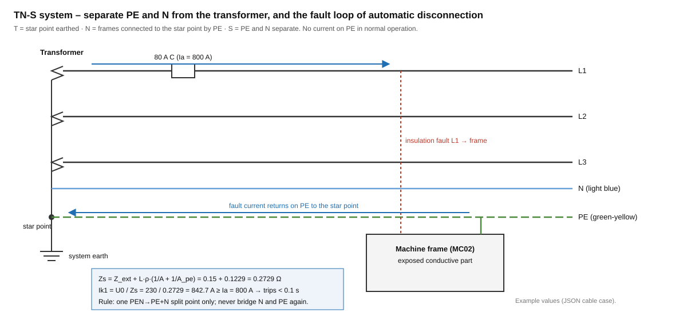

### A3.3 Why TN-S in factories

1. **Fast disconnection by ordinary breakers.** The fault loop is metallic (L conductor → frame → PE → transformer star point). The
   fault current is high, so the magnetic trip of the breaker opens within milliseconds (A4, C4).
2. **No current on the PE in normal operation.** In TN-C the PEN carries load current and harmonics. Part of this current flows over
   cable shields, machine frames and network cables – the classic cause of **EMC problems, damaged Ethernet ports and humming
   screens**. In TN-S the PE is clean.
3. **RCDs can be used everywhere** (they need separate N and PE).
4. **Clear responsibility:** one single PEN-to-PE+N split point (usually at the main board), from there five conductors everywhere.

**Rule for the FMS specification:** "TN-S from the main distribution board; one central earthing point; no PEN downstream of the
main board; PE and N never connected again after the split point." The separation can be checked with an RCD-style current clamp
around PE (should be ≈ 0 A) or around L1+L2+L3+N (sum should be ≈ 0 A) – a "stray current" measurement during commissioning.

### A3.4 The IT system in an FMS

Some suppliers use an IT system inside a machine (an isolating transformer for the control circuit, IEC 60204-1 allows it) so that a
first earth fault in a control circuit gives only an alarm. For the cell supply TN-S stays the standard. If the plant is IT (rare in
manufacturing), drives need IT-compatible EMC filters (filter capacitors to earth must be disconnected) – write this in the
specification.

### A3.5 Common mistakes and checklist

| Mistake | Consequence | Correct |
|---|---|---|
| N and PE bridged again in a module cabinet ("for safety") | TN-C behaviour, stray currents over shields, RCDs trip | bridge only at the one split point |
| Machine from a 4-wire (no N) supplier connected without PE check | frame not earthed | always 3 L + PE (+ N if needed) |
| VFD EMC filter on an IT supply | filter damaged, insulation monitor alarms | IT-compatible setting |
| PE smaller than required on long feeders | disconnection too slow (C5) | size PE by the fault loop, not only by the table |

- [ ] Earthing system of the plant known and written in the contract.
- [ ] One PEN split point, documented.
- [ ] Stray current measurement planned at commissioning.
- [ ] Supplier drives / filters suitable for the earthing system.

---

## A4. Protection against electric shock

### A4.1 Two layers of protection

IEC 60364-4-41 and IEC 60204-1 require two independent protective provisions:

1. **Basic protection** (protection against direct contact): you cannot touch live parts in normal operation – insulation, barriers,
   enclosures (IP2X / IPXXB: finger-safe; top surfaces of enclosures IP4X / IPXXD where accessible), obstacles.
2. **Fault protection** (protection against indirect contact): when insulation fails and a frame becomes live, the fault is switched
   off fast enough – **automatic disconnection of supply (ADS)**, plus protective equipotential bonding.

Plus **additional protection**: **RCDs ≤ 30 mA** for socket outlets (IEC 60364: up to 32 A sockets used by ordinary persons – check
your national rules; many plants require RCDs for all sockets in machines) and supplementary bonding.

### A4.2 Automatic disconnection in a TN system

When a line conductor touches the frame, the fault current flows through the **fault loop**: transformer winding → line conductor →
fault → frame → PE conductor → back to the star point. The loop impedance is **Zs**:

```
Ik1 = U0 / Zs                         condition:   Ik1 ≥ Ia     (or:  Zs ≤ U0 / Ia)
Ia = current that operates the protective device within the required disconnection time
```

Maximum disconnection times (IEC 60364-4-41, TN, U0 = 230 V – check your edition):

| Circuit | Max. time |
|---|---|
| Final circuits up to 32 A (sockets and fixed equipment) | **0.4 s** |
| Distribution circuits and final circuits above 32 A | **5 s** |

For an MCB or a breaker, the **magnetic (instantaneous) trip** acts in < 0.1 s, so the simple and safe rule (used in this guide and in
the JSON) is: **Ia = magnetic trip current = m × In**, with m = 5 (curve B), 10 (curve C), 20 (curve D) or the setting of an MCCB. If
Ik1 ≥ m × In, the breaker trips instantaneously and both time limits are met. With fuses, Ia is read from the fuse time-current curve at
0.4 s or 5 s.

**Touch voltage.** During the fault the frame rises to approximately Ik1 × R_PE (the voltage drop along the PE). The fast disconnection
makes sure that this voltage is present only for a short time. Protective bonding (A4.4) keeps the voltage difference between frames
that a person can touch at the same time small.

### A4.3 RCDs

An RCD (residual current device) measures the sum of all live conductor currents (L1 + L2 + L3 + N). Without fault the sum is zero.
A fault current to earth makes the sum different from zero; above the rated residual current IΔn the RCD trips.

| Type | Detects | Use in an FMS |
|---|---|---|
| AC | sinusoidal AC residual current | not for machines with electronics |
| A | AC + pulsating DC | sockets, single-phase loads with rectifiers |
| F | A + mixed frequencies (single-phase VFD) | single-phase VFD loads |
| **B** | A + F + smooth DC residual current | **three-phase VFDs, servo drives, chargers** (a smooth DC fault current blinds type A RCDs) |

Sensitivity: 30 mA = protection of persons (additional protection); 100–300 mA = fire protection / fault protection in TT systems.
**VFDs have leakage currents** (EMC filter capacitors, cable capacitance, many mA). One 30 mA RCD in front of several VFDs trips at
switch-on. Rule: in TN-S feed machines with VFDs **without** an RCD (protection by the breaker, C4), or use type B RCDs with 300 mA
where a residual-current protection is required, and keep RCD 30 mA type A for the socket circuits.

### A4.4 PE, protective bonding and functional earthing

- **PE conductor** (green-yellow): connects every exposed conductive part (frames, cabinet doors, motor housings, cable trays where
  required) with the main earthing terminal. Its cross-section follows IEC 60364-5-54 (simple rule in C1.4) **and** the fault loop
  condition (C4).
- **Main equipotential bonding** (building): connects the main earthing terminal with water pipes, structure steel, foundation earth.
- **Protective bonding circuit of a machine** (IEC 60204-1 clause 8): all frames of the machine connected to the PE terminal of the
  machine; continuity tested (K3.2).
- **Functional earthing / EMC bonding:** low-impedance (wide, short, meshed) connections for high frequencies – cable shields on clamps,
  cabinet doors with wide straps, machine bases bonded to a meshed earth grid. It is **not** a replacement for PE, but it uses the same
  metal. Guide 27 explains the meshed earth network of the compressor factory.
- **Rule of 10 mm²:** IEC 60204-1 requires special measures when the leakage current of a machine exceeds 10 mA AC or DC in the PE
  (e.g. PE ≥ 10 mm² Cu or a second PE conductor). Many VFD machines are in this class – check the supplier data.

### A4.5 FMS use case

Pallet pool `POOL01`: the stacker crane runs on a rail; power via a conductor rail (busbar) system. The PE of the rail is a separate
collector; a **second PE collector** (redundant) is common because a lifted collector would leave the crane frame unearthed. The
crane's VFDs have high leakage currents → no 30 mA RCD in the crane feeder; protection by a C-curve breaker with a checked fault loop;
service sockets on the crane fed by a separate circuit with a 30 mA type A RCD.

### A4.6 Common mistakes and checklist

| Mistake | Consequence | Correct |
|---|---|---|
| 30 mA RCD in front of a machine with VFDs | trips at switch-on, operator bridges it | breaker with fault loop check; RCD only for sockets |
| Type A RCD where VFDs can produce DC fault currents | RCD does not trip | type B |
| Painted surfaces under PE screws | high resistance, test fails | contact washers, remove paint |
| Moving parts bonded only through bearings / rails | no reliable PE | dedicated PE conductor, second collector |
| Fault loop never measured | disconnection not proven | measure Zs at every feeder (K3.3) |

- [ ] Basic protection: IP2X inside cabinets, covers on terminals > 50 V AC after the main switch.
- [ ] Fault protection: every feeder checked Ik1 ≥ Ia (C4); measured at commissioning.
- [ ] RCD types and sensitivities chosen per circuit; leakage of VFDs considered.
- [ ] PE ≥ 10 mm² or double PE where leakage > 10 mA.
- [ ] Bonding of all frames, doors, trays, rails; continuity tested.

---

## A5. IEC 60204-1 essentials

IEC 60204-1 is the **type-B standard for the electrical equipment of machines**. It applies from the machine's supply terminals to
every motor, sensor and push-button. For an FMS it applies to every module **and** to the cell as an assembly. The clauses below are
the ones an FMS engineer meets daily.

### A5.1 Supply disconnecting device (clause 5.3)

- **One per incoming supply** of a machine (one for the cell board, one per module cabinet that has its own supply).
- Types allowed: switch-disconnector (IEC 60947-3), disconnector with auxiliary contact that first switches off the load,
  circuit-breaker suitable for isolation, plug-and-socket up to certain limits.
- Requirements: **manually operated**, one OFF and one ON position clearly marked "O" and "I", **lockable in OFF** (padlock for
  lock-out / tag-out, LOTO), the handle easily accessible 0.6–1.9 m above floor (1.7 m recommended), handle colour **red on yellow** if
  it is also used as an emergency switching-off device, otherwise black or grey.
- **Excepted circuits** that stay live when the main switch is OFF (cabinet lighting, a service socket, a PLC buffer for data, the
  supply of a cooling unit to prevent condensation): their conductors are coloured **orange**, they are marked with a warning label,
  and they are listed in the documents.
- A cell with many modules needs a **clear isolation concept**: which switch isolates which module, and a written LOTO procedure per
  module (the stacker crane: main switch of `POOL01` + lock; the cell board feeder only for work on the feeder).

### A5.2 Protection (clause 7)

Overcurrent protection of every circuit (C), overload protection of motors > 0.5 kW (B5), protection against abnormal temperature,
loss of supply and **restart after voltage return**: a machine must not restart by itself when the voltage comes back (clause 7.5) –
start always needs a new command.

### A5.3 Stop categories (clause 9.2.2)

| Stop category | What happens | Example in an FMS |
|---|---|---|
| **0** | uncontrolled stop: power to the actuators removed **immediately** (contactor opens, STO) | a small conveyor, a pump; e-stop of a machine whose stop distance is short |
| **1** | controlled stop: the drives brake the motion **with power**, then the power is removed when standstill is reached (SS1) | stacker crane (10 t moving mass: braking with the drive is much shorter than coasting), spindle, rotary table |
| **2** | controlled stop **with power remaining** at standstill (SOS / SS2): position held by the drive | machine axis held in position during a door-open setup; robot "protective stop 2" |

Rules:
- **Emergency stop must be stop category 0 or 1** (never 2), selected by the risk assessment.
- Stop category 2 is allowed for other stops (operational stops, protective stops) if a safe standstill monitoring (SOS) is used where
  needed.
- With stop category 1, the time delay until power removal must be monitored and **safe** (the safety PLC or the safety relay with
  delayed contacts switches STO / contactors after a fixed maximum time even if the drive does not reach standstill).

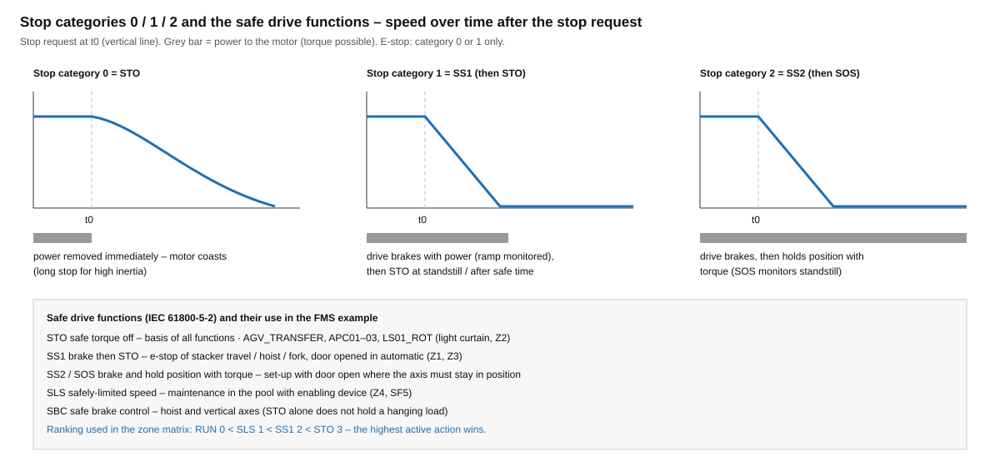

### A5.4 Control circuits and control voltage (clause 7.2.4, 9.4)

- Control circuits fed from AC must use a **transformer** (separate windings); preferred today: **24 V DC PELV** from a power supply
  unit with safe separation (IEC 61558 / IEC 61204-7), 0 V connected to PE at one point (D7).
- Control circuits are protected against overcurrent (fuses, ECBs – Part D).
- **Earth faults must not cause unintended starts or prevent stops** (clause 9.4.3): the 0 V is earthed and the switching elements
  are in the **+24 V line** – an earth fault on the switched side then trips the protection instead of energising a coil.

### A5.5 Colours (clauses 10 and 13)

**Push-buttons and actuators (clause 10.2):**

| Colour | Meaning | Use |
|---|---|---|
| **Red** | emergency, stop | stop, off; **e-stop: red mushroom on yellow background** |
| Yellow | abnormal | intervention in an abnormal condition |
| Green | normal / start | start, on (white preferred for start) |
| Blue | mandatory | reset (common use) |
| White, grey, black | no specific meaning | start (white preferred), on, off, jog |

**Indicator lights (clause 10.3):** red = emergency (danger, act immediately), yellow = abnormal, blue = mandatory action needed,
green = normal, white = neutral information.

**Wires (clause 13.2.4) – recommended colours:**

| Conductor | Colour |
|---|---|
| Protective conductor PE | **green-yellow** (mandatory, only for PE) |
| Neutral N | **light blue** |
| AC and DC power circuits | black |
| AC control circuits | red |
| DC control circuits | blue |
| Interlock / excepted circuits fed from an external source (live with main switch OFF) | **orange** |

Many plants define their own wiring colours in the specification (e.g. 24 V DC + dark blue, 0 V dark blue with white stripe; safety
circuits yellow). **Write it into the specification of the FMS**, so that all module suppliers wire the same way.

### A5.6 Protective bonding circuit (clause 8) and tests (clause 18)

- All exposed conductive parts connected to the protective bonding circuit; PE terminal of the machine marked "PE".
- Tests per clause 18 (details in K3): (1) continuity of the protective bonding circuit, (2) verification of the conditions for
  automatic disconnection (fault loop impedance), (3) insulation resistance (500 V DC, ≥ 1 MΩ between power circuits and PE),
  (4) voltage test (where required), (5) protection against residual voltages (≤ 60 V within 5 s after switch-off, e.g. DC-link
  capacitors of drives – or a warning label), (6) functional tests.

### A5.7 Documentation (clause 17)

Required: installation information (supply, earthing system, Ik, incoming cable cross-sections), overview and **circuit diagrams**, terminal
plans, parts list, operating and maintenance information incl. the description and test of the safety functions, list of excepted circuits.
Each module supplier delivers this set; the integrator delivers it for the cell board, the cell safety system and all interconnections (E7).

### A5.8 Checklist IEC 60204-1

- [ ] One lockable supply disconnecting device per incoming supply; LOTO procedure per module.
- [ ] Excepted circuits orange, labelled, listed.
- [ ] No automatic restart after voltage return.
- [ ] Stop category of every stop function chosen by the risk assessment; e-stop 0 or 1.
- [ ] 24 V DC PELV control voltage; 0 V earthed; switching in the + line.
- [ ] Colours of push-buttons, lamps and wires as specified for the whole cell.
- [ ] Tests of clause 18 planned (K3), results recorded.
- [ ] Complete documentation set per module and for the cell.

---

## A6. Who is responsible for what: IEC 60364 vs IEC 60204-1 vs IEC 61439

### A6.1 The three standards and their boundaries

| Standard | Covers | Typical responsible party in an FMS project |
|---|---|---|
| **IEC 60364** (installation) | the building installation: from the utility point to the outlet / terminal of the machine; transformer, main board, cables to the cell board, earthing of the building | plant (factory owner) and its electrical contractor |
| **IEC 61439-1/-2** (assemblies) | low-voltage switchgear assemblies (distribution boards and control cabinets) as **products**: design verification and routine verification | the **assembly manufacturer** (panel builder) – often the integrator or a sub-supplier |
| **IEC 60204-1** (machines) | the electrical equipment **of a machine** from its supply terminals: control circuits, protection, stop functions, safety-related wiring, tests | the machine manufacturer – for the FMS as an assembly: the **integrator** (or whoever takes the role of manufacturer, F2) |

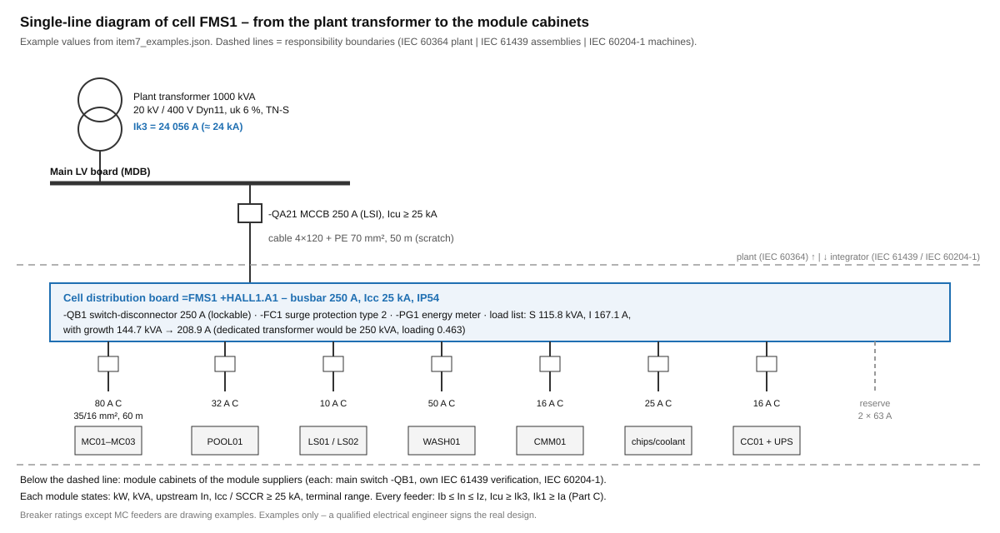

### A6.2 The interface points

The responsibilities change at exactly defined points. Write them into the contract and the single-line diagram:

1. **Plant ↔ cell:** usually the **outgoing terminals of the feeder breaker in the main LV board** (the plant supplies the breaker and the
   cable to the cell board) **or** the incoming terminals of the cell board (the plant lays the cable, the integrator supplies the
   board). Both work – but write which.
2. **Cell board ↔ module:** the incoming terminals of the module's main switch. The module supplier states the required supply (kW,
   kVA, In of the upstream breaker, max. Ik, SCCR of his cabinet, cross-section range of his terminals).
3. **Machine tool ↔ cell safety:** the hard-wired safety coupling terminals (I4).

### A6.3 What the owner's engineer must give each supplier

| Information | Value in the running example | Why |
|---|---|---|
| Voltage, frequency, system | 3/N/PE AC 50 Hz 400/230 V, TN-S | design of every device |
| Prospective short-circuit current at the cell board | ≤ 25 kA (calculated 24 056 A, B4) | breaking capacity and SCCR |
| Voltage tolerance | ± 10 % (IEC 60204-1 4.3.2: 0.9–1.1 × nominal) | drive and PSU design |
| Ambient conditions | 5–40 °C, max. 1 000 m, no condensation | derating, cooling |
| Earthing / bonding concept | meshed earth, one PEN split point | EMC |
| Colours, wire marking, designation system | IEC 60204-1 colours + plant rules, IEC 81346 | uniform cell |
| Safety concept and interfaces | Part I of this guide | the cell is one machine |

### A6.4 Checklist

- [ ] Interface point plant ↔ cell written in the contract and shown in the single-line diagram.
- [ ] For every module: supply data sheet (kW, kVA, In upstream, Ik max, SCCR, terminals).
- [ ] Assembly manufacturer of each cabinet named (IEC 61439 responsibility).
- [ ] Manufacturer of the FMS assembly named (F2).

---

# Part B – Power distribution of an FMS

## B1. The distribution chain

### B1.1 Theory – levels of distribution

Energy flows through four levels. Each level has its own board, its own protective devices and its own responsible party (A6).

| Level | Equipment | Typical rating | Standard / responsibility |
|---|---|---|---|
| 1 Medium voltage → LV | plant transformer 10–20 kV / 400 V, Dyn11 | 630–2 500 kVA | utility / plant |
| 2 Main LV distribution (MDB) | busbars, ACB / MCCB feeders, PF correction, metering | 1 000–4 000 A | plant, IEC 61439-2 |
| 3 Cell distribution board (`=FMS1` CDB) | incoming switch-disconnector or MCCB, feeders to modules, metering, surge protection | 160–630 A | integrator, IEC 61439-2 |
| 4 Module cabinets (`=FMS1.MC01`, `=FMS1.POOL01` …) | main switch, breakers, contactors, drives, PSU, PLC | 16–250 A | module supplier, IEC 61439 + IEC 60204-1 |


### B1.2 How it works – the single-line diagram (SLD)

A single-line diagram shows the three phases as one line. On it you read:

1. Source: transformer kVA, uk, earthing system, short-circuit current.
2. Every board with its busbar rating (A) and its rated short-time withstand current Icw or conditional short-circuit current Icc.
3. Every outgoing feeder: protective device (type, In, curve or settings, Icu), cable (type, cross-section, length), load (kW).
4. Metering points (energy per machine is a valuable FMS KPI – energy per part, guide 65).

**Typical SLD of the cell `FMS1`** (example):

```
 plant transformer 1000 kVA, uk 6 %, 20 kV / 400 V Dyn11, TN-S          Ik3 at LV busbar ≈ 24 kA (B4)
   │
 MDB  ── -QA21  MCCB 250 A (feeder "FMS1") ── cable 4×120 + PE 70 mm², 50 m ──┐
                                                                           CDB =FMS1 +HALL1.A1   busbar 250 A, Icc 25 kA
                                                                           -QB1 switch-disconnector 250 A (lockable)
                                                                           -FC1 surge protection type 2   -PG1 energy meter
   ├─ -QA11  80 A C  → MC01 (38 kW)        ├─ -QA14  32 A C  → POOL01 (15 kW, stacker)
   ├─ -QA12  80 A C  → MC02 (38 kW)        ├─ -QA15  10 A C  → LS01 / LS02 (3 kW each, own breakers)
   ├─ -QA13  80 A C  → MC03 (38 kW)        ├─ -QA16  50 A C  → WASH01 (25 kW)
   ├─ -QA17  16 A C  → CMM01 + climate     ├─ -QA18  25 A C  → chip / coolant system (11 kW)
   ├─ -QA19  10 A C  → AGV charger         ├─ -QA20  16 A C  → cell controls, IT (UPS), lighting
   └─ reserve 2 × 63 A (growth)            (compressed air: from the plant's compressor station, cost share only)
```

The breaker sizes above are examples for the drawing; each one is chosen by the method of C1 from the module supplier's data.

### B1.3 Design choices

| Question | Options | Rule of thumb |
|---|---|---|
| Own cell board or feeders direct from the MDB? | (a) CDB in the cell (b) each module from the MDB | (a) for an FMS: one isolation point, local metering, short feeders, easy extension |
| Dedicated transformer for the cell? | normally no | only for very large cells, sensitive measuring equipment (CMM) or a separate network quality need |
| Busbar trunking or cables? | cables up to ~250 A; busbar trunking for long lines with many tap-offs | busbar trunking along a transfer line with frequent re-layout |
| Surge protection | type 1 at the building entry, type 2 at the CDB, type 3 near sensitive electronics | always type 2 at the CDB of an FMS |
| Energy metering | per module feeder | at least per machining centre, washer, compressed air share |

### B1.4 FMS use case

The cell `FMS1` gets one feeder from the MDB, one cell board in the cell, and one feeder per module. Advantages for the factory: one
lockable switch isolates the whole cell for work on the cell board; each module can be isolated alone; the energy per module and per
part is measured; adding a fourth machining centre means using a reserve feeder.

### B1.5 Checklist

- [ ] SLD with source data (kVA, uk, Ik3, earthing), every board, every feeder, every cable.
- [ ] Interface point plant ↔ cell marked on the SLD.
- [ ] Reserve feeders (≥ 20 % or 2 feeders) in the cell board.
- [ ] Surge protection type 2 at the cell board.
- [ ] Energy meters per main module.

---

## B2. The load list method – the JSON load list worked in full

### B2.1 Theory

A **load list** answers: how much power does the cell really take at the same time? Adding the installed powers is wrong – no machine
runs all its motors at full power at the same time, and not all machines are at their peak at the same time. Two factors correct this:

- **ku – utilisation factor** of one load: average used power / installed power while it works (e.g. machining centre 0.6: the spindle
  works at partial load, the axes move only part of the time).
- **ks – simultaneity (diversity) factor** of the group: probability that the loads work together (0.8 for a group of 9 loads of this
  type; typical values 0.6–0.9 depending on number and kind of loads – IEC 61439-1 gives rated diversity factors for assemblies).

The JSON formulas (`_formulas.load_list`):

```
per load:   P_d = qty × P_kW × ku        Q_d = P_d × tan(acos(cos φ))
totals:     P = Σ P_d       Q = Σ Q_d       S = ks × √(P² + Q²)   [kVA]
            cos φ_total = P / √(P² + Q²)     I = S × 1000 / (√3 × U)
growth:     S_req = S × growth               transformer = smallest standard size ≥ S_req      loading = S / S_T
```

### B2.2 How to make a load list – step by step

1. List every load from the module suppliers' data sheets: name, quantity, installed kW (or kVA), cos φ (or power factor), duty.
2. Choose ku per load from the supplier, from measurements of similar machines (best: energy meters in the existing factory) or from
   typical values (table B2.3).
3. Calculate P_d and Q_d per line.
4. Add P and Q (never add S of different cos φ – add the vectors through P and Q).
5. Apply ks.
6. Calculate cos φ_total and the current I.
7. Apply a growth factor (1.2–1.3) for future machines.
8. Check against peaks: the largest motor start (B6), the simultaneous start of all spindles in the morning, a washer heater at full
   power.
9. Size the feeder, the cell board and – if needed – a transformer.

### B2.3 Typical utilisation factors

| Load | ku (typical) | Note |
|---|---|---|
| Machining centre (roughing / finishing mix) | 0.4–0.7 | spindle rarely at rated power; measure! |
| Stacker crane, AGV, conveyors | 0.2–0.4 | short motions, regenerative braking |
| Washer: heater | 0.7–1.0 | thermostat; at heat-up 1.0 |
| Pumps, fans, coolant systems | 0.7–0.9 | continuous |
| Compressed air (share) | 0.6–0.8 | load / unload cycles |
| Controls, IT, lighting | 1.0 | continuous |
| Battery chargers | 0.5–1.0 | depends on charging strategy |

### B2.4 Worked example – the JSON load list (U = 400 V, ks = 0.8, growth = 1.25)

| # | Load | qty | P each kW | installed kW | ku | cos φ | tan φ | P_d kW | Q_d kvar |
|---|---|---|---|---|---|---|---|---|---|
| 1 | HMC machining centre | 3 | 38 | 114 | 0.6 | 0.85 | 0.6197 | 68.400 | 42.391 |
| 2 | Pallet pool stacker crane | 1 | 15 | 15 | 0.3 | 0.80 | 0.7500 | 4.500 | 3.375 |
| 3 | Load / unload station | 2 | 3 | 6 | 0.3 | 0.80 | 0.7500 | 1.800 | 1.350 |
| 4 | Parts washer (heater + pumps) | 1 | 25 | 25 | 0.7 | 0.95 | 0.3287 | 17.500 | 5.752 |
| 5 | CMM + climate unit | 1 | 6 | 6 | 0.6 | 0.90 | 0.4843 | 3.600 | 1.744 |
| 6 | Central coolant + chip system | 1 | 11 | 11 | 0.8 | 0.82 | 0.6980 | 8.800 | 6.142 |
| 7 | Compressed air (share) | 1 | 22 | 22 | 0.7 | 0.85 | 0.6197 | 15.400 | 9.544 |
| 8 | Cell controls, IT, lighting | 1 | 4 | 4 | 1.0 | 0.95 | 0.3287 | 4.000 | 1.315 |
| 9 | AGV charger | 1 | 3 | 3 | 0.5 | 0.95 | 0.3287 | 1.500 | 0.493 |
| | **Total** | | | **206** | | | | **125.500** | **72.105** |

Step by step:

1. Line 1: P_d = 3 × 38 × 0.6 = 68.4 kW; tan φ = tan(acos 0.85) = 0.6197; Q_d = 68.4 × 0.6197 = 42.391 kvar.
2. Sum: **P = 125.5 kW**, **Q = 72.105 kvar**.
3. √(P² + Q²) = √(125.5² + 72.105²) = √(15 750.25 + 5 199.18) = 144.739 kVA.
4. With simultaneity: **S = 0.8 × 144.739 = 115.791 kVA**.
5. **cos φ_total = 125.5 / 144.739 = 0.8671**.
6. **I = 115 791 / (1.732 × 400) = 167.13 A**.
7. With growth: **S_req = 115.791 × 1.25 = 144.74 kVA**. (In this example ks × growth = 0.8 × 1.25 = 1.0, so S_req equals the
   undiversified vector sum – a coincidence of the example values.)
8. The design current of the cell feeder including growth: 144 739 / (1.732 × 400) = 208.9 A → feeder breaker **250 A** (B5), feeder
   cable sized by C1.

**Compare:** installed power 206 kW; diversified demand 115.8 kVA. Sizing by installed power would make the feeder, the board and a
transformer about 1.8 times bigger than needed. Sizing by the average without peak check could make it too small – so step 8 (peak
check) is never skipped.

### B2.5 Peak check for the example

- Largest motor start: the 7.5 kW motor of B6 starts DOL with 102.7 A for about 1–3 s – small compared with 209 A design current.
- Morning start of the three HMCs: spindle drives ramp up with the VFD (current limited to about 1.5 × rated drive current); the cell
  controller (guide 65) can **stagger** the start of the machines by 10–30 s – an inexpensive way to avoid peaks. Write this in the
  cell controller's start-up sequence.
- Washer heat-up at shift start: 25 kW heater at ku 1.0 for 30–60 min, while the HMCs warm up – inside the reserve of the growth factor.

### B2.6 FMS use case – using the load list in the project

- **Owner's engineer:** asks every module supplier for the load data sheet (kW, kVA, cos φ, ku, inrush, leakage current, harmonics) in the
  inquiry; checks the integrator's load list at the design review; compares it later with the measured energy of the meters.
- **Integrator:** builds the load list in the basic engineering phase, updates it at every design freeze, uses it for the feeder, cell
  board and upstream breaker.
- Program: `python tools/fmse/load_list.py --example` prints exactly this table; web section **7A**.

### B2.7 Common mistakes and checklist

| Mistake | Consequence | Correct |
|---|---|---|
| Adding installed kW | oversized board, transformer, cost | ku and ks |
| Adding kVA of loads with different cos φ | wrong S (too big) | add P and Q separately |
| ku from a brochure without measurement | under / oversizing | measure similar machines |
| No growth reserve | the 4th machine needs a new feeder | growth 1.2–1.3 |
| No peak check | breaker trips at shift start | starts staggered, peak calculated |

- [ ] All loads from data sheets, with cos φ and ku.
- [ ] P and Q added, ks applied, cos φ and I calculated.
- [ ] Growth factor applied; feeder, board, transformer sized from S_req.
- [ ] Peak check: largest start, morning start, heaters.
- [ ] Load list version-controlled and updated at each design freeze.

---

## B3. Transformer sizing and loading

### B3.1 Theory

Usually the cell is fed from the **plant transformer** (here 1 000 kVA). A **dedicated** cell transformer is needed only in special
cases (B1.3). If you need one, its size follows from S_req:

```
transformer = smallest standard size ≥ S_req          loading = S / S_T
standard sizes (JSON): 250, 400, 630, 800, 1000, 1250, 1600 kVA
```

### B3.2 Worked example

S_req = 144.74 kVA → smallest standard size ≥ 144.74 kVA = **250 kVA**. Loading = S / S_T = 115.791 / 250 = **0.463 (46.3 %)**.

A transformer is most efficient at about 40–60 % loading (copper losses = iron losses); 46 % is good. The rated current of the 250 kVA
transformer is 250 000 / (1.732 × 400) = 360.8 A; its short-circuit current at uk 6 % would be 6 014 A – much lower than the 24 kA of
the plant transformer. That would allow cheaper breakers (lower Icu) in the cell – but this is rarely the reason to buy a transformer.

### B3.3 Plant transformer check

The owner's engineer must check that the **plant** transformer and the MDB have the reserve: present plant peak load + 115.8 kVA (+
growth) ≤ transformer rating (keep about 20 % reserve). If not: new transformer or load management.

### B3.4 Checklist

- [ ] Fed from the plant transformer? Reserve of the plant transformer and MDB checked.
- [ ] Dedicated transformer only with a reason; size from S_req; loading 40–80 %.
- [ ] Vector group (Dyn11) and earthing of the star point (TN-S) specified.

---

## B4. Short-circuit current, breaking capacity and SCCR

### B4.1 Theory

At a short circuit the current is limited only by the impedances of the transformer, the upstream network and the cables. The
**worst case** for the breaking capacity is a three-phase fault close to the transformer. With an infinite upstream network and no cable
impedance (JSON `_formulas.short_circuit`):

```
Ik3 = S_T × 1000 / (√3 × U × uk)        [A]
uk = relative short-circuit voltage of the transformer (typ. 4 % up to 630 kVA, 6 % above)
```

### B4.2 Worked example – the plant transformer

S_plant = 1 000 kVA, U = 400 V, uk = 0.06:
Ik3 = 1 000 000 / (1.732 × 400 × 0.06) = **24 056 A ≈ 24 kA**.

Check: rated current of the transformer In_T = 1 000 000 / (1.732 × 400) = 1 443 A; Ik3 = In_T / uk = 1 443 / 0.06 = 24 056 A. ✓

The cable from the MDB to the cell board reduces this value at the cell board (an exact calculation follows IEC 60909 with resistances
and reactances of network, transformer and cables). The JSON and this guide use the **conservative** value at the transformer secondary
for the cell board. This keeps the method simple and safe; a precise calculation may allow cheaper devices in large projects.

### B4.3 What must withstand the short-circuit current

| Item | Value | Rule |
|---|---|---|
| Breaking capacity of a circuit-breaker | **Icu** (ultimate, IEC 60947-2) or **Icn** (MCB, IEC 60898-1) | Icu ≥ Ik at its location |
| Service breaking capacity | Ics (% of Icu) | Ics ≥ Ik where the breaker must stay usable after a fault (feeders of critical modules) |
| Assembly (board, cabinet) | rated conditional short-circuit current **Icc** or short-time withstand **Icw** (IEC 61439) | ≥ Ik at the incoming terminals |
| Machine / panel in North America | **SCCR** (short-circuit current rating, UL 508A / NFPA 79) | SCCR ≥ available fault current; marked on the nameplate |
| Fuses | breaking capacity typ. 50–120 kA | usually no problem |

**Example:** the cell board receives Ik3 ≤ 24 kA. All breakers in the cell board need **Icu ≥ 25 kA** (next standard rating). A cheap
MCB with Icn = 6 kA or 10 kA must **not** be used directly at the cell board busbar – unless it is protected by an upstream device in a
tested combination (**back-up protection / cascading**, the maker's tables give the combination value, e.g. "MCB 10 kA behind MCCB 160
A: 25 kA" – use only the maker's tested tables). Module cabinets must state their **Icc / SCCR ≥ 25 kA** (or the integrator calculates
the reduced Ik at the end of the feeder cable and the module may have a lower rating).

### B4.4 FMS use case

Machine tools from overseas suppliers often come with a nameplate "SCCR 5 kA" (the default of UL 508A for a panel with no further
evaluation). Connected to a 24 kA board, the panel's components may explode in a fault. Owner's engineer: write "**Icc / SCCR ≥ 25
kA at the incoming terminals, or the supplier provides current-limiting fuses / breakers upstream as part of his delivery**" into
every module specification.

### B4.5 Checklist

- [ ] Ik3 at the cell board calculated (or the plant's value obtained).
- [ ] Every breaker Icu ≥ Ik at its location (or tested cascading combination).
- [ ] Cell board Icc / Icw ≥ Ik.
- [ ] Every module cabinet Icc / SCCR ≥ Ik at its terminals – written in the contract.

---

## B5. Protective devices and selectivity

### B5.1 The devices

| Device | Standard | Range | Protects | Adjustable |
|---|---|---|---|---|
| **MCB** miniature circuit-breaker | IEC 60898-1 / IEC 60947-2 | 0.5–125 A | cables against overload and short circuit | no (fixed curve B / C / D / K / Z) |
| **MCCB** moulded-case circuit-breaker | IEC 60947-2 | 16–1 600 A | feeders, boards | thermal Ir, magnetic Im (electronic: L, S, I, G) |
| **ACB** air circuit-breaker | IEC 60947-2 | 630–6 300 A | MDB incomers | full electronic settings, Icw |
| **MPCB** motor protection circuit-breaker | IEC 60947-2 / -4-1 | 0.1–100 A | a motor and its cable (overload set to motor In; magnetic ≈ 12–14 × In) | thermal set to the motor current |
| **Fuse gG** | IEC 60269 | 2–1 250 A | cables (general purpose) | no |
| **Fuse aM** | IEC 60269 | | motor circuits (short circuit only, overload by relay) | no |
| **Fuse gR / aR** (semiconductor) | IEC 60269-4 | | drive input rectifiers | no |
| **Overload relay** | IEC 60947-4-1 | | motor overload (with contactor) | yes |
| **RCD / RCBO** | IEC 61008 / 61009 / 62423 | 30–300 mA | persons, fire | some |

### B5.2 MCB tripping curves

| Curve | Magnetic trip (instantaneous) | m used in this guide | Use |
|---|---|---|---|
| **B** | 3–5 × In | 5 | long cables, resistive loads, lighting, sockets |
| **C** | 5–10 × In | 10 | general, motors with small start current, PSUs, feeders |
| **D** | 10–20 × In | 20 | transformers, high inrush (large PSUs, motors DOL) |
| K / Z | ~8–14 / 2–3 × In | – | motors / semiconductor circuits |

The **upper** limit of the band (5, 10, 20 × In) is used for the disconnection check, because the device is guaranteed to trip only above
it (JSON: m = 5 / 10 / 20).

### B5.3 How to choose the device of a circuit

1. **Ib** (design current) from the load (B2, B6).
2. **In ≥ Ib** – the next standard rating (6, 10, 13, 16, 20, 25, 32, 40, 50, 63, 80, 100, 125 A …).
3. Curve / settings: inrush of the load must not trip it (PSU inrush, transformer, DOL motor), and **Ia = m × In ≤ Ik1** (C4).
4. **Icu ≥ Ik** at the location (B4).
5. Cable: **In ≤ Iz** (C1).
6. Selectivity with the upstream device (B5.5).

### B5.4 MCCB settings example – the cell feeder

Design current with growth 208.9 A → MCCB **In = 250 A** with electronic trip unit:
- L (long time, overload): Ir = 0.9 × 250 = 225 A ≥ 208.9 A ✓ (with the feeder cable Iz ≥ 225 A).
- S (short time): Isd = 6 × Ir = 1 350 A, tsd = 0.1 s – delayed, so the 80 A breakers of the machines trip first (selectivity).
- I (instantaneous): Ii = 12 × In = 3 000 A – above Isd; still well below the 24 kA short-circuit current.
- G (earth fault): optional, e.g. 0.3 × In, 0.2 s.
The fault loop check uses the current at which the device trips within 5 s (distribution circuit, A4.2) – with the S function this
is Isd (1 350 A).

### B5.5 Selectivity (discrimination)

**Selectivity** means: at a fault, only the device directly upstream of the fault opens; all other circuits keep running. In an FMS this
is a **production** requirement: a short circuit in the washer must not switch off the three machining centres.

| Method | How | Rule of thumb |
|---|---|---|
| Current selectivity | upstream magnetic threshold > maximum fault current downstream | works for small downstream devices and long cables |
| Time selectivity | upstream S function delayed (tsd 0.1–0.4 s) | MCCB / ACB with electronic trip |
| Energy selectivity | current-limiting breakers; maker's selectivity tables | MCB behind MCCB of the same maker |
| Fuses gG | rated currents in ratio ≥ 1.6 : 1 | e.g. 100 A upstream of 63 A |

Always use the **maker's selectivity tables** (they give the limit current up to which selectivity is guaranteed, "total" if up to Icu).

**Example:** MC02 feeder 80 A C (magnetic up to 800 A); cell feeder MCCB 250 A with Isd 1 350 A, tsd 0.1 s. A fault at MC02 with 3 kA:
the 80 A C trips instantaneously (< 10 ms); the MCCB sees 3 kA > Isd but waits 0.1 s – the fault is already cleared → selective. Above
the MCCB's Ii (3 000 A) both would trip instantaneously; whether selectivity remains then depends on the energy-limiting behaviour →
maker's table.

### B5.6 Motor protection

A motor needs: short-circuit protection (MPCB magnetic or fuse), overload protection (MPCB thermal or overload relay set to the motor
rated current), and a switching device (contactor, or a VFD). Coordination type (IEC 60947-4-1): **type 1** = after a short circuit the
starter may be damaged; **type 2** = no damage except light welding of contacts that can be separated – **specify type 2** for FMS
modules (fast restart after a fault). Makers publish tested type-2 combinations of MPCB + contactor for each motor size.

### B5.7 Checklist

- [ ] Every device: In ≥ Ib, In ≤ Iz, Icu ≥ Ik, Ia ≤ Ik1, inrush OK.
- [ ] Motor starters coordination type 2 from the maker's tables.
- [ ] Selectivity between cell feeder and module feeders checked with the maker's tables.
- [ ] Settings of MCCBs documented (Ir, Isd, tsd, Ii, Ig) and set on site.

---

## B6. Motors: rated current, DOL, star-delta, soft starter, VFD

### B6.1 Rated current of a three-phase motor

```
I_n = P × 1000 / (√3 × U × η × cos φ)          P = shaft power (nameplate kW), η = efficiency
```

**Worked example – the JSON motor** (7.5 kW, 400 V, η = 0.90, cos φ = 0.82, k_start = 7.0):
I_n = 7 500 / (1.732 × 400 × 0.90 × 0.82) = 7 500 / 511.29 = **14.668 A**.
(Real nameplate: compare – an IE3 7.5 kW 4-pole motor has about 14–15 A at 400 V.)

### B6.2 Direct-on-line (DOL) start

The motor is switched directly to the full voltage. Starting current = k_start × I_n:
**I_DOL = 7.0 × 14.668 = 102.68 A** for 1–5 s (until the motor reaches speed).

- Simple, cheap, full starting torque.
- The starting current causes a voltage dip in the network (problem with weak supplies or large motors) and mechanical shocks.
- Breaker / MPCB: the magnetic trip must stay above the starting current, including the first-half-wave peak (up to about 2 × the rms
  starting current, i.e. up to about 205 A peak here). An MPCB of the 10–16 A range set to 14.7 A has its magnetic trip fixed at about
  13 × the upper end of the range (13 × 16 A ≈ 208 A). Makers design MPCBs for DOL starts of standard motors – confirm with the maker's
  coordination table, never by calculation alone.

### B6.3 Star-delta start

The motor starts in star (each winding at U0 = 230 V instead of 400 V) and switches to delta after the run-up. In star the line current is
one third: **I_YΔ = k_start × I_n / 3 = 102.68 / 3 = 34.23 A**. The starting torque is also only one third – the machine must start
without load (fans, pumps, compressors unloaded).

- Needs a motor for Δ at the supply voltage (400 V Δ, nameplate 400/690 V) and six wires to the motor.
- Current peak at the switch-over (if the speed falls during the open transition).
- Today mostly replaced by soft starters or VFDs.

### B6.4 Soft starter

Thyristors ramp the voltage up. Starting current about 2–4 × I_n, smooth torque, built-in overload and often a bypass contactor. Use:
pumps, fans, conveyors, compressors with fixed speed. Not for positioning.

### B6.5 Variable-frequency drive (VFD)

The VFD rectifies the supply (diode bridge or active front end), stores energy in a DC link and creates a variable voltage and frequency
with IGBTs (PWM). In an FMS almost every motion that positions (stacker travel, hoist, rotary table, conveyors with soft stops) uses a VFD
or a servo drive.

| Topic | What to design |
|---|---|
| Input current | approx. motor power / (√3 × U × η_total × λ); for 7.5 kW typically 12–16 A (data sheet!) |
| Protection | fuses or breaker as stated by the maker (often gR fuses for semiconductor protection) |
| Line reactor / DC choke | reduces harmonics (THDi 80–100 % without → 30–45 % with choke) and protects against supply transients |
| EMC filter | category C2 (industrial, with warning) or C3 (industrial networks only) after IEC 61800-3; leakage current! |
| Motor cable | **shielded**, symmetrical (3 conductors + 3 split PE or concentric shield), shield 360° on both ends; max. length per data sheet (typ. 50–150 m without output filter) |
| Long motor cables | output reactor, du/dt filter or sine filter (reflection → voltage peaks up to 2 × DC link at the motor terminals) |
| Braking | brake resistor (chopper) or regenerative unit (stacker hoist lowering, travel braking) |
| Safety | **STO** input (Safe Torque Off) – the basis of all safe drive functions (H10) |
| Cooling | losses ≈ 2–3 % of the power (stacker cabinet E3: 330 W for 11 kW) |

### B6.6 Comparison and choice

| Method | Start current | Start torque | Speed control | Cost (7.5 kW, relative) | Use in an FMS |
|---|---|---|---|---|---|
| DOL | 6–8 × In | 100 % (high) | no | 1 | pumps, fans, small conveyors |
| Star-delta | 2–2.7 × In | 33 % | no | 1.5 | old compressors, fans |
| Soft starter | 2–4 × In | adjustable | no | 2 | pumps, compressors, conveyors |
| VFD | ≤ 1.5 × In | up to 150–200 % | yes | 3–4 | all motion, positioning, energy saving |

### B6.7 Common mistakes and checklist

| Mistake | Consequence | Correct |
|---|---|---|
| VFD motor cable unshielded | EMC faults in sensors and networks | shielded, 360° clamps (C6, E5) |
| 30 mA RCD in front of VFDs | nuisance trips | see A4.3 |
| Star-delta for a loaded start | motor does not start, overheats | VFD or soft starter |
| No brake resistor for a hoist | DC-link over-voltage trip while lowering | braking chopper or regenerative unit |
| STO wired but not validated | safety function untested | validation (G11) |

- [ ] Motor currents from nameplates; starting method chosen per motor.
- [ ] MPCB / contactor type-2 combinations.
- [ ] VFD: input protection, choke, EMC filter category, shielded motor cable, cable length, braking, STO.

---

## B7. Power quality and harmonics

### B7.1 Theory

Non-linear loads (diode rectifiers of VFDs, servo drives, PSUs, LED drivers, chargers) take current in pulses, not as a sine. A pulse
current is a sum of sine currents of 1×, 5×, 7×, 11×, 13× … the base frequency (**harmonics**). For a three-phase 6-pulse rectifier the
typical harmonic orders are h = 6k ± 1 (5, 7, 11, 13 …); for single-phase loads 3, 5, 7 …

```
THDi = √(I2² + I3² + I4² + …) / I1 × 100 %          (total harmonic distortion of the current)
THDu = same for the voltage – the result of harmonic currents flowing through the network impedance
```

### B7.2 Effects

- Extra heating of transformers, cables, neutral conductors (3rd harmonic adds in N).
- Voltage distortion → malfunction of sensitive equipment (CMM, measuring systems), flicker.
- Resonance with power-factor capacitors → capacitor failures (therefore **detuned** compensation with reactors, typically 7 % /
  189 Hz).
- Nuisance trips of breakers and RCDs.

### B7.3 Limits and measures

| Measure | THDi of a drive (typical) | Note |
|---|---|---|
| 6-pulse diode rectifier without choke | 80–100 % | avoid for drives > 2 kW |
| with DC choke or 3 % line reactor | 30–45 % | **standard for FMS drives** |
| 12-pulse / 18-pulse | 10–15 % / 5 % | large drives with special transformer |
| active front end (AFE) | < 5 % | regenerative, more expensive |
| active harmonic filter (central) | system < 5–8 % | when many drives share a board |

Standards for orientation: IEC 61000-3-12 (equipment 16–75 A), IEC 61000-2-4 (compatibility levels in industrial plants, class 2: THDu
≤ 8 %), IEEE 519 (point of common coupling, USA). Rule: **ask the module suppliers for THDi of their drives** and give the cell an
upper limit (e.g. "drives > 2 kW with choke; THDu at the cell board ≤ 5 % at full load").

### B7.4 Other power quality items

Voltage dips (machine tools must ride through dips per IEC 61000-4-11 / -34 class), voltage unbalance (< 2 %), transient over-voltages
(surge protection B1.3), frequency deviation (rare in public networks). For a CMM: separate the supply from big drives and give it a
UPS or a voltage stabiliser if the supplier requires it.

### B7.5 Checklist

- [ ] THDi of every drive > 2 kW known; chokes specified.
- [ ] Neutral not reduced (3rd harmonics).
- [ ] PF correction of the plant detuned.
- [ ] Sensitive loads (CMM, IT) separated or on UPS.

---

## B8. UPS and buffering for controls

### B8.1 Why

A short voltage dip (100 ms) can stop every PLC, every PC and every network switch of the cell. After the dip the machines are stopped
in an undefined state, the cell controller has lost its connections, the MES does not know which part was finished. **Buffering the
controls** turns a 10-minute recovery into no stop at all.

### B8.2 What to buffer

| Load | Buffer | Typical duration |
|---|---|---|
| Cell controller PC, SCADA server, network switches, firewall | **AC UPS** (online / double conversion) in the cell or in the server room | 10–30 min + clean shutdown |
| PLCs and 24 V of a module | **DC-UPS** module with battery or capacitor buffer (D7) | 1–60 s (ride-through) or minutes (save data, safe shutdown) |
| Safety PLC | together with the PLC 24 V | as above – loss of supply is always a safe state, but restart is faster |
| Drives, spindles | **no** – a stop on supply loss is safe | – |

### B8.3 Sizing of an AC UPS (example)

Cell controller PC 150 W + 2 switches 2 × 30 W + firewall 40 W + HMI 50 W = 300 W. With power factor 0.9 and reserve 1.3: 300 / 0.9 × 1.3 =
433 VA → UPS **1 000 VA** (next size; runtime at 300 W typically 15–25 min with the internal battery – data sheet). The UPS signals
"on battery" and "battery low" to the cell controller (dry contact or network) so that it shuts down cleanly.

### B8.4 Checklist

- [ ] Cell controller, network, SCADA on UPS; shutdown signal wired.
- [ ] PLC 24 V with DC-UPS or buffer where restart time matters.
- [ ] Battery replacement interval in the maintenance plan (typ. 3–5 years).

---

# Part C – Cable sizing

## C1. The method: Ib ≤ In ≤ Iz

### C1.1 Theory

A cable heats up when current flows (I² × R). The insulation has a maximum continuous temperature (PVC 70 °C, XLPE / EPR 90 °C). The
**current-carrying capacity Iz** is the current at which the conductor reaches this temperature in a given installation. The cable must
also: keep the voltage drop small, survive the short-circuit current until the breaker opens, and let enough fault current flow to trip the
breaker (automatic disconnection). So **four checks** decide the cross-section:

| Check | Condition | Chapter |
|---|---|---|
| 1 Thermal (overload) | **Ib ≤ In ≤ Iz** (Iz = table value × correction factors) | C1–C3 |
| 2 Voltage drop | ΔU% ≤ limit (here 5 %) | C4 |
| 3 Automatic disconnection (fault loop) | Ik1 ≥ Ia | C4, C5 |
| 4 Short-circuit withstand | k² × A² ≥ I² × t (energy let-through of the device) | C1.3 |

For breakers with a conventional tripping current I2 ≤ 1.45 × In (MCBs, MCCBs to IEC 60947-2 / 60898-1) the second overload condition of
IEC 60364-4-43 (I2 ≤ 1.45 × Iz) is fulfilled automatically when In ≤ Iz. With gG fuses it is fulfilled as well (I2 = 1.6 × In for small
fuses needs care below 16 A – check your edition).

### C1.2 Step by step (JSON `_formulas.cable_size`)

```
1  Ib = design current of the circuit (from the load: B2, B6)
2  In = rated current of the protective device, In ≥ Ib (next standard rating)
3  correction factors for the installation: k_temp (ambient), k_group (grouping), others (soil, harmonics)
4  required Iz = In / (k_temp × k_group)
5  choose the smallest cross-section A with Iz_table ≥ required Iz   (table for the installation method)
6  check: Ib ≤ In ≤ Iz_table × k_temp × k_group
7  PE size (IEC 60364-5-54 simple rule): A ≤ 16 → A_pe = A ; 16 < A ≤ 35 → 16 ; A > 35 → A/2 (next standard size)
8  voltage drop, fault loop and L_max (C4)
```

### C1.3 Short-circuit withstand (adiabatic equation)

During a short circuit the conductor heats up adiabatically until the device opens:

```
I² × t ≤ k² × A²       k = 115 (Cu / PVC), 143 (Cu / XLPE)    A in mm², I in A, t in s
```

For breakers and fuses the let-through energy I²t is given by the maker. Example: 35 mm² Cu / PVC withstands k² A² = 115² × 35² = 16.2 ×
10⁶ A²s. A current-limiting 80 A MCCB at 24 kA lets through typically < 1 × 10⁶ A²s → OK. Small cables (1.5 mm²: 2.98 × 10⁴ A²s) behind a
non-limiting large breaker can fail – this is why each cable is protected by a device sized for it.

### C1.4 PE cross-section – the simple rule

| Line conductor A (Cu) | PE (Cu), simple rule IEC 60364-5-54 Table 54.2 |
|---|---|
| A ≤ 16 mm² | A_pe = A |
| 16 < A ≤ 35 mm² | 16 mm² |
| A > 35 mm² | A / 2 (next standard size) |

Alternative: calculate the PE with the adiabatic equation (A_pe ≥ √(I² t) / k). **The simple rule does not check the fault loop.** A
reduced PE increases the loop resistance – C5 shows when this matters.

---

## C2. Installation methods and the ampacity table

### C2.1 Installation methods (IEC 60364-5-52)

The same cable carries different currents depending on how well it can lose heat:

| Method (letter) | Description | Relative Iz |
|---|---|---|
| A1 / A2 | insulated conductors / multicore cable in a conduit in a thermally insulated wall | lowest |
| B1 / B2 | in a conduit or trunking on a wall | low |
| C | multicore cable clipped direct on a wall | medium |
| D1 / D2 | in a duct in the ground / direct in the ground | medium |
| **E** | **multicore cable in free air, on a perforated tray** | high |
| F / G | single-core cables touching / spaced in free air | highest |

In an FMS most feeders run on **perforated cable trays** above the cell or in floor ducts → method E (trays) or B2 / D (ducts).

### C2.2 The JSON ampacity table

> **Example table** – copper, PVC insulation 70 °C, multicore cable in free air on a perforated tray (installation method E), 3 loaded
> conductors, ambient 30 °C. **Check against IEC 60364-5-52 Table B.52.10 (or the national table) of the edition used in your project.**

| A mm² | 1.5 | 2.5 | 4 | 6 | 10 | 16 | 25 | 35 | 50 | 70 | 95 | 120 |
|---|---|---|---|---|---|---|---|---|---|---|---|---|
| Iz_table A | 22 | 30 | 40 | 51 | 70 | 94 | 119 | 148 | 180 | 232 | 282 | 328 |

XLPE (90 °C) cables carry about 20–25 % more current in the same method. Aluminium: about 78 % of copper at the same cross-section.

---

## C3. Correction factors

### C3.1 Ambient temperature (k_temp)

The table is for 30 °C air. In a hall with 40 °C under the roof (cable trays are high!) the cable can carry less:

```
k_temp = √((θ_max − θ_a) / (θ_max − 30))     PVC θ_max = 70 °C:  40 °C → √(30/40) = 0.866 ≈ 0.87
```

| Ambient °C | 25 | 30 | 35 | 40 | 45 | 50 |
|---|---|---|---|---|---|---|
| PVC 70 °C | 1.03 | 1.00 | 0.94 | 0.87 | 0.79 | 0.71 |
| XLPE 90 °C | 1.02 | 1.00 | 0.96 | 0.91 | 0.87 | 0.82 |

### C3.2 Grouping (k_group)

Cables lying together heat each other. Example values for multicore cables touching on one perforated tray (method E): 1 cable 1.00,
2 cables 0.88, 3 cables 0.82, **4 cables 0.77**, 6 cables 0.73, 9 cables 0.72 (check the table of your edition: Table B.52.20 /
B.52.21). Spacing the cables by one diameter raises the factors considerably.

### C3.3 Other factors

Soil thermal resistivity and depth (buried cables), harmonics in the neutral (4 loaded conductors – IEC 60364-5-52 Annex E), cables in
direct sun, cables in drag chains (maker's derating, often 0.8–0.9 for many cores), multicore control cables with many loaded cores.

---

## C4. Worked example – the JSON feeder to MC02

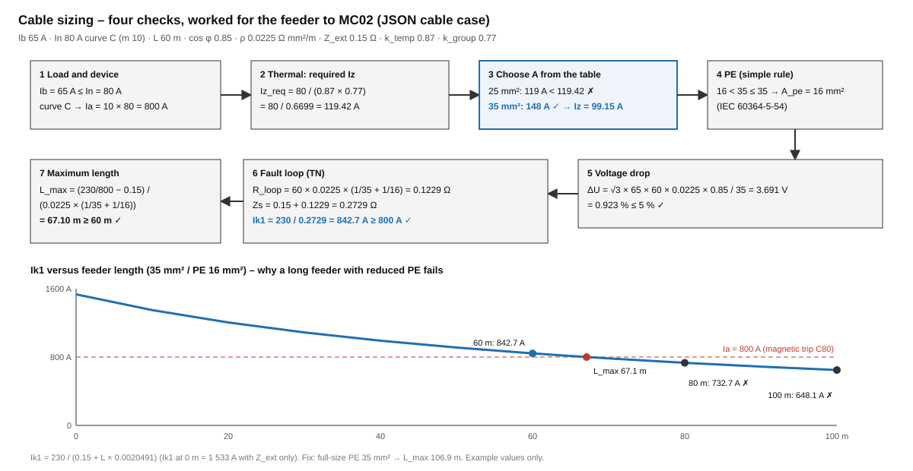

### C4.1 Input data (JSON `cable`)

| Item | Value |
|---|---|
| Case | feeder to HMC `MC02` from the cell distribution board (`=FMS1-QA12` → `=FMS1.MC02-QB1`) |
| Design current Ib | 65 A |
| Breaker | In = 80 A, curve C, m = 10 → Ia = 800 A |
| Length L | 60 m |
| cos φ | 0.85 |
| U / U0 | 400 V / 230 V |
| Resistivity ρ (Cu at operating temperature) | 0.0225 Ω mm²/m |
| Upstream loop impedance Z_ext (at the cell board) | 0.15 Ω |
| Correction factors | k_temp = 0.87 (40 °C, PVC 70 °C), k_group = 0.77 (4 multicore cables touching on a perforated tray) |

### C4.2 Step 1 – thermal

1. Ib = 65 A ≤ In = 80 A ✓.
2. Total correction: k = 0.87 × 0.77 = 0.6699.
3. **Required Iz = In / k = 80 / 0.6699 = 119.42 A.**
4. Table: 25 mm² has 119 A < 119.42 A ✗ (just too small!); **35 mm² has 148 A ≥ 119.42 A ✓ → A = 35 mm²**.
5. Corrected Iz = 148 × 0.6699 = **99.15 A**. Check: Ib 65 ≤ In 80 ≤ Iz 99.15 ✓.

Notice: 25 mm² misses by 0.42 A. Never round in your favour – if the margin matters, change the installation (space the cables: k_group
rises, 25 mm² could fit) instead of bending the calculation.

### C4.3 Step 2 – PE size

16 < 35 ≤ 35 → **A_pe = 16 mm²** (simple rule). The cable is a 4-core or 5-core with reduced PE, e.g. 3 × 35 + 16 mm² (+ N if needed).

### C4.4 Step 3 – voltage drop

```
ΔU = √3 × Ib × L × ρ × cos φ / A            (reactance neglected – acceptable up to ~50 mm²)
   = 1.732 × 65 × 60 × 0.0225 × 0.85 / 35 = 3.691 V
ΔU% = 3.691 / 400 × 100 = 0.923 %   ≤ 5 % ✓
```

The 5 % is an example project limit (IEC 60204-1 orientation: the voltage drop from the supply point of the machine to the load should not
exceed 5 % at rated current; IEC 60364 Annex G recommends ≤ 3 % lighting / ≤ 5 % other for installations from the origin). The total from
the transformer to the motor terminal counts: MDB → CDB (feeder, here 0.74 % for the 120 mm² feeder of B5.4 over 50 m at 208.9 A, scratch
value) + CDB → MC02 (0.92 %) + inside the machine (supplier) ≤ project limit.

### C4.5 Step 4 – fault loop and automatic disconnection

```
R_loop = L × ρ × (1/A + 1/A_pe) = 60 × 0.0225 × (1/35 + 1/16) = 1.35 × (0.028571 + 0.0625) = 0.1229 Ω
Zs     = Z_ext + R_loop = 0.15 + 0.1229 = 0.2729 Ω
Ik1    = U0 / Zs = 230 / 0.2729 = 842.7 A
Ia     = m × In = 10 × 80 = 800 A
842.7 A ≥ 800 A  →  disconnection OK (magnetic trip, < 0.1 s)
```

### C4.6 Step 5 – maximum length

```
L_max = (U0 / Ia − Z_ext) / (ρ × (1/A + 1/A_pe)) = (230/800 − 0.15) / (0.0225 × 0.091071) = 0.1375 / 0.0020491 = 67.10 m
```

The feeder of 60 m is **inside** the limit, with 7 m margin. If the machine is moved 10 m further away during a re-layout, the same cable
**fails** the disconnection check (C5).

### C4.7 Summary of the JSON feeder

| Result | Value | Verdict |
|---|---|---|
| Required Iz | 119.42 A | |
| Cross-section | 35 mm² (Iz_table 148 A, corrected 99.15 A) | Ib ≤ In ≤ Iz ✓ |
| PE | 16 mm² | simple rule |
| ΔU | 3.691 V = 0.923 % | ≤ 5 % ✓ |
| R_loop / Zs | 0.1229 Ω / 0.2729 Ω | |
| Ik1 | 842.7 A | ≥ Ia 800 A ✓ |
| L_max | 67.10 m | 60 m ✓ |

Program: `python tools/fmse/cable_size.py --example` (web **7B**).

---

## C5. Why a long feeder with a reduced PE can fail disconnection

### C5.1 The effect

The fault current flows out through the line conductor and back through the PE. The PE of 16 mm² has more than twice the resistance of
the 35 mm² line conductor – it dominates the loop: 1/16 = 0.0625 vs 1/35 = 0.0286. **About 69 % of the cable loop resistance (0.0625 / 0.0911) is in the
PE.** Every metre adds resistance, Ik1 falls, and at some length it falls below the magnetic trip current:

| L (m) | R_loop Ω | Zs Ω | Ik1 A | ≥ 800 A? |
|---|---|---|---|---|
| 60 | 0.1229 | 0.2729 | 842.7 | ✓ |
| 67.1 | 0.1375 | 0.2875 | 800.0 | limit |
| 80 | 0.1639 | 0.3139 | 732.7 | ✗ |
| 100 | 0.2049 | 0.3549 | 648.1 | ✗ |

At 80 m the breaker does not trip magnetically. It trips only thermally – after seconds to minutes. During this time the machine frame has
a touch voltage of roughly Ik1 × R_PE = 732.7 × (80 × 0.0225 / 16) = 82 V – **dangerous** for the people touching the machine and an
earthed part at the same time.

### C5.2 Fixes – in order of preference

| Fix | Effect on the example | Note |
|---|---|---|
| **Full-size PE** (35 mm² instead of 16) | L_max = 0.1375 / (0.0225 × 2/35) = **106.9 m** | cheapest: a 4 × 35 + PE 35 cable or a separate PE |
| Bigger cable (50 mm², PE 25) | longer L_max | also less voltage drop |
| Breaker with lower magnetic setting (MCCB, Im = 5 × In = 400 A) | L_max much longer | check selectivity and inrush |
| B-curve MCB | m = 5 → Ia = 400 A → L_max (35/16) = (0.575 − 0.15)/(0.0225 × 0.09107) = **207.4 m** (scratch) | only if the load's inrush allows B |
| RCD (type B for drives) | trips at 0.3 A – loop impedance irrelevant | leakage currents of VFDs (A4.3) |
| Supplementary bonding at the machine | lowers touch voltage | additional measure, not a replacement |

### C5.3 FMS use case

FMS layouts change: a fourth machine is added, a washer moves to the other end of the cell. **Each re-layout must re-check the feeders**
with the real lengths. Owner's rule: the cable list contains L, A, A_pe, Ik1 and L_max for each feeder; a moved machine gets a new
calculation and a new loop impedance measurement (K3.3).

---

## C6. Cable types

| Type | Construction | Use in an FMS | Notes |
|---|---|---|---|
| Power cable, fixed | PVC or halogen-free (LSZH) multicore, e.g. NYY / N2XH / H07RN-F | feeders CDB → modules | halogen-free in halls with people, cable trays near IT |
| **Motor cable for VFD** | symmetrical 3 × L + 3 × PE/3 or concentric PE, overall copper braid shield ≥ 80 % coverage | VFD → motor | shield on both ends 360°; separate from signal cables; length limit |
| Servo cable (hybrid) | power + brake + feedback in one cable, shielded | servo drives (fork, rotary table) | maker's cable, confectioned |
| Control cable | multicore 0.5–1.5 mm², numbered cores, shielded or not | IO, interlocks, valves | 24 V voltage drop (D5) |
| Sensor / actuator cable | M8 / M12 moulded, PUR jacket | sensors, valves, IO-Link | drag-chain suitable versions |
| Bus / Ethernet cable | Cat 5e / 6, PROFINET type A/B/C (green), fibre | networks (guide 66 A11) | minimum bending radius |
| **Drag-chain (flexible) cable** | class 6 stranding, PUR jacket, tested for millions of cycles (e.g. 5–10 million at given radius) | stacker crane, gantry, APC | bending radius ≥ 7.5–10 × D; derating |
| Safety cable | often yellow jacket or marked | e-stop chains, interlocks | separate routing for redundant channels where required (CCF) |
| Conductor rail / festoon | busbar or festoon for moving machines | stacker crane travel | redundant PE collector (A4.5) |

**Cross-section units:** mm² in IEC countries; AWG in North America (AWG 10 ≈ 5.3 mm², AWG 14 ≈ 2.1 mm²). Machines from the US come
with AWG wiring – check the PE and the protective devices against IEC values.

---

## C7. Separation, routing and cable trays

### C7.1 Separation classes

Cables disturb each other through capacitive and inductive coupling. Route them in **separate classes**:

| Class | Cables | Minimum separation (typical, on separate trays or with metal divider) |
|---|---|---|
| 1 Power / motor (disturbing) | VFD motor cables, feeders, welding | — |
| 2 Control AC / DC | 230 V control, 24 V valves, contactor coils | ≥ 100 mm from class 1 |
| 3 Signal / bus (sensitive) | analogue 4–20 mA, encoders, Ethernet, PROFINET, fieldbus | ≥ 200–300 mm from class 1 (VFD motor cables), ≥ 100 mm from class 2; cross at 90° |

(Distances after IEC 61918 / IEC 61000-5-2 practice and the PROFINET installation guideline; values depend on cable type and length –
use the guidelines of your network system.)

### C7.2 Routing rules

1. Metallic trays bonded every few metres and at every joint (EMC), connected to the earth grid at both ends.
2. Sensitive cables on the **inside corner** of a tray (shielded by the tray side), power on the open side, or separate trays with a
   metal divider.
3. Redundant safety channels separated where the CCF analysis requires it (G6).
4. Floor ducts with covers rated for forklift / AGV loads where crossing traffic routes.
5. Fire barriers at wall penetrations.
6. 20–30 % free space on trays for later extension.
7. Drag chains: separate compartments for power and signal, maker's fill rules.

### C7.3 Checklist

- [ ] Separation classes defined in the specification; tray layout shows them.
- [ ] Trays bonded; shields clamped 360°.
- [ ] Cable list contains route, class, length, cross-section, shield.

---

## C8. Common mistakes and checklist

| Mistake | Consequence | Correct |
|---|---|---|
| Table Iz used without correction factors | cable overheats on hot trays | k_temp × k_group |
| "Close enough" rounding (25 mm² for 119.42 A) | overload | next size or change installation |
| PE by the simple rule only, long feeder | disconnection fails (C5) | fault loop check, full PE |
| Voltage drop only of the last cable | motors / PSU under-voltage | add all sections |
| Length from the layout drawing, not the route | ΔU, Ik1 wrong | route length + 10–15 % |
| Unshielded VFD motor cables | EMC faults | shielded symmetrical cable |
| Re-layout without re-calculation | dangerous feeder | re-check and re-measure |

**Checklist – every cable:**
- [ ] Ib, In, curve / settings, installation method, k factors, required Iz, A, Iz corrected.
- [ ] PE size; fault loop Ik1 ≥ Ia; L_max ≥ L.
- [ ] Voltage drop of the whole chain ≤ limit.
- [ ] Short-circuit withstand (I²t).
- [ ] Cable type suitable (VFD shield, drag chain, halogen-free).
- [ ] Route, separation class, length recorded in the cable list.

---

# Part D – 24 V DC control power

## D1. Why 24 V DC and PELV

### D1.1 Theory

Almost all control devices of an FMS run on **24 V DC**: PLCs, IO modules, sensors, valves, safety devices, HMIs, IO-Link masters, RFID,
signal towers. 24 V DC is:

- **Safe to touch** when it is built as **PELV** (protective extra-low voltage: safely separated from the mains by a PSU with reinforced
  insulation, ≤ 60 V DC ripple-free, earthed at one point) – IEC 60204-1 6.4, IEC 60364-4-41 clause 414.
- Standardised in **IEC 61131-2**: operating range 20.4–28.8 V (−15 % / +20 %) for PLC IO; many devices specify 19.2–30 V. The JSON uses
  **U_min = 21.6 V (24 V − 10 %)** as a conservative project limit for the load terminals.
- Independent of mains frequency and voltage (a 100–500 V AC wide-range PSU works everywhere).

### D1.2 SELV or PELV?

| | SELV | PELV |
|---|---|---|
| Separation from mains | safe separation | safe separation |
| Earth connection | **no** earth connection of the circuit | 0 V **earthed** at one point |
| Use | small devices, medical | **machines (IEC 60204-1 recommends earthed control circuits, 9.4.3)** |
| Earth fault | not detected, two faults can bridge contacts | first earth fault on + trips the protection → safe |

### D1.3 Checklist

- [ ] All 24 V PSUs with safe separation (SELV/PELV marking, IEC 61558-2-16 / IEC 61204-7 / IEC 62368-1).
- [ ] 0 V earthed at one point (PELV).
- [ ] Project voltage limit at the load terminals defined (here 21.6 V).

---

## D2. The load budget and the PSU (JSON dc24)

### D2.1 Method (JSON `_formulas.dc24_budget`)

```
I_load = Σ I × qty × sim            sim = simultaneity (valves 0.5: half the valves are on at the same time)
PSU rating = smallest standard size ≥ I_load × reserve          reserve = 1.25
channel current = Σ of its loads       channel rating = smallest ECB rating ≥ channel current × reserve
```

### D2.2 Worked example – a module cabinet (load station / pool area)

| Load | I each A | qty | sim | I A | channel |
|---|---|---|---|---|---|
| PLC CPU + IO modules | 1.2 | 1 | 1.0 | 1.200 | ch1 |
| IO-Link master (+ sensors) | 0.4 | 2 | 1.0 | 0.800 | ch1 |
| Safety IO module | 0.3 | 1 | 1.0 | 0.300 | ch1 |
| Sensors (inductive / optical) | 0.03 | 24 | 1.0 | 0.720 | ch2 |
| RFID read head | 0.25 | 2 | 1.0 | 0.500 | ch2 |
| Signal tower | 0.2 | 1 | 1.0 | 0.200 | ch2 |
| Valve coils 2.5 W | 0.104 | 10 | 0.5 | 0.520 | ch3 |
| Light curtain pair | 0.6 | 1 | 1.0 | 0.600 | ch4 |
| HMI 10 inch | 0.9 | 1 | 1.0 | 0.900 | ch4 |
| **Total** | | | | **5.740** | |

- I_load = **5.74 A**; with reserve: 5.74 × 1.25 = **7.175 A** → PSU sizes 5 / 10 / 20 / 40 A → **10 A PSU**.
- A valve coil of 2.5 W draws 2.5 / 24 = 0.104 A.

### D2.3 How to choose the PSU

| Feature | Recommendation |
|---|---|
| Rating | ≥ I_load × 1.25 (reserve for extension and ageing), not more than about 2 × (efficiency at low load) |
| Input | wide-range 3-phase 400 V (no neutral, survives loss of one phase) or 1-phase 230 V for small loads |
| Power boost / reserve | 120–150 % for some seconds – helps to start capacitive loads and to trip ECBs / fuses |
| Efficiency | ≥ 93 % (losses heat the cabinet: 10 A × 24 V = 240 W output → ~18 W loss) |
| DC OK contact | wire to the PLC – an alarm before the voltage collapses |
| Parallel / redundancy | redundancy module (diode / MOSFET) with two PSUs for critical cells (cell controller, safety PLC) |
| Approvals | SELV / PELV, UL 61010 / 62368 if exported |

### D2.4 Checklist

- [ ] Load list per 24 V PSU with sim factors and channel assignment.
- [ ] PSU = next size ≥ 1.25 × load; DC OK wired.
- [ ] Losses included in the cabinet thermal calculation (E3).

---

## D3. Electronic circuit breakers per channel

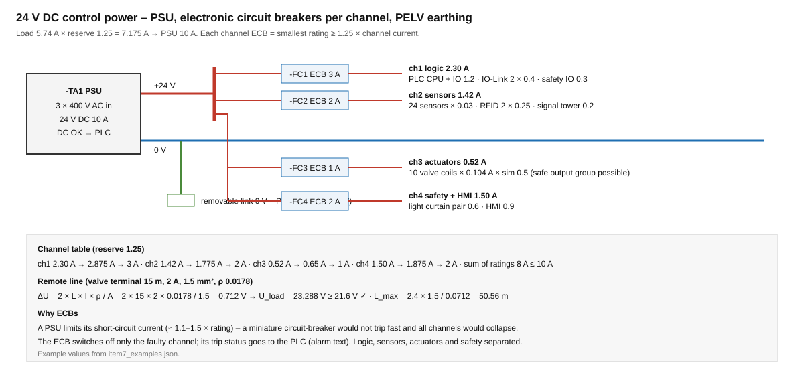

### D3.1 Why not one fuse?

A switched-mode PSU limits its current to about 1.1–1.5 × its rating in a short circuit. A 10 A PSU delivers maybe 15 A into a short – too
little to trip a 6 A miniature circuit-breaker fast (a C6 needs 30–60 A for instant tripping). The voltage collapses for **all** loads and
the whole module stops. **Electronic circuit breakers (ECB)** solve this: they measure the current of each channel and switch off that
channel actively at 1.1–1.5 × its rating, often with current limitation, **before** the PSU voltage drops.

### D3.2 Worked example – the four JSON channels

ECB ratings 1, 2, 3, 4, 6, 8, 10 A; reserve 1.25:

| Channel | Loads | Current | × 1.25 | ECB rating |
|---|---|---|---|---|
| ch1 | PLC + IO-Link + safety IO (logic) | 2.30 A | 2.875 A | **3 A** |
| ch2 | sensors, RFID, signal tower | 1.42 A | 1.775 A | **2 A** |
| ch3 | valve coils (actuators) | 0.52 A | 0.650 A | **1 A** |
| ch4 | light curtain + HMI | 1.50 A | 1.875 A | **2 A** |
| **Sum of ratings** | | 5.74 A | | 8 A ≤ PSU 10 A ✓ |

Rule: the sum of the channel ratings may exceed the PSU rating only if not all channels are fully loaded at the same time; the PSU must be
able to deliver the trip current of the largest channel on top of the load of the others (here 10 A PSU with power boost 15 A: 5.74 − 2.3 +
1.5 × 3 = 7.94 A – the largest channel can be tripped while the others stay supplied ✓).

### D3.3 Channel design rules

1. **Separate the functions**: logic (PLC, CPU) on its own channel – a sensor short must never reset the PLC.
2. Sensors per area / per IO module so that a fault affects only one area.
3. Actuators (valves) separate – they can be switched off in a group for safety (D6).
4. Safety devices on their own channel; light curtains and scanners need a stable supply (a dip resets them → stop).
5. Every ECB channel status (tripped) into the PLC (signal contact or IO-Link ECB) → clear alarm text "24 V channel 2 sensors tripped".
6. Cable cross-section of each channel ≥ the ECB rating (0.75 mm² up to 6 A on short lines; check voltage drop).

### D3.4 Checklist

- [ ] Channels by function; each channel ECB = next size ≥ 1.25 × channel current.
- [ ] ECB trip status to the PLC with alarm text.
- [ ] PSU can trip the largest channel with the others loaded.

---

## D4. Selectivity on 24 V

### D4.1 Theory

Selectivity on 24 V means: a short in one sensor cable trips **only** its channel, and the voltage on the other channels stays above the
minimum of the devices (often 19.2–20.4 V) during the trip. Three things must fit:

1. **PSU reserve**: power boost / reserve so the PSU can supply the fault current without collapsing.
2. **Trip characteristic of the ECB**: active current limitation (e.g. 1.5 × In) and trip within ms to s depending on the overload.
3. **Line resistance**: a long, thin line limits the short-circuit current itself → the ECB may not see enough current to trip quickly.

### D4.2 Worked example

Sensor channel ch2 (2 A ECB) with a short circuit at the end of a 25 m, 0.75 mm² line: R = 2 × 25 × 0.0178 / 0.75 = 1.19 Ω → I = 24 /
1.19 = 20 A theoretical – limited by the ECB to ≈ 3 A (1.5 × 2 A) → trips within its delay; PSU load = 5.74 − 1.42 + 3 = 7.32 A < 10 A
→ other channels unaffected ✓ (scratch values).

With a miniature circuit-breaker B2 instead of the ECB: instant trip needs 5 × 2 = 10 A; the PSU (15 A boost) can deliver that only for a
short time while the voltage of all channels drops → risk of PLC reset. **Use ECBs or fuses dimensioned with the PSU maker's selectivity
tables.**

### D4.3 Checklist

- [ ] Selectivity proven with the PSU / ECB maker's data or tested (short-circuit test at commissioning, K3).

---

## D5. Voltage drop and maximum line length (JSON line)

### D5.1 Formula (JSON `_formulas.dc24_drop`)

A DC line has two conductors (+24 V and 0 V); both carry the current:

```
ΔU = 2 × L × I × ρ / A            U_load = U_psu − ΔU         OK if U_load ≥ U_min = 21.6 V
L_max = (U_psu − U_min) × A / (2 × I × ρ)          ρ = 0.0178 Ω mm²/m (Cu at 20 °C)
```

### D5.2 Worked example – valve terminal 15 m from the cabinet

L = 15 m, I = 2.0 A, A = 1.5 mm²:
ΔU = 2 × 15 × 2.0 × 0.0178 / 1.5 = **0.712 V** → U_load = 24 − 0.712 = **23.288 V** ≥ 21.6 V ✓.
L_max = (24 − 21.6) × 1.5 / (2 × 2.0 × 0.0178) = 3.6 / 0.0712 = **50.56 m**.

| A mm² | ΔU at 15 m | L_max (2 A, 21.6 V) |
|---|---|---|
| 0.75 | 1.424 V | 25.28 m |
| 1.5 | 0.712 V | 50.56 m |
| 2.5 | 0.427 V | 84.27 m |

### D5.3 Design notes

- Set the PSU output to 24.5–25 V (adjustable) to gain margin on long lines – but never above the device maximum (28.8 V).
- Long lines to remote valve terminals and IO stations: use a **local PSU** at the remote station (fed with 400 / 230 V) or a larger
  cross-section.
- Inrush of valve coils, lamps and capacitive loads (HMI, IO-Link masters) causes short dips – add margin.
- Copper at 70 °C has ρ ≈ 0.0213 – for hot environments use this value.

### D5.4 Checklist

- [ ] Every remote 24 V line: ΔU and L_max calculated; U_load ≥ U_min with inrush margin.
- [ ] Local PSUs where lines are long.

---

## D6. Separate supplies: logic, sensors, actuators, safety

| Group | Why separate | How |
|---|---|---|
| **Logic** (PLC, CPU, network) | must never reset because of field faults | own ECB channel; buffer (D7) |
| **Sensors** | many cables, many faults; area-wise diagnosis | ECB per area / IO module |
| **Actuators** (valves, brakes, small motors) | switched off for safety (safe output groups); EMC (coils) | own channel, switched by the safety PLC (safe output P/M switching) or a safety relay |
| **Safety devices** (light curtains, scanners, safety IO) | supply stability; no reset by valve inrush | own channel; some makers require a dedicated PSU |
| **External / interface 24 V** (signals to machine tools, AGV) | two companies' 0 V – avoid ground loops | potential-free contacts or opto-couplers; define who supplies the 24 V |

**Safe switching of actuators:** pneumatic valves of a load station (`LS01` clamp, door cylinder) can be supplied from a **safe output
group** (safety PLC output P/M switching, or a safety relay with two contacts). When the light curtain is interrupted, the group is
switched off → all valves of that group de-energise. **Careful:** de-energising does not always mean safe – a clamp valve that releases
the pallet when de-energised is **dangerous** (I7.4). Choose valve function (monostable / bistable, normally closed / open) in the risk
assessment.

---

## D7. Earthing the 0 V, inrush, buffer and DC-UPS

### D7.1 Earthing the 0 V (PELV)

- Connect the **0 V of each PSU to PE at one point**, in the cabinet, at a removable link (for insulation measurement).
- Never earth the 0 V in several places (ground loops, current over the PE).
- Never earth the +24 V.
- With IT-like 24 V systems (unearthed, rare in machines): use an insulation monitor.

### D7.2 Inrush

Capacitive loads (input capacitors of IO modules, HMIs, drives' 24 V inputs) draw a high current at switch-on. A PSU with power boost and an
ECB with capacitive-load start (some ECBs allow up to e.g. 20 000 µF) avoids nuisance trips. Check the maker's capacitive-load limits.

### D7.3 Buffer and DC-UPS

| Device | Principle | Time | Use |
|---|---|---|---|
| Buffer module (capacitors) | stores energy, bridges voltage dips | 0.1–several s | ride-through of mains dips (most dips < 1 s) |
| DC-UPS with supercapacitors | maintenance-free | seconds – 1 min | PLC data save, safe shutdown of an IPC |
| DC-UPS with battery (lead / LiFePO4) | longer time | minutes – hours | cell controller IPC, network, RFID data |

Example: PLC + IO 1.2 A + IO-Link 0.8 A + safety IO 0.3 A = 2.3 A (ch1) for 20 s → energy = 24 V × 2.3 A × 20 s = 1 104 J. A buffer module of
e.g. 20 A × 0.2 s (= 96 J at 24 V) is not enough; a supercap DC-UPS for 2.3 A / 20 s or a battery DC-UPS is needed (scratch value).

---

## D8. Common mistakes and checklist

| Mistake | Consequence | Correct |
|---|---|---|
| One 24 V PSU, one fuse for the whole module | one short stops everything | ECB channels by function |
| MCB on a PSU output | does not trip (PSU current limit) | ECB or fuses per maker's table |
| 0 V not earthed / earthed several times | unwanted starts / ground loops | PELV, one earth point with link |
| 0.5 mm² to a valve terminal 40 m away | valves chatter at 19 V | ΔU calculation, 1.5 mm² or local PSU |
| Light curtain on the valve channel | reset at every valve inrush | own channel |
| No DC OK and no ECB status in the PLC | "machine dead" without alarm | diagnostics to the PLC |

- [ ] Load budget, PSU rating, ECB channels (D2, D3).
- [ ] Selectivity proven (D4).
- [ ] All lines: ΔU, L_max (D5).
- [ ] Groups separated; safe actuator groups considered in the risk assessment (D6).
- [ ] 0 V earthed once; buffer / DC-UPS where needed (D7).
- [ ] Program: `python tools/fmse/control_power.py --example` and `python tools/fmse/cable_size.py --example` (24 V line); web **7C**.

---

# Part E – Control cabinet design

## E1. Layout of a module cabinet

### E1.1 Principles

A good cabinet layout follows the energy flow from top to bottom or from left to right, separates power and signals, leaves space for heat
and for extension, and makes every device reachable for test and replacement.

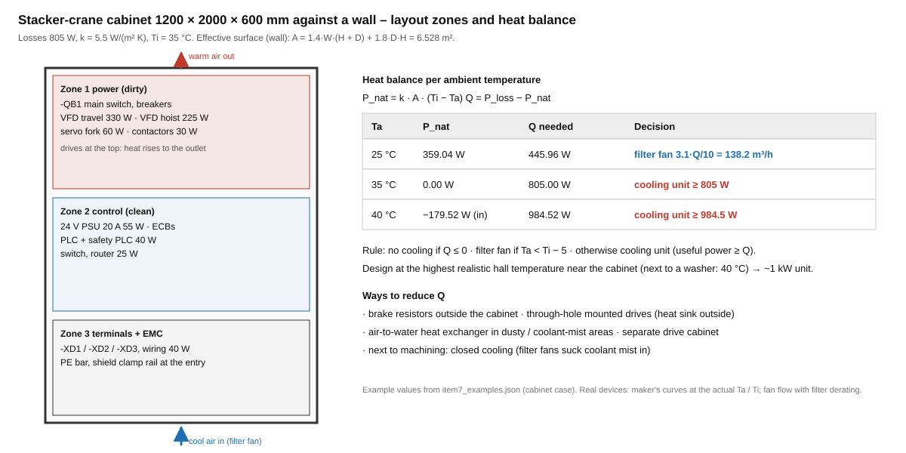

**Typical layout of the stacker-crane cabinet `=POOL01+HALL1.A3`** (1 200 × 2 000 × 600 mm, two doors):

```
 ┌──────────────────────────── 1200 ─────────────────────────────┐
 │ cooling unit / fan outlet (top)              cable entry (top) │  ← hot air leaves at the top
 │ ┌──────────────┐ ┌───────────────────────────────────────────┐ │
 │ │ -QB1 main    │ │ -TA11 VFD travel 11 kW   -TA12 VFD hoist   │ │  zone 1: power (dirty)
 │ │ switch       │ │ (+ brake resistors outside / on top)      │ │  drives at the top: their heat rises
 │ │ -QA1..QA8    │ │ -TA13 servo fork                          │ │  directly to the outlet
 │ │ breakers     │ └───────────────────────────────────────────┘ │
 │ │ -QA10 K1/K2  │  wiring duct ═════════════════════════════════│
 │ └──────────────┘ ┌────────────────┐ ┌────────────────────────┐ │
 │ -TA1 24 V PSU    │ -KF1 PLC +     │ │ -KF2 safety PLC / IO   │ │  zone 2: control (clean)
 │ -FC1..FC4 ECB    │ IO modules     │ │ -KF3 switch / router   │ │
 │                  └────────────────┘ └────────────────────────┘ │
 │  wiring duct ══════════════════════════════════════════════════│
 │ -XD1 power terminals │ -XD2 24 V / IO terminals │ -XD3 safety   │  zone 3: terminals
 │  PE bar + shield clamp rail (EMC)                              │
 │ cable entry with EMC glands / cable entry plate (bottom)       │  ← cool air enters at the bottom (filter)
 └────────────────────────────────────────────────────────────────┘
```

### E1.2 Rules

1. **Space reserve 20–30 %** on the mounting plate and in the ducts (later modifications, spare IO).
2. Wiring ducts filled ≤ 70 %.
3. Drives with their maker's free spaces above / below for air flow (typ. 100–200 mm).
4. Heavy devices low (transformers), hot devices high and near the outlet.
5. Power and signal ducts separate; cross at 90°.
6. Incoming supply terminals close to the main switch; live parts after the main switch covered (IP2X); a warning label for excepted
   circuits.
7. Terminal strips ≥ 200 mm above the cabinet floor for cable bending.
8. Door devices (HMI, push-buttons, e-stop) wired with a flexible loom and a protective bonding strap to the door.
9. Documentation pocket inside the door; circuit diagram and terminal plan as printed copy.
10. The PE bar near the cable entry; the shield clamp rail directly at the entry.

### E1.3 Checklist

- [ ] Layout drawing with dimensions, free spaces, ducts and reserve.
- [ ] Power / control / terminal zones separated.
- [ ] Door devices and bonding strap.

---

## E2. IEC 61439: design verification and routine verification

### E2.1 What IEC 61439 requires

IEC 61439-1 (general rules) and -2 (power switchgear and controlgear assemblies, PSC) treat a distribution board or a control cabinet as a
**product** with a responsible **assembly manufacturer**. The assembly manufacturer must prove that the assembly fulfils its ratings by:

1. **Design verification** (once per design): strength of materials, degree of protection (IP), clearances and creepage distances,
   protection against electric shock and integrity of protective circuits, incorporation of devices, internal circuits and connections,
   terminals for external conductors, dielectric properties, **temperature-rise limits**, **short-circuit withstand strength**, EMC,
   mechanical operation. Methods: test, comparison with a tested reference design, or assessment / calculation (e.g. temperature rise by
   calculation for assemblies up to 1 600 A per IEC TR 60890 within the limits of IEC 61439-1 clause 10.10.4).
2. **Routine verification** (every assembly): IP, clearances, protection against electric shock, wiring, mechanical operation, dielectric
   test, wiring and functional check, documentation.

### E2.2 Ratings the owner must specify / the assembly manufacturer must state

| Rating | Symbol | Example (cell board) |
|---|---|---|
| Rated voltage | Un | 400 V |
| Rated current of the assembly | InA | 250 A |
| Rated current of circuits | Inc | per feeder |
| Rated diversity factor | RDF | 0.8 (IEC 61439-1 Annex E table) |
| Rated conditional short-circuit current / short-time withstand | Icc / Icw | 25 kA |
| Degree of protection | IP | IP54 |
| Form of internal separation | Form 1 … 4 | Form 1 for module cabinets; Form 2b / 3b for cell boards where work under voltage on neighbour feeders is needed |
| Ambient conditions | | 5–40 °C, pollution degree 3 |
| EMC environment | A / B | A (industrial) |

### E2.3 FMS use case

The owner's engineer asks every module supplier: "Who is the assembly manufacturer of your cabinet? Send the design verification summary
(temperature rise, short-circuit) and the routine test report with the delivery." The integrator who builds the cell board is its assembly
manufacturer and must keep these records.

### E2.4 Checklist

- [ ] Ratings specified (table E2.2).
- [ ] Design verification evidence (temperature, short circuit) per cabinet type.
- [ ] Routine verification report delivered with every cabinet.

---

## E3. Thermal design with IEC TR 60890 – the JSON stacker cabinet

### E3.1 Theory

Every device in the cabinet produces losses (heat). The heat leaves the cabinet through its walls (natural convection and radiation) and,
if that is not enough, through a fan or a cooling unit. Electronic devices are rated for a maximum internal air temperature, typically
**Ti = 35 °C** (planning value: drives and PLCs are rated to 40–55 °C, but life halves for every 10 K higher – a cool cabinet is a long-living
cabinet).

**Effective cooling surface** (IEC TR 60890, JSON `_formulas.cabinet_area`; W, H, D in m):

```
free-standing (all sides free):      A = 1.8 × H × (W + D) + 1.4 × W × D
against a wall / wall-hung:          A = 1.4 × W × (H + D) + 1.8 × D × H
```

**Heat balance** (JSON `_formulas.cabinet_heat`):

```
P_loss = Σ losses [W]
P_nat  = k × A × (Ti − Ta)        k = 5.5 W/(m² K) painted sheet steel   (negative if Ta > Ti: heat flows IN)
Q      = P_loss − P_nat           needed active cooling
if Q ≤ 0              → no active cooling
else if Ta < Ti − 5   → filter fan: V = 3.1 × Q / (Ti − Ta)  [m³/h]   (3.1 = 3 600 / (ρ cp) at sea level, m³ K / Wh)
else                  → cooling unit with useful cooling power ≥ Q [W]
```

Why "Ta < Ti − 5" for fans: a fan can only bring the inside temperature **close to** the outside temperature. If the hall is 33 °C and the
inside must stay ≤ 35 °C, the needed air flow becomes huge and the dust load with it – then a closed cooling unit (or air-to-water heat
exchanger) is the right choice.

### E3.2 Input data (JSON `cabinet`)

Stacker-crane cabinet against a wall, W = 1.2 m, H = 2.0 m, D = 0.6 m, k = 5.5 W/(m² K), Ti = 35 °C.

| Device | Loss W |
|---|---|
| VFD travel 11 kW | 330 |
| VFD hoist 7.5 kW | 225 |
| Servo drive fork | 60 |
| 24 V PSU 20 A | 55 |
| PLC + safety PLC | 40 |
| Contactors, relays | 30 |
| Terminals, wiring | 40 |
| Switch, router | 25 |
| **Total P_loss** | **805** |

Where do loss values come from? Data sheets (drives: "power loss at rated current", often 2.5–3 % of rated power; PSU: (1 − η) × output; PLC
modules: W per module; contactors: coil + contact losses; wiring: IEC 61439-1 Annex H gives W/m per cross-section).

### E3.3 Surface

A = 1.4 × 1.2 × (2.0 + 0.6) + 1.8 × 0.6 × 2.0 = 4.368 + 2.160 = **6.528 m²** (free-standing it would be 7.488 m²).

### E3.4 The three ambient cases

| Ta °C | P_nat = 5.5 × 6.528 × (35 − Ta) W | Q = 805 − P_nat W | Decision |
|---|---|---|---|
| 25 | 5.5 × 6.528 × 10 = **359.04** | **445.96** | Ta 25 < 30 → **filter fan V = 3.1 × 445.96 / 10 = 138.2 m³/h** (138.25) |
| 35 | 0.00 | **805.00** | Ta = Ti → **cooling unit ≥ 805 W** |
| 40 | 5.5 × 6.528 × (−5) = **−179.52** (heat flows in) | **984.52** | **cooling unit ≥ 984.5 W** |

**Choosing the real device:**
- Filter fan: the catalogue air flow is for a free fan; with the outlet filter and the filter mats the real flow is 50–70 % of it. Choose
  a fan with ≥ 138.2 / 0.6 ≈ 230 m³/h free-blowing (scratch value) – or the maker's "with filter" value directly.
- Cooling unit: choose by the maker's curve at the **actual** Ta and Ti (e.g. "L35 L35" = 35 °C outside, 35 °C inside). For Ta 40 °C:
  ≥ 984.5 W at L40/L35 → typically a 1 000–1 500 W unit; plus condensate drain, door contact switch (cooling off when the door is open).
- Summer design: design for the **highest** hall temperature near the cabinet (under the roof, next to a washer: 40 °C is realistic) → the
  Ta 40 case decides: cooling unit ≈ 1 kW.

### E3.5 Alternatives and tips

| Measure | Effect |
|---|---|
| Brake resistors **outside** the cabinet | removes hundreds of W at a hoist |
| Through-hole mounted drives (heat sink outside) | removes 70–80 % of the drive loss from the inside |
| Air-to-water heat exchanger | when cooling water is available, very dusty air |
| Cabinet heater + hygrostat | prevents condensation in cold halls / at night (excepted circuit!) |
| Separate drive cabinet | splits the heat |
| Stainless / unpainted surfaces | k lower (≈ 4.5) – check |

### E3.6 FMS use case and checklist

The washer `WASH01` stands next to the pallet pool; its warm humid air reaches 38 °C near the stacker cabinet → the owner's engineer asks for
the thermal calculation at 40 °C and a cooling unit with condensate drain. Program: `python tools/fmse/cabinet_thermal.py --example` (web **7D**).

- [ ] Loss list from data sheets; mounting (wall / free) correct.
- [ ] Calculation at the highest realistic ambient temperature.
- [ ] Fan with filter derating / cooling unit by maker's curve; condensate handled.
- [ ] Heater against condensation where needed.
- [ ] Design verification (temperature rise) documented (E2).

---

## E4. IP ratings and environment

### E4.1 The IP code (IEC 60529)

IP**XY**: first digit X = protection against solid objects and touch; second digit Y = protection against water.

| X | Meaning | Y | Meaning |
|---|---|---|---|
| 2 | finger (12.5 mm) | 0 | none |
| 4 | wire 1 mm | 4 | splashing water |
| 5 | dust-protected | 5 | water jets |
| 6 | dust-tight | 6 | powerful jets |
| | | 7 | temporary immersion |
| | | 9K | high-pressure / steam cleaning |

### E4.2 Typical choices in an FMS

| Location | IP | Note |
|---|---|---|
| Cabinets in a clean assembly hall | IP54 | standard |
| Cabinets next to machining (coolant mist, chips) | IP54–IP55 + cooling unit (closed) | filter fans suck coolant mist in! |
| Washer area | IP55–IP65 | humidity, steam |
| Junction boxes, valve terminals on machines | IP65–IP67 | coolant, cleaning |
| Sensors in the working area | IP67–IP69K | coolant, chips |
| Inside a cabinet (touch protection) | IP2X / IPXXB | live parts after the main switch |

Remember: a cabinet with a filter fan is IP54 only with the filters in place – and the dust / mist **enters** with the air. Next to machine
tools prefer closed cooling (cooling unit or heat exchanger).

---

## E5. EMC in the cabinet

### E5.1 The EMC zones

Divide the cabinet into zones: **dirty** (mains input, drives, motor outputs, brake resistors), **filtered** (after EMC filters), **clean**
(PLC, IO, network, sensors). Cables of the dirty zone never run through the clean zone.

### E5.2 Rules

1. **Galvanised (unpainted) mounting plate** – the reference plane; all devices bonded to it with large area.
2. **Shields: 360° clamps** at the cabinet entry (shield clamp rail on the plate, close to the entry); no "pigtails" (a 5 cm pigtail makes a
   shield nearly useless above a few MHz).
3. VFD: EMC filter close to the drive, input and output cables separated, motor cable shield clamped at the drive and at the motor.
4. Drive cabinet doors bonded with wide straps.
5. Coils (contactors, valves, brakes) with suppressors (RC, varistor, diode – note: a diode slows contactor opening → longer stop time for
   safety contactors: use varistor or the maker's suppressor and include it in the stopping time measurement).
6. Network cables (PROFINET, Ethernet) in the clean zone; shield bonded at the entry (guide 66 A11).
7. One earthing bar (PE) and the mounting plate connected; PE of all incoming cables at the PE bar.

### E5.3 Checklist

- [ ] Zones on the layout drawing.
- [ ] Galvanised mounting plate; shield clamps at the entry.
- [ ] Coil suppressors chosen (and considered in stop times).
- [ ] Drive maker's EMC installation guide followed (written check at FAT).

---

## E6. Terminals, wire numbers and labels with IEC 81346

### E6.1 Designation

Every device, terminal, wire and cable has a unique **reference designation** (IEC 81346, guide 65 B4):

```
=FMS1.POOL01 +HALL1.A3 -QA12          contactor 12 of the pallet pool, cabinet A3 hall 1
=FMS1.POOL01 +HALL1.A3 -XD2:14        terminal 14 of terminal strip XD2
=FMS1.POOL01 -WD5                     power cable 5 of the pool (cable list)
=FMS1.POOL01 +POOL.DOOR1 -BG1         interlock switch at pool door 1 (location aspect: on the machine)
```

The **tag** for the same signal in the control system (guide 65 B1): `PLT1.MACH.FMS1.POOL01.Safety.Door1Closed`. Keep a mapping table
"reference designation ↔ tag" in the IO list – this is how the electrician on the floor and the programmer talk about the same signal.

### E6.2 Wire numbering methods

| Method | Example | Pro / contra |
|---|---|---|
| Potential number (all wires of the same potential have the same number) | 24V, 0V, 101, 102 … | simple; finding the destination needs the diagram |
| Destination (source / target) marking | `-KF1:X2.3 / -XD2:14` at each end | fast fault finding; more labels |
| Page / column number | 12.4 (sheet 12, column 4) | links to the diagram; changes when sheets change |

The FMS specification fixes **one method for all modules** (most plants: destination marking for control wires, potential for power).

### E6.3 Labels

Device labels on the plate **and** on the device (when the device is removed, the plate label stays); cable labels at both ends; terminal
labels; warning labels (voltage, excepted circuits orange, residual voltage of drives "Wait 5 min"), the nameplate of the assembly (maker,
type, Un, InA, Icc, IP, standard, date).

---

## E7. The documentation set

| Document | Content | Who | When |
|---|---|---|---|
| Single-line diagram | supply, boards, feeders, devices, cables | integrator / plant | basic design |
| Load list | B2 | integrator | basic design, updated |
| Short-circuit and selectivity study | B4, B5 | integrator | detail design |
| Cable list | id, from, to, type, A, A_pe, L, route, Ib, In, ΔU, Ik1, L_max | integrator | detail design |
| Circuit diagrams | IEC 61082-1, IEC 81346, sheet per function | module supplier / integrator | detail design |
| Terminal and connection plans | every terminal, every wire | " | " |
| Cabinet layout | mechanical arrangement, thermal calculation | " | " |
| Bill of materials (BOM) | maker, type, order number, quantity, designation | " | " |
| IO list | address, designation, tag, description, signal type, safety yes/no | " | " |
| Safety documents | risk assessment, safety function list, PL calculation, validation report (F, G) | integrator / module suppliers | throughout |
| Test reports | IEC 60204-1 clause 18, IEC 61439 routine test, safety validation (K3) | " | FAT / SAT |
| Operating and maintenance manual | incl. proof-test intervals, T10d replacement (G4.4) | " | delivery |

**Format:** native files of the ECAD system (EPLAN, E3, WSCAD, AutoCAD Electrical …) **and** PDF; the owner should demand the native files in the
contract – otherwise every later change must be bought from the supplier.

---

## E8. Common mistakes and checklist

| Mistake | Consequence | Correct |
|---|---|---|
| No space reserve | every modification is a new cabinet | 20–30 % reserve |
| Filter fan next to machining | coolant film on the electronics | closed cooling |
| Thermal calculation at 25 °C only | drive alarms in summer | design at the highest Ta |
| Painted mounting plate | poor EMC | galvanised plate |
| Pigtail shields | EMC faults | 360° clamps |
| Only PDF drawings | expensive changes | native ECAD files |

- [ ] Layout, IEC 61439 ratings and verifications (E1, E2).
- [ ] Thermal design at worst case (E3).
- [ ] IP for the location (E4); EMC zones (E5).
- [ ] Designations and labels (E6); documentation set complete and native (E7).

---

# Part F – Safety legal framework and risk assessment

## F1. Machinery Directive 2006/42/EC and Machinery Regulation (EU) 2023/1230

### F1.1 The legal frame in the EU (and why it matters elsewhere)

In the European Economic Area a machine may be placed on the market or put into service only if it meets the **essential health and safety
requirements (EHSR)**, has a technical file, a declaration of conformity and the CE marking.

| | Machinery Directive 2006/42/EC | Machinery Regulation (EU) 2023/1230 |
|---|---|---|
| Type | directive (transposed into national laws) | regulation (directly applicable in all member states) |
| Applies | until 19 January 2027 | **from 20 January 2027** (some articles earlier) |
| Main content | EHSR Annex I, conformity assessment, Annex IV list | updated EHSR (Annex III), new: AI / self-evolving behaviour, cyber-security of safety functions ("protection against corruption"), substantial modification, digital instructions allowed, Annex I high-risk list with third-party assessment for some categories |
| Assemblies of machinery | included in the definition of "machinery" | included; plus rules for **substantial modification** (whoever substantially modifies a machine becomes its manufacturer) |

An FMS project signed in 2026 and commissioned in 2027 falls under the **Regulation** if it is placed on the market / put into service after
20 January 2027 – check the dates with your legal department; design to the Regulation now.

Outside the EU similar frames exist (UKCA in the UK, OSHA + NFPA 79 + ANSI B11 / RIA in the USA, GB standards in China, KCs in Korea …). The
technical method (ISO 12100 → ISO 13849 / IEC 62061) is the same everywhere – the standards are international.

### F1.2 Harmonised standards and presumption of conformity

Standards listed in the Official Journal of the EU as **harmonised** give a "presumption of conformity" with the EHSR they cover.
Three types:

| Type | Content | Examples |
|---|---|---|
| **A** (basic) | general principles for all machines | ISO 12100 |
| **B** (group) | B1: safety aspects (distances, temperatures, PL); B2: safeguards | ISO 13849-1, ISO 13855, ISO 13857, IEC 60204-1 (B1); ISO 14119, ISO 14120, ISO 13850, IEC 61496 (B2) |
| **C** (product) | specific machine types | ISO 16090-1 (machining centres), ISO 10218-2 (robot systems), ISO 3691-4 (AGV), EN 528 (stacker cranes), ISO 11161 (integrated manufacturing systems) |

**Rule:** if a C-standard exists, it has priority over A and B (it may require e.g. a specific PL for a specific function). For an FMS, read
**ISO 11161** (integrated manufacturing systems) first – it explains how to treat the assembly, its task zones, modes and the coupling of
machines. Check on the Commission's website whether the edition is still harmonised under the Regulation (lists are being updated).

---

## F2. An FMS is an assembly of machinery – CE marking and roles

### F2.1 The assembly

An FMS (machines + pallet pool + load stations + AGV + washer + cell control) is an **assembly of machinery**: several machines arranged and
controlled so that they function as an integrated whole. Therefore:

- The **assembly** needs its own conformity assessment, risk assessment, technical file, declaration of conformity and CE marking – in
  addition to the CE marking of each machine.
- Each delivered machine is either a **complete machine** (CE + declaration of conformity) or a **partly completed machine** (declaration
  of incorporation + assembly instructions, no CE). Machines integrated in an FMS are often delivered as partly completed (e.g. a machining
  centre without its own loading door safeguarding) – the integrator must then complete them.
- The **hazards at the interfaces** (pallet transfer into the machine, AGV docking, shared guards, a common e-stop) exist only in the
  assembly – they are assessed by its manufacturer.

### F2.2 Who is the manufacturer of the assembly?

| Contract model | Manufacturer of the assembly (typical) |
|---|---|
| General contractor / turnkey integrator delivers the whole FMS | the integrator |
| Owner buys modules separately and integrates himself | **the owner** (he becomes the manufacturer) |
| Machine-tool builder delivers the FMS with his own pallet pool | the machine-tool builder |
| Several suppliers, no one named | **nobody – a legal gap; avoid it** |

**Owner's engineer's rule:** name the manufacturer of the assembly in the contract (who issues the declaration of conformity of the FMS), and
require from every module supplier: CE + DoC or declaration of incorporation + assembly instructions, his risk assessment, his safety function
list with PL, interface descriptions of safety signals (I4).

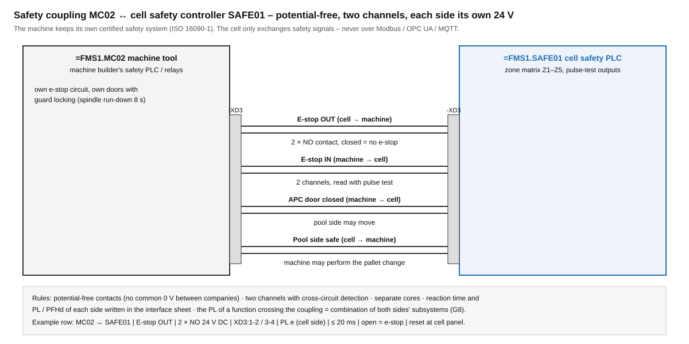

### F2.3 The conformity procedure – step by step (integrator as manufacturer)

1. Collect the module documents (DoC / DoI, risk assessments, safety interfaces).
2. Define the limits of the assembly (F3 step 1): which machines, which zones, which modes.
3. Risk assessment of the assembly (F3) – focus on interfaces, transfers, common zones, modes, restart.
4. Safety concept (Part I): zones, safety functions, PLr.
5. Design and calculation (G, H): PL, distances.
6. Validation (G11) and electrical tests (K3).
7. Technical file: risk assessment, drawings, calculations, test reports, list of standards, instructions.
8. Instructions for use of the FMS (operation, modes, maintenance, residual risks).
9. Declaration of conformity of the assembly; CE marking (nameplate of the FMS, e.g. on the cell board or the cell controller cabinet).

### F2.4 Substantial modification

Adding a machine, changing the safety concept or the speed of the stacker crane can be a **substantial modification** – then the one who
modifies becomes the manufacturer of the modified assembly and must repeat the assessment for the affected parts (Regulation 2023/1230 defines
the term). Rule for FMS growth: every extension starts with a check "substantial modification yes / no", documented.

---

## F3. The ISO 12100 risk assessment step by step

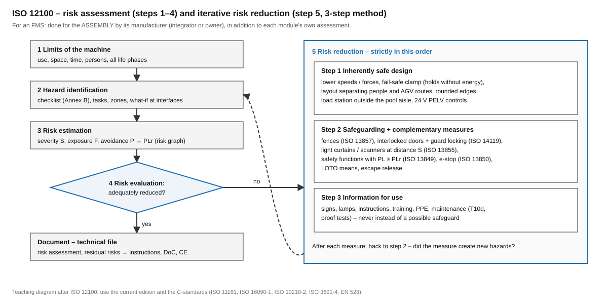

### F3.1 The process

```
 1 Determine the limits of the machine (use, space, time, persons, life phases)
 2 Hazard identification (all hazards, all life phases, all tasks)
 3 Risk estimation (severity × probability: exposure, occurrence, possibility of avoidance)
 4 Risk evaluation (is the risk adequately reduced?)
        no → 5 Risk reduction (3-step method, F5) → back to 2 (new hazards from the measure?)
        yes → document (technical file)
```

Steps 1–4 = **risk assessment**; with step 5 = the iterative risk reduction process.

### F3.2 Step 1 – limits

| Limit | FMS example |
|---|---|
| Use limits | machining crankcases ≤ 800 kg per pallet; operators trained; modes Production / Maintenance / Manual (guide 65) |
| Space limits | cell fence 32 × 18 m; pallet pool aisle; AGV routes in the hall (shared with pedestrians) |
| Time limits | 20 years life; T10d replacement of components (G4) |
| Persons | operators (load stations), setters, maintenance (mechanical, electrical), cleaners, AGV traffic, visitors |
| Life phases | transport, installation, commissioning, production, set-up, fault finding, maintenance, cleaning, dismantling |

### F3.3 Step 2 – hazard identification methods

- **Checklist of hazard types** (ISO 12100 Annex B): mechanical (crushing, shearing, cutting, entanglement, drawing-in, impact, stabbing,
  high-pressure fluid ejection), electrical, thermal, noise, vibration, radiation, materials (coolant mist, oil), ergonomic, environment,
  combinations.
- **Task-based**: for every task in every life phase, which hazards are there? (Example: "clear a jammed pallet in the stacker aisle".)
- **Zone-based**: walk through the layout zone by zone (F4 list).
- **What-if / HAZOP style** for interfaces: "What if the AGV docks while an operator is at the transfer?"

### F3.4 Step 3 – risk estimation

Risk = function of **severity** of the harm and **probability** of occurrence (frequency and duration of exposure, probability of the hazardous
event, possibility of avoiding or limiting the harm). Methods: risk graph (ISO 13849-1 Annex A, used here in G2), risk matrix, hybrid
methods (ISO/TR 14121-2), the IEC 62061 Annex A table (Se, Fr, Pr, Av).

### F3.5 Step 4 – evaluation

The risk is adequately reduced when: all hazards are eliminated or the risks reduced by the 3-step method; the measures do not create new
hazards; the measures are compatible with the use; C-standard requirements are fulfilled; residual risks are documented in the instructions.

### F3.6 Documentation – the risk assessment table

| Id | Zone / task | Hazard | Life phase | S | F | P | PLr | Measure (step) | Safety function | Residual risk |
|---|---|---|---|---|---|---|---|---|---|---|
| H03 | Pool, stacker aisle | crushing / impact by stacker crane (10 t, 2 m/s) | maintenance | S2 | F2 | P1 | d | interlocked door with guard locking (2) | SF1 | instructions: LOTO for work on the crane |
| H07 | LS01 load station | crushing by rotary table | production | S2 | F2 | P1 | d | light curtain (2) | SF2 | — |

(Tool: `python tools/fmse/safety_pl.py --example` prints the PLr of the JSON functions; for a full register use guide 61's
`risk_register.py` for the project risks and this table for the machine safety.)

---

## F4. The hazard list of an FMS

| Module (unit) | Main hazards | Typical life phases | Typical safeguarding |
|---|---|---|---|
| **Pallet pool + stacker crane** (`POOL01`, M03) | impact and crushing by the crane (high mass, speed 2–4 m/s), falling pallets / loads, shearing at the fork, crushing between crane and rack | maintenance in the aisle, fault clearing, set-up of pallets | fence ≥ 1 400–2 000 mm (ISO 13857), interlocked doors with guard locking (SF1), maintenance mode with enabling device + SLS (SF5), mechanical end buffers, fall protection of the fork |
| **Load / unload station** (`LS01`, M04) | crushing by rotary table, door, clamping; cutting at chips; ergonomics (lifting), falling parts | production (every pallet!), set-up | light curtain (SF2) or interlocked door, two-hand control for clamping, low clamp force at manual, lifting aids |
| **APC / pallet changer** (`APC01`, M02) | crushing / shearing at the pallet change, rotation | production, set-up | integrated in the machine guard; STO when pool door open (I7) |
| **Machining centre** (`MC01`, M01) | entanglement / cutting by spindle and tool, ejection of parts / chips, coolant, fire (oil mist), noise | production, set-up, tool change, cleaning | machine builder's guard with locking (spindle run-down 8 s → guard locking, H5), ISO 16090-1; coupling to the cell (I4) |
| **AGV / AMR** (`AGVST01`, M06) | impact with persons, crushing at the dock, falling loads | transport in shared areas, docking, charging | safety scanners with field switching (H7), speed limits, ISO 3691-4 zones, dock scanner (SF4) |
| **Robot** (M05) | impact, crushing, ejected parts, gripper release | production, teaching, maintenance | fence + interlocked door, scanners, collaborative operation only after ISO 10218-2 / ISO/TS 15066 |
| **Washer** (`WASH01`, M10) | hot water / steam, chemicals, rotating / moving parts, pump pressure, slippery floor | production, cleaning, maintenance | interlocked door (SF6 → fixed in G10), temperature interlock, ventilation |
| **CMM** (`CMM01`, M11) | moving bridge (low force), loading parts | measuring, loading | low speed / force by design; light curtain for automatic loading |
| **Conveyors / transfer** (M07) | drawing-in at rollers, crushing at transfer points | production, cleaning | fixed guards, nip-point guards, trip wire / e-stop |
| **Cell overall** | wrong restart after a stop, unexpected start from the cell controller, confusion of modes, e-stop range | all | zones and modes (Part I), reset rules, LOTO concept, e-stop concept |
| **Electrical** | shock, arc flash in boards, stored energy (DC links) | maintenance | Part A, LOTO, warning labels, residual voltage ≤ 60 V in 5 s or label |
| **Pneumatic / hydraulic** | stored pressure, unexpected movement, hose whip | maintenance | lockable dump valves, gravity-loaded axes held, ISO 4414 / 4413 |

---

## F5. The 3-step method: inherently safe design, safeguarding, information

ISO 12100 orders the measures strictly. You may go to the next step only when the previous step cannot reduce the risk further.

| Step | Principle | FMS examples |
|---|---|---|
| **1 Inherently safe design** | eliminate the hazard or reduce it by design | lower stacker speed in the maintenance zone; low clamping force at manual loading; limited torque of the rotary table; physical distance (load station outside the pool); pallet locking by spring (fail-safe clamp); rounded edges; low-voltage controls; layout that separates people and AGV routes |
| **2 Safeguarding and complementary protective measures** | guards and protective devices with safety functions | fences, interlocked doors with guard locking, light curtains, scanners, enabling devices, e-stop (complementary), means for LOTO, means to free trapped persons |
| **3 Information for use** | warn and instruct about residual risks | signs, signal lamps, instructions, training, PPE requirements, maintenance instructions (T10d, proof tests) |

**Rule:** information never replaces a safeguard that is possible. "Do not enter the aisle while the crane runs" on a sign is not a measure for
a hazard that can be guarded by an interlocked door.

---

## F6. Common mistakes and checklist

| Mistake | Consequence | Correct |
|---|---|---|
| Each supplier assesses only his machine | interface hazards forgotten | risk assessment of the assembly (F2) |
| No manufacturer of the assembly named | no DoC, legal gap | contract names him |
| Only the production phase assessed | maintenance accidents | all life phases and tasks |
| Measures from step 3 where step 2 is possible | not compliant | 3-step order |
| Risk assessment written after the design | expensive changes | start in the concept phase, update at each design stage |
| C-standard ignored | PL or distances too low | check ISO 11161, ISO 16090-1, ISO 10218-2, ISO 3691-4, EN 528 |

- [ ] Manufacturer of the assembly named; DoC / DoI of every module received.
- [ ] Limits, life phases, persons, tasks defined.
- [ ] Hazard list per zone and per task (F4).
- [ ] Risk estimated, PLr per safety function (G2).
- [ ] 3-step method documented; residual risks in the instructions.
- [ ] Substantial-modification check procedure for future changes.

---

# Part G – ISO 13849-1 / -2 in depth

ISO 13849-1 is the most used standard for designing the **safety-related parts of control systems (SRP/CS)** of machines. It answers: how good
must a safety function be (PLr), and how good is my design (PL)? ISO 13849-2 tells how to **validate** it. The current edition of part 1 is
ISO 13849-1:2023; the method below follows the simplified procedure (categories, MTTFd, DCavg, CCF, bar chart) that is the same in the 2015
and 2023 editions in its main steps. **The tables in the JSON are simplified teaching versions – real projects use the standard text and a
tool such as SISTEMA (free tool of the IFA) or the safety PLC maker's calculation tool.**

## G1. Safety functions and their specification

### G1.1 What a safety function is

A **safety function** is a function of the machine whose failure can result in an immediate increase of the risk. It always has the
structure **input → logic → output** and a clear **trigger → reaction → safe state**:

```
   [ input: sense ]  ──►  [ logic: decide ]  ──►  [ output: act ]  ──►  safe state
   interlock switch        safety PLC              contactors / STO       stacker crane stopped
   light curtain           safety relay            safe valve             rotary table stopped
   e-stop button                                    drive SLS              speed ≤ limit
```

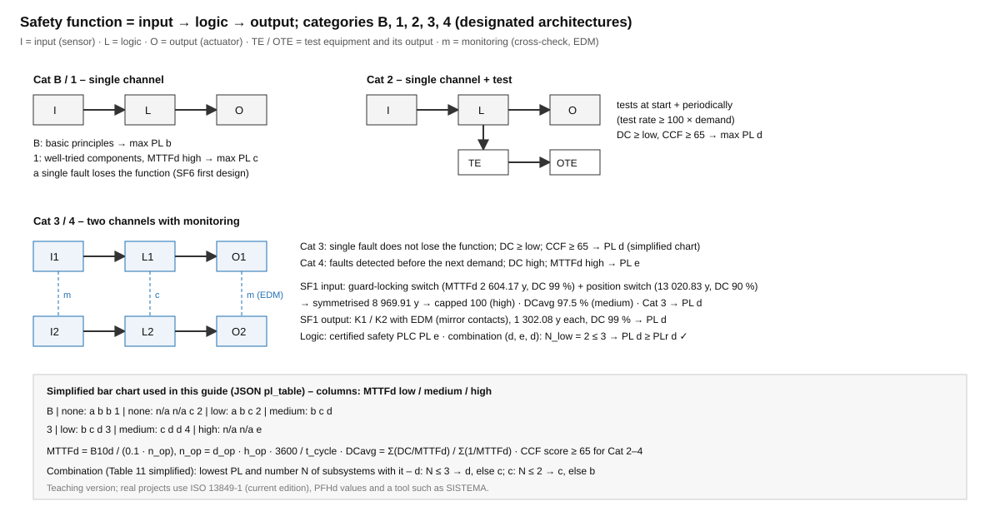

### G1.2 The safety function specification (SRS) – what to write for each function

| Field | SF1 example |
|---|---|
| Id, name | SF1 – pallet-pool access door open → stacker crane stops (guard locking) |
| Hazard covered | H03 crushing / impact by stacker crane in the aisle |
| Trigger | request to open door 1 / door 1 not closed and locked |
| Reaction | stacker travel, hoist, fork: SS1 (controlled stop) then contactors K1/K2 open (power off); door unlocks only after standstill |
| Safe state | crane without power, door locked until standstill confirmed |
| Reaction time | ≤ 1.2 s to standstill (stop time measured, H5) |
| Operating mode | all modes except maintenance with enabling device (then SF5) |
| PLr | d (S2 F2 P1, G2) |
| Category, PL reached | Cat 3 / PL d (G9.1) |
| Reset / restart | manual reset outside the aisle at the door, then start command |
| Test / proof | function test at commissioning, yearly; components replaced before T10d |
| Interfaces | door switch `=FMS1.POOL01+POOL.DOOR1-BG1`, `-BG2`; safety PLC `=FMS1.SAFE01-KF1`; contactors `=FMS1.POOL01-QA10/-QA11` |

### G1.3 Typical safety functions of an FMS

| Function | Typical PLr |
|---|---|
| Interlocked guard → stop of hazardous motion | d |
| Guard locking (lock until standstill) | d (locking function itself often c–d after ISO 14119 / risk) |
| Light curtain / scanner → stop | d (c for low-severity) |
| Emergency stop | d (usually; min. c) |
| Enabling device + safely-limited speed | c–d |
| Prevention of unexpected start-up | d |
| Muting | same as the protected function |
| Safe standstill monitoring (SOS) during intervention | d |
| AGV: personnel detection → stop / slow-down | d (ISO 3691-4 requires PL d for most personnel detection functions) |

---

## G2. PLr with the risk graph

### G2.1 The parameters (ISO 13849-1 Annex A)

| Parameter | Choice | Meaning |
|---|---|---|
| **S – severity** | S1 | slight (normally reversible) injury: bruises, small cuts |
| | S2 | serious (normally irreversible) injury or death: fractures, amputation |
| **F – frequency / duration of exposure** | F1 | seldom to less often and/or short exposure (guide: ≤ once per 15 min **and** ≤ 1/20 of operating time – check edition) |
| | F2 | frequent to continuous and/or long exposure |
| **P – possibility of avoiding** | P1 | possible under specific conditions (slow motion < 250 mm/s, the person can see and react, trained) |
| | P2 | scarcely possible |

### G2.2 The graph (JSON `_formulas.risk_graph`)

```
 S1 ─┬─ F1 ─┬─ P1 → a          S2 ─┬─ F1 ─┬─ P1 → c
     │      └─ P2 → b              │      └─ P2 → d
     └─ F2 ─┬─ P1 → b              └─ F2 ─┬─ P1 → d
            └─ P2 → c                     └─ P2 → e
```

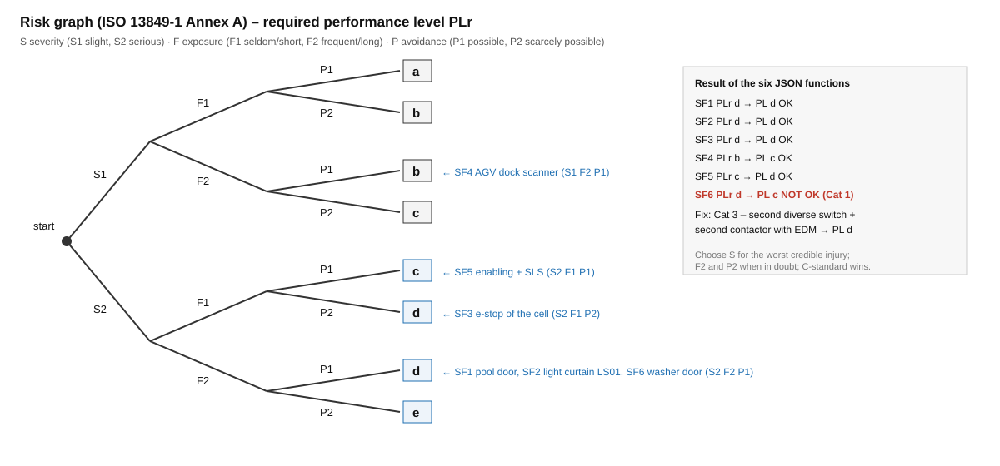

### G2.3 The six JSON functions

| Id | Function | S | F | P | PLr | Reasoning |
|---|---|---|---|---|---|---|
| SF1 | pool door → stacker stop | S2 | F2 | P1 | **d** | heavy crane: serious; maintenance staff enter often (daily pallet / fault work); crane visible and audible, can be avoided under conditions |
| SF2 | light curtain LS01 → rotary table + fork stop | S2 | F2 | P1 | **d** | crushing at the table; operator at every pallet; motion slow and visible |
| SF3 | e-stop of the cell (stop cat 1) | S2 | F1 | P2 | **d** | e-stop is used seldom; when used, the person is often already in danger (avoidance scarcely possible) |
| SF4 | scanner at the AGV dock → transfer conveyor stops | S1 | F2 | P1 | **b** | slow small conveyor: slight injury |
| SF5 | enabling device → stacker SLS | S2 | F1 | P1 | **c** | maintenance with enabling device seldom; slow speed allows avoidance |
| SF6 | washer door → pumps + conveyor stop | S2 | F2 | P1 | **d** | hot water jets + conveyor; frequent door opening for cleaning / checks |

### G2.4 How to choose S, F, P honestly

- Choose **S** for the worst credible injury, not for the average.
- **F**: count the real interventions (production planning, guide 64 → pallets per hour × operator interventions); F2 if in doubt.
- **P1** only if all conditions are true: the hazard is visible, the motion is slow (≤ 250 mm/s is a common orientation), the person is
  trained and has room to escape. A stacker crane at 2 m/s in the aisle is **not** P1 for a person in the aisle – SF1 uses P1 because guard
  locking keeps the person out until standstill and the remaining motions near the door are slow; document your reasoning.
- Several persons from a team decide (integrator + owner + operator + maintenance).
- **The C-standard wins**: if it specifies a PL, use at least that.

---

## G3. Categories B, 1, 2, 3, 4

### G3.1 Overview

A **category** describes the **architecture** (structure) and the behaviour at faults.

| Cat | Structure | Behaviour at a fault | Requirements | Max. PL (typical) |
|---|---|---|---|---|
| **B** | single channel | a fault can lead to loss of the safety function | basic safety principles, components suitable for the environment | b |
| **1** | single channel | as B, but probability lower | **well-tried components** and well-tried safety principles; MTTFd high | c |
| **2** | single channel + **test equipment (TE)** | a fault between tests can lead to loss; detected at the next test | test at start-up and periodically (test rate ≥ 100 × demand rate), DCavg ≥ low, CCF ≥ 65 | d |
| **3** | **two channels** (redundant) | a single fault does not lead to loss; some faults detected | single-fault tolerance, DCavg ≥ low, CCF ≥ 65 | d (e with high MTTFd/DC in some editions' bar chart: here d) |
| **4** | two channels | single fault does not lead to loss; detected at or before the next demand; accumulation of undetected faults does not lead to loss | DCavg **high**, MTTFd high, CCF ≥ 65 | e |

### G3.2 Block diagrams (designated architectures)

```
 Cat B / 1:      I ──► L ──► O

 Cat 2:          I ──► L ──► O
                       │
                       └─► TE ──► OTE     (test equipment checks the channel and switches OTE when a fault is found)

 Cat 3 / 4:      I1 ──► L1 ──► O1
                  ↕ m    ↕ c    ↕ m       m = monitoring (cross-monitoring, EDM, discrepancy check)
                 I2 ──► L2 ──► O2        Cat 4: monitoring good enough to detect faults before the next demand
```

### G3.3 Typical FMS circuits per category

| Category | Input | Logic | Output | Example |
|---|---|---|---|---|
| 1 | one interlock switch with **positive opening** (IEC 60947-5-1 Annex K, well-tried) | safety relay | one contactor | SF6 first design; SF4 output |
| 2 | one switch tested by the PLC at every door opening | standard + test | one contactor + test output | low-risk conveyors (rare in FMS today) |
| 3 | two switches (one interlock with guard locking + one position switch) or a 2-channel sensor | safety PLC / relay | two contactors with **EDM** (feedback of NC mirror contacts) or STO dual channel | SF1, SF3, SF5 input |
| 4 | coded switch with internal diagnostics (certified Cat 4 / PL e) | safety PLC | two contactors with EDM, high DC | press areas, high-risk robot cells |

**EDM (external device monitoring):** the logic reads the **mirror contacts** (NC, mechanically linked, IEC 60947-4-1 Annex F) of both
contactors. Before every start, both mirror contacts must be closed (contactors dropped). If one contactor welds, its mirror contact stays
open → no restart → the fault is detected. This gives DC ≈ 99 % for the contactors.

### G3.4 Common mistakes

- Two contactors in series but **no EDM** → a welded contactor stays undetected; after the second weld the function is lost (DC = 0 → Cat 3
  not reached).
- Two contacts of **one** e-stop button counted as two independent channels **for the mechanics** – the actuator is one part; ISO 13849-2
  allows fault exclusion for the mechanical part of well-made e-stop devices under conditions; document it.
- Two channels in one multicore cable along a moving cable without protection → short circuit between channels not detected: use
  cross-circuit detection (pulse testing) or separate cables.

---

## G4. MTTFd from B10d

### G4.1 Theory

Electromechanical and pneumatic components wear out by **operations**. Makers give **B10d** = number of operations until 10 % of the
components have failed **dangerously** (ISO 13849-1 Annex C gives typical values when the maker gives none, e.g. contactors at nominal load
1 300 000 – data-sheet values are better; the JSON uses its own example values).

```
n_op  = d_op × h_op × 3600 / t_cycle            operations per year
         d_op = days per year, h_op = hours per day, t_cycle = seconds between two operations
MTTFd = B10d / (0.1 × n_op)                     [years] per component
T10d  = B10d / n_op                             [years] – replace the component before this time
channel: MTTFd_ch = 1 / Σ(1 / MTTFd_i)          (components in series in one channel)
two different channels C1, C2 (symmetrisation):
         MTTFd = 2/3 × (C1 + C2 − 1 / (1/C1 + 1/C2))
cap at 100 years (this guide and the JSON; editions 2015 / 2023 allow up to 2 500 years for Cat 4)
bands: low 3 ≤ x < 10 · medium 10 ≤ x < 30 · high 30 ≤ x ≤ 100 · below 3: not allowed
```

Electronic components (sensors, PLCs) are given by the maker directly as MTTFd or as PFHd / PL of a certified device.

### G4.2 Worked example – SF1 input channels

Channel A: interlock switch with guard locking, B10d = 2 000 000, 240 days, 16 h/day, one operation every 1 800 s (door opened twice per hour).
- n_op = 240 × 16 × 3 600 / 1 800 = **7 680 operations / year**.
- MTTFd = 2 000 000 / (0.1 × 7 680) = **2 604.17 years**.
- T10d = 2 000 000 / 7 680 = **260.42 years** (no replacement needed during the machine life).

Channel B: position switch, B10d = 10 000 000, same use → n_op = 7 680; MTTFd = 10 000 000 / 768 = **13 020.83 years**; T10d = 1 302.08 years.

Symmetrisation (two different channels):
1/C1 + 1/C2 = 1/2 604.17 + 1/13 020.83 = 0.000384 + 0.0000768 = 0.0004608 → 1 / 0.0004608 = 2 170.14.
MTTFd = 2/3 × (2 604.17 + 13 020.83 − 2 170.14) = 2/3 × 13 454.86 = **8 969.91 years** → capped at **100 years → high**.

### G4.3 Why symmetrisation?

Cat 3 and 4 assume two equal channels. With unequal channels the formula gives an "equivalent" channel MTTFd. It always lies between the
two values: here between 2 604 and 13 021 years.

### G4.4 T10d in the maintenance plan

The SF4 output contactor (one operation every 240 s, 24 h/day, 300 days): n_op = 300 × 24 × 3 600 / 240 = 108 000 / year; MTTFd = 1 000 000 /
10 800 = **92.59 years** (still high), but **T10d = 9.26 years** → replace the contactor after about 9 years. Write all T10d values below
the machine life (typ. 20 years) into the maintenance plan.

### G4.5 Checklist

- [ ] B10d from the maker (not invented); n_op from the real cycle of the FMS (guide 64 cycle times).
- [ ] MTTFd per channel, symmetrised, capped; band.
- [ ] T10d < machine life → replacement in the maintenance plan.

---

## G5. DCavg

### G5.1 Theory

**Diagnostic coverage (DC)** = share of the dangerous failures that are detected. Typical DC values (ISO 13849-1 Annex E):

| Measure | DC |
|---|---|
| Cross-monitoring of two inputs with plausibility (discrepancy) check, e.g. two door switches | 90–99 % |
| Monitoring of a contactor by its mirror contact (EDM) | 99 % |
| Indirect monitoring (e.g. pressure switch for a valve) | 90 % |
| Direct monitoring of a valve with position sensing | 99 % |
| No monitoring | 0 % |

```
DCavg = Σ(DC_i / MTTFd_i) / Σ(1 / MTTFd_i)        (uncapped MTTFd values)
bands: none < 60 % · low 60 ≤ x < 90 · medium 90 ≤ x < 99 · high ≥ 99
```

The average is weighted by the failure rate (1/MTTFd): the component that fails most often counts most.

### G5.2 Worked example – SF1 input

DC: guard-locking switch 99 %, position switch 90 %; MTTFd 2 604.17 and 13 020.83 years:
- Numerator: 99 / 2 604.17 + 90 / 13 020.83 = 0.038016 + 0.006912 = 0.044928
- Denominator: 1 / 2 604.17 + 1 / 13 020.83 = 0.000384 + 0.0000768 = 0.0004608
- **DCavg = 0.044928 / 0.0004608 = 97.5 % → band "medium"** (90 ≤ 97.5 < 99).

Note: the switch with the lower MTTFd (fails more often) has the higher DC – this lifts the average. Had both been 90 %, DCavg would be 90 %.

---

## G6. CCF – common cause failure

### G6.1 Theory

Two channels help only if they do not fail **together** from one cause (heat, over-voltage, EMC, a wrong design rule, dirt). ISO 13849-1
Annex F gives a points system; Cat 2, 3 and 4 need **≥ 65 points**.

| Measure (JSON `ccf_measures`) | Points |
|---|---|
| Separation of signal paths | 15 |
| Diversity (different technologies / makers) | 20 |
| Protection against over-voltage, over-pressure … | 15 |
| Well-tried components | 5 |
| FMEA in design | 5 |
| Competence / training of designers | 5 |
| EMC / environment (tested to product standards) | 25 |
| Other influences (temperature, shock …) | 10 |
| **Maximum** | **100** |

### G6.2 The JSON cases

| Case | Applied measures | Score | Verdict |
|---|---|---|---|
| Typical cell safety design | separation 15 + over-voltage 15 + FMEA 5 + competence 5 + EMC 25 | **65** | ≥ 65 **OK** |
| Same without EMC test evidence | 15 + 15 + 5 + 5 | **40** | < 65 **not OK** → Cat 2/3/4 not allowed |

Lesson: the **EMC evidence** (devices tested to their product standards, installation per maker's guide) is worth 25 points – without it a
redundant design does not count as redundant. Diversity (20) is a second big lever (e.g. one mechanical switch + one non-contact sensor).

---

## G7. PL from category, MTTFd and DCavg

### G7.1 The simplified bar chart (JSON `pl_table`)

| Category \| DC column | MTTFd low | MTTFd medium | MTTFd high |
|---|---|---|---|
| B \| none | a | b | b |
| 1 \| none | n/a | n/a | c |
| 2 \| low | a | b | c |
| 2 \| medium | b | c | d |
| 3 \| low | b | c | d |
| 3 \| medium | c | d | d |
| 4 \| high | n/a | n/a | e |

Column choice (JSON `_formulas.pl_from_cat`): Cat B and 1 use "none" (any DC); Cat 2 and 3: DC band low → "low", medium or high → "medium",
none → not allowed; Cat 4: only DC high. Cat 2, 3, 4 need CCF ≥ 65. ("n/a" = combination not allowed.)

**Simplification note:** in ISO 13849-1 Figure 5 a Cat 3 with DC medium and MTTFd high reaches PL e at the top of its bar, and PFHd values
give finer results. The JSON table is deliberately conservative (Cat 3 → max. d) for teaching; a SISTEMA calculation may give a better PL
for the same design.

### G7.2 PFHd ranges (for information)

| PL | Average probability of a dangerous failure per hour PFHd | ≈ SIL (IEC 62061) |
|---|---|---|
| a | ≥ 10⁻⁵ to < 10⁻⁴ | – |
| b | ≥ 3 × 10⁻⁶ to < 10⁻⁵ | 1 |
| c | ≥ 10⁻⁶ to < 3 × 10⁻⁶ | 1 |
| d | ≥ 10⁻⁷ to < 10⁻⁶ | 2 |
| e | ≥ 10⁻⁸ to < 10⁻⁷ | 3 |

---

## G8. Combining subsystems (Table 11)

A safety function = series of subsystems (input, logic, output). Each has its PL. The simplified method of ISO 13849-1 (JSON `pl_combine`):

```
PL_low = lowest PL of all subsystems ; N_low = number of subsystems with PL_low
a: N ≤ 3 → a, else none        b: N ≤ 2 → b, else a        c: N ≤ 2 → c, else b
d: N ≤ 3 → d, else c           e: N ≤ 3 → e, else d
verdict OK if PL ≥ PLr
```

If PFHd values are known (certified devices give them), the more exact method adds the PFHd values: PFHd_total = Σ PFHd_i → PL from the
table G7.2. Example (scratch): light curtain 1.0 × 10⁻⁸ + safety PLC 1.0 × 10⁻⁹ + VFD STO 5 × 10⁻⁸ = 6.1 × 10⁻⁸ /h → PL e range by PFHd, but
limited by the lowest **category / PL** of the subsystems (the STO is PL d) → d. Always use the data sheets.

---

## G9. The six JSON safety functions worked in full

Rules used: G4 (MTTFd), G5 (DCavg), G6 (CCF ≥ 65 assumed for Cat 2–4 subsystems, as the JSON states), G7 (bar chart), G8 (combination).
Program: `python tools/fmse/safety_pl.py --example` (web **7F**).

### G9.1 SF1 – pallet-pool access door open → stacker crane stops (guard locking)

PLr: S2 F2 P1 → **d**.

**Input subsystem (Cat 3):** channel A guard-locking switch (B10d 2 000 000, DC 99 %), channel B position switch (B10d 10 000 000, DC 90 %),
240 d × 16 h, every 1 800 s.

| Step | Value |
|---|---|
| n_op (both) | 7 680 /year |
| MTTFd A / B | 2 604.17 / 13 020.83 years |
| T10d A / B | 260.42 / 1 302.08 years |
| Symmetrised MTTFd | 8 969.91 → capped **100 years (high)** |
| DCavg | **97.5 % (medium)** |
| Column | Cat 3, DC medium → "3 \| medium" |
| PL | MTTFd high → **d** |

**Logic:** certified safety PLC → **e**.

**Output subsystem (Cat 3):** two contactors K1 / K2 with EDM, B10d 1 000 000, DC 99 %, every 1 800 s.
n_op = 7 680; MTTFd = 1 000 000 / 768 = **1 302.08 years** each; T10d 130.21 years; symmetrised (equal channels) = 1 302.08 → capped **100
(high)**; DCavg = **99 % (high)** → column "3 | medium" (Cat 3 uses "medium" for DC high) → **d**.

**Combination:** PLs (d, e, d) → PL_low = d, N_low = 2 ≤ 3 → **PL d ≥ PLr d → OK**.

### G9.2 SF2 – light curtain at the load station → rotary table + fork stop

PLr: S2 F2 P1 → **d**.
Subsystems: type 4 light curtain (certified PL e) **e**; safety PLC **e**; VFD with STO (certified SIL 2 / PL d) **d**.
Combination: (e, e, d) → PL_low = d, N = 1 → **PL d ≥ d → OK**.

Note: the output "VFD with STO" alone stops the torque; for the **fork** the function also needs the **brake** or a stop category 1 with SS1
(H10). The PL of the brake control (SBC) belongs to the function if gravity or stored energy can move the axis.

### G9.3 SF3 – emergency stop of the cell (stop category 1)

PLr: S2 F1 P2 → **d**.

**Input (Cat 3):** e-stop buttons, 2 NC contacts, B10d 100 000, DC 99 %, 240 d × 16 h, one operation every 28 800 s (once per 8-hour shift,
including the test).
n_op = 240 × 16 × 3 600 / 28 800 = **480 /year**; MTTFd = 100 000 / 48 = **2 083.33 years** each; T10d 208.33 years; symmetrised = 2 083.33 →
**100 (high)**; DCavg **99 % (high)** → column "3 | medium" → **d**.

**Logic:** safety PLC **e**. **Output:** K1 / K2 with EDM as in SF1 → **d**.

Combination: (d, e, d) → N_low = 2 → **PL d ≥ d → OK**.

Stop category 1: the safety PLC first commands SS1 to the drives, then opens K1 / K2 after a **safe time delay** (e.g. 1.5 s ≥ longest
braking time + margin, H10).

### G9.4 SF4 – scanner at the AGV dock → transfer conveyor stops

PLr: S1 F2 P1 → **b**.
Input: safety laser scanner (certified PL d) **d**; logic: safety PLC **e**.
**Output (Cat 1):** one well-tried contactor, B10d 1 000 000, DC 0, 300 d × 24 h, every 240 s:
n_op = 300 × 24 × 3 600 / 240 = **108 000 /year**; MTTFd = 1 000 000 / 10 800 = **92.59 years (high)**; T10d = **9.26 years**; Cat 1 with
MTTFd high → **c**.
Combination: (d, e, c) → PL_low = c, N = 1 → **PL c ≥ b → OK** (over-fulfilled; T10d → replace contactor every 9 years).

### G9.5 SF5 – enabling device in maintenance mode → stacker safely-limited speed

PLr: S2 F1 P1 → **c**.
**Input (Cat 3):** 3-position enabling switch, 2 contacts, B10d 100 000, DC 90 %, 200 d × 8 h, every 2 880 s.
n_op = 200 × 8 × 3 600 / 2 880 = **2 000 /year**; MTTFd = 100 000 / 200 = **500 years** each; T10d = 50 years; symmetrised 500 → **100
(high)**; DCavg **90 % (medium)** → "3 | medium" → **d**.
Logic **e**; output: drive SLS certified PL d → **d**.
Combination: (d, e, d) → N = 2 → **PL d ≥ c → OK**.

### G9.6 SF6 – washer door open → pumps + conveyor stop (FIRST DESIGN, single channel)

PLr: S2 F2 P1 → **d**.
**Input (Cat 1):** one interlock switch, B10d 2 000 000, DC 0, 240 d × 16 h, every 600 s:
n_op = 240 × 16 × 3 600 / 600 = **23 040 /year**; MTTFd = 2 000 000 / 2 304 = **868.06 years → 100 (high)**; T10d = 86.81 years; Cat 1, high
→ **c**.
Logic: safety relay (certified PL e) **e**.
**Output (Cat 1):** one contactor, B10d 1 000 000, DC 0, every 600 s → n_op 23 040; MTTFd = 1 000 000 / 2 304 = **434.03 years → 100
(high)**; T10d 43.40 years; → **c**.
Combination: (c, e, c) → PL_low = c, N_low = 2 ≤ 2 → **PL c < PLr d → NOT OK**.

**Why it fails although the MTTFd is very high:** Cat 1 is single-channel – one welded contactor or one broken switch actuator and the function
is lost, and nobody notices. The bar chart limits Cat 1 to PL c **whatever the MTTFd**. More reliable components do not help; only a better
**architecture** helps.

### G9.7 Summary

| Id | PLr | Input | Logic | Output | PL | Verdict |
|---|---|---|---|---|---|---|
| SF1 | d | Cat 3: MTTFd 100 (8 969.91), DCavg 97.5 % → d | e | Cat 3: MTTFd 100 (1 302.08), DC 99 % → d | **d** | **OK** |
| SF2 | d | cert. e | e | cert. d | **d** | **OK** |
| SF3 | d | Cat 3: MTTFd 100 (2 083.33), DC 99 % → d | e | Cat 3 → d | **d** | **OK** |
| SF4 | b | cert. d | e | Cat 1: MTTFd 92.59, T10d 9.26 y → c | **c** | **OK** |
| SF5 | c | Cat 3: MTTFd 100 (500), DC 90 % → d | e | cert. d | **d** | **OK** |
| SF6 | d | Cat 1: MTTFd 100 (868.06) → c | e | Cat 1: MTTFd 100 (434.03) → c | **c** | **NOT OK** |

---

## G10. Fixing SF6 – from PL c to PL d

### G10.1 Options

| Option | Change | Result |
|---|---|---|
| A – better components | switch with B10d 10⁷ | still Cat 1 → **c** – does not help |
| B – Cat 2 | add a test of the switch at every door cycle by the PLC + test output | d possible, but test equipment and test rate rules – rarely chosen |
| **C – Cat 3** | **second switch (position switch, diverse) + second contactor + EDM** | **d** ✓ – the standard solution |
| D – certified sensor | one coded non-contact safety sensor with OSSD outputs (certified PL e, Cat 4) + two contactors with EDM | d ✓ – fewer parts on the door |

### G10.2 Recalculation of option C (scratch, same use as SF6: 240 d × 16 h, every 600 s)

**Input (Cat 3):** channel A interlock switch B10d 2 000 000, DC 99 % (cross-monitoring with B); channel B position switch B10d 10 000 000,
DC 90 %.
- n_op = 23 040 /year.
- MTTFd A = 868.06 years, MTTFd B = 10 000 000 / 2 304 = 4 340.28 years.
- Symmetrised: 2/3 × (868.06 + 4 340.28 − 1 / (1/868.06 + 1/4 340.28)) = 2/3 × (5 208.33 − 723.38) = **2 989.97 years → 100 (high)**.
- DCavg = (99/868.06 + 90/4 340.28) / (1/868.06 + 1/4 340.28) = **97.5 % (medium)** → "3 | medium", high → **d**.
- CCF: the design must reach ≥ 65 (case "typical cell safety design").

**Output (Cat 3):** two contactors with EDM, B10d 1 000 000, DC 99 %, every 600 s → MTTFd 434.03 years each → **100 (high)**; DCavg 99 % → **d**.

**Logic:** safety relay PL e (two-channel inputs with cross-monitoring, EDM input) → **e**.

**Combination:** (d, e, d) → N = 2 → **PL d ≥ PLr d → OK** ✓.

Cost of the fix (example): one position switch + one contactor + wiring + relay with EDM input: a few hundred EUR. Cost of finding it at
acceptance: stop of the line, re-design, re-validation. **Do the PL calculation in the design phase.**

Check the fix with the tool (the input subsystem of option C plus the logic e and output d):
`python tools/fmse/safety_pl.py eval --cat 3 --ch1 "Interlock switch,2000000,240,16,600,99" --ch2 "Position switch,10000000,240,16,600,90"
--other e,d --risk S2F2P1` → 868.06 / 4 340.28 y, 2 989.97 → 100 high, DCavg 97.5 % medium, input d, function d e d → **PL d vs PLr d: OK**.

---

## G11. Validation after ISO 13849-2

### G11.1 What validation is

**Validation** proves that the safety functions are specified correctly and that the design fulfils the specification – by **analysis** and
**test**. It is done by a person who did not design the function (independence according to the PL: for PL d / e a separate person or
department is good practice).

### G11.2 The validation plan

| Item | Content |
|---|---|
| Scope | list of safety functions (G9), their SRS (G1.2) |
| Documents to check | risk assessment, circuit diagrams, PL calculation, B10d data sheets, safety PLC program and parameters, CCF list, fault exclusions |
| Analysis | FMEA / fault lists per component (ISO 13849-2 Annexes A–D list faults to consider for mechanical, pneumatic, hydraulic, electrical components and the allowed fault exclusions) |
| Tests | function test of every safety function in every mode; fault injection tests; stop-time measurements; reset / restart tests |
| Criteria | reaction as specified; safe state reached; faults detected as calculated (Cat 3: single fault does not lose the function) |
| Records | validation report signed |

### G11.3 Fault list example (SF1 input + output)

| Fault | Expected reaction (Cat 3) | Test |
|---|---|---|
| Channel A switch does not open (welded / broken actuator) | channel B opens → stop; discrepancy detected → no reset | bridge channel A at the terminals, open the door |
| Short circuit between channel A and B | detected by pulse testing (cross-circuit) → fault, stop | short the two inputs |
| Short to +24 V of one channel | detected by pulse test | apply 24 V |
| Wire break | channel open → stop, discrepancy | disconnect one wire |
| Contactor K1 welded | K2 opens → stop; EDM shows K1 not dropped → no restart | simulate by holding K1 mechanically (test fixture) or bridging the mirror contact feed |
| Loss of 24 V | all outputs off → safe | switch off PSU |
| Safety PLC program changed | checksum (CRC) differs from the validated one → alarm | compare program signature |

### G11.4 Stop-time measurement

The stopping time T used in ISO 13855 (H4) and in the guard-locking decision (H5) must be **measured** at commissioning (stop-time meter:
triggers the light curtain or door and measures until standstill), at the worst-case conditions (max. load, max. speed, worn brake), and
repeated periodically (e.g. yearly) because brakes wear. If the measured time exceeds the design time, the safety distance is no longer
valid.

### G11.5 Software of the safety PLC

- Use only certified function blocks of the maker (e-stop, door, EDM, muting, two-hand).
- Limited variability language (FBD / LD); naming per guide 65; comments per safety function id.
- Program checksum recorded in the validation report; access protected by password; changes only by the change procedure with
  re-validation.
- ISO 13849-1 clause 4.6 (software requirements: V-model, reviews, tests).

---

## G12. IEC 62061 and SIL

IEC 62061:2021 is the alternative standard (from the IEC 61508 family) for functional safety of machinery. It uses **SIL** (safety integrity
level) instead of PL and is equally recognised.

| ISO 13849-1 | IEC 62061 | Typical use |
|---|---|---|
| PL a | – | |
| PL b, c | SIL 1 | |
| PL d | **SIL 2** | most FMS safety functions |
| PL e | **SIL 3** | high-risk presses, some robot functions |

Practical rules:
- Certified devices often state both (e.g. "SIL 3 / PL e", "SIL 2 / PL d").
- A function may be designed with one standard; subsystems certified to the other can be combined via PFHd.
- Complex programmable logic (safety PLCs) is designed by its maker to IEC 61508; the user programs it according to the maker's safety manual.
- IEC 62061 requires a **functional safety plan** and stresses management of functional safety – good practice for any FMS.

---

## G13. Documentation (SISTEMA-style)

For every safety function the technical file contains:

1. SRS (G1.2) with the risk graph parameters and PLr.
2. Block diagram with subsystems, channels, components.
3. For each component: maker, type, B10d / MTTFd / PFHd, DC with justification, n_op data (d_op, h_op, t_cycle), T10d.
4. CCF checklist with points.
5. Category with justification; fault exclusions with justification (ISO 13849-2).
6. PL per subsystem, combination, verdict.
7. Validation plan and report (G11).
8. Maintenance: T10d replacements, proof / function tests and intervals.

SISTEMA (IFA, free) stores this as a project file; makers' tools (safety PLC configuration software) export the same. **Keep the calculation
file with the technical file and update it when a component changes.** This guide's tool `safety_pl.py` prints the same structure for the
JSON functions (`--json` for machine-readable output).

---

## G14. Common mistakes and checklist

| Mistake | Consequence | Correct |
|---|---|---|
| Better components instead of better architecture | Cat 1 stuck at c | Cat 3 with EDM (G10) |
| No EDM on contactors | DC 0, Cat 3 not reached | mirror contacts monitored |
| n_op guessed | MTTFd / T10d wrong | n_op from the real cycle |
| CCF without EMC evidence | 40 points, Cat 3 invalid | EMC tested devices, maker's installation rules |
| Certified devices "make everything safe" | wrong wiring / parameters | validation of the whole function |
| T10d not in maintenance | worn contactor after 9 years | maintenance plan |
| Safety PLC program changed without re-validation | invalid safety function | checksum, change procedure |

- [ ] SRS per safety function; PLr by risk graph with documented reasoning.
- [ ] Category chosen; block diagram; components with B10d / MTTFd / PFHd.
- [ ] MTTFd, DCavg, CCF ≥ 65 calculated; PL per subsystem; combination OK.
- [ ] Failing functions redesigned (architecture) and recalculated.
- [ ] Validation plan, fault lists, tests, stop times; report signed.
- [ ] T10d and function tests in the maintenance plan.

---

# Part H – Safeguards and safety distances

## H1. Guards: fixed, movable interlocked (ISO 14120)

### H1.1 Types of guards

| Guard | Description | Use in an FMS | Requirement |
|---|---|---|---|
| **Fixed guard** | held in place permanently (welded) or by fasteners that need a **tool** to open; fixings stay attached to the guard or machine (Machinery Directive / Regulation) | perimeter fences around pool, robot, conveyors where access is rarely needed (< once per week as a rule of thumb) | ISO 14120; height and distance per ISO 13857 (H3) |
| **Movable interlocked guard** | door / hatch whose position is monitored; hazardous functions stop when it opens and cannot start while it is open | pool access doors, washer doors, robot cell doors | ISO 14119; PL of the interlocking function (G) |
| **Interlocked guard with guard locking** | the door is held closed until the hazard is gone (standstill) | spindle area of machining centres, stacker aisle | H2.4, H5 |
| **Adjustable guard** | adjusted to the workpiece | rare in FMS (manual machines) | |
| **Distance guard / fence** | keeps persons away from the danger zone | cell perimeter | mesh size vs. distance (ISO 13857) |

### H1.2 Design rules for fences

1. Height ≥ 1 400 mm is a common minimum; **2 000 mm** or more where reaching over must be prevented close to the hazard (ISO 13857 Table 1
   / 2; H3).
2. Gap at the floor ≤ 180 mm (body cannot pass – ISO 13857 / ISO 14120 practice, check your C-standard) – smaller where feet / legs could
   reach a hazard.
3. Mesh openings matched to the distance from the hazard (ISO 13857 Table 4).
4. Mechanically strong: withstand impact of ejected parts and of persons (ISO 14120 loads); pallet pool fences may need a crane-impact
   design.
5. Doors open outward (escape), with escape release from inside (H2.5).
6. Fixed fence panels: fasteners that stay attached (captive screws).

### H1.3 Checklist

- [ ] Every opening: fixed (tool) or interlocked; justification by access frequency.
- [ ] Heights, gaps, meshes per ISO 13857.
- [ ] Escape from inside possible for every enclosed area.

---

## H2. Interlocking devices after ISO 14119

### H2.1 Types

| Type (ISO 14119) | Principle | Example | Coding |
|---|---|---|---|
| Type 1 | uncoded mechanical actuation (cam, hinge) | position switch actuated by a cam on the door | uncoded |
| Type 2 | coded mechanical actuator (tongue) | tongue switch with separate actuator | low / medium / high (shape) |
| Type 3 | uncoded non-contact (inductive, magnetic) | inductive proximity switch on a steel door | uncoded |
| Type 4 | coded non-contact (RFID, magnetic coded) | RFID safety sensor, coded magnet sensor | low / medium / high |

### H2.2 Coding levels (type 2 and 4)

| Level | Number of possible codes | Example |
|---|---|---|
| Low | 1–9 | standard tongue, any actuator of the type works |
| Medium | 10–1 000 | |
| High | > 1 000 | **individually taught RFID** – only this one actuator works |

### H2.3 Defeat prevention (ISO 14119 clause 7)

Operators defeat interlocks when they hinder their work (a spare actuator taped into a switch, a magnet on a sensor). ISO 14119 requires to
**assess the motivation** to defeat and to reduce it:
- **Design the task so that defeat brings no advantage**: a set-up mode with reduced speed is better than a door that blocks all set-up.
- Low-coded devices: mount concealed, out of reach, with non-removable fixings, or use monitoring (plausibility, e.g. door must open
  between cycles).
- High-coded devices (taught RFID) prevent most defeat.
- Never give spare actuators to the operators; keep them locked.

### H2.4 Guard locking

**Guard locking** keeps the door closed until the hazardous motion has stopped (or until a time / speed condition is met).

| Principle | How it locks | When power fails | Use |
|---|---|---|---|
| **Spring-applied, power-to-unlock** (closed-circuit principle) | spring locks, solenoid unlocks | door **stays locked** | **protection of persons (preferred)** |
| Power-to-lock (spring-released) | solenoid locks | door **unlocks** | process protection only, or with risk assessment |

The **locking function** is a safety function (PL by risk assessment – often the same as the interlocking: d). Unlock request → safety PLC
checks standstill (speed monitor, SOS, or a safe time delay ≥ stopping time) → unlock.

### H2.5 Escape release and emergency release

- **Escape release**: from **inside** the guarded area, without tools, a person can open the locked door (a lever / push-bar on the inside).
  Required where persons can be enclosed (pool aisle, robot cell).
- **Emergency release / auxiliary release**: from outside with a tool / key for rescue or power failure; must not be usable for normal
  operation (sealed).

### H2.6 Mounting

- Positive opening (IEC 60947-5-1 Annex K, symbol ⊖→) for mechanical switches of category 1 interlocks.
- Actuator fixed with one-way screws or welding; switch not usable as a door stop (separate mechanical end stop).
- Second switch for Cat 3 mounted so that both cannot be defeated by one action (different principle: tongue + hinge, or tongue + magnetic).
- Series connection of potential-free contacts of several doors ("daisy chain") **masks faults** (ISO/TR 24119): with many doors in series
  the DC drops; for PL d with several doors use devices with individual diagnostics (series-connectable OSSD sensors with diagnosis, or one
  input pair per door).

### H2.7 Checklist

- [ ] Device type and coding chosen; defeat motivation assessed.
- [ ] Guard locking where the stopping time requires (H5); spring-applied for persons.
- [ ] Escape release inside every enclosed area; emergency release sealed.
- [ ] Series connection only with fault masking considered (ISO/TR 24119).

---

## H3. Reach distances after ISO 13857

### H3.1 Principle

ISO 13857 gives the distances so that persons cannot reach a danger zone **over**, **through**, **around** or **under** a guard, based on
body dimensions (upper limbs, lower limbs).

### H3.2 The key ideas

| Situation | What the standard gives | Example values (orientation – check the tables of the edition) |
|---|---|---|
| Reaching **upwards** | height of the danger zone not reachable | ≥ 2 500 mm (low risk) / ≥ 2 700 mm (high risk) |
| Reaching **over** a fence | combination of fence height b, danger-zone height a, horizontal distance c (Table 1 low risk / Table 2 high risk) | a 2 000 mm hazard behind a 1 400 mm fence needs a horizontal distance of the order of 800–900 mm (high risk) |
| Reaching **through** openings | mesh / slot width e vs. distance sr (Table 4) | square mesh 20–30 mm: fingertip to hand – ≥ 120–850 mm; mesh ≤ 4 mm: almost no distance |
| Reaching **around** | distances for arm parts around edges | |
| Lower limbs (under a fence) | Table 7 | gap 180 mm → leg can reach ~ 850–1 100 mm |

### H3.3 How to use it in the design

1. For each fence segment, identify the nearest hazard: height a, horizontal distance c.
2. Choose the fence height b from Table 1 or 2 (high risk = serious injury → Table 2).
3. Choose the mesh from Table 4 for the distance sr from the mesh to the hazard.
4. Document per segment in the layout drawing ("fence check" table).

**FMS use case:** the stacker aisle fence is 2 000 mm high; the rack and crane are ≥ 1 000 mm behind it → reaching over not possible; mesh
30 × 30 mm needs ≥ 850 mm to the crane path (scratch orientation) → OK. At the load station the operator stands **at** the opening → protection
by the light curtain (H4, H6).

---

## H4. Safety distances after ISO 13855 – all six JSON cases

### H4.1 Theory

A protective device (light curtain, scanner, two-hand control, interlocked door without locking) stops the hazard when a person is detected.
The person keeps moving during the stopping time. The device must therefore be **far enough away** so that the hazard has stopped before the
person reaches it.

```
S = K × T + C          S = minimum distance from the detection zone to the danger zone [mm]
K = approach speed [mm/s]: 2 000 (hand / arm) or 1 600 (body / walking)
T = total stopping time [s] = device response + logic + output + machine stopping time
C = intrusion distance [mm]: how far a body part can reach through / over the detection before it is detected
```

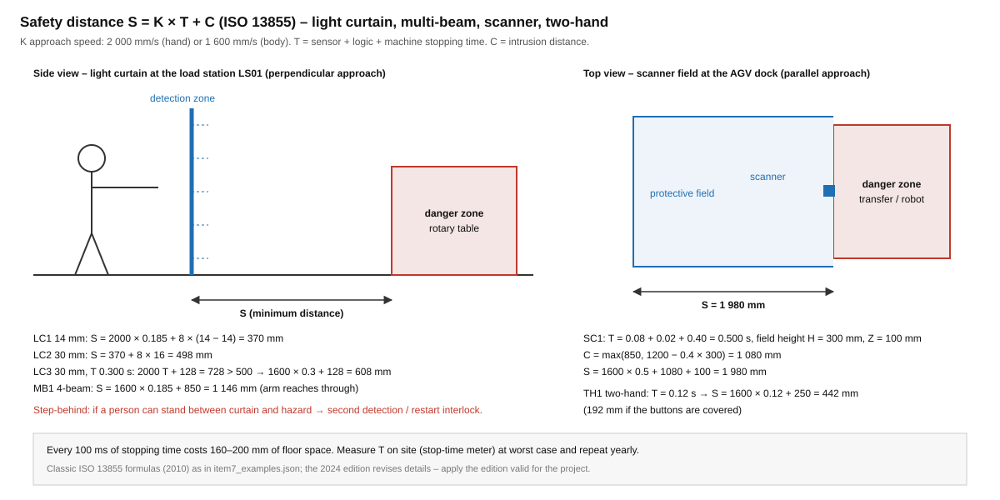

### H4.2 The rules (JSON `_formulas.safety_distance`, ISO 13855:2010 formulas)

| Device | Formula |
|---|---|
| Light curtain (AOPD), perpendicular approach, resolution d ≤ 40 mm | S = 2 000 × T + 8 × (d − 14); if S < 100 → S = 100; if S > 500 → S = 1 600 × T + 8 × (d − 14), and if this is < 500 → S = 500 |
| Multi-beam / d > 40 mm (body detection) | S = 1 600 × T + 850 |
| Laser scanner, parallel approach | C = max(850, 1 200 − 0.4 × H) with H = height of the protective field [mm]; S = 1 600 × T + C + Z (Z = scanner + measuring tolerances) |
| Two-hand control | S = 1 600 × T + 250 (C = 0 if the hands are covered so that no intrusion is possible) |

Note: ISO 13855 was revised (edition 2024). The revision changes some details (for example, new approach directions and intrusion rules). The
JSON and this guide use the classic formulas above for teaching; real projects apply the edition required (and harmonised) at the time.

### H4.3 The six JSON cases

**LC1 – load station, light curtain 14 mm.** Times: light curtain 0.015 + safety PLC 0.020 + rotary table stop 0.150 → **T = 0.185 s**.
S = 2 000 × 0.185 + 8 × (14 − 14) = 370 + 0 = **370 mm** (100 ≤ 370 ≤ 500 → keep). A finger-resolution curtain (14 mm) has no intrusion term.

**LC2 – same, 30 mm resolution.** T = 0.185 s. S = 370 + 8 × (30 − 14) = 370 + 128 = **498 mm** (≤ 500 → keep). The coarser hand resolution adds
128 mm.

**LC3 – 30 mm, slower stop.** Times: 0.015 + 0.020 + 0.265 → **T = 0.300 s**. S = 2 000 × 0.3 + 128 = 728 mm > 500 → recalculate with K = 1 600:
S = 1 600 × 0.3 + 128 = 480 + 128 = **608 mm** (≥ 500 → keep). The slower table (115 ms more stopping time) moves the curtain 110 mm further
out compared with LC2 – and from the "hand" to the "body" formula.

**MB1 – 4-beam body detection.** T = 0.185 s. S = 1 600 × 0.185 + 850 = 296 + 850 = **1 146 mm**. A multi-beam grid detects only the body; an arm
can reach 850 mm through the beams – the distance grows by about 650 mm compared with LC2. Use multi-beam only where the space exists and
where reaching through is not the access route.

**SC1 – scanner at the AGV dock / robot.** Times: scanner 0.080 + safety PLC 0.020 + robot / conveyor stop 0.400 → **T = 0.500 s**; protective
field height H = 300 mm; tolerance Z = 100 mm. C = max(850, 1 200 − 0.4 × 300) = max(850, 1 080) = **1 080 mm**. S = 1 600 × 0.5 + 1 080 + 100 =
800 + 1 080 + 100 = **1 980 mm**. The protective field must extend at least 1.98 m from the danger zone. (Field heights above 300 mm reduce C
but a field height H must not allow a person to crawl under – ISO 13855: H ≤ 1 000 mm and depends on resolution.)

**TH1 – two-hand control at a press-fit station.** Times: two-hand module 0.020 + safety PLC 0.020 + press stop 0.080 → **T = 0.120 s**; hands not
covered → C = 250. S = 1 600 × 0.12 + 250 = 192 + 250 = **442 mm** (with covered buttons: 192 mm).

| Case | Device | T s | Formula used | S mm |
|---|---|---|---|---|
| LC1 | light curtain 14 mm | 0.185 | 2 000 T + 8(d − 14) | **370** |
| LC2 | light curtain 30 mm | 0.185 | 2 000 T + 8(d − 14) | **498** |
| LC3 | light curtain 30 mm, slow stop | 0.300 | > 500 → 1 600 T + 8(d − 14) | **608** |
| MB1 | 4-beam grid | 0.185 | 1 600 T + 850 | **1 146** |
| SC1 | scanner H 300, Z 100 | 0.500 | 1 600 T + C + Z, C = 1 080 | **1 980** |
| TH1 | two-hand, not covered | 0.120 | 1 600 T + 250 | **442** |

Program: `python tools/fmse/safety_distance.py --example` (web **7G**).

### H4.4 Lessons for design

1. **Stopping time dominates.** Every 100 ms of stopping time costs 160–200 mm of floor space. A drive with SS1 and a good brake, a fast
   safety PLC (cycle and output time), and small moving masses save space.
2. **Resolution matters**: 14 mm instead of 30 mm saves 128 mm.
3. Distances must be **measured on site** (T from the stop-time measurement, G11.4) and the curtain mounted accordingly – with **step-behind
   protection**: if a person can stand between the curtain and the hazard (distance > 75 mm to the machine frame or the curtain is in front
   of a free space), a second detection (horizontal curtain, scanner, presence sensing mat) or restart interlock is needed.
4. **Height of the curtain**: lowest beam ≤ 300 mm above floor (for d ≤ 40 mm usually lower), highest beam such that reaching over is
   prevented (ISO 13855 table for reaching over the detection zone).

### H4.5 Checklist

- [ ] T = sum of all times, with the measured machine stopping time at worst case.
- [ ] Correct formula per device and approach direction.
- [ ] S marked in the layout; device mounted at ≥ S; step-behind protection.
- [ ] Re-measure T periodically.

---

## H5. Guard locking – the JSON decision

### H5.1 Rule (JSON `_formulas.guard_locking`)

```
t_access = distance_mm / 1 600   [s]       (walking / reaching speed 1 600 mm/s)
guard locking required if t_stop > t_access   (the hazard still moves when the person arrives)
```

### H5.2 The three JSON hazards (door → hazard 800 mm)

t_access = 800 / 1 600 = **0.5 s**.

| Hazard | Stopping time | t_access | Decision |
|---|---|---|---|
| HMC spindle run-down | 8.0 s | 0.5 s | 8.0 > 0.5 → **guard locking required** |
| Stacker crane stop | 1.2 s | 0.5 s | 1.2 > 0.5 → **guard locking required** |
| Washer pump run-down | 0.3 s | 0.5 s | 0.3 ≤ 0.5 → **no guard locking needed** (interlock only) |

Distance needed to avoid locking for the spindle: 8.0 × 1 600 = 12 800 mm – impossible → locking. For the washer, the pump stops before a hand
reaches it; still the hot water may remain – a **temperature** condition can require locking for another reason (thermal hazard): the risk
assessment decides, not only the stopping time.

### H5.3 How the unlock works (SF1 example)

1. Operator presses "request access" at door 1 of the pool.
2. Cell controller finishes the current crane move (or stops it at a safe position – operational stop).
3. Safety PLC commands SS1 to the crane drives; monitors standstill (safe speed monitor or SS1 time 1.5 s).
4. Contactors K1 / K2 open; standstill confirmed.
5. Safety PLC releases the guard-locking solenoid → door can be opened.
6. Door closing + reset outside the aisle → restart possible.

---

## H6. Light curtains, muting, blanking

### H6.1 Light curtains (AOPD, IEC 61496-1/-2)

- **Type 4** (PL e / SIL 3 capable) for most machine uses; type 2 only for lower risks (PL c max).
- Resolution: 14 mm finger, 30 mm hand, > 40 mm body (multi-beam, 2/3/4 beams).
- OSSD outputs (two PNP outputs, self-tested by pulses) → safety PLC / relay.
- Functions: restart interlock (manual reset after interruption), EDM, beam coding (against interference from neighbour curtains),
  cascading.
- Mounting: rigid brackets, no reflective surfaces nearby (mirror effect – IEC 62046 gives distances), alignment aids.

### H6.2 Muting

**Muting** = automatic temporary suspension of the light curtain while material passes (a pallet on a conveyor through the curtain), while
persons are still detected.

- Muting sensors (2 or 4) recognise the material by sequence and timing (e.g. two crossed sensors, time window 0.1–4 s); a person does not
  produce the same pattern.
- Muting lamp (some standards / C-standards require it), muting time limit, override function for clearing the curtain after a fault (with
  hold-to-run).
- The muting function has the **same PL** as the protection (IEC 62046).
- FMS use: pallet transfer from the load station to the conveyor through a curtain; AGV entering a cell with a 4-sensor muting.

### H6.3 Blanking

- **Fixed blanking**: certain beams are permanently ignored because a fixed object (conveyor frame) interrupts them – the gap must be closed
  mechanically, or the effective resolution increases (→ larger S).
- **Floating blanking**: one or two beams anywhere may be interrupted (e.g. by a cable or a moving part) – effective resolution increases
  (e.g. 14 mm with 1 floating beam ≈ 24 mm) → recalculate S with the effective resolution.

### H6.4 Checklist

- [ ] Type 4 / resolution / S calculated; restart interlock; EDM.
- [ ] Muting: sensor arrangement, timing, lamp, time limit, override; PL same as protection.
- [ ] Blanking: effective resolution used for S.

---

## H7. Safety laser scanners and field switching (AGV)

### H7.1 Principle

A safety laser scanner (IEC 61496-3, type 3, typically PL d / SIL 2) scans a plane with a laser and detects objects in configurable
**protective fields** (→ OSSD off) and **warning fields** (→ slow down, signal).

### H7.2 Stationary use

Area protection in front of a robot or conveyor (SC1: protective field depth ≥ 1 980 mm from the danger zone), access detection,
presence detection behind a light curtain (step-behind protection). Advantages: flexible field shapes; disadvantages: response time (often
60–100 ms + multiple sampling), sensitivity to dust and reflections, field height limits.

### H7.3 Mobile use – AGV / AMR (ISO 3691-4)

The scanner on the vehicle must detect a person in time **at the current speed**. Therefore the protective field length depends on the speed:

```
stopping distance s = v × t_response + v² / (2 × a_brake) + tolerances
field length L ≥ s + Z (Z = scanner tolerance + reflection allowance)
```

Example (scratch values): v = 1.0 m/s, t_response = 0.12 s, a_brake = 0.8 m/s², Z = 0.1 m → s = 0.12 + 1/(1.6) = 0.745 m → L ≥ 0.845 m. At
0.3 m/s: s = 0.036 + 0.056 = 0.092 m → L ≥ 0.192 m.

**Field switching**: the vehicle controller switches between field sets based on **safe speed** (encoder-based, safe speed monitoring) and
on the location (narrow passage, docking station). The field switching itself is a safety function (PL d in ISO 3691-4 for personnel
detection). At the dock (`AGVST01`): the vehicle switches to a short field set and low speed; the stationary dock scanner (SF4) protects the
transfer conveyor.

### H7.4 Checklist

- [ ] Field size from the stopping distance at each speed; Z included.
- [ ] Field switching by safe speed and position; validated.
- [ ] Shared routes marked; ISO 3691-4 zones (operating hazard zone, restricted zone) defined.

---

## H8. Enabling devices and two-hand control

### H8.1 Enabling device (3-position switch)

- Positions: 1 released (off), 2 middle (**enable**), 3 pressed through (off – panic reaction). Returning from 3 to 2 must not enable.
- Allows motion **only while held** in position 2, together with a separate start / jog command; combined with reduced speed (SLS) and
  maintenance mode (I5).
- PL typically c–d (SF5: input Cat 3, PL d).
- FMS use: teaching the stacker crane positions inside the aisle (door open, maintenance mode, SLS 0.25 m/s typical value from C-standards for
  manual mode – check EN 528 / your risk assessment).

### H8.2 Two-hand control (ISO 13851)

- Both hands needed on two buttons, actuated **simultaneously** (within 0.5 s, type III), released → stop; re-initiation only after releasing
  both.
- Types I, II, IIIA, IIIB, **IIIC** (IIIC = Cat 4 / PL e). Safety distance per ISO 13855: S = 1 600 × T + 250 (TH1: 442 mm).
- Protects **only the operator who presses** – other persons need their own protection (fence, light curtain).
- FMS use: press-fit station of the assembly cell (J2), manual clamping at a load station.

---

## H9. Emergency stop after ISO 13850

### H9.1 Principles

- The e-stop is a **complementary protective measure** – it does not replace guards or protective devices.
- **Stop category 0 or 1** (A5.3), chosen by the risk assessment. Stop category 1 is common in FMS (drives brake actively: stacker crane,
  spindles).
- Function: overrides all other functions and modes; **latching** (the button stays pressed); reset only by deliberate manual action at
  the button (unlatch), and **reset of the e-stop does not restart** the machine – a separate start command is needed.
- Actuator: red mushroom / palm button on yellow background, **direct opening action** (IEC 60947-5-5), reachable from each operating position
  and at access points; also pull-wire switches along conveyors.
- PL: determined by risk assessment; usually **PL d** in FMS (SF3), at least PL c (ISO 13850 note: the e-stop function should have at least
  the PL of the other safety functions it complements – check).

### H9.2 E-stop concept of an FMS (zones)

| Question | FMS rule |
|---|---|
| Which area stops when a button is pressed? | defined **e-stop zones** (the cell, or a module), marked on the layout; buttons labelled with their zone |
| What happens to machine tools? | e-stop **signal to the machine's own e-stop circuit** by hard-wired safety coupling (I4) |
| What happens to holding functions (clamps, brakes, vacuum)? | **stay active** if de-energising would create a hazard (falling pallets, released parts) – I7.4 |
| How is it reset? | unlatch the button → reset at the zone's reset station (outside the danger zone, with view into it) → start |
| Portable panels (pendants)? | inactive e-stops on unplugged pendants must be stored out of sight or indicated (ISO 13850: avoid confusion) |

### H9.3 Common mistakes

- E-stop used as the normal stop → wear, and the machine stops in an undefined state.
- E-stop opens the clamp valve → pallet falls (I7).
- One e-stop chain for several cells → a button in cell 1 stops cell 2 (confusion) – define zones.
- Reset of the button restarts the conveyor → forbidden.

---

## H10. Safe drive functions after IEC 61800-5-2

### H10.1 The functions

| Function | Abbr. | What it does | Stop cat. / use |
|---|---|---|---|
| **Safe torque off** | **STO** | removes the energy that creates torque (pulse inhibit) – the motor coasts | stop cat 0; basis of all others |
| **Safe stop 1** | **SS1** | brakes the motor (ramp), monitors the deceleration (SS1-r) or waits a time (SS1-t), then STO | stop cat 1 – e-stop of crane, spindle |
| **Safe stop 2** | **SS2** | brakes, then **SOS** (holds position with torque) | stop cat 2 – door open during set-up with axis held |
| **Safe operating stop** | **SOS** | monitors that the motor stays at standstill (within a window) while the drive keeps torque | intervention without losing position |
| **Safely-limited speed** | **SLS** | monitors that the speed stays below a limit; if exceeded → STO / SS1 | maintenance / set-up with enabling device (SF5) |
| **Safe brake control** | **SBC** | safe control of the holding brake (two-channel brake output) | vertical axes, hoist; with STO |
| Safe direction / limited position / speed monitor | SDI / SLP / SSM | direction, position limits, speed below threshold signal | robot / crane zones, door unlock at standstill (SSM) |


### H10.2 How to apply them in an FMS

| Situation | Function |
|---|---|
| Pool door opened in automatic | SS1 → STO for travel / hoist / fork (Z3) |
| Maintenance in the aisle with enabling device | SLS for travel / hoist / fork (Z4, SF5) |
| E-stop | SS1 (stop cat 1), STO for small drives (Z1) |
| Light curtain LS01 interrupted | STO rotary table (short stop at low speed), SS1 fork (Z2) |
| Vertical hoist | SBC + mechanical brake test (yearly / per C-standard) – a falling load is not stopped by STO |
| Door unlock only at standstill | SSM (safe speed monitor) or SS1 completed |

### H10.3 Integration

- Hard-wired STO terminals (two channels) from the safety PLC / relay, or STO / SS1 / SLS via a safety protocol (PROFIsafe, FSoE, CIP Safety –
  guide 66 B6).
- SLS / SOS need a **safe speed / position feedback** (safe encoder or encoderless methods approved by the maker for the function and the PL).
- Parameters (limits, ramps, times) are part of the safety configuration → checksum, validation (G11).
- Stopping time with SS1 is shorter than coasting with STO for high-inertia drives – this reduces safety distances (H4).

---

## H11. Common mistakes and checklist

| Mistake | Consequence | Correct |
|---|---|---|
| Light curtain mounted where space allowed, not at S | person reaches the hazard | calculate S, then design the layout |
| Stopping time from the data sheet only | real T longer (brake wear) | measure T, re-measure periodically |
| Multi-beam where a hand can reach through | hand injury | 14 / 30 mm curtain or larger distance |
| No step-behind protection | restart with a person inside | second detection, restart interlock |
| Power-to-lock guard locking for persons | door opens at power failure while spindle runs down | spring-applied locking |
| STO for a hoist without SBC | load falls | SBC + brake test |
| Low-coded switch at a door used every few minutes | defeated | high coding, better task design |

- [ ] Guard types, fences, ISO 13857 distances (H1, H3).
- [ ] Interlocks: type, coding, defeat, guard locking, escape (H2).
- [ ] All protective devices: S calculated and checked on site (H4).
- [ ] Guard-locking decision per door (H5).
- [ ] Curtains / muting / blanking (H6), scanners and AGV fields (H7), enabling and two-hand (H8).
- [ ] E-stop concept with zones and holding functions (H9).
- [ ] Safe drive functions chosen per situation; parameters validated (H10).

---

# Part I – Safety architecture of an FMS

## I1. Safety relays or safety PLC

### I1.1 The options

| Solution | Description | Strengths | Limits | Typical use |
|---|---|---|---|---|
| **Safety relay** (safety module) | one hard-wired module per function (e-stop, door, light curtain), contacts or semiconductor outputs | simple, cheap for 1–3 functions, no software, easy for electricians | wiring grows fast; zones and modes are hard; little diagnosis | small machines, J3 small factory |
| Configurable safety relay / small safety controller | a few dozen IO, configured by software (function blocks) | flexible, diagnosis, still small | limited IO and networking | single modules (load station, washer) |
| **Safety PLC** | safety CPU + safety IO (central or distributed), certified FBs, safety protocol | zones, modes, cause & effect, diagnosis to HMI, networked safety | needs software competence, validation discipline | **FMS cell safety controller `SAFE01` (M18)** |
| Integrated safety in the standard PLC (F-CPU / safety option) | one CPU runs standard and safety programs separately | one hardware, one network | same discipline as safety PLC | module controllers of larger modules |

### I1.2 How to choose

1. Count the safety functions, inputs and outputs of the cell (FMS with 3 HMC + pool: 20–40 safety functions, 80–200 safety IO).
2. Count zones and modes: more than 2 zones or a maintenance mode with SLS → safety PLC.
3. Need for diagnostics to the HMI and cell controller (which door, which channel) → safety PLC.
4. Competence of the maintenance team: relays are easier to understand; safety PLC needs trained staff and a change procedure.
5. Lifetime and changes: an FMS changes (new machines) → safety PLC is easier to extend.

### I1.3 Typical circuit patterns (see web 7J and guide 68)

```
 e-stop Cat 3 / PL d with a safety relay:
   +24V ── S1 (NC ch1) ──┐                ┌── K1 (contactor) ──┐
                         ├─ safety relay ─┤                    ├── motor supply
   +24V ── S1 (NC ch2) ──┘   (cross-mon.) └── K2 (contactor) ──┘
            reset button ─► relay (monitored reset: falling edge)
            EDM: K1 NC mirror + K2 NC mirror in series → relay feedback input

 door interlock Cat 3 with safety PLC:
   BG1 (guard locking switch, OSSD or 2 NC) → F-DI ch A ; BG2 (position switch NC) → F-DI ch B
   safety PLC: discrepancy time 0.5 s, pulse test outputs T1/T2 for cross-circuit detection
   outputs: F-DQ (P/M switching) → STO A/B of VFDs ; F-DQ → K1/K2 ; EDM → F-DI
```

---

## I2. Hard-wired or networked safety (PROFIsafe, FSoE, CIP Safety)

### I2.1 Networked safety

Safety protocols (guide 66 B6) transmit safety data over the standard network as a **black channel**: the safety layer adds a CRC, a
sequence counter, a watchdog and a unique safety address, so that errors of the network are detected; the network itself is not trusted.

| Protocol | Network | Typical makers / ecosystem |
|---|---|---|
| PROFIsafe | PROFINET, PROFIBUS | Siemens and many others |
| FSoE (Safety over EtherCAT) | EtherCAT | Beckhoff and many others |
| CIP Safety | EtherNet/IP | Rockwell and many others |
| openSAFETY, CC-Link IE Safety | various | B&R, Mitsubishi |

### I2.2 When hard-wired, when networked?

| Link | Recommendation | Why |
|---|---|---|
| Inside a module (sensors → module safety IO → drives) | networked (safety IO on the fieldbus, STO via protocol) is fine | same maker, one validation |
| Cell safety controller ↔ modules of the **same** integrator / ecosystem | networked possible (F-device coupling, e.g. PROFIsafe I-device) | fewer wires, diagnosis |
| Cell ↔ **machine tool of another maker** | **hard-wired** potential-free two-channel signals (I4) | different safety systems, simple validation, clear responsibility |
| Cell ↔ AGV | hard-wired via the dock interface or a certified safety radio | mobile; check maker |
| Any safety signal over Modbus TCP / OPC UA / MQTT / HTTP | **never** (no safety layer) | guide 66 K11 exercise 19 |

**Module standard rule (guide 60):** safety is always hard-wired / safety PLC (M18), never over the standard network alone.

### I2.3 Reaction time with networked safety

Reaction time = sensor + input delay + **F-watchdog time** (worst case: a telegram is lost) + safety CPU cycle × 2 + output + actuator. The
F-watchdog (guide 66 B6.3) can add 50–200 ms – it enters T in ISO 13855 (H4). Use the maker's reaction time calculator.

---

## I3. Safety zones of a cell

### I3.1 Why zones

If every safety event stops the whole cell, the FMS loses its main advantage – **continuous unmanned production**. An operator at the load
station must not stop the three machining centres. A maintenance technician in the pallet pool should not stop the machines that are still
machining their pallets. **Zones** limit the effect of a safety event to the area where the person is.

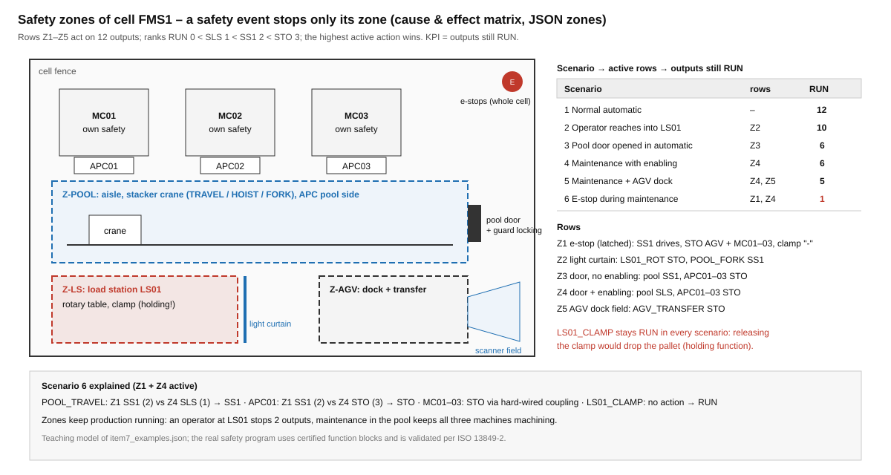

### I3.2 The zones of the running example

| Zone | Area | Hazards | Inputs | Affected outputs |
|---|---|---|---|---|
| Z-LS | load stations LS01 / LS02 | rotary table, fork transfer, clamps | light curtain `LS01_LC` | `LS01_ROT`, `POOL_FORK` (only while it serves LS01) |
| Z-POOL | pallet pool aisle, stacker crane, APC transfer side | crane, fork, APC | pool door `POOL_DOOR_OPEN`, enabling `ENABLE_OK` | `POOL_TRAVEL`, `POOL_HOIST`, `POOL_FORK`, `APC01`–`APC03` |
| Z-AGV | AGV dock with transfer conveyor | conveyor, AGV | dock scanner `AGV_DOCK_FIELD` | `AGV_TRANSFER` |
| Z-MC1..3 | inside each machine | spindle, tool changer | machine builder's own doors | machine's own outputs (machine safety) |
| Cell | everything | all | e-stop `ESTOP_CELL` | all outputs (Z1) |

### I3.3 Design rules for zones

1. A person can be in only one zone at a time **or** each zone is protected independently.
2. Zone boundaries are physical (fences, curtains, scanners) – never "imaginary lines".
3. Each zone has its own reset station with view into the zone.
4. Transfer points between zones (fork into the load station, APC into the machine) get the **union** of both zones' conditions.
5. Zone status is shown on the HMI and at the zone entry (lamp).

---

## I4. Coupling with machine tools and module suppliers

### I4.1 The situation

A machining centre comes with its **own** safety system (machine builder, certified to ISO 16090-1, its own safety PLC or relays, its own
door with guard locking, its own e-stop circuit). The cell safety controller `SAFE01` must coordinate with it **without** modifying it.

### I4.2 The hard-wired safety coupling (typical signals)

| Signal | Direction | Type | Meaning |
|---|---|---|---|
| E-stop OUT (cell → machine) | SAFE01 → MC | 2 potential-free NO contacts (two channels), closed = no e-stop | cell e-stop stops the machine (its own stop category) |
| E-stop IN (machine → cell) | MC → SAFE01 | 2 channels | machine e-stop stops the cell zone around it (or the whole cell, per concept) |
| Pallet-change area free / door closed | MC → SAFE01 | 2 channels | APC door of the machine closed – the pool side may move |
| Pool side safe (zone free) | SAFE01 → MC | 2 channels | the pool side is safe – the machine may perform the pallet change (APC motion into the pool side) |
| Enabling / mode signals (optional) | both | 2 channels | maintenance mode coordination |

Electrical rules: **potential-free** contacts (each side supplies its own 24 V and reads the other side's contacts) – no common 0 V, no
ground loops, clear responsibility; two channels; cross-circuit detection by the reading side (pulse test outputs); cable with
separate cores; terminal designation agreed in the interface sheet (guide 66 H7). The PL of a function that passes the coupling is the
combination of both sides' subsystems (G8) – each side gives the PL / PFHd of its part.


### I4.3 The interface sheet (safety part)

For every module: list of safety coupling signals, contact type, voltage, channel assignment, PL / PFHd of the module's part, reaction
time, behaviour on cable break, reset concept, who resets what. Signed by both parties. Example row:
`MC02 ↔ SAFE01 | E-stop OUT | 2 × NO 24 V DC 10 mA min | XD3:1-2 / 3-4 | PL e, PFHd 1.0E-8 (cell side) | ≤ 20 ms | open = e-stop | e-stop reset at cell panel, machine reset at machine`.

---

## I5. Operating modes and maintenance

### I5.1 Modes (guide 65: Production / Maintenance / Manual)

| Mode | Safety condition | Typical safe drive functions |
|---|---|---|
| Production (automatic) | all guards closed and locked; protective devices active | normal; zone stops (Z2, Z3, Z5) |
| Maintenance | door may be open **only** with enabling device held; reduced speed | SLS (Z4); STO for APC |
| Manual / set-up | hold-to-run or enabling; reduced speed / force | SLS, SOS |
| Service (special) | additional procedures (LOTO, special key) | per risk assessment |

### I5.2 Mode selection

- **Mode selector switch** (lockable key or RFID access system), one selected mode at a time, the selection itself is a safety function (PL
  as the functions it enables) – IEC 60204-1 9.2.3.
- Changing the mode does not start motion; the selected mode is displayed.
- Access systems with personal RFID cards are common in modern FMS (who entered which zone when → log).

### I5.3 LOTO (lock-out / tag-out)

For work where unexpected start-up is dangerous and safety functions are not sufficient (mechanical repair in the aisle, electrical work):
switch off the module main switch, lock with a personal padlock, tag, verify absence of energy (electrical, pneumatic, gravity, springs),
then work. The LOTO procedure per module is part of the instructions (F5 step 3).

---

## I6. Reset and restart rules

1. **Reset ≠ start.** Reset acknowledges that the zone is safe; a separate start command (from the cell controller or a start button) restarts
   motion (IEC 60204-1 9.2.5.4, ISO 13849-1 5.2.2).
2. Reset button **outside** the danger zone, with **full view** into the zone (or a confirmation sequence when view is impossible).
3. Reset reacts on the **falling edge** (release of the button) – a stuck or bridged button does not reset.
4. **Latched** functions (e-stop Z1) need a reset after the cause clears; non-latched protective stops (light curtain Z2) can restart
   automatically **only** if the risk assessment allows (no person can be inside the hazard zone – e.g. finger-resolution curtain on a small
   opening without step-behind possibility); otherwise a reset is needed (restart interlock).
5. After a safety stop, the cell controller resumes the job **from the module state** (PackML: Stopped / Held → Resetting → Idle, guide 65) –
   it never "replays" a half-finished command blindly.

---

## I7. The JSON cause & effect matrix – six scenarios

### I7.1 The idea

A **cause & effect matrix** lists, for every safety condition (row), the action on every output (column). The safety PLC implements exactly
this matrix; the matrix is the **specification** and the **validation checklist** at the same time.

JSON rules (`_formulas.safety_zones`): each row = condition (all `all_of` inputs true AND all `none_of` inputs false) → actions per output;
action ranks **RUN 0 < SLS 1 < SS1 2 < STO 3** ("-" = no action); the output result = highest-ranked action of all active rows, RUN if none;
latched rows need a reset; KPI = number of outputs still RUN (production continuity).

### I7.2 Inputs, outputs and rows

Inputs: `ESTOP_CELL`, `LS01_LC` (light curtain interrupted), `POOL_DOOR_OPEN`, `ENABLE_OK` (maintenance mode selected AND enabling device in the
middle position – evaluated in the safety PLC), `AGV_DOCK_FIELD` (scanner field at the dock violated).

Outputs (12): `LS01_ROT`, `LS01_CLAMP`, `POOL_TRAVEL`, `POOL_HOIST`, `POOL_FORK`, `APC01`, `APC02`, `APC03`, `AGV_TRANSFER`, `MC01`, `MC02`, `MC03`.

| Row | Condition | Latched | LS01_ROT | LS01_CLAMP | POOL_TRAVEL | POOL_HOIST | POOL_FORK | APC01–03 | AGV_TRANSFER | MC01–03 |
|---|---|---|---|---|---|---|---|---|---|---|
| **Z1** | ESTOP_CELL | yes | SS1 | **-** | SS1 | SS1 | SS1 | SS1 | STO | STO |
| **Z2** | LS01_LC | no | STO | | | | SS1 | | | |
| **Z3** | POOL_DOOR_OPEN and not ENABLE_OK | no | | | SS1 | SS1 | SS1 | STO | | |
| **Z4** | POOL_DOOR_OPEN and ENABLE_OK | no | | | SLS | SLS | SLS | STO | | |
| **Z5** | AGV_DOCK_FIELD | no | | | | | | | STO | |

(MC01–MC03 "STO" in Z1 means: the e-stop signal goes to the machine over the hard-wired safety coupling, I4; the machine performs its own
e-stop.)

### I7.3 The six scenarios

| # | Scenario | Active inputs | Active rows | Outputs still RUN |
|---|---|---|---|---|
| 1 | Normal automatic | – | – | **12** |
| 2 | Operator reaches into the load station | LS01_LC | Z2 | **10** |
| 3 | Pool door opened in automatic | POOL_DOOR_OPEN | Z3 | **6** |
| 4 | Maintenance in the pool with enabling device | POOL_DOOR_OPEN, ENABLE_OK | Z4 | **6** |
| 5 | Maintenance + person at the AGV dock | POOL_DOOR_OPEN, ENABLE_OK, AGV_DOCK_FIELD | Z4, Z5 | **5** |
| 6 | E-stop during maintenance | ESTOP_CELL, POOL_DOOR_OPEN, ENABLE_OK | Z1, Z4 | **1** |

Results per output:

| Output | 1 Normal | 2 LS01 reach | 3 Door auto | 4 Maint. | 5 Maint. + AGV | 6 E-stop in maint. |
|---|---|---|---|---|---|---|
| LS01_ROT | RUN | **STO** | RUN | RUN | RUN | **SS1** |
| LS01_CLAMP | RUN | RUN | RUN | RUN | RUN | **RUN** |
| POOL_TRAVEL | RUN | RUN | SS1 | SLS | SLS | **SS1** |
| POOL_HOIST | RUN | RUN | SS1 | SLS | SLS | **SS1** |
| POOL_FORK | RUN | **SS1** | SS1 | SLS | SLS | **SS1** |
| APC01 | RUN | RUN | STO | STO | STO | STO |
| APC02 | RUN | RUN | STO | STO | STO | STO |
| APC03 | RUN | RUN | STO | STO | STO | STO |
| AGV_TRANSFER | RUN | RUN | RUN | RUN | **STO** | STO |
| MC01 | RUN | RUN | RUN | RUN | RUN | **STO** |
| MC02 | RUN | RUN | RUN | RUN | RUN | **STO** |
| MC03 | RUN | RUN | RUN | RUN | RUN | **STO** |
| **Still RUN** | **12** | **10** | **6** | **6** | **5** | **1** |

How to read scenario 6: rows Z1 (e-stop) and Z4 (maintenance) are both active. For `POOL_TRAVEL` Z1 says SS1 (rank 2) and Z4 says SLS (rank 1)
→ the higher rank wins: **SS1**. For `APC01` Z1 says SS1 (2), Z4 says STO (3) → **STO**. For `LS01_CLAMP` no row acts ("-" in Z1) → **RUN**.

Program: `python tools/fmse/safety_zones.py --example` (web **7H**).

### I7.4 Why the clamp valve is never de-energised

`LS01_CLAMP` is the only output that keeps RUN even in scenario 6. The reason is **physics, not production**: the clamp holds the pallet (up
to 800 kg) on the rotary table of the load station. If the e-stop de-energised the clamp valve, the pallet would be **released** – it could
slide, tip or fall when the table stops or when the operator touches it. **De-energising is not always the safe state.** ISO 12100 and ISO 13850
require that the e-stop does not create new hazards; IEC 60204-1 allows holding functions to stay active. The design rules:

- Use a clamping principle that **holds without energy** (spring-clamping, self-locking mechanics) or a valve that **keeps its position** without
  signal (bistable / detented valve, or monostable "energise to release" with a pilot check valve).
- The clamp's **release** command is blocked by the safety system while the table can move or a person is present (release only in a safe state
  with operator action).
- Document the decision in the risk assessment ("holding function, kept active in all stop categories").

The same applies to: vertical axis brakes (SBC: brake **closes** without energy – correct), vacuum grippers (vacuum reservoir / check valve),
magnetic grippers (permanent-electro magnets), tool clamping in spindles (spring-clamped).

### I7.5 Production continuity – what the KPI teaches

- Scenario 2: the operator at LS01 stops only two outputs (rotary table, fork) – the machines and the pool continue (10 of 12 RUN).
- Scenarios 3 and 4: maintenance in the pool still keeps all three machines machining and the load station working (6 RUN); with the
  enabling device the crane may move slowly (SLS) for teaching – better than a full stop.
- Scenario 6: the e-stop stops everything except the holding function (1 RUN) – correct, the e-stop is the "last resort".
- Without zones (one cell stop for every event), every scenario would give 0–1 RUN: **dozens of machine hours lost per week** in a cell with
  frequent operator interventions.

### I7.6 How to build your own matrix

1. List all safety inputs (from the safety function list, G1.3).
2. List all hazardous outputs (drives, valves, machine couplings) – including holding functions.
3. For each input (and combination with modes): which outputs must react, with which action (STO / SS1 / SLS / no action)?
4. Mark latched rows (e-stop).
5. Check every output column for holding functions ("-" where de-energising is dangerous).
6. Simulate the scenarios (the tool) → KPI and plausibility review with operators.
7. Implement in the safety PLC; validate row by row and scenario by scenario (G11).

---

## I8. Safety in the module standard (the safety face of M01–M22)

The module standard (guide 60 §4) gives every module a **safety face**. Item 7 fills it in principle; item 8 (guide 68) gives complete
circuits.

| Module | Safety face content (principle) |
|---|---|
| M01 machine tool interface | machine builder's safety; hard-wired coupling (e-stop in / out, APC door closed, pool side safe); guard locking for spindle run-down |
| M02 APC | STO when the pool side is open; coupling to the machine |
| M03 pallet pool + stacker | fence, interlocked doors with guard locking (SF1), maintenance mode + enabling + SLS (SF5), SBC for hoist, end buffers |
| M04 load / unload station | light curtain or interlocked door (SF2), clamp as holding function, two-hand for manual clamping |
| M05 robot loading cell | fence, doors, scanners, ISO 10218-2, collaborative modes only with ISO/TS 15066 |
| M06 AGV / AMR interface | dock scanner (SF4), field switching, hard-wired dock handshake for safety signals |
| M07 conveyors | nip-point guards, e-stop / pull wire, transfer points |
| M08 AS/RS | like M03 (EN 528) |
| M10 washer | interlocked door Cat 3 (SF6 fixed), temperature / pressure interlocks |
| M11 measuring station | low-force design; light curtain for automatic loading |
| M13–M16 assembly, test, welding, press | two-hand (H8), light curtains, welding curtains / fume, press safety (ISO 16092) |
| M17 utilities | lockable isolation of air / water / power; pressure release |
| **M18 cell safety controller** | safety PLC `SAFE01`, zone matrix (I7), e-stop concept, mode selection, reset stations, coupling terminals |
| M19 cell controller | **no safety functions** – only reads safety status for coordination and HMI |
| M20 SCADA / HMI | shows safety status, zone lamps; never commands safety |
| M22 network | safety protocol networks segmented; F-watchdog times in the reaction time |

Each module's safety face lists: safety functions with PLr / PL, safety IO, coupling signals, stop categories, reset concept, holding functions,
T10d components.

---

## I9. Common mistakes and checklist

| Mistake | Consequence | Correct |
|---|---|---|
| One zone = whole cell | low availability, operators bypass | zones (I3, I7) |
| Safety coupling with a common 0 V between companies | ground loops, unclear faults | potential-free two-channel contacts |
| Safety signals over Modbus / OPC UA | not safe | hard-wired / safety protocol |
| E-stop de-energises holding functions | falling loads | "-" in the matrix, holding by design |
| Reset button inside the zone | restart with person inside | outside, with view |
| Matrix not validated scenario by scenario | hidden logic errors | validation per row and scenario |

- [ ] Safety logic chosen (relay / safety PLC) with reasons.
- [ ] Hard-wired vs networked decided per link; reaction times include watchdogs.
- [ ] Zones defined physically; reset stations.
- [ ] Coupling interface sheet with every module supplier signed.
- [ ] Modes, mode selection, LOTO procedure.
- [ ] Cause & effect matrix with holding functions; scenarios simulated and validated.
- [ ] Safety face of every module filled.

---

# Part J – Three complete cases

## J1. Machining FMS: 3 HMC + pallet pool + load stations + AGV

**Plant:** compressor factory, cell `FMS1` (the running example). Siemens-type safety PLC with PROFIsafe inside modules, hard-wired coupling to
machine tools (guide 66 J1 for the network).

**Power (B, C):**

| Item | Result |
|---|---|
| Load list | P 125.5 kW, Q 72.105 kvar, S 115.791 kVA, cos φ 0.8671, I 167.13 A |
| With growth | S_req 144.74 kVA → feeder 208.9 A → MCCB 250 A; (dedicated transformer would be 250 kVA, loading 0.463 – not needed) |
| Short circuit | plant 1 000 kVA, uk 6 % → Ik3 24 056 A → Icu / Icc / SCCR ≥ 25 kA |
| MC02 feeder | 80 A C, 35 mm² / PE 16 mm², ΔU 0.923 %, Ik1 842.7 A ≥ 800 A, L_max 67.10 m (60 m installed) |
| Motor example | 7.5 kW: In 14.668 A, DOL 102.68 A, star-delta 34.23 A |
| 24 V (LS / pool cabinet) | 5.74 A → 7.175 A → PSU 10 A; ECB 3 / 2 / 1 / 2 A; valve line 15 m 1.5 mm²: 23.288 V, L_max 50.56 m |
| Stacker cabinet | 805 W losses; Ta 25 °C fan 138.2 m³/h; Ta 35 °C cooling unit ≥ 805 W; Ta 40 °C ≥ 984.5 W → cooling unit ~1 kW |

**Safety (F–I):**

| Function | PLr | PL | Verdict |
|---|---|---|---|
| SF1 pool door + guard locking | d | d | OK |
| SF2 light curtain LS01 | d | d | OK |
| SF3 e-stop cat 1 | d | d | OK |
| SF4 AGV dock scanner | b | c | OK |
| SF5 enabling + SLS | c | d | OK |
| SF6 washer door (first design) | d | c | **NOT OK → fixed to Cat 3 → d (G10)** |

Distances: LS01 curtain 14 mm 370 mm (or 30 mm: 498 mm; with the slower table 608 mm); AGV dock scanner 1 980 mm. Guard locking: spindle
(8 s) and stacker (1.2 s) yes, washer pumps (0.3 s) no. Zone matrix: 12 / 10 / 6 / 6 / 5 / 1 outputs still RUN in the six scenarios; clamp
`LS01_CLAMP` kept as holding function.

**Project steps (integrator):** load list and SLD in basic engineering → short-circuit check and supply contract with the plant → cell board
and feeders → module cabinet reviews (thermal, 24 V, IEC 61439) → risk assessment workshops (concept, design freeze) → safety function list
and PL → layout check of S and fences → coupling interface sheets with the machine builder → safety PLC program from the zone matrix → FAT of
the cell safety with a simulator → SAT: electrical tests, stop times, validation → DoC of the assembly.

---

## J2. Robot assembly cell with press-fit and screwdriving

**Plant:** compressor head assembly cell `ASM1`: two robots load parts, a servo press fits the valve plate (press-fit), four automatic
screwdrivers, conveyors, a leak tester; one operator loads trays at a manual station with a press-fit hand station for rework.

**Load list (scratch values, method of B2, ks 0.8, growth 1.25):**

| Load | qty | kW | ku | cos φ |
|---|---|---|---|---|
| Robot | 2 | 5 | 0.5 | 0.90 |
| Servo press | 1 | 7.5 | 0.4 | 0.90 |
| Screwdriver | 4 | 0.5 | 0.5 | 0.95 |
| Conveyor | 3 | 0.75 | 0.7 | 0.80 |
| Leak tester | 1 | 1.5 | 0.6 | 0.90 |
| Controls | 1 | 2 | 1.0 | 0.95 |

Result: installed 25.25 kW; P 13.475 kW, Q 6.478 kvar, S 11.961 kVA, cos φ 0.9013, I 17.26 A; S_req 14.95 kVA → feeder 32 A (Ib with growth =
14 950 / 692.8 = 21.6 A → In 25 A or 32 A with reserve) – a small cell feeder.

**Safety concept:**

| Function | Hazard | S F P | PLr | Design | PL (expected) |
|---|---|---|---|---|---|
| Robot cell door interlock with guard locking | robot impact | S2 F2 P2 | e | coded RFID switch with locking (certified PL e, Cat 4) + safety PLC + robot safety controller (certified) | e |
| Tray station light curtain 14 mm → robot stop in the shared area | robot / press crushing | S2 F2 P1 | d | type 4 curtain + safety PLC + robot SS1 | d |
| Press-fit hand station: two-hand control type IIIC | press crushing of hands | S2 F2 P2 | e | two-hand IIIC module PL e + safety valve / servo STO with SBC | e (if output certified e) |
| Screwdriver area: fixed guards + light curtain | low force rotation | S1 F2 P1 | b | curtain as above (covers) | d |
| E-stop cell | all | S2 F1 P2 | d | Cat 3 two-channel, safety PLC | d |
| Robot reduced speed in teach (T1 ≤ 250 mm/s, ISO 10218-1) + enabling | robot | S2 F1 P1 | c | robot's certified functions | d |

Robot cell door interlocks (scratch values with the G4 method, 240 d × 16 h, every 300 s): guard-locking switch B10d 2 × 10⁶ → MTTFd 434.03 y;
position switch B10d 10⁷ → 2 170.14 y; symmetrised 1 494.98 y → 100 (high); DCavg 97.5 % (medium) → Cat 3 → d. For PL e the design uses a
certified Cat 4 coded switch instead (G7: Cat 3 is limited to d in the simplified table).

**Distances (scratch values):** tray-station curtain 14 mm, T = 0.015 + 0.015 + 0.12 = 0.15 s → S = 2 000 × 0.15 = **300 mm**; press-fit two-hand
station = TH1 → **442 mm** (192 mm with covered buttons). Robot door: robot stop 0.6 s (scratch), door 800 mm → t_access 0.5 s → guard locking
required.

**Zones:** Z-tray (curtain: robot 1 SS1 in the shared area, robot 2 continues), Z-press (two-hand: only the press), Z-robot (door: both robots
SS1 → STO; screwdrivers continue cycle and stop at end), e-stop all. Holding functions: grippers with vacuum reservoir / spring jaws stay
closed.

---

## J3. Small factory with relay-based safety and Modbus / HTTP-only control

**Plant:** a small machining shop: two CNC lathes with a robot loading cell, two conveyors, a compressor, a small washer. The plant allows
only **Modbus TCP and HTTP** for control and data (guide 66 J2, Ball screw factory tab). The owner wants simple, maintainable safety that his
electricians understand.

**Load list (scratch values, ks 0.8, growth 1.25):** lathes 2 × 22 kW (ku 0.5, cos φ 0.85), robot 3 kW (0.5, 0.9), conveyors 2 × 0.75 kW (0.7,
0.8), compressor 7.5 kW (0.7, 0.85), washer 6 kW (0.7, 0.95), controls + IT 1.5 kW (1.0, 0.95). Installed 63.5 kW; P 35.5 kW, Q 20.276 kvar,
S 32.706 kVA, cos φ 0.8684, I 47.21 A; S_req 40.88 kVA → feeder 59 A → **63 A** breaker, cable by C1.

**Safety with safety relays (no safety PLC):**

| Function | Design | Category / PL |
|---|---|---|
| E-stop (all buttons in series, 2 NC each, few buttons) | e-stop safety relay, 2 contactors with EDM in the conveyor / washer supplies; robot and lathes via their own e-stop inputs (potential-free relay contacts) | Cat 3 / PL d |
| Robot cell door | 2 switches (tongue with locking + hinge switch) → door safety relay with cross-monitoring → robot safety input (2 channels) | Cat 3 / PL d |
| Lathe doors | machine builder's own (certified), coupled with potential-free contacts | builder |
| Washer door | 2 switches + safety relay + 2 contactors with EDM (the **fixed SF6** pattern) | Cat 3 / PL d |
| Conveyor nip points | fixed guards | – |

Example values (G4 method, 220 d × 16 h, one operation every 900 s): contactor B10d 10⁶ → MTTFd 710.23 y → 100 (high); door switch B10d 2 × 10⁶ →
1 420.45 y → high. With EDM (DC 99 %) and cross-monitoring, Cat 3 → **PL d**.

**Rules for relay-based safety:** one safety relay per function or zone; expansion modules for more contacts; monitored manual reset;
diagnostics: auxiliary (non-safety) contacts of the relays to the standard PLC → Modbus TCP register "safety status word" for the HMI and the
cell PC (**information only**, never control); maximum 3–4 relays before a configurable safety controller becomes cheaper and clearer. All
safety stays hard-wired; Modbus / HTTP carry only status and jobs.

---

## J4. Implementation in a real factory – step by step

| Phase | Owner's engineer | Integrator |
|---|---|---|
| Concept | supply data (A6.3), earthing, Ik, space for boards; safety philosophy (zones, modes), who is the manufacturer of the assembly | first load list, SLD sketch, first risk assessment, safety concept |
| Specification / inquiry | module specification: supply data sheet, SCCR ≥ 25 kA, colours, designation, documentation set, safety faces, coupling signals | answers with load data, safety function lists |
| Basic engineering | design review of load list, SLD, short circuit, cable concept | load list, SLD, short-circuit study, cell board, cable trays |
| Detail engineering | design review of circuits, thermal, PL calculation, distances, zone matrix | circuits, cabinets, 24 V, cables, PL, S, matrix, interface sheets |
| Manufacturing / FAT | witness IEC 61439 routine tests, safety function tests on the simulator | routine tests, safety program, FAT |
| Installation | inspect trays, separation, bonding | install, label |
| Commissioning / SAT | witness K3 tests, stop-time measurements, validation | perform tests, validate, document |
| Hand-over | technical file, DoC of the assembly, training, maintenance plan (T10d, tests) | delivers all; trains |
| Operation | periodic tests (insulation, loop, RCD, safety functions, stop times), change procedure (substantial modification check) | service |

---

# Part K – Programs, tools and reference

## K1. Offline Python tools (`tools/fmse/`)

All tools use only the Python 3 standard library, run offline, read `tools/fmse/examples/item7_examples.json` (option `--examples my.json` for
your own copy), and offer `--example` (print the JSON example worked step by step), `--json` (machine-readable output) and `--selftest`
(compares the results with the reference values of this guide). `python tools/fmse/run_all_selftests.py` runs the self-tests of all
FMS-engineering tools. Own-value options of each tool: `--help`.

| Tool | Command line | What it prints | Chapter |
|---|---|---|---|
| `load_list.py` | `python tools/fmse/load_list.py [--loads my.csv --U 400 --ks 0.8 --growth 1.25] [ik3 --S 1000 --uk 0.06 --U 400] [motor --P 7.5 --eta 0.9 --cosphi 0.82 --kstart 7] [--md f] [--csv f] [--json] [--selftest]` | load table with P_d / Q_d, P 125.5 kW, Q 72.105 kvar, S 115.791 kVA, cos φ 0.8671, I 167.13 A, S_req 144.74 kVA → 250 kVA, loading 0.463; Ik3 24 056 A; motor 14.668 / 102.68 / 34.23 A | B2–B4, B6 |
| `cable_size.py` | `python tools/fmse/cable_size.py [feeder --Ib 40 --In 50 --L 80 --curve C] [feeder --In 80 --A 50] [dc24 --L 25 --I 1.5 --A 0.75] [--json] [--selftest]` | MC02 feeder: required Iz 119.42 A → 35 mm², Iz 99.15 A, PE 16, ΔU 3.691 V / 0.923 %, R_loop 0.1229 Ω, Zs 0.2729 Ω, Ik1 842.7 A, L_max 67.10 m; 24 V line: ΔU 0.712 V, 23.288 V, L_max 50.56 m | C4, C5, D5 |
| `control_power.py` | `python tools/fmse/control_power.py [--loads my_24v.csv --reserve 1.3] [--md f] [--csv f] [--json] [--selftest]` | 24 V budget 5.74 A × 1.25 = 7.175 A → PSU 10 A; channels ch1 2.3 → 3 A, ch2 1.42 → 2 A, ch3 0.52 → 1 A, ch4 1.5 → 2 A | D2, D3 |
| `cabinet_thermal.py` | `python tools/fmse/cabinet_thermal.py [--W 0.8 --H 2.0 --D 0.6 --mounting free --loss 450 --Ta 20,30,40] [--md f] [--csv f] [--json] [--selftest]` | A 6.528 m², P_loss 805 W; Ta 25: P_nat 359.04 W, Q 445.96 W → fan 138.2 m³/h; Ta 35: cooling unit 805 W; Ta 40: 984.5 W | E3 |
| `safety_pl.py` | `python tools/fmse/safety_pl.py [--function SF6] [--ccf-score 40] [risk --S S2 --F F1 --P P2] [eval --cat 3 --ch1 "name,B10d,d,h,t,DC" --ch2 "…" --other e,d --risk S2F2P1] [ccf --measures 1,3,5,6,7] [--md f] [--csv f] [--json] [--selftest]` | risk graph PLr, n_op, MTTFd, T10d, symmetrisation, DCavg, CCF (65 / 40), PL per subsystem, combination for SF1–SF6 (SF6 NOT OK) | G2–G10 |
| `safety_distance.py` | `python tools/fmse/safety_distance.py [aopd --d 30 --times 0.015,0.02,0.2] [multibeam --T 0.25] [scanner --H 200 --Z 120 --T 0.45] [twohand --T 0.1 --covered] [guard --tstop 2.5 --dist 1200] [--md f] [--csv f] [--json] [--selftest]` | ISO 13855: LC1 370, LC2 498, LC3 608, MB1 1 146, SC1 1 980, TH1 442 mm; guard locking: spindle yes, stacker yes, washer no | H4, H5 |
| `safety_zones.py` | `python tools/fmse/safety_zones.py [--active LS01_LC,AGV_DOCK_FIELD] [--sequence "ESTOP_CELL \| \| RESET \| POOL_DOOR_OPEN"] [--md f] [--csv f] [--json] [--selftest]` | cause & effect matrix, six scenarios with outputs still RUN 12 / 10 / 6 / 6 / 5 / 1 and the result per output | I7 |

Typical session (integrator, design review preparation):

```
python tools/fmse/load_list.py --example
python tools/fmse/cable_size.py --example
python tools/fmse/control_power.py --example
python tools/fmse/cabinet_thermal.py --example
python tools/fmse/safety_pl.py --example
python tools/fmse/safety_distance.py --example
python tools/fmse/safety_zones.py --example
python tools/fmse/safety_pl.py --function SF6
python tools/fmse/safety_pl.py eval --cat 3 --ch1 "Interlock switch,2000000,240,16,600,99" --ch2 "Position switch,10000000,240,16,600,90" --other e,d --risk S2F2P1
python tools/fmse/safety_zones.py --active LS01_LC,AGV_DOCK_FIELD
python tools/fmse/cable_size.py feeder --In 63 --curve C --L 60
python tools/fmse/run_all_selftests.py
```

**Use the tools with your data:** copy `item7_examples.json` to `my_cell.json`, change the loads, the cable, the 24 V loads, the cabinet, the
safety functions (for example SF6 as two channels to check the fix of G10), the distance cases or the zone matrix, and run each tool with
`--examples my_cell.json`. Keep the JSON file of a project in its technical file – it documents the inputs of every calculation.

---

## K2. The web tab item 7 – which section supports which chapter

| Web section | Content | Chapters |
|---|---|---|
| 7A Power & load list | load list, P / Q / S, cos φ, I, growth, transformer, Ik3, motor currents | B2–B6 |
| 7B Cable sizing | Ib ≤ In ≤ Iz, factors, PE, ΔU, fault loop, L_max; 24 V line | C, D5 |
| 7C 24 V control power | budget, PSU, ECB channels | D2–D4 |
| 7D Cabinet thermal | IEC TR 60890, fan / cooling unit | E3 |
| 7E Risk assessment & PLr | hazard list, risk graph | F3, F4, G2 |
| 7F PL calculator | MTTFd, DCavg, CCF, PL, combination, six functions | G3–G10 |
| 7G Safety distances | ISO 13855 cases, guard locking | H4, H5 |
| 7H Safety zones cause & effect | matrix, scenarios, KPI | I3, I7 |
| 7I Safe drive functions & stop categories | STO, SS1, SS2, SOS, SLS, SBC; stop cat 0 / 1 / 2 | A5.3, H10 |
| 7J Circuit patterns | feeder, DOL, VFD + STO, 24 V ECB, e-stop Cat 3, door interlock, EDM | B5, B6, D, G3, I1 |
| 7K Standards map | type A / B / C, which standard for which question | A6, F1, K5 |
| 7L Commissioning tests | test list with limits and procedure | K3, G11 |
| 7M Cases | J1–J3 | J |
| 7N Checklists | all checklists | K6 |

Deep link: `/?feitem=7#fmse`. The web tab and the tools use the same JSON and formulas – all results are identical.

---

## K3. Commissioning tests

The tests below follow IEC 60204-1 clause 18 (machines), IEC 60364-6 (installations) and ISO 13849-2 (validation). Record every result in a
test report with date, instrument (type, serial number, calibration date), tester and signature. **Electrical tests are done by qualified
electricians with suitable instruments (IEC 61557 series).**

### K3.1 Visual inspection (before switching on)

- Cabinet labels, designations, nameplate, documents in the door pocket.
- Cross-sections and colours as drawn; PE connections tight; no damaged insulation.
- Covers of live parts (IP2X); shields clamped; separation of cables.
- Settings of breakers (Ir, Isd, Ii), MPCBs, ECBs as in the documentation.

### K3.2 Continuity of the protective bonding circuit

- Method: measure the resistance between the PE terminal and every exposed conductive part (frames, doors, motor housings) with a current of
  at least 0.2 A (IEC 60204-1: 0.2 A to about 10 A from a source with ≤ 24 V no-load voltage – check your edition).
- Limit: the measured value must be consistent with the conductor length and cross-section (typical orientation: well below 0.1 Ω for short
  connections; IEC 60204-1 Table 9 / Annex A give values for the relation with the protective device).
- Moving parts (crane, doors): measure in several positions.

### K3.3 Fault loop impedance (automatic disconnection)

- Method: loop impedance tester at the end of each feeder (machine terminals) between L and PE → Zs measured.
- Condition: **Zs_measured ≤ 2/3 × U0 / Ia** (factor 2/3 for the temperature rise of the conductors in operation – common practice, check your
  national rules) or Ik1 = U0 / Zs ≥ Ia.
- Example MC02: Ia = 800 A → U0 / Ia = 0.2875 Ω → with 2/3: 0.1917 Ω. The calculated Zs = 0.2729 Ω uses ρ = 0.0225 (warm conductor) and the
  upstream value 0.15 Ω; the **measured** cold value is lower (ρ_20 = 0.0178 for the cable part: 60 × 0.0178 × 0.091071 = 0.0973 Ω + upstream).
  Compare the measured value with the calculated **cold** value; if it is far above, look for bad connections. If the measured Zs is close to
  the limit, the margin is too small → full-size PE or another fix (C5.2).

### K3.4 Insulation resistance

- Method: 500 V DC between the power circuits (L1, L2, L3, N connected together) and PE; electronics (drives, PSUs, surge protection,
  0 V–PE link of PELV) disconnected or bridged according to the maker.
- Limit: ≥ 1 MΩ (IEC 60204-1 18.3; sections may be tested separately). Typical new installations show hundreds of MΩ.
- 24 V circuits: test at 250 V DC (or as the maker allows) after opening the 0 V–PE link.

### K3.5 RCD test

- Method: RCD tester at a socket / downstream point: trip time at IΔn (≤ 300 ms for general type), at 5 × IΔn (≤ 40 ms); trip current
  between 0.5 and 1 × IΔn (ramp test); test button function.
- Type B RCDs: test also with smooth DC residual current (tester with DC function).

### K3.6 Voltage, phase sequence, residual voltage

- Supply voltage ± 10 %, phase sequence clockwise (motors turn the right way; a wrong sequence at a stacker crane is a safety problem).
- Residual voltage after switch-off: ≤ 60 V within 5 s at accessible parts (IEC 60204-1 18.5) – otherwise warning label ("DC link: wait 5
  min").

### K3.7 Functional safety validation (ISO 13849-2)

For **every** safety function (G9) and **every** row and scenario of the cause & effect matrix (I7):

1. Trigger the function in each mode → check the reaction of every output (STO / SS1 / SLS / no action) and the safe state.
2. Check reset and restart behaviour (I6).
3. Inject the faults of the fault list (G11.3) → check detection and safe reaction.
4. Check discrepancy times, EDM, pulse tests (cross-circuit detection).
5. Record the safety PLC program checksum and parameter checksum.
6. Sign the validation report (independent person).

### K3.8 Stop-time measurement

- Instrument: stopping-time meter (triggers a light curtain / door contact and measures the motion with an encoder or a contact).
- At worst-case load and speed, several repetitions (e.g. 10), take the **maximum**.
- Compare with T used in ISO 13855 (H4) and with the guard-locking decision (H5): measured T ≤ design T. Example LS01: design stopping time of the
  rotary table 0.150 s; if 0.265 s is measured, case LC3 applies → S = 608 mm instead of 498 mm → move the curtain or improve the stop.
- Repeat yearly and after brake / drive changes.

### K3.9 Test report summary sheet (example)

| Test | Object | Limit | Measured | OK |
|---|---|---|---|---|
| PE continuity | MC02 frame ↔ PE bar CDB | consistent, < 0.1 Ω | 0.04 Ω | ✓ |
| Loop impedance | MC02 terminals L1-PE | ≤ 0.2875 Ω (Ik1 ≥ 800 A) | 0.21 Ω | ✓ |
| Insulation | MC02 feeder L-PE, 500 V | ≥ 1 MΩ | > 200 MΩ | ✓ |
| RCD | sockets pool cabinet, 30 mA type A | ≤ 300 ms at IΔn | 22 ms | ✓ |
| Stop time | LS01 rotary table | ≤ 0.150 s | 0.138 s | ✓ |
| SF1 validation | pool door 1 | all faults detected | per fault list | ✓ |

(Measured values are illustrative examples of a test sheet, not calculations.)

---

## K4. Buy list – electrical and safety equipment

Price classes per K-notation in the front block (estimate – ask for a quote). Product families are examples of products that exist – not a
recommendation; check the maker's data.

| Item | Specification (generic) | Qty (FMS1) | Price class | Examples of product families |
|---|---|---|---|---|
| Cell distribution board | IEC 61439-2, 250 A, Icc 25 kA, IP54, Form 2b, 12 feeders + reserve | 1 | €€€€ | panel builders' systems (Rittal VX25 / Ri4Power, Schneider Prisma, Siemens SIVACON, ABB) |
| MCCB with electronic trip | 250 A, LSI, Icu ≥ 25 kA | 1 | €€ | Siemens 3VA, Schneider ComPacT NSX, ABB Tmax, Eaton NZM |
| MCBs / feeder breakers | C-curve 10–80 A, Icu ≥ 25 kA or tested cascading | 12 | € | many makers |
| Surge protection type 2 | 3+1 for TN-S | 1 | € | Dehn, Phoenix Contact, OBO |
| Energy meters | Modbus TCP / RTU, class 1 | 10 | € | Janitza, Schneider PowerLogic, Siemens SENTRON PAC |
| Motor protection circuit breakers + contactors | type-2 coordination | per module | € | many makers |
| VFDs | with DC choke, EMC filter C2/C3, STO (SIL 2/3), SS1/SLS options | per module | €€–€€€ | many makers |
| 24 V PSUs | 10 / 20 / 40 A, 3-phase, power boost, DC OK | per cabinet | € | Phoenix QUINT, Puls, Siemens SITOP, Weidmüller |
| Electronic circuit breakers | 4–8 channels, 1–10 A, signal / IO-Link | per cabinet | € | Phoenix CBM, Murrelektronik Mico, Siemens SITOP SEO, Weidmüller maxGUARD |
| DC-UPS / buffer | supercap or battery | critical cabinets | € | same PSU makers |
| AC UPS | 1–3 kVA online | 1 | € – €€ | APC, Eaton, Socomec |
| Cabinet cooling unit | 1 000–1 500 W, condensate drain | stacker, drive cabinets | €€ | Rittal Blue e, Pfannenberg, Seifert |
| Filter fans | with filter, rated flow ≥ 230 m³/h free | clean areas | € | Rittal, Pfannenberg, Stego |
| Safety PLC + safety IO | e.g. 100–200 safety IO, PROFIsafe / FSoE / CIP Safety | 1 + per module | €€€ | Siemens F-CPU, Pilz PSS 4000, Rockwell GuardLogix, Beckhoff TwinSAFE |
| Safety relays / small safety controllers | e-stop, door, two-hand | small cells | € | Pilz PNOZ, Schmersal, Phoenix PSR, Siemens 3SK, ABB Jokab Pluto |
| Interlock switches with guard locking | spring-applied, high coding (RFID), escape release | pool doors, robot doors | € – €€ | Euchner, Schmersal, Pilz, Fortress, Pizzato |
| Position / door switches | positive opening | per door | € | many makers |
| Light curtains type 4 | 14 / 30 mm, muting option | load stations | €€ | Sick, Leuze, Keyence, Pilz, Banner |
| Safety laser scanners | type 3, field sets, PROFIsafe option | AGV dock, robots | €€ | Sick, Leuze, Keyence, Hokuyo, Pilz |
| Enabling devices | 3-position, with e-stop, on a pendant | pool maintenance | € | Euchner, Idec, Schmersal |
| Two-hand control | type IIIC | press stations | € | many makers |
| E-stop buttons / pull-wire switches | IEC 60947-5-5 | per zone | € | many makers |
| Fences | mesh panels, posts, doors per ISO 14120 / ISO 13857 | cell | €€€ | Axelent, Troax, Satech, Brühl |
| Stop-time meter | for ISO 13855 measurements | 1 (or rent / service) | €€ | specialised makers / safety service providers |
| Installation tester | IEC 61557: continuity, insulation, loop, RCD | 1 (electrician) | €€ | Fluke, Metrel, Gossen, Megger, Benning |
| Calculation software | SISTEMA (free, IFA); ECAD (EPLAN, E3.series, WSCAD); cable / selectivity tools of breaker makers | – | free – €€€ | — |

---

## K5. Standards and references

| Standard | Title (short) | Used in |
|---|---|---|
| IEC 60364-4-41 | protection against electric shock | A3, A4 |
| IEC 60364-4-43 | protection against overcurrent | C1 |
| IEC 60364-5-52 | selection and erection – wiring systems (ampacity tables, correction factors) | C2, C3 |
| IEC 60364-5-54 | earthing arrangements and protective conductors | A4, C1.4 |
| IEC 60364-6 | verification | K3 |
| IEC 60204-1 | electrical equipment of machines | A5, D, K3 |
| IEC 61439-1 / -2 | LV switchgear and controlgear assemblies | E2 |
| IEC TR 60890 | temperature rise of assemblies by calculation | E3 |
| IEC 60909 | short-circuit currents in three-phase AC systems | B4 |
| IEC 60947-2 / -3 / -4-1 / -5-1 / -5-5 | circuit-breakers / switch-disconnectors / contactors and motor starters / control circuit devices / e-stop devices | B5, B6, G3, H9 |
| IEC 60898-1, IEC 60269 | MCBs, fuses | B5 |
| IEC 61008 / 61009 / 62423 | RCDs (type B: 62423) | A4.3 |
| IEC 60529 | IP code | E4 |
| IEC 61000-6-2 / -6-4, IEC 61000-2-4, IEC 61000-3-12 | EMC immunity / emission, compatibility levels, harmonics | B7, E5 |
| IEC 61800-3, IEC 61800-5-2 | drives: EMC, safety functions | B6, H10 |
| IEC 81346-1 / -2, IEC 61082-1 | reference designations, documents | E6, E7 |
| IEC 61131-2 | PLC equipment (24 V ranges) | D1 |
| IEC 61557 | test instruments for LV installations | K3 |
| Directive 2006/42/EC, Regulation (EU) 2023/1230 | machinery (Regulation applies from 20 January 2027) | F1, F2 |
| ISO 12100 | risk assessment and risk reduction | F3, F5 |
| ISO/TR 14121-2 | risk assessment – practical guidance | F3 |
| ISO 11161 | integrated manufacturing systems | F1, F2 |
| ISO 13849-1 / -2 | safety-related parts of control systems: design / validation | G |
| ISO/TR 24119 | fault masking in series connection of interlocks | H2.6 |
| IEC 62061 | functional safety of machinery (SIL) | G12 |
| ISO 13850 | emergency stop | H9 |
| ISO 13851 | two-hand control | H8 |
| ISO 13855 | positioning of safeguards (approach speeds) | H4 |
| ISO 13857 | safety distances – reach | H3 |
| ISO 14118 | prevention of unexpected start-up | I5 |
| ISO 14119 | interlocking devices | H2 |
| ISO 14120 | guards | H1 |
| IEC 61496-1/-2/-3 | ESPE: general, light curtains, scanners | H6, H7 |
| IEC 62046 | application of protective equipment to detect persons | H6 |
| ISO 10218-1 / -2, ISO/TS 15066 | robots, robot systems, collaborative operation | F4, J2 |
| ISO 3691-4 | driverless industrial trucks | H7 |
| EN 528 | rail-dependent storage and retrieval equipment | F4 |
| ISO 16090-1 | machining centres safety | F4, I4 |
| ISO 16092 | press safety | I8 |
| ISO 4413 / ISO 4414 | hydraulic / pneumatic fluid power safety | F4 |
| UL 508A, NFPA 79 | industrial control panels, electrical standard for industrial machinery (USA) | B4 |

Related guides in this twin: 16 (standards register), 24 (robot control circuits), 27 (installation, electrical, EMC), 33 (AS/RS control
circuits), 65 (naming, IEC 81346, modes), 66 (safety protocols B6, interface sheet H7). **Always use the editions valid (and, in the EU,
harmonised) for your project.**

---

## K6. Consolidated checklists

**Electrical design review (owner's engineer):**
- [ ] Supply data and earthing (A1, A3, A6.3); interface point plant ↔ cell.
- [ ] Load list with P, Q, S, ku, ks, growth; peak check (B2).
- [ ] Ik3; Icu / Icc / SCCR of every device and cabinet ≥ Ik3 (B4).
- [ ] Device list with settings; selectivity; motor coordination type 2 (B5, B6).
- [ ] Harmonics: chokes, THDi; UPS for controls (B7, B8).
- [ ] Cable list: Iz, factors, PE, ΔU, Ik1, L_max for every feeder (C).
- [ ] 24 V: budget, PSU, ECB channels, line lengths, PELV (D).
- [ ] Cabinets: IEC 61439 verification, thermal at worst case, IP, EMC, labels, native ECAD files (E).

**Safety design review:**
- [ ] Manufacturer of the assembly named; DoC / DoI per module (F2).
- [ ] Risk assessment of the assembly: limits, life phases, hazards per zone and task (F3, F4).
- [ ] Safety function list with SRS and PLr (G1, G2).
- [ ] PL calculation per function incl. CCF; failing functions redesigned (G9, G10).
- [ ] Guards, interlocks, coding, guard locking, escape release (H1, H2, H5).
- [ ] Safety distances calculated and drawn; stop times to be measured (H4).
- [ ] E-stop concept with zones and holding functions (H9, I7.4).
- [ ] Safe drive functions per situation (H10).
- [ ] Zones, modes, reset rules, coupling interface sheets, cause & effect matrix (I).

**Commissioning:**
- [ ] Visual inspection, PE continuity, loop impedance, insulation, RCD, voltage / phase sequence, residual voltage (K3.1–K3.6).
- [ ] Safety validation per function and per matrix scenario; fault injection; checksums (K3.7).
- [ ] Stop-time measurements ≤ design T (K3.8).
- [ ] Reports signed; technical file complete; maintenance plan with T10d and periodic tests.

---

## K7. Common mistakes

| Mistake | Consequence | Fix (chapter) |
|---|---|---|
| Sizing by installed power | oversized, expensive | load list with ku / ks (B2) |
| Breakers with Icu < Ik3 | explosion at a short circuit | Icu ≥ 25 kA or cascading (B4) |
| Module SCCR 5 kA on a 24 kA board | dangerous | SCCR in the contract (B4.4) |
| Reduced PE on long feeders | no disconnection | fault loop check, full PE (C5) |
| 30 mA RCD before VFDs | nuisance trips, bypassed RCD | breaker + loop check; RCD type B where needed (A4.3) |
| One 24 V fuse for a whole module | total stop at a sensor short | ECB channels (D3) |
| Filter fan next to machining | coolant on electronics | cooling unit (E3, E4) |
| No risk assessment of the assembly | legal gap, interface accidents | manufacturer of the assembly (F2) |
| Single-channel interlock for PLr d | PL c, NOT OK | Cat 3 with EDM (G10) |
| Light curtain too close | person reaches the hazard | S = K T + C, measured T (H4) |
| Power-to-lock guard locking for persons | door opens during run-down | spring-applied (H2.4) |
| E-stop releases clamps | falling pallets | holding functions (I7.4) |
| Safety over Modbus / OPC UA | not safe | hard-wired / safety protocol (I2) |
| One zone for the whole cell | low availability, bypassing | zones (I3) |

---

## K8. Limits

- All numbers are **examples** from `item7_examples.json` or scratch values marked as such; they are not data of a real project, product or
  supplier.
- The electrical formulas are simplified: reactances neglected in voltage drop and fault loop, Ik3 at the transformer secondary with an infinite
  upstream network, ampacity and correction factors from an **example table** (check IEC 60364-5-52 of your edition and the national annex),
  magnetic trip at the upper band limit. Real projects use IEC 60909 short-circuit calculations and the makers' software.
- The thermal calculation uses the simple k × A × ΔT method; IEC TR 60890 includes further factors (installation, internal separations,
  vertical temperature distribution).
- The ISO 13849 method is the simplified procedure with a **conservative simplified bar chart** (Cat 3 → max. PL d), MTTFd capped at 100 years
  and Table 11 combination; real projects use the standard text, PFHd values and a tool such as SISTEMA.
- The ISO 13855 formulas are the classic ones (2010 edition); the 2024 edition revises details. Scanner and AGV fields need the maker's tools.
- The zone matrix logic is a teaching model; the real safety program uses certified function blocks and is validated per ISO 13849-2.
- Laws and standards change (Machinery Regulation from 20 January 2027). **A qualified electrical engineer and a qualified functional-safety
  engineer sign every real design; the current standard editions and the authority decide.**

---

## K9. Glossary

| Term | Meaning |
|---|---|
| **ADS** | automatic disconnection of supply – fault protection by breakers / fuses / RCDs |
| **AOPD** | active opto-electronic protective device (light curtain, light grid) |
| **B10d** | number of operations until 10 % of the components fail dangerously |
| **Category (B, 1–4)** | architecture and fault behaviour of a safety-related part (ISO 13849-1) |
| **CCF** | common cause failure – both channels fail from one cause; ≥ 65 points needed for Cat 2–4 |
| **CDB** | cell distribution board |
| **cos φ** | displacement factor = P / S of the fundamental |
| **DC / DCavg** | diagnostic coverage / its average over a subsystem |
| **DoC / DoI** | declaration of conformity (complete machine, assembly) / declaration of incorporation (partly completed machine) |
| **DOL** | direct-on-line start |
| **ECB** | electronic circuit breaker for 24 V channels |
| **EDM** | external device monitoring – checking contactors by their mirror contacts |
| **EHSR** | essential health and safety requirements (Machinery Directive Annex I / Regulation Annex III) |
| **Enabling device** | 3-position switch that allows motion only in the middle position |
| **ESPE** | electro-sensitive protective equipment (light curtains, scanners) |
| **F-watchdog** | monitoring time of a safety protocol telegram |
| **Guard locking** | locking of an interlocked guard until the hazard has stopped |
| **Holding function** | function that must stay active in a stop (clamp, brake, vacuum) |
| **Ia** | current that operates the protective device within the required time (here m × In) |
| **Ib / In / Iz** | design current / rated current of the device / current-carrying capacity of the cable |
| **Icu / Ics / Icn** | ultimate / service breaking capacity (IEC 60947-2) / rated breaking capacity of MCBs |
| **Icc / Icw** | conditional short-circuit current / short-time withstand current of an assembly |
| **Ik3 / Ik1** | three-phase short-circuit current / single-phase fault (earth fault) current |
| **IT system** | source isolated from earth; first fault gives only an alarm |
| **ks / ku** | simultaneity (diversity) factor / utilisation factor |
| **LOTO** | lock-out / tag-out |
| **MCB / MCCB / MPCB / ACB** | miniature / moulded-case / motor protection / air circuit-breaker |
| **MTTFd** | mean time to dangerous failure (years) |
| **Muting** | automatic, temporary suspension of a protective device while material passes |
| **n_op** | number of operations per year |
| **OSSD** | output signal switching device – the two safety outputs of a light curtain / scanner |
| **PE / PEN / N** | protective earth / combined protective and neutral / neutral conductor |
| **PELV / SELV** | protective / safety extra-low voltage (earthed / unearthed) |
| **PFHd** | average probability of a dangerous failure per hour |
| **PL / PLr** | performance level reached / required (a–e) |
| **P / Q / S** | active (kW) / reactive (kvar) / apparent (kVA) power |
| **RCD** | residual current device (types AC, A, F, B) |
| **SCCR** | short-circuit current rating of a panel (UL 508A / NFPA 79) |
| **SIL** | safety integrity level (IEC 62061 / IEC 61508) |
| **SLD** | single-line diagram |
| **SRP/CS** | safety-related parts of control systems |
| **SRS** | safety requirements specification of a safety function |
| **STO / SS1 / SS2 / SOS / SLS / SBC** | safe drive functions (IEC 61800-5-2) |
| **Stop category 0 / 1 / 2** | uncontrolled / controlled then power off / controlled with power remaining (IEC 60204-1) |
| **T10d** | time until 10 % dangerous failures – replace the component before |
| **THDi / THDu** | total harmonic distortion of current / voltage |
| **TN-S / TN-C / TN-C-S / TT** | earthing systems (IEC 60364) |
| **U / U0** | line-to-line / line-to-earth voltage |
| **uk** | relative short-circuit voltage of a transformer |
| **VFD** | variable-frequency drive |
| **Zs** | fault loop impedance |

---

## K10. How the numbers were checked

- All JSON-based results – load list (B2), transformer and Ik3 (B3, B4), motor currents (B6), MC02 feeder incl. PE, ΔU, fault loop and L_max (C4)
  and its length table (C5), 24 V budget, channels and line (D2, D3, D5), cabinet surface and the three ambient cases (E3), CCF cases (G6), all
  six safety functions with n_op, MTTFd, T10d, symmetrisation, DCavg, PL and combination (G9), all six distance cases and the guard-locking
  decisions (H4, H5) and the six zone scenarios with every output (I7) – were calculated with independent stdlib-Python scratch scripts written
  only from the JSON `_formulas`, outside the repository.
- These values agree with the reference values of the project lead: P 125.5 kW, Q 72.105 kvar, S 115.791 kVA, cos φ 0.8671, I 167.13 A, S_req
  144.74 kVA → 250 kVA, loading 0.463, Ik3 24 056 A, motor 14.668 / 102.68 / 34.23 A, required Iz 119.42 A → 35 mm² (99.15 A), PE 16 mm²,
  ΔU 3.691 V = 0.923 %, R_loop 0.1229 Ω, Zs 0.2729 Ω, Ik1 842.7 A, L_max 67.10 m, 24 V 5.74 → 7.175 A → 10 A, channels 3 / 2 / 1 / 2 A,
  line 0.712 V / 23.288 V / 50.56 m, cabinet 6.528 m² / 805 W / 359.04 W / 445.96 W / 138.2 m³/h / 805 W / 984.5 W, SF1–SF6 as in G9.7,
  distances 370 / 498 / 608 / 1 146 / 1 980 / 442 mm, zones 12 / 10 / 6 / 6 / 5 / 1. The fan air flow is 138.2476 m³/h (printed 138.2 or 138.25).
- The tools `load_list.py`, `cable_size.py`, `control_power.py`, `cabinet_thermal.py`, `safety_pl.py`, `safety_distance.py` and
  `safety_zones.py` implement the same formulas. Their example outputs were compared with this guide: **all values identical**, and all
  seven `--selftest` runs pass (28 / 28 / 26 / 21 / 51 / 23 / 21 checks). The G10 fix (`safety_pl.py eval …`), exercise 5/6
  (`cable_size.py feeder --In 63 --curve C --L 60`), exercise 16 (`safety_distance.py aopd --d 14 --times 0.3`) and exercise 20
  (`safety_zones.py --active LS01_LC,AGV_DOCK_FIELD` → 9 of 12) were checked with the tools' own-value options.
- Values marked **scratch** (feeder 120 mm² of B5.4 / C4.4, C5.2 alternatives, D4.2, D7.3, E3.4 fan derating, G8 PFHd sum, G10 recalculation,
  H7.3 AGV fields, J2 and J3 load lists, safety and distance values) are teaching calculations with the same formulas, not JSON cases. The
  measured values in K3.9 are illustrative entries of a test sheet.

---

## K11. Figures of this guide

| File | Content | Chapter |
|---|---|---|
| `img/67_power_distribution_sld.svg` | single-line diagram: plant transformer → MDB → cell board → module feeders, responsibility boundaries | A6, B1 |
| `img/67_tn_s_earthing.svg` | TN-S system with fault loop and PE / N separation | A3, A4 |
| `img/67_stop_categories.svg` | stop categories 0 / 1 / 2 and safe drive functions as speed-time curves | A5.3, H10 |
| `img/67_cable_sizing_flow.svg` | cable sizing flow with the MC02 numbers | C4 |
| `img/67_dc24_distribution.svg` | 24 V PSU with four ECB channels and the JSON currents | D3 |
| `img/67_cabinet_thermal.svg` | cabinet layout zones and heat balance at Ta 25 / 35 / 40 °C | E1, E3 |
| `img/67_iso12100_loop.svg` | ISO 12100 risk assessment and 3-step risk reduction loop | F3, F5 |
| `img/67_risk_graph.svg` | ISO 13849-1 risk graph with the six JSON functions | G2 |
| `img/67_iso13849_categories.svg` | safety function chain and the designated architectures B / 1 / 2 / 3 / 4 | G1, G3 |
| `img/67_safety_distance.svg` | ISO 13855 geometry: light curtain, multi-beam, scanner; the six JSON distances | H4 |
| `img/67_safety_zones.svg` | safety zones of the FMS cell with the cause & effect idea and the KPI per scenario | I3, I7 |
| `img/67_safety_coupling.svg` | hard-wired safety coupling machine tool ↔ cell safety controller | F2, I4 |

---

## K12. Exercises with solutions

Try each exercise first, then check with the solution (all values are examples; formulas from the JSON `_formulas`).

**1 – Power triangle.** A load takes 50 kW at cos φ = 0.8. Q, S and the current at 400 V? Solution: tan φ = 0.75 → Q = 37.5 kvar; S = 62.5 kVA;
I = 62 500 / 692.8 = **90.2 A**.

**2 – Load list.** Add a fourth HMC (38 kW, ku 0.6, cos φ 0.85) to the JSON list. New P, Q, S? Solution: P = 125.5 + 22.8 = 148.3 kW; Q = 72.105 +
14.130 = 86.235 kvar; √ = 171.55 kVA; S = 0.8 × 171.55 = **137.24 kVA**; S_req = 171.55 kVA → a dedicated transformer would still be **250 kVA**
(loading 0.549).

**3 – Short circuit.** Ik3 of a 630 kVA and of a 1 600 kVA transformer, uk 6 %, 400 V? Solution: **15 155 A** and **38 490 A** → with 1 600 kVA
the cell devices need Icu ≥ 40 kA (or a calculation with the cable impedance).

**4 – Motor.** 11 kW, η = 0.91, cos φ = 0.84, k_start = 7. In, DOL and star-delta current? Solution: In = 11 000 / (1.732 × 400 × 0.91 × 0.84) =
**20.77 A**; DOL **145.39 A**; star-delta **48.46 A**.

**5 – Cable.** Same installation as C4 (k = 0.6699), Ib = 55 A, breaker 63 A. Required Iz and cross-section? Solution: 63 / 0.6699 = **94.04 A** → 16 mm² has 94
A < 94.04 A ✗ → **25 mm²** (119 A ≥ 94.04); Iz corrected 79.7 A ≥ 63 A ✓; PE 16 mm².

**6 – L_max.** For exercise 5 with curve C (Ia = 630 A), Z_ext = 0.15 Ω, ρ = 0.0225, 25 / 16 mm²: L_max? Solution: (230 / 630 − 0.15) / (0.0225 ×
(1/25 + 1/16)) = (0.36508 − 0.15) / 0.0023063 = **93.3 m**.

**7 – Reduced PE.** For the C4 feeder (35 mm², 80 A C), what is L_max with a 25 mm² cable and PE 16 mm²? Solution: (0.2875 − 0.15) / (0.0225 ×
(1/25 + 1/16)) = **59.62 m** – shorter than the 60 m installed → would **fail** (and 25 mm² fails the thermal check anyway).

**8 – 24 V line.** 2 A over 15 m with 2.5 mm². ΔU and L_max? Solution: ΔU = 2 × 15 × 2 × 0.0178 / 2.5 = **0.427 V**; L_max = 2.4 × 2.5 / 0.0712 =
**84.27 m**.

**9 – 24 V budget.** Add 10 more valve coils (0.104 A, sim 0.5) on ch3. New total, PSU, ch3 rating? Solution: +0.52 A → 6.26 A × 1.25 = 7.825 A → PSU
still **10 A**; ch3 = 1.04 A × 1.25 = 1.3 A → **2 A** ECB.

**10 – Cabinet.** A free-standing cabinet 800 × 2 000 × 600 mm (W × H × D), Ti 35 °C, Ta 25 °C. Effective surface and natural dissipation? Solution:
A = 1.8 × 2.0 × (0.8 + 0.6) + 1.4 × 0.8 × 0.6 = 5.04 + 0.672 = **5.712 m²**; P_nat = 5.5 × 5.712 × 10 = **314.16 W**.

**11 – Fan.** The JSON stacker cabinet at Ta 25 °C with losses of only 600 W. Fan flow? Solution: Q = 600 − 359.04 = 240.96 W → V = 3.1 × 240.96 / 10 =
**74.70 m³/h**.

**12 – PLr.** A hazard with serious injury, seldom exposure, avoidance possible. PLr? Solution: S2 F1 P1 → **c** (like SF5).

**13 – MTTFd and T10d.** Interlock switch B10d 2 000 000, 220 days × 16 h, one operation every 120 s. Solution: n_op = 220 × 16 × 3 600 / 120 =
**105 600 /year**; MTTFd = 2 000 000 / 10 560 = **189.39 years** → high (capped 100); T10d = **18.94 years** → replace before 19 years.

**14 – CCF.** The "typical cell" design without FMEA. Score and verdict? Solution: 65 − 5 = **60 < 65 → not OK** for Cat 3; add diversity (+20) → 80 ✓.

**15 – Combination.** Subsystems with PL d, d, d, d (four). Result? Solution: PL_low = d, N_low = 4 > 3 → **PL c**.

**16 – Light curtain.** 14 mm resolution, T = 0.30 s. S? Solution: 2 000 × 0.3 = 600 > 500 → 1 600 × 0.3 + 0 = 480 < 500 → **S = 500 mm**.

**17 – Scanner.** SC1 with field height H = 0 (floor-level field). S? Solution: C = max(850, 1 200) = 1 200 → S = 800 + 1 200 + 100 = **2 100 mm**.

**18 – Two-hand.** TH1 with covered buttons. S? Solution: 1 600 × 0.12 + 0 = **192 mm**.

**19 – Guard locking.** A robot stops in 0.6 s; the door is 800 mm from the robot's reach. Locking? Solution: t_access = 0.5 s < 0.6 s → **guard
locking required** (or a distance ≥ 960 mm).

**20 – Zone matrix.** Scenario: the operator reaches into LS01 **and** a person stands at the AGV dock (inputs LS01_LC, AGV_DOCK_FIELD). Outputs
still RUN? Solution: rows Z2 + Z5 → LS01_ROT STO, POOL_FORK SS1, AGV_TRANSFER STO → **9 of 12** RUN.

**21 – Holding function.** Why is LS01_CLAMP "-" in the e-stop row? Solution: de-energising the clamp would release an up to 800 kg pallet → new
hazard; the clamp is a holding function that must stay active (I7.4).

**22 – SF6 fix.** Name the minimum change that makes SF6 reach PL d. Solution: Cat 3 – a second (diverse) door switch with cross-monitoring and a
second contactor with EDM (DC 99 %), CCF ≥ 65 → input d, output d, logic e → **PL d** (G10).

**23 – Earthing.** A supplier bridges N and PE in his module cabinet. What happens in a TN-S cell? Solution: the system becomes TN-C downstream of
the bridge; load and harmonic currents flow over PE, shields and frames → EMC faults, RCDs trip, damaged network ports. Remove the bridge (A3.3).

**24 – Responsibility.** The owner buys three machines, a pallet pool and a washer from five suppliers and integrates them with his own staff.
Who is the manufacturer of the FMS? Solution: **the owner** – he must do the risk assessment of the assembly, the technical file, the DoC and the
CE marking (F2.2).
