# 68 – Module library: complete circuits per module – circuit patterns, IO lists, devices, terminals, cables, BOM, power and 24 V for M01–M22 (textbook)

> Tab **FMS engineering → item 8** (`/?feitem=8#fmse`). Contract: guide 60.
> State: **November 2026** (first edition, written as a full textbook).
> **Revision 2026-11-15 – gaps fixed:** power cables are now sized **per instance** (new rule B0.14: 16 cable texts changed, e.g. 18 kW
> heater 4G2.5 → 4G6, 15 kW pump 4G1.5 → 4G6); new pattern **ZONE_OUT** (B3.4, now 32 patterns) gives the cell safety controller M18 its four
> zone safety outputs (C18). Kit now 210 IO, 57 cards, 342 terminals, 137 cables / 1 333 m, 163 devices, losses 1 258.6 W (Part D); cases F2 /
> F3 updated; `library_check.py` rules R9 and R10 added. What changed and why: F2, "Revision 2026-11-15: gaps fixed".
> Previous items: guide 61 (FMS types, pipeline, module
> standard M01–M22), guide 62 (product → process → machines), guide 63 (elements catalogue), guide 64 (capacity, layout,
> simulation), guide 65 (control architecture, naming, PackML), guide 66 (communication, data block), guide 67 (electrical and
> safety principles). Next: guide 69 (PLC programming principles) and guide 70 (module library – complete PLC programs).
> **All numbers in this guide are examples.** They are not data from a real project, a real catalogue or a real supplier. All
> worked results use the shared library file `tools/fmse/examples/item8_examples.json` (32 circuit patterns, 22 modules, one kit)
> with the rules written in its `_rules` section. Everything in that file is **deterministic**: the Python tools in `tools/fmse/`,
> the web tab and this guide must give **identical** results. Every number in this guide was re-calculated with Python (G9 explains
> how).
> **A circuit in this guide is a teaching pattern, not a released drawing.** Real circuits must be designed, checked and signed off by
> qualified electrical and functional-safety engineers to IEC 60204-1, IEC 61439, ISO 13849-1/-2 (or IEC 62061) and the other current
> standards, with the data sheets and manuals of the devices actually bought. Device data (currents, losses, terminal numbers, wiring
> of safety inputs) always come from the manufacturer.
> Standards: see G4 (IEC 60617, IEC 81346, IEC 61082-1, IEC 60204-1, IEC 61439, ISO 13849, ISO 14119, IEC 61496 and more). **Use the current
> editions** – this guide explains the ideas in simple words, it does not replace the standard texts.

## How to use this guide

Guide 67 explained **principles**: how power reaches a module, how to size a breaker and a cable, how to plan 24 V, how to calculate a
performance level and how to build safety zones. This guide turns the principles into **complete, repeatable circuits** for every
module of the module standard M01–M22. It answers one practical question:

> *"I have chosen my modules. What exactly do I draw, wire, order, label and test for each of them?"*

The answer is a **library** with three levels:

```
 level 1  CIRCUIT PATTERN  (32)   one small standard circuit, e.g. DOL = MPCB + contactor + motor + 3 IO + 1 cable
              │ instantiated with a group name and parameters ("Travel", kW 11)
              ▼
 level 2  MODULE           (22)   a list of pattern instances, e.g. M03 pallet pool = 14 instances
              │ expanded by fixed rules → IO list, addresses, devices, terminals, cables, BOM, power, 24 V, losses
              ▼
 level 3  KIT / PROJECT           a list of modules, e.g. "FMS (3 HMCs + pool + AGV)" = 18 modules → 210 IO, 137 cables
```

Because the expansion follows fixed rules, the same module always gives the same IO list, the same tags, the same terminal numbers and
the same BOM. The PLC programmer (item 10) and the HMI designer use the **same tags**; the panel builder uses the **same terminal plan**;
the buyer uses the **same BOM**; the commissioning engineer uses the **same FAT list**. This is the main value of a library: **one
source of truth** instead of five spreadsheets that disagree.

Typical problems that a circuit library prevents (seen in many projects):

1. Every module supplier draws his own way – the cell has six different terminal numbering systems and nobody finds a wire at night.
2. The IO list is typed by hand from the drawings – the PLC program uses `DoorClosed`, the drawing says `S12`, the HMI says
   `Door 1 OK`. The first commissioning week is spent on finding which is which.
3. A guard door was wired single-channel because "the old cabinet had it that way" – PL d was required (guide 67 G10).
4. The spare IO was "forgotten": the first change after start of production needs a new IO card that does not fit in the station.
5. The 24 V supply was sized from a catalogue page of the PLC only – sensors, valves, light curtains and the HMI were not counted.
6. The cable list was made after the cables were pulled – nobody knows the length of the spare cores, the tray is overfilled.
7. The BOM was counted from the drawing by hand – 3 safety contactors missing at FAT, 6 weeks delivery time.
8. The machine tool's own electrics were drawn twice (once by the machine builder, once by the integrator) – with different breakers.

Each of these problems is **preventable with a library and rules**. That is what this guide teaches.

The guide has seven parts: **A** how to read and draw circuit documentation (IEC 60617 symbols, IEC 81346 designations, sheet
structure, cross-references, wire numbers and colours, terminal plans, EPLAN-style organisation, free tools) · **B** the 32 circuit
patterns, each with purpose, schematic, IO, devices, cables, 24 V, losses, sizing, PLC side, FAT steps and typical faults · **C** the 22
modules M01–M22, each with scope and interfaces, instance list, IO list, devices, motors, power and feeder, 24 V, losses, terminals,
cables, BOM, safety functions, sheet list, use case and mistakes · **D** the kit "FMS (3 HMCs + pool + AGV)" with totals, unit
numbering, distribution board schedule and the comparison with the load list of guide 67 · **E** the engineering workflow from library
to project, cabinet FAT, site installation, SAT, change management and the interfaces to items 6 and 10 · **F** three complete cases
(machining FMS, assembly line, robot welding cell) · **G** programs, web tab, buy list, standards, checklists, exercises, glossary and
limits.

**How to read it.** Read Part A first if you have never read an electrical drawing set – every later part uses its words (designation,
cross-reference, terminal plan, F-DI). Read the beginning of Part B (B0, the rules) completely, then use the pattern chapters as a
**reference**: open DOL when you meet a motor, DOOR_LOCK when you meet a guard door. Part C is the **catalogue of modules**: open the
module you need. Parts D–F show how the modules add up to a cell and a project. Part E is the **work procedure** – follow it on a real
project.

**The two roles in this guide.** As **factory owner's engineer** you prescribe the library (or accept the integrator's library), you
demand the IO list, terminal plans, cable list and BOM in the agreed format, and you check them at design review and FAT. As
**integrator** you **make** the module circuits from the library, generate the lists, draw the sheets, build and test the cabinets. Every
chapter ends with a checklist that serves both roles.

**Running use case** (the same as in guides 61–67): the **compressor factory** of this twin – crankcases on three horizontal machining
centres with a pallet pool, a stacker crane, two load stations, an AGV dock, a washer, a CMM and a marking station (kit "FMS (3 HMCs +
pool + AGV)"), plus the compressor head assembly line. Site 1, plant `PLT1`, area `MACH`, cell `FMS1`.

**Naming used everywhere** (item-5 standard, guide 65 B1): tags `site.area.cell.unit.group.signal`, for example
`PLT1.MACH.FMS1.POOL01.Door.Locked`; unit = unit code of the module + two-digit number (`MC01`–`MC03`, `APC01`–`APC03`, `POOL01`,
`LS01`, `LS02` …). In this library the **group** is the instance name of a pattern (`Door`, `Travel`, `Tower`) and the **signal** is the
pattern's signal name (`Locked`, `STO`, `Red`). Reference designations after IEC 81346 (A3): `=FMS1.POOL01-TA1` = frequency inverter 1 of
the pallet pool.

**Notation.** Decimal point (0.85), space as thousands separator (1 333 m). U = 400 V line-to-line, 230 V line-to-earth, 24 V DC control
voltage. **In** rated current of a motor (B0.9) or of a protective device (B0.10 – the text says which), **I_inst** installed current of a
module, **Iz** current-carrying capacity of a cable, **ku** utilisation factor, **P / Q / S** active / reactive / apparent power. IO types:
**DI** digital input, **DO** digital output, **AI** analogue input, **AO** analogue output, **FDI** fail-safe (safety) digital input, **FDO**
fail-safe digital output. Results are rounded for printing; the calculations use full precision.

## Contents

**Part A – How to read and draw circuit documentation**
- A0 Purpose and where in the twin · A1 The library idea: pattern → module → kit · A2 IEC 60617 symbols – the 40 symbols you need ·
  A3 IEC 81346 reference designations – function, location, product; the class letters of the library · A4 The sheet structure of a
  module project · A5 Cross-references and contact images · A6 Wire numbers and conductor colours (IEC 60204-1) · A7 Terminal plans ·
  A8 IO list, cable list and BOM – the generated reports · A9 How an EPLAN-style project is organised (generic) · A10 Free tools:
  QElectroTech, SVG, spreadsheets, by hand · A11 Common mistakes and checklist

**Part B – The circuit-pattern library (32 patterns)**
- B0 The library rules – expansion, tags, designations, IO cards and addresses, station, terminals, cables, BOM, motor, power, 24 V,
  losses, power cable per instance (B0.14) · B1 Power patterns: FEEDER_EXT, DOL, VFD_STO, HEATER, CONT_PAIR_EDM · B2 Safety input patterns: ESTOP, DOOR_LOCK, DOOR_2CH,
  LC, SCANNER, ENABLE, MODE_SWITCH, TWOHAND · B3 Safety logic, safety output and coupling: SAFETY_PLC, SAFE_VALVE, COUPLING, ZONE_OUT · B4
  Pneumatic actuators: VALVE_SINGLE, VALVE_DOUBLE · B5 Sensors: SENSOR, ANALOG_P, ANALOG_T, RFID · B6 Operator devices: PUSHBUTTON,
  SIGNAL_TOWER, HMI · B7 Communication and control: BUS, HANDSHAKE_HW, IPC, SWITCH, FIREWALL, UPS_DC · B8 The 24 V distribution of a
  module · B9 Pattern summary table and checklist

**Part C – The module library M01–M22**
- C0 How a module chapter is built; all 22 modules in one table · C1 M01 machine tool interface · C2 M02 APC · C3 M03 pallet pool +
  stacker crane · C4 M04 load / unload station · C5 M05 robot loading cell · C6 M06 AGV / AMR transfer station · C7 M07 conveyor · C8
  M08 AS/RS · C9 M09 tool management · C10 M10 parts washer · C11 M11 measuring station · C12 M12 marking & ID · C13 M13 assembly
  station · C14 M14 test station · C15 M15 robot welding cell · C16 M16 press · C17 M17 utilities · C18 M18 cell safety controller ·
  C19 M19 cell controller · C20 M20 SCADA / HMI · C21 M21 MES / ERP connector · C22 M22 network & IT/OT

**Part D – The kit "FMS (3 HMCs + pool + AGV)"**
- D1 Composition and unit numbering · D2 Totals per module and for the kit · D3 IO cards and reserve – why the kit has more spare than
  20 % · D4 Cables and BOM of the kit · D5 The distribution board schedule and its single-line diagram · D6 Comparison with the load
  list of guide 67 · D7 24 V and heat of the kit · D8 Checklist

**Part E – Engineering workflow from library to project**
- E1 The ten steps · E2 Choose modules and instantiate patterns · E3 Generate the lists · E4 Draw and check the sheets · E5 Cabinet
  layout and heat · E6 Design review · E7 Cabinet manufacturing · E8 Cabinet FAT: point-to-point, IO test per tag, safety validation ·
  E9 Site installation and SAT · E10 Change management – revisions of library and project · E11 How to add a new pattern or module ·
  E12 Interfaces to item 6 (data block) and item 10 (PLC programs)

**Part F – Three complete cases**
- F1 Machining FMS (the JSON kit) · F2 Assembly line: conveyor + 4 assembly stations + test + marking + load station + infrastructure · F3
  Robot welding cell: 2 welding cells + load station + marking + infrastructure · F4 What the three cases teach

**Part G – Programs, tools and reference**
- G1 Offline Python tools · G2 The web tab item 8 · G3 Buy list · G4 Standards and references · G5 Consolidated checklists · G6 Limits ·
  G7 Glossary · G8 Figures of this guide · G9 How the numbers were checked · G10 Exercises with solutions

---

# Part A – How to read and draw circuit documentation

## A0. Purpose and where in the twin

### A0.1 Purpose

A mechanical engineer reads assembly drawings every day: views, sections, item numbers, a parts list. An electrical drawing set is the
same idea in another language: **symbols** instead of views, **reference designations** instead of item numbers, **cross-references**
instead of section arrows, a **BOM** instead of a parts list, plus three lists the mechanical world does not have: the **IO list**, the
**terminal plan** and the **cable list**. After this part you can:

1. Read every sheet of a module drawing set and find a device, a wire and a terminal from its designation.
2. Check a drawing set against the library: is every pattern instance there, are the safety circuits two-channel, is the 24 V budget
   on the sheet, is the reserve there?
3. Produce a simple drawing set yourself with free tools – enough for a small module, a retrofit or a teaching rig.
4. Specify in a contract **how** the supplier must document (designation system, sheet structure, reports, native files).

### A0.2 Where in the twin

Open the tab with `/?feitem=8#fmse`.

| Part of the tab | What you can do there | Chapter of this guide |
|---|---|---|
| **8A** Library overview | the three levels pattern → module → kit, counts, the `_rules` text | A1, B0 |
| **8B** Pattern browser | each of the 32 patterns with IO, devices, cables, 24 V, loss and an SVG schematic | B1–B8 |
| **8C** Module browser | each module M01–M22: instances, IO list with tags and addresses, devices, cables, terminals, BOM | C |
| **8D** IO cards & addresses | used channels, cards with 20 % reserve, spare channels, the address rule TYPE card.channel | B0.4, C |
| **8E** Power & 24 V per module | motors (In, contactor / inverter), demand and installed power, feeder breaker + cable, PSU, losses | B0.9–B0.12, C |
| **8F** Kit builder + distribution board | build a kit from modules, unit numbering, totals, one feeder per module | D, F |
| **8G** Cable list | all cables of a module or kit with WD numbers, cores, lengths, metres per type | A8, D4 |
| **8H** Terminal plan | -XD2 of a module, io terminals first, then the supply terminals of the same instance | A7, C |
| **8I** BOM | bill of materials per module and kit, sorted by item text | A8, D4 |
| **8J** Cabinet FAT test generator | one test step per tag with expected result, printable | E8 |
| **8K** Documentation structure | IEC 81346 aspects, class letters, sheet structure, sheet frame | A2–A6 |
| **8L** Design workflow | the ten steps from library to SAT with the documents of each step | E |
| **8M** Cases | machining FMS, assembly line, welding cell (Part F) | F |
| **8N** Checklists | all checklists of this guide in one place, printable | G5 |

Worked examples elsewhere in the twin: guide 67 (principles, formulas, safety functions SF1–SF6, zones), guide 66 H (standard data block
words 0–19 and the module part), guide 65 B1 / B4 (tags and IEC 81346), guide 24 (`docs/24_robot_control_circuits.md`), guide 33
(`docs/33_asrs_control_circuits.md`), guide 27 (`docs/27_installation_electrical_emc.md`), the `fmsctl/` package (real cell controller with
its register map, guide 66 H9).

---

## A1. The library idea: pattern → module → kit

### A1.1 Theory

Every machine control cabinet is built from a small number of **repeating circuits**: a motor starter, a drive with STO, a guard door,
an e-stop, a valve with two cylinder sensors, a sensor, a signal tower. A typical FMS of 15–25 modules has 150–400 IO signals, but only
**about 30 different circuit types**. If each circuit type is engineered **once** – carefully, with the safety engineer, with tested
wiring and FAT steps – and then **re-used**, the quality of the whole cell rises and the engineering time falls.

This is the same idea as standard parts in mechanical design (a DIN bolt is not redesigned for every machine) and the same idea as
"macros" or "typicals" in commercial ECAD systems.

| Level | Content | Example | Who maintains it |
|---|---|---|---|
| Pattern | IO (signal name, type, description), devices (class, description, BOM item), cables (description, cores, default length), i24, loss, tx | `DOL` | library owner (lead electrical engineer) |
| Module | ordered list of pattern instances with group names and parameters | `M10` washer = 10 instances | library owner, reviewed per module type |
| Kit / project | ordered list of modules | 18 modules of the machining FMS | project engineer |

### A1.2 What is fixed and what is free

| Fixed by the library (do not change per project) | Free per project (parameters) |
|---|---|
| Signal names and IO types of a pattern | group names (instance names) |
| Device classes and BOM item texts | motor kW, heater kW, external feeder kW / ku / cos φ |
| Cable types and the cores of control cables | cable length (instance parameter `len`, default in the pattern); **power cable cores** follow from kW by rule B0.14 |
| Rules: tags, designations, addresses, terminals, card sizing, PSU sizing | which modules and how many |
| Safety structure (two channels, EDM, F-IO) | real device make and type (after selection), real terminal numbers of the device |

### A1.3 Why the module is a list of instances in a fixed order

The order of the instances is **meaningful**: it fixes the order of the IO entries, therefore the **addresses**, the **terminal
numbers**, the **designation numbers** and the **cable numbers**. If you insert a sensor in the middle of a module, all later
addresses shift – the PLC program and the drawings no longer agree. Rule for changes (E10): **append** new instances at the end of a
module or use the spare channels; never re-order a released module.

---

## A2. IEC 60617 symbols – the 40 symbols you need

### A2.1 Theory

IEC 60617 is the database of graphical symbols for electrical diagrams. A symbol shows the **function** of a device, not its look. A
contactor appears as a **coil** (in the control circuit) and as **main contacts** (in the power circuit) and as **auxiliary
contacts** – three symbols on two or three sheets, connected by the same designation `-QA1` and by cross-references (A5).

Rules for drawing:

1. Contacts are drawn in the **de-energised, unactuated** state (coil without voltage, push-button not pressed, door open unless stated –
   the drawing note says which state of mechanical switches is shown; for guard switches state it explicitly: "door closed").
2. Power flows from **top to bottom** (supply at the top, load at the bottom) and signals from **left to right** on control sheets.
3. One device may appear on several sheets; the designation is written next to every symbol.
4. Lines do not cross with a dot unless they are connected; a T-junction is a connection.

### A2.2 The symbols of the library (drawn as text)

| Symbol (text sketch) | Meaning | Where in the library |
|---|---|---|
| `──/ ──` | normally open contact (NO, make) | auxiliary contact RunFb, sensor output |
| `──/̶──` (with bar) or `──┤/├──` | normally closed contact (NC, break) | e-stop channel, EDM mirror contact |
| `──/ ──` with a hook "◁" | contact with positive opening (direct opening action, IEC 60947-5-1 Annex K) | e-stop, interlock switch |
| `[ ]` rectangle with A1 / A2 | coil of a contactor or relay | DOL `-QA`, CONT_PAIR_EDM |
| `[▣]` rectangle with diagonal | coil of a solenoid valve | VALVE_SINGLE `-MB` |
| `─(M 3~)─` circle with M and 3~ | three-phase motor | DOL, VFD_STO `-MA` |
| `─/ ─` with "I>" and thermal sign | motor protection circuit breaker (thermal + magnetic) | DOL `-FC` |
| `─/ ─` with "I>" | circuit breaker (MCB / MCCB) | FEEDER_EXT, HEATER, VFD line protection `-FC` |
| `[~/~]` rectangle with two curves | frequency inverter (AC/AC converter) | VFD_STO `-TA` |
| `[~/=]` rectangle with "~" and "=" | power supply (AC/DC converter) | 24 V PSU `-TB` |
| `▭▭▭` resistor chain in rectangle | heating element | HEATER `-EB` |
| mushroom head on NC contacts | emergency-stop push-button (red, yellow background) | ESTOP `-SF` |
| push-button head on NO contact | push-button | PUSHBUTTON, Request |
| key head on change-over | key-operated selector | MODE_SWITCH |
| cam on contact, lock symbol | interlock switch with guard locking | DOOR_LOCK `-BG` |
| `→ ⇢` arrows in rectangle | light curtain (emitter + receiver), AOPD | LC `-BG` |
| rhombus with sensor face | proximity sensor (inductive / optical) | SENSOR `-BG` |
| `p` in a circle | pressure transmitter | ANALOG_P `-BP` |
| `θ` in a circle | temperature sensor / transmitter | ANALOG_T `-BT` |
| circle with cross | lamp | PUSHBUTTON lamp, signal tower `-PF` |
| `─┤├─` with number | terminal (on strip -XD) | -XD1, -XD2 |
| `─)─` and `─(─` | plug and socket (connector) | M12 sensor cables |
| `⏚` | protective earth (PE) | every metal part, every motor |
| parallel lines with ellipse around | cable (with core count) | every WD |
| dashed rectangle | device boundary / enclosure (e.g. drive, safety PLC) | `-TA`, `-KF` |
| dash-dot line | mechanical link (contacts of one device) | e-stop 2 NC, MPCB auxiliary contact |

Commercial ECAD systems and QElectroTech (A10) contain all these symbols. When you draw by hand or as SVG, keep the shapes simple and
**always write the designation** next to the symbol – a symbol without designation is worthless.

---

## A3. IEC 81346 reference designations

### A3.1 The three aspects

IEC 81346-1 structures a plant by **aspects**. Each aspect has a **prefix sign**:

| Aspect | Prefix | Question it answers | Example in this guide |
|---|---|---|---|
| Function | `=` | *what does it do / which system does it belong to?* | `=FMS1.POOL01` = the pallet pool function of cell FMS1 |
| Location | `+` | *where is it?* | `+HALL1.A3` = cabinet at place A3 of hall 1; `+POOL.DOOR1` = at pool door 1 |
| Product | `-` | *what is it?* | `-TA1` = inverter 1, `-XD2` = terminal strip 2 |
| (Terminal) | `:` | *which connection point?* | `-XD2:14` = terminal 14 of strip XD2 |

Full designation: `=FMS1.POOL01+HALL1.A3-TA1` = "inverter 1 of the pallet pool, in cabinet A3 of hall 1". On a sheet you normally
write only the part that differs from the sheet header (the header says `=FMS1.POOL01+HALL1.A3`; next to the symbol you write `-TA1`).

In this library the **function aspect** is `=FMS1.<unit>` (cell + module unit), the **product aspect** is class letters + running number.
The location aspect is project-specific (cabinet places come from the layout, guide 64), so the library does not fix it.

### A3.2 The class letters used in the library (IEC 81346-2)

IEC 81346-2 classifies objects by their **purpose** with two letters: the first letter is the main class (e.g. **Q** = controlling the
flow of energy), the second the sub-class (e.g. **QA** = switching and variation of electric power). Check the code table of the edition
your project uses (the 2009 and 2019 editions differ in details; older drawings use one-letter codes of IEC 61346 / DIN 40719 such as
K, S, F, M).

| Code | Meaning (IEC 81346-2, simplified) | Library devices |
|---|---|---|
| BG | sensing position, presence, proximity | sensors, interlock switches, light curtain, scanner, RFID head |
| BP | sensing pressure | pressure transmitter |
| BT | sensing temperature | temperature transmitter, safety thermostat |
| EB | heating (electric) | heater elements |
| FC | protection against over-current | MPCB, MCB, MCCB, fuses, inverter line protection |
| KF | processing electrical signals | safety PLC, IPC, bus port, coupling relays, switch, firewall, safety coupling terminals |
| MA | electric motor drive | three-phase motors |
| MB | electromagnetic drive (solenoid) | solenoid valves, safety valve block |
| PF | visual indication | signal tower, HMI panel |
| QA | switching electric power | contactors, safety contactors |
| SF | manual control (electric) | push-buttons, e-stop, enabling switch, key selector, two-hand station |
| TA | converting AC/AC (same kind of energy) | frequency inverter |
| TB | converting AC/DC, DC/DC | 24 V power supply, DC UPS |
| WD | cable (power or signal) – the library numbers all cables WD | every cable |
| XD | terminal / connector (electrical) | -XD1 power terminals, -XD2 control terminals |

Older drawings use one-letter codes (`-K1` contactor / relay, `-S1` switch, `-F1` protection, `-M1` motor, `-X1` terminal …) – the owner's
specification says which code system applies.

### A3.3 The designation rule of the library

```
device designation   = class code + running number per class code inside the module, in expansion order
                       (FC1, FC2 …, QA1 …, BG1 …)
full designation     = '=FMS1.' + unit + '-' + class + n                      e.g. =FMS1.POOL01-TA2 (Hoist inverter)
cable designation    = 'WD' + running number in expansion order                e.g. =FMS1.POOL01-WD5
terminal             = '-XD2:' + running number (io first, then the extras of the same instance)
```

Worked example – M03 pallet pool, first instances (full lists in C3):

| Instance (order) | Pattern | Devices created | Why this number |
|---|---|---|---|
| 1 DriveSup | CONT_PAIR_EDM | -QA1, -QA2 | first two QA of the module |
| 2 Travel | VFD_STO | -FC1, -TA1, -MA1 | first FC, first TA, first MA |
| 3 Hoist | VFD_STO | -FC2, -TA2, -MA2 | second of each class |
| 4 Fork | VFD_STO | -FC3, -TA3, -MA3 | third of each class |
| 5 Door | DOOR_LOCK | -BG1, -SF1 | first BG, first SF |
| 6 Estop | ESTOP | -SF2 | second SF |

Note: the IEC 81346 designation (`-TA2`) and the tag (`PLT1.MACH.FMS1.POOL01.Hoist.Ready`) name **different things**: the designation
names the **device** on the drawing and on the label, the tag names the **signal** in the PLC, HMI and historian. The IO list connects
both (A8). Guide 67 E6 explains labels and wire numbers.

### A3.4 Checklist

- [ ] Code table and edition of IEC 81346-2 fixed in the project specification.
- [ ] Function aspect = cell + unit; location aspect from the layout; product aspect from the library.
- [ ] Every device has exactly one designation, unique in the module (`library_check.py` tests this, G1).

---

## A4. The sheet structure of a module project

### A4.1 Theory

IEC 61082-1 describes how to prepare documents; IEC 61355-1 classifies document kinds. In practice every module drawing set has the same
order of sheets so that anybody finds anything. The library fixes the following **sheet numbering** (two digits per range; the generated
sheet list of each module in Part C follows it):

| Sheet range | Content | Generated from |
|---|---|---|
| 01 | cover: project, module, unit, library version, revision table, signatures | project data |
| 02 | contents (list of sheets) | sheet list |
| 03 | block diagram: cabinet, IO station, field devices, network, safety links | instances |
| 10 | supply: module feeder, main switch, power distribution inside the cabinet | power rule (B0.10) |
| 11–19 | one sheet per power pattern instance (FEEDER_EXT, DOL, VFD_STO, HEATER) | instances |
| 20 | 24 V DC: PSU, electronic circuit breaker (ECB) channels, 0 V – PE link | 24 V rule (B0.11) |
| 21 | 24 V DC UPS (if UPS_DC) | instances |
| 30–39 | one sheet per safety pattern instance (SAFETY_PLC, CONT_PAIR_EDM, ESTOP, DOOR_LOCK, DOOR_2CH, LC, SCANNER, ENABLE, MODE_SWITCH, TWOHAND, SAFE_VALVE, COUPLING) | instances |
| 40 | IO station: bus interface, power feed of the station | station rule (B0.5) |
| 41–47 | one sheet per IO card in the order DI, DO, AI, AO, FDI, FDO (channels 0…n with tag, terminal, device) | IO list |
| 48 | network and bus devices (BUS, IPC, HMI, SWITCH, FIREWALL) | instances |
| 50 | terminal plan -XD2 (and -XD1 power terminals if used) | terminal rule (B0.6) |
| 60 | cable list | cable rule (B0.7) |
| 70 | BOM | BOM rule (B0.8) |
| 80 | IO list | IO list |

Larger modules need more than one sheet per range (for example two sheets for a big IO card); then use sub-numbers (41.1, 41.2). Big
projects use the ECAD system's page structure (A9) where the sheet is identified by the function aspect + document kind + page number,
for example `=FMS1.POOL01&EFS/31` (`&EFS` = document kind "circuit diagram" in the IEC 61355 class code used by many ECAD systems).

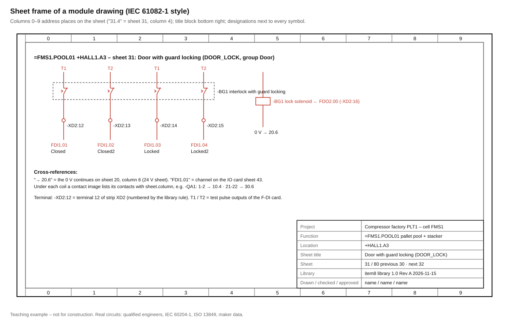

### A4.2 The sheet frame

Every sheet has the same **frame**: columns 0–9 along the top and bottom edge (to address a place on the sheet: "31.4" = sheet 31,
column 4), rows A–F optionally, and a **title block** at the bottom right with:

| Field | Example |
|---|---|
| Plant / project | Compressor factory PLT1 – FMS1 |
| Function aspect | `=FMS1.POOL01` (pallet pool + stacker crane) |
| Location aspect | `+HALL1.A3` |
| Sheet title | Door with guard locking (DOOR_LOCK, group Door) |
| Sheet / of | 31 / 80 |
| Library version | item8 library 1.0 |
| Revision, date, drawn, checked, approved | A · 2026-11-15 · name · name · name |
| Next / previous sheet | 32 / 30 |

### A4.3 The block diagram (sheet 03)

The block diagram shows the module on one page: the cabinet with feeder, PSU and IO station; the field devices grouped by instance; the
cables with WD numbers; the network connection to the cell switch (M22); and the safety links to the cell safety PLC (M18). The M03
block diagram is drawn in C3 (`img/68_m03_block.svg`). It is the first sheet a commissioning engineer reads.

---

## A5. Cross-references and contact images

### A5.1 Theory

A device with a coil and contacts appears on several sheets. **Cross-references** connect them:

- Under each **coil** a small table, the **contact image**, lists all contacts of that device with the sheet and column where each
  contact is drawn: `1-2 → 12.3` (main contact on sheet 12 column 3), `13-14 → 41.5` (auxiliary NO to the DI card, sheet 41 column 5),
  `21-22 → 31.2` (NC mirror contact in the EDM circuit, sheet 31 column 2).
- Next to each **contact** the place of the coil: `-QA1 / 30.4` (coil on sheet 30 column 4).
- **Interruption points** (a wire that continues on another sheet) carry an arrow and the target: `24V → 20.8`, `→ 41.2 (DI1.00)`.

Without cross-references a technician must search all sheets for the contacts of a contactor; with them he follows the arrow.

### A5.2 Example – CONT_PAIR_EDM of M03 (sheet 30)

```
 sheet 30  DriveSup (CONT_PAIR_EDM)                          contact images under the coils
   FDO1.00 (Enable) ──┬── -QA1 coil A1/A2      -QA1:  1-2, 3-4, 5-6 → 10.4 (main contacts, drive supply)
                      └── -QA2 coil A1/A2             21-22 (mirror NC) → 30.6
   +24V ── -QA1 21-22 ── -QA2 21-22 ── FDI1.00 (EDM)   -QA2:  1-2, 3-4, 5-6 → 10.5 ; 21-22 → 30.7
```

The main contacts of `-QA1` and `-QA2` are drawn in series on sheet 10 (supply to the three inverters); their mirror contacts are drawn
on sheet 30 in the feedback loop. A cross-reference tells you that the "21-22" you see on sheet 30 belongs to the contactor whose main
contacts are on sheet 10.

---

## A6. Wire numbers and conductor colours (IEC 60204-1)

### A6.1 Conductor colours

IEC 60204-1 clause 13.2 recommends colours for single-core wires inside the cabinet (check the current edition and local practice; some
countries and some plant standards use other colours – the owner's specification decides):

| Circuit | Colour (IEC 60204-1 recommendation) | Typical use in the library |
|---|---|---|
| Protective earth PE | green-yellow (mandatory) | every metal part, motor PE, cabinet door |
| Neutral N | light blue | 230 V circuits (PSU input, cabinet light) |
| AC and DC power circuits | black | feeder, motor, heater circuits |
| AC control circuits | red | 230 V AC control (avoid in new designs) |
| DC control circuits | dark blue | +24 V and 0 V control circuits (often +24 V dark blue, 0 V blue-white or other plant rule) |
| Interlock circuits supplied from an external source (excepted circuits) | orange | coupling circuits from a machine tool that stay live when the cabinet main switch is off |

Rules: green-yellow **only** for PE; light blue used for N must not be used for anything else if confusion is possible; **orange** for
circuits that remain live when the main switch is open (they must be marked at the main switch with a warning label – guide 67 A5).
Multicore cables use numbered cores or the cable's colour code (IEC 60757 letters: BK, BN, BU, GY, WH, GNYE …); M12 sensor cables use
the standard colours BN (pin 1, +24 V), WH (pin 2), BU (pin 3, 0 V), BK (pin 4, signal), GY (pin 5).

### A6.2 Wire numbering

Guide 67 E6.2 compares the methods (potential numbers, destination marking, sheet/column numbers). The library recommends:

| Wire | Method | Example |
|---|---|---|
| Power wires in the cabinet | potential number (L1, L2, L3, PE, 1L1, 2U …) | `2U1, 2V1, 2W1` = output of -TA2 to -XD1 |
| Control wires | **destination marking** at both ends | at the card: `-XD2:14`; at the terminal: `-KF1.FDI1:1` |
| 24 V distribution | potential with channel | `24V1` (ECB channel 1), `0V` |
| Field cables | cable designation + core number | `-WD7:3` = core 3 of cable WD7 |

---

## A7. Terminal plans

### A7.1 Theory

A **terminal strip** is the boundary between the cabinet wiring (done by the panel builder) and the field wiring (done by the
electrician on site). The **terminal plan** lists every terminal with its inner connection (to the card, the PSU, a device in the
cabinet) and its outer connection (field cable and core). It is the most used document during installation and fault finding.

The library uses:

| Strip | Content | Rule |
|---|---|---|
| -XD1 | power terminals (motor outputs, heater, external feeders) | drawn on the power sheets; not counted by the library rule |
| -XD2 | control terminals 24 V: one terminal per IO entry + the extra supply terminals (`tx`) of the pattern | counted and numbered by the library: `terminals = IO entries + Σ tx` |
| -XD3 (optional) | machine coupling (orange, excepted circuits) | for COUPLING when the machine supplies the contacts |

Numbering rule of -XD2 (from `_rules.terminals`): numbered 1…n **in expansion order**; for each instance first its IO terminals, then its
extra terminals. The extra terminals (tx) are the +24 V and 0 V supply terminals for field devices that need power (3-wire sensors,
valves, light curtains, scanners, analogue transmitters).

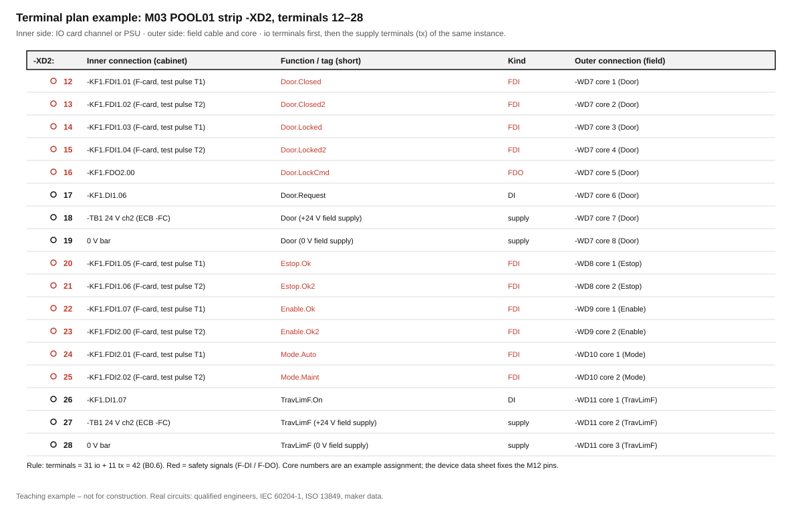

### A7.2 Terminal types

| Type | Use | Note |
|---|---|---|
| Feed-through terminal 2.5 mm² | normal 24 V signals | grey |
| Potential distribution terminal (with bridge) | +24 V / 0 V supply of many sensors | red / blue marking |
| Fused terminal | individually fused field supply | alternative to ECB channels |
| Disconnect (knife) terminal | analogue signals, coupling circuits – open for measuring | test without removing wires |
| PE terminal | shields and PE of field devices | green-yellow, contact to the rail |
| Sensor-actuator interface (3-level terminal) | +24 V, signal, 0 V for one sensor in one block | saves space, clear assignment |
| Push-in vs screw | push-in faster, vibration-safe; screw for big cross-sections | the library counts terminals, not types |

### A7.3 Worked example – the first 12 terminals of M03 -XD2

| -XD2: | Function | Field cable | Why here |
|---|---|---|---|
| 1 | DriveSup.Enable (FDO) – internal to -QA1/-QA2 coils | – (inside cabinet) | first IO entry of instance 1 |
| 2 | DriveSup.EDM (FDI) – internal mirror loop | – | second IO entry of instance 1 |
| 3 | Travel.STO (FDO) → -TA1 STO input | – (internal) | instance 2 |
| 4 | Travel.Ready (DI) | internal | |
| 5 | Travel.Fault (DI) | internal | |
| 6–8 | Hoist.STO / Ready / Fault | internal | instance 3 |
| 9–11 | Fork.STO / Ready / Fault | internal | instance 4 |
| 12 | Door.Closed (FDI) | -WD7 (M12 8-pole) | instance 5, first IO |

Terminals 1–11 connect devices **inside** the cabinet. Many panel builders wire such signals directly from card to device without a
terminal. The library still counts one terminal per IO entry – it is the conservative rule for the BOM and for a clean test point; you
may decide per project to skip internal terminals (then the terminal count of the project is lower than the library value, and the
project documents the deviation).

The complete M03 terminal plan (42 terminals) is in C3.

### A7.4 Checklist

- [ ] Every field signal on a terminal; terminal plan shows inner and outer connection.
- [ ] Supply terminals (+24 V / 0 V) per instance next to its signal terminals.
- [ ] Reserve terminals: at least 10 % per strip plus the spare IO channels routed to terminals (owner's choice).
- [ ] Separate strips or separators for 400 V, 230 V, 24 V, excepted circuits (orange).

---

## A8. IO list, cable list and BOM – the generated reports

### A8.1 IO list

The IO list is the contract between electrical design, PLC programming, HMI and commissioning. Columns (library format):

| Column | Example | Source |
|---|---|---|
| # | 12 | expansion order |
| Address | FDI1.01 | address rule B0.4 |
| Tag | `PLT1.MACH.FMS1.POOL01.Door.Closed` | tag rule B0.2 |
| Type | FDI | pattern |
| Description | door closed, channel 1 | pattern |
| -XD2 terminal | 12 | terminal rule B0.6 |
| Device (optional) | `-BG1` | designation rule B0.3 |
| Safety | yes (F-IO) | type FDI / FDO |

Real projects add: card slot number, signal level (24 V, 4–20 mA), PLC data type, HMI text, alarm number (guide 66 H2), range and unit
for analogue values, and the item-6 data-block word if the signal is part of the standard block.

### A8.2 Cable list

| Column | Example |
|---|---|
| Cable | `-WD7` |
| From / to | cabinet POOL01 / group Door (`-BG1` at the pool door) |
| Type | safety switch cable M12 8-pole |
| Cores | 8x0.25 |
| Length | 10 m (default length of the pattern; replace by the layout length) |
| Route (project) | tray T3 – drag chain – door post |

### A8.3 BOM

The library BOM counts each **BOM item text** over all device entries, adds the IO station items (bus interface + cards), the 24 V PSU
and one "Control terminal" per -XD2 terminal, and sorts by item text (B0.8). In the project, each BOM line gets maker, type, order number
and the designations that use it.

---

## A9. How an EPLAN-style project is organised (generic)

Commercial ECAD systems (EPLAN Electric P8, Zuken E3.series, WSCAD, AutoCAD Electrical, SEE Electrical and others – examples, not a
recommendation) share the same ideas. Knowing them lets you specify and check without being an expert in one product.

| Concept | Meaning | Library equivalent |
|---|---|---|
| Project structure | function (=) and location (+) aspects define the tree of the project | `=FMS1.<unit>`, `+HALL1.A3` |
| Page / sheet | identified by structure + document kind + page number | sheet numbering A4 |
| Macro / typical / window macro | a stored piece of circuit with devices and parameters | pattern |
| Macro project / page macro | a whole page or group of pages stored as a unit | module |
| Placeholder object / value sets | parameters inside a macro (kW, names) replaced on insertion | instance parameters |
| Parts (master data) | device database with maker, order number, connection points, data | BOM item text → part number |
| Device navigator | list of all devices of the project | device list |
| Reports | generated lists: terminal diagram, cable diagram, BOM, PLC overview, contents | lists of B0 |
| PLC data exchange | import / export of the IO list to the PLC engineering tool (AutomationML / CSV) | IO list CSV (G1) |
| Revision management | marked changes, revision index on the cover | E10 |

**Owner's rule:** demand the **native project file** and PDF, the part master data used, and the macros (patterns) if they were made for
your library – otherwise every later change must be bought from the original supplier (guide 67 E7).

---

## A10. Free tools: QElectroTech, SVG, spreadsheets, by hand

You do not need a commercial ECAD system to learn, to make a small module or to check a supplier.

| Tool | Use | Note |
|---|---|---|
| **QElectroTech** (free, open source, GPL) | circuit diagrams with IEC symbols, title blocks, cross-references, terminal strips, element collections; exports PDF / SVG | runs offline on Windows / Linux; enough for module-size projects |
| **`circuit_svg.py`** (this twin, G1) | writes SVG schematic sheets of patterns and module overviews directly from the library | offline, stdlib Python, consistent with the lists |
| **`circuit_library.py`** (G1) | IO list, devices, cables, terminals, BOM as Markdown / CSV | open the CSV in any spreadsheet |
| Spreadsheet (LibreOffice Calc, Excel) | IO list, cable list, BOM editing and review | keep one sheet per report, never re-type |
| Pencil and A3 grid paper | first sketch of a new pattern with the safety engineer | photograph and file it; then draw it properly |

**Procedure to draw a module with free tools (small project):**

1. Run `python tools/fmse/circuit_library.py --module M03 --out M03_lists` (G1) → IO list, devices, terminal plan, cable list, BOM as CSV.
2. Run `python tools/fmse/circuit_svg.py --module M03 --out sheets` (and `--pattern DOL` … for the pattern sheets) → SVG sheets.
3. In QElectroTech create a project with the title block of A4.2; insert one folio per sheet of the generated sheet list (C3).
4. Draw each pattern sheet from the B chapter of the pattern (the SVG is your template); write the designations exactly as generated.
5. Draw the IO card sheets from the IO list (channel, tag, terminal, device).
6. Paste or attach the terminal plan, cable list and BOM from the CSV (or let QElectroTech generate its terminal strip and compare).
7. Check with `python tools/fmse/library_check.py --modules M03` and with the checklist A11.

---

## A11. Common mistakes and checklist

Typical mistakes: lists typed by hand (tags and terminals disagree) · no contact images · duplicated designations · contacts drawn
actuated · no library version on the sheets · only PDF from the supplier · 230 V and 24 V terminals mixed without separators.

- [ ] Symbols IEC 60617, designations IEC 81346 with the project code table (A2, A3).
- [ ] Sheet structure, frame, block diagram (A4).
- [ ] Cross-references and contact images (A5).
- [ ] Colours and wire numbers per IEC 60204-1 and plant rule (A6).
- [ ] Terminal plans with inner and outer connection (A7).
- [ ] IO list, cable list, BOM generated from the library (A8).
- [ ] Native files and macros delivered (A9).

---

# Part B – The circuit-pattern library (32 patterns)

## B0. The library rules

All lists of this guide are produced by the rules of the `_rules` section of `item8_examples.json` (B0.1–B0.14; revision 2026-11-15 added
`power_cable` = B0.14 and `zone_out` = pattern ZONE_OUT in M18, B3.4 / C18). They are written here as
formulas, each with a worked example. Learn them once – then you can expand any module by hand, check any tool output and extend the
library (E11).

### B0.1 Expansion

```
for each instance (pattern, group, parameters) of the module, in list order:
    append the pattern's io entries   (signal, type, description)      in pattern order
    append the pattern's dev entries  (class, description, BOM item)   in pattern order
    append the pattern's cab entries  (description, cores, length)     in pattern order
unit = unit code + '01'   (in a kit: the number counts up per module code: MC01, MC02, MC03 …)
```

Example: M06 AGV station = `SCANNER Scanner`, `DOL Transfer (0.37 kW)`, `SENSOR Entry`, `SENSOR Centre`, `SENSOR End`, `HANDSHAKE_HW Agv`
→ IO = 5 + 3 + 1 + 1 + 1 + 8 = **19**, devices = 1 + 3 + 1 + 1 + 1 + 1 = **8**, cables = 1 + 1 + 1 + 1 + 1 + 1 = **6**.

### B0.2 Tags

```
tag = 'PLT1.MACH.FMS1.' + unit + '.' + group + '.' + signal        (item-5 rule, at most 48 characters)
```

Example: `PLT1.MACH.FMS1.POOL01.Door.Locked2`. The longest tag of the library is
`PLT1.MACH.FMS1.WELD01.RobSafety.EnableOut` (and `…RobSafety.ZoneFree2`) with **41 characters** ≤ 48 ✓. Group names are kept short
(≤ 10 characters) so that a unit with 7 characters (`MESCON01`) still fits. The cell controller and the HMI use exactly this string; OPC UA
and MQTT use it without the `PLT1.MACH.FMS1.` prefix (guide 66 H2.4).

### B0.3 Designations

```
designation       = class + n        n = running number per class code inside the module, in expansion order
full designation  = '=FMS1.' + unit + '-' + class + n
cable             = 'WD' + running number in expansion order
```

Example: M10 washer – `SprayPump` (DOL) creates `-FC1 -QA1 -MA1`, `RinsePump` (DOL) `-FC2 -QA2 -MA2`, `Heater` (HEATER) `-FC3 -QA3 -EB1
-BT1`, `TankTemp` (ANALOG_T) `-BT2` … the conveyor motor at the end becomes `-FC4 -QA4 -MA3`.

### B0.4 IO cards and addresses

Example card sizes (ET 200SP-class remote IO; other systems are similar): **DI 16, DO 16, AI 4, AO 2, FDI 8, FDO 4** channels per card.

```
used(type)    = number of io entries of that type
cards(type)   = 0 if used = 0, else ceil( used × (1 + 0.2) / channels )        reserve 20 %
spare(type)   = cards × channels − used
address       = TYPE + (k // channels + 1) + '.' + (k % channels, 2 digits)     k = 0, 1, … per type in expansion order
```

Worked example – M03 pallet pool:

| Type | used | used × 1.2 | / channels | cards | installed | spare |
|---|---|---|---|---|---|---|
| DI | 11 | 13.2 | 13.2 / 16 = 0.825 | 1 | 16 | 5 |
| DO | 4 | 4.8 | 4.8 / 16 = 0.3 | 1 | 16 | 12 |
| FDI | 11 | 13.2 | 13.2 / 8 = 1.65 | 2 | 16 | 5 |
| FDO | 5 | 6.0 | 6.0 / 4 = 1.5 | 2 | 8 | 3 |

The 9th FDI entry (k = 8) gets card 8 // 8 + 1 = 2, channel 8 % 8 = 0 → **FDI2.00** (`POOL01.Enable.Ok2`). The reserve rule gives **at
least** 20 % spare per type; because cards are whole, the real spare is usually higher (M03 DO: 12 spare of 16).

Why 20 %: changes during commissioning (5–10 % more signals is normal) and later extensions. Guide 67 E8 asks 20–30 % space reserve in the
cabinet – the IO reserve is the electrical counterpart.

### B0.5 IO station

```
a module with at least one io entry gets an IO station (bus interface + cards):
    i24_station  = 0.3 + 0.05 × cards_total   [A]
    loss_station = 4 + 1 × cards_total        [W]
    BOM: 'IO station bus interface' × 1 + each card type count ('DI 16 card' …)
```

Example M03: 6 cards → i24 = 0.3 + 0.3 = **0.6 A**, loss = 4 + 6 = **10 W**.

### B0.6 Terminals

```
terminals (-XD2) = number of io entries + Σ tx of all instances
numbering 1 … n in expansion order: for each instance first its io terminals, then its tx extras
```

Example M03: 31 io + tx (DOOR_LOCK 2 + 4 × SENSOR 2 + SIGNAL_TOWER 1 = 11) = **42**.

### B0.7 Cables

```
one cable per pattern cab entry; length = default length of the pattern (instance parameter 'len' overrides)
totals: number of cables, total metres, metres per cores text
```

Example M03: 3 × VFD_STO (2 cables: motor 15 m + Ethernet 3 m) = 6 cables / 54 m; DOOR_LOCK 1 / 10; ESTOP 1 / 10; ENABLE 1 / 5; MODE_SWITCH
1 / 5; 4 × SENSOR 4 / 40; BUS 1 / 15; SIGNAL_TOWER 1 / 10 → **16 cables, 149 m**.

### B0.8 BOM

```
BOM = count of each BOM item text over all dev entries
      + station items + '24 V power supply <rating> A' + 'Control terminal' × terminals
      sorted by item text
```

### B0.9 Motors

```
per DOL / VFD_STO instance:   η = 0.88, cos φ = 0.82 unless given
In  = kW × 1000 / (√3 × 400 × η × cos φ)
DOL: contactor = smallest AC-3 rating ≥ In  from [9, 12, 18, 25, 32, 40, 50, 65, 80, 95] A ; MPCB setting = In (rounded to 0.01 A)
VFD: inverter  = smallest size ≥ kW  from [0.37 … 30] kW ;  loss = 3 % × kW × 1000 W
```

Example: washer spray pump 7.5 kW DOL → In = 7 500 / (1.732 × 400 × 0.88 × 0.82) = 7 500 / 499.95 = **15.00 A** → contactor **18 A**, MPCB
set to 15.00 A. Stacker travel 11 kW VFD → In = **22.00 A** → inverter **11 kW**, loss **330 W**. (Guide 67 B6 uses the same formula; the
real In comes from the motor rating plate.)

### B0.10 Power, demand and feeder

```
loads: FEEDER_EXT (kW, ku, cos φ from parameters) · DOL and VFD_STO motors (ku 0.7, cos φ 0.82 unless given)
       HEATER (ku 0.8, cos φ 1.0) · control power = PSU rating × 24 / 0.9 / 1000 kW (ku 0.6, cos φ 0.95) if PSU > 0
demand:    P = Σ kW × ku ;  Q = Σ P_i × tan(acos cos φ_i) ;  S = √(P² + Q²) ;  I = S × 1000 / (√3 × 400)
installed: P_inst = Σ kW ;  Q_inst = Σ kW × tan(acos cos φ) ;  S_inst = √(P_inst² + Q_inst²) ;  I_inst = S_inst × 1000 / (√3 × 400)
feeder breaker In = smallest of [6, 10, 13, 16, 20, 25, 32, 40, 50, 63, 80, 100, 125, 160, 200, 250] A ≥ I_inst      (Ib ≤ In)
cable  = smallest size with Iz_table ≥ In / (k_temp × k_group) = In / (0.87 × 0.77) = In / 0.6699                   (In ≤ Iz)
a module with S_inst = 0 has no feeder ; motor kW is used as electrical kW in the load list (simplification)
```

Why two powers: the **demand** values (with ku) go into the **cell load list** – they tell how big the cell board, the cell feeder and the
transformer must be (guide 67 B2). The **feeder** of one module must carry the module even when **all its loads run at rated power at
the same time** – one module is too small for statistics, so the installed values (ku = 1) size its breaker and cable.

Worked example – M01 machine tool interface (MC01), which equals the item-7 cable example:

| Load | kW | ku | cos φ | P = kW·ku | Q = P·tan φ | P_inst | Q_inst |
|---|---|---|---|---|---|---|---|
| Supply | 38 | 0.6 | 0.85 | 22.800 | 14.130 | 38 | 23.550 |
| Control power (PSU 2.5 A) | 0.0667 | 0.6 | 0.95 | 0.040 | 0.013 | 0.0667 | 0.022 |
| **Σ** | | | | **22.840** | **14.143** | **38.067** | **23.572** |

Demand: S = √(22.840² + 14.143²) = **26.864 kVA**, I = S·1000/(√3·400) = **38.78 A**. Installed: S_inst = √(38.067² + 23.572²) = 44.774 kVA, **I_inst = 64.63 A** → feeder breaker **In = 80 A** → required Iz = 80 / (0.87 × 0.77) = 119.42 A → cable **35 mm²** (table Iz 148 A).

This is exactly guide 67 C4: **80 A breaker, required Iz 119.42 A, 25 mm² (119 A) just too small, 35 mm² (148 A) ✓**. The voltage drop,
the PE size (16 mm²), the fault loop and L_max (67.10 m at 60 m length) are checked as in guide 67 C4 – the library rule only gives the
thermal size.

Table used (copper, PVC, installation method of guide 67 C2): 1.5 mm² 22 A · 2.5 mm² 30 A · 4 mm² 40 A · 6 mm² 51 A · 10 mm² 70 A ·
16 mm² 94 A · 25 mm² 119 A · 35 mm² 148 A · 50 mm² 180 A · 70 mm² 232 A · 95 mm² 282 A · 120 mm² 328 A.

### B0.11 24 V DC

```
module 24 V current = Σ pattern i24 over all instances + station i24
PSU = smallest of [2.5, 5, 10, 20, 40] A ≥ current × 1.25          (0 if current = 0)
```

Example M03: 0.3 (EDM pair) + 3 × 0.5 (inverters: STO input and control board) + 0.3 (door) + 4 × 0.03 (sensors) + 0.2 (tower) + 0.6
(station) = **3.02 A** × 1.25 = 3.775 A → **PSU 5 A**. Compare guide 67 D2: same method; guide 67 also uses a simultaneity factor for valves
(0.5) – the library uses i24 values per pattern that already contain the typical simultaneity.

### B0.12 Cabinet losses

```
losses = Σ pattern losses (VFD: 3 % of kW) + station loss + PSU loss
PSU loss = PSU rating × 24 × (1/0.92 − 1) W        (efficiency 92 %, at full load – conservative)
```

Example M03: patterns 6 + 2 + 3 = 11 W, VFD 330 + 225 + 45 = 600 W, station 10 W, PSU 5 × 24 × 0.08696 = 10.43 W → **631.4 W**. The
cabinet thermal check (guide 67 E3, IEC TR 60890) starts with this number. The losses of contactors' coils, MPCBs and terminals are inside
the pattern loss values.

### B0.13 Kit

```
kit totals = sum over the modules (a module code may appear several times):
             io per type, cards per type, terminals, cables, metres, P, S (arithmetic sum of module S), PSU sum, losses
kit IO tag list = each module instance with its own unit number (MC01, MC02, MC03 …)
```

Part D applies it to the kit. The arithmetic sum of module S values is an **upper bound** of the cell demand; the correct cell value is
the vector sum √(ΣP² + ΣQ²) with a simultaneity factor (guide 67 B2) – D6 explains the difference.

### B0.14 Power cable sizing per instance (rule `power_cable`, revision 2026-11-15)

**Why this rule exists.** In the first edition every pattern carried **fixed cores** for its power cable: DOL `4G1.5`, VFD_STO
`4G1.5 + shield`, HEATER `4G2.5`, and FEEDER_EXT only the words "4G (size from the feeder calculation)". A fixed core text is right for a
**control** cable – a PNP sensor draws the same few milliamperes on a 0.37 kW conveyor and on a 15 kW press. It is wrong for a **power**
cable, because the current of a power circuit grows with the power of the instance. The design review of this guide found two unsafe
cables in the generated lists: the 18 kW washer heater (M10) on 4G2.5 and the 15 kW press pump (M16) on 4G1.5. Since revision 2026-11-15
the library sizes the power cable of **every instance** of the four power patterns from that instance's own parameters. The patterns now
carry a `pcab` key (`index` = which `cab` entry is the power cable, `prefix` "4G", `suffix` "" or " + shield"); the old core text is only
a placeholder that the rule replaces.

**The rule** (item-7 cable condition Ib ≤ In ≤ Iz × k, guide 67 C1; here the protective-device current is called **Ip** so that it is not
mixed up with the motor rated current In of B0.9):

```
for each instance of DOL, VFD_STO, HEATER, FEEDER_EXT (patterns with 'pcab'):

  1  design current Ib
       DOL, VFD_STO :  Ib = motor In = kW × 1000 / (√3 × 400 × η × cos φ)        η 0.88, cos φ 0.82 unless given (B0.9)
       HEATER       :  Ib = kW × 1000 / (√3 × 400 × cos φ)                       cos φ 1.0 unless given
       FEEDER_EXT   :  Ib = kW × 1000 / (√3 × 400 × cos φ)                       installed kW and cos φ of the parameters; ku ignored

  2  protective-device current Ip  (the device that protects THIS cable against overload)
       DOL          :  Ip = MPCB thermal setting       = motor In  = Ib
       VFD_STO      :  Ip = inverter motor-overload setting = motor In = Ib
       HEATER,
       FEEDER_EXT   :  Ip = smallest breaker rating ≥ Ib from [6, 10, 13, 16, 20, 25, 32, 40, 50, 63, 80, 100 …] A

  3  cross-section A = smallest size of the ampacity table with
           Iz_table × k_temp × k_group ≥ Ip      ⇔      Iz_table ≥ Ip / (0.87 × 0.77) = Ip / 0.6699      (1.5 mm² minimum)

  4  cores text = prefix + A + suffix            '4G' + '6' + ''  = 4G6      '4G' + '4' + ' + shield' = 4G4 + shield
     (A printed without '.0': 4G2.5, 4G10) ; cable count and lengths do not change
```

| Symbol | Meaning | Library value |
|---|---|---|
| Ib | design (operating) current of the circuit | from kW, η, cos φ |
| Ip | rated current or setting of the overload protective device in front of the cable | motor In, or a breaker rating |
| Iz_table | current-carrying capacity of the cable in the reference condition (copper, PVC, method of guide 67 C2, 30 °C, one circuit) | table of B0.10 |
| k_temp | ambient-temperature factor: √((70 − 40) / (70 − 30)) = √0.75 = 0.866 ≈ **0.87** (40 °C ambient, PVC 70 °C) | 0.87 |
| k_group | grouping factor: 4 multicore cables touching on a perforated tray | 0.77 |
| k | total correction k_temp × k_group = 0.87 × 0.77 = **0.6699** | 0.6699 |
| Iz | corrected capacity Iz_table × k – must be ≥ Ip | |

Rule of thumb from step 3: 1 / 0.6699 = 1.4928 – the **table value must be about 1.5 × the protective-device current**.

**Why the protective device differs between the patterns.** A cable must be protected against **overload** by the device in front of it,
so the cable must carry the device current **Ip** permanently – not only the load current Ib (IEC 60364-4-43: Ib ≤ In ≤ Iz). The four
patterns have two kinds of device:

1. **Adjustable devices – DOL and VFD_STO.** The MPCB of a DOL starter has a thermal release with a setting range (for example 25–32 A);
   it is **set** to the rated motor current (B0.9: "MPCB set to 30.00 A"). The inverter of VFD_STO has an electronic motor-overload
   function (an I²t model of the motor) that is parametrised with the rating-plate current. In both cases the overload trip sits exactly at
   the motor current → **Ip = Ib = motor In**, no rounding to a standard rating. That is why motor circuits get the smallest cables.
2. **Fixed-rating devices – HEATER and FEEDER_EXT.** An MCB / MCCB is bought in standard ratings. The rating must be ≥ Ib, so the library
   takes the **next standard rating** – and the cable must carry that rating. The step between two ratings can push the cable one or two
   sizes up: the 25.98 A heater needs a 32 A breaker; the 32.08 A welding supply misses 32 A by 0.08 A and needs a 40 A breaker.

A resistive heater cannot be overloaded by its load (its resistance is fixed), and IEC 60364-4-43 allows some cases without overload
protection – the library does **not** use that exception: it keeps one simple, conservative rule for all four patterns.

Short-circuit protection is a **second, separate** condition: the magnetic release of the MPCB or breaker, or – for the motor cable behind
an inverter – the inverter's output short-circuit protection as declared by its maker. The cable must withstand the let-through energy of
the device: k² × S² ≥ I²t (k = 115 for copper / PVC; for 6 mm²: 115² × 6² = 476 100 A²s; compare with the maker's let-through curve). The
library does not check this.

**Worked example 1 – M10 washer heater 18 kW (HEATER, cos φ 1.0), step by step.**

1. Ib = 18 000 / (√3 × 400 × 1.0) = 18 000 / 692.82 = **25.98 A**.
2. Ip = smallest breaker rating ≥ 25.98 A: 25 A is too small → **32 A**.
3. Required Iz_table = 32 / 0.6699 = **47.77 A**.
4. Table: 2.5 mm² 30 A ✗ · 4 mm² 40 A ✗ · 6 mm² 51 A ✓ → **A = 6 mm²**; corrected Iz = 51 × 0.6699 = 34.16 A ≥ 32 A ✓.
5. Cores text = '4G' + '6' = **4G6** (first edition: fixed 4G2.5).

Check of the old text: 4G2.5 has Iz = 30 × 0.6699 = 20.10 A – **below the normal operating current** of 25.98 A. The cable would run above
its permitted conductor temperature every time the tank heats up, and a wash-tank heater runs for hours (ku 0.8). The first edition's B1.4
note suggested "4G4 at least" from 26 / 0.6699 = 38.8 A – that compares the table with **Ib**; behind a 32 A breaker a 4 mm² cable
(Iz 26.80 A) is not protected against overload. The rule corrects both.

**Worked example 2 – M16 press hydraulic pump 15 kW (DOL), step by step.**

1. Ib = motor In = 15 000 / (√3 × 400 × 0.88 × 0.82) = **30.00 A** (B0.9).
2. Ip = MPCB setting = **30.00 A** (the AC-3 contactor of 32 A only switches – it protects nothing).
3. Required Iz_table = 30.00 / 0.6699 = **44.78 A**.
4. 4 mm² 40 A ✗ · 6 mm² 51 A ✓ → **A = 6 mm²**; corrected Iz = 34.16 A ≥ 30.00 A ✓.
5. Cores text = **4G6** (first edition: fixed 4G1.5).

Check of the old text: 4G1.5 has Iz = 22 × 0.6699 = 14.74 A – **half** of the running current. The first edition said so in a note (C16.5),
but the generated cable list and the BOM still printed 4G1.5 – **a note in a text does not change a generated list**. Only a rule does.

**Worked example 3 – M01 machine-tool supply 38 kW (FEEDER_EXT, cos φ 0.85; ku 0.6 ignored).**

1. Ib = 38 000 / (√3 × 400 × 0.85) = 38 000 / 588.90 = **64.53 A**. Installed kW, because the cable must carry the machine at its full
   connected load; ku belongs to the cell load list (B0.10), never to a cable.
2. Ip: 63 A ✗ → **80 A**.
3. Required Iz_table = 80 / 0.6699 = **119.42 A**.
4. 25 mm² 119 A ✗ (0.42 A short) · 35 mm² 148 A ✓ → **4G35**; corrected Iz = 99.15 A ≥ 80 A ✓.
5. The same 80 A / 35 mm² as the module feeder of M01 (B0.10, guide 67 C4): cable WD1 behind `-FC1` (to the machine's main switch) and the
   board feeder `-FC2` carry the same machine. (The module feeder adds 0.067 kW control power – 64.63 A instead of 64.53 A, same breaker.)

**Worked example 4 – M03 pallet pool, three inverter drives (VFD_STO).**

| Drive | kW | Ib = Ip = motor In A | Ip / 0.6699 A | Table check | A mm² | Iz corrected A | Cores old → new |
|---|---|---|---|---|---|---|---|
| Travel | 11 | 22.00 | 32.84 | 2.5 (30) ✗ · 4 (40) ✓ | 4 | 26.80 | 4G1.5 + shield → **4G4 + shield** |
| Hoist | 7.5 | 15.00 | 22.39 | 1.5 (22) ✗ · 2.5 (30) ✓ | 2.5 | 20.10 | 4G1.5 + shield → **4G2.5 + shield** |
| Fork | 1.5 | 3.00 | 4.48 | 1.5 (22) ✓ | 1.5 | 14.74 | 4G1.5 + shield (unchanged) |

The motor cable carries the **motor (output) current** of the inverter. The inverter's **line side** (input current, line fuses `-FC1`…
`-FC3`) is cabinet wiring sized from the inverter manual – it is not a library cable.

**Worked example 5 – M08 AS/RS stacker crane (VFD_STO).** Travel 15 kW: Ib = Ip = 30.00 A → 44.78 A → 4 mm² 40 A ✗, 6 mm² 51 A ✓ →
**4G6 + shield** (Iz 34.16 A). Hoist 11 kW: 22.00 A → 32.84 A → **4G4 + shield** (Iz 26.80 A). Fork 2.2 kW: 4.40 A → 6.57 A → 4G1.5 + shield
(unchanged, Iz 14.74 A).

**Worked example 6 – M15 robot welding cell (two feeders, one inverter, one DOL).**

| Instance | Pattern | kW / cos φ | Ib A | Ip A | Ip / 0.6699 A | A mm² | Cores |
|---|---|---|---|---|---|---|---|
| RobotSup | FEEDER_EXT | 5 / 0.9 | 5 000 / 623.54 = 8.02 | breaker 10 | 14.93 | 1.5 (22 ✓) | **4G1.5** |
| WeldPwr | FEEDER_EXT | 20 / 0.9 | 20 000 / 623.54 = 32.08 | 32 ✗ → breaker **40** | 59.71 | 6 (51 ✗) → **10** (70 ✓) | **4G10** |
| Turntable | VFD_STO | 1.1 | 2.20 | 2.20 (inverter setting) | 3.28 | 1.5 | 4G1.5 + shield |
| Fume | DOL | 4 | 8.00 | 8.00 (MPCB setting) | 11.94 | 1.5 | 4G1.5 |

The welding supply is the classic **rating-step** case: 0.08 A above 32 A → 40 A breaker → the cable jumps from 6 mm² to 10 mm². If the
real power source has a nameplate I1eff of, say, 30 A, the project enters the real kW / cos φ and the cable may fall back to 6 mm².

The other **edge case** is the M10 spray pump (DOL 7.5 kW): Ib = Ip = 15.00 A → 22.39 A needed, 1.5 mm² gives 22 A – short by 0.39 A →
**4G2.5**. A cable that is "almost enough" is not enough: the rule compares, it does not round.

**All power-cable instances of the library** (29 instances in 22 modules; ★ = cores text changed by revision 2026-11-15 – the 16 changes of
the revision):

| Module | Group | Pattern | kW | cos φ | Ib A | Ip A (device) | Ip / 0.6699 A | A mm² (Iz_table A) | Iz corr. A | Cores before | Cores now |
|---|---|---|---|---|---|---|---|---|---|---|---|
| M01 | Supply | FEEDER_EXT | 38 | 0.85 | 64.53 | 80 (breaker) | 119.42 | 35 (148) | 99.15 | 4G (size from the feeder calculation) | ★ **4G35** |
| M03 | Travel | VFD_STO | 11 | 0.82 | 22.00 | 22.00 (inverter) | 32.84 | 4 (40) | 26.80 | 4G1.5 + shield | ★ **4G4 + shield** |
| M03 | Hoist | VFD_STO | 7.5 | 0.82 | 15.00 | 15.00 (inverter) | 22.39 | 2.5 (30) | 20.10 | 4G1.5 + shield | ★ **4G2.5 + shield** |
| M03 | Fork | VFD_STO | 1.5 | 0.82 | 3.00 | 3.00 (inverter) | 4.48 | 1.5 (22) | 14.74 | 4G1.5 + shield | 4G1.5 + shield |
| M04 | Rotary | VFD_STO | 0.75 | 0.82 | 1.50 | 1.50 (inverter) | 2.24 | 1.5 (22) | 14.74 | 4G1.5 + shield | 4G1.5 + shield |
| M05 | RobotSup | FEEDER_EXT | 5 | 0.9 | 8.02 | 10 (breaker) | 14.93 | 1.5 (22) | 14.74 | 4G (size from the feeder calculation) | ★ **4G1.5** |
| M06 | Transfer | DOL | 0.37 | 0.82 | 0.74 | 0.74 (MPCB) | 1.10 | 1.5 (22) | 14.74 | 4G1.5 | 4G1.5 |
| M07 | Zone1 | DOL | 0.55 | 0.82 | 1.10 | 1.10 (MPCB) | 1.64 | 1.5 (22) | 14.74 | 4G1.5 | 4G1.5 |
| M07 | Zone2 | DOL | 0.55 | 0.82 | 1.10 | 1.10 (MPCB) | 1.64 | 1.5 (22) | 14.74 | 4G1.5 | 4G1.5 |
| M07 | Zone3 | DOL | 0.55 | 0.82 | 1.10 | 1.10 (MPCB) | 1.64 | 1.5 (22) | 14.74 | 4G1.5 | 4G1.5 |
| M08 | Travel | VFD_STO | 15 | 0.82 | 30.00 | 30.00 (inverter) | 44.78 | 6 (51) | 34.16 | 4G1.5 + shield | ★ **4G6 + shield** |
| M08 | Hoist | VFD_STO | 11 | 0.82 | 22.00 | 22.00 (inverter) | 32.84 | 4 (40) | 26.80 | 4G1.5 + shield | ★ **4G4 + shield** |
| M08 | Fork | VFD_STO | 2.2 | 0.82 | 4.40 | 4.40 (inverter) | 6.57 | 1.5 (22) | 14.74 | 4G1.5 + shield | 4G1.5 + shield |
| M09 | Presetter | FEEDER_EXT | 1 | 0.95 | 1.52 | 6 (breaker) | 8.96 | 1.5 (22) | 14.74 | 4G (size from the feeder calculation) | ★ **4G1.5** |
| M10 | SprayPump | DOL | 7.5 | 0.82 | 15.00 | 15.00 (MPCB) | 22.39 | 2.5 (30) | 20.10 | 4G1.5 | ★ **4G2.5** |
| M10 | RinsePump | DOL | 3 | 0.82 | 6.00 | 6.00 (MPCB) | 8.96 | 1.5 (22) | 14.74 | 4G1.5 | 4G1.5 |
| M10 | Heater | HEATER | 18 | 1.0 | 25.98 | 32 (breaker) | 47.77 | 6 (51) | 34.16 | 4G2.5 | ★ **4G6** |
| M10 | Conveyor | DOL | 0.37 | 0.82 | 0.74 | 0.74 (MPCB) | 1.10 | 1.5 (22) | 14.74 | 4G1.5 | 4G1.5 |
| M11 | CmmSup | FEEDER_EXT | 6 | 0.9 | 9.62 | 10 (breaker) | 14.93 | 1.5 (22) | 14.74 | 4G (size from the feeder calculation) | ★ **4G1.5** |
| M12 | Laser | FEEDER_EXT | 1 | 0.95 | 1.52 | 6 (breaker) | 8.96 | 1.5 (22) | 14.74 | 4G (size from the feeder calculation) | ★ **4G1.5** |
| M12 | Exhaust | DOL | 0.75 | 0.82 | 1.50 | 1.50 (MPCB) | 2.24 | 1.5 (22) | 14.74 | 4G1.5 | 4G1.5 |
| M13 | Nutrunner | FEEDER_EXT | 1.5 | 0.95 | 2.28 | 6 (breaker) | 8.96 | 1.5 (22) | 14.74 | 4G (size from the feeder calculation) | ★ **4G1.5** |
| M14 | Tester | FEEDER_EXT | 1 | 0.95 | 1.52 | 6 (breaker) | 8.96 | 1.5 (22) | 14.74 | 4G (size from the feeder calculation) | ★ **4G1.5** |
| M15 | RobotSup | FEEDER_EXT | 5 | 0.9 | 8.02 | 10 (breaker) | 14.93 | 1.5 (22) | 14.74 | 4G (size from the feeder calculation) | ★ **4G1.5** |
| M15 | WeldPwr | FEEDER_EXT | 20 | 0.9 | 32.08 | 40 (breaker) | 59.71 | 10 (70) | 46.89 | 4G (size from the feeder calculation) | ★ **4G10** |
| M15 | Turntable | VFD_STO | 1.1 | 0.82 | 2.20 | 2.20 (inverter) | 3.28 | 1.5 (22) | 14.74 | 4G1.5 + shield | 4G1.5 + shield |
| M15 | Fume | DOL | 4 | 0.82 | 8.00 | 8.00 (MPCB) | 11.94 | 1.5 (22) | 14.74 | 4G1.5 | 4G1.5 |
| M16 | HydPump | DOL | 15 | 0.82 | 30.00 | 30.00 (MPCB) | 44.78 | 6 (51) | 34.16 | 4G1.5 | ★ **4G6** |
| M17 | CoolPump | DOL | 5.5 | 0.82 | 11.00 | 11.00 (MPCB) | 16.42 | 1.5 (22) | 14.74 | 4G1.5 | 4G1.5 |

How to read the table: 13 of the 29 instances keep 1.5 mm² (small motors, small external loads) – for them the old fixed text happened to be
right. The 16 changes are of two kinds: **8 corrections** where the fixed text was too small (M03 travel / hoist, M08 travel / hoist, M10
spray pump and heater, M16 pump; the M01 machine feeder counts here too, because "4G (size from the feeder calculation)" is not an orderable
cable) and **8 completions** where a FEEDER_EXT had no size at all and now gets a real one (M05, M09, M11, M12, M13, M14, M15 RobotSup and
WeldPwr). In the kit (Part D) the change touches MC01–MC03, POOL01, WASH01, CMM01 and MARK01; the number of cables and their lengths stay the
same (137 cables, 1 333 m), only the cores per type move (D4).

**Voltage drop and fault loop are still separate checks (item 7).** The rule gives the **thermal** size only. For every power cable, and
always for long runs, check with guide 67 C3–C5 (tool `cable_size.py`):

```
voltage drop     ΔU = √3 × Ib × L × ρ × cos φ / A          ΔU% = ΔU / 400 × 100        ρ = 0.0225 Ω mm²/m (Cu, warm)
                 limit: feeder + branch together ≤ the project limit (guide 67: 5 %)
fault loop       R_loop = L × ρ × (1/A + 1/A_pe) ;  Ik1 = 230 / (Z_ext + R_loop) ≥ Ia (magnetic trip current)
                 L_max = (230 / Ia − Z_ext) / (ρ × (1/A + 1/A_pe))  must be ≥ the real length
```

- **M08 travel drive on a long aisle** (scratch): 30.00 A, 4G6, cos φ 0.82. At the default 15 m: ΔU = 1.732 × 30 × 15 × 0.0225 × 0.82 / 6 =
  2.40 V = 0.60 % ✓. If the aisle and the festoon make **120 m**: ΔU = 19.17 V = **4.79 %** – together with the drop of the module feeder this
  exceeds 5 % → choose 10 mm²: 11.50 V = 2.88 %. Here the voltage drop, not the temperature, sets the size.
- **M10 heater branch** (scratch): 32 A C-curve breaker, magnetic trip Ia = 10 × 32 = 320 A, 4G6 (PE 6 mm²), 10 m, assumed Z_ext = 0.15 Ω
  up to the module (take the real value of the module feeder): R_loop = 10 × 0.0225 × (1/6 + 1/6) = 0.075 Ω → Ik1 = 230 / 0.225 = 1 022 A ≥
  320 A ✓; L_max = (230/320 − 0.15) / (0.0225 × 2/6) = **75.83 m** ≥ 10 m ✓.
- **Motor cables behind an inverter** need no fault-loop check of the MPCB type – the inverter detects an output short circuit and an
  earth fault (maker's data); the **inverter's cable length limit** (often 50–100 m without output choke, B1.3) is the critical value there.
- The pattern default lengths (10–15 m) are placeholders: enter the real length (`len`) and repeat both checks in the project.

**What the rule does not do** (G6): no voltage drop, fault loop, short-circuit withstand or PE reduction (4G means the PE has the phase size);
no 5G cables with N; no XLPE or other installation methods; no derating for harmonics; no parallel cables. These remain the electrical
designer's work, with the item-7 tools.

**Tool support.** `circuit_library.py` prints the sized cores in every cable list and in the kit; `module_power.py` shows Ib, Ip and A per
instance; `library_check.py` rule **R9 pcable** fails a module if any power cable is smaller than the calculated size (its self-test plants a
HEATER without `pcab` and finds "M10 Heater 4G2.5 = 2.5 mm² < calculated 6 mm²"). The web tab shows the same numbers in 8B (pattern note) and in the power-cable tables of 8C and 8E.

Checklist:
- [ ] Every power instance has the real kW (and cos φ for heaters / external loads) – the cable follows automatically.
- [ ] Breaker rating steps checked (25.98 A → 32 A, 32.08 A → 40 A): is the kW value real or rounded up?
- [ ] Voltage drop and fault loop calculated with the real length for every power cable (guide 67 C3–C5).
- [ ] Inverter cable length limit and shield (VFD_STO) checked.
- [ ] `library_check.py` R9 without findings.

---

## B1. Power patterns

### B1.1 FEEDER_EXT – feeder to an external load (machine with its own electrics)

**Purpose.** Supply a machine or device that has its **own** control cabinet and main switch (machining centre, robot controller, welding
power source, CMM, laser marker, nutrunner controller, leak tester). The cell only delivers protected power and reads that the breaker is
ON. Everything behind the machine's main switch is the machine builder's (guide 67 A6).

**Schematic.**
- Power path: cell distribution board busbar → `-FC1` feeder breaker 3-pole (MCCB / MCB, auxiliary contact) → power cable 4G (or 5G with
  N; cores sized per instance by B0.14) → main switch of the machine (`=FMS1.MC01+MC01-QB1`, machine builder's).
- Control path: `-FC1` auxiliary contact 13-14 → DI `SupplyOn`.
- Safety path: none in this pattern (the machine's e-stop coupling is pattern COUPLING).

| Kind | Item | Detail |
|---|---|---|
| IO DI | `<group>.SupplyOn` | feeder breaker ON (auxiliary contact) |
| device | -FC Feeder circuit breaker (MCCB / MCB) | BOM: Feeder circuit breaker 3-pole |
| cable | Power cable to the load | 4G (sized per instance, B0.14 – e.g. M01 38 kW → 4G35), 15 m |
| library data | i24 0 A · loss 5 W · tx 0 · power `load` | B0.11, B0.12, B0.6 |

**Sizing rules.** Ib = installed current of the load (machine nameplate: "connected load 38 kVA" or "rated current 65 A"); In ≥ Ib; cable
by Ib ≤ In ≤ Iz with correction factors (the library does this per instance, B0.14: breaker = next rating ≥ Ib, cable for the breaker); PE by the simple rule; voltage drop; fault loop and L_max (guide 67 C1–C5). Breaking capacity ≥
Ik3 at the board (guide 67 B4). The default 15 m length is a placeholder – the layout gives the real length (MC02 in guide 67: 60 m). Many
machine builders require a type B or F RCD or **no** RCD (drives with leakage current) – ask for it in the interface sheet.

**PLC side.** `SupplyOn` = 0 → module state cannot leave **Stopped** (PackML), alarm "supply off" (module range × 1000 + n, guide 66 H2);
the machine's own state comes over the bus (BUS pattern). In the data block, `SupplyOn` is part of the module part, not of words 0–19.

**FAT test steps.** (1) Breaker OFF → DI = 0, alarm shown; ON → DI = 1. (2) Check breaker rating and setting against the schedule. (3)
Check cable size, PE, and labels at both ends. (4) At site: loop impedance test at the machine's main switch (guide 67 K3.3).

**Typical faults.** Auxiliary contact wired as NC (DI inverted); breaker sized with the demand current instead of the installed current;
machine nameplate current higher than the interface sheet (late change by the machine builder); RCD trips at drive start (leakage).

### B1.2 DOL – motor starter direct-on-line (MPCB + contactor)

**Purpose.** Start and stop a small three-phase motor at fixed speed: pumps, fans, conveyors, chip conveyors, hydraulic pumps, exhaust.
DOL is cheapest and robust; use it when the starting current (6–8 × In) is acceptable and no speed control is needed (guide 67 B6).

**Schematic.**
- Power path: L1/L2/L3 → `-FC1` motor protection circuit breaker (thermal overload set to In + magnetic short-circuit trip) → `-QA1`
  contactor AC-3 main contacts → -XD1 → motor cable 4G<A> (B0.14) → `-MA1` motor (PE to the motor frame).
- Control path: DO `Run` → `-QA1` coil A1 (A2 to 0 V); `-QA1` auxiliary NO 13-14 → DI `RunFb`; `-FC1` auxiliary contact (tripped signal)
  → DI `Tripped`.
- Safety path: if the motor's hazard needs a safety function (conveyor nip point, washer pump with door open), the coil supply goes
  through a safety output or a safety contactor pair (CONT_PAIR_EDM or an FDO in series with the DO) – the library keeps that in the
  module (example M10 SF6, C10).

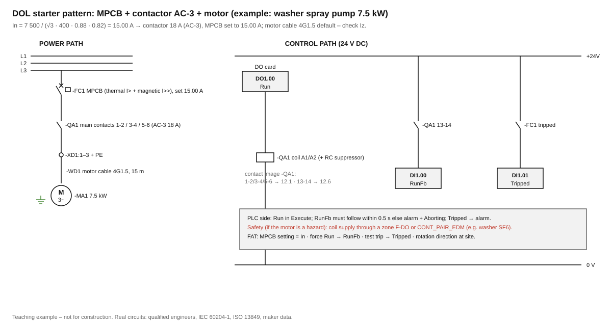

| Kind | Item | Detail |
|---|---|---|
| IO DO | `<group>.Run` | contactor coil |
| IO DI | `<group>.RunFb` | contactor auxiliary contact |
| IO DI | `<group>.Tripped` | motor protection tripped |
| device | -FC Motor protection circuit breaker, setting = rated current | BOM: Motor protection circuit breaker |
| device | -QA Contactor AC-3 | BOM: Contactor AC-3 |
| device | -MA Three-phase motor | BOM: Motor (part of the mechanics) |
| cable | Motor cable | 4G1.5 default text, cores sized per instance (B0.14), 15 m |
| library data | i24 0.1 A · loss 5 W · tx 0 · power `motor` | B0.11, B0.12, B0.6 |

**Sizing rules.** In by B0.9; contactor AC-3 rating ≥ In (B0.9); MPCB setting range must contain In (set to In); short-circuit breaking
capacity of the MPCB ≥ Ik at the cabinet or "type 2 coordination" of MPCB + contactor from the maker's table (IEC 60947-4-1: after a short
circuit the contactor may weld lightly but must be usable – type 2 is the normal demand in an FMS). Motor cable: sized per instance by B0.14 with Ip = MPCB
setting = motor In; 1.5 mm² carries Ip ≤ 22 × 0.6699 = 14.74 A (motors up to 5.5 kW); the M10 7.5 kW spray pump gets 4G2.5 and the M16 15 kW
hydraulic pump (In 30.00 A → 44.78 A) **4G6**; check voltage drop and fault loop with the real length (guide 67 C3–C5).

**PLC side.** `Run` from the module FB in state **Execute** (or Starting / Idle for auxiliaries like a hydraulic pump); `RunFb` must follow
`Run` within ~0.5 s, otherwise alarm "contactor feedback" and state **Aborting**; `Tripped` = 1 → alarm, **Aborting** / **Held** depending
on the module. Running hours for maintenance count on `RunFb` (module part of the data block).

**FAT test steps.** (1) MPCB setting = In on the label and the schedule. (2) Force `Run` → contactor pulls in, `RunFb` = 1 within 0.5 s.
(3) Switch the MPCB to OFF / test trip → `Tripped` = 1. (4) Motor rotation direction (at site, with the mechanics). (5) Measure motor current
at load ≤ In.

**Typical faults.** MPCB set to the contactor rating instead of motor In (no overload protection); `Tripped` read from the wrong auxiliary
(ON/OFF instead of "tripped"); no RC / varistor suppressor on the coil when the DO card is not protected; motor cable unscreened next to VFD
cables (no problem for DOL, but keep power and signal separated, guide 67 C7).

### B1.3 VFD_STO – frequency inverter with STO and fieldbus

**Purpose.** Speed-controlled drives: stacker crane travel / hoist / fork, rotary tables, turntables, conveyors with soft acceleration.
STO (safe torque off, IEC 61800-5-2) is the basic safety function: the inverter cannot produce torque while STO is active – without
switching the motor power.

**Schematic.**
- Power path: L1/L2/L3 → `-FC1` line protection (MCB or fuses as specified by the inverter maker, often semiconductor fuses for large
  drives) → (optional line choke / EMC filter) → `-TA1` inverter → shielded motor cable 4G<A> + shield (B0.14) (360° shield clamps at both ends) →
  `-MA1` motor (PE + shield). In M03 / M08 the line side of all inverters passes the safety contactor pair (CONT_PAIR_EDM) for a stop that
  also removes the power (category 0 backup).
- Control path: PROFINET (or other bus) Ethernet cable → speed setpoint, control word, status word, position (guide 66 B); DI `Ready` and
  DI `Fault` as hard-wired backup / quick status.
- Safety path: FDO `STO` (two-channel F-DO, P/M switching) → STO A / STO B terminals of the inverter. Stop category 1 (SS1-t): the PLC ramps
  the drive down over the bus, then the safety PLC removes STO after the time delay (guide 67 A5.3, H10).

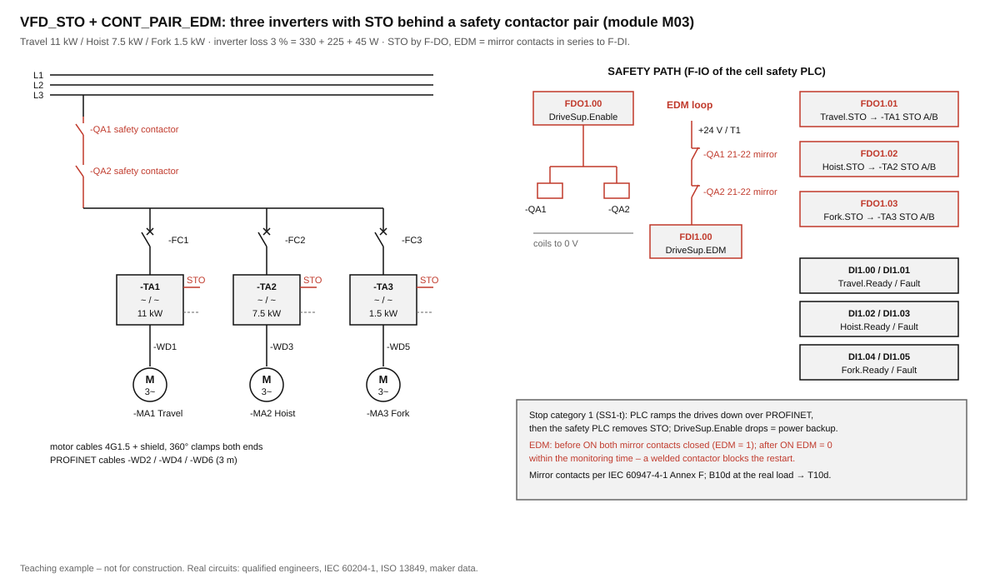

| Kind | Item | Detail |
|---|---|---|
| IO FDO | `<group>.STO` | safe torque off (2-channel F-DO) |
| IO DI | `<group>.Ready` | inverter ready |
| IO DI | `<group>.Fault` | inverter fault |
| device | -FC Line protection of the inverter (MCB / fuses) | BOM: Inverter line protection |
| device | -TA Frequency inverter with STO + PROFINET | BOM: Frequency inverter |
| device | -MA Three-phase motor | BOM: Motor (part of the mechanics) |
| cable | Motor cable, shielded (EMC) | 4G1.5 + shield default text, cores sized per instance (B0.14), 15 m |
| cable | Industrial Ethernet cable, shielded | 4x0.34 (PROFINET / Ethernet), 3 m |
| library data | i24 0.5 A · loss 3 % of motor kW · tx 0 · power `vfd` | B0.11, B0.12, B0.6 |

**Sizing rules.** Inverter size ≥ motor kW **and** inverter output current ≥ motor In at the duty (heavy duty for hoists – the library
picks by kW only, the real choice uses current and overload profile); line protection from the inverter manual; motor cable shielded, cross-section per instance from motor In (B0.14: Ip = inverter
motor-overload setting; M08 15 kW travel → 4G6 + shield), length limit of the inverter (often 50–100 m without output choke); braking resistor for hoist and travel (regeneration – its loss is
additional heat if mounted inside); loss 3 % of kW for the heat calculation. STO wiring: both channels, cross-circuit detection by the
safety PLC's test pulses or by the inverter's diagnostics; the PL of the STO path = the PL / PFHd of the inverter's STO (maker's data) +
F-DO (guide 67 G8).

**PLC side.** The drive FB (item 10) writes the control word and setpoint over the bus only when STO is not active; STO active → drive
state "safe torque off" → module state **Held** (door request) or **Stopped / Aborted** (e-stop); `Fault` → **Aborting**; `Ready` = 0 in
Idle → alarm "drive not ready". The STO status is also read back over PROFIsafe (if used) – the hard-wired DI are the simple variant.

**FAT test steps.** (1) Parameter set loaded and saved (motor data, ramps, limits). (2) STO: activate the safety function → inverter shows
STO, motor torque-free; pull one STO channel → inverter / safety PLC detects discrepancy. (3) `Ready` / `Fault` bits. (4) Bus communication:
control word / status word / setpoint. (5) Stop-time measurement of the stop category 1 (at site, with the mechanics, guide 67 K3.8).

**Typical faults.** Shield connected with a pigtail (EMC faults on encoders and bus); STO bridged with a wire "for commissioning" and
forgotten; both STO channels from one F-DO channel; motor cable longer than allowed without output choke (bearing currents, overvoltage);
brake of the hoist controlled by the inverter but not monitored (safe brake control SBC belongs to the safety concept, guide 67 H10).

### B1.4 HEATER – heater with contactor + safety thermostat

**Purpose.** Electric heating of a wash tank, an oven, a degreasing bath, a curing zone. Resistive load (cos φ = 1), switched by an AC-1
contactor; the temperature is controlled by the PLC (ANALOG_T) and limited by an independent **safety thermostat** that switches the
heater off even if the PLC fails.

**Schematic.**
- Power path: L1/L2/L3 → `-FC1` circuit breaker 3-pole → `-QA1` contactor AC-1 → power cable 4G<A> (B0.14; 18 kW → 4G6) → `-EB1` heating elements (star or
  delta).
- Control path: DO `On` → `-QA1` coil; `-QA1` aux NO → DI `OnFb`.
- Safety path: `-BT1` safety thermostat (NC, manual reset) in series with the `-QA1` coil **and** its signal contact → DI `OverTemp`
  (control cable 3x0.75). The thermostat must act directly on the coil (or on a second contactor), not only via the PLC.

| Kind | Item | Detail |
|---|---|---|
| IO DO | `<group>.On` | heater contactor coil |
| IO DI | `<group>.OnFb` | contactor auxiliary contact |
| IO DI | `<group>.OverTemp` | safety thermostat tripped |
| device | -FC Circuit breaker 3-pole | BOM: Circuit breaker 3-pole |
| device | -QA Contactor AC-1 | BOM: Contactor AC-1 |
| device | -EB Heating elements | BOM: Heater (part of the mechanics) |
| device | -BT Safety thermostat | BOM: Safety thermostat |
| cable | Power cable | 4G2.5 default text, cores sized per instance (B0.14: M10 18 kW → 4G6), 10 m |
| cable | Control cable | 3x0.75, 10 m |
| library data | i24 0.1 A · loss 8 W · tx 0 · power `heater` | B0.11, B0.12, B0.6 |

**Sizing rules.** I = P / (√3 × 400) for a balanced 3-phase heater (18 kW → 26 A); contactor AC-1 rating ≥ I (AC-1 ratings are much higher
than AC-3 for the same frame); breaker = next rating ≥ I (25.98 A → 32 A); cable for the **breaker**, not for I (B0.14: 32 / 0.6699 = 47.77 A → 6 mm² → **4G6**; the
first edition's "26 / 0.6699 = 38.8 A → 4G4 at least" used I instead of the breaker rating and is corrected). Heaters run long at full power – ku 0.8 in the
library, 1.0 in winter start-up (guide 67 B2.5). Use solid-state relays instead of contactors when the PLC switches the heater many times per
minute (contactor life).

**PLC side.** Temperature controller (two-point or PID with PWM) in the module FB; `OnFb` ≠ `On` → alarm; `OverTemp` → alarm, **Held**
(washer cannot wash cold parts – the module waits); heating may run in **Idle** and **Stopped** (warm keeping) – define this in the state
model (item 9).

**FAT test steps.** (1) Force `On` → contactor, `OnFb`. (2) Open the thermostat circuit (test button or simulated) → contactor drops
independently of the PLC output, `OverTemp` = 1, manual reset needed. (3) Insulation test of the heater circuit (guide 67 K3.4) – wet
heater elements have low insulation after storage.

**Typical faults.** Safety thermostat only read by the PLC (no direct action); heater cable sized from the default; AC-3 contactor ordered
(oversized) or AC-1 contactor used for a motor (undersized); heater runs dry when the level sensor fails – the level-low signal must also
inhibit the heater.

### B1.5 CONT_PAIR_EDM – two safety contactors with feedback (EDM)

**Purpose.** Switch the power of hazardous drives off **redundantly**: two contactors in series, each able to stop the hazard alone
(category 3 / 4 output, ISO 13849). Their **mirror contacts** (NC auxiliary contacts that are mechanically linked to the main contacts,
IEC 60947-4-1 Annex F) are read back as EDM (external device monitoring): if a contactor welds, the safety PLC sees it at the next demand
and refuses the restart.

**Schematic.**
- Power path: supply of the drive group (in M03: the line side of the three inverters) → `-QA1` main contacts → `-QA2` main contacts →
  inverters.
- Control path: none (no standard IO).
- Safety path: FDO `Enable` → coils of `-QA1` and `-QA2` (in parallel, P/M switching F-DO, or one F-DO channel per coil on separate
  outputs if the PL requires) ; +24 V → `-QA1` mirror NC 21-22 → `-QA2` mirror NC 21-22 → FDI `EDM`. Before the outputs switch on, EDM
  must be 1 (both contactors open); after switching on, EDM must go to 0 within the monitoring time (e.g. 300 ms).

| Kind | Item | Detail |
|---|---|---|
| IO FDO | `<group>.Enable` | coils K1 + K2 |
| IO FDI | `<group>.EDM` | feedback: NC mirror contacts K1 + K2 in series |
| device | -QA Safety contactor K1 (mirror contacts) | BOM: Safety contactor |
| device | -QA Safety contactor K2 (mirror contacts) | BOM: Safety contactor |
| library data | i24 0.3 A · loss 6 W · tx 0 | B0.11, B0.12, B0.6 |

**Sizing rules.** Contactor AC-3 rating ≥ the current of the drive group (M03: inverters 11 + 7.5 + 1.5 kW → input current about 40 A
→ 40 A or 50 A contactors; for inverters use the AC-1 rating if the inverter has a precharge circuit – maker's note); B10d of the
contactor at the **real load** for MTTFd (guide 67 G4: n_op per year from the demand rate); T10d (time until 10 % dangerous failures) =
replacement interval in the maintenance plan.

**PLC side.** The safety program (item 10, safety part) contains the EDM function block of the safety PLC library (feedback time,
start-up test). The standard program sees only the status ("drive power on") for the HMI and the PackML state **Starting** (wait for
drive power) – never commands the contactors directly.

**FAT test steps.** (1) Switch on → both contactors close, EDM 1 → 0. (2) Simulate a welded contactor: hold `-QA2` closed mechanically (or
bridge its mirror contact open) → after the stop, the restart is refused, alarm "EDM". (3) Check the mirror contact type in the data sheet
(Annex F marking). (4) Measure the drop-out time for the stop-time calculation.

**Typical faults.** Normal auxiliary contacts instead of mirror contacts; EDM wired in parallel instead of series; both coils from one
single-channel output without test pulses (category reduced); contactors sized at AC-3 for a capacitive inverter input (contact welding at
precharge).

---

## B2. Safety input patterns

All patterns of this section feed **F-DI** channels of the module's safety IO (FDI cards), which are part of the cell safety PLC (M18,
networked safety, guide 67 I2). Common rules: two channels, test pulses (cross-circuit detection), discrepancy time (typ. 50–500 ms),
manual reset after a trip (guide 67 I6), devices with positive opening contacts or OSSD outputs.

### B2.1 ESTOP – emergency-stop push-button, 2 NC (ISO 13850)

**Purpose.** The complementary protective measure for emergencies: stop the hazard as fast as possible (stop category 0 or 1, guide 67
H9). Every operator place and every zone entry has one.

**Schematic.**
- Safety path: test pulse output T1 → `-SF1` NC contact 1 → FDI `Ok`; test pulse output T2 → `-SF1` NC contact 2 → FDI `Ok2`. Contacts
  with positive opening (direct opening action), mechanically latched, red mushroom on yellow background, released by turning or pulling.
- Power / control path: none in the pattern (the effect is in the safety program and the outputs of the zone).

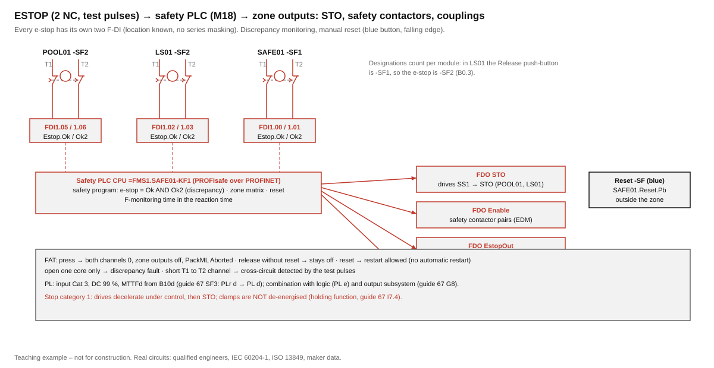

| Kind | Item | Detail |
|---|---|---|
| IO FDI | `<group>.Ok` | e-stop not pressed, channel 1 |
| IO FDI | `<group>.Ok2` | e-stop not pressed, channel 2 |
| device | -SF Emergency-stop push-button 2 NC in enclosure | BOM: Emergency-stop push-button |
| cable | Control cable | 4x0.75, 10 m |
| library data | i24 0 A · loss 0 W · tx 0 | B0.11, B0.12, B0.6 |

**Sizing rules.** B10d of the e-stop (typ. 100 000 operations – maker's data) → MTTFd; DC 99 % with two channels, test pulses and
plausibility (guide 67 G5); PLr usually d (guide 67 SF3). Enclosure IP65 at the place; the cable 4x0.75 uses separate cores for each
channel (cross-circuit detection catches shorts between them).

**PLC side.** Safety program: e-stop OK = `Ok` AND `Ok2` (with discrepancy monitoring) → zone e-stop output; reset by the reset button of
M18 (rising / falling edge). Standard program: e-stop active → module PackML **Aborting → Aborted**; after release and reset → **Clearing →
Stopped**. HMI shows which e-stop was pressed (each button has its own two FDIs – the library does not daisy-chain e-stops, so the location
is known).

**FAT test steps.** (1) Press → both channels 0 within the discrepancy time, zone outputs off, PackML Aborted. (2) Release without reset →
outputs stay off. (3) Reset → outputs may restart (no automatic restart). (4) Open one channel only (disconnect a core) → discrepancy fault,
needs a special acknowledgement. (5) Short the two channels → test pulse detects cross-circuit.

**Typical faults.** E-stops in series on one pair of channels (no location, masking of faults – ISO 14119 / ISO TR 24119 limits series
connection); e-stop placed where the operator cannot reach it; yellow background missing; e-stop used as a normal stop button in daily
work (wear, B10d).

### B2.2 DOOR_LOCK – guard door with guard locking (ISO 14119)

**Purpose.** A door into a hazard zone with a long stopping time (stacker crane aisle, robot cell, welding cell): the door stays **locked**
until the hazard has stopped; it can be opened only after a request and a safe stop (guide 67 H5: guard locking needed when the stopping
time is longer than the access time).

**Schematic.**
- Safety path: `-BG1` interlock switch with guard locking, coded (type 4, RFID or type 2 with coded actuator): door-closed contacts
  (2 channels) → FDI `Closed`, `Closed2`; locking monitoring contacts (2 channels) → FDI `Locked`, `Locked2`; locking solenoid ← FDO
  `LockCmd` (power-to-unlock or power-to-lock – power-to-lock only when the risk assessment allows, ISO 14119 clause 5.7).
- Control path: `-SF1` access request push-button with lamp → DI `Request`; lamp from a DO of the module (the lamp DO is not in the
  pattern; the library uses the HMI or the signal tower).
- Supply: +24 V / 0 V (tx = 2) for the switch electronics; M12 8-pole cable.

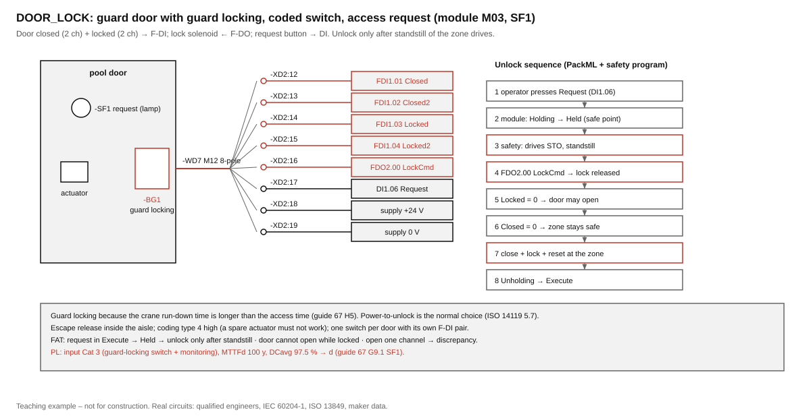

| Kind | Item | Detail |
|---|---|---|
| IO FDI | `<group>.Closed` | door closed, channel 1 |
| IO FDI | `<group>.Closed2` | door closed, channel 2 |
| IO FDI | `<group>.Locked` | door locked, channel 1 |
| IO FDI | `<group>.Locked2` | door locked, channel 2 |
| IO FDO | `<group>.LockCmd` | guard locking solenoid |
| IO DI | `<group>.Request` | access request push-button |
| device | -BG Interlock switch with guard locking, coded | BOM: Guard-locking interlock switch |
| device | -SF Access request push-button with lamp | BOM: Illuminated push-button |
| cable | Safety switch cable M12 8-pole | 8x0.25, 10 m |
| library data | i24 0.3 A · loss 2 W · tx 2 | B0.11, B0.12, B0.6 |

**Sizing rules.** Guard locking force ≥ the expected force on the door (maker's F_zh, ISO 14119 clause 5.7); escape release from inside if a
person can be trapped; auxiliary release for rescue (guide 67 H2.5); MTTFd of the switch from the maker (many such switches are certified
"PL e, category 4" as a subsystem); masking: one guard-locking switch per door with its own FDI pair.

**PLC side.** Sequence (guide 67 H5.3, SF1): operator presses `Request` → module goes to **Holding** (finishes the current move or stops
at a safe point) → **Held** → safety program: drives in STO (standstill) → FDO `LockCmd` releases the lock → `Locked` = 0 → door may open
(`Closed` = 0) → entry. Closing: door closed + locked → reset at the zone reset station → **Unholding → Execute**. The standard program
shows the door state on the HMI; the safety program owns `LockCmd`.

**FAT test steps.** (1) Request in Execute → module Holding → Held → unlock only after standstill. (2) Try to open while locked → lock
holds. (3) Open the door → STO of the zone drives, `Closed` 0. (4) Interrupt one channel → discrepancy. (5) Escape release from inside works
without power. (6) Coding: a spare actuator of the same type does **not** close the circuit (type 4 high coding).

**Typical faults.** Switch mounted where the actuator can be bypassed easily (ISO 14119 clause 7: defeat prevention); power-to-lock chosen
to "keep the door closed during power failure" without risk assessment; no escape release; request lamp missing – operators wait without
feedback and force the door.

### B2.3 DOOR_2CH – guard door, two diverse switches (Category 3)

**Purpose.** A guard door where the hazard stops faster than a person can reach it (washer door, test hood, laser enclosure): no guard
locking needed (guide 67 H5) but PL d → two switches with **diverse** technology (tongue switch + position switch / hinge switch) to
avoid common cause failure.

**Schematic.**
- Safety path: `-BG1` interlock switch A (tongue actuator, NC positive opening) → FDI `Closed`; `-BG2` position switch B (roller / plunger
  NC or NO, diverse mounting) → FDI `Closed2`. Each switch has its own M12 cable (5-pole).
- Supply: tx = 2 (+24 V / 0 V for electronic switches or for the test pulse return – depends on the device).

| Kind | Item | Detail |
|---|---|---|
| IO FDI | `<group>.Closed` | interlock switch A |
| IO FDI | `<group>.Closed2` | position switch B (diverse) |
| device | -BG Interlock switch A (tongue) | BOM: Interlock switch |
| device | -BG Position switch B (diverse) | BOM: Position switch |
| cable | Sensor cable M12 5-pole | 5x0.34, 10 m |
| cable | Sensor cable M12 5-pole | 5x0.34, 10 m |
| library data | i24 0.05 A · loss 0 W · tx 2 | B0.11, B0.12, B0.6 |

**Sizing rules.** Category 3: two channels, single fault does not lead to loss of the function, most faults detected (DC ≥ 60 %, with
plausibility in the safety PLC typically 99 %); MTTFd from B10d and n_op (guide 67 G4). This is the "option C" fix of SF6 in guide 67 G10
(PL c → PL d).

**PLC side.** Door open → safety outputs of the module zone off (pumps, conveyor, cylinder) → module **Held** or **Stopped**; door closed +
reset → resume. Standard program: door status for HMI and for the cycle (door cylinder closes the door automatically in M10).

**FAT test steps.** (1) Open → both channels 0 within the discrepancy time; hazardous outputs off. (2) Defeat test: with the door open, try
to actuate one switch by hand – the other switch must still see "open" (diversity, mounting). (3) Disconnect one switch → discrepancy alarm.

**Typical faults.** Two identical switches on one actuator (common cause: the actuator breaks off, both stay "closed"); both switches on
one cable (one cable cut = both channels); discrepancy time too short for slow-moving doors (nuisance trips).

### B2.4 LC – light curtain type 4 (OSSD pair)

**Purpose.** Protect an opening where operators load parts by hand (load station, assembly station, press, welding table): a person
reaching through the light field stops the hazard (IEC 61496-1/-2, type 4 for PL e).

**Schematic.**
- Safety path: `-BG1` receiver OSSD1 → FDI `Ossd1`, OSSD2 → FDI `Ossd2` (OSSDs are self-testing semiconductor outputs; the F-DI must
  accept OSSD test pulses – switch off the F-DI's own test pulses for these channels).
- Control path: receiver warning output (contamination, weak signal) → DI `Warn`.
- Supply: emitter and receiver each +24 V / 0 V (tx = 4); emitter cable M12 5-pole, receiver cable M12 8-pole.
- Optional: muting sensors and muting lamp (for material passing, guide 67 H6.2) – not in the library pattern; add instances of SENSOR
  and PUSHBUTTON (lamp) when muting is needed.

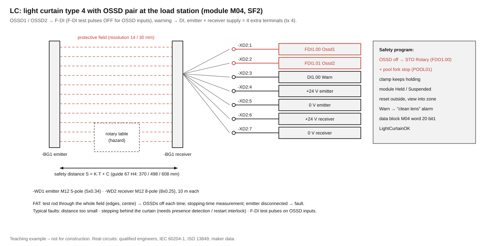

| Kind | Item | Detail |
|---|---|---|
| IO FDI | `<group>.Ossd1` | OSSD 1 |
| IO FDI | `<group>.Ossd2` | OSSD 2 |
| IO DI | `<group>.Warn` | contamination warning |
| device | -BG Light curtain type 4, emitter + receiver | BOM: Light curtain pair |
| cable | Sensor cable M12 5-pole (emitter) | 5x0.34, 10 m |
| cable | Sensor cable M12 8-pole (receiver) | 8x0.25, 10 m |
| library data | i24 0.6 A · loss 6 W · tx 4 | B0.11, B0.12, B0.6 |

**Sizing rules.** Safety distance S = K × T + C with resolution-dependent C (ISO 13855; guide 67 H4: cases LC1–LC3 give 370 / 498 / 608 mm); resolution
14 mm (finger) / 30 mm (hand); protective height covers the opening; reflective surfaces near the beam (minimum distance from the maker);
response time of the curtain + safety PLC + actuator stopping time in T.

**PLC side.** OSSDs off → safety program: zone outputs off (rotary table STO, clamp keeps holding – guide 67 I7.4) → module **Held** or
**Suspended** (if the stop is expected: operator loading) → curtain free + reset (or automatic restart only if the risk assessment allows
it, never for whole-body access). `Warn` → maintenance alarm "clean the light curtain". Data block M04 word 20 bit1 `LightCurtainOK`
(guide 66 H2.3).

**FAT test steps.** (1) Test rod (14 / 30 mm) through the whole field, at the edges and at the centre → OSSDs off each time. (2) Stopping
time measurement and safety distance check. (3) Disconnect the emitter → OSSDs off, fault. (4) Warning output with a partly covered lens.

**Typical faults.** Distance smaller than calculated (guide 67 H4: 200 mm instead of 608 mm); possible to step behind the curtain (no
presence detection – needs a second curtain, scanner or restart interlock with a reset outside); F-DI test pulses on OSSD inputs (immediate
discrepancy faults); mirrors misaligned after transport.

### B2.5 SCANNER – safety laser scanner with field switching

**Purpose.** Area protection on the floor (AGV dock, robot cell entry, machine front): the scanner sees a person entering a protective
field and stops the hazard; field sets switch with the operating situation (AGV docking, robot position – guide 67 H7).

**Schematic.**
- Safety path: OSSD1 → FDI `Ossd1`, OSSD2 → FDI `Ossd2` (protective field).
- Control path: warning field → DI `Warn`; field set select A / B ← DO `FieldA`, `FieldB` (for **safety-relevant** field switching use
  safe inputs or a safety-network scanner – the DO-based switching is acceptable only when the risk assessment shows that a wrong field
  set is still safe, e.g. switching between two protective fields of which both protect).
- Supply: tx = 2; system cable 12x0.25.

| Kind | Item | Detail |
|---|---|---|
| IO FDI | `<group>.Ossd1` | OSSD 1 protective field |
| IO FDI | `<group>.Ossd2` | OSSD 2 protective field |
| IO DI | `<group>.Warn` | warning field free |
| IO DO | `<group>.FieldA` | field set select A |
| IO DO | `<group>.FieldB` | field set select B |
| device | -BG Safety laser scanner | BOM: Safety laser scanner |
| cable | Scanner system cable | 12x0.25, 10 m |
| library data | i24 0.5 A · loss 6 W · tx 2 | B0.11, B0.12, B0.6 |

**Sizing rules.** Protective field S = K × T + C (ISO 13855 for area protection: K = 1 600 mm/s, C = max(850, 1 200 − 0.4 H) + tolerance Z) – guide 67 H4 (scanner
case SC1 1 980 mm); type 3 per IEC 61496-3 (max PL d); response time incl. multiple scans; mounting height and dead zones.

**PLC side.** Protective field interrupted → transfer conveyor stop (SF4) → module **Held**; warning field → slow down (if a drive), lamp.
Field selection by the module state (AGV docking: field A; free: field B) – the field switching logic belongs to the safety program when
it is safety-relevant.

**FAT test steps.** (1) Walk into each field set → OSSDs off at the configured distance (measure). (2) Test the field switching in every
state of the module. (3) Configuration checksum of the scanner recorded in the validation report.

**Typical faults.** Field configured smaller than calculated "because the AGV triggers it"; scanner dirty (no warning output wired);
configuration changed with a laptop and not re-validated; field switching via standard DO without risk assessment.

### B2.6 ENABLE – 3-position enabling device

**Purpose.** Allow movement in **maintenance / setting mode** while a person is inside the hazard zone: the movement is possible only while
the enabling switch is held in the middle position; releasing or pressing through stops it (IEC 60204-1 10.9, guide 67 H8.1, SF5).

**Schematic.**
- Safety path: enabling contacts channel 1 / 2 → FDI `Ok`, `Ok2`. Combined with MODE_SWITCH (maintenance mode) and safely-limited speed
  (SLS) of the drives.
- Cable 7x0.5 (spiral cable or plug-in pendant with jog buttons – the jog buttons are standard DI, add PUSHBUTTON instances if needed).

| Kind | Item | Detail |
|---|---|---|
| IO FDI | `<group>.Ok` | enabling middle position, channel 1 |
| IO FDI | `<group>.Ok2` | enabling middle position, channel 2 |
| device | -SF 3-position enabling switch | BOM: Enabling switch |
| cable | Control cable | 7x0.5, 5 m |
| library data | i24 0 A · loss 0 W · tx 0 | B0.11, B0.12, B0.6 |

**Sizing rules.** PLr c–d (guide 67 SF5); B10d of the enabling switch (often lower than an e-stop – check the maker); plug-in pendants need
a bridging plug / a safe "pendant missing" detection so that unplugging does not trigger an e-stop unintentionally – or the pendant's
e-stop must be designed per ISO 13850 for detachable devices.

**PLC side.** Maintenance mode + enabling middle position → safety program releases the drives at SLS (e.g. 250 mm/s); jog commands from
the HMI / pendant in PackML unit mode **Maintenance** (guide 65: mode 2). Release → STO / SS1.

**FAT test steps.** (1) Middle position → movement possible at SLS only. (2) Release → stop. (3) Press through (panic) → stop, and
release from panic does **not** re-enable. (4) Speed above SLS → safe stop (test with a changed setpoint).

**Typical faults.** Enabling switch taped in the middle position (organisational measure + design: the movement still needs a jog
command); SLS not implemented (enabling alone does not limit the speed); enabling active in automatic mode.

### B2.7 MODE_SWITCH – key mode selector Auto / Maintenance

**Purpose.** Select the operating mode in a safe way: each mode position is a safe input; the key can be removed in each position (only
authorised persons switch to maintenance). IEC 60204-1 9.2.3.

**Schematic.** Safety path: key selector `-SF1` contact Auto → FDI `Auto`; contact Maintenance → FDI `Maint`. The safety program checks
**exactly one** position active (1-of-n with discrepancy time); none or both → fault.

| Kind | Item | Detail |
|---|---|---|
| IO FDI | `<group>.Auto` | mode Automatic |
| IO FDI | `<group>.Maint` | mode Maintenance |
| device | -SF Key mode selector switch | BOM: Key mode selector |
| cable | Control cable | 4x0.75, 5 m |
| library data | i24 0 A · loss 0 W · tx 0 | B0.11, B0.12, B0.6 |

**Sizing rules.** PL of the mode selection = PL of the function that it enables (maintenance with SLS: PL d); one key per mode level;
change of mode must not start a movement (IEC 60204-1).

**PLC side.** Safety program: mode → which safety functions are active (doors with guard locking in Auto; enabling + SLS in Maintenance).
Standard program: `Status.UnitModeCurrent` (data-block word 1) follows the safe mode; the cell controller can **request** a mode (word 5)
but never switch the safe mode – the key decides.

**FAT test steps.** (1) Each position → exactly one input 1. (2) Between positions (key half turned) → fault after discrepancy time, no
movement. (3) Switch Auto → Maintenance during motion → stop.

**Typical faults.** Mode read only by a standard DI (mode not safe); key not removable or the same key for all machines; the HMI allows
mode change without the key.

### B2.8 TWOHAND – two-hand control station type IIIC

**Purpose.** Keep both hands of the operator out of the hazard during the dangerous stroke of a press or a press-fit station (ISO 13851,
type IIIC = synchronous actuation within 0.5 s + category 3/4 with NO + NC per button).

**Schematic.** Safety path: left button NO → FDI `Left`, NC → FDI `Left2`; right button NO → FDI `Right`, NC → FDI `Right2`. The safety
PLC uses a certified two-hand function block (synchronous within 0.5 s, release both before the next cycle, NO/NC antivalence).

| Kind | Item | Detail |
|---|---|---|
| IO FDI | `<group>.Left` | left button NO |
| IO FDI | `<group>.Left2` | left button NC |
| IO FDI | `<group>.Right` | right button NO |
| IO FDI | `<group>.Right2` | right button NC |
| device | -SF Two-hand control station | BOM: Two-hand control station |
| cable | Control cable | 7x0.75, 5 m |
| library data | i24 0 A · loss 0 W · tx 0 | B0.11, B0.12, B0.6 |

**Sizing rules.** Safety distance S = K × T + C with K = 1 600 mm/s, C = 250 mm (or 0 if the buttons are shielded; ISO 13855 – guide 67 H4
case TH1 442 mm); buttons shrouded against actuation with one hand + elbow (distance between buttons ≥ 260 mm or shrouds, ISO 13851).

**PLC side.** Safety program: two-hand OK → stroke enable (press: SAFE_VALVE; press-fit: valve FDO); release of one hand → stroke stops (or
reverses, per risk assessment). Standard program: only counts and shows the cycle; it cannot start the stroke alone.

**FAT test steps.** (1) Both buttons within 0.5 s → stroke. (2) Delay > 0.5 s → no stroke. (3) Release one → stop. (4) Keep one pressed and
re-press the other → no new stroke. (5) One-hand + elbow test with the station mounted.

**Typical faults.** Station too close to the hazard (distance not calculated); a second operator presses one button (two-hand protects
only the person at the station – other persons need a light curtain: M13 / M16 have both); worn NC contacts → antivalence faults.

---

## B3. Safety logic, safety output and coupling

### B3.1 SAFETY_PLC – safety PLC CPU (PL e / SIL 3)

**Purpose.** The logic of all safety functions of the cell: reads the F-DI of all modules (over PROFIsafe / FSoE / CIP Safety, guide 66
B6), executes the certified safety program (zone matrix, guide 67 I7), drives the F-DO. It is the core of M18. One safety CPU per cell is
the normal design; a big cell may have one per zone group with safe cross-communication.

**Schematic.**
- Power path: 24 V from its own ECB channel (preferably buffered by the DC UPS of M19 / M22, so that the safety PLC does not restart
  when the 400 V supply dips).
- Control / safety path: Industrial Ethernet to the cell switch (PROFINET with PROFIsafe); the F-IO cards of all modules are its devices.

| Kind | Item | Detail |
|---|---|---|
| device | -KF Safety PLC CPU | BOM: Safety PLC CPU |
| cable | Industrial Ethernet cable, shielded | 4x0.34 (PROFINET / Ethernet), 3 m |
| library data | i24 0.8 A · loss 15 W · tx 0 | B0.11, B0.12, B0.6 |

**Sizing rules.** Number of F-devices and F-IO (kit: 49 FDI + 17 FDO used, D3), cycle time and F-monitoring time (watchdog) in the reaction
time of each safety function (guide 67 I2.3); PFHd of the CPU (maker's certificate, typ. 1E-9 per hour range); memory for the safety program.

**PLC side.** The safety program is a separate program part with its own signature (CRC); standard program reads safety status bits (zone
OK, e-stop, door locked) for PackML and HMI, never writes safety signals (guide 60: "Safety is always hard-wired / safety PLC (M18), never
over the standard network alone").

**FAT test steps.** (1) Safety program signature recorded. (2) Each safety function validated (guide 67 G11, the cause & effect matrix row by
row). (3) F-monitoring time: interrupt the network → F-IO passivated, outputs off. (4) Access protection (password) of the safety program.

**Typical faults.** Safety program changed at site without re-validation (signature changed – keep the signature in the validation report);
F-addresses (PROFIsafe destination addresses) duplicated after copying a module (the F-address must be unique in the network); the safety CPU
supplied from the same channel as the valves (voltage dips reset the CPU).

### B3.2 SAFE_VALVE – redundant safety valve with spool monitoring (press, Category 4)

**Purpose.** Stop the hydraulic or pneumatic stroke of a press **safely**: two valves in series (or one double valve block) – each alone can
stop the stroke – with **spool monitoring** (each valve reports its spool position, so a stuck valve is detected). Required for presses with
manual loading (ISO 16092, guide 67 G3 category 4).

**Schematic.**
- Safety path: FDO `ValveA` → coil A; FDO `ValveB` → coil B (separate F-DO channels); spool monitor A → FDI `FbA`; spool monitor B → FDI
  `FbB`. Valve cable 5x0.75, sensor cable M12 4-pole. Supply tx = 2.
- The safety program checks before every stroke: both spools in rest position; after the stroke command: both spools switched within time;
  after release: both back. Any mismatch → lock-out until a special reset.

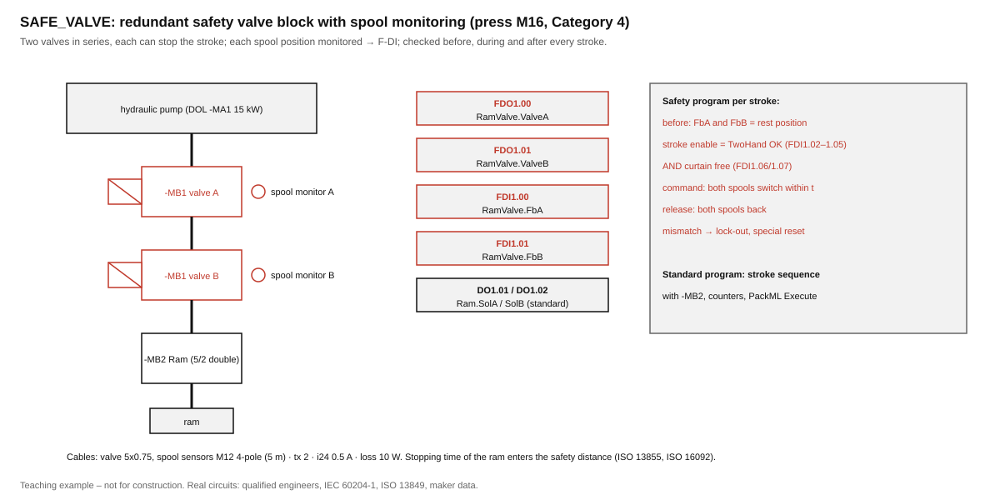

| Kind | Item | Detail |
|---|---|---|
| IO FDO | `<group>.ValveA` | valve coil A |
| IO FDO | `<group>.ValveB` | valve coil B |
| IO FDI | `<group>.FbA` | spool monitor A |
| IO FDI | `<group>.FbB` | spool monitor B |
| device | -MB Redundant safety valve block with spool monitoring | BOM: Safety valve block |
| cable | Valve cable | 5x0.75, 5 m |
| cable | Sensor cable M12 4-pole | 4x0.34, 5 m |
| library data | i24 0.5 A · loss 10 W · tx 2 | B0.11, B0.12, B0.6 |

**Sizing rules.** Valve size by flow and pressure (hydraulics designer); response time of the valve in the stopping time of the press (safety
distance of the light curtain and two-hand station!); MTTFd from the maker's B10d (valves: B10d in cycles; n_op = strokes per year – a press
can make millions of strokes, T10d may be short → replacement interval).

**PLC side.** Safety program: stroke enable = two-hand OK (or light curtain free in the allowed phase) AND mode AND valve monitoring OK. Standard
program: stroke sequence (down – dwell – up) with the standard valve (VALVE_DOUBLE `Ram`), counters, and PackML **Execute**; the safety valves
are only an enable in series.

**FAT test steps.** (1) Stroke with both valves → OK. (2) Simulate stuck valve A (disconnect its spool sensor or hold it) → next stroke refused.
(3) Stopping time measurement of the ram (overrun) → compare with the safety distance (guide 67 H4). (4) Pressure release of the system when
the press stops (residual energy).

**Typical faults.** One valve only with "monitoring" by a pressure switch (no category 4); spool sensors wired to standard DI; valve exhaust
blocked by a silencer full of dirt (slow stop – longer stopping time than measured at FAT).

### B3.3 COUPLING – hard-wired safety coupling machine ↔ cell

**Purpose.** Exchange the safety signals between a machine with its own safety system (machining centre, robot controller) and the cell safety
PLC (guide 67 I4): e-stop in both directions and the "zone free / may enter" permissions for pallet change or robot loading.

**Schematic.**
- Safety path in: machine's potential-free contacts (2 channels) "e-stop OK" → FDI `EstopIn`, `EstopIn2`; "loading zone free" → FDI
  `ZoneFree`, `ZoneFree2`. The cell supplies the 24 V (test pulses) for these contacts.
- Safety path out: FDO `EstopOut` → safety relay / coupling relays with potential-free contacts to the machine's e-stop input (two channels);
  FDO `EnableOut` → "cell zone safe, machine may open / load" (two channels).
- Device: `-KF1` safety coupling terminal set (disconnect terminals + coupling relays with forcibly guided contacts, or a certified safety
  coupling module). Cable 12x0.75 shielded; tx = 2.

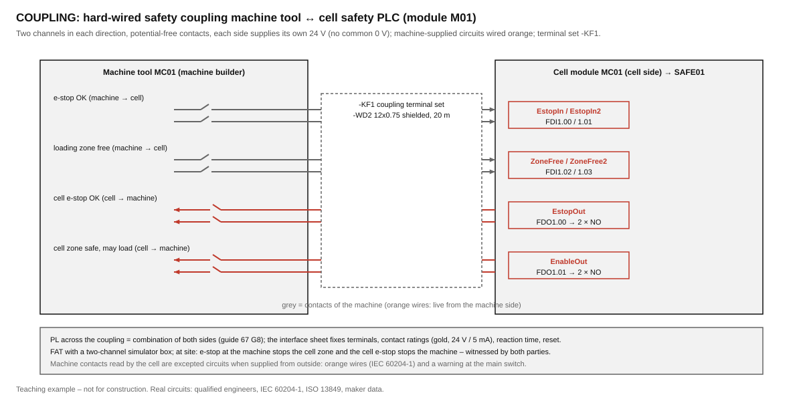

| Kind | Item | Detail |
|---|---|---|
| IO FDI | `<group>.EstopIn` | e-stop OK from the machine, channel 1 |
| IO FDI | `<group>.EstopIn2` | e-stop OK from the machine, channel 2 |
| IO FDI | `<group>.ZoneFree` | machine loading zone free, channel 1 |
| IO FDI | `<group>.ZoneFree2` | machine loading zone free, channel 2 |
| IO FDO | `<group>.EstopOut` | cell e-stop OK to the machine (2-channel F-DO) |
| IO FDO | `<group>.EnableOut` | cell zone safe -> machine may open / load |
| device | -KF Safety coupling terminal set | BOM: Safety coupling terminal set |
| cable | Control cable, shielded | 12x0.75, 20 m |
| library data | i24 0.1 A · loss 2 W · tx 2 | B0.11, B0.12, B0.6 |

**Sizing rules.** Potential separation: each side supplies its own 24 V (no common 0 V between machine and cell – guide 67 I4.2); contact rating
of the machine's outputs vs the minimum current of the F-DI (gold contacts for 24 V / 5 mA); PL of the function across the coupling = the
combination of both sides (guide 67 G8 – each side gives its PFHd); the interface sheet (guide 66 H7, guide 67 I4.3) fixes terminals,
directions and reset rules.

**PLC side.** Safety program: `EstopIn` → cell zone e-stop (or only the zone around the machine – concept); `ZoneFree` → the pool side may move
into the APC area; `EnableOut` written by the safety program when the pool side is safe. Standard program: shows the coupling state; the machine's
PackML state comes over the bus.

**FAT test steps.** (1) With a coupling simulator (two-channel switch box) test each input: open one channel → discrepancy; open both → reaction.
(2) Measure each output pair at the terminals (potential-free, two channels, switching together). (3) At site: test with the real machine
(e-stop at the machine stops the cell zone, e-stop at the cell stops the machine) – witnessed by both parties.

**Typical faults.** Common 0 V between machine and cell (ground loops, unclear responsibility); only one channel wired "because the machine has
only one contact"; orange marking missing for circuits supplied from the machine (excepted circuits stay live when the cabinet is off).

### B3.4 ZONE_OUT – zone safety output, 2-channel F-DO with contactor feedback (EDM) (new in revision 2026-11-15)

**Purpose.** The **output side of the zone matrix** (guide 67 I3, I7). A safety function has three parts: input (sensor) → logic → output
(actuator). The library had the inputs in every module (ESTOP, DOOR_2CH, LC, SCANNER …) and the logic in M18 (SAFETY_PLC), but several modules
have **no safety output of their own**: the washer pumps (M10, SF6), the AGV transfer conveyor (M06, SF4), the conveyor motors (M07), the
press-fit valves of the assembly stations (M13), the marking enclosure (M12), the test hood (M14). Their C chapters said "the coil supply goes
through a **zone F-DO**" – but no pattern and no module contained that F-DO. ZONE_OUT is that output: one **release** per safety zone,
switched by the cell safety PLC, wired to the coil supply of the zone's contactors, the STO group of the zone's drives or the zone's safety
valves, and **read back** through the series-connected mirror contacts (EDM) of the switched contactors. M18 SAFE01 carries four instances
(`Zone1`–`Zone4`) as the library default; a project adds or removes instances to match its zone matrix.

**Schematic.**
- Safety path out: F-DO `Release` of SAFE01 (two-channel P/M switching: P-switch to +24 V, M-switch to 0 V, test pulses on both) →
  zone interface terminal block `-XD` in the SAFE01 cabinet → control cable 4x0.75 to the zone → coil supply of the zone's actuators: the
  A1/A2 circuit of the zone contactors (for example `=FMS1.WASH01-QA1`, `-QA2`, `-QA4`), the STO-A/STO-B inputs of an inverter group, or the
  coils of a safety valve. The standard DO of the module (`Run`, `On`, `SolA`) stays in series – the zone release is an **enable**, the
  module's DO is the **command**.
- Safety path back (EDM): test-pulse output of the F-DI card → NC mirror contacts 21-22 of all contactors switched by this zone **in series**
  → F-DI `Fb`. Before the release is switched on, `Fb` must be 1 (all contactors open); after switch-on it must go to 0 within the monitoring
  time; after switch-off back to 1. A welded contactor keeps `Fb` at 0 → the restart is refused.
- No power path: the pattern switches 24 V control circuits only. The power of the zone's motors stays in their DOL / HEATER patterns.

```
 SAFE01 cabinet                                   | field / module cabinet of the zone (e.g. WASH01)
                                                   |
 F-DO card  ch.n  P ──┐                            |   module DO "Run" ─┐
 (Release)            ├─ -XDn:1 ── core 1 ─────────┼──────────────────┐ │
              M ──┐   │                            |                  ▼ ▼
                  └───┼─ -XDn:2 ── core 2 ─────────┼──── 0 V of the  [AND: zone release in series with the
                      │                            |      coils         module's DO] ─► A1 -QA1 A2  A1 -QA2 A2 ...
 F-DI card  T (test   │                            |
 pulse out) ──────────┼─ -XDn:3 ── core 3 ─────────┼── 21 ┤ -QA1 NC ├ 22 ── 21 ┤ -QA2 NC ├ 22 ──┐
 F-DI       ch.n  ◄───┴─ -XDn:4 ── core 4 ─────────┼────────────────────────────────────────────────┘   (EDM loop)
 (Fb)                                              |
```

(Text schematic; the coil connection is drawn per project – one release can enable several coils in parallel if the F-DO current is
enough, otherwise through a safety relay / contactor relay with forcibly guided contacts that is itself monitored in the EDM loop.)

| Kind | Item | Detail |
|---|---|---|
| IO FDO | `<group>.Release` | zone release, 2-channel PM switching to the zone contactors / STO / safety valves |
| IO FDI | `<group>.Fb` | zone feedback: NC mirror contacts of the zone contactors in series (EDM) |
| device | -XD Zone interface terminal block (F-DO out + EDM in) | BOM: Zone interface terminal block |
| cable | Control cable to the zone | 4x0.75, 20 m |
| library data | i24 0.05 A · loss 1 W · tx 0 | B0.11, B0.12, B0.6 |

**Why four cores.** Core 1 = F-DO P-switch (+24 V switched), core 2 = F-DO M-switch (0 V switched), core 3 = test-pulse supply of the EDM
loop, core 4 = EDM return to the F-DI. The P/M switching on two separate cores lets the F-DO detect a short to +24 V or to 0 V on either
core (cross-circuit detection) – the reason why a P/M F-DO reaches category 3 / 4 with one two-core output.

**Sizing rules.**
1. **F-DO current.** Σ holding current of all coils on the release + their inrush ≤ the F-DO channel rating (typical 0.5–2 A per channel –
   card data sheet). Example (scratch): three AC-3 contactors with 24 V DC coils of 5 W holding → 3 × 5 / 24 = 0.63 A holding, inrush some
   times higher for a few ms → a 2 A channel is enough; a 0.5 A channel is not → use one interface relay with forcibly guided contacts (and
   put its mirror contact into the EDM loop).
2. **Voltage drop on the 24 V line** (guide 67 D5): ΔU = 2 × L × I × ρ / A = 2 × 20 × 0.63 × 0.0178 / 0.75 = **0.60 V** → 23.4 V at the coils
   ≥ 21.6 V ✓ (scratch, 20 m default length). Long zones (80 m) with 0.75 mm²: 2.39 V – still OK at holding, check the coil pick-up voltage
   at inrush.
3. **Test pulses.** The F-DO's test pulses (dark tests of < 1 ms) must not make the actuator chatter: contactor coils ignore them; electronic
   inputs (STO inputs, valve electronics) need the maker's statement "suitable for test-pulsed safety outputs" or a filter parameter.
4. **Performance level.** PL of the function = input subsystem + logic + output subsystem (guide 67 G8). The output subsystem here is the
   F-DO (PFHd from the card certificate) + the contactors (MTTFd from B10d and the number of operations, DC from the EDM ≈ 99 %, category 3
   with two contactors, category 1 with one). One contactor on a ZONE_OUT is allowed when the PLr allows it (M06 SF4: Cat 1, PLr b / c);
   for PL d use two contactors in series, both in the EDM loop.
5. **EDM monitoring time** (typ. 300–500 ms) > the drop-out time of the slowest contactor of the zone – measured at FAT.
6. **How many zones.** One ZONE_OUT per row group of the zone matrix that switches **different** actuators. The library default of four is
   a starting point – count the columns of the project's matrix (guide 67 I7.6).

Example assignment for the machining kit (scratch – the project's zone matrix decides): `Zone1` Z-AGV → coil supply of `AGVST01-QA1`
(transfer conveyor, SF4, row Z5 of guide 67 I7); `Zone2` Z-POOL / APC side → valve supply of APC01–APC03 (rows Z1, Z3, Z4); `Zone3` Z-WASH →
coil supply of `WASH01-QA1`, `-QA2`, `-QA4` (pumps and conveyor, SF6); `Zone4` reserve (e.g. MARK01 laser enable, UTIL01 coolant pump in the
e-stop group). The modules with their own F-DO (POOL01 `DriveSup` and STO, LS01 `Rotary.STO`, the M01 couplings) do not need a zone output.

**PLC side.** Safety program: `Release` = AND of the zone's matrix row conditions (no e-stop, zone door closed, scanner field free …) AND
`EDM OK` AND reset done; the certified EDM block of the safety library monitors `Fb` (feedback time, start-up test); the release drops
**before** a stop category 0 / after the ramp time for SS1-t. Standard program: reads the zone state (released / not released / EDM fault)
for the HMI zone display and the PackML state of the affected modules (**Held** or **Stopped**); it **never** writes the release. Alarm
"zone n EDM fault" (module range × 1000 + n, guide 66 H2.2).

**FAT test steps.**
1. Release ON (all conditions true, reset) → 24 V at `-XDn:1`/`:2` against each other; zone contactors can be switched by their module DO;
   `Fb` 1 → 0 when they close.
2. Trigger each matrix row of the zone (e-stop, door, scanner simulator) → release OFF (both switches, measure P and M separately),
   contactors drop, `Fb` 0 → 1.
3. Welded-contactor simulation: hold one contactor closed mechanically (or open its 21-22 at the terminal) → after the next release-OFF the
   restart is refused, alarm "EDM".
4. Cross-circuit test: short core 1 to +24 V (or core 2 to 0 V) through a test adapter → F-DO detects the fault and passivates.
5. Test pulses: oscilloscope or the card diagnostics – actuators do not chatter.
6. Drop-out time of each zone contactor measured and entered in the stopping-time calculation (guide 67 K3.8).

**Typical faults.** EDM loop wired in **parallel** instead of series (a welded contactor is not seen); the zone release wired to the
**module DO** instead of in series with it (the standard program can override safety); one F-DO channel used for two zones "because it was
free" (one fault switches off two zones, or worse: one zone stays live); STO inputs without test-pulse tolerance (spurious STO trips); EDM
contact of a contactor that is **not** switched by this zone in the loop (feedback never matches); zone not marked on the module drawing –
the module supplier does not know that his coil supply is a safety circuit (orange marking / note "supplied from SAFE01 zone n").

**Library note – designation of the terminal blocks.** The rule B0.3 numbers the zone interface blocks `-XD1`…`-XD4` inside SAFE01. In the
A3 / A7 convention `-XD1` is the power-terminal strip and `-XD2` the control-terminal strip of a module, so `=FMS1.SAFE01-XD2` now names
both the -XD2 terminal plan and the Zone2 interface block. In a project, rename the zone blocks (e.g. `-XD11`…`-XD14`, or terminals
`-XD5:1…16` on one strip); a later library revision should give ZONE_OUT its own number range.

---

## B4. Pneumatic actuators

### B4.1 VALVE_SINGLE – cylinder with single-solenoid 5/2 valve + 2 end sensors

**Purpose.** Clamp, stopper, door cylinder, seal cylinder: a cylinder with a **defined rest position** – without power the spring returns the
valve (fail-safe position chosen by the mechanical designer: a clamp usually **closes** or **stays** without power – guide 67 I7.4: "clamp is
never de-energised").

**Schematic.**
- Control path: DO `Sol` → valve coil (valve terminal or single valve with connector, 3x0.75 cable); cylinder sensors A and B (reed / magneto-
  resistive, PNP) → DI `PosA`, `PosB` (M8 3-pole cables). Supply tx = 4 (+24 V / 0 V for each sensor).
- Safety path: none in the pattern. If the cylinder motion is a hazard, the valve supply passes a safety output or a safe exhaust valve (add
  SAFE_VALVE or route through the zone F-DO).

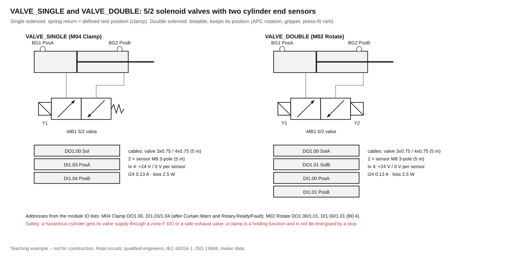

| Kind | Item | Detail |
|---|---|---|
| IO DO | `<group>.Sol` | solenoid |
| IO DI | `<group>.PosA` | end position A |
| IO DI | `<group>.PosB` | end position B |
| device | -MB Solenoid valve 5/2 single, spring return | BOM: Solenoid valve 5/2 single |
| device | -BG Cylinder sensor A | BOM: Cylinder sensor |
| device | -BG Cylinder sensor B | BOM: Cylinder sensor |
| cable | Valve cable | 3x0.75, 5 m |
| cable | Sensor cable M8 3-pole | 3x0.25, 5 m |
| cable | Sensor cable M8 3-pole | 3x0.25, 5 m |
| library data | i24 0.13 A · loss 2.5 W · tx 4 | B0.11, B0.12, B0.6 |

**Sizing rules.** Coil 24 V DC, typ. 1–3 W (0.04–0.13 A – the pattern i24 0.13 A contains both sensors and the coil); DO card output current ≥
coil current (0.5 A per channel is typical); valve terminals with fieldbus or IO-Link reduce wiring when more than ~6 valves sit together (then
replace the DO / DI by a bus device – a project variant, E11).

**PLC side.** Standard actuator FB (item 10): command → expected sensor within the monitoring time (e.g. 2 s) → else alarm "cylinder did not
reach end position"; both sensors 1 at the same time → sensor fault. Part of the module sequence in **Execute**; clamp pressure confirmed by
ANALOG_P (M02, M04).

**FAT test steps.** (1) Force `Sol` → valve LED, cylinder moves (at FAT with air connected or a test cylinder). (2) Each sensor at its end
position. (3) Remove power → spring return to the defined position. (4) Monitoring time alarm by blocking the cylinder.

**Typical faults.** Sensors swapped (A ↔ B); fail-safe position not agreed with the mechanics (part falls when power is off); valve exhaust
silencer blocked (slow return); sensor M8 cable without strain relief in the drag chain.

### B4.2 VALVE_DOUBLE – cylinder with double-solenoid 5/2 valve + 2 end sensors

**Purpose.** Cylinders that must **keep their position** when power fails (APC rotation, gripper, press-fit ram, robot gripper): a double-
solenoid valve is bistable – it stays in the last position.

**Schematic.** DO `SolA` → coil A (extend), DO `SolB` → coil B (retract), cable 4x0.75; sensors as VALVE_SINGLE; tx = 4.

| Kind | Item | Detail |
|---|---|---|
| IO DO | `<group>.SolA` | solenoid A |
| IO DO | `<group>.SolB` | solenoid B |
| IO DI | `<group>.PosA` | end position A |
| IO DI | `<group>.PosB` | end position B |
| device | -MB Solenoid valve 5/2 double | BOM: Solenoid valve 5/2 double |
| device | -BG Cylinder sensor A | BOM: Cylinder sensor |
| device | -BG Cylinder sensor B | BOM: Cylinder sensor |
| cable | Valve cable | 4x0.75, 5 m |
| cable | Sensor cable M8 3-pole | 3x0.25, 5 m |
| cable | Sensor cable M8 3-pole | 3x0.25, 5 m |
| library data | i24 0.13 A · loss 2.5 W · tx 4 | B0.11, B0.12, B0.6 |

**Sizing rules.** As VALVE_SINGLE; never energise both coils at the same time (the PLC FB interlocks them; with both on, the first one wins –
undefined); pulse operation (energise until the end sensor, then off) saves energy and coil heat.

**PLC side.** FB with two commands, interlocked; after power return the cylinder is where it was – the FB reads the sensors at **Resetting /
Starting** and does not move without a command. Gripper: `PartInGrip` sensor (M05) confirms the part before the robot moves.

**FAT test steps.** (1) Each coil → movement + sensor. (2) Power off in the middle of a movement → cylinder continues to the end of the selected
direction or stops (valve type!) – document. (3) Both coils forced → check interlock in the program (FAT of the program, item 10).

**Typical faults.** Bistable valve used where a safe position is required after e-stop (the gripper opens after a restart because the program
writes the last command); coils swapped.

---

## B5. Sensors

### B5.1 SENSOR – discrete sensor PNP (3-wire)

**Purpose.** Presence, position, end of travel, level: inductive, capacitive, optical, magnetic sensors and mechanical limit switches with
a PNP output (IEC 61131-2 type 1 / 3 inputs, IEC 60947-5-2).

**Schematic.** +24 V (brown, pin 1) / 0 V (blue, pin 3) from the supply terminals (tx = 2) → sensor → signal (black, pin 4) → DI `On`. Cable M12
3-pole (3x0.34), 10 m default.

| Kind | Item | Detail |
|---|---|---|
| IO DI | `<group>.On` | sensor signal |
| device | -BG Inductive / optical sensor PNP | BOM: Sensor PNP M12 |
| cable | Sensor cable M12 3-pole | 3x0.34, 10 m |
| library data | i24 0.03 A · loss 0 W · tx 2 | B0.11, B0.12, B0.6 |

**Sizing rules.** Current 10–30 mA per sensor (i24 0.03 A); switching distance with the real target material (reduction factors for stainless
/ aluminium); IP67 / IP69K near coolant; IO-Link sensors give diagnostics and parameters (replace the DI by an IO-Link port – E11).
Travel limits of the stacker crane (`TravLimF`, `TravLimR`) are **operational** limits; the safety-relevant end limits are separate devices
in the safety concept (EN 528) – do not use a standard SENSOR as safety limit.

**PLC side.** Input debouncing (5–20 ms filter), plausibility (pallet present but RFID read fails → alarm); `Status.Bits` bit 6 `PartPresent`
of the data block is typically the presence sensor of the hand-over place (guide 66 H2.1).

**FAT test steps.** (1) Target in front → DI 1, LED; removed → 0. (2) Cable break → 0 (and with IO-Link: diagnosis). (3) Short circuit on the
sensor supply → only that ECB channel trips (selectivity, guide 67 D4).

**Typical faults.** NPN sensor ordered for a PNP card; sensor supply from a different 0 V than the card (no common reference); sensor mounted
in the drag chain area without protection.

### B5.2 ANALOG_P – pressure transmitter 4–20 mA

**Purpose.** Measure air, hydraulic, coolant or clamping pressure continuously (clamp pressure OK, system pressure, filter differential, leak
test pressure).

**Schematic.** Two-wire loop: +24 V loop supply (tx = 1) → transmitter → AI `Value` (the AI card measures the loop current); shielded cable
3x0.34 + shield, shield on one side (cabinet) or both sides with equipotential bonding (EMC rule of the plant).

| Kind | Item | Detail |
|---|---|---|
| IO AI | `<group>.Value` | pressure 4-20 mA |
| device | -BP Pressure transmitter 4-20 mA | BOM: Pressure transmitter |
| cable | Sensor cable, shielded | 3x0.34 + shield, 10 m |
| library data | i24 0.025 A · loss 0 W · tx 1 | B0.11, B0.12, B0.6 |

**Sizing rules.** Range so that the normal value is at 30–70 % of the span; 4 mA = 0 (live zero → wire break detectable below 3.6 mA, NAMUR
NE 43); accuracy class; AI card resolution (typ. 15 bit + sign); loop burden ≤ card's maximum.

**PLC side.** Scaling raw → bar; limits (warning / alarm) with hysteresis; clamp pressure OK → `ClampPressureOK` (M04 data-block word 20 bit2);
leak test pressure curve recorded for traceability (M14 – the test result itself usually comes over the bus from the tester).

**FAT test steps.** Inject 4 / 12 / 20 mA with a loop calibrator → 0 / 50 / 100 % on the HMI; 3.6 mA → wire-break alarm; 21 mA → overrange.

**Typical faults.** Shield on both ends without bonding (hum); range of the transmitter not equal to the scaling in the PLC; transmitter
mounted where pressure peaks destroy it (no snubber).

### B5.3 ANALOG_T – temperature transmitter Pt100 → 4–20 mA

**Purpose.** Measure tank temperature (washer), room temperature (CMM – measurement accuracy depends on it), coolant temperature, oil
temperature.

**Schematic.** Pt100 in a protection tube with head transmitter (4–20 mA, 2-wire) → AI `Value`; tx = 1 (loop supply); shielded cable.

| Kind | Item | Detail |
|---|---|---|
| IO AI | `<group>.Value` | temperature 4-20 mA |
| device | -BT Pt100 with head transmitter 4-20 mA | BOM: Temperature transmitter |
| cable | Sensor cable, shielded | 3x0.34 + shield, 10 m |
| library data | i24 0.025 A · loss 0 W · tx 1 | B0.11, B0.12, B0.6 |

**Sizing rules.** Range (e.g. 0–100 °C washer, 15–25 °C CMM room → choose a narrow range for good resolution); class A / B Pt100; response time
of the protection tube.

**PLC side.** Washer: heater control (B1.4) and "temperature OK" condition for **Execute**; CMM: room temperature logged with every measurement;
alarm when outside the allowed band (the CMM result is not valid – M11 `ResultValid`).

**FAT test steps.** Simulate with a Pt100 simulator / decade resistor at the transmitter or inject current: 0 / 50 / 100 °C → expected value;
wire break → alarm.

**Typical faults.** Transmitter range set to 0–150 °C while the PLC scales 0–100 °C; sensor outside the tank liquid at low level (reads air).

### B5.4 RFID – RFID read/write head (IO-Link)

**Purpose.** Identify pallets, carriers, tools (data carrier on the pallet or tool holder): pallet ID → `Job.PalletId` (data-block words 14–15,
guide 66 H2.1); tool ID → tool data from the presetter (M09).

**Schematic.** IO-Link port of an IO-Link master (part of the IO station or a separate master) → RFID head; cable M12 4-pole. No discrete IO in
the library pattern – the data come over IO-Link process data.

| Kind | Item | Detail |
|---|---|---|
| device | -BG RFID read/write head, IO-Link | BOM: RFID head |
| cable | IO-Link cable M12 4-pole | 4x0.34, 10 m |
| library data | i24 0.25 A · loss 3 W · tx 0 | B0.11, B0.12, B0.6 |

**Sizing rules.** Frequency band (HF 13.56 MHz typical for pallets / tools – short range, robust near metal with the right tags; UHF for longer
range); read distance and speed; metal mounting of tags; IO-Link master ports available (the library counts the head; the IO-Link master
port is part of the station in real projects – add a master if the station has no IO-Link port).

**PLC side.** Read on arrival (presence sensor + "read" command) → ID to the module FB → data block; write on departure (e.g. operation
done). Read error → retry → alarm and the pallet goes to the load station for manual check (cell controller rule, item 10).

**FAT test steps.** Read and write a test tag at the nominal distance; read error with a missing tag → alarm; IO-Link diagnostics.

**Typical faults.** Tag mounted on the wrong side after a pallet rebuild; two tags in the field (reads the neighbour pallet); IO-Link cable
longer than 20 m.

---

## B6. Operator devices

### B6.1 PUSHBUTTON – illuminated push-button

**Purpose.** Operator commands at a station: release / done (load station), pick-to-light confirmation (assembly), reset (M18), access
request (inside DOOR_LOCK the request button is part of that pattern).

**Schematic.** +24 V (tx = 1) → button NO → DI `Pb`; DO `Lamp` → LED lamp → 0 V. Cable 4x0.5. Colours by IEC 60204-1 10.2 / 10.3: reset blue,
start white / green, stop black / red (not the e-stop), lamp colours: red = danger, yellow = abnormal, green = normal, blue = action required,
white = information.

| Kind | Item | Detail |
|---|---|---|
| IO DI | `<group>.Pb` | push-button |
| IO DO | `<group>.Lamp` | lamp |
| device | -SF Illuminated push-button | BOM: Illuminated push-button |
| cable | Control cable | 4x0.5, 5 m |
| library data | i24 0.02 A · loss 0 W · tx 1 | B0.11, B0.12, B0.6 |

**Sizing rules.** LED lamp current 10–20 mA; IP65 at stations; the **reset** button of a safety function must be placed outside the zone with
view into it (guide 67 I6) – for the safety reset the button is read by the safety PLC (in M18 the `Reset` push-button goes to a standard DI
and the safety PLC uses it with edge detection – acceptable for the reset function when the safety program evaluates the falling edge and the
reset circuit is designed per ISO 13849 for the reset; if your safety concept requires, wire the reset to an F-DI).

**PLC side.** Button → command into the module FB (e.g. `LS.OperatorRelease`, data-block word 20 bit0 of M04); lamp flashing = "action
required", steady = "confirmed".

**FAT test steps.** Press → DI; force lamp → lamp on; colour and text label check.

**Typical faults.** Wrong colour (green reset); reset button inside the zone; button used for two functions (short / long press) without
operator training.

### B6.2 SIGNAL_TOWER – signal tower 3 colours + buzzer

**Purpose.** Show the module state from far: red = fault / e-stop, yellow = warning / waiting for operator, green = automatic running; buzzer
for operator call.

**Schematic.** DO `Red`, `Yellow`, `Green`, `Buzzer` → tower elements; common 0 V (tx = 1); cable 7x0.5.

| Kind | Item | Detail |
|---|---|---|
| IO DO | `<group>.Red` | red |
| IO DO | `<group>.Yellow` | yellow |
| IO DO | `<group>.Green` | green |
| IO DO | `<group>.Buzzer` | buzzer |
| device | -PF Signal tower LED + buzzer | BOM: Signal tower |
| cable | Control cable | 7x0.5, 10 m |
| library data | i24 0.2 A · loss 3 W · tx 1 | B0.11, B0.12, B0.6 |

**Sizing rules.** LED elements (≈ 0.05 A each); buzzer volume above the hall noise (dB(A) + 10 dB); mounting height visible from the
operator places; plant standard for colours (ISA-101 / VDI 3699 style – one colour meaning for the whole factory).

**PLC side.** Mapping from the PackML state (guide 65): Execute → green steady; Suspended / Held (waiting for material / operator) → yellow;
Aborted / Stopped with alarm → red; operator call → buzzer for 5 s + yellow flashing. The same mapping in every module (item 10 library FB).

**FAT test steps.** Force each colour and the buzzer; check the mapping in each PackML state with the simulator.

**Typical faults.** Different colour meaning per supplier (green = "power on" at one, "automatic" at another); permanent buzzer → operators
disconnect it.

### B6.3 HMI – HMI panel

**Purpose.** Local operator panel at a station (load station M04 shows job, part, pallet, instructions; SCADA client M20).

**Schematic.** 24 V supply from an ECB channel; Industrial Ethernet to the cell switch; no IO in the library.

| Kind | Item | Detail |
|---|---|---|
| device | -PF HMI touch panel 15 inch | BOM: HMI panel |
| cable | Industrial Ethernet cable, shielded | 4x0.34 (PROFINET / Ethernet), 10 m |
| library data | i24 1.2 A · loss 25 W · tx 0 | B0.11, B0.12, B0.6 |

**Sizing rules.** 1.2 A at 24 V for a 15-inch panel (maker's data: 10-inch ~0.6–0.9 A); front IP65; screen size by the information density;
mounting at ergonomic height (1.2–1.6 m centre).

**PLC side.** Standard screens per module (item 10): state, mode, alarms, job / pallet, handshake; e-stop button **not** on the touch screen
(hardware e-stop next to it).

**FAT test steps.** Panel boots, connects, shows all screens with the simulated module; touch calibration; screen saver vs safety
(information must stay visible when needed).

**Typical faults.** HMI used to command safety-relevant actions (mode change without key); no IP address plan (guide 66 G); panel mounted in
direct sunlight.

---

## B7. Communication and control

### B7.1 BUS – fieldbus / Ethernet connection to a device with its own controller

**Purpose.** Connect a device that has its own controller to the cell network: CNC (M01), robot controller (M05, M15), presetter (M09),
CMM (M11), code reader (M12), nutrunner (M13), tester (M14), energy meter (M17), position laser of the stacker crane (M03, M08).

**Schematic.** Port on the cell switch (M22) or on the module's switch → shielded Industrial Ethernet cable 4x0.34 (PROFINET / Ethernet
category 5e, green PROFINET cable or a plant standard) → device. 15 m default.

| Kind | Item | Detail |
|---|---|---|
| device | -KF Bus port (device controller) | BOM: Bus connection (port on the cell switch) |
| cable | Industrial Ethernet cable, shielded | 4x0.34 (PROFINET / Ethernet), 15 m |
| library data | i24 0 A · loss 0 W · tx 0 | B0.11, B0.12, B0.6 |

**Sizing rules.** Max 100 m per Ethernet segment (copper); protocol by guide 66 (PROFINET IO, OPC UA, MTConnect, Modbus TCP); IP address and
VLAN from the IP plan (guide 66 G); the BOM item "Bus connection (port on the cell switch)" reminds the network designer to count ports
(M22 switches have 8 ports in the library – count the kit's BUS + VFD + HMI + IPC cables, D4).

**PLC side.** The device's status and data map into the module's data block (guide 66 H2.3): M01 CNC → `NC.ProgramNo`, `NC.SpindleLoad_pct`
…; heartbeat both ways (words 18 / 19).

**FAT test steps.** Link LED, ping, protocol connection, data exchange with a simulator of the device; cable test (certification) for long
cables.

**Typical faults.** Unshielded office cable in the hall; port count of the switch too small; IP address conflicts after copying a module.

### B7.2 HANDSHAKE_HW – hard-wired handshake (machine / AGV without fieldbus)

**Purpose.** Exchange the hand-over signals (guide 66 H4: Ready → Request → Busy → Done) with a partner that has **no fieldbus** to the cell:
an older machine, an AGV through an optical / infrared coupler (E84-style parallel IO at a dock), a supplier's machine with a simple parallel
interface.

**Schematic.** Partner outputs → coupling relay module `-KF1` (8 channels, potential separation) → DI `Ready`, `Busy`, `Done`, `Fault`; DO
`Request`, `Ack`, `Enable`, `Reset` → relays → partner inputs. Cable 12x0.75; tx = 2.

| Kind | Item | Detail |
|---|---|---|
| IO DI | `<group>.Ready` | partner ready |
| IO DI | `<group>.Busy` | partner busy |
| IO DI | `<group>.Done` | partner done |
| IO DI | `<group>.Fault` | partner fault |
| IO DO | `<group>.Request` | request to partner |
| IO DO | `<group>.Ack` | acknowledge to partner |
| IO DO | `<group>.Enable` | enable / permission |
| IO DO | `<group>.Reset` | fault reset |
| device | -KF Coupling relay module 8 channels | BOM: Coupling relay module 8 ch |
| cable | Control cable | 12x0.75, 20 m |
| library data | i24 0.2 A · loss 3 W · tx 2 | B0.11, B0.12, B0.6 |

**Sizing rules.** Relay contact ratings for the partner's input type; potential separation (each side its own 24 V); **not safety** – safety
signals to the partner use COUPLING. For AGV docks, the optical coupler (e.g. E84-style parallel IO) replaces the cable; the library keeps the
signal set identical.

**PLC side.** The handshake FB (guide 66 H8, item 9) runs the four phases with timeouts; the same FB is used for bus partners – only the signal
source changes (hard-wired bits vs data-block bits). Data block M06 word 20 / 21 (`Dock.ReadyToGive`, `Dock.AGVPresent` …).

**FAT test steps.** Handshake simulator (switch box with 4 switches and 4 lamps) → run the four phases, timeouts and fault reset.

**Typical faults.** Common 0 V with the partner; `Done` as a pulse shorter than the PLC cycle (missed); no timeout → module waits forever.

### B7.3 IPC – industrial PC (fanless)

**Purpose.** Cell controller (M19, the `fmsctl` software), SCADA server / client (M20), edge gateway.

**Schematic.** 24 V DC from a buffered channel (DC UPS) → IPC; Industrial Ethernet to the cell switch.

| Kind | Item | Detail |
|---|---|---|
| device | -KF Industrial PC, fanless | BOM: Industrial PC |
| cable | Industrial Ethernet cable, shielded | 4x0.34 (PROFINET / Ethernet), 5 m |
| library data | i24 2.5 A · loss 40 W · tx 0 | B0.11, B0.12, B0.6 |

**Sizing rules.** 2.5 A at 24 V = 60 W (fanless IPC class); 40 W loss in the cabinet; buffer time of the DC UPS ≥ the shutdown time of the
operating system + database (guide 67 D7.3); industrial temperature range.

**PLC side.** The IPC is the master of the cell coordination: Modbus TCP / OPC UA client to every module's data block (guide 66 H), job
dispatch, heartbeat; reads UPS signals and shuts down cleanly.

**FAT test steps.** Boot, software start, connection to all module simulators; UPS: remove 400 V → `OnBattery` → orderly shutdown after the
set time; restart on power return.

**Typical faults.** Office PC in the cabinet (fan clogs, dies in summer); no UPS → corrupted database; Windows updates during production
(the cell PC is managed like OT, guide 66 J).

### B7.4 SWITCH – managed industrial switch

**Purpose.** The network of a module or of the cell (M22 core switches, M19 cabinet switch): VLANs, redundancy (ring with MRP / RSTP),
diagnostics (SNMP, LLDP).

**Schematic.** 24 V supply (redundant inputs from two channels if available); copper ports to devices; fibre uplinks between cabinets.

| Kind | Item | Detail |
|---|---|---|
| device | -KF Managed industrial switch 8 ports | BOM: Managed switch |
| library data | i24 0.4 A · loss 8 W · tx 0 | B0.11, B0.12, B0.6 |

**Sizing rules.** Port count (ports used + 20 % reserve), PROFINET conformance class if PROFINET devices are behind it, managed features for
VLANs and the security zones (IEC 62443, guide 66 J).

**PLC side.** Switch diagnostics (port down) into the alarm list of M22 via SNMP or PROFINET diagnostics.

**FAT test steps.** Configuration loaded (VLANs, ring), ring break test (redundancy switchover time), port mirror for diagnosis available.

**Typical faults.** Unmanaged switches in a PROFINET network (no diagnostics, broadcast storms); configuration not backed up.

### B7.5 FIREWALL – industrial firewall

**Purpose.** Separate the cell network (OT) from the plant network (IT / MES) – the conduit of the zones-and-conduits model (guide 66 J,
IEC 62443).

**Schematic.** 24 V supply; two (or more) Ethernet ports: cell side / plant side.

| Kind | Item | Detail |
|---|---|---|
| device | -KF Industrial firewall | BOM: Industrial firewall |
| library data | i24 0.5 A · loss 10 W · tx 0 | B0.11, B0.12, B0.6 |

**Sizing rules.** Throughput for MES / historian traffic; rule set "deny all, allow listed" (OPC UA / MQTT ports only); remote access through
a jump host, never direct.

**PLC side.** No PLC logic; its status ("link up") is part of the network diagnosis of M22.

**FAT test steps.** Rule set test (allowed connection works, all others blocked), logging enabled, configuration backup.

**Typical faults.** "Allow any" rule left from commissioning; firewall bypassed by a second network cable for remote service.

### B7.6 UPS_DC – 24 V DC UPS module + battery

**Purpose.** Keep the cell controller, the network and (optionally) the safety PLC running during short voltage dips and allow an orderly
shutdown during longer outages (guide 67 B8, D7.3).

**Schematic.** PSU output → DC UPS module `-TB1` → buffered 24 V output (to IPC, switch, safety PLC); battery module; signal contacts → DI
`UpsOk`, `OnBattery`.

| Kind | Item | Detail |
|---|---|---|
| IO DI | `<group>.UpsOk` | UPS ready |
| IO DI | `<group>.OnBattery` | running on battery |
| device | -TB 24 V DC UPS module + battery | BOM: DC UPS module |
| library data | i24 0.2 A · loss 10 W · tx 0 | B0.11, B0.12, B0.6 |

**Sizing rules.** Buffer current = Σ of the buffered loads (M19: IPC 2.5 A + switch 0.4 A + station …); buffer time (e.g. 5 min for shutdown);
battery capacity Ah = I × t / (depth of discharge × ageing factor); the PSU must deliver load + battery charging current; battery life
(temperature – 10 °C more halves the life).

**PLC side.** `OnBattery` → cell controller starts the shutdown timer, saves data, informs MES; `UpsOk` = 0 → maintenance alarm (battery end of
life).

**FAT test steps.** Remove the PSU input → loads stay on, `OnBattery` = 1, shutdown sequence; battery test function; `UpsOk` with the battery
disconnected.

**Typical faults.** Battery never replaced (life 3–5 years); UPS output also feeds the valves (empty in seconds); no shutdown logic → the UPS
only delays the crash.

---

## B8. The 24 V distribution of a module

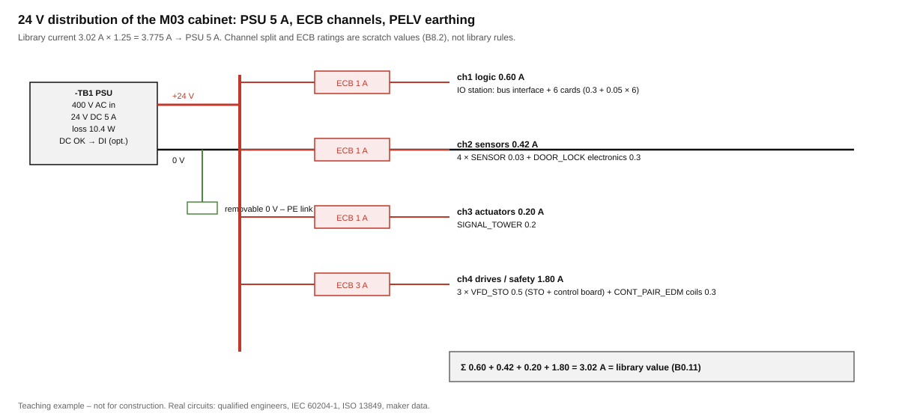

### B8.1 Theory (from guide 67 D)

The 24 V supply of a module cabinet follows guide 67 D: one PSU sized with 25 % reserve, **separate ECB channels** for logic (IO station,
safety, network), sensors, actuators (valves) and safety devices / drives' STO inputs, 0 V connected to PE at **one** point (PELV), DC OK
contact of the PSU to a DI (optional), and a DC UPS where the controller must survive dips.

The library gives the **total** current; the split into channels is a project step. Recommended channel split (rule of thumb):

| Channel | Loads (library patterns) | Why separate |
|---|---|---|
| ch1 logic | IO station, SAFETY_PLC, SWITCH, IPC, FIREWALL | a sensor short must never reset the PLC |
| ch2 sensors | SENSOR, ANALOG_P / T, RFID, cylinder sensors of valves, LC, SCANNER, DOOR_LOCK electronics | field cables have the highest fault rate |
| ch3 actuators | valve coils, signal tower, lamps, HANDSHAKE relays | inductive loads, switching peaks |
| ch4 drives / safety | VFD_STO control supply and STO, CONT_PAIR_EDM coils, COUPLING | safety-related loads, often required separate by the safety concept |
| ch5 HMI | HMI panels | big single load, inrush |

### B8.2 Worked example – M03 pallet pool

From the instance list (C3): CONT_PAIR_EDM 0.3 A, 3 × VFD_STO 1.5 A, DOOR_LOCK 0.3 A, 4 × SENSOR 0.12 A, SIGNAL_TOWER 0.2 A, station 0.6 A → **3.02
A**, PSU 5 A (3.775 A needed). Split: ch1 logic = station 0.6 A; ch2 sensors = 0.12 + door 0.3 = 0.42 A; ch3 actuators = tower 0.2 A; ch4 drives
/ safety = 1.5 + 0.3 = 1.8 A. ECB ratings (guide 67 D3: smallest rating ≥ 1.25 × channel current, ratings 1 / 2 / 3 / 4 / 6 / 8 / 10 A as an
example): ch1 0.75 A → 1 A; ch2 0.525 A → 1 A; ch3 0.25 A → 1 A; ch4 2.25 A → 3 A. (Scratch values: the channel split is not a library rule.)

### B8.3 Checklist

- [ ] PSU = library value or larger; DC OK wired; losses in the thermal check.
- [ ] Channels separated (logic / sensors / actuators / safety); ECB per channel.
- [ ] 0 V – PE link at one point, removable for insulation measurement.
- [ ] Line length check for long field supplies (guide 67 D5).

---

## B9. Pattern summary table and checklist

| Pattern | IO | DI | DO | AI | FDI | FDO | Dev | Cab | i24 A | Loss W | tx | Instances in the library |
|---|---|---|---|---|---|---|---|---|---|---|---|---|
| `FEEDER_EXT` | 1 | 1 | 0 | 0 | 0 | 0 | 1 | 1 | 0 | 5 | 0 | 9 |
| `BUS` | 0 | 0 | 0 | 0 | 0 | 0 | 1 | 1 | 0 | 0 | 0 | 11 |
| `COUPLING` | 6 | 0 | 0 | 0 | 4 | 2 | 1 | 1 | 0.1 | 2 | 2 | 3 |
| `HANDSHAKE_HW` | 8 | 4 | 4 | 0 | 0 | 0 | 1 | 1 | 0.2 | 3 | 2 | 1 |
| `DOL` | 3 | 2 | 1 | 0 | 0 | 0 | 3 | 1 | 0.1 | 5 | 0 | 11 |
| `VFD_STO` | 3 | 2 | 0 | 0 | 0 | 1 | 3 | 2 | 0.5 | 3 % kW | 0 | 8 |
| `CONT_PAIR_EDM` | 2 | 0 | 0 | 0 | 1 | 1 | 2 | 0 | 0.3 | 6 | 0 | 2 |
| `DOOR_LOCK` | 6 | 1 | 0 | 0 | 4 | 1 | 2 | 1 | 0.3 | 2 | 2 | 4 |
| `DOOR_2CH` | 2 | 0 | 0 | 0 | 2 | 0 | 2 | 2 | 0.05 | 0 | 2 | 3 |
| `ESTOP` | 2 | 0 | 0 | 0 | 2 | 0 | 1 | 1 | 0 | 0 | 0 | 11 |
| `ENABLE` | 2 | 0 | 0 | 0 | 2 | 0 | 1 | 1 | 0 | 0 | 0 | 2 |
| `MODE_SWITCH` | 2 | 0 | 0 | 0 | 2 | 0 | 1 | 1 | 0 | 0 | 0 | 3 |
| `LC` | 3 | 1 | 0 | 0 | 2 | 0 | 1 | 2 | 0.6 | 6 | 4 | 4 |
| `SCANNER` | 5 | 1 | 2 | 0 | 2 | 0 | 1 | 1 | 0.5 | 6 | 2 | 2 |
| `TWOHAND` | 4 | 0 | 0 | 0 | 4 | 0 | 1 | 1 | 0 | 0 | 0 | 2 |
| `VALVE_SINGLE` | 3 | 2 | 1 | 0 | 0 | 0 | 3 | 3 | 0.13 | 2.5 | 4 | 8 |
| `VALVE_DOUBLE` | 4 | 2 | 2 | 0 | 0 | 0 | 3 | 3 | 0.13 | 2.5 | 4 | 4 |
| `SAFE_VALVE` | 4 | 0 | 0 | 0 | 2 | 2 | 1 | 2 | 0.5 | 10 | 2 | 1 |
| `SENSOR` | 1 | 1 | 0 | 0 | 0 | 0 | 1 | 1 | 0.03 | 0 | 2 | 47 |
| `ANALOG_P` | 1 | 0 | 0 | 1 | 0 | 0 | 1 | 1 | 0.025 | 0 | 1 | 6 |
| `ANALOG_T` | 1 | 0 | 0 | 1 | 0 | 0 | 1 | 1 | 0.025 | 0 | 1 | 2 |
| `PUSHBUTTON` | 2 | 1 | 1 | 0 | 0 | 0 | 1 | 1 | 0.02 | 0 | 1 | 3 |
| `SIGNAL_TOWER` | 4 | 0 | 4 | 0 | 0 | 0 | 1 | 1 | 0.2 | 3 | 1 | 5 |
| `HEATER` | 3 | 2 | 1 | 0 | 0 | 0 | 4 | 2 | 0.1 | 8 | 0 | 1 |
| `SAFETY_PLC` | 0 | 0 | 0 | 0 | 0 | 0 | 1 | 1 | 0.8 | 15 | 0 | 1 |
| `IPC` | 0 | 0 | 0 | 0 | 0 | 0 | 1 | 1 | 2.5 | 40 | 0 | 2 |
| `HMI` | 0 | 0 | 0 | 0 | 0 | 0 | 1 | 1 | 1.2 | 25 | 0 | 2 |
| `RFID` | 0 | 0 | 0 | 0 | 0 | 0 | 1 | 1 | 0.25 | 3 | 0 | 2 |
| `UPS_DC` | 2 | 2 | 0 | 0 | 0 | 0 | 1 | 0 | 0.2 | 10 | 0 | 2 |
| `SWITCH` | 0 | 0 | 0 | 0 | 0 | 0 | 1 | 0 | 0.4 | 8 | 0 | 3 |
| `FIREWALL` | 0 | 0 | 0 | 0 | 0 | 0 | 1 | 0 | 0.5 | 10 | 0 | 1 |
| `ZONE_OUT` | 2 | 0 | 0 | 0 | 1 | 1 | 1 | 1 | 0.05 | 1 | 0 | 4 |

How to read it: the last column counts the instances in the 22 library modules and shows how often each pattern is re-used – SENSOR, ESTOP, BUS and VALVE_SINGLE are the
workhorses; SAFE_VALVE and HEATER are used once. A pattern used in many modules deserves the most careful engineering and FAT procedure.

Checklist for every pattern instance: G5 (library and modules, safety).

---

# Part C – The module library M01–M22

## C0. How a module chapter is built; all 22 modules in one table

### C0.1 The blocks of a module chapter

Every module chapter has the same blocks: **scope and interfaces** (machine builder / supplier vs cell, guide 67 A6) · **summary** (B0
rules) · **instance list** (the library definition) · **IO list** (full table with address, tag, type, description and terminal for M01, M03,
M04, M06, M10, M15, M16; for the other modules the instance list with its signals – the full list is printed by `circuit_library.py --module
Mxx`) · **devices** · **motors and power** (B0.9, B0.10) · **24 V, PSU, losses** (B0.11, B0.12) · **cables and BOM** (B0.7, B0.8) · **safety**
(guide 67 SF1–SF6, zones) · **sheets** (A4 numbering, generated) · **data block and PackML** (guide 66 H) · **use case and mistakes**.

### C0.2 All 22 modules in one table

| Mod | Unit | IO | DI | DO | AI | FDI | FDO | Cards | XD2 | Cab / m | Dev | i24 A | PSU | P kW | S kVA | I_inst A | Feeder | Loss W |
|---|---|---|---|---|---|---|---|---|---|---|---|---|---|---|---|---|---|---|
| M01 | MC01 | 8 | 2 | 0 | 0 | 4 | 2 | 3 | 12 | 4 / 60 | 4 | 0.58 | 2.5 | 22.84 | 26.864 | 64.63 | 80 A / 35 mm² | 19.2 |
| M02 | APC01 | 10 | 6 | 3 | 1 | 0 | 0 | 3 | 23 | 9 / 60 | 9 | 0.795 | 2.5 | 0.04 | 0.042 | 0.10 | 6 A / 1.5 mm² | 17.2 |
| M03 | POOL01 | 31 | 11 | 4 | 0 | 11 | 5 | 6 | 42 | 16 / 149 | 22 | 3.02 | 5 | 14.08 | 17.154 | 35.40 | 40 A / 10 mm² | 631.4 |
| M04 | LS01 | 20 | 8 | 6 | 1 | 4 | 1 | 5 | 35 | 15 / 128 | 15 | 3.535 | 5 | 0.605 | 0.721 | 1.52 | 6 A / 1.5 mm² | 81.4 |
| M05 | ROB01 | 25 | 6 | 4 | 0 | 12 | 3 | 5 | 37 | 10 / 105 | 11 | 1.61 | 2.5 | 2.54 | 2.82 | 8.12 | 10 A / 1.5 mm² | 31.7 |
| M06 | AGVST01 | 19 | 10 | 7 | 0 | 2 | 0 | 3 | 29 | 6 / 75 | 8 | 1.34 | 2.5 | 0.299 | 0.356 | 0.75 | 6 A / 1.5 mm² | 26.2 |
| M07 | CONV01 | 23 | 16 | 5 | 0 | 2 | 0 | 4 | 43 | 16 / 145 | 22 | 1.24 | 2.5 | 1.195 | 1.449 | 3.00 | 6 A / 1.5 mm² | 33.2 |
| M08 | ASRS01 | 33 | 13 | 4 | 0 | 11 | 5 | 6 | 48 | 18 / 169 | 24 | 3.08 | 5 | 19.82 | 24.154 | 49.83 | 50 A / 16 mm² | 877.4 |
| M09 | TOOL01 | 3 | 3 | 0 | 0 | 0 | 0 | 1 | 7 | 5 / 60 | 5 | 0.66 | 2.5 | 0.54 | 0.568 | 1.62 | 6 A / 1.5 mm² | 18.2 |
| M10 | WASH01 | 22 | 12 | 5 | 1 | 4 | 0 | 4 | 33 | 14 / 140 | 22 | 1.165 | 2.5 | 22.049 | 22.683 | 43.19 | 50 A / 16 mm² | 38.7 |
| M11 | CMM01 | 3 | 2 | 0 | 1 | 0 | 0 | 2 | 6 | 4 / 50 | 4 | 0.455 | 2.5 | 3.64 | 4.042 | 9.72 | 10 A / 1.5 mm² | 16.2 |
| M12 | MARK01 | 10 | 6 | 2 | 0 | 2 | 0 | 3 | 18 | 9 / 90 | 11 | 0.76 | 2.5 | 1.165 | 1.3 | 2.91 | 6 A / 1.5 mm² | 24.7 |
| M13 | ST01 | 20 | 9 | 3 | 0 | 8 | 0 | 4 | 37 | 14 / 125 | 13 | 1.37 | 2.5 | 0.79 | 0.832 | 2.38 | 6 A / 1.5 mm² | 26.7 |
| M14 | TEST01 | 16 | 7 | 6 | 1 | 2 | 0 | 4 | 32 | 14 / 120 | 14 | 1.095 | 2.5 | 0.64 | 0.674 | 1.62 | 6 A / 1.5 mm² | 26.2 |
| M15 | WELD01 | 29 | 12 | 1 | 0 | 12 | 4 | 6 | 45 | 15 / 178 | 18 | 2.32 | 5 | 18.15 | 20.505 | 49.18 | 50 A / 16 mm² | 78.4 |
| M16 | PRESS01 | 25 | 9 | 3 | 1 | 10 | 2 | 6 | 44 | 15 / 125 | 15 | 2.075 | 5 | 10.58 | 12.886 | 26.60 | 32 A / 6 mm² | 43.9 |
| M17 | UTIL01 | 7 | 4 | 1 | 2 | 0 | 0 | 3 | 13 | 6 / 70 | 8 | 0.66 | 2.5 | 3.89 | 4.735 | 9.78 | 10 A / 1.5 mm² | 17.2 |
| M18 | SAFE01 | 20 | 1 | 5 | 0 | 10 | 4 | 6 | 22 | 10 / 123 | 10 | 1.82 | 2.5 | 0.04 | 0.042 | 0.10 | 6 A / 1.5 mm² | 37.2 |
| M19 | CC01 | 2 | 2 | 0 | 0 | 0 | 0 | 1 | 2 | 1 / 5 | 3 | 3.45 | 5 | 0.08 | 0.084 | 0.20 | 6 A / 1.5 mm² | 73.4 |
| M20 | SCADA01 | 0 | 0 | 0 | 0 | 0 | 0 | 0 | 0 | 2 / 15 | 2 | 3.7 | 5 | 0.08 | 0.084 | 0.20 | 6 A / 1.5 mm² | 75.4 |
| M21 | MESCON01 | 0 | 0 | 0 | 0 | 0 | 0 | 0 | 0 | 0 / 0 | 0 | 0 | 0 | 0 | 0 | 0.00 | – | 0.0 |
| M22 | NET01 | 2 | 2 | 0 | 0 | 0 | 0 | 1 | 2 | 0 / 0 | 4 | 1.85 | 2.5 | 0.04 | 0.042 | 0.10 | 6 A / 1.5 mm² | 46.2 |

Read the table like a catalogue: the **big IO modules** are the stacker cranes (M03 31, M08 33) and the robot / welding / press cells (M05, M15,
M16 25–29 IO, many of them safety IO). The **big power modules** are the machine tool feeder M01 (80 A), the washer M10 (heater, 50 A), the
welding cell M15 (welding power source, 50 A) and the AS/RS M08 (50 A). The **big heat** sources are the cabinets with inverters (M03 631 W, M08
877 W). M21 (MES / ERP connector) is software on a server – it has no field circuit at all, but it stays in the library so that every module
of the standard has an entry.

---

## C1. M01 – Machine tool interface (cell side)

### C1.1 Scope and interfaces

A machining centre (HMC) comes **complete** from the machine builder: its own cabinet, CNC, drives, safety system (ISO 16090-1), main switch,
door with guard locking and its own e-stop circuit. The cell must not touch these internals. Module M01 is therefore the **cell side** of the
machine: the feeder from the cell distribution board, the hard-wired safety coupling, the bus connection to the CNC and one cell sensor (pallet
at the APC hand-over). The APC itself is module M02 when it is delivered separately (or part of the machine – then M02 is omitted or reduced).

| Interface | Machine builder | Cell (M01) |
|---|---|---|
| Power | main switch `-QB1` in the machine cabinet, everything behind it | feeder breaker, feeder cable to the main switch (B1.1) |
| Safety | machine safety, its door, its e-stop, its stop categories | coupling terminals, cell e-stop out, zone signals (B3.3, guide 67 I4) |
| Data | CNC, its interface (OPC UA / MTConnect / PROFINET) | network port, data block words 0–19 + NC part (guide 66 H2.3) |
| Pallet hand-over | APC mechanics and its sensors | sensor `PalAtApc` on the pool side |

### C1.2 Summary and instance list

**Summary MC01:** IO 8 (DI 2, FDI 4, FDO 2) · cards DI 1, FDI 1, FDO 1 (spare DI 14, FDI 4, FDO 2) · -XD2 12 terminals · 4 cables / 60 m
· 4 devices (BG 1, FC 1, KF 2) · 24 V 0.58 A → PSU 2.5 A · demand 22.84 kW / 26.864 kVA / 38.78 A · I_inst 64.63 A → feeder 80 A / 35
mm² · losses 19.2 W · longest tag 36 characters.

| # | Group (instance) | Pattern | Parameters | IO | Dev | Cab | i24 A | Loss W | tx |
|---|---|---|---|---|---|---|---|---|---|
| 1 | Supply | `FEEDER_EXT` | kW 38, ku 0.6, cos 0.85 | 1 DI | 1 | 1 | 0 | 5 | 0 |
| 2 | Safety | `COUPLING` | – | 4 FDI 2 FDO | 1 | 1 | 0.1 | 2 | 2 |
| 3 | Cnc | `BUS` | – | – | 1 | 1 | 0 | 0 | 0 |
| 4 | PalAtApc | `SENSOR` | – | 1 DI | 1 | 1 | 0.03 | 0 | 2 |

### C1.3 IO list

| # | Address | Tag | Type | Description | -XD2 |
|---|---|---|---|---|---|
| 1 | DI1.00 | `PLT1.MACH.FMS1.MC01.Supply.SupplyOn` | DI | feeder breaker ON (auxiliary contact) | 1 |
| 2 | FDI1.00 | `PLT1.MACH.FMS1.MC01.Safety.EstopIn` | FDI | e-stop OK from the machine, channel 1 | 2 |
| 3 | FDI1.01 | `PLT1.MACH.FMS1.MC01.Safety.EstopIn2` | FDI | e-stop OK from the machine, channel 2 | 3 |
| 4 | FDI1.02 | `PLT1.MACH.FMS1.MC01.Safety.ZoneFree` | FDI | machine loading zone free, channel 1 | 4 |
| 5 | FDI1.03 | `PLT1.MACH.FMS1.MC01.Safety.ZoneFree2` | FDI | machine loading zone free, channel 2 | 5 |
| 6 | FDO1.00 | `PLT1.MACH.FMS1.MC01.Safety.EstopOut` | FDO | cell e-stop OK to the machine (2-channel F-DO) | 6 |
| 7 | FDO1.01 | `PLT1.MACH.FMS1.MC01.Safety.EnableOut` | FDO | cell zone safe -> machine may open / load | 7 |
| 8 | DI1.01 | `PLT1.MACH.FMS1.MC01.PalAtApc.On` | DI | sensor signal | 10 |

### C1.4 Devices

**Devices** (4): -FC1 Feeder circuit breaker 3-pole (Supply) · -KF1 Safety coupling terminal set (Safety) · -KF2 Bus connection (port on
the cell switch) (Cnc) · -BG1 Sensor PNP M12 (PalAtApc).

### C1.5 Power, 24 V, losses

_No motor in this module (no DOL / VFD_STO instance)._

The module has no motor of its own – the machine's 38 kW connected load (spindle, axes, coolant, chip conveyor, hydraulics) is one
FEEDER_EXT load with ku 0.6 and cos φ 0.85 (the same values as the item-7 load list).

(load table: B0.10 worked example.)

Demand: S = √(22.840² + 14.143²) = **26.864 kVA**, I = S·1000/(√3·400) = **38.78 A**. Installed: S_inst = √(38.067² + 23.572²) = 44.774 kVA, **I_inst = 64.63 A** → feeder breaker **In = 80 A** → required Iz = 80 / (0.87 × 0.77) = 119.42 A → cable **35 mm²** (table Iz 148 A).

24 V current = COUPLING 0.1 + SENSOR 0.03 + station (0.3 + 0.05 × 3 cards = 0.45) = **0.58 A**; × 1.25 = 0.725 A → **PSU 2.5 A**.

Losses = patterns 7 W + station 7 W + PSU 2.5 × 24 × (1/0.92 − 1) = 5.2 W → **19.2 W**.

### C1.6 Cables and BOM

**Cables** (4, 60 m): -WD1 Supply 4G35 15 m · -WD2 Safety 12x0.75 20 m · -WD3 Cnc 4x0.34 (PROFINET /
Ethernet) 15 m · -WD4 PalAtApc 3x0.34 10 m.

Note: the feeder cable's default length (15 m) is a placeholder. In the compressor factory MC02 stands 60 m from the cell board – the 35 mm²
cable passes the fault-loop check up to L_max 67.10 m (guide 67 C4.6). Since revision 2026-11-15 the WD1 cores are calculated (B0.14:
64.53 A → 80 A → 35 mm² → 4G35) instead of the old text "4G (size from the feeder calculation)". Use the instance parameter `len` in a project.

**BOM** (10 lines): 24 V power supply 2.5 A × 1 · Bus connection (port on the cell switch) × 1 · Control terminal × 12 · DI 16 card × 1
· FDI 8 card × 1 · FDO 4 card × 1 · Feeder circuit breaker 3-pole × 1 · IO station bus interface × 1 · Safety coupling terminal set × 1
· Sensor PNP M12 × 1.

### C1.7 Safety

- Coupling (guide 67 I4.2): cell e-stop → machine (`EstopOut`), machine e-stop → cell (`EstopIn`, `EstopIn2`), APC loading zone free
  (`ZoneFree`, `ZoneFree2`), cell zone safe → machine may perform the pallet change (`EnableOut`).
- Zone: Z-MC1..3 (inside the machine) is the machine builder's; the pool side of the APC belongs to Z-POOL (guide 67 I3.2).
- Safety functions: SF3 (cell e-stop) acts on the machine through `EstopOut`; the PL is the combination of the cell part and the machine part
  (guide 67 G8). The interface sheet example of guide 67 I4.3 (`MC02 ↔ SAFE01 | E-stop OUT | XD3:1-2 / 3-4 | PL e …`) is the document that
  fixes these signals.

### C1.8 Sheets, data block and PackML

Sheets: 01 cover · 02 contents · 03 block diagram · 10 supply, main switch, distribution · 11 Supply (FEEDER_EXT) · 20 24 V DC PSU 2.5 A + ECB channels · 30 Safety (COUPLING) · 40 IO station (bus interface + cards) · 41 DI card 1 · 42 FDI card 1 · 43 FDO card 1 · 48 network / bus devices: Cnc (BUS) · 50 terminal plan -XD2 (12 terminals) · 60 cable list (4 cables, 60 m) · 70 BOM · 80 IO list (8 signals)

The CNC's state comes over the bus and is mapped by the module FB into words 0–19 (PackML state, mode, handshake bits) and the NC part
(`NC.ProgramNo`, `NC.SpindleLoad_pct`, `NC.ToolLifeMin_pct`, `NC.DoorClosed`). `SupplyOn` = 0 or a coupling input open → the module reports
**Stopped / Aborted** whatever the CNC says.

### C1.9 Use case and mistakes

Use case: three HMCs MC01–MC03 of the crankcase FMS. Each gets one M01 instance; in the kit they become MC01, MC02, MC03 with identical IO
lists except the unit part of the tag.

| Mistake | Correct |
|---|---|
| The integrator draws the machine's internal circuits again | only the interface; the machine documentation is the builder's |
| Coupling with one channel because the machine offers one contact | require two channels in the purchase specification (guide 67 I4) |
| Feeder sized with the demand current (38.78 A → 40 A breaker) | installed current 64.63 A → 80 A (B0.10) |

---

## C2. M02 – Automatic pallet changer (APC)

### C2.1 Scope and interfaces

A separate APC (two-place rotary pallet changer in front of a machine that has none, or a pallet shuttle) with pneumatic rotation and clamp,
pallet-side sensors and a clamp pressure transmitter. If the APC is part of the machine tool (most HMCs), its circuits are the machine
builder's and the cell only uses M01; then M02 is not needed. The library M02 is the **stand-alone pneumatic APC**.

### C2.2 Summary and instance list

**Summary APC01:** IO 10 (DI 6, DO 3, AI 1) · cards DI 1, DO 1, AI 1 (spare DI 10, DO 13, AI 3) · -XD2 23 terminals · 9 cables / 60 m ·
9 devices (BG 6, BP 1, MB 2) · 24 V 0.795 A → PSU 2.5 A · demand 0.04 kW / 0.042 kVA / 0.06 A · I_inst 0.10 A → feeder 6 A / 1.5 mm² ·
losses 17.2 W · longest tag 37 characters.

Instances in order (pattern, parameters) → IO signals (tag = `PLT1.MACH.FMS1.APC01.<group>.<signal>`, address by B0.4):

- `Rotate` (VALVE_DOUBLE) → SolA DO, SolB DO, PosA DI, PosB DI · dev 3 · cab 3 · i24 0.13 A · tx 4
- `Clamp` (VALVE_SINGLE) → Sol DO, PosA DI, PosB DI · dev 3 · cab 3 · i24 0.13 A · tx 4
- `PalSideA` (SENSOR) → On DI · dev 1 · cab 1 · i24 0.03 A · tx 2
- `PalSideB` (SENSOR) → On DI · dev 1 · cab 1 · i24 0.03 A · tx 2
- `ClampPress` (ANALOG_P) → Value AI · dev 1 · cab 1 · i24 0.025 A · tx 1

Full IO list with addresses: `python tools/fmse/circuit_library.py --module M02`.

Devices: BG 6, BP 1, MB 2 (`-MB1` rotate valve, `-MB2` clamp valve, `-BG1`…`-BG6` cylinder and pallet sensors, `-BP1` clamp pressure).

### C2.3 Power, 24 V, losses

_No motor in this module (no DOL / VFD_STO instance)._ Demand: S = √(0.040² + 0.013²) = **0.042 kVA**, I = S·1000/(√3·400) = **0.06 A**. Installed: S_inst = √(0.067² + 0.022²) = 0.070 kVA, **I_inst = 0.10 A** → feeder breaker **In = 6 A** → required Iz = 6 / (0.87 × 0.77) = 8.96 A → cable **1.5 mm²** (table Iz 22 A). The only electrical load is the control power of the cabinet; in practice the APC is often supplied from the machine's
or the pool's 24 V and gets no own feeder – the library keeps a small feeder so that every module is self-contained.

24 V current = VALVE_DOUBLE 0.13 + VALVE_SINGLE 0.13 + SENSOR 0.06 + ANALOG_P 0.025 + station (0.3 + 0.05 × 3 cards = 0.45) = **0.795 A**; × 1.25 = 0.9938 A → **PSU 2.5 A**. Losses = patterns 5 W + station 7 W + PSU 2.5 × 24 × (1/0.92 − 1) = 5.2 W → **17.2 W**.

### C2.4 Cables and BOM

**Cables** (9, 60 m): -WD1 Rotate 4x0.75 5 m · -WD2 Rotate 3x0.25 5 m · -WD3 Rotate 3x0.25 5 m · -WD4 Clamp 3x0.75 5 m · -WD5 Clamp
3x0.25 5 m · -WD6 Clamp 3x0.25 5 m · -WD7 PalSideA 3x0.34 10 m · -WD8 PalSideB 3x0.34 10 m · -WD9 ClampPress 3x0.34 + shield 10 m.

**BOM** (11 lines): 24 V power supply 2.5 A × 1 · AI 4 card × 1 · Control terminal × 23 · Cylinder sensor × 4 · DI 16 card × 1 · DO 16
card × 1 · IO station bus interface × 1 · Pressure transmitter × 1 · Sensor PNP M12 × 2 · Solenoid valve 5/2 double × 1 · Solenoid valve
5/2 single × 1.

### C2.5 Safety, sheets, data block

Safety: the APC moves between the machine side (machine builder's zone) and the pool side (Z-POOL). Its motion must be stopped when the pool
door is open (SF1 affects `APC01`–`APC03`, guide 67 I3.2) – in the library the APC valves are standard DO, so the **valve supply** of M02 is
switched by a safety output of the pool zone (a zone F-DO of M03 or an M18 ZONE_OUT, B3.4, switches the APC's valve-terminal supply; add this wire in the project).
Clamp: never de-energised on a stop (guide 67 I7.4) – the clamp valve is single-solenoid with "clamped" as the spring position, or the clamp is
mechanically self-locking.

Sheets: 01 cover · 02 contents · 03 block diagram · 10 supply, main switch, distribution · 20 24 V DC PSU 2.5 A + ECB channels · 40 IO station (bus interface + cards) · 41 DI card 1 · 42 DO card 1 · 43 AI card 1 · 50 terminal plan -XD2 (23 terminals) · 60 cable list (9 cables, 60 m) · 70 BOM · 80 IO list (10 signals)

Data block: words 0–19 only (no module part yet, guide 66 H2.3). PackML: rotate = **Execute** step; clamp pressure low → **Held**.

Mistakes: clamp de-energised by the e-stop (pallet falls – guide 67 introduction, problem 8); rotation sensor A/B swapped (the APC "rotates"
into the machine during maintenance).

---

## C3. M03 – Pallet pool + stacker crane

### C3.1 Scope and interfaces

The pallet pool (rack with N places) with a stacker crane that moves pallets between rack places, load stations (M04) and the APCs of the
machines (M02 / M01). It is the **heart** of the machining FMS: one crane serves all machines. The crane has three drives (travel, hoist, fork)
on inverters with STO, a safety contactor pair in front of the inverters, a fenced aisle with a guard-locked door, e-stop, enabling device and
key mode selector for maintenance, operational limit sensors, a position laser (bus) and a signal tower.

| Interface | Pool supplier | Cell |
|---|---|---|
| Mechanics | rack, crane, fork, end buffers, fence | layout, foundation, hand-over positions (guide 63 / 64) |
| Electrics | complete module cabinet (this chapter) | feeder from the cell board (40 A / 10 mm²), network, safety network |
| Safety | SF1 (door + guard locking), SF5 (enabling + SLS), drives' STO / SS1, EN 528 | e-stop concept (SF3), zone matrix Z-POOL, coupling to the APCs |
| Control | crane PLC program or the module FB on the cell PLC (item 10) | data block words 0–19 + 20–23 (`Move.From`, `Move.To`, `Move.PalletAt`, `Rack.FreePlaces`) |

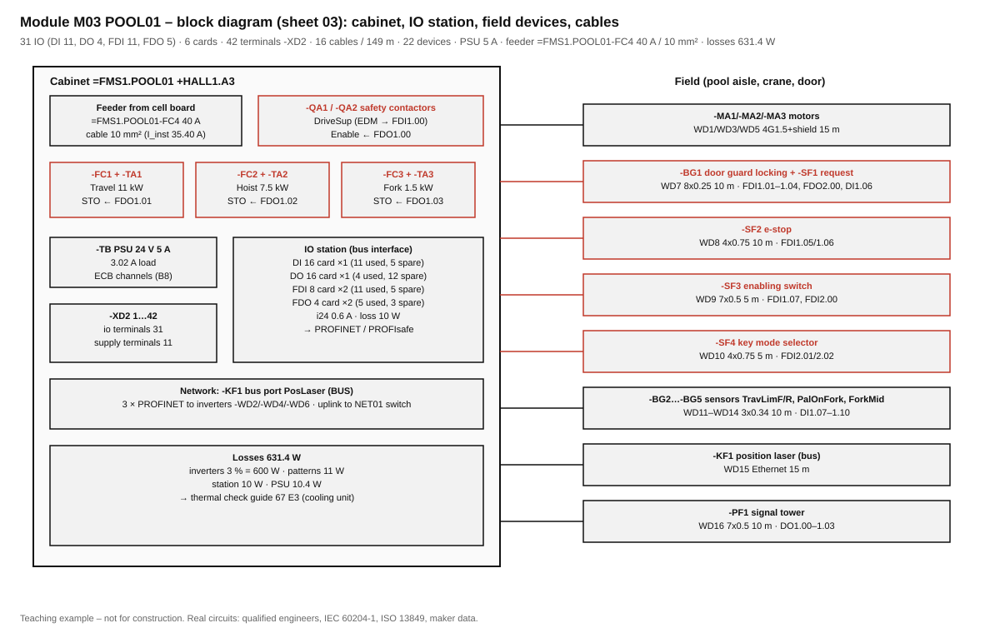

### C3.2 Summary and instance list

**Summary POOL01:** IO 31 (DI 11, DO 4, FDI 11, FDO 5) · cards DI 1, DO 1, FDI 2, FDO 2 (spare DI 5, DO 12, FDI 5, FDO 3) · -XD2 42
terminals · 16 cables / 149 m · 22 devices (BG 5, FC 3, KF 1, MA 3, PF 1, QA 2, SF 4, TA 3) · 24 V 3.02 A → PSU 5 A · demand 14.08 kW /
17.154 kVA / 24.76 A · I_inst 35.40 A → feeder 40 A / 10 mm² · losses 631.4 W · longest tag 37 characters.

| # | Group (instance) | Pattern | Parameters | IO | Dev | Cab | i24 A | Loss W | tx |
|---|---|---|---|---|---|---|---|---|---|
| 1 | DriveSup | `CONT_PAIR_EDM` | – | 1 FDI 1 FDO | 2 | 0 | 0.3 | 6 | 0 |
| 2 | Travel | `VFD_STO` | kW 11 | 2 DI 1 FDO | 3 | 2 | 0.5 | 3 % × 11 kW = 330 | 0 |
| 3 | Hoist | `VFD_STO` | kW 7.5 | 2 DI 1 FDO | 3 | 2 | 0.5 | 3 % × 7.5 kW = 225 | 0 |
| 4 | Fork | `VFD_STO` | kW 1.5 | 2 DI 1 FDO | 3 | 2 | 0.5 | 3 % × 1.5 kW = 45 | 0 |
| 5 | Door | `DOOR_LOCK` | – | 1 DI 4 FDI 1 FDO | 2 | 1 | 0.3 | 2 | 2 |
| 6 | Estop | `ESTOP` | – | 2 FDI | 1 | 1 | 0 | 0 | 0 |
| 7 | Enable | `ENABLE` | – | 2 FDI | 1 | 1 | 0 | 0 | 0 |
| 8 | Mode | `MODE_SWITCH` | – | 2 FDI | 1 | 1 | 0 | 0 | 0 |
| 9 | TravLimF | `SENSOR` | – | 1 DI | 1 | 1 | 0.03 | 0 | 2 |
| 10 | TravLimR | `SENSOR` | – | 1 DI | 1 | 1 | 0.03 | 0 | 2 |
| 11 | PalOnFork | `SENSOR` | – | 1 DI | 1 | 1 | 0.03 | 0 | 2 |
| 12 | ForkMid | `SENSOR` | – | 1 DI | 1 | 1 | 0.03 | 0 | 2 |
| 13 | PosLaser | `BUS` | – | – | 1 | 1 | 0 | 0 | 0 |
| 14 | Tower | `SIGNAL_TOWER` | – | 4 DO | 1 | 1 | 0.2 | 3 | 1 |

### C3.3 IO list (complete, with addresses and terminals)

| # | Address | Tag | Type | Description | -XD2 |
|---|---|---|---|---|---|
| 1 | FDO1.00 | `PLT1.MACH.FMS1.POOL01.DriveSup.Enable` | FDO | coils K1 + K2 | 1 |
| 2 | FDI1.00 | `PLT1.MACH.FMS1.POOL01.DriveSup.EDM` | FDI | feedback: NC mirror contacts K1 + K2 in series | 2 |
| 3 | FDO1.01 | `PLT1.MACH.FMS1.POOL01.Travel.STO` | FDO | safe torque off (2-channel F-DO) | 3 |
| 4 | DI1.00 | `PLT1.MACH.FMS1.POOL01.Travel.Ready` | DI | inverter ready | 4 |
| 5 | DI1.01 | `PLT1.MACH.FMS1.POOL01.Travel.Fault` | DI | inverter fault | 5 |
| 6 | FDO1.02 | `PLT1.MACH.FMS1.POOL01.Hoist.STO` | FDO | safe torque off (2-channel F-DO) | 6 |
| 7 | DI1.02 | `PLT1.MACH.FMS1.POOL01.Hoist.Ready` | DI | inverter ready | 7 |
| 8 | DI1.03 | `PLT1.MACH.FMS1.POOL01.Hoist.Fault` | DI | inverter fault | 8 |
| 9 | FDO1.03 | `PLT1.MACH.FMS1.POOL01.Fork.STO` | FDO | safe torque off (2-channel F-DO) | 9 |
| 10 | DI1.04 | `PLT1.MACH.FMS1.POOL01.Fork.Ready` | DI | inverter ready | 10 |
| 11 | DI1.05 | `PLT1.MACH.FMS1.POOL01.Fork.Fault` | DI | inverter fault | 11 |
| 12 | FDI1.01 | `PLT1.MACH.FMS1.POOL01.Door.Closed` | FDI | door closed, channel 1 | 12 |
| 13 | FDI1.02 | `PLT1.MACH.FMS1.POOL01.Door.Closed2` | FDI | door closed, channel 2 | 13 |
| 14 | FDI1.03 | `PLT1.MACH.FMS1.POOL01.Door.Locked` | FDI | door locked, channel 1 | 14 |
| 15 | FDI1.04 | `PLT1.MACH.FMS1.POOL01.Door.Locked2` | FDI | door locked, channel 2 | 15 |
| 16 | FDO2.00 | `PLT1.MACH.FMS1.POOL01.Door.LockCmd` | FDO | guard locking solenoid | 16 |
| 17 | DI1.06 | `PLT1.MACH.FMS1.POOL01.Door.Request` | DI | access request push-button | 17 |
| 18 | FDI1.05 | `PLT1.MACH.FMS1.POOL01.Estop.Ok` | FDI | e-stop not pressed, channel 1 | 20 |
| 19 | FDI1.06 | `PLT1.MACH.FMS1.POOL01.Estop.Ok2` | FDI | e-stop not pressed, channel 2 | 21 |
| 20 | FDI1.07 | `PLT1.MACH.FMS1.POOL01.Enable.Ok` | FDI | enabling middle position, channel 1 | 22 |
| 21 | FDI2.00 | `PLT1.MACH.FMS1.POOL01.Enable.Ok2` | FDI | enabling middle position, channel 2 | 23 |
| 22 | FDI2.01 | `PLT1.MACH.FMS1.POOL01.Mode.Auto` | FDI | mode Automatic | 24 |
| 23 | FDI2.02 | `PLT1.MACH.FMS1.POOL01.Mode.Maint` | FDI | mode Maintenance | 25 |
| 24 | DI1.07 | `PLT1.MACH.FMS1.POOL01.TravLimF.On` | DI | sensor signal | 26 |
| 25 | DI1.08 | `PLT1.MACH.FMS1.POOL01.TravLimR.On` | DI | sensor signal | 29 |
| 26 | DI1.09 | `PLT1.MACH.FMS1.POOL01.PalOnFork.On` | DI | sensor signal | 32 |
| 27 | DI1.10 | `PLT1.MACH.FMS1.POOL01.ForkMid.On` | DI | sensor signal | 35 |
| 28 | DO1.00 | `PLT1.MACH.FMS1.POOL01.Tower.Red` | DO | red | 38 |
| 29 | DO1.01 | `PLT1.MACH.FMS1.POOL01.Tower.Yellow` | DO | yellow | 39 |
| 30 | DO1.02 | `PLT1.MACH.FMS1.POOL01.Tower.Green` | DO | green | 40 |
| 31 | DO1.03 | `PLT1.MACH.FMS1.POOL01.Tower.Buzzer` | DO | buzzer | 41 |

Check the address rule on three rows: `Travel.Ready` is the first DI → DI1.00; `Enable.Ok2` is the 9th FDI (k = 8) → FDI2.00; `Door.LockCmd`
is the 5th FDO (k = 4) → card 4 // 4 + 1 = 2, channel 0 → FDO2.00.

### C3.4 Devices

| Designation | Full designation | Device | BOM item | Group |
|---|---|---|---|---|
| -QA1 | `=FMS1.POOL01-QA1` | Safety contactor K1 (mirror contacts) | Safety contactor | DriveSup |
| -QA2 | `=FMS1.POOL01-QA2` | Safety contactor K2 (mirror contacts) | Safety contactor | DriveSup |
| -FC1 | `=FMS1.POOL01-FC1` | Line protection of the inverter (MCB / fuses) | Inverter line protection | Travel |
| -TA1 | `=FMS1.POOL01-TA1` | Frequency inverter with STO + PROFINET | Frequency inverter | Travel |
| -MA1 | `=FMS1.POOL01-MA1` | Three-phase motor | Motor (part of the mechanics) | Travel |
| -FC2 | `=FMS1.POOL01-FC2` | Line protection of the inverter (MCB / fuses) | Inverter line protection | Hoist |
| -TA2 | `=FMS1.POOL01-TA2` | Frequency inverter with STO + PROFINET | Frequency inverter | Hoist |
| -MA2 | `=FMS1.POOL01-MA2` | Three-phase motor | Motor (part of the mechanics) | Hoist |
| -FC3 | `=FMS1.POOL01-FC3` | Line protection of the inverter (MCB / fuses) | Inverter line protection | Fork |
| -TA3 | `=FMS1.POOL01-TA3` | Frequency inverter with STO + PROFINET | Frequency inverter | Fork |
| -MA3 | `=FMS1.POOL01-MA3` | Three-phase motor | Motor (part of the mechanics) | Fork |
| -BG1 | `=FMS1.POOL01-BG1` | Interlock switch with guard locking, coded | Guard-locking interlock switch | Door |
| -SF1 | `=FMS1.POOL01-SF1` | Access request push-button with lamp | Illuminated push-button | Door |
| -SF2 | `=FMS1.POOL01-SF2` | Emergency-stop push-button 2 NC in enclosure | Emergency-stop push-button | Estop |
| -SF3 | `=FMS1.POOL01-SF3` | 3-position enabling switch | Enabling switch | Enable |
| -SF4 | `=FMS1.POOL01-SF4` | Key mode selector switch | Key mode selector | Mode |
| -BG2 | `=FMS1.POOL01-BG2` | Inductive / optical sensor PNP | Sensor PNP M12 | TravLimF |
| -BG3 | `=FMS1.POOL01-BG3` | Inductive / optical sensor PNP | Sensor PNP M12 | TravLimR |
| -BG4 | `=FMS1.POOL01-BG4` | Inductive / optical sensor PNP | Sensor PNP M12 | PalOnFork |
| -BG5 | `=FMS1.POOL01-BG5` | Inductive / optical sensor PNP | Sensor PNP M12 | ForkMid |
| -KF1 | `=FMS1.POOL01-KF1` | Bus port (device controller) | Bus connection (port on the cell switch) | PosLaser |
| -PF1 | `=FMS1.POOL01-PF1` | Signal tower LED + buzzer | Signal tower | Tower |

### C3.5 Motors and power

| Group | Pattern | kW | η | cos φ | In A | Size |
|---|---|---|---|---|---|---|
| Travel | VFD_STO | 11 | 0.88 | 0.82 | 22.003 | inverter 11 kW, loss 3 % = 330 W |
| Hoist | VFD_STO | 7.5 | 0.88 | 0.82 | 15.002 | inverter 7.5 kW, loss 3 % = 225 W |
| Fork | VFD_STO | 1.5 | 0.88 | 0.82 | 3.000 | inverter 1.5 kW, loss 3 % = 45 W |

The library picks the inverter by kW. In the real selection the hoist inverter is chosen for **heavy duty** (150 % overload for 60 s) and gets
a braking resistor (the hoist regenerates when it lowers a pallet); the travel drive also regenerates when it brakes. Check motor In from the
rating plate against the inverter's output current.

| Load | kW | ku | cos φ | P = kW·ku | Q = P·tan φ | P_inst | Q_inst |
|---|---|---|---|---|---|---|---|
| Travel | 11 | 0.7 | 0.82 | 7.700 | 5.375 | 11 | 7.678 |
| Hoist | 7.5 | 0.7 | 0.82 | 5.250 | 3.665 | 7.5 | 5.235 |
| Fork | 1.5 | 0.7 | 0.82 | 1.050 | 0.733 | 1.5 | 1.047 |
| Control power (PSU 5 A) | 0.1333 | 0.6 | 0.95 | 0.080 | 0.026 | 0.1333 | 0.044 |
| **Σ** | | | | **14.080** | **9.798** | **20.133** | **14.004** |

Demand: S = √(14.080² + 9.798²) = **17.154 kVA**, I = S·1000/(√3·400) = **24.76 A**. Installed: S_inst = √(20.133² + 14.004²) = 24.525 kVA, **I_inst = 35.40 A** → feeder breaker **In = 40 A** → required Iz = 40 / (0.87 × 0.77) = 59.71 A → cable **10 mm²** (table Iz 70 A).

Compare with guide 67 B2.4, line 2: the item-7 cell load list counts the stacker crane as **15 kW, ku 0.3** (P_d 4.5 kW) – the crane rarely runs
all drives at full power. The module library uses ku 0.7 per motor (14.08 kW demand) because it knows nothing about the duty cycle. Both are
"right" for their purpose – D6 explains.

### C3.6 24 V and losses

24 V current = CONT_PAIR_EDM 0.3 + VFD_STO 1.5 + DOOR_LOCK 0.3 + SENSOR 0.12 + SIGNAL_TOWER 0.2 + station (0.3 + 0.05 × 6 cards = 0.6) = **3.02 A**; × 1.25 = 3.775 A → **PSU 5 A**.

Losses = patterns 11 W + VFD 3 % 600 W + station 10 W + PSU 5 × 24 × (1/0.92 − 1) = 10.4 W → **631.4 W**.

The 600 W of the inverters dominate. The item-7 thermal example (guide 67 E3, "JSON stacker cabinet", 805 W with braking resistor and
other losses) is the same cabinet type with more losses counted – a 631 W module loss inside a sealed cabinet needs a cooling unit at 35–40 °C
hall temperature (guide 67 E3.4).

### C3.7 Terminal plan -XD2 (complete)

| -XD2 | | |
|---|---|---|
| 1 DriveSup.Enable | 2 DriveSup.EDM | 3 Travel.STO |
| 4 Travel.Ready | 5 Travel.Fault | 6 Hoist.STO |
| 7 Hoist.Ready | 8 Hoist.Fault | 9 Fork.STO |
| 10 Fork.Ready | 11 Fork.Fault | 12 Door.Closed |
| 13 Door.Closed2 | 14 Door.Locked | 15 Door.Locked2 |
| 16 Door.LockCmd | 17 Door.Request | 18 Door (+24 V field supply) |
| 19 Door (0 V field supply) | 20 Estop.Ok | 21 Estop.Ok2 |
| 22 Enable.Ok | 23 Enable.Ok2 | 24 Mode.Auto |
| 25 Mode.Maint | 26 TravLimF.On | 27 TravLimF (+24 V field supply) |
| 28 TravLimF (0 V field supply) | 29 TravLimR.On | 30 TravLimR (+24 V field supply) |
| 31 TravLimR (0 V field supply) | 32 PalOnFork.On | 33 PalOnFork (+24 V field supply) |
| 34 PalOnFork (0 V field supply) | 35 ForkMid.On | 36 ForkMid (+24 V field supply) |
| 37 ForkMid (0 V field supply) | 38 Tower.Red | 39 Tower.Yellow |
| 40 Tower.Green | 41 Tower.Buzzer | 42 Tower (0 V common of the tower) |

### C3.8 Cables and BOM

**Cables** (16, 149 m): -WD1 Travel 4G4 + shield 15 m · -WD2 Travel 4x0.34 (PROFINET / Ethernet) 3 m · -WD3 Hoist 4G2.5 + shield 15 m
· -WD4 Hoist 4x0.34 (PROFINET / Ethernet) 3 m · -WD5 Fork 4G1.5 + shield 15 m · -WD6 Fork 4x0.34 (PROFINET / Ethernet) 3 m · -WD7 Door
8x0.25 10 m · -WD8 Estop 4x0.75 10 m · -WD9 Enable 7x0.5 5 m · -WD10 Mode 4x0.75 5 m · -WD11 TravLimF 3x0.34 10 m · -WD12 TravLimR
3x0.34 10 m · -WD13 PalOnFork 3x0.34 10 m · -WD14 ForkMid 3x0.34 10 m · -WD15 PosLaser 4x0.34 (PROFINET / Ethernet) 15 m · -WD16 Tower
7x0.5 10 m. (Motor cables sized per instance, B0.14 worked example 4: travel 22.00 A → 4G4 + shield, hoist 15.00 A → 4G2.5 + shield, fork
3.00 A → 4G1.5 + shield.)

**BOM** (19 lines): 24 V power supply 5 A × 1 · Bus connection (port on the cell switch) × 1 · Control terminal × 42 · DI 16 card × 1 ·
DO 16 card × 1 · Emergency-stop push-button × 1 · Enabling switch × 1 · FDI 8 card × 2 · FDO 4 card × 2 · Frequency inverter × 3 ·
Guard-locking interlock switch × 1 · IO station bus interface × 1 · Illuminated push-button × 1 · Inverter line protection × 3 · Key
mode selector × 1 · Motor (part of the mechanics) × 3 · Safety contactor × 2 · Sensor PNP M12 × 4 · Signal tower × 1.

### C3.9 Safety

| Safety function (guide 67) | Circuits of M03 | PLr / PL | Stop |
|---|---|---|---|
| SF1 pool door open → crane stops, guard locking | DOOR_LOCK `Door` (FDI1.01–1.04, FDO2.00), STO of `Travel`, `Hoist`, `Fork`, CONT_PAIR_EDM `DriveSup` | d / d | SS1 then STO |
| SF3 cell e-stop | ESTOP `Estop` (FDI1.05/1.06) + all e-stops of the cell via M18 → STO + `DriveSup` off | d / d | category 1 (SS1-t) |
| SF5 enabling in maintenance → SLS | ENABLE `Enable` (FDI1.07, FDI2.00), MODE_SWITCH `Mode` (FDI2.01/2.02), SLS in the inverters (safe speed monitoring, via PROFIsafe or the safety PLC) | c / d | SLS, release → SS1 |
| Hoist falling load | brake of the hoist motor + safe brake control (SBC) and brake test – not a library pattern; add it in the project (EN 528) | per risk assessment | – |

Zone: Z-POOL (guide 67 I3.2). Transfer points: the fork into a load station (Z-LS) and into an APC get the union of both zones' conditions.

### C3.10 Sheets, data block and PackML

Sheets: 01 cover · 02 contents · 03 block diagram · 10 supply, main switch, distribution · 11 Travel (VFD_STO) · 12 Hoist (VFD_STO) · 13 Fork (VFD_STO) · 20 24 V DC PSU 5 A + ECB channels · 30 DriveSup (CONT_PAIR_EDM) · 31 Door (DOOR_LOCK) · 32 Estop (ESTOP) · 33 Enable (ENABLE) · 34 Mode (MODE_SWITCH) · 40 IO station (bus interface + cards) · 41 DI card 1 · 42 DO card 1 · 43 FDI card 1 · 44 FDI card 2 · 45 FDO card 1 · 46 FDO card 2 · 48 network / bus devices: PosLaser (BUS) · 50 terminal plan -XD2 (42 terminals) · 60 cable list (16 cables, 149 m) · 70 BOM · 80 IO list (31 signals)

Data block (guide 66 H2.3): words 20–23 `Move.From`, `Move.To` (in), `Move.PalletAt`, `Rack.FreePlaces` (out). PackML: a move job =
**Execute**; door request → **Holding / Held**; drive fault → **Aborting**; maintenance mode → unit mode 2 (Maintenance) with jog from the HMI
(enabling held).

### C3.11 Use case and mistakes

Use case: POOL01 serves MC01–MC03 and LS01–LS02 with 40 pallet places. In the kit it is the module with the largest heat load and the second
largest feeder after the machine tools.

| Mistake | Consequence | Correct |
|---|---|---|
| STO only, no contactor pair | a welded IGBT / wrong parameter could still move the crane in rare cases; no category-0 backup | CONT_PAIR_EDM in front of the inverters (as in the library) |
| Travel limits used as safety limits | crane overruns into the buffer when a sensor fails | separate safety limit switches / safe position (EN 528) |
| Inverters in a cabinet without cooling | over-temperature trips in summer | thermal check with 631 W (guide 67 E3) |
| Enabling switch without SLS | maintenance person in the aisle with a crane at full speed | SLS active in maintenance (SF5) |

---

## C4. M04 – Load / unload station

### C4.1 Scope and interfaces

The operator's place: a pallet arrives from the pool on a rotary table, the operator unclamps / clamps parts (manual or with a pneumatic clamp),
reads the instructions on the HMI, confirms with a release button. A type 4 light curtain protects the opening (SF2); the rotary table turns
the pallet to the operator side (VFD with STO); an RFID head reads the pallet ID.

### C4.2 Summary and instance list

**Summary LS01:** IO 20 (DI 8, DO 6, AI 1, FDI 4, FDO 1) · cards DI 1, DO 1, AI 1, FDI 1, FDO 1 (spare DI 8, DO 10, AI 3, FDI 4, FDO 3)
· -XD2 35 terminals · 15 cables / 128 m · 15 devices (BG 6, BP 1, FC 1, MA 1, MB 1, PF 2, SF 2, TA 1) · 24 V 3.535 A → PSU 5 A · demand
0.605 kW / 0.721 kVA / 1.04 A · I_inst 1.52 A → feeder 6 A / 1.5 mm² · losses 81.4 W · longest tag 36 characters.

| # | Group (instance) | Pattern | Parameters | IO | Dev | Cab | i24 A | Loss W | tx |
|---|---|---|---|---|---|---|---|---|---|
| 1 | Curtain | `LC` | – | 1 DI 2 FDI | 1 | 2 | 0.6 | 6 | 4 |
| 2 | Rotary | `VFD_STO` | kW 0.75 | 2 DI 1 FDO | 3 | 2 | 0.5 | 3 % × 0.75 kW = 22.5 | 0 |
| 3 | Clamp | `VALVE_SINGLE` | – | 2 DI 1 DO | 3 | 3 | 0.13 | 2.5 | 4 |
| 4 | ClampPress | `ANALOG_P` | – | 1 AI | 1 | 1 | 0.025 | 0 | 1 |
| 5 | Release | `PUSHBUTTON` | – | 1 DI 1 DO | 1 | 1 | 0.02 | 0 | 1 |
| 6 | Estop | `ESTOP` | – | 2 FDI | 1 | 1 | 0 | 0 | 0 |
| 7 | PalPresent | `SENSOR` | – | 1 DI | 1 | 1 | 0.03 | 0 | 2 |
| 8 | RotHome | `SENSOR` | – | 1 DI | 1 | 1 | 0.03 | 0 | 2 |
| 9 | Rfid | `RFID` | – | – | 1 | 1 | 0.25 | 3 | 0 |
| 10 | Hmi | `HMI` | – | – | 1 | 1 | 1.2 | 25 | 0 |
| 11 | Tower | `SIGNAL_TOWER` | – | 4 DO | 1 | 1 | 0.2 | 3 | 1 |

### C4.3 IO list

| # | Address | Tag | Type | Description | -XD2 |
|---|---|---|---|---|---|
| 1 | FDI1.00 | `PLT1.MACH.FMS1.LS01.Curtain.Ossd1` | FDI | OSSD 1 | 1 |
| 2 | FDI1.01 | `PLT1.MACH.FMS1.LS01.Curtain.Ossd2` | FDI | OSSD 2 | 2 |
| 3 | DI1.00 | `PLT1.MACH.FMS1.LS01.Curtain.Warn` | DI | contamination warning | 3 |
| 4 | FDO1.00 | `PLT1.MACH.FMS1.LS01.Rotary.STO` | FDO | safe torque off (2-channel F-DO) | 8 |
| 5 | DI1.01 | `PLT1.MACH.FMS1.LS01.Rotary.Ready` | DI | inverter ready | 9 |
| 6 | DI1.02 | `PLT1.MACH.FMS1.LS01.Rotary.Fault` | DI | inverter fault | 10 |
| 7 | DO1.00 | `PLT1.MACH.FMS1.LS01.Clamp.Sol` | DO | solenoid | 11 |
| 8 | DI1.03 | `PLT1.MACH.FMS1.LS01.Clamp.PosA` | DI | end position A | 12 |
| 9 | DI1.04 | `PLT1.MACH.FMS1.LS01.Clamp.PosB` | DI | end position B | 13 |
| 10 | AI1.00 | `PLT1.MACH.FMS1.LS01.ClampPress.Value` | AI | pressure 4-20 mA | 18 |
| 11 | DI1.05 | `PLT1.MACH.FMS1.LS01.Release.Pb` | DI | push-button | 20 |
| 12 | DO1.01 | `PLT1.MACH.FMS1.LS01.Release.Lamp` | DO | lamp | 21 |
| 13 | FDI1.02 | `PLT1.MACH.FMS1.LS01.Estop.Ok` | FDI | e-stop not pressed, channel 1 | 23 |
| 14 | FDI1.03 | `PLT1.MACH.FMS1.LS01.Estop.Ok2` | FDI | e-stop not pressed, channel 2 | 24 |
| 15 | DI1.06 | `PLT1.MACH.FMS1.LS01.PalPresent.On` | DI | sensor signal | 25 |
| 16 | DI1.07 | `PLT1.MACH.FMS1.LS01.RotHome.On` | DI | sensor signal | 28 |
| 17 | DO1.02 | `PLT1.MACH.FMS1.LS01.Tower.Red` | DO | red | 31 |
| 18 | DO1.03 | `PLT1.MACH.FMS1.LS01.Tower.Yellow` | DO | yellow | 32 |
| 19 | DO1.04 | `PLT1.MACH.FMS1.LS01.Tower.Green` | DO | green | 33 |
| 20 | DO1.05 | `PLT1.MACH.FMS1.LS01.Tower.Buzzer` | DO | buzzer | 34 |

### C4.4 Devices

**Devices** (15): -BG1 Light curtain pair (Curtain) · -FC1 Inverter line protection (Rotary) · -TA1 Frequency inverter (Rotary) · -MA1
Motor (part of the mechanics) (Rotary) · -MB1 Solenoid valve 5/2 single (Clamp) · -BG2 Cylinder sensor (Clamp) · -BG3 Cylinder sensor
(Clamp) · -BP1 Pressure transmitter (ClampPress) · -SF1 Illuminated push-button (Release) · -SF2 Emergency-stop push-button (Estop) ·
-BG4 Sensor PNP M12 (PalPresent) · -BG5 Sensor PNP M12 (RotHome) · -BG6 RFID head (Rfid) · -PF1 HMI panel (Hmi) · -PF2 Signal tower
(Tower).

### C4.5 Power, 24 V, losses

| Group | Pattern | kW | η | cos φ | In A | Size |
|---|---|---|---|---|---|---|
| Rotary | VFD_STO | 0.75 | 0.88 | 0.82 | 1.500 | inverter 0.75 kW, loss 3 % = 22.5 W |

Demand: S = √(0.605² + 0.393²) = **0.721 kVA**, I = S·1000/(√3·400) = **1.04 A**. Installed: S_inst = √(0.883² + 0.567²) = 1.050 kVA, **I_inst = 1.52 A** → feeder breaker **In = 6 A** → required Iz = 6 / (0.87 × 0.77) = 8.96 A → cable **1.5 mm²** (table Iz 22 A).

24 V current = LC 0.6 + VFD_STO 0.5 + VALVE_SINGLE 0.13 + ANALOG_P 0.025 + PUSHBUTTON 0.02 + SENSOR 0.06 + RFID 0.25 + HMI 1.2 + SIGNAL_TOWER 0.2 + station (0.3 + 0.05 × 5 cards = 0.55) = **3.535 A**; × 1.25 = 4.4188 A → **PSU 5 A**. The HMI (1.2 A) and the light curtain (0.6 A) are the biggest 24 V consumers – this is why the station needs a 5 A PSU although it
has only one small drive.

Losses = patterns 39.5 W + VFD 3 % 22.5 W + station 9 W + PSU 5 × 24 × (1/0.92 − 1) = 10.4 W → **81.4 W**.

### C4.6 Cables and BOM

**Cables** (15, 128 m): -WD1 Curtain 5x0.34 10 m · -WD2 Curtain 8x0.25 10 m · -WD3 Rotary 4G1.5 + shield 15 m · -WD4 Rotary 4x0.34
(PROFINET / Ethernet) 3 m · -WD5 Clamp 3x0.75 5 m · -WD6 Clamp 3x0.25 5 m · -WD7 Clamp 3x0.25 5 m · -WD8 ClampPress 3x0.34 + shield 10 m
· -WD9 Release 4x0.5 5 m · -WD10 Estop 4x0.75 10 m · -WD11 PalPresent 3x0.34 10 m · -WD12 RotHome 3x0.34 10 m · -WD13 Rfid 4x0.34 10 m ·
-WD14 Hmi 4x0.34 (PROFINET / Ethernet) 10 m · -WD15 Tower 7x0.5 10 m.

**BOM** (21 lines): 24 V power supply 5 A × 1 · AI 4 card × 1 · Control terminal × 35 · Cylinder sensor × 2 · DI 16 card × 1 · DO 16
card × 1 · Emergency-stop push-button × 1 · FDI 8 card × 1 · FDO 4 card × 1 · Frequency inverter × 1 · HMI panel × 1 · IO station bus
interface × 1 · Illuminated push-button × 1 · Inverter line protection × 1 · Light curtain pair × 1 · Motor (part of the mechanics) × 1
· Pressure transmitter × 1 · RFID head × 1 · Sensor PNP M12 × 2 · Signal tower × 1 · Solenoid valve 5/2 single × 1.

### C4.7 Safety

| Safety function | Circuits | PLr / PL |
|---|---|---|
| SF2 light curtain → rotary table + fork stop | LC `Curtain` (FDI1.00/1.01) → STO `Rotary` (FDO1.00) and the pool fork (cross-module: the safety program stops POOL01's fork while it serves LS01) | d / d |
| SF3 e-stop | ESTOP `Estop` | d / d |
| Clamp holding | clamp valve single-solenoid, clamped without power; pressure monitored (`ClampPress`) | holding function, not de-energised |

Safety distance of the curtain: guide 67 H4 cases LC1–LC3 (370 / 498 / 608 mm, depending on resolution and the stopping time of the rotary
table).

### C4.8 Sheets, data block, PackML

Sheets: 01 cover · 02 contents · 03 block diagram · 10 supply, main switch, distribution · 11 Rotary (VFD_STO) · 20 24 V DC PSU 5 A + ECB channels · 30 Curtain (LC) · 31 Estop (ESTOP) · 40 IO station (bus interface + cards) · 41 DI card 1 · 42 DO card 1 · 43 AI card 1 · 44 FDI card 1 · 45 FDO card 1 · 48 network / bus devices: Hmi (HMI) · 50 terminal plan -XD2 (35 terminals) · 60 cable list (15 cables, 128 m) · 70 BOM · 80 IO list (20 signals)

Data block (guide 66 H2.3): word 20 bit0 `LS.OperatorRelease` (from `Release.Pb`), bit1 `LightCurtainOK` (curtain OSSDs), bit2 `ClampPressureOK`
(from `ClampPress.Value` > limit); word 21 `LS.PartsOnPallet`; words 22–31 `LS.SerialFirst`. PackML: operator working = **Suspended** (waiting for
release); curtain interrupted during rotation = **Held**; release → **Execute** (rotate to the pool side, hand-over to the crane).

### C4.9 Use case and mistakes

Use case: LS01 and LS02 in the compressor FMS – two stations so that the operator loads one while the other is served by the crane.

| Mistake | Correct |
|---|---|
| Curtain too close to the rotary table | distance by ISO 13855 with the measured stop time (guide 67 H4) |
| Clamp opens on e-stop | holding function, clamp spring-closed (guide 67 I7.4) |
| Release button reachable from inside the protected area while the table can turn | button outside, view into the area |

---

## C5. M05 – Robot loading cell

### C5.1 Scope and interfaces

An industrial robot loads raw parts into a machine or between stations (ISO 10218-2 cell). The robot controller has its own safety (robot
safety controller, safe zones, safe speed); the cell supplies power, the network connection, the hard-wired safety coupling, the guard door with
guard locking, a scanner at the cell entry, an e-stop, the gripper valve and a part-in-gripper sensor.

### C5.2 Summary, instance list and IO rule

**Summary ROB01:** IO 25 (DI 6, DO 4, FDI 12, FDO 3) · cards DI 1, DO 1, FDI 2, FDO 1 (spare DI 10, DO 12, FDI 4, FDO 1) · -XD2 37
terminals · 10 cables / 105 m · 11 devices (BG 5, FC 1, KF 2, MB 1, SF 2) · 24 V 1.61 A → PSU 2.5 A · demand 2.54 kW / 2.82 kVA / 4.07 A
· I_inst 8.12 A → feeder 10 A / 1.5 mm² · losses 31.7 W · longest tag 40 characters.

Instances in order (pattern, parameters) → IO signals (tag = `PLT1.MACH.FMS1.ROB01.<group>.<signal>`, address by B0.4):

- `RobotSup` (FEEDER_EXT kW 5, ku 0.5, cos 0.9) → SupplyOn DI · dev 1 · cab 1 · i24 0 A · tx 0
- `Robot` (BUS) → no IO · dev 1 · cab 1 · i24 0 A · tx 0
- `RobSafety` (COUPLING) → EstopIn FDI, EstopIn2 FDI, ZoneFree FDI, ZoneFree2 FDI, EstopOut FDO, EnableOut FDO · dev 1 · cab 1 · i24 0.1 A · tx 2
- `Door` (DOOR_LOCK) → Closed FDI, Closed2 FDI, Locked FDI, Locked2 FDI, LockCmd FDO, Request DI · dev 2 · cab 1 · i24 0.3 A · tx 2
- `Scanner` (SCANNER) → Ossd1 FDI, Ossd2 FDI, Warn DI, FieldA DO, FieldB DO · dev 1 · cab 1 · i24 0.5 A · tx 2
- `Estop` (ESTOP) → Ok FDI, Ok2 FDI · dev 1 · cab 1 · i24 0 A · tx 0
- `Gripper` (VALVE_DOUBLE) → SolA DO, SolB DO, PosA DI, PosB DI · dev 3 · cab 3 · i24 0.13 A · tx 4
- `PartInGrip` (SENSOR) → On DI · dev 1 · cab 1 · i24 0.03 A · tx 2

Devices: BG 5, FC 1, KF 2, MB 1, SF 2.

### C5.3 Power, 24 V, losses

Demand: S = √(2.540² + 1.224²) = **2.820 kVA**, I = S·1000/(√3·400) = **4.07 A**. Installed: S_inst = √(5.067² + 2.444²) = 5.625 kVA, **I_inst = 8.12 A** → feeder breaker **In = 10 A** → required Iz = 10 / (0.87 × 0.77) = 14.93 A → cable **1.5 mm²** (table Iz 22 A). The robot controller is a FEEDER_EXT load (5 kW connected, ku 0.5, cos φ 0.9); the 10 A breaker follows from 8.12 A installed current.

24 V current = COUPLING 0.1 + DOOR_LOCK 0.3 + SCANNER 0.5 + VALVE_DOUBLE 0.13 + SENSOR 0.03 + station (0.3 + 0.05 × 5 cards = 0.55) = **1.61 A**; × 1.25 = 2.0125 A → **PSU 2.5 A**. Losses = patterns 17.5 W + station 9 W + PSU 2.5 × 24 × (1/0.92 − 1) = 5.2 W → **31.7 W**.

### C5.4 Cables and BOM

**Cables** (10, 105 m): -WD1 RobotSup 4G1.5 15 m · -WD2 Robot 4x0.34 (PROFINET / Ethernet) 15 m · -WD3
RobSafety 12x0.75 20 m · -WD4 Door 8x0.25 10 m · -WD5 Scanner 12x0.25 10 m · -WD6 Estop 4x0.75 10 m · -WD7 Gripper 4x0.75 5 m · -WD8
Gripper 3x0.25 5 m · -WD9 Gripper 3x0.25 5 m · -WD10 PartInGrip 3x0.34 10 m.

**BOM** (17 lines): 24 V power supply 2.5 A × 1 · Bus connection (port on the cell switch) × 1 · Control terminal × 37 · Cylinder sensor
× 2 · DI 16 card × 1 · DO 16 card × 1 · Emergency-stop push-button × 1 · FDI 8 card × 2 · FDO 4 card × 1 · Feeder circuit breaker 3-pole
× 1 · Guard-locking interlock switch × 1 · IO station bus interface × 1 · Illuminated push-button × 1 · Safety coupling terminal set × 1
· Safety laser scanner × 1 · Sensor PNP M12 × 1 · Solenoid valve 5/2 double × 1.

### C5.5 Safety, sheets, data block

Safety: door with guard locking (robot run-down time), scanner protective field at the entry (guide 67 H4 case SC1: 1 980 mm), coupling with the
robot controller (`RobSafety`: e-stop in / out, zone free, enable), e-stop. Collaborative operation only with ISO/TS 15066 – the library pattern
set here is for a **fenced** robot cell. Zone: one robot zone; its e-stop and door stop the robot (category 1) and the machine's loading door
(through M01 coupling).

Sheets: 01 cover · 02 contents · 03 block diagram · 10 supply, main switch, distribution · 11 RobotSup (FEEDER_EXT) · 20 24 V DC PSU 2.5 A + ECB channels · 30 RobSafety (COUPLING) · 31 Door (DOOR_LOCK) · 32 Scanner (SCANNER) · 33 Estop (ESTOP) · 40 IO station (bus interface + cards) · 41 DI card 1 · 42 DO card 1 · 43 FDI card 1 · 44 FDI card 2 · 45 FDO card 1 · 48 network / bus devices: Robot (BUS) · 50 terminal plan -XD2 (37 terminals) · 60 cable list (10 cables, 105 m) · 70 BOM · 80 IO list (25 signals)

Data block: words 0–19 (robot job via the handshake); robot program number and part data in a future module part (guide 70). Mistakes: robot
safety zones configured but not validated; gripper bistable valve opens after restart (B4.2); scanner fields not matched to the robot's
safe zones.

---

## C6. M06 – AGV / AMR transfer station

### C6.1 Scope and interfaces

The dock where an AGV / AMR delivers and collects pallets or bins: a short powered roller conveyor (DOL), three position sensors (entry, centre,
end), a safety laser scanner that protects the dock area (SF4), and a hard-wired handshake to the AGV (optical / parallel IO – E84-style).

| Interface | AGV supplier | Cell (M06) |
|---|---|---|
| Vehicle | AGV, its own safety (ISO 3691-4), its fleet manager | docking position, floor marks |
| Hand-over | AGV's own roller deck and its parallel IO coupler | station conveyor, handshake counterpart, scanner |
| Data | fleet manager ↔ cell controller (guide 66) | handshake signals, data block words 20 / 21 |

### C6.2 Summary and instance list

**Summary AGVST01:** IO 19 (DI 10, DO 7, FDI 2) · cards DI 1, DO 1, FDI 1 (spare DI 6, DO 9, FDI 6) · -XD2 29 terminals · 6 cables / 75
m · 8 devices (BG 4, FC 1, KF 1, MA 1, QA 1) · 24 V 1.34 A → PSU 2.5 A · demand 0.299 kW / 0.356 kVA / 0.51 A · I_inst 0.75 A → feeder 6
A / 1.5 mm² · losses 26.2 W · longest tag 39 characters.

| # | Group (instance) | Pattern | Parameters | IO | Dev | Cab | i24 A | Loss W | tx |
|---|---|---|---|---|---|---|---|---|---|
| 1 | Scanner | `SCANNER` | – | 1 DI 2 DO 2 FDI | 1 | 1 | 0.5 | 6 | 2 |
| 2 | Transfer | `DOL` | kW 0.37 | 2 DI 1 DO | 3 | 1 | 0.1 | 5 | 0 |
| 3 | Entry | `SENSOR` | – | 1 DI | 1 | 1 | 0.03 | 0 | 2 |
| 4 | Centre | `SENSOR` | – | 1 DI | 1 | 1 | 0.03 | 0 | 2 |
| 5 | End | `SENSOR` | – | 1 DI | 1 | 1 | 0.03 | 0 | 2 |
| 6 | Agv | `HANDSHAKE_HW` | – | 4 DI 4 DO | 1 | 1 | 0.2 | 3 | 2 |

### C6.3 IO list

| # | Address | Tag | Type | Description | -XD2 |
|---|---|---|---|---|---|
| 1 | FDI1.00 | `PLT1.MACH.FMS1.AGVST01.Scanner.Ossd1` | FDI | OSSD 1 protective field | 1 |
| 2 | FDI1.01 | `PLT1.MACH.FMS1.AGVST01.Scanner.Ossd2` | FDI | OSSD 2 protective field | 2 |
| 3 | DI1.00 | `PLT1.MACH.FMS1.AGVST01.Scanner.Warn` | DI | warning field free | 3 |
| 4 | DO1.00 | `PLT1.MACH.FMS1.AGVST01.Scanner.FieldA` | DO | field set select A | 4 |
| 5 | DO1.01 | `PLT1.MACH.FMS1.AGVST01.Scanner.FieldB` | DO | field set select B | 5 |
| 6 | DO1.02 | `PLT1.MACH.FMS1.AGVST01.Transfer.Run` | DO | contactor coil | 8 |
| 7 | DI1.01 | `PLT1.MACH.FMS1.AGVST01.Transfer.RunFb` | DI | contactor auxiliary contact | 9 |
| 8 | DI1.02 | `PLT1.MACH.FMS1.AGVST01.Transfer.Tripped` | DI | motor protection tripped | 10 |
| 9 | DI1.03 | `PLT1.MACH.FMS1.AGVST01.Entry.On` | DI | sensor signal | 11 |
| 10 | DI1.04 | `PLT1.MACH.FMS1.AGVST01.Centre.On` | DI | sensor signal | 14 |
| 11 | DI1.05 | `PLT1.MACH.FMS1.AGVST01.End.On` | DI | sensor signal | 17 |
| 12 | DI1.06 | `PLT1.MACH.FMS1.AGVST01.Agv.Ready` | DI | partner ready | 20 |
| 13 | DI1.07 | `PLT1.MACH.FMS1.AGVST01.Agv.Busy` | DI | partner busy | 21 |
| 14 | DI1.08 | `PLT1.MACH.FMS1.AGVST01.Agv.Done` | DI | partner done | 22 |
| 15 | DI1.09 | `PLT1.MACH.FMS1.AGVST01.Agv.Fault` | DI | partner fault | 23 |
| 16 | DO1.03 | `PLT1.MACH.FMS1.AGVST01.Agv.Request` | DO | request to partner | 24 |
| 17 | DO1.04 | `PLT1.MACH.FMS1.AGVST01.Agv.Ack` | DO | acknowledge to partner | 25 |
| 18 | DO1.05 | `PLT1.MACH.FMS1.AGVST01.Agv.Enable` | DO | enable / permission | 26 |
| 19 | DO1.06 | `PLT1.MACH.FMS1.AGVST01.Agv.Reset` | DO | fault reset | 27 |

### C6.4 Devices

**Devices** (8): -BG1 Safety laser scanner (Scanner) · -FC1 Motor protection circuit breaker (Transfer) · -QA1 Contactor AC-3 (Transfer)
· -MA1 Motor (part of the mechanics) (Transfer) · -BG2 Sensor PNP M12 (Entry) · -BG3 Sensor PNP M12 (Centre) · -BG4 Sensor PNP M12 (End)
· -KF1 Coupling relay module 8 ch (Agv).

### C6.5 Power, 24 V, losses

| Group | Pattern | kW | η | cos φ | In A | Size |
|---|---|---|---|---|---|---|
| Transfer | DOL | 0.37 | 0.88 | 0.82 | 0.740 | contactor AC-3 9 A, MPCB set to 0.74 A |

Demand: S = √(0.299² + 0.194²) = **0.356 kVA**, I = S·1000/(√3·400) = **0.51 A**. Installed: S_inst = √(0.437² + 0.280²) = 0.519 kVA, **I_inst = 0.75 A** → feeder breaker **In = 6 A** → required Iz = 6 / (0.87 × 0.77) = 8.96 A → cable **1.5 mm²** (table Iz 22 A).

24 V current = SCANNER 0.5 + DOL 0.1 + SENSOR 0.09 + HANDSHAKE_HW 0.2 + station (0.3 + 0.05 × 3 cards = 0.45) = **1.34 A**; × 1.25 = 1.675 A → **PSU 2.5 A**. Losses = patterns 14 W + station 7 W + PSU 2.5 × 24 × (1/0.92 − 1) = 5.2 W → **26.2 W**.

### C6.6 Cables and BOM

**Cables** (6, 75 m): -WD1 Scanner 12x0.25 10 m · -WD2 Transfer 4G1.5 15 m · -WD3 Entry 3x0.34 10 m · -WD4 Centre 3x0.34 10 m · -WD5 End
3x0.34 10 m · -WD6 Agv 12x0.75 20 m.

**BOM** (12 lines): 24 V power supply 2.5 A × 1 · Contactor AC-3 × 1 · Control terminal × 29 · Coupling relay module 8 ch × 1 · DI 16
card × 1 · DO 16 card × 1 · FDI 8 card × 1 · IO station bus interface × 1 · Motor (part of the mechanics) × 1 · Motor protection circuit
breaker × 1 · Safety laser scanner × 1 · Sensor PNP M12 × 3.

### C6.7 Safety

| Safety function | Circuits | PLr / PL |
|---|---|---|
| SF4 scanner at the AGV dock → transfer conveyor stops | SCANNER `Scanner` (FDI1.00/1.01) → the conveyor contactor coil supply through a zone F-DO (ZONE_OUT of M18, B3.4 – e.g. `SAFE01.Zone1`) | b / c (guide 67 G9.4) |
| Field switching | `Scanner.FieldA/B` (DO): field A while the AGV is docked (the AGV body is inside the field), field B when free | per risk assessment |

The transfer conveyor `Transfer` is a DOL – the library's DOL pattern has no safety output; SF4's output subsystem in guide 67 (Cat 1, one
contactor, MTTFd 92.59 years) is exactly the DOL contactor `-QA1` with its coil supply switched by the zone. If a higher PLr results from the
risk assessment, add CONT_PAIR_EDM.

### C6.8 Sheets, data block, PackML

Sheets: 01 cover · 02 contents · 03 block diagram · 10 supply, main switch, distribution · 11 Transfer (DOL) · 20 24 V DC PSU 2.5 A + ECB channels · 30 Scanner (SCANNER) · 40 IO station (bus interface + cards) · 41 DI card 1 · 42 DO card 1 · 43 FDI card 1 · 50 terminal plan -XD2 (29 terminals) · 60 cable list (6 cables, 75 m) · 70 BOM · 80 IO list (19 signals)

Data block (guide 66 H2.3): word 20 `Dock.ReadyToGive` / `ReadyToTake` / `TransferActive` / `TransferDone` (out, from the sensors and the
conveyor state), word 21 `Dock.AGVPresent` / `AGVReadyToTransfer` (in – written by the cell controller from the fleet manager **or** derived
from the hard-wired `Agv.Ready` / `Agv.Busy`). PackML: transfer = **Execute**; scanner field interrupted = **Held**.

### C6.9 Use case and mistakes

Use case: AGVST01 receives raw crankcases from the warehouse AGV and returns finished parts. Mistakes: handshake without timeout (the station
waits forever when the AGV is called away); scanner field switching by the AGV's own signal only (a missing AGV signal leaves the small field
active – must be validated); conveyor and AGV deck speeds not matched (pallet jams at the edge).

---

## C7. M07 – Conveyor / carrier system (3 zones)

### C7.1 Scope and interfaces

A zone conveyor (roller or belt) with three zones, each driven by a small DOL motor, with in / out sensors per zone, two pneumatic stoppers and a
pull-wire e-stop along the conveyor. It is the base module of assembly lines (Part F2).

### C7.2 Summary, instance list and IO rule

**Summary CONV01:** IO 23 (DI 16, DO 5, FDI 2) · cards DI 2, DO 1, FDI 1 (spare DI 16, DO 11, FDI 6) · -XD2 43 terminals · 16 cables /
145 m · 22 devices (BG 10, FC 3, MA 3, MB 2, QA 3, SF 1) · 24 V 1.24 A → PSU 2.5 A · demand 1.195 kW / 1.449 kVA / 2.09 A · I_inst 3.00
A → feeder 6 A / 1.5 mm² · losses 33.2 W · longest tag 35 characters.

Instances in order (pattern, parameters) → IO signals (tag = `PLT1.MACH.FMS1.CONV01.<group>.<signal>`, address by B0.4):

- `Zone1` (DOL kW 0.55) → Run DO, RunFb DI, Tripped DI · dev 3 · cab 1 · i24 0.1 A · tx 0
- `Zone2` (DOL kW 0.55) → Run DO, RunFb DI, Tripped DI · dev 3 · cab 1 · i24 0.1 A · tx 0
- `Zone3` (DOL kW 0.55) → Run DO, RunFb DI, Tripped DI · dev 3 · cab 1 · i24 0.1 A · tx 0
- `Z1In` (SENSOR) → On DI · dev 1 · cab 1 · i24 0.03 A · tx 2
- `Z1Out` (SENSOR) → On DI · dev 1 · cab 1 · i24 0.03 A · tx 2
- `Z2In` (SENSOR) → On DI · dev 1 · cab 1 · i24 0.03 A · tx 2
- `Z2Out` (SENSOR) → On DI · dev 1 · cab 1 · i24 0.03 A · tx 2
- `Z3In` (SENSOR) → On DI · dev 1 · cab 1 · i24 0.03 A · tx 2
- `Z3Out` (SENSOR) → On DI · dev 1 · cab 1 · i24 0.03 A · tx 2
- `Stop1` (VALVE_SINGLE) → Sol DO, PosA DI, PosB DI · dev 3 · cab 3 · i24 0.13 A · tx 4
- `Stop2` (VALVE_SINGLE) → Sol DO, PosA DI, PosB DI · dev 3 · cab 3 · i24 0.13 A · tx 4
- `PullWire` (ESTOP) → Ok FDI, Ok2 FDI · dev 1 · cab 1 · i24 0 A · tx 0

Devices: BG 10, FC 3, MA 3, MB 2, QA 3, SF 1.

### C7.3 Motors, power, 24 V, losses

| Group | Pattern | kW | η | cos φ | In A | Size |
|---|---|---|---|---|---|---|
| Zone1 | DOL | 0.55 | 0.88 | 0.82 | 1.100 | contactor AC-3 9 A, MPCB set to 1.10 A |
| Zone2 | DOL | 0.55 | 0.88 | 0.82 | 1.100 | contactor AC-3 9 A, MPCB set to 1.10 A |
| Zone3 | DOL | 0.55 | 0.88 | 0.82 | 1.100 | contactor AC-3 9 A, MPCB set to 1.10 A |

Demand: S = √(1.195² + 0.819²) = **1.449 kVA**, I = S·1000/(√3·400) = **2.09 A**. Installed: S_inst = √(1.717² + 1.174²) = 2.080 kVA, **I_inst = 3.00 A** → feeder breaker **In = 6 A** → required Iz = 6 / (0.87 × 0.77) = 8.96 A → cable **1.5 mm²** (table Iz 22 A). 24 V current = DOL 0.3 + SENSOR 0.18 + VALVE_SINGLE 0.26 + station (0.3 + 0.05 × 4 cards = 0.5) = **1.24 A**; × 1.25 = 1.55 A → **PSU 2.5 A**. Losses = patterns 20 W + station 8 W + PSU 2.5 × 24 × (1/0.92 − 1) = 5.2 W → **33.2 W**.

### C7.4 Cables and BOM

**Cables** (16, 145 m): -WD1 Zone1 4G1.5 15 m · -WD2 Zone2 4G1.5 15 m · -WD3 Zone3 4G1.5 15 m · -WD4 Z1In 3x0.34 10 m · -WD5 Z1Out
3x0.34 10 m · -WD6 Z2In 3x0.34 10 m · -WD7 Z2Out 3x0.34 10 m · -WD8 Z3In 3x0.34 10 m · -WD9 Z3Out 3x0.34 10 m · -WD10 Stop1 3x0.75 5 m ·
-WD11 Stop1 3x0.25 5 m · -WD12 Stop1 3x0.25 5 m · -WD13 Stop2 3x0.75 5 m · -WD14 Stop2 3x0.25 5 m · -WD15 Stop2 3x0.25 5 m · -WD16
PullWire 4x0.75 10 m.

**BOM** (13 lines): 24 V power supply 2.5 A × 1 · Contactor AC-3 × 3 · Control terminal × 43 · Cylinder sensor × 4 · DI 16 card × 2 · DO
16 card × 1 · Emergency-stop push-button × 1 · FDI 8 card × 1 · IO station bus interface × 1 · Motor (part of the mechanics) × 3 · Motor
protection circuit breaker × 3 · Sensor PNP M12 × 6 · Solenoid valve 5/2 single × 2.

### C7.5 Safety, sheets, data block

Safety: nip points guarded mechanically (inherently safe design first, guide 67 F5); pull-wire e-stop `PullWire` along the conveyor (ESTOP
pattern: the pull-wire switch has 2 NC with positive opening and latching); transfer points to stations get the union of zones. Sheets:
01 cover · 02 contents · 03 block diagram · 10 supply, main switch, distribution · 11 Zone1 (DOL) · 12 Zone2 (DOL) · 13 Zone3 (DOL) · 20 24 V DC PSU 2.5 A + ECB channels · 30 PullWire (ESTOP) · 40 IO station (bus interface + cards) · 41 DI card 1 · 42 DI card 2 · 43 DO card 1 · 44 FDI card 1 · 50 terminal plan -XD2 (43 terminals) · 60 cable list (16 cables, 145 m) · 70 BOM · 80 IO list (23 signals)

Data block: words 0–19; carrier IDs (if RFID is added) in `Job.PalletId`. PackML: the conveyor runs in **Execute**; a zone full = **Suspended**
(starved / blocked states are PackML **Suspended** with a reason code).

Mistakes: long conveyor with one pull-wire switch for 50 m (rope sag – follow the maker's maximum length); all zones on one motor protection
(one trip stops the line).

---

## C8. M08 – AS/RS stacker crane

### C8.1 Scope and interfaces

An automated storage and retrieval system (high-bay or small-parts store) with a stacker crane: the same circuit structure as M03, with larger
drives (travel 15 kW, hoist 11 kW, fork 2.2 kW) and two more sensors (hoist top / bottom). Standards: EN 528 (rail-dependent storage and
retrieval equipment), FEM guidelines for the cycle time (guide 63).

### C8.2 Summary, instance list and IO rule

**Summary ASRS01:** IO 33 (DI 13, DO 4, FDI 11, FDO 5) · cards DI 1, DO 1, FDI 2, FDO 2 (spare DI 3, DO 12, FDI 5, FDO 3) · -XD2 48
terminals · 18 cables / 169 m · 24 devices (BG 7, FC 3, KF 1, MA 3, PF 1, QA 2, SF 4, TA 3) · 24 V 3.08 A → PSU 5 A · demand 19.82 kW /
24.154 kVA / 34.86 A · I_inst 49.83 A → feeder 50 A / 16 mm² · losses 877.4 W · longest tag 37 characters.

Instances in order (pattern, parameters) → IO signals (tag = `PLT1.MACH.FMS1.ASRS01.<group>.<signal>`, address by B0.4):

- `DriveSup` (CONT_PAIR_EDM) → Enable FDO, EDM FDI · dev 2 · cab 0 · i24 0.3 A · tx 0
- `Travel` (VFD_STO kW 15) → STO FDO, Ready DI, Fault DI · dev 3 · cab 2 · i24 0.5 A · tx 0
- `Hoist` (VFD_STO kW 11) → STO FDO, Ready DI, Fault DI · dev 3 · cab 2 · i24 0.5 A · tx 0
- `Fork` (VFD_STO kW 2.2) → STO FDO, Ready DI, Fault DI · dev 3 · cab 2 · i24 0.5 A · tx 0
- `Door` (DOOR_LOCK) → Closed FDI, Closed2 FDI, Locked FDI, Locked2 FDI, LockCmd FDO, Request DI · dev 2 · cab 1 · i24 0.3 A · tx 2
- `Estop` (ESTOP) → Ok FDI, Ok2 FDI · dev 1 · cab 1 · i24 0 A · tx 0
- `Enable` (ENABLE) → Ok FDI, Ok2 FDI · dev 1 · cab 1 · i24 0 A · tx 0
- `Mode` (MODE_SWITCH) → Auto FDI, Maint FDI · dev 1 · cab 1 · i24 0 A · tx 0
- `TravLimF` (SENSOR) → On DI · dev 1 · cab 1 · i24 0.03 A · tx 2
- `TravLimR` (SENSOR) → On DI · dev 1 · cab 1 · i24 0.03 A · tx 2
- `HoistTop` (SENSOR) → On DI · dev 1 · cab 1 · i24 0.03 A · tx 2
- `HoistBot` (SENSOR) → On DI · dev 1 · cab 1 · i24 0.03 A · tx 2
- `LoadOnFork` (SENSOR) → On DI · dev 1 · cab 1 · i24 0.03 A · tx 2
- `ForkMid` (SENSOR) → On DI · dev 1 · cab 1 · i24 0.03 A · tx 2
- `PosLaser` (BUS) → no IO · dev 1 · cab 1 · i24 0 A · tx 0
- `Tower` (SIGNAL_TOWER) → Red DO, Yellow DO, Green DO, Buzzer DO · dev 1 · cab 1 · i24 0.2 A · tx 1

Devices: BG 7, FC 3, KF 1, MA 3, PF 1, QA 2, SF 4, TA 3.

### C8.3 Motors, power, 24 V, losses

| Group | Pattern | kW | η | cos φ | In A | Size |
|---|---|---|---|---|---|---|
| Travel | VFD_STO | 15 | 0.88 | 0.82 | 30.004 | inverter 15 kW, loss 3 % = 450 W |
| Hoist | VFD_STO | 11 | 0.88 | 0.82 | 22.003 | inverter 11 kW, loss 3 % = 330 W |
| Fork | VFD_STO | 2.2 | 0.88 | 0.82 | 4.401 | inverter 2.2 kW, loss 3 % = 66 W |

Demand: S = √(19.820² + 13.805²) = **24.154 kVA**, I = S·1000/(√3·400) = **34.86 A**. Installed: S_inst = √(28.333² + 19.728²) = 34.525 kVA, **I_inst = 49.83 A** → feeder breaker **In = 50 A** → required Iz = 50 / (0.87 × 0.77) = 74.64 A → cable **16 mm²** (table Iz 94 A).

24 V current = CONT_PAIR_EDM 0.3 + VFD_STO 1.5 + DOOR_LOCK 0.3 + SENSOR 0.18 + SIGNAL_TOWER 0.2 + station (0.3 + 0.05 × 6 cards = 0.6) = **3.08 A**; × 1.25 = 3.85 A → **PSU 5 A**. Losses = patterns 11 W + VFD 3 % 846 W + station 10 W + PSU 5 × 24 × (1/0.92 − 1) = 10.4 W → **877.4 W**. With 877.4 W this is the hottest module cabinet of the library – plan a cooling unit, or mount the inverters with
push-through heat sinks (heat outside the cabinet).

### C8.4 Cables and BOM

**Cables** (18, 169 m): -WD1 Travel 4G6 + shield 15 m · -WD2 Travel 4x0.34 (PROFINET / Ethernet) 3 m · -WD3 Hoist 4G4 + shield 15 m
· -WD4 Hoist 4x0.34 (PROFINET / Ethernet) 3 m · -WD5 Fork 4G1.5 + shield 15 m · -WD6 Fork 4x0.34 (PROFINET / Ethernet) 3 m · -WD7 Door
8x0.25 10 m · -WD8 Estop 4x0.75 10 m · -WD9 Enable 7x0.5 5 m · -WD10 Mode 4x0.75 5 m · -WD11 TravLimF 3x0.34 10 m · -WD12 TravLimR
3x0.34 10 m · -WD13 HoistTop 3x0.34 10 m · -WD14 HoistBot 3x0.34 10 m · -WD15 LoadOnFork 3x0.34 10 m · -WD16 ForkMid 3x0.34 10 m · -WD17
PosLaser 4x0.34 (PROFINET / Ethernet) 15 m · -WD18 Tower 7x0.5 10 m.

**BOM** (19 lines): 24 V power supply 5 A × 1 · Bus connection (port on the cell switch) × 1 · Control terminal × 48 · DI 16 card × 1 ·
DO 16 card × 1 · Emergency-stop push-button × 1 · Enabling switch × 1 · FDI 8 card × 2 · FDO 4 card × 2 · Frequency inverter × 3 ·
Guard-locking interlock switch × 1 · IO station bus interface × 1 · Illuminated push-button × 1 · Inverter line protection × 3 · Key
mode selector × 1 · Motor (part of the mechanics) × 3 · Safety contactor × 2 · Sensor PNP M12 × 6 · Signal tower × 1.

### C8.5 Safety, sheets, data block

Safety: as M03 (door with guard locking, e-stop, enabling + mode + SLS, STO + contactor pair); additionally hoist end limits, slack-rope /
overload detection and safe brake control per EN 528 and the risk assessment (add patterns in the project). Sheets: 01 cover · 02 contents · 03 block diagram · 10 supply, main switch, distribution · 11 Travel (VFD_STO) · 12 Hoist (VFD_STO) · 13 Fork (VFD_STO) · 20 24 V DC PSU 5 A + ECB channels · 30 DriveSup (CONT_PAIR_EDM) · 31 Door (DOOR_LOCK) · 32 Estop (ESTOP) · 33 Enable (ENABLE) · 34 Mode (MODE_SWITCH) · 40 IO station (bus interface + cards) · 41 DI card 1 · 42 DO card 1 · 43 FDI card 1 · 44 FDI card 2 · 45 FDO card 1 · 46 FDO card 2 · 48 network / bus devices: PosLaser (BUS) · 50 terminal plan -XD2 (48 terminals) · 60 cable list (18 cables, 169 m) · 70 BOM · 80 IO list (33 signals)

Data block: words 0–19 + a storage part (place from / to, like M03 words 20–23). Mistakes: as M03; plus: the aisle access door not coupled
with the warehouse management (people enter while the WMS sends jobs – the door request must block new jobs, PackML **Held**).

---

## C9. M09 – Tool management (presetter + tool transfer)

### C9.1 Scope and interfaces

The tool room side of the FMS: a tool presetter (measures length / radius, writes the data to the tool's RFID chip or sends it to the tool
management system) and a tool transfer port (a drawer or shuttle through which tools pass to the central tool store or the machines). The
presetter is a device with its own controller (FEEDER_EXT + BUS).

### C9.2 Summary, instance list and IO rule

**Summary TOOL01:** IO 3 (DI 3) · cards DI 1 (spare DI 13) · -XD2 7 terminals · 5 cables / 60 m · 5 devices (BG 3, FC 1, KF 1) · 24 V
0.66 A → PSU 2.5 A · demand 0.54 kW / 0.568 kVA / 0.82 A · I_inst 1.62 A → feeder 6 A / 1.5 mm² · losses 18.2 W · longest tag 40
characters.

Instances in order (pattern, parameters) → IO signals (tag = `PLT1.MACH.FMS1.TOOL01.<group>.<signal>`, address by B0.4):

- `Presetter` (FEEDER_EXT kW 1, ku 0.5, cos 0.95) → SupplyOn DI · dev 1 · cab 1 · i24 0 A · tx 0
- `Presetter` (BUS) → no IO · dev 1 · cab 1 · i24 0 A · tx 0
- `ToolInPort` (SENSOR) → On DI · dev 1 · cab 1 · i24 0.03 A · tx 2
- `PortDoor` (SENSOR) → On DI · dev 1 · cab 1 · i24 0.03 A · tx 2
- `ToolId` (RFID) → no IO · dev 1 · cab 1 · i24 0.25 A · tx 0

Devices: BG 3, FC 1, KF 1.

### C9.3 Power, 24 V, losses

Demand: S = √(0.540² + 0.177²) = **0.568 kVA**, I = S·1000/(√3·400) = **0.82 A**. Installed: S_inst = √(1.067² + 0.351²) = 1.123 kVA, **I_inst = 1.62 A** → feeder breaker **In = 6 A** → required Iz = 6 / (0.87 × 0.77) = 8.96 A → cable **1.5 mm²** (table Iz 22 A). 24 V current = SENSOR 0.06 + RFID 0.25 + station (0.3 + 0.05 × 1 cards = 0.35) = **0.66 A**; × 1.25 = 0.825 A → **PSU 2.5 A**. Losses = patterns 8 W + station 5 W + PSU 2.5 × 24 × (1/0.92 − 1) = 5.2 W → **18.2 W**.

### C9.4 Cables and BOM

**Cables** (5, 60 m): -WD1 Presetter 4G1.5 15 m · -WD2 Presetter 4x0.34 (PROFINET / Ethernet) 15 m ·
-WD3 ToolInPort 3x0.34 10 m · -WD4 PortDoor 3x0.34 10 m · -WD5 ToolId 4x0.34 10 m.

**BOM** (8 lines): 24 V power supply 2.5 A × 1 · Bus connection (port on the cell switch) × 1 · Control terminal × 7 · DI 16 card × 1 ·
Feeder circuit breaker 3-pole × 1 · IO station bus interface × 1 · RFID head × 1 · Sensor PNP M12 × 2.

### C9.5 Safety, sheets, data block

Safety: low hazard (manual presetter); the transfer port door (`PortDoor` sensor) is an operational signal – if the port has a powered shuttle,
add DOOR_2CH and a drive pattern. Sheets: 01 cover · 02 contents · 03 block diagram · 10 supply, main switch, distribution · 11 Presetter (FEEDER_EXT) · 20 24 V DC PSU 2.5 A + ECB channels · 40 IO station (bus interface + cards) · 41 DI card 1 · 48 network / bus devices: Presetter (BUS) · 50 terminal plan -XD2 (7 terminals) · 60 cable list (5 cables, 60 m) · 70 BOM · 80 IO list (3 signals)

Data block: words 0–19; tool data (tool ID, length, radius, life) go to the tool management system over the bus, not through the PLC.
Mistakes: tool ID read but not compared with the presetter record (wrong tool data written); port door not interlocked with the shuttle.

---

## C10. M10 – Parts washer

### C10.1 Scope and interfaces

A chamber washer (spray, rinse, blow-off) that cleans parts after machining before the CMM: spray pump 7.5 kW, rinse pump 3 kW, tank heater
18 kW, a small conveyor, tank temperature and level, a guard door with two diverse switches (SF6 fixed design), a door cylinder and an e-stop.
Many washers come as a complete machine with own electrics (then M01-like FEEDER_EXT + COUPLING); the library M10 is the **cell-built washer**
whose circuits are designed by the integrator.

### C10.2 Summary and instance list

**Summary WASH01:** IO 22 (DI 12, DO 5, AI 1, FDI 4) · cards DI 1, DO 1, AI 1, FDI 1 (spare DI 4, DO 11, AI 3, FDI 4) · -XD2 33
terminals · 14 cables / 140 m · 22 devices (BG 6, BT 2, EB 1, FC 4, MA 3, MB 1, QA 4, SF 1) · 24 V 1.165 A → PSU 2.5 A · demand 22.049
kW / 22.683 kVA / 32.74 A · I_inst 43.19 A → feeder 50 A / 16 mm² · losses 38.7 W · longest tag 39 characters.

| # | Group (instance) | Pattern | Parameters | IO | Dev | Cab | i24 A | Loss W | tx |
|---|---|---|---|---|---|---|---|---|---|
| 1 | SprayPump | `DOL` | kW 7.5 | 2 DI 1 DO | 3 | 1 | 0.1 | 5 | 0 |
| 2 | RinsePump | `DOL` | kW 3 | 2 DI 1 DO | 3 | 1 | 0.1 | 5 | 0 |
| 3 | Heater | `HEATER` | kW 18 | 2 DI 1 DO | 4 | 2 | 0.1 | 8 | 0 |
| 4 | TankTemp | `ANALOG_T` | – | 1 AI | 1 | 1 | 0.025 | 0 | 1 |
| 5 | LevelLow | `SENSOR` | – | 1 DI | 1 | 1 | 0.03 | 0 | 2 |
| 6 | LevelHigh | `SENSOR` | – | 1 DI | 1 | 1 | 0.03 | 0 | 2 |
| 7 | Door | `DOOR_2CH` | – | 2 FDI | 2 | 2 | 0.05 | 0 | 2 |
| 8 | DoorCyl | `VALVE_SINGLE` | – | 2 DI 1 DO | 3 | 3 | 0.13 | 2.5 | 4 |
| 9 | Conveyor | `DOL` | kW 0.37 | 2 DI 1 DO | 3 | 1 | 0.1 | 5 | 0 |
| 10 | Estop | `ESTOP` | – | 2 FDI | 1 | 1 | 0 | 0 | 0 |

### C10.3 IO list

| # | Address | Tag | Type | Description | -XD2 |
|---|---|---|---|---|---|
| 1 | DO1.00 | `PLT1.MACH.FMS1.WASH01.SprayPump.Run` | DO | contactor coil | 1 |
| 2 | DI1.00 | `PLT1.MACH.FMS1.WASH01.SprayPump.RunFb` | DI | contactor auxiliary contact | 2 |
| 3 | DI1.01 | `PLT1.MACH.FMS1.WASH01.SprayPump.Tripped` | DI | motor protection tripped | 3 |
| 4 | DO1.01 | `PLT1.MACH.FMS1.WASH01.RinsePump.Run` | DO | contactor coil | 4 |
| 5 | DI1.02 | `PLT1.MACH.FMS1.WASH01.RinsePump.RunFb` | DI | contactor auxiliary contact | 5 |
| 6 | DI1.03 | `PLT1.MACH.FMS1.WASH01.RinsePump.Tripped` | DI | motor protection tripped | 6 |
| 7 | DO1.02 | `PLT1.MACH.FMS1.WASH01.Heater.On` | DO | heater contactor coil | 7 |
| 8 | DI1.04 | `PLT1.MACH.FMS1.WASH01.Heater.OnFb` | DI | contactor auxiliary contact | 8 |
| 9 | DI1.05 | `PLT1.MACH.FMS1.WASH01.Heater.OverTemp` | DI | safety thermostat tripped | 9 |
| 10 | AI1.00 | `PLT1.MACH.FMS1.WASH01.TankTemp.Value` | AI | temperature 4-20 mA | 10 |
| 11 | DI1.06 | `PLT1.MACH.FMS1.WASH01.LevelLow.On` | DI | sensor signal | 12 |
| 12 | DI1.07 | `PLT1.MACH.FMS1.WASH01.LevelHigh.On` | DI | sensor signal | 15 |
| 13 | FDI1.00 | `PLT1.MACH.FMS1.WASH01.Door.Closed` | FDI | interlock switch A | 18 |
| 14 | FDI1.01 | `PLT1.MACH.FMS1.WASH01.Door.Closed2` | FDI | position switch B (diverse) | 19 |
| 15 | DO1.03 | `PLT1.MACH.FMS1.WASH01.DoorCyl.Sol` | DO | solenoid | 22 |
| 16 | DI1.08 | `PLT1.MACH.FMS1.WASH01.DoorCyl.PosA` | DI | end position A | 23 |
| 17 | DI1.09 | `PLT1.MACH.FMS1.WASH01.DoorCyl.PosB` | DI | end position B | 24 |
| 18 | DO1.04 | `PLT1.MACH.FMS1.WASH01.Conveyor.Run` | DO | contactor coil | 29 |
| 19 | DI1.10 | `PLT1.MACH.FMS1.WASH01.Conveyor.RunFb` | DI | contactor auxiliary contact | 30 |
| 20 | DI1.11 | `PLT1.MACH.FMS1.WASH01.Conveyor.Tripped` | DI | motor protection tripped | 31 |
| 21 | FDI1.02 | `PLT1.MACH.FMS1.WASH01.Estop.Ok` | FDI | e-stop not pressed, channel 1 | 32 |
| 22 | FDI1.03 | `PLT1.MACH.FMS1.WASH01.Estop.Ok2` | FDI | e-stop not pressed, channel 2 | 33 |

### C10.4 Devices

**Devices** (22): -FC1 Motor protection circuit breaker (SprayPump) · -QA1 Contactor AC-3 (SprayPump) · -MA1 Motor (part of the
mechanics) (SprayPump) · -FC2 Motor protection circuit breaker (RinsePump) · -QA2 Contactor AC-3 (RinsePump) · -MA2 Motor (part of the
mechanics) (RinsePump) · -FC3 Circuit breaker 3-pole (Heater) · -QA3 Contactor AC-1 (Heater) · -EB1 Heater (part of the mechanics)
(Heater) · -BT1 Safety thermostat (Heater) · -BT2 Temperature transmitter (TankTemp) · -BG1 Sensor PNP M12 (LevelLow) · -BG2 Sensor PNP
M12 (LevelHigh) · -BG3 Interlock switch (Door) · -BG4 Position switch (Door) · -MB1 Solenoid valve 5/2 single (DoorCyl) · -BG5 Cylinder
sensor (DoorCyl) · -BG6 Cylinder sensor (DoorCyl) · -FC4 Motor protection circuit breaker (Conveyor) · -QA4 Contactor AC-3 (Conveyor) ·
-MA3 Motor (part of the mechanics) (Conveyor) · -SF1 Emergency-stop push-button (Estop).

### C10.5 Motors and power

| Group | Pattern | kW | η | cos φ | In A | Size |
|---|---|---|---|---|---|---|
| SprayPump | DOL | 7.5 | 0.88 | 0.82 | 15.002 | contactor AC-3 18 A, MPCB set to 15.00 A |
| RinsePump | DOL | 3 | 0.88 | 0.82 | 6.001 | contactor AC-3 9 A, MPCB set to 6.00 A |
| Conveyor | DOL | 0.37 | 0.88 | 0.82 | 0.740 | contactor AC-3 9 A, MPCB set to 0.74 A |

The spray pump's contactor (18 A) is one size above the rinse pump's (9 A); the 0.37 kW conveyor motor gets the smallest contactor (9 A) and an
MPCB with a setting range around 0.74 A (e.g. 0.63–1.0 A).

| Load | kW | ku | cos φ | P = kW·ku | Q = P·tan φ | P_inst | Q_inst |
|---|---|---|---|---|---|---|---|
| SprayPump | 7.5 | 0.7 | 0.82 | 5.250 | 3.665 | 7.5 | 5.235 |
| RinsePump | 3 | 0.7 | 0.82 | 2.100 | 1.466 | 3 | 2.094 |
| Heater | 18 | 0.8 | 1 | 14.400 | 0.000 | 18 | 0.000 |
| Conveyor | 0.37 | 0.7 | 0.82 | 0.259 | 0.181 | 0.37 | 0.258 |
| Control power (PSU 2.5 A) | 0.0667 | 0.6 | 0.95 | 0.040 | 0.013 | 0.0667 | 0.022 |
| **Σ** | | | | **22.049** | **5.324** | **28.937** | **7.609** |

Demand: S = √(22.049² + 5.324²) = **22.683 kVA**, I = S·1000/(√3·400) = **32.74 A**. Installed: S_inst = √(28.937² + 7.609²) = 29.920 kVA, **I_inst = 43.19 A** → feeder breaker **In = 50 A** → required Iz = 50 / (0.87 × 0.77) = 74.64 A → cable **16 mm²** (table Iz 94 A).

The heater dominates: 18 kW resistive (cos φ 1) – the module's demand cos φ is high (P 22.049 kW, Q 5.324 kvar → cos φ = 22.049 / 22.683 = 0.972).
The item-7 load list has the washer as 25 kW, ku 0.7, cos φ 0.95 (P_d 17.5 kW) – close to the library's 22 kW demand (D6).

### C10.6 24 V and losses

24 V current = DOL 0.3 + HEATER 0.1 + ANALOG_T 0.025 + SENSOR 0.06 + DOOR_2CH 0.05 + VALVE_SINGLE 0.13 + station (0.3 + 0.05 × 4 cards = 0.5) = **1.165 A**; × 1.25 = 1.4563 A → **PSU 2.5 A**.

Losses = patterns 25.5 W + station 8 W + PSU 2.5 × 24 × (1/0.92 − 1) = 5.2 W → **38.7 W**.

### C10.7 Cables and BOM

**Cables** (14, 140 m): -WD1 SprayPump 4G2.5 15 m · -WD2 RinsePump 4G1.5 15 m · -WD3 Heater 4G6 10 m · -WD4 Heater 3x0.75 10 m · -WD5
TankTemp 3x0.34 + shield 10 m · -WD6 LevelLow 3x0.34 10 m · -WD7 LevelHigh 3x0.34 10 m · -WD8 Door 5x0.34 10 m · -WD9 Door 5x0.34 10 m ·
-WD10 DoorCyl 3x0.75 5 m · -WD11 DoorCyl 3x0.25 5 m · -WD12 DoorCyl 3x0.25 5 m · -WD13 Conveyor 4G1.5 15 m · -WD14 Estop 4x0.75 10 m.

Revision 2026-11-15: the heater cable was the fixed pattern text 4G2.5 in the first edition (Iz 20.10 A < the operating current 25.98 A).
It is now sized per instance (B0.14, worked example 1): 25.98 A → 32 A breaker → 47.77 A → **4G6**; the spray pump moved from 4G1.5 to
**4G2.5** (15.00 A → 22.39 A, 1.5 mm² misses by 0.39 A). `library_check.py` rule R9 now checks every branch power cable of the module, not
only the module feeder; voltage drop and fault loop with the real lengths remain the designer's job (guide 67 C3–C5).

**BOM** (21 lines): 24 V power supply 2.5 A × 1 · AI 4 card × 1 · Circuit breaker 3-pole × 1 · Contactor AC-1 × 1 · Contactor AC-3 × 3 ·
Control terminal × 33 · Cylinder sensor × 2 · DI 16 card × 1 · DO 16 card × 1 · Emergency-stop push-button × 1 · FDI 8 card × 1 · Heater
(part of the mechanics) × 1 · IO station bus interface × 1 · Interlock switch × 1 · Motor (part of the mechanics) × 3 · Motor protection
circuit breaker × 3 · Position switch × 1 · Safety thermostat × 1 · Sensor PNP M12 × 2 · Solenoid valve 5/2 single × 1 · Temperature
transmitter × 1.

### C10.8 Safety

| Safety function | Circuits | PLr / PL |
|---|---|---|
| SF6 washer door open → pumps + conveyor stop | DOOR_2CH `Door` (FDI1.00/1.01 – two diverse switches, Category 3) → zone F-DO (ZONE_OUT of M18, B3.4 – e.g. `SAFE01.Zone3`) switches the coil supply of `-QA1`, `-QA2`, `-QA4` (pump and conveyor contactors) | d / d (the fixed design of guide 67 G10, option C) |
| SF3 e-stop | ESTOP `Estop` (FDI1.02/1.03) | d / d |
| Over-temperature | HEATER safety thermostat `-BT1` acts directly on `-QA3` | process safety (not an ISO 13849 function in this example) |
| Hot water / steam at the door | door stays closed until the spray pump has run down (time) – door cylinder `DoorCyl` controlled by the PLC | per risk assessment |

Guide 67 G9.6 showed the **first** washer design with one interlock switch (Cat 1, PL c < PLr d → NOT OK). The library pattern for M10 is
already the corrected DOOR_2CH – this is how a library carries lessons learned into every new project.

### C10.9 Sheets, data block, PackML

Sheets: 01 cover · 02 contents · 03 block diagram · 10 supply, main switch, distribution · 11 SprayPump (DOL) · 12 RinsePump (DOL) · 13 Heater (HEATER) · 14 Conveyor (DOL) · 20 24 V DC PSU 2.5 A + ECB channels · 30 Door (DOOR_2CH) · 31 Estop (ESTOP) · 40 IO station (bus interface + cards) · 41 DI card 1 · 42 DO card 1 · 43 AI card 1 · 44 FDI card 1 · 50 terminal plan -XD2 (33 terminals) · 60 cable list (14 cables, 140 m) · 70 BOM · 80 IO list (22 signals)

Data block: words 0–19 (no module part yet). PackML: heating up after start = **Starting** (until `TankTemp` OK); washing = **Execute**; level
low or over-temperature = **Held**; door open = **Stopped** (needs reset).

### C10.10 Use case and mistakes

Use case: WASH01 between the machines and the CMM in the compressor FMS; the crankcases must be free of chips and coolant before measuring.

| Mistake | Correct |
|---|---|
| Single door switch (PL c) | two diverse switches (DOOR_2CH) – PL d |
| Heater runs with low level | `LevelLow` blocks the heater in the program **and** a level switch in the heater's safety circuit if required |
| Heater cable from the pattern default (first edition: 4G2.5 for 18 kW) | size each branch circuit for its protective device (B0.14 → 4G6) |
| Pumps' contactors switched by DO only | coil supply through the zone F-DO = M18 ZONE_OUT (SF6, B3.4) |

---

## C11. M11 – Measuring station (CMM)

### C11.1 Scope and interfaces

A coordinate measuring machine in a climatised room or enclosure: the CMM has its own controller and software (FEEDER_EXT + BUS); the cell adds
a pallet-present sensor and a room temperature transmitter (measurements are valid only in the allowed temperature band).

### C11.2 Summary, instance list and IO rule

**Summary CMM01:** IO 3 (DI 2, AI 1) · cards DI 1, AI 1 (spare DI 14, AI 3) · -XD2 6 terminals · 4 cables / 50 m · 4 devices (BG 1, BT
1, FC 1, KF 1) · 24 V 0.455 A → PSU 2.5 A · demand 3.64 kW / 4.042 kVA / 5.83 A · I_inst 9.72 A → feeder 10 A / 1.5 mm² · losses 16.2 W
· longest tag 36 characters.

Instances in order (pattern, parameters) → IO signals (tag = `PLT1.MACH.FMS1.CMM01.<group>.<signal>`, address by B0.4):

- `CmmSup` (FEEDER_EXT kW 6, ku 0.6, cos 0.9) → SupplyOn DI · dev 1 · cab 1 · i24 0 A · tx 0
- `Cmm` (BUS) → no IO · dev 1 · cab 1 · i24 0 A · tx 0
- `PalPresent` (SENSOR) → On DI · dev 1 · cab 1 · i24 0.03 A · tx 2
- `RoomTemp` (ANALOG_T) → Value AI · dev 1 · cab 1 · i24 0.025 A · tx 1

Devices: BG 1, BT 1, FC 1, KF 1.

### C11.3 Power, 24 V, losses

Demand: S = √(3.640² + 1.757²) = **4.042 kVA**, I = S·1000/(√3·400) = **5.83 A**. Installed: S_inst = √(6.067² + 2.928²) = 6.736 kVA, **I_inst = 9.72 A** → feeder breaker **In = 10 A** → required Iz = 10 / (0.87 × 0.77) = 14.93 A → cable **1.5 mm²** (table Iz 22 A). 24 V current = SENSOR 0.03 + ANALOG_T 0.025 + station (0.3 + 0.05 × 2 cards = 0.4) = **0.455 A**; × 1.25 = 0.5687 A → **PSU 2.5 A**. Losses = patterns 5 W + station 6 W + PSU 2.5 × 24 × (1/0.92 − 1) = 5.2 W → **16.2 W**. The 6 kW includes the CMM's controller, compressor-free air bearings supply and the climate unit (item-7
load list: "CMM + climate unit 6 kW").

### C11.4 Cables and BOM

**Cables** (4, 50 m): -WD1 CmmSup 4G1.5 15 m · -WD2 Cmm 4x0.34 (PROFINET / Ethernet) 15 m · -WD3
PalPresent 3x0.34 10 m · -WD4 RoomTemp 3x0.34 + shield 10 m.

**BOM** (9 lines): 24 V power supply 2.5 A × 1 · AI 4 card × 1 · Bus connection (port on the cell switch) × 1 · Control terminal × 6 ·
DI 16 card × 1 · Feeder circuit breaker 3-pole × 1 · IO station bus interface × 1 · Sensor PNP M12 × 1 · Temperature transmitter × 1.

### C11.5 Safety, sheets, data block

Safety: CMMs are low-force machines; with automatic pallet loading, the loading area needs a light curtain or a fence (add LC – guide 67 I8).
Sheets: 01 cover · 02 contents · 03 block diagram · 10 supply, main switch, distribution · 11 CmmSup (FEEDER_EXT) · 20 24 V DC PSU 2.5 A + ECB channels · 40 IO station (bus interface + cards) · 41 DI card 1 · 42 AI card 1 · 48 network / bus devices: Cmm (BUS) · 50 terminal plan -XD2 (6 terminals) · 60 cable list (4 cables, 50 m) · 70 BOM · 80 IO list (3 signals)

Data block (guide 66 H2.3): word 20 `Meas.ProgramNo` (in), word 21 `Meas.ResultOK` / NOK / `ResultValid` (out; ResultValid also needs
`RoomTemp` within the band), word 22 `Meas.FeaturesOut`. Mistakes: room temperature not logged with the result; CMM supplied from a circuit
with large motors (voltage dips disturb the controller – separate feeder, as in the library).

---

## C12. M12 – Marking & ID (laser + code reader)

### C12.1 Scope and interfaces

A laser marking station (DataMatrix code on each crankcase) with an enclosure (laser class 1 when closed – the enclosure door is a safety
function), a code reader (bus) that verifies the mark, a part-present sensor, a clamp and a fume exhaust fan.

### C12.2 Summary, instance list and IO rule

**Summary MARK01:** IO 10 (DI 6, DO 2, FDI 2) · cards DI 1, DO 1, FDI 1 (spare DI 10, DO 14, FDI 6) · -XD2 18 terminals · 9 cables / 90
m · 11 devices (BG 5, FC 2, KF 1, MA 1, MB 1, QA 1) · 24 V 0.76 A → PSU 2.5 A · demand 1.165 kW / 1.3 kVA / 1.88 A · I_inst 2.91 A →
feeder 6 A / 1.5 mm² · losses 24.7 W · longest tag 39 characters.

Instances in order (pattern, parameters) → IO signals (tag = `PLT1.MACH.FMS1.MARK01.<group>.<signal>`, address by B0.4):

- `Laser` (FEEDER_EXT kW 1, ku 0.6, cos 0.95) → SupplyOn DI · dev 1 · cab 1 · i24 0 A · tx 0
- `Enclosure` (DOOR_2CH) → Closed FDI, Closed2 FDI · dev 2 · cab 2 · i24 0.05 A · tx 2
- `Reader` (BUS) → no IO · dev 1 · cab 1 · i24 0 A · tx 0
- `PartPresent` (SENSOR) → On DI · dev 1 · cab 1 · i24 0.03 A · tx 2
- `Clamp` (VALVE_SINGLE) → Sol DO, PosA DI, PosB DI · dev 3 · cab 3 · i24 0.13 A · tx 4
- `Exhaust` (DOL kW 0.75) → Run DO, RunFb DI, Tripped DI · dev 3 · cab 1 · i24 0.1 A · tx 0

Devices: BG 5, FC 2, KF 1, MA 1, MB 1, QA 1.

### C12.3 Motors, power, 24 V, losses

| Group | Pattern | kW | η | cos φ | In A | Size |
|---|---|---|---|---|---|---|
| Exhaust | DOL | 0.75 | 0.88 | 0.82 | 1.500 | contactor AC-3 9 A, MPCB set to 1.50 A |

Demand: S = √(1.165² + 0.577²) = **1.300 kVA**, I = S·1000/(√3·400) = **1.88 A**. Installed: S_inst = √(1.817² + 0.874²) = 2.016 kVA, **I_inst = 2.91 A** → feeder breaker **In = 6 A** → required Iz = 6 / (0.87 × 0.77) = 8.96 A → cable **1.5 mm²** (table Iz 22 A). 24 V current = DOOR_2CH 0.05 + SENSOR 0.03 + VALVE_SINGLE 0.13 + DOL 0.1 + station (0.3 + 0.05 × 3 cards = 0.45) = **0.76 A**; × 1.25 = 0.95 A → **PSU 2.5 A**. Losses = patterns 12.5 W + station 7 W + PSU 2.5 × 24 × (1/0.92 − 1) = 5.2 W → **24.7 W**.

### C12.4 Cables and BOM

**Cables** (9, 90 m): -WD1 Laser 4G1.5 15 m · -WD2 Enclosure 5x0.34 10 m · -WD3 Enclosure 5x0.34 10 m ·
-WD4 Reader 4x0.34 (PROFINET / Ethernet) 15 m · -WD5 PartPresent 3x0.34 10 m · -WD6 Clamp 3x0.75 5 m · -WD7 Clamp 3x0.25 5 m · -WD8
Clamp 3x0.25 5 m · -WD9 Exhaust 4G1.5 15 m.

**BOM** (16 lines): 24 V power supply 2.5 A × 1 · Bus connection (port on the cell switch) × 1 · Contactor AC-3 × 1 · Control terminal ×
18 · Cylinder sensor × 2 · DI 16 card × 1 · DO 16 card × 1 · FDI 8 card × 1 · Feeder circuit breaker 3-pole × 1 · IO station bus
interface × 1 · Interlock switch × 1 · Motor (part of the mechanics) × 1 · Motor protection circuit breaker × 1 · Position switch × 1 ·
Sensor PNP M12 × 1 · Solenoid valve 5/2 single × 1.

### C12.5 Safety, sheets, data block

Safety: enclosure door DOOR_2CH `Enclosure` (FDI1.00/1.01) → laser interlock input of the laser controller (the laser's own safety interlock
circuit – coupled two-channel; IEC 60825-1 / -4 for laser safety) and the clamp; e-stop from the cell (no own e-stop in the library module –
the station sits inside a zone with e-stops; add ESTOP if the station is free-standing). Fume exhaust running is a process condition
(`Exhaust.RunFb` before marking). Sheets: 01 cover · 02 contents · 03 block diagram · 10 supply, main switch, distribution · 11 Laser (FEEDER_EXT) · 12 Exhaust (DOL) · 20 24 V DC PSU 2.5 A + ECB channels · 30 Enclosure (DOOR_2CH) · 40 IO station (bus interface + cards) · 41 DI card 1 · 42 DO card 1 · 43 FDI card 1 · 48 network / bus devices: Reader (BUS) · 50 terminal plan -XD2 (18 terminals) · 60 cable list (9 cables, 90 m) · 70 BOM · 80 IO list (10 signals)

Data block: words 0–19; the code content read back (serial number) to the cell controller over the bus (`Job.Id` link for traceability).
Mistakes: laser interlock wired single-channel; marking without exhaust running (fumes, lens contamination).

---

## C13. M13 – Assembly station (screwdriving + press-fit)

### C13.1 Scope and interfaces

A manual / semi-automatic assembly station: a nutrunner with its own controller (FEEDER_EXT + BUS), a pneumatic press-fit unit (double-solenoid
valve) started by a two-hand control, a light curtain for the loading opening, four sensors (part, components A / B, fixture), a pick-to-light
button and an e-stop. It is the repeating module of the assembly line (Part F2).

### C13.2 Summary, instance list and IO rule

**Summary ST01:** IO 20 (DI 9, DO 3, FDI 8) · cards DI 1, DO 1, FDI 2 (spare DI 7, DO 13, FDI 8) · -XD2 37 terminals · 14 cables / 125 m
· 13 devices (BG 7, FC 1, KF 1, MB 1, SF 3) · 24 V 1.37 A → PSU 2.5 A · demand 0.79 kW / 0.832 kVA / 1.20 A · I_inst 2.38 A → feeder 6 A
/ 1.5 mm² · losses 26.7 W · longest tag 38 characters.

Instances in order (pattern, parameters) → IO signals (tag = `PLT1.MACH.FMS1.ST01.<group>.<signal>`, address by B0.4):

- `Nutrunner` (FEEDER_EXT kW 1.5, ku 0.5, cos 0.95) → SupplyOn DI · dev 1 · cab 1 · i24 0 A · tx 0
- `Nutrunner` (BUS) → no IO · dev 1 · cab 1 · i24 0 A · tx 0
- `PressFit` (VALVE_DOUBLE) → SolA DO, SolB DO, PosA DI, PosB DI · dev 3 · cab 3 · i24 0.13 A · tx 4
- `TwoHand` (TWOHAND) → Left FDI, Left2 FDI, Right FDI, Right2 FDI · dev 1 · cab 1 · i24 0 A · tx 0
- `Curtain` (LC) → Ossd1 FDI, Ossd2 FDI, Warn DI · dev 1 · cab 2 · i24 0.6 A · tx 4
- `PartIn` (SENSOR) → On DI · dev 1 · cab 1 · i24 0.03 A · tx 2
- `CompA` (SENSOR) → On DI · dev 1 · cab 1 · i24 0.03 A · tx 2
- `CompB` (SENSOR) → On DI · dev 1 · cab 1 · i24 0.03 A · tx 2
- `Fixture` (SENSOR) → On DI · dev 1 · cab 1 · i24 0.03 A · tx 2
- `PickLight` (PUSHBUTTON) → Pb DI, Lamp DO · dev 1 · cab 1 · i24 0.02 A · tx 1
- `Estop` (ESTOP) → Ok FDI, Ok2 FDI · dev 1 · cab 1 · i24 0 A · tx 0

Devices: BG 7, FC 1, KF 1, MB 1, SF 3.

### C13.3 Power, 24 V, losses

Demand: S = √(0.790² + 0.260²) = **0.832 kVA**, I = S·1000/(√3·400) = **1.20 A**. Installed: S_inst = √(1.567² + 0.515²) = 1.649 kVA, **I_inst = 2.38 A** → feeder breaker **In = 6 A** → required Iz = 6 / (0.87 × 0.77) = 8.96 A → cable **1.5 mm²** (table Iz 22 A). 24 V current = VALVE_DOUBLE 0.13 + LC 0.6 + SENSOR 0.12 + PUSHBUTTON 0.02 + station (0.3 + 0.05 × 4 cards = 0.5) = **1.37 A**; × 1.25 = 1.7125 A → **PSU 2.5 A**. Losses = patterns 13.5 W + station 8 W + PSU 2.5 × 24 × (1/0.92 − 1) = 5.2 W → **26.7 W**.

### C13.4 Cables and BOM

**Cables** (14, 125 m): -WD1 Nutrunner 4G1.5 15 m · -WD2 Nutrunner 4x0.34 (PROFINET / Ethernet) 15 m ·
-WD3 PressFit 4x0.75 5 m · -WD4 PressFit 3x0.25 5 m · -WD5 PressFit 3x0.25 5 m · -WD6 TwoHand 7x0.75 5 m · -WD7 Curtain 5x0.34 10 m ·
-WD8 Curtain 8x0.25 10 m · -WD9 PartIn 3x0.34 10 m · -WD10 CompA 3x0.34 10 m · -WD11 CompB 3x0.34 10 m · -WD12 Fixture 3x0.34 10 m ·
-WD13 PickLight 4x0.5 5 m · -WD14 Estop 4x0.75 10 m.

**BOM** (15 lines): 24 V power supply 2.5 A × 1 · Bus connection (port on the cell switch) × 1 · Control terminal × 37 · Cylinder sensor
× 2 · DI 16 card × 1 · DO 16 card × 1 · Emergency-stop push-button × 1 · FDI 8 card × 2 · Feeder circuit breaker 3-pole × 1 · IO station
bus interface × 1 · Illuminated push-button × 1 · Light curtain pair × 1 · Sensor PNP M12 × 4 · Solenoid valve 5/2 double × 1 · Two-hand
control station × 1.

### C13.5 Safety, sheets, data block

Safety: press-fit stroke enabled by TWOHAND (guide 67 H4 case TH1: 442 mm) **and** light curtain free; the press-fit valve supply passes a
zone F-DO (for a pneumatic press-fit with low force the risk assessment may accept Category 3 with the standard valve + safe exhaust; for
higher force use SAFE_VALVE as in M16). Nutrunner: low hazard (reaction torque – handle / torque arm). Sheets: 01 cover · 02 contents · 03 block diagram · 10 supply, main switch, distribution · 11 Nutrunner (FEEDER_EXT) · 20 24 V DC PSU 2.5 A + ECB channels · 30 TwoHand (TWOHAND) · 31 Curtain (LC) · 32 Estop (ESTOP) · 40 IO station (bus interface + cards) · 41 DI card 1 · 42 DO card 1 · 43 FDI card 1 · 44 FDI card 2 · 48 network / bus devices: Nutrunner (BUS) · 50 terminal plan -XD2 (37 terminals) · 60 cable list (14 cables, 125 m) · 70 BOM · 80 IO list (20 signals)

Data block (guide 66 H2.3): word 20 `Asm.RecipeNo`, words 21–22 `Asm.Torque_Nm`, 23–24 `Asm.Angle_deg`, word 25 `Asm.ResultOK` (the values come
from the nutrunner over the bus). Mistakes: two-hand station mounted closer than the safety distance; component sensors bypassed by operators
(the pick-to-light confirms the step, the sensors confirm the part).

---

## C14. M14 – Test station (leak / function test)

### C14.1 Scope and interfaces

A leak tester (own controller, FEEDER_EXT + BUS) with two seal cylinders, a test pressure transmitter, a hood with two diverse switches, two
sensors (part in, part OK marker) and a signal tower.

### C14.2 Summary, instance list and IO rule

**Summary TEST01:** IO 16 (DI 7, DO 6, AI 1, FDI 2) · cards DI 1, DO 1, AI 1, FDI 1 (spare DI 9, DO 10, AI 3, FDI 6) · -XD2 32 terminals
· 14 cables / 120 m · 14 devices (BG 8, BP 1, FC 1, KF 1, MB 2, PF 1) · 24 V 1.095 A → PSU 2.5 A · demand 0.64 kW / 0.674 kVA / 0.97 A ·
I_inst 1.62 A → feeder 6 A / 1.5 mm² · losses 26.2 W · longest tag 37 characters.

Instances in order (pattern, parameters) → IO signals (tag = `PLT1.MACH.FMS1.TEST01.<group>.<signal>`, address by B0.4):

- `Tester` (FEEDER_EXT kW 1, ku 0.6, cos 0.95) → SupplyOn DI · dev 1 · cab 1 · i24 0 A · tx 0
- `Tester` (BUS) → no IO · dev 1 · cab 1 · i24 0 A · tx 0
- `Seal1` (VALVE_SINGLE) → Sol DO, PosA DI, PosB DI · dev 3 · cab 3 · i24 0.13 A · tx 4
- `Seal2` (VALVE_SINGLE) → Sol DO, PosA DI, PosB DI · dev 3 · cab 3 · i24 0.13 A · tx 4
- `TestPress` (ANALOG_P) → Value AI · dev 1 · cab 1 · i24 0.025 A · tx 1
- `Hood` (DOOR_2CH) → Closed FDI, Closed2 FDI · dev 2 · cab 2 · i24 0.05 A · tx 2
- `PartIn` (SENSOR) → On DI · dev 1 · cab 1 · i24 0.03 A · tx 2
- `PartOk` (SENSOR) → On DI · dev 1 · cab 1 · i24 0.03 A · tx 2
- `Tower` (SIGNAL_TOWER) → Red DO, Yellow DO, Green DO, Buzzer DO · dev 1 · cab 1 · i24 0.2 A · tx 1

Devices: BG 8, BP 1, FC 1, KF 1, MB 2, PF 1.

### C14.3 Power, 24 V, losses

Demand: S = √(0.640² + 0.210²) = **0.674 kVA**, I = S·1000/(√3·400) = **0.97 A**. Installed: S_inst = √(1.067² + 0.351²) = 1.123 kVA, **I_inst = 1.62 A** → feeder breaker **In = 6 A** → required Iz = 6 / (0.87 × 0.77) = 8.96 A → cable **1.5 mm²** (table Iz 22 A). 24 V current = VALVE_SINGLE 0.26 + ANALOG_P 0.025 + DOOR_2CH 0.05 + SENSOR 0.06 + SIGNAL_TOWER 0.2 + station (0.3 + 0.05 × 4 cards = 0.5) = **1.095 A**; × 1.25 = 1.3687 A → **PSU 2.5 A**. Losses = patterns 13 W + station 8 W + PSU 2.5 × 24 × (1/0.92 − 1) = 5.2 W → **26.2 W**.

### C14.4 Cables and BOM

**Cables** (14, 120 m): -WD1 Tester 4G1.5 15 m · -WD2 Tester 4x0.34 (PROFINET / Ethernet) 15 m · -WD3
Seal1 3x0.75 5 m · -WD4 Seal1 3x0.25 5 m · -WD5 Seal1 3x0.25 5 m · -WD6 Seal2 3x0.75 5 m · -WD7 Seal2 3x0.25 5 m · -WD8 Seal2 3x0.25 5 m
· -WD9 TestPress 3x0.34 + shield 10 m · -WD10 Hood 5x0.34 10 m · -WD11 Hood 5x0.34 10 m · -WD12 PartIn 3x0.34 10 m · -WD13 PartOk 3x0.34
10 m · -WD14 Tower 7x0.5 10 m.

**BOM** (16 lines): 24 V power supply 2.5 A × 1 · AI 4 card × 1 · Bus connection (port on the cell switch) × 1 · Control terminal × 32 ·
Cylinder sensor × 4 · DI 16 card × 1 · DO 16 card × 1 · FDI 8 card × 1 · Feeder circuit breaker 3-pole × 1 · IO station bus interface ×
1 · Interlock switch × 1 · Position switch × 1 · Pressure transmitter × 1 · Sensor PNP M12 × 2 · Signal tower × 1 · Solenoid valve 5/2
single × 2.

### C14.5 Safety, sheets, data block

Safety: hood closed (DOOR_2CH `Hood`) before pressurising – stored energy (compressed air) is the hazard; the seal valves' supply through a zone
F-DO, exhaust on hood open. Sheets: 01 cover · 02 contents · 03 block diagram · 10 supply, main switch, distribution · 11 Tester (FEEDER_EXT) · 20 24 V DC PSU 2.5 A + ECB channels · 30 Hood (DOOR_2CH) · 40 IO station (bus interface + cards) · 41 DI card 1 · 42 DO card 1 · 43 AI card 1 · 44 FDI card 1 · 48 network / bus devices: Tester (BUS) · 50 terminal plan -XD2 (32 terminals) · 60 cable list (14 cables, 120 m) · 70 BOM · 80 IO list (16 signals)

Data block: words 0–19 + a future module part for test results (leak rate, pressure decay; guide 63 leak test curve). Mistakes: hood opened
while the part is still under pressure (exhaust time not included); test pressure transmitter range too wide for the decay resolution.

---

## C15. M15 – Robot welding cell (2-station turntable)

### C15.1 Scope and interfaces

A robot arc-welding cell: the robot controller (5 kW) and the welding power source (20 kW) have their own electrics (two FEEDER_EXT); the robot
is on the bus with a safety coupling; a two-station turntable (VFD with STO) swaps side A (operator loads) and side B (robot welds); a light
curtain protects the operator side; a guard door with guard locking gives access to the robot side; a fume extraction fan (DOL) runs while
welding; four sensors (side A / B home, part A / B).

| Interface | Robot / welding supplier | Cell |
|---|---|---|
| Robot + welding | robot controller, power source, torch, wire feeder, their safety | feeders, coupling, network |
| Turntable | mechanics, motor | inverter with STO, sensors |
| Safety | robot safety controller (safe zones, safe speed) | curtain, door, e-stop, zone logic, coupling |

### C15.2 Summary and instance list

**Summary WELD01:** IO 29 (DI 12, DO 1, FDI 12, FDO 4) · cards DI 1, DO 1, FDI 2, FDO 2 (spare DI 4, DO 15, FDI 4, FDO 4) · -XD2 45
terminals · 15 cables / 178 m · 18 devices (BG 6, FC 4, KF 2, MA 2, QA 1, SF 2, TA 1) · 24 V 2.32 A → PSU 5 A · demand 18.15 kW / 20.505
kVA / 29.60 A · I_inst 49.18 A → feeder 50 A / 16 mm² · losses 78.4 W · longest tag 41 characters.

| # | Group (instance) | Pattern | Parameters | IO | Dev | Cab | i24 A | Loss W | tx |
|---|---|---|---|---|---|---|---|---|---|
| 1 | RobotSup | `FEEDER_EXT` | kW 5, ku 0.5, cos 0.9 | 1 DI | 1 | 1 | 0 | 5 | 0 |
| 2 | WeldPwr | `FEEDER_EXT` | kW 20, ku 0.6, cos 0.9 | 1 DI | 1 | 1 | 0 | 5 | 0 |
| 3 | Robot | `BUS` | – | – | 1 | 1 | 0 | 0 | 0 |
| 4 | RobSafety | `COUPLING` | – | 4 FDI 2 FDO | 1 | 1 | 0.1 | 2 | 2 |
| 5 | Turntable | `VFD_STO` | kW 1.1 | 2 DI 1 FDO | 3 | 2 | 0.5 | 3 % × 1.1 kW = 33 | 0 |
| 6 | Curtain | `LC` | – | 1 DI 2 FDI | 1 | 2 | 0.6 | 6 | 4 |
| 7 | Door | `DOOR_LOCK` | – | 1 DI 4 FDI 1 FDO | 2 | 1 | 0.3 | 2 | 2 |
| 8 | Estop | `ESTOP` | – | 2 FDI | 1 | 1 | 0 | 0 | 0 |
| 9 | Fume | `DOL` | kW 4 | 2 DI 1 DO | 3 | 1 | 0.1 | 5 | 0 |
| 10 | SideAHome | `SENSOR` | – | 1 DI | 1 | 1 | 0.03 | 0 | 2 |
| 11 | SideBHome | `SENSOR` | – | 1 DI | 1 | 1 | 0.03 | 0 | 2 |
| 12 | PartA | `SENSOR` | – | 1 DI | 1 | 1 | 0.03 | 0 | 2 |
| 13 | PartB | `SENSOR` | – | 1 DI | 1 | 1 | 0.03 | 0 | 2 |

### C15.3 IO list

| # | Address | Tag | Type | Description | -XD2 |
|---|---|---|---|---|---|
| 1 | DI1.00 | `PLT1.MACH.FMS1.WELD01.RobotSup.SupplyOn` | DI | feeder breaker ON (auxiliary contact) | 1 |
| 2 | DI1.01 | `PLT1.MACH.FMS1.WELD01.WeldPwr.SupplyOn` | DI | feeder breaker ON (auxiliary contact) | 2 |
| 3 | FDI1.00 | `PLT1.MACH.FMS1.WELD01.RobSafety.EstopIn` | FDI | e-stop OK from the machine, channel 1 | 3 |
| 4 | FDI1.01 | `PLT1.MACH.FMS1.WELD01.RobSafety.EstopIn2` | FDI | e-stop OK from the machine, channel 2 | 4 |
| 5 | FDI1.02 | `PLT1.MACH.FMS1.WELD01.RobSafety.ZoneFree` | FDI | machine loading zone free, channel 1 | 5 |
| 6 | FDI1.03 | `PLT1.MACH.FMS1.WELD01.RobSafety.ZoneFree2` | FDI | machine loading zone free, channel 2 | 6 |
| 7 | FDO1.00 | `PLT1.MACH.FMS1.WELD01.RobSafety.EstopOut` | FDO | cell e-stop OK to the machine (2-channel F-DO) | 7 |
| 8 | FDO1.01 | `PLT1.MACH.FMS1.WELD01.RobSafety.EnableOut` | FDO | cell zone safe -> machine may open / load | 8 |
| 9 | FDO1.02 | `PLT1.MACH.FMS1.WELD01.Turntable.STO` | FDO | safe torque off (2-channel F-DO) | 11 |
| 10 | DI1.02 | `PLT1.MACH.FMS1.WELD01.Turntable.Ready` | DI | inverter ready | 12 |
| 11 | DI1.03 | `PLT1.MACH.FMS1.WELD01.Turntable.Fault` | DI | inverter fault | 13 |
| 12 | FDI1.04 | `PLT1.MACH.FMS1.WELD01.Curtain.Ossd1` | FDI | OSSD 1 | 14 |
| 13 | FDI1.05 | `PLT1.MACH.FMS1.WELD01.Curtain.Ossd2` | FDI | OSSD 2 | 15 |
| 14 | DI1.04 | `PLT1.MACH.FMS1.WELD01.Curtain.Warn` | DI | contamination warning | 16 |
| 15 | FDI1.06 | `PLT1.MACH.FMS1.WELD01.Door.Closed` | FDI | door closed, channel 1 | 21 |
| 16 | FDI1.07 | `PLT1.MACH.FMS1.WELD01.Door.Closed2` | FDI | door closed, channel 2 | 22 |
| 17 | FDI2.00 | `PLT1.MACH.FMS1.WELD01.Door.Locked` | FDI | door locked, channel 1 | 23 |
| 18 | FDI2.01 | `PLT1.MACH.FMS1.WELD01.Door.Locked2` | FDI | door locked, channel 2 | 24 |
| 19 | FDO1.03 | `PLT1.MACH.FMS1.WELD01.Door.LockCmd` | FDO | guard locking solenoid | 25 |
| 20 | DI1.05 | `PLT1.MACH.FMS1.WELD01.Door.Request` | DI | access request push-button | 26 |
| 21 | FDI2.02 | `PLT1.MACH.FMS1.WELD01.Estop.Ok` | FDI | e-stop not pressed, channel 1 | 29 |
| 22 | FDI2.03 | `PLT1.MACH.FMS1.WELD01.Estop.Ok2` | FDI | e-stop not pressed, channel 2 | 30 |
| 23 | DO1.00 | `PLT1.MACH.FMS1.WELD01.Fume.Run` | DO | contactor coil | 31 |
| 24 | DI1.06 | `PLT1.MACH.FMS1.WELD01.Fume.RunFb` | DI | contactor auxiliary contact | 32 |
| 25 | DI1.07 | `PLT1.MACH.FMS1.WELD01.Fume.Tripped` | DI | motor protection tripped | 33 |
| 26 | DI1.08 | `PLT1.MACH.FMS1.WELD01.SideAHome.On` | DI | sensor signal | 34 |
| 27 | DI1.09 | `PLT1.MACH.FMS1.WELD01.SideBHome.On` | DI | sensor signal | 37 |
| 28 | DI1.10 | `PLT1.MACH.FMS1.WELD01.PartA.On` | DI | sensor signal | 40 |
| 29 | DI1.11 | `PLT1.MACH.FMS1.WELD01.PartB.On` | DI | sensor signal | 43 |

### C15.4 Devices

**Devices** (18): -FC1 Feeder circuit breaker 3-pole (RobotSup) · -FC2 Feeder circuit breaker 3-pole (WeldPwr) · -KF1 Bus connection
(port on the cell switch) (Robot) · -KF2 Safety coupling terminal set (RobSafety) · -FC3 Inverter line protection (Turntable) · -TA1
Frequency inverter (Turntable) · -MA1 Motor (part of the mechanics) (Turntable) · -BG1 Light curtain pair (Curtain) · -BG2 Guard-locking
interlock switch (Door) · -SF1 Illuminated push-button (Door) · -SF2 Emergency-stop push-button (Estop) · -FC4 Motor protection circuit
breaker (Fume) · -QA1 Contactor AC-3 (Fume) · -MA2 Motor (part of the mechanics) (Fume) · -BG3 Sensor PNP M12 (SideAHome) · -BG4 Sensor
PNP M12 (SideBHome) · -BG5 Sensor PNP M12 (PartA) · -BG6 Sensor PNP M12 (PartB).

### C15.5 Motors and power

| Group | Pattern | kW | η | cos φ | In A | Size |
|---|---|---|---|---|---|---|
| Turntable | VFD_STO | 1.1 | 0.88 | 0.82 | 2.200 | inverter 1.1 kW, loss 3 % = 33 W |
| Fume | DOL | 4 | 0.88 | 0.82 | 8.001 | contactor AC-3 9 A, MPCB set to 8.00 A |

| Load | kW | ku | cos φ | P = kW·ku | Q = P·tan φ | P_inst | Q_inst |
|---|---|---|---|---|---|---|---|
| RobotSup | 5 | 0.5 | 0.9 | 2.500 | 1.211 | 5 | 2.422 |
| WeldPwr | 20 | 0.6 | 0.9 | 12.000 | 5.812 | 20 | 9.686 |
| Turntable | 1.1 | 0.7 | 0.82 | 0.770 | 0.537 | 1.1 | 0.768 |
| Fume | 4 | 0.7 | 0.82 | 2.800 | 1.954 | 4 | 2.792 |
| Control power (PSU 5 A) | 0.1333 | 0.6 | 0.95 | 0.080 | 0.026 | 0.1333 | 0.044 |
| **Σ** | | | | **18.150** | **9.541** | **30.233** | **15.712** |

Demand: S = √(18.150² + 9.541²) = **20.505 kVA**, I = S·1000/(√3·400) = **29.60 A**. Installed: S_inst = √(30.233² + 15.712²) = 34.072 kVA, **I_inst = 49.18 A** → feeder breaker **In = 50 A** → required Iz = 50 / (0.87 × 0.77) = 74.64 A → cable **16 mm²** (table Iz 94 A).

A welding power source has a pulsed, unbalanced load and a duty cycle (e.g. 60 % at rated current) – the ku 0.6 of the library reflects it.
Real projects take the power source's rated input current from its nameplate (I1max / I1eff) for the feeder. The WeldPwr cable is
sized per instance (B0.14, worked example 6): 32.08 A → 40 A breaker → 59.71 A → **4G10**; RobotSup 8.02 A → 10 A → 4G1.5.

### C15.6 24 V, losses

24 V current = COUPLING 0.1 + VFD_STO 0.5 + LC 0.6 + DOOR_LOCK 0.3 + DOL 0.1 + SENSOR 0.12 + station (0.3 + 0.05 × 6 cards = 0.6) = **2.32 A**; × 1.25 = 2.9 A → **PSU 5 A**.

Losses = patterns 25 W + VFD 3 % 33 W + station 10 W + PSU 5 × 24 × (1/0.92 − 1) = 10.4 W → **78.4 W**.

### C15.7 Cables and BOM

**Cables** (15, 178 m): -WD1 RobotSup 4G1.5 15 m · -WD2 WeldPwr 4G10 15
m · -WD3 Robot 4x0.34 (PROFINET / Ethernet) 15 m · -WD4 RobSafety 12x0.75 20 m · -WD5 Turntable 4G1.5 + shield 15 m · -WD6 Turntable
4x0.34 (PROFINET / Ethernet) 3 m · -WD7 Curtain 5x0.34 10 m · -WD8 Curtain 8x0.25 10 m · -WD9 Door 8x0.25 10 m · -WD10 Estop 4x0.75 10 m
· -WD11 Fume 4G1.5 15 m · -WD12 SideAHome 3x0.34 10 m · -WD13 SideBHome 3x0.34 10 m · -WD14 PartA 3x0.34 10 m · -WD15 PartB 3x0.34 10 m.

**BOM** (20 lines): 24 V power supply 5 A × 1 · Bus connection (port on the cell switch) × 1 · Contactor AC-3 × 1 · Control terminal ×
45 · DI 16 card × 1 · DO 16 card × 1 · Emergency-stop push-button × 1 · FDI 8 card × 2 · FDO 4 card × 2 · Feeder circuit breaker 3-pole
× 2 · Frequency inverter × 1 · Guard-locking interlock switch × 1 · IO station bus interface × 1 · Illuminated push-button × 1 ·
Inverter line protection × 1 · Light curtain pair × 1 · Motor (part of the mechanics) × 2 · Motor protection circuit breaker × 1 ·
Safety coupling terminal set × 1 · Sensor PNP M12 × 4.

### C15.8 Safety

| Safety function | Circuits | Note |
|---|---|---|
| Operator side: curtain interrupted → turntable stop (STO) and robot must not enter side A | LC `Curtain` (FDI1.04/1.05), STO `Turntable` (FDO1.02), coupling `RobSafety.EnableOut` (FDO1.01) | the robot safety controller limits the robot to side B with safe zones |
| Robot side access → robot stop + guard locking | DOOR_LOCK `Door` (FDI1.06, 1.07, 2.00, 2.01; FDO1.03) + coupling `RobSafety.EstopOut` (FDO1.00) | robot run-down time > access time → guard locking |
| E-stop | ESTOP `Estop` (FDI2.02/2.03) + coupling both ways (FDI1.00–1.03 in) | category 1 |
| Welding hazards (arc light, fumes, spatter) | welding curtains / screens (mechanical), fume extraction `Fume` | not ISO 13849 functions; process / health measures |

### C15.9 Sheets, data block, PackML

Sheets: 01 cover · 02 contents · 03 block diagram · 10 supply, main switch, distribution · 11 RobotSup (FEEDER_EXT) · 12 WeldPwr (FEEDER_EXT) · 13 Turntable (VFD_STO) · 14 Fume (DOL) · 20 24 V DC PSU 5 A + ECB channels · 30 RobSafety (COUPLING) · 31 Curtain (LC) · 32 Door (DOOR_LOCK) · 33 Estop (ESTOP) · 40 IO station (bus interface + cards) · 41 DI card 1 · 42 DO card 1 · 43 FDI card 1 · 44 FDI card 2 · 45 FDO card 1 · 46 FDO card 2 · 48 network / bus devices: Robot (BUS) · 50 terminal plan -XD2 (45 terminals) · 60 cable list (15 cables, 178 m) · 70 BOM · 80 IO list (29 signals)

Data block (guide 66 H2.3): word 20 `Weld.JobNo` (robot + power source job), words 21–22 `Weld.ArcOnTime_s`, word 23 `Weld.TableSide` (from
`SideAHome` / `SideBHome`). PackML: robot welding side B while operator loads side A = **Execute** with a parallel operator task; table rotation
waits for curtain free + operator release.

### C15.10 Use case and mistakes

Use case: the welding case F3 (compressor frame brackets). Mistakes: turntable rotation started while the operator's hand is still in the
fixture (rotation must need curtain free **and** a release); fume fan interlocked only by the program (no flow monitoring); the welding return
current flows through the PE of the cabinet (welding ground clamp on the fixture, not on the robot base or the cabinet – classic EMC and safety
fault).

---

## C16. M16 – Press (hydraulic)

### C16.1 Scope and interfaces

A hydraulic press for bending, punching or press-fitting with manual loading: a 15 kW hydraulic pump (DOL), a redundant safety valve block with
spool monitoring (Category 4), a double-solenoid main valve for the ram, a two-hand control, a light curtain, an e-stop, a system pressure
transmitter and four sensors (ram top, ram bottom dead centre, oil level, filter dirty). Standard: ISO 16092-1/-3 (hydraulic presses).

### C16.2 Summary and instance list

**Summary PRESS01:** IO 25 (DI 9, DO 3, AI 1, FDI 10, FDO 2) · cards DI 1, DO 1, AI 1, FDI 2, FDO 1 (spare DI 7, DO 13, AI 3, FDI 6, FDO
2) · -XD2 44 terminals · 15 cables / 125 m · 15 devices (BG 7, BP 1, FC 1, MA 1, MB 2, QA 1, SF 2) · 24 V 2.075 A → PSU 5 A · demand
10.58 kW / 12.886 kVA / 18.60 A · I_inst 26.60 A → feeder 32 A / 6 mm² · losses 43.9 W · longest tag 38 characters.

| # | Group (instance) | Pattern | Parameters | IO | Dev | Cab | i24 A | Loss W | tx |
|---|---|---|---|---|---|---|---|---|---|
| 1 | HydPump | `DOL` | kW 15 | 2 DI 1 DO | 3 | 1 | 0.1 | 5 | 0 |
| 2 | RamValve | `SAFE_VALVE` | – | 2 FDI 2 FDO | 1 | 2 | 0.5 | 10 | 2 |
| 3 | Ram | `VALVE_DOUBLE` | – | 2 DI 2 DO | 3 | 3 | 0.13 | 2.5 | 4 |
| 4 | TwoHand | `TWOHAND` | – | 4 FDI | 1 | 1 | 0 | 0 | 0 |
| 5 | Curtain | `LC` | – | 1 DI 2 FDI | 1 | 2 | 0.6 | 6 | 4 |
| 6 | Estop | `ESTOP` | – | 2 FDI | 1 | 1 | 0 | 0 | 0 |
| 7 | SysPress | `ANALOG_P` | – | 1 AI | 1 | 1 | 0.025 | 0 | 1 |
| 8 | RamTop | `SENSOR` | – | 1 DI | 1 | 1 | 0.03 | 0 | 2 |
| 9 | RamBdc | `SENSOR` | – | 1 DI | 1 | 1 | 0.03 | 0 | 2 |
| 10 | OilLevel | `SENSOR` | – | 1 DI | 1 | 1 | 0.03 | 0 | 2 |
| 11 | FilterDirty | `SENSOR` | – | 1 DI | 1 | 1 | 0.03 | 0 | 2 |

### C16.3 IO list

| # | Address | Tag | Type | Description | -XD2 |
|---|---|---|---|---|---|
| 1 | DO1.00 | `PLT1.MACH.FMS1.PRESS01.HydPump.Run` | DO | contactor coil | 1 |
| 2 | DI1.00 | `PLT1.MACH.FMS1.PRESS01.HydPump.RunFb` | DI | contactor auxiliary contact | 2 |
| 3 | DI1.01 | `PLT1.MACH.FMS1.PRESS01.HydPump.Tripped` | DI | motor protection tripped | 3 |
| 4 | FDO1.00 | `PLT1.MACH.FMS1.PRESS01.RamValve.ValveA` | FDO | valve coil A | 4 |
| 5 | FDO1.01 | `PLT1.MACH.FMS1.PRESS01.RamValve.ValveB` | FDO | valve coil B | 5 |
| 6 | FDI1.00 | `PLT1.MACH.FMS1.PRESS01.RamValve.FbA` | FDI | spool monitor A | 6 |
| 7 | FDI1.01 | `PLT1.MACH.FMS1.PRESS01.RamValve.FbB` | FDI | spool monitor B | 7 |
| 8 | DO1.01 | `PLT1.MACH.FMS1.PRESS01.Ram.SolA` | DO | solenoid A | 10 |
| 9 | DO1.02 | `PLT1.MACH.FMS1.PRESS01.Ram.SolB` | DO | solenoid B | 11 |
| 10 | DI1.02 | `PLT1.MACH.FMS1.PRESS01.Ram.PosA` | DI | end position A | 12 |
| 11 | DI1.03 | `PLT1.MACH.FMS1.PRESS01.Ram.PosB` | DI | end position B | 13 |
| 12 | FDI1.02 | `PLT1.MACH.FMS1.PRESS01.TwoHand.Left` | FDI | left button NO | 18 |
| 13 | FDI1.03 | `PLT1.MACH.FMS1.PRESS01.TwoHand.Left2` | FDI | left button NC | 19 |
| 14 | FDI1.04 | `PLT1.MACH.FMS1.PRESS01.TwoHand.Right` | FDI | right button NO | 20 |
| 15 | FDI1.05 | `PLT1.MACH.FMS1.PRESS01.TwoHand.Right2` | FDI | right button NC | 21 |
| 16 | FDI1.06 | `PLT1.MACH.FMS1.PRESS01.Curtain.Ossd1` | FDI | OSSD 1 | 22 |
| 17 | FDI1.07 | `PLT1.MACH.FMS1.PRESS01.Curtain.Ossd2` | FDI | OSSD 2 | 23 |
| 18 | DI1.04 | `PLT1.MACH.FMS1.PRESS01.Curtain.Warn` | DI | contamination warning | 24 |
| 19 | FDI2.00 | `PLT1.MACH.FMS1.PRESS01.Estop.Ok` | FDI | e-stop not pressed, channel 1 | 29 |
| 20 | FDI2.01 | `PLT1.MACH.FMS1.PRESS01.Estop.Ok2` | FDI | e-stop not pressed, channel 2 | 30 |
| 21 | AI1.00 | `PLT1.MACH.FMS1.PRESS01.SysPress.Value` | AI | pressure 4-20 mA | 31 |
| 22 | DI1.05 | `PLT1.MACH.FMS1.PRESS01.RamTop.On` | DI | sensor signal | 33 |
| 23 | DI1.06 | `PLT1.MACH.FMS1.PRESS01.RamBdc.On` | DI | sensor signal | 36 |
| 24 | DI1.07 | `PLT1.MACH.FMS1.PRESS01.OilLevel.On` | DI | sensor signal | 39 |
| 25 | DI1.08 | `PLT1.MACH.FMS1.PRESS01.FilterDirty.On` | DI | sensor signal | 42 |

### C16.4 Devices

**Devices** (15): -FC1 Motor protection circuit breaker (HydPump) · -QA1 Contactor AC-3 (HydPump) · -MA1 Motor (part of the mechanics)
(HydPump) · -MB1 Safety valve block (RamValve) · -MB2 Solenoid valve 5/2 double (Ram) · -BG1 Cylinder sensor (Ram) · -BG2 Cylinder
sensor (Ram) · -SF1 Two-hand control station (TwoHand) · -BG3 Light curtain pair (Curtain) · -SF2 Emergency-stop push-button (Estop) ·
-BP1 Pressure transmitter (SysPress) · -BG4 Sensor PNP M12 (RamTop) · -BG5 Sensor PNP M12 (RamBdc) · -BG6 Sensor PNP M12 (OilLevel) ·
-BG7 Sensor PNP M12 (FilterDirty).

### C16.5 Motors and power

| Group | Pattern | kW | η | cos φ | In A | Size |
|---|---|---|---|---|---|---|
| HydPump | DOL | 15 | 0.88 | 0.82 | 30.004 | contactor AC-3 32 A, MPCB set to 30.00 A |

The 15 kW pump starts DOL with about 6–8 × 30 A ≈ 180–240 A for 1–2 s. Check the voltage dip at the cell board and the selectivity with the
32 A module feeder (curve D or a motor-rated breaker may be required – guide 67 B5). Many presses use star-delta or a soft starter for the
pump; the library DOL pattern is the simplest variant.

| Load | kW | ku | cos φ | P = kW·ku | Q = P·tan φ | P_inst | Q_inst |
|---|---|---|---|---|---|---|---|
| HydPump | 15 | 0.7 | 0.82 | 10.500 | 7.329 | 15 | 10.470 |
| Control power (PSU 5 A) | 0.1333 | 0.6 | 0.95 | 0.080 | 0.026 | 0.1333 | 0.044 |
| **Σ** | | | | **10.580** | **7.355** | **15.133** | **10.514** |

Demand: S = √(10.580² + 7.355²) = **12.886 kVA**, I = S·1000/(√3·400) = **18.60 A**. Installed: S_inst = √(15.133² + 10.514²) = 18.427 kVA, **I_inst = 26.60 A** → feeder breaker **In = 32 A** → required Iz = 32 / (0.87 × 0.77) = 47.77 A → cable **6 mm²** (table Iz 51 A).

Revision 2026-11-15: the first edition printed the fixed DOL text 4G1.5 here (Iz 14.74 A, half the running current) and only warned in this
note. The pump cable is now sized per instance (B0.14, worked example 2): Ip = MPCB setting 30.00 A → 30.00 / 0.6699 = 44.78 A → 6 mm²
(51 A) → **4G6** – the same size as the 32 A module feeder.

### C16.6 24 V, losses

24 V current = DOL 0.1 + SAFE_VALVE 0.5 + VALVE_DOUBLE 0.13 + LC 0.6 + ANALOG_P 0.025 + SENSOR 0.12 + station (0.3 + 0.05 × 6 cards = 0.6) = **2.075 A**; × 1.25 = 2.5938 A → **PSU 5 A**.

Losses = patterns 23.5 W + station 10 W + PSU 5 × 24 × (1/0.92 − 1) = 10.4 W → **43.9 W**.

### C16.7 Cables and BOM

**Cables** (15, 125 m): -WD1 HydPump 4G6 15 m · -WD2 RamValve 5x0.75 5 m · -WD3 RamValve 4x0.34 5 m · -WD4 Ram 4x0.75 5 m · -WD5 Ram
3x0.25 5 m · -WD6 Ram 3x0.25 5 m · -WD7 TwoHand 7x0.75 5 m · -WD8 Curtain 5x0.34 10 m · -WD9 Curtain 8x0.25 10 m · -WD10 Estop 4x0.75 10
m · -WD11 SysPress 3x0.34 + shield 10 m · -WD12 RamTop 3x0.34 10 m · -WD13 RamBdc 3x0.34 10 m · -WD14 OilLevel 3x0.34 10 m · -WD15
FilterDirty 3x0.34 10 m.

**BOM** (19 lines): 24 V power supply 5 A × 1 · AI 4 card × 1 · Contactor AC-3 × 1 · Control terminal × 44 · Cylinder sensor × 2 · DI 16
card × 1 · DO 16 card × 1 · Emergency-stop push-button × 1 · FDI 8 card × 2 · FDO 4 card × 1 · IO station bus interface × 1 · Light
curtain pair × 1 · Motor (part of the mechanics) × 1 · Motor protection circuit breaker × 1 · Pressure transmitter × 1 · Safety valve
block × 1 · Sensor PNP M12 × 4 · Solenoid valve 5/2 double × 1 · Two-hand control station × 1.

### C16.8 Safety

| Safety function | Circuits | PLr (typical) |
|---|---|---|
| Ram stroke only with two-hand OK | TWOHAND `TwoHand` (FDI1.02–1.05) → SAFE_VALVE `RamValve` (FDO1.00/1.01, spool monitoring FDI1.00/1.01) | e (press, Cat 4) |
| Curtain interrupted during the closing stroke → stop | LC `Curtain` (FDI1.06/1.07) → SAFE_VALVE | e |
| E-stop | ESTOP `Estop` (FDI2.00/2.01) → SAFE_VALVE off + pump off | d–e |
| Overrun monitoring | stopping time measured periodically (ISO 16092) | – |

How the addresses follow from the order (B0.4): SAFE_VALVE is the first instance with F-IO – its feedback inputs get FDI1.00 / FDI1.01 and
its valve outputs FDO1.00 / FDO1.01; TWOHAND follows with four FDI (1.02–1.05); the curtain takes the last two channels of card 1 (1.06 /
1.07); the e-stop starts card 2 (2.00 / 2.01). Always copy addresses from the generated IO list (C16.3) – never type them from memory.

### C16.9 Sheets, data block, PackML

Sheets: 01 cover · 02 contents · 03 block diagram · 10 supply, main switch, distribution · 11 HydPump (DOL) · 20 24 V DC PSU 5 A + ECB channels · 30 RamValve (SAFE_VALVE) · 31 TwoHand (TWOHAND) · 32 Curtain (LC) · 33 Estop (ESTOP) · 40 IO station (bus interface + cards) · 41 DI card 1 · 42 DO card 1 · 43 AI card 1 · 44 FDI card 1 · 45 FDI card 2 · 46 FDO card 1 · 50 terminal plan -XD2 (44 terminals) · 60 cable list (15 cables, 125 m) · 70 BOM · 80 IO list (25 signals)

Data block: words 0–19 + press part (stroke counter, force / pressure peak). PackML: pump start = **Starting**; strokes = **Execute**; valve
monitoring fault = **Aborted** with special reset.

### C16.10 Use case and mistakes

Use case: press-fitting valve plates in the compressor head line. Mistakes: one valve + pressure switch called "redundant"; stopping time not
re-measured after hydraulic changes; the curtain's restart interlock missing (operator steps behind the curtain).

---

## C17. M17 – Utilities (air, coolant, energy)

### C17.1 Scope and interfaces

The cell's utility supervision: compressed air pressure, central coolant pressure, dryer fault, coolant level, the coolant pump (DOL 5.5 kW)
and an energy meter on the bus (energy monitoring per cell, ISO 50001).

### C17.2 Summary, instance list and IO rule

**Summary UTIL01:** IO 7 (DI 4, DO 1, AI 2) · cards DI 1, DO 1, AI 1 (spare DI 12, DO 15, AI 2) · -XD2 13 terminals · 6 cables / 70 m ·
8 devices (BG 2, BP 2, FC 1, KF 1, MA 1, QA 1) · 24 V 0.66 A → PSU 2.5 A · demand 3.89 kW / 4.735 kVA / 6.84 A · I_inst 9.78 A → feeder
10 A / 1.5 mm² · losses 17.2 W · longest tag 38 characters.

Instances in order (pattern, parameters) → IO signals (tag = `PLT1.MACH.FMS1.UTIL01.<group>.<signal>`, address by B0.4):

- `AirPress` (ANALOG_P) → Value AI · dev 1 · cab 1 · i24 0.025 A · tx 1
- `CoolPress` (ANALOG_P) → Value AI · dev 1 · cab 1 · i24 0.025 A · tx 1
- `DryerFault` (SENSOR) → On DI · dev 1 · cab 1 · i24 0.03 A · tx 2
- `CoolLevelL` (SENSOR) → On DI · dev 1 · cab 1 · i24 0.03 A · tx 2
- `CoolPump` (DOL kW 5.5) → Run DO, RunFb DI, Tripped DI · dev 3 · cab 1 · i24 0.1 A · tx 0
- `EnergyMtr` (BUS) → no IO · dev 1 · cab 1 · i24 0 A · tx 0

Devices: BG 2, BP 2, FC 1, KF 1, MA 1, QA 1.

### C17.3 Motors, power, 24 V, losses

| Group | Pattern | kW | η | cos φ | In A | Size |
|---|---|---|---|---|---|---|
| CoolPump | DOL | 5.5 | 0.88 | 0.82 | 11.001 | contactor AC-3 12 A, MPCB set to 11.00 A |

Demand: S = √(3.890² + 2.700²) = **4.735 kVA**, I = S·1000/(√3·400) = **6.84 A**. Installed: S_inst = √(5.567² + 3.861²) = 6.775 kVA, **I_inst = 9.78 A** → feeder breaker **In = 10 A** → required Iz = 10 / (0.87 × 0.77) = 14.93 A → cable **1.5 mm²** (table Iz 22 A). 24 V current = ANALOG_P 0.05 + SENSOR 0.06 + DOL 0.1 + station (0.3 + 0.05 × 3 cards = 0.45) = **0.66 A**; × 1.25 = 0.825 A → **PSU 2.5 A**. Losses = patterns 5 W + station 7 W + PSU 2.5 × 24 × (1/0.92 − 1) = 5.2 W → **17.2 W**.

### C17.4 Cables and BOM

**Cables** (6, 70 m): -WD1 AirPress 3x0.34 + shield 10 m · -WD2 CoolPress 3x0.34 + shield 10 m · -WD3 DryerFault 3x0.34 10 m · -WD4
CoolLevelL 3x0.34 10 m · -WD5 CoolPump 4G1.5 15 m · -WD6 EnergyMtr 4x0.34 (PROFINET / Ethernet) 15 m.

**BOM** (12 lines): 24 V power supply 2.5 A × 1 · AI 4 card × 1 · Bus connection (port on the cell switch) × 1 · Contactor AC-3 × 1 ·
Control terminal × 13 · DI 16 card × 1 · DO 16 card × 1 · IO station bus interface × 1 · Motor (part of the mechanics) × 1 · Motor
protection circuit breaker × 1 · Pressure transmitter × 2 · Sensor PNP M12 × 2.

### C17.5 Safety, sheets, data block

Safety: lockable isolation of air, water and power for maintenance (LOTO, guide 67 I5.3) – mechanical valves and the main switch, not IO.
Sheets: 01 cover · 02 contents · 03 block diagram · 10 supply, main switch, distribution · 11 CoolPump (DOL) · 20 24 V DC PSU 2.5 A + ECB channels · 40 IO station (bus interface + cards) · 41 DI card 1 · 42 DO card 1 · 43 AI card 1 · 48 network / bus devices: EnergyMtr (BUS) · 50 terminal plan -XD2 (13 terminals) · 60 cable list (6 cables, 70 m) · 70 BOM · 80 IO list (7 signals)

Data block: words 0–19; air / coolant pressures and energy values for the energy dashboard (historian). The cell controller holds the cell in
**Held** when air pressure is too low (clamps and APCs need air). Mistakes: air pressure low alarm without a delay (nuisance alarms at every
big consumer start); energy meter on the wrong current transformers (CT ratio).

---

## C18. M18 – Cell safety controller

### C18.1 Scope and interfaces

The safety heart of the cell (guide 67 I): the safety PLC CPU, the **zone safety outputs** (four ZONE_OUT, revision 2026-11-15), the cell
e-stops at the cell panel and the second operator place, the cell mode selector, the safety reset button with lamp and a cell signal tower.
The F-IO of all other modules are its decentralised devices (PROFIsafe). The zone outputs switch the coil supply of the modules that have
safety inputs but no safety output of their own (M06, M07, M10, M12, M13, M14 – the six `library_check.py` R10 warnings, B3.4).

| Interface | Other modules / suppliers | Cell (M18) |
|---|---|---|
| Safety inputs | F-DI of every module (doors, curtains, scanners, e-stops, couplings) | safety program, zone matrix (guide 67 I7) |
| Safety outputs | modules with own F-DO (STO, CONT_PAIR_EDM, couplings) | **zone releases** `Zone1`–`Zone4` for modules without own F-DO; EDM read-back |
| Operator | – | cell e-stops, mode selector, reset, tower |

### C18.2 Summary, instance list and IO list

**Summary SAFE01:** IO 20 (DI 1, DO 5, FDI 10, FDO 4) · cards DI 1, DO 1, FDI 2, FDO 2 (spare DI 15, DO 11, FDI 6, FDO 4) · -XD2 22
terminals · 10 cables / 123 m · 10 devices (KF 1, PF 1, SF 4, XD 4) · 24 V 1.82 A → PSU 2.5 A · demand 0.04 kW / 0.042 kVA / 0.06 A ·
I_inst 0.10 A → feeder 6 A / 1.5 mm² · losses 37.2 W · longest tag 35 characters.

| # | Group (instance) | Pattern | Parameters | IO | Dev | Cab | i24 A | Loss W | tx |
|---|---|---|---|---|---|---|---|---|---|
| 1 | SafetyCpu | `SAFETY_PLC` | – | – | 1 | 1 | 0.8 | 15 | 0 |
| 2 | Zone1 | `ZONE_OUT` | – | 1 FDI 1 FDO | 1 | 1 | 0.05 | 1 | 0 |
| 3 | Zone2 | `ZONE_OUT` | – | 1 FDI 1 FDO | 1 | 1 | 0.05 | 1 | 0 |
| 4 | Zone3 | `ZONE_OUT` | – | 1 FDI 1 FDO | 1 | 1 | 0.05 | 1 | 0 |
| 5 | Zone4 | `ZONE_OUT` | – | 1 FDI 1 FDO | 1 | 1 | 0.05 | 1 | 0 |
| 6 | Estop1 | `ESTOP` | – | 2 FDI | 1 | 1 | 0 | 0 | 0 |
| 7 | Estop2 | `ESTOP` | – | 2 FDI | 1 | 1 | 0 | 0 | 0 |
| 8 | Mode | `MODE_SWITCH` | – | 2 FDI | 1 | 1 | 0 | 0 | 0 |
| 9 | Reset | `PUSHBUTTON` | – | 1 DI 1 DO | 1 | 1 | 0.02 | 0 | 1 |
| 10 | Tower | `SIGNAL_TOWER` | – | 4 DO | 1 | 1 | 0.2 | 3 | 1 |

IO list (complete, with addresses and terminals):

| # | Address | Tag | Type | Description | -XD2 |
|---|---|---|---|---|---|
| 1 | FDO1.00 | `PLT1.MACH.FMS1.SAFE01.Zone1.Release` | FDO | zone release, 2-channel PM switching to the zone contactors / STO / safety valves | 1 |
| 2 | FDI1.00 | `PLT1.MACH.FMS1.SAFE01.Zone1.Fb` | FDI | zone feedback: NC mirror contacts of the zone contactors in series (EDM) | 2 |
| 3 | FDO1.01 | `PLT1.MACH.FMS1.SAFE01.Zone2.Release` | FDO | zone release (as row 1) | 3 |
| 4 | FDI1.01 | `PLT1.MACH.FMS1.SAFE01.Zone2.Fb` | FDI | zone feedback (EDM) | 4 |
| 5 | FDO1.02 | `PLT1.MACH.FMS1.SAFE01.Zone3.Release` | FDO | zone release (as row 1) | 5 |
| 6 | FDI1.02 | `PLT1.MACH.FMS1.SAFE01.Zone3.Fb` | FDI | zone feedback (EDM) | 6 |
| 7 | FDO1.03 | `PLT1.MACH.FMS1.SAFE01.Zone4.Release` | FDO | zone release (as row 1) | 7 |
| 8 | FDI1.03 | `PLT1.MACH.FMS1.SAFE01.Zone4.Fb` | FDI | zone feedback (EDM) | 8 |
| 9 | FDI1.04 | `PLT1.MACH.FMS1.SAFE01.Estop1.Ok` | FDI | e-stop not pressed, channel 1 | 9 |
| 10 | FDI1.05 | `PLT1.MACH.FMS1.SAFE01.Estop1.Ok2` | FDI | e-stop not pressed, channel 2 | 10 |
| 11 | FDI1.06 | `PLT1.MACH.FMS1.SAFE01.Estop2.Ok` | FDI | e-stop not pressed, channel 1 | 11 |
| 12 | FDI1.07 | `PLT1.MACH.FMS1.SAFE01.Estop2.Ok2` | FDI | e-stop not pressed, channel 2 | 12 |
| 13 | FDI2.00 | `PLT1.MACH.FMS1.SAFE01.Mode.Auto` | FDI | mode Automatic | 13 |
| 14 | FDI2.01 | `PLT1.MACH.FMS1.SAFE01.Mode.Maint` | FDI | mode Maintenance | 14 |
| 15 | DI1.00 | `PLT1.MACH.FMS1.SAFE01.Reset.Pb` | DI | push-button | 15 |
| 16 | DO1.00 | `PLT1.MACH.FMS1.SAFE01.Reset.Lamp` | DO | lamp | 16 |
| 17 | DO1.01 | `PLT1.MACH.FMS1.SAFE01.Tower.Red` | DO | red | 18 |
| 18 | DO1.02 | `PLT1.MACH.FMS1.SAFE01.Tower.Yellow` | DO | yellow | 19 |
| 19 | DO1.03 | `PLT1.MACH.FMS1.SAFE01.Tower.Green` | DO | green | 20 |
| 20 | DO1.04 | `PLT1.MACH.FMS1.SAFE01.Tower.Buzzer` | DO | buzzer | 21 |

Terminals 17 (+24 V for `Reset`) and 22 (+24 V for `Tower`) are the tx supply terminals (B0.6): 20 IO + 2 tx = **22**.

Check the address rule: the four zone feedbacks are the first FDI (k = 0–3) → FDI1.00–1.03, so the e-stops move to FDI1.04–1.07 and the mode
selector starts card 2 (k = 8 → FDI2.00). In the first edition (without zones) `Estop1.Ok` was FDI1.00 and `Mode.Auto` FDI1.04. The zones
were **inserted** after `SafetyCpu` – allowed here because it is a library revision before any project release; a project already released
on the old library keeps its addresses and **appends** the four ZONE_OUT at the end of its M18 instead (A1.3, E10). Cards: FDI 10 × 1.2 =
12 / 8 = 1.5 → 2 cards (spare 6); FDO 4 × 1.2 = 4.8 / 4 = 1.2 → **2 cards** (8 channels, spare 4) – the 20 % reserve rule needs a second FDO
card for one spare channel; a project with exactly four zones may accept the deviation or plan a fifth zone.

**Devices** (10): -KF1 Safety PLC CPU (SafetyCpu) · -XD1 Zone interface terminal block (Zone1) · -XD2 Zone interface terminal block (Zone2)
· -XD3 Zone interface terminal block (Zone3) · -XD4 Zone interface terminal block (Zone4) · -SF1 Emergency-stop push-button (Estop1) · -SF2
Emergency-stop push-button (Estop2) · -SF3 Key mode selector (Mode) · -SF4 Illuminated push-button (Reset) · -PF1 Signal tower (Tower). (The
generated zone-block designations `-XD1`…`-XD4` collide with the -XD1 / -XD2 strip convention – rename them in a project, B3.4 library note.)

### C18.3 Power, 24 V, losses

Demand: S = √(0.040² + 0.013²) = **0.042 kVA**, I = S·1000/(√3·400) = **0.06 A**. Installed: S_inst = √(0.067² + 0.022²) = 0.070 kVA, **I_inst = 0.10 A** → feeder breaker **In = 6 A** → required Iz = 6 / (0.87 × 0.77) = 8.96 A → cable **1.5 mm²** (table Iz 22 A). 24 V current = SAFETY_PLC 0.8 + ZONE_OUT 4 × 0.05 = 0.2 + PUSHBUTTON 0.02 + SIGNAL_TOWER 0.2 + station (0.3 + 0.05 × 6 cards = 0.6) = **1.82 A**; × 1.25 = 2.275 A → **PSU 2.5 A**. Losses = patterns 22 W (SAFETY_PLC 15 + ZONE_OUT 4 × 1 + SIGNAL_TOWER 3) + station 4 + 6 = 10 W + PSU 2.5 × 24 × (1/0.92 − 1) = 5.2 W → **37.2 W**. Feed the safety CPU from a buffered channel (UPS of M19 or M22) – a restart of the safety CPU after a dip
stops the whole cell.

The library i24 of ZONE_OUT (0.05 A) is the interface terminal and the EDM loop only. The **coil currents** of the zone contactors are taken
from the F-DO outputs of SAFE01 – add them to the SAFE01 24 V budget in the project (example B3.4: 0.63 A per zone → 4 zones up to 2.5 A more
→ PSU 5 A). The library cannot know them because the contactors belong to other modules.

### C18.4 Cables and BOM

**Cables** (10, 123 m): -WD1 SafetyCpu 4x0.34 (PROFINET / Ethernet) 3 m · -WD2 Zone1 4x0.75 20 m · -WD3 Zone2 4x0.75 20 m · -WD4 Zone3
4x0.75 20 m · -WD5 Zone4 4x0.75 20 m · -WD6 Estop1 4x0.75 10 m · -WD7 Estop2 4x0.75 10 m · -WD8 Mode 4x0.75 5 m · -WD9 Reset 4x0.5 5 m ·
-WD10 Tower 7x0.5 10 m. Metres per type: 4x0.34 (PROFINET / Ethernet) 3 m, 4x0.75 105 m, 4x0.5 5 m, 7x0.5 10 m.

**BOM** (13 lines): 24 V power supply 2.5 A × 1 · Control terminal × 22 · DI 16 card × 1 · DO 16 card × 1 · Emergency-stop push-button ×
2 · FDI 8 card × 2 · FDO 4 card × 2 · IO station bus interface × 1 · Illuminated push-button × 1 · Key mode selector × 1 · Safety PLC CPU × 1
· Signal tower × 1 · Zone interface terminal block × 4.

Totals before → after revision 2026-11-15: IO 12 → **20** (FDI 6 → 10, FDO 0 → 4) · cards 3 → **6** · terminals 14 → **22** · cables 6 / 43 m
→ **10 / 123 m** · devices 6 → **10** · i24 1.47 → **1.82 A** (PSU 2.5 A unchanged) · losses 30.2 → **37.2 W**.

### C18.5 Safety

| Function | Circuits | Note |
|---|---|---|
| SF3 cell e-stop | ESTOP `Estop1` (FDI1.04/1.05), `Estop2` (FDI1.06/1.07) + every module's ESTOP | the zone matrix decides what stops (guide 67 I7) |
| Cell mode | MODE_SWITCH `Mode` (FDI2.00/2.01) | cell-level Auto / Maintenance; module-level modes (M03) are subordinate |
| Reset | PUSHBUTTON `Reset` (blue, lamp flashing = reset possible) | edge-evaluated in the safety program (B6.1 note) |
| Zone outputs | ZONE_OUT `Zone1`–`Zone4` (FDO1.00–1.03, EDM FDI1.00–1.03) | output subsystem of SF4 (AGV transfer), SF6 (washer pumps), conveyor and station valves – B3.4 |
| Zone matrix | all F-IO of the kit (49 FDI, 17 FDO used in the kit, D3) | guide 67 I7 cause & effect, six scenarios |

Sheets: 01 cover · 02 contents · 03 block diagram · 10 supply, main switch, distribution · 20 24 V DC PSU 2.5 A + ECB channels · 30 SafetyCpu (SAFETY_PLC) · 31 Zone1 (ZONE_OUT) · 32 Zone2 (ZONE_OUT) · 33 Zone3 (ZONE_OUT) · 34 Zone4 (ZONE_OUT) · 35 Estop1 (ESTOP) · 36 Estop2 (ESTOP) · 37 Mode (MODE_SWITCH) · 40 IO station (bus interface + cards) · 41 DI card 1 · 42 DO card 1 · 43 FDI card 1 · 44 FDI card 2 · 45 FDO card 1 · 46 FDO card 2 · 50 terminal plan -XD2 (22 terminals) · 60 cable list (10 cables, 123 m) · 70 BOM · 80 IO list (20 signals)

Data block: words 0–19 of SAFE01 carry the cell safety state (zone OK bits – one per ZONE_OUT release – in a future module part); the
standard program never writes to the safety program. Mistakes: one e-stop circuit for the whole cell without zones (every stop is a full
stop – guide 67 I7.5 production continuity); reset button out of view of the zone; zone outputs counted only after the cabinet is built
(the first edition of this library made exactly that mistake – F2).

---

## C19. M19 – Cell controller

### C19.1 Scope and interfaces

The cell controller hardware (the `fmsctl` software, guide 65 / 66 H9): a fanless IPC, a 24 V DC UPS and a managed switch in a small cabinet.

### C19.2 Summary, instance list and IO list

**Summary CC01:** IO 2 (DI 2) · cards DI 1 (spare DI 14) · -XD2 2 terminals · 1 cables / 5 m · 3 devices (KF 2, TB 1) · 24 V 3.45 A →
PSU 5 A · demand 0.08 kW / 0.084 kVA / 0.12 A · I_inst 0.20 A → feeder 6 A / 1.5 mm² · losses 73.4 W · longest tag 33 characters.

Instances in order (pattern, parameters) → IO signals (tag = `PLT1.MACH.FMS1.CC01.<group>.<signal>`, address by B0.4):

- `Ipc` (IPC) → no IO · dev 1 · cab 1 · i24 2.5 A · tx 0
- `Ups` (UPS_DC) → UpsOk DI, OnBattery DI · dev 1 · cab 0 · i24 0.2 A · tx 0
- `Switch` (SWITCH) → no IO · dev 1 · cab 0 · i24 0.4 A · tx 0

### C19.3 Power, 24 V, losses

Demand: S = √(0.080² + 0.026²) = **0.084 kVA**, I = S·1000/(√3·400) = **0.12 A**. Installed: S_inst = √(0.133² + 0.044²) = 0.140 kVA, **I_inst = 0.20 A** → feeder breaker **In = 6 A** → required Iz = 6 / (0.87 × 0.77) = 8.96 A → cable **1.5 mm²** (table Iz 22 A). 24 V current = IPC 2.5 + UPS_DC 0.2 + SWITCH 0.4 + station (0.3 + 0.05 × 1 cards = 0.35) = **3.45 A**; × 1.25 = 4.3125 A → **PSU 5 A**. Losses = patterns 58 W + station 5 W + PSU 5 × 24 × (1/0.92 − 1) = 10.4 W → **73.4 W**.

### C19.4 Cables and BOM

**Cables** (1, 5 m): -WD1 Ipc 4x0.34 (PROFINET / Ethernet) 5 m.

**BOM** (7 lines): 24 V power supply 5 A × 1 · Control terminal × 2 · DC UPS module × 1 · DI 16 card × 1 · IO station bus interface × 1
· Industrial PC × 1 · Managed switch × 1.

### C19.5 Safety, sheets, data block

Safety: **no safety functions** (guide 67 I8) – it reads safety status for coordination and HMI. Sheets: 01 cover · 02 contents · 03 block diagram · 10 supply, main switch, distribution · 20 24 V DC PSU 5 A + ECB channels · 21 24 V DC UPS · 40 IO station (bus interface + cards) · 41 DI card 1 · 48 network / bus devices: Ipc (IPC), Switch (SWITCH) · 50 terminal plan -XD2 (2 terminals) · 60 cable list (1 cables, 5 m) · 70 BOM · 80 IO list (2 signals)

Data block: CC01 is the **client** of all module blocks (writes words 2, 3, 5, 12–15, 19; reads the rest); its own UPS signals go into the
cell's alarm list. Mistakes: no UPS shutdown logic; cell controller and SCADA on one PC without separation of functions.

---

## C20. M20 – SCADA / HMI clients

### C20.1 Scope

A SCADA PC (IPC) and a cell HMI panel. No IO, no station – only 24 V, network and heat.

**Summary SCADA01:** IO 0 (–) · cards – (spare –) · -XD2 0 terminals · 2 cables / 15 m · 2 devices (KF 1, PF 1) · 24 V 3.7 A → PSU 5 A ·
demand 0.08 kW / 0.084 kVA / 0.12 A · I_inst 0.20 A → feeder 6 A / 1.5 mm² · losses 75.4 W · longest tag 0 characters.

Instances in order (pattern, parameters) → IO signals (tag = `PLT1.MACH.FMS1.SCADA01.<group>.<signal>`, address by B0.4):

- `Scada` (IPC) → no IO · dev 1 · cab 1 · i24 2.5 A · tx 0
- `Hmi` (HMI) → no IO · dev 1 · cab 1 · i24 1.2 A · tx 0

Demand: S = √(0.080² + 0.026²) = **0.084 kVA**, I = S·1000/(√3·400) = **0.12 A**. Installed: S_inst = √(0.133² + 0.044²) = 0.140 kVA, **I_inst = 0.20 A** → feeder breaker **In = 6 A** → required Iz = 6 / (0.87 × 0.77) = 8.96 A → cable **1.5 mm²** (table Iz 22 A). 24 V current = IPC 2.5 + HMI 1.2 = **3.7 A**; × 1.25 = 4.625 A → **PSU 5 A**. Losses = patterns 65 W + station 0 W + PSU 5 × 24 × (1/0.92 − 1) = 10.4 W → **75.4 W**.

**Cables** (2, 15 m): -WD1 Scada 4x0.34 (PROFINET / Ethernet) 5 m · -WD2 Hmi 4x0.34 (PROFINET / Ethernet) 10 m.

**BOM** (3 lines): 24 V power supply 5 A × 1 · HMI panel × 1 · Industrial PC × 1.

Sheets: 01 cover · 02 contents · 03 block diagram · 10 supply, main switch, distribution · 20 24 V DC PSU 5 A + ECB channels · 48 network / bus devices: Scada (IPC), Hmi (HMI) · 60 cable list (2 cables, 15 m) · 70 BOM

Note: M20 has no IO, so it has no IO station and no -XD2 terminals – the BOM has no "Control terminal". The SCADA shows safety status and zone
lamps but never commands safety (guide 67 I8). Mistakes: SCADA PC used for engineering and office tasks; screens without alarm philosophy
(ISA-18.2, guide 65 alarm chapter).

---

## C21. M21 – MES / ERP connector

M21 is software on a server or virtual machine in the plant IT (guide 71 / 72). The library keeps it with **no instances**: no IO, no devices, no
cables, no 24 V, no feeder.

**Summary MESCON01:** IO 0 (–) · cards – (spare –) · -XD2 0 terminals · 0 cables / 0 m · 0 devices (–) · 24 V 0 A → PSU 0 A · demand 0
kW / 0 kVA / 0.00 A · I_inst 0.00 A → no feeder · losses 0.0 W · longest tag 0 characters.

Why keep an empty module? The module standard (guide 60 §4) lists M01–M22 for every FMS; tools, web and kit builder treat all modules the same
way. The electrical face of M21 is "none – IT infrastructure supplied by plant IT (server room power, UPS)". Its communication face (OPC UA /
MQTT / REST to the cell controller) is item 6 / 11 / 12.

---

## C22. M22 – Network & IT/OT (cell network cabinet)

### C22.1 Scope

Two core switches (redundant ring), an industrial firewall to the plant network and a DC UPS (guide 66 network architecture).

**Summary NET01:** IO 2 (DI 2) · cards DI 1 (spare DI 14) · -XD2 2 terminals · 0 cables / 0 m · 4 devices (KF 3, TB 1) · 24 V 1.85 A →
PSU 2.5 A · demand 0.04 kW / 0.042 kVA / 0.06 A · I_inst 0.10 A → feeder 6 A / 1.5 mm² · losses 46.2 W · longest tag 34 characters.

Instances in order (pattern, parameters) → IO signals (tag = `PLT1.MACH.FMS1.NET01.<group>.<signal>`, address by B0.4):

- `Core1` (SWITCH) → no IO · dev 1 · cab 0 · i24 0.4 A · tx 0
- `Core2` (SWITCH) → no IO · dev 1 · cab 0 · i24 0.4 A · tx 0
- `Firewall` (FIREWALL) → no IO · dev 1 · cab 0 · i24 0.5 A · tx 0
- `Ups` (UPS_DC) → UpsOk DI, OnBattery DI · dev 1 · cab 0 · i24 0.2 A · tx 0

Demand: S = √(0.040² + 0.013²) = **0.042 kVA**, I = S·1000/(√3·400) = **0.06 A**. Installed: S_inst = √(0.067² + 0.022²) = 0.070 kVA, **I_inst = 0.10 A** → feeder breaker **In = 6 A** → required Iz = 6 / (0.87 × 0.77) = 8.96 A → cable **1.5 mm²** (table Iz 22 A). 24 V current = SWITCH 0.8 + FIREWALL 0.5 + UPS_DC 0.2 + station (0.3 + 0.05 × 1 cards = 0.35) = **1.85 A**; × 1.25 = 2.3125 A → **PSU 2.5 A**. Losses = patterns 36 W + station 5 W + PSU 2.5 × 24 × (1/0.92 − 1) = 5.2 W → **46.2 W**.

**BOM** (7 lines): 24 V power supply 2.5 A × 1 · Control terminal × 2 · DC UPS module × 1 · DI 16 card × 1 · IO station bus interface ×
1 · Industrial firewall × 1 · Managed switch × 2.

Sheets: 01 cover · 02 contents · 03 block diagram · 10 supply, main switch, distribution · 20 24 V DC PSU 2.5 A + ECB channels · 21 24 V DC UPS · 40 IO station (bus interface + cards) · 41 DI card 1 · 48 network / bus devices: Core1 (SWITCH), Core2 (SWITCH), Firewall (FIREWALL) · 50 terminal plan -XD2 (2 terminals) · 70 BOM · 80 IO list (2 signals)

Port count check for the kit (D4): Ethernet cables in the kit = 18 (BUS, VFD, HMI, IPC, safety CPU) → 18 ports + uplinks; two 8-port core
switches (16 ports) plus the switch in CC01 (8) = 24 ports – enough, with little reserve; a real project uses 16- or 24-port switches for the
core. The library cables of M22 are zero because the patch cables inside the network cabinet are not counted. Mistakes: one switch for the whole
cell (single point of failure); firewall rules not documented; network cabinet without UPS.

---

# Part D – The kit "FMS (3 HMCs + pool + AGV)"

## D1. Composition and unit numbering

The kit of the JSON file (`kit`, source `web/fmse6_data.js` KITS – the same kit as in guides 65–67) is the machining FMS of the compressor
factory:

```
M01 ×3 (MC01–MC03) · M02 ×3 (APC01–APC03) · M03 (POOL01) · M04 ×2 (LS01–LS02) · M06 (AGVST01) · M10 (WASH01) · M11 (CMM01)
M12 (MARK01) · M17 (UTIL01) · M18 (SAFE01) · M19 (CC01) · M20 (SCADA01) · M22 (NET01)                       = 18 module instances
```

Unit numbering rule (B0.1, item 5 / 6): the number counts **per module code** in kit order – the third M01 is `MC03`, the second M04 is `LS02`.
Each instance gets its own tags (`PLT1.MACH.FMS1.MC02.Safety.EstopIn`), its own designations (`=FMS1.MC02-FC1`) and its own cabinet documents;
the IO addresses **restart** in each module (every module has its own IO station: `MC02` has DI1.00 like `MC01`). The PLC tells them apart by the
station (device name / IP address of the IO station from the IP plan, guide 66 G) – the tag carries the unit.

M05, M07, M08, M09, M13–M16 and M21 are not in this kit (M21 would add nothing electrical).

## D2. Totals per module and for the kit

| # | Unit | Mod | IO | Cards | XD2 | Cab / m | Dev | i24 A | PSU A | P kW | S kVA | I_inst A | Breaker | Cable | Loss W |
|---|---|---|---|---|---|---|---|---|---|---|---|---|---|---|---|
| 1 | MC01 | M01 | 8 | 3 | 12 | 4 / 60 | 4 | 0.58 | 2.5 | 22.84 | 26.864 | 64.63 | -FC2 80 A | 35 mm² | 19.2 |
| 2 | MC02 | M01 | 8 | 3 | 12 | 4 / 60 | 4 | 0.58 | 2.5 | 22.84 | 26.864 | 64.63 | -FC2 80 A | 35 mm² | 19.2 |
| 3 | MC03 | M01 | 8 | 3 | 12 | 4 / 60 | 4 | 0.58 | 2.5 | 22.84 | 26.864 | 64.63 | -FC2 80 A | 35 mm² | 19.2 |
| 4 | APC01 | M02 | 10 | 3 | 23 | 9 / 60 | 9 | 0.795 | 2.5 | 0.04 | 0.042 | 0.10 | -FC1 6 A | 1.5 mm² | 17.2 |
| 5 | APC02 | M02 | 10 | 3 | 23 | 9 / 60 | 9 | 0.795 | 2.5 | 0.04 | 0.042 | 0.10 | -FC1 6 A | 1.5 mm² | 17.2 |
| 6 | APC03 | M02 | 10 | 3 | 23 | 9 / 60 | 9 | 0.795 | 2.5 | 0.04 | 0.042 | 0.10 | -FC1 6 A | 1.5 mm² | 17.2 |
| 7 | POOL01 | M03 | 31 | 6 | 42 | 16 / 149 | 22 | 3.02 | 5 | 14.08 | 17.154 | 35.40 | -FC4 40 A | 10 mm² | 631.4 |
| 8 | LS01 | M04 | 20 | 5 | 35 | 15 / 128 | 15 | 3.535 | 5 | 0.605 | 0.721 | 1.52 | -FC2 6 A | 1.5 mm² | 81.4 |
| 9 | LS02 | M04 | 20 | 5 | 35 | 15 / 128 | 15 | 3.535 | 5 | 0.605 | 0.721 | 1.52 | -FC2 6 A | 1.5 mm² | 81.4 |
| 10 | AGVST01 | M06 | 19 | 3 | 29 | 6 / 75 | 8 | 1.34 | 2.5 | 0.299 | 0.356 | 0.75 | -FC2 6 A | 1.5 mm² | 26.2 |
| 11 | WASH01 | M10 | 22 | 4 | 33 | 14 / 140 | 22 | 1.165 | 2.5 | 22.049 | 22.683 | 43.19 | -FC5 50 A | 16 mm² | 38.7 |
| 12 | CMM01 | M11 | 3 | 2 | 6 | 4 / 50 | 4 | 0.455 | 2.5 | 3.64 | 4.042 | 9.72 | -FC2 10 A | 1.5 mm² | 16.2 |
| 13 | MARK01 | M12 | 10 | 3 | 18 | 9 / 90 | 11 | 0.76 | 2.5 | 1.165 | 1.3 | 2.91 | -FC3 6 A | 1.5 mm² | 24.7 |
| 14 | UTIL01 | M17 | 7 | 3 | 13 | 6 / 70 | 8 | 0.66 | 2.5 | 3.89 | 4.735 | 9.78 | -FC2 10 A | 1.5 mm² | 17.2 |
| 15 | SAFE01 | M18 | 20 | 6 | 22 | 10 / 123 | 10 | 1.82 | 2.5 | 0.04 | 0.042 | 0.10 | -FC1 6 A | 1.5 mm² | 37.2 |
| 16 | CC01 | M19 | 2 | 1 | 2 | 1 / 5 | 3 | 3.45 | 5 | 0.08 | 0.084 | 0.20 | -FC1 6 A | 1.5 mm² | 73.4 |
| 17 | SCADA01 | M20 | 0 | 0 | 0 | 2 / 15 | 2 | 3.7 | 5 | 0.08 | 0.084 | 0.20 | -FC1 6 A | 1.5 mm² | 75.4 |
| 18 | NET01 | M22 | 2 | 1 | 2 | 0 / 0 | 4 | 1.85 | 2.5 | 0.04 | 0.042 | 0.10 | -FC1 6 A | 1.5 mm² | 46.2 |
| | **Σ** | | **210** | **57** | **342** | **137 / 1333** | **163** | **29.415** | **57.5** | **115.213** | **132.682** | **299.58** | | | **1258.6** |

Kit totals (rule B0.13 – the kit adds the **rounded** module values, like adding a printed schedule): **210 IO** in 57 cards and 17 IO
stations (every module except SCADA01), **342** terminals, **137 cables / 1 333 m**, **163** devices, 11 motors (38.99 kW: POOL01 3, LS01 /
LS02 1 each, AGVST01 1, WASH01 3, MARK01 1, UTIL01 1), 24 V 29.415 A in 18 PSUs with **57.5 A**, demand **P 115.213 kW**, **Σ module S
132.682 kVA** (arithmetic, ks = 1), losses **1 258.6 W**. Longest tag in the kit 39 characters (`PLT1.MACH.FMS1.AGVST01.Transfer.Tripped`,
`…WASH01.SprayPump.Tripped`); 41 in the whole library (M15). Revision 2026-11-15 changed only SAFE01 in this table (four ZONE_OUT: +8 IO,
+3 cards, +8 terminals, +4 cables / 80 m, +4 devices, +0.35 A, +7 W); the per-instance power cables changed cores, not counts.

PSU count check: 2.5 A PSUs in MC01–03, APC01–03, AGVST01, WASH01, CMM01, MARK01, UTIL01, SAFE01, NET01 = 13 × 2.5 = 32.5 A; 5 A PSUs in POOL01,
LS01, LS02, CC01, SCADA01 = 5 × 5 = 25 A → **57.5 A** ✓.

About 31 % of the kit IO are safety IO (49 FDI + 17 FDO = 66 of 210; before the revision 58 of 202 = 29 %). This is typical for an FMS with crane, curtains and couplings and is the reason why the
safety PLC (M18) and networked safety are the normal design (guide 67 I1, I2).

## D3. IO cards and reserve – why the kit has more spare than 20 %

| Type | Used channels | Cards | Channels per card | Installed channels | Spare | Reserve % |
|---|---|---|---|---|---|---|
| DI | 90 | 17 | 16 | 272 | 182 | 202 |
| DO | 45 | 11 | 16 | 176 | 131 | 291 |
| AI | 9 | 8 | 4 | 32 | 23 | 256 |
| AO | 0 | 0 | 2 | 0 | 0 | – |
| FDI | 49 | 12 | 8 | 96 | 47 | 96 |
| FDO | 17 | 9 | 4 | 36 | 19 | 112 |
| **Σ** | **210** | **57** | | **612** | **402** | |

The kit uses 210 channels but installs 612 – a "reserve" of almost 200 %. The reason: **cards are rounded up in every module separately**
(every module has its own IO station near its devices). A module with 2 DI still needs a full 16-channel DI card. This is not waste – it is the
price of **modularity** (each module is built, tested and commissioned alone, guide 61). Alternatives when cost matters:

| Option | Effect | Trade-off |
|---|---|---|
| One IO station per module (library) | clean modules, FAT per module | many partly used cards |
| Shared IO station for small neighbouring modules (APC + its machine's M01) | fewer cards | the modules are no longer independent |
| Smaller cards (8 DI) for small modules | less spare | more card types in the spare-parts stock |
| IO-Link masters + sensor hubs | fewer cables, diagnostics | more engineering, IO-Link knowledge |

A real project compares the cost of the cards (a 16-channel DI card is in the € class) with the cost of engineering and commissioning hours.
The library keeps the simple rule.

## D4. Cables and BOM of the kit

Cables by type (from the kit cable lists):

| Cores / type | Cables | Metres |
|---|---|---|
| 12x0.25 | 1 | 10 |
| 12x0.75 | 4 | 80 |
| 3x0.25 | 20 | 100 |
| 3x0.34 | 26 | 260 |
| 3x0.34 + shield | 9 | 90 |
| 3x0.75 | 8 | 45 |
| 4G1.5 | 7 | 105 |
| 4G1.5 + shield | 3 | 45 |
| 4G2.5 | 1 | 15 |
| 4G2.5 + shield | 1 | 15 |
| 4G35 | 3 | 45 |
| 4G4 + shield | 1 | 15 |
| 4G6 | 1 | 10 |
| 4x0.34 | 2 | 20 |
| 4x0.34 (PROFINET / Ethernet) | 18 | 163 |
| 4x0.5 | 3 | 15 |
| 4x0.75 | 15 | 165 |
| 5x0.34 | 6 | 60 |
| 7x0.5 | 5 | 45 |
| 8x0.25 | 3 | 30 |
| **Σ** | **137** | **1333** |

The 18 Industrial Ethernet cables need 18 switch ports (+ uplinks) – C22 compares with the port count of the network cabinet. The 17 power cables (4G…)
are sized per instance (B0.14): MC01–MC03 4G35 (the machine feeders, = D5), POOL01 travel 4G4 + shield and hoist 4G2.5 + shield, WASH01
spray pump 4G2.5 and heater 4G6, all others 4G1.5 (CMM01 and MARK01 feeders, LS01 / LS02 rotary and POOL01 fork with shield, AGVST01 transfer,
WASH01 rinse pump and conveyor, MARK01 exhaust, UTIL01 coolant pump). In the first edition five of them carried the non-orderable text "4G
(size from the feeder calculation)" and two were too small. The four new 4x0.75 cables (80 m) are the SAFE01 zone cables.

Kit BOM (sum of the module BOMs):

**Kit BOM** (47 lines): 24 V power supply 2.5 A × 13 · 24 V power supply 5 A × 5 · AI 4 card × 8 · Bus connection (port on the cell
switch) × 7 · Circuit breaker 3-pole × 1 · Contactor AC-1 × 1 · Contactor AC-3 × 6 · Control terminal × 342 · Coupling relay module 8 ch
× 1 · Cylinder sensor × 20 · DC UPS module × 2 · DI 16 card × 17 · DO 16 card × 11 · Emergency-stop push-button × 6 · Enabling switch ×
1 · FDI 8 card × 12 · FDO 4 card × 9 · Feeder circuit breaker 3-pole × 5 · Frequency inverter × 5 · Guard-locking interlock switch × 1 ·
HMI panel × 3 · Heater (part of the mechanics) × 1 · IO station bus interface × 17 · Illuminated push-button × 4 · Industrial PC × 2 ·
Industrial firewall × 1 · Interlock switch × 2 · Inverter line protection × 5 · Key mode selector × 2 · Light curtain pair × 2 · Managed
switch × 3 · Motor (part of the mechanics) × 11 · Motor protection circuit breaker × 6 · Position switch × 2 · Pressure transmitter × 7
· RFID head × 2 · Safety PLC CPU × 1 · Safety contactor × 2 · Safety coupling terminal set × 3 · Safety laser scanner × 1 · Safety
thermostat × 1 · Sensor PNP M12 × 26 · Signal tower × 4 · Solenoid valve 5/2 double × 3 · Solenoid valve 5/2 single × 7 · Temperature
transmitter × 2 · Zone interface terminal block × 4.

## D5. The distribution board schedule and its single-line diagram

One feeder per module instance in the cell distribution board `=FMS1` (guide 67 B1). Feeder designation rule (`_rules.kit`): `=FMS1.<unit>-FC` +
(number of FC devices in the module + 1) – the feeder breaker belongs to the module's function aspect and continues the module's FC numbering
(MC01 has `-FC1` = its FEEDER_EXT breaker → the board feeder is `-FC2`; POOL01 has 3 inverter line protections → `-FC4`; WASH01 has 4 → `-FC5`;
APC01 has none → `-FC1`).

| No | Feeder designation | Unit | Module | P_inst kW | I_inst A | I demand A | Breaker In A | Required Iz A | Cable mm² | Iz corrected A |
|---|---|---|---|---|---|---|---|---|---|---|
| 1 | `=FMS1.MC01-FC2` | MC01 | M01 | 38.067 | 64.63 | 38.78 | 80 | 119.42 | 35 | 99.15 |
| 2 | `=FMS1.MC02-FC2` | MC02 | M01 | 38.067 | 64.63 | 38.78 | 80 | 119.42 | 35 | 99.15 |
| 3 | `=FMS1.MC03-FC2` | MC03 | M01 | 38.067 | 64.63 | 38.78 | 80 | 119.42 | 35 | 99.15 |
| 4 | `=FMS1.APC01-FC1` | APC01 | M02 | 0.067 | 0.10 | 0.06 | 6 | 8.96 | 1.5 | 14.74 |
| 5 | `=FMS1.APC02-FC1` | APC02 | M02 | 0.067 | 0.10 | 0.06 | 6 | 8.96 | 1.5 | 14.74 |
| 6 | `=FMS1.APC03-FC1` | APC03 | M02 | 0.067 | 0.10 | 0.06 | 6 | 8.96 | 1.5 | 14.74 |
| 7 | `=FMS1.POOL01-FC4` | POOL01 | M03 | 20.133 | 35.40 | 24.76 | 40 | 59.71 | 10 | 46.89 |
| 8 | `=FMS1.LS01-FC2` | LS01 | M04 | 0.883 | 1.52 | 1.04 | 6 | 8.96 | 1.5 | 14.74 |
| 9 | `=FMS1.LS02-FC2` | LS02 | M04 | 0.883 | 1.52 | 1.04 | 6 | 8.96 | 1.5 | 14.74 |
| 10 | `=FMS1.AGVST01-FC2` | AGVST01 | M06 | 0.437 | 0.75 | 0.51 | 6 | 8.96 | 1.5 | 14.74 |
| 11 | `=FMS1.WASH01-FC5` | WASH01 | M10 | 28.937 | 43.19 | 32.74 | 50 | 74.64 | 16 | 62.97 |
| 12 | `=FMS1.CMM01-FC2` | CMM01 | M11 | 6.067 | 9.72 | 5.83 | 10 | 14.93 | 1.5 | 14.74 |
| 13 | `=FMS1.MARK01-FC3` | MARK01 | M12 | 1.817 | 2.91 | 1.88 | 6 | 8.96 | 1.5 | 14.74 |
| 14 | `=FMS1.UTIL01-FC2` | UTIL01 | M17 | 5.567 | 9.78 | 6.84 | 10 | 14.93 | 1.5 | 14.74 |
| 15 | `=FMS1.SAFE01-FC1` | SAFE01 | M18 | 0.067 | 0.10 | 0.06 | 6 | 8.96 | 1.5 | 14.74 |
| 16 | `=FMS1.CC01-FC1` | CC01 | M19 | 0.133 | 0.20 | 0.12 | 6 | 8.96 | 1.5 | 14.74 |
| 17 | `=FMS1.SCADA01-FC1` | SCADA01 | M20 | 0.133 | 0.20 | 0.12 | 6 | 8.96 | 1.5 | 14.74 |
| 18 | `=FMS1.NET01-FC1` | NET01 | M22 | 0.067 | 0.10 | 0.06 | 6 | 8.96 | 1.5 | 14.74 |
| | **Σ** | | | **179.526** | **299.58** | **191.52** | **416** | | | |

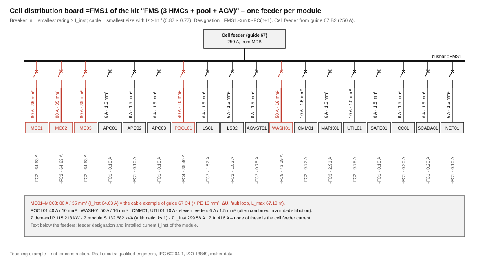

Read the schedule:

1. **MC01–MC03 = 80 A / 35 mm²** – exactly guide 67 C4 (the item-7 cable example of MC02). The rest of the cable check (PE 16 mm², ΔU 0.923 %,
   fault loop 842.7 A ≥ 800 A, L_max 67.10 m at 60 m) applies to each machine with its real length.
2. **POOL01 40 A / 10 mm²**, **WASH01 50 A / 16 mm²** – the two big module feeders.
3. Eleven feeders are **6 A / 1.5 mm²** (control-power-only modules and small drives) – in practice they are combined: e.g. one 3-phase 16 A
   feeder to a small sub-distribution in the pool area that supplies APC01–03, LS01–02 and AGVST01, or the control cabinets are supplied from a
   230 V circuit. Each combination must be checked again with B0.10 (installed values of all modules on it).
4. MCB 6 A is the smallest rating of the list; CMM01 and UTIL01 get 10 A.
5. Σ breaker ratings = 416 A, Σ I_inst = 299.58 A, Σ demand I = 191.52 A – none of these sums is the cell feeder current; the cell feeder is sized
   with the load list and simultaneity (guide 67 B2: 208.9 A with growth → 250 A breaker). D6 compares.

## D6. Comparison with the load list of guide 67

| Quantity | Guide 67 cell load list (B2.4) | Item 8 kit (library) |
|---|---|---|
| Installed P | 206 kW | 179.523 kW (Σ P_inst of the modules; Σ rounded 179.526) |
| Demand P | 125.5 kW (ku per load group) | 115.213 kW (ku per load type: motors 0.7, heater 0.8, feeders from parameters) |
| Q | 72.105 kvar | 63.684 kvar |
| S | 144.739 kVA vector sum → × ks 0.8 = **115.791 kVA** | Σ module S 132.682 kVA (arithmetic); vector sum √(115.213² + 63.684²) = 131.642 kVA; × ks 0.8 = 105.314 kVA (scratch) |
| Current | 167.13 A (with ks) | Σ module I 191.52 A; with vector sum and ks 0.8: 152.0 A (scratch) |

Why the numbers differ (and why both are correct for their purpose):

1. **Different scope.** The item-7 list contains loads that are **not modules of the kit**: compressed air share 22 kW, central coolant +
   chip system 11 kW (the kit's UTIL01 has only a 5.5 kW coolant pump), AGV charger 3 kW, cell lighting. The kit contains loads the item-7 list
   summarises differently (marking station, control power of 17 cabinets).
2. **Different utilisation assumptions.** Item 7 uses ku per **load group from experience** (stacker crane 15 kW at ku 0.3 – the crane rarely
   runs all drives at full power); the library uses one **rule per load type** (each motor ku 0.7). POOL01: item 7 4.5 kW demand, item 8 14.08
   kW. The washer: item 7 25 kW at ku 0.7 = 17.5 kW, item 8 22.049 kW (heater 18 kW at 0.8).
3. **Different summation.** Item 7 adds P and Q **vectorially** and applies a simultaneity factor ks = 0.8 for the cell; the library kit
   adds module S **arithmetically** with ks = 1 (an upper bound, since cos φ differs between modules and not all modules peak together).
4. **Same feeder for the machine tools.** Both use 38 kW, ku 0.6, cos φ 0.85 for an HMC: item 7's demand line 1 (68.4 kW for three) equals 3 ×
   22.8 kW in the library; and the module feeder 80 A / 35 mm² equals item 7's cable example.

Rule for the project: use the **item-7 method** (load list, ks, growth) for the **cell feeder and the transformer**; use the **library
values** for the **module feeders, PSUs and cabinet heat**. Keep both in the project file and explain differences at the design review.

## D7. 24 V and heat of the kit

- 24 V: 29.415 A in 18 PSUs with 57.5 A rated – every module has its own PSU (modularity again; a central 24 V for the cell would be one
  single point of failure and long 24 V lines with voltage drop, guide 67 D5).
- Heat: 1 258.6 W in all cabinets, of which POOL01 631.4 W (50 %, the inverters). The thermal check (guide 67 E3) is needed for **every**
  cabinet; for most module cabinets (16–80 W) natural convection is enough, POOL01 needs active cooling at 35–40 °C ambient.
- The PSU losses are calculated at full load (conservative); at the real 29.4 A load the losses are lower.

## D8. Checklist

- [ ] Kit list = module list of the layout; unit numbers counted per module code.
- [ ] Kit totals generated (`circuit_library.py --kit`, `module_power.py --kit`) and filed.
- [ ] Distribution board schedule: one feeder per module (or justified combinations), designations by the rule, breaker and cable checked
      with real lengths (guide 67 C4).
- [ ] Load list (item 7) and kit totals compared and differences explained.
- [ ] Network port count vs Ethernet cables; spare-part stock for card types.

---

# Part E – Engineering workflow from library to project

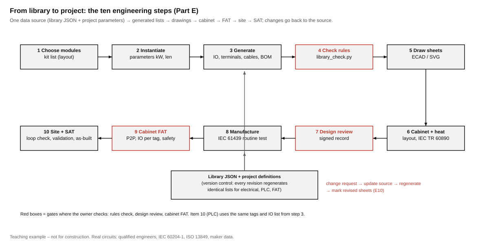

## E1. The ten steps

| Step | Activity | Output | Tool / web | Role mainly |
|---|---|---|---|---|
| 1 | Choose modules from the layout (guide 64) and the process (guide 62) | kit list | 8F | owner + integrator |
| 2 | Instantiate patterns: set parameters (kW, lengths), add project variants | module definitions (JSON copy) | editor, 8C | integrator |
| 3 | Generate IO list, terminals, cables, BOM, power, 24 V, losses | lists (CSV / Markdown) | `circuit_library.py`, `module_power.py`, 8C–8I | integrator |
| 4 | Check rules | findings list (must be empty) | `library_check.py` | integrator, owner checks |
| 5 | Draw / generate the sheets | drawing set per module | `circuit_svg.py`, ECAD / QElectroTech | integrator |
| 6 | Cabinet layout and heat | layout, thermal calculation | guide 67 E1–E3, `cabinet_thermal.py` | integrator |
| 7 | Design review | signed review record | checklists G5 | owner + integrator + safety engineer |
| 8 | Cabinet manufacturing | cabinets, routine test report (IEC 61439) | panel builder | panel builder |
| 9 | Cabinet FAT | point-to-point, IO test per tag, safety validation (pre) | 8J | integrator, owner witnesses |
| 10 | Site installation and SAT | installed cell, SAT report, as-built documents | guide 67 K3 | integrator, owner accepts |

## E2. Choose modules and instantiate patterns

1. From the layout (guide 64) list every physical unit: machines, pool, stations, conveyors, AGV dock, washer, CMM … Each becomes a module
   instance of M01–M22.
2. For each module check the library definition against the real equipment: does the machine builder deliver the APC? (then no M02); does the
   washer come with its own electrics? (then M01-like FEEDER_EXT + COUPLING instead of the library M10).
3. Set the parameters: motor kW from the mechanical design (guide 63 element sizing), heater kW, external feeder kW / ku / cos φ from the
   suppliers' interface sheets.
4. Set cable lengths from the layout (instance parameter `len`) – the default lengths (5–20 m) are placeholders.
5. Record variants: an extra sensor → **append** an instance; a different device → keep the pattern, change the device selection; a new kind of
   circuit → new pattern (E11).

Worked example – the M10 washer of a supplier with a 22 kW heater: copy M10, set `Heater` kW 22 → installed P rises by 4 kW → I_inst =
√((28.937 + 4)² + 7.609²) × 1000 / 692.82 = 48.79 A (scratch) → breaker still 50 A, cable 16 mm²; with 25 kW heater: √(35.937² + 7.609²) =
36.734 kVA → 53.02 A → **63 A**, required Iz = 63 / 0.6699 = 94.04 A → 16 mm² (94 A) is just too small (94 < 94.04) → **25 mm²** (scratch –
check with `module_power.py` on a modified copy of the JSON).

## E3. Generate the lists

```
python tools/fmse/circuit_library.py --module M03 --md M03.md --out M03_lists     (io_list.csv, devices.csv, cables.csv, terminals.csv, bom.csv)
python tools/fmse/circuit_library.py --kit --out kit_lists                        (one folder per module instance + kit_bom.csv)
python tools/fmse/module_power.py --kit --md board.md --csv board.csv             (distribution board schedule)
python tools/fmse/library_check.py                                                (rules check of all modules + kit)
python tools/fmse/circuit_svg.py --all --out sheets                               (32 pattern sheets + 22 module sheets = 54 SVG sheets + index)
```

The CSV files go into the ECAD import (IO list → PLC overview, BOM → parts), into the PLC engineering tool (tag table, item 10) and into the
project folder. **Never edit a generated list by hand** – change the module definition and generate again.

## E4. Draw and check the sheets

1. Create the ECAD / QElectroTech project with the structure `=FMS1.<unit>` and the sheet numbering of A4.
2. Insert the pattern macros in instance order (each macro = one sheet in the 11–19 / 30–39 ranges or a block on an IO sheet).
3. Draw the IO card sheets from the IO list; write tag, address, terminal and device designation at every channel; draw the spare channels with
   "spare" and route them to spare terminals if the owner requires.
4. Check: (a) every IO list row appears on exactly one card sheet; (b) every safety pattern is on F-IO with two channels; (c) designations
   unique; (d) cross-references complete; (e) the 24 V sheet shows the PSU rating ≥ library value; (f) the module feeder on sheet 10 equals the
   board schedule.

## E5. Cabinet layout and heat

Use guide 67 E1 (zones: power at the top, drives, PLC / IO in the middle, terminals at the bottom; separation 400 V / 24 V; ducts; 20–30 %
space reserve) and guide 67 E3 (IEC TR 60890 heat balance) with the **library loss** of the module as input. Example: POOL01 631.4 W in a 1 200 ×
2 000 × 500 mm cabinet at 35 °C ambient – compare with the guide 67 E3 numbers (stacker cabinet 6.528 m² surface) → active cooling.

## E6. Design review

Participants: owner's engineer, integrator's electrical lead, safety engineer, PLC lead, module supplier (for M01-type interfaces). Agenda:

1. Kit list and module definitions vs layout (E2).
2. Generated lists and `library_check.py` result (no findings or justified deviations).
3. Safety: each safety function of the risk assessment mapped to patterns, PL calculation (guide 67 G), zone matrix (guide 67 I7).
4. Power: board schedule, cable checks with real lengths, load list comparison (D6).
5. 24 V and heat per cabinet.
6. Documentation: sheet structure, designations, native files (A9).
7. Open points with responsible person and date. Sign the record.

## E7. Cabinet manufacturing

The panel builder receives: drawing set, BOM with order numbers, cabinet layout, terminal plans, wire numbering and colour rules (A6), label
list. He produces the cabinet and performs the **routine verification of IEC 61439** (wiring, insulation, protective circuit, clearances,
function) and delivers the routine test report. Owner's check at the panel shop: labels, wire ends (ferrules), duct fill ≤ 70 %, shield clamps,
PE connections, reserve space, documentation pocket.

## E8. Cabinet FAT – point-to-point, IO test per tag, safety validation

FAT of a cabinet happens **before** it is shipped, with the PLC and the safety program loaded, with simulators instead of the field devices
(signal boxes for DI / FDI, lamps for DO, a loop calibrator for AI).

**1. Point-to-point test (wiring).** Every wire from its source to its target, checked against the terminal plan (buzzer or continuity tester,
or an automated wire test system). Result: the terminal plan with ticks.

**2. Insulation and protective circuit.** IEC 60204-1 clause 18 / IEC 61439 routine tests (guide 67 K3.2, K3.4).

**3. Power-up and 24 V.** PSU output, ECB channels, 0 V – PE link, DC OK signal.

**4. IO test per tag.** One step per IO list row, generated by the web section 8J. Example – M03 POOL01 (31 steps):

| Step | Address | -XD2 | Tag (short) | Test | Expected | OK |
|---|---|---|---|---|---|---|
| 1 | FDO1.00 | 1 | `DriveSup.Enable` | FDO | trigger the safety function → output off (both switches), actuator de-energised; check test pulses do not move the actuator | ☐ |
| 2 | FDI1.00 | 2 | `DriveSup.EDM` | FDI | open this channel only → safety function trips and discrepancy alarm after the discrepancy time; close → reset needed | ☐ |
| 3 | FDO1.01 | 3 | `Travel.STO` | FDO | trigger the safety function → output off (both switches), actuator de-energised; check test pulses do not move the actuator | ☐ |
| 4 | DI1.00 | 4 | `Travel.Ready` | DI | operate the field device (or bridge at the terminal) → PLC bit = 1; release → 0 | ☐ |
| 5 | DI1.01 | 5 | `Travel.Fault` | DI | operate the field device (or bridge at the terminal) → PLC bit = 1; release → 0 | ☐ |
| 6 | FDO1.02 | 6 | `Hoist.STO` | FDO | trigger the safety function → output off (both switches), actuator de-energised; check test pulses do not move the actuator | ☐ |
| 7 | DI1.02 | 7 | `Hoist.Ready` | DI | operate the field device (or bridge at the terminal) → PLC bit = 1; release → 0 | ☐ |
| 8 | DI1.03 | 8 | `Hoist.Fault` | DI | operate the field device (or bridge at the terminal) → PLC bit = 1; release → 0 | ☐ |
| 9 | FDO1.03 | 9 | `Fork.STO` | FDO | trigger the safety function → output off (both switches), actuator de-energised; check test pulses do not move the actuator | ☐ |
| 10 | DI1.04 | 10 | `Fork.Ready` | DI | operate the field device (or bridge at the terminal) → PLC bit = 1; release → 0 | ☐ |
| 11 | DI1.05 | 11 | `Fork.Fault` | DI | operate the field device (or bridge at the terminal) → PLC bit = 1; release → 0 | ☐ |
| 12 | FDI1.01 | 12 | `Door.Closed` | FDI | open this channel only → safety function trips and discrepancy alarm after the discrepancy time; close → reset needed | ☐ |
| 13 | FDI1.02 | 13 | `Door.Closed2` | FDI | open this channel only → safety function trips and discrepancy alarm after the discrepancy time; close → reset needed | ☐ |
| 14 | FDI1.03 | 14 | `Door.Locked` | FDI | open this channel only → safety function trips and discrepancy alarm after the discrepancy time; close → reset needed | ☐ |
| 15 | FDI1.04 | 15 | `Door.Locked2` | FDI | open this channel only → safety function trips and discrepancy alarm after the discrepancy time; close → reset needed | ☐ |
| 16 | FDO2.00 | 16 | `Door.LockCmd` | FDO | trigger the safety function → output off (both switches), actuator de-energised; check test pulses do not move the actuator | ☐ |
| 17 | DI1.06 | 17 | `Door.Request` | DI | operate the field device (or bridge at the terminal) → PLC bit = 1; release → 0 | ☐ |
| 18 | FDI1.05 | 20 | `Estop.Ok` | FDI | open this channel only → safety function trips and discrepancy alarm after the discrepancy time; close → reset needed | ☐ |
| 19 | FDI1.06 | 21 | `Estop.Ok2` | FDI | open this channel only → safety function trips and discrepancy alarm after the discrepancy time; close → reset needed | ☐ |
| 20 | FDI1.07 | 22 | `Enable.Ok` | FDI | open this channel only → safety function trips and discrepancy alarm after the discrepancy time; close → reset needed | ☐ |
| 21 | FDI2.00 | 23 | `Enable.Ok2` | FDI | open this channel only → safety function trips and discrepancy alarm after the discrepancy time; close → reset needed | ☐ |
| 22 | FDI2.01 | 24 | `Mode.Auto` | FDI | open this channel only → safety function trips and discrepancy alarm after the discrepancy time; close → reset needed | ☐ |
| 23 | FDI2.02 | 25 | `Mode.Maint` | FDI | open this channel only → safety function trips and discrepancy alarm after the discrepancy time; close → reset needed | ☐ |
| 24 | DI1.07 | 26 | `TravLimF.On` | DI | operate the field device (or bridge at the terminal) → PLC bit = 1; release → 0 | ☐ |
| 25 | DI1.08 | 29 | `TravLimR.On` | DI | operate the field device (or bridge at the terminal) → PLC bit = 1; release → 0 | ☐ |
| 26 | DI1.09 | 32 | `PalOnFork.On` | DI | operate the field device (or bridge at the terminal) → PLC bit = 1; release → 0 | ☐ |
| 27 | DI1.10 | 35 | `ForkMid.On` | DI | operate the field device (or bridge at the terminal) → PLC bit = 1; release → 0 | ☐ |
| 28 | DO1.00 | 38 | `Tower.Red` | DO | force the output in the test mode → device acts (lamp, valve, coil); LED on card | ☐ |
| 29 | DO1.01 | 39 | `Tower.Yellow` | DO | force the output in the test mode → device acts (lamp, valve, coil); LED on card | ☐ |
| 30 | DO1.02 | 40 | `Tower.Green` | DO | force the output in the test mode → device acts (lamp, valve, coil); LED on card | ☐ |
| 31 | DO1.03 | 41 | `Tower.Buzzer` | DO | force the output in the test mode → device acts (lamp, valve, coil); LED on card | ☐ |

**5. Safety validation (pre-validation at FAT).** Each safety function with the field-device simulators: e-stop, door (guard locking sequence),
enabling, mode, EDM (welded contactor simulation), STO (inverter shows STO). Final validation with the real devices and stopping-time
measurement is done at site (guide 67 G11, K3.7, K3.8).

**6. Communication.** Bus to the IO station, PROFIsafe F-addresses, data block to the cell controller simulator (guide 66 H5 handshake
scenarios).

**7. Record.** FAT report with the step list, deviations (punch list) and signatures. The cabinet ships only with all "A" punch points closed.

## E9. Site installation and SAT

1. Cabinets placed and fixed, feeder cables pulled and connected (the board schedule), field cables pulled by the cable list (route, length),
   field devices mounted and connected by the terminal plan.
2. Electrical tests at site (guide 67 K3): PE continuity, insulation, loop impedance at each feeder, RCD, phase sequence.
3. IO check with the real devices (repeat the FAT step list with the field device instead of the simulator – "loop check").
4. Safety validation with the real devices, stopping-time measurement, safety distances (guide 67 G11, H4); validation report signed.
5. Functional tests per module (PackML states, handshakes), then the cell (SAT, guide 61 pipeline, guide 73).
6. As-built documents: every change at site entered into the drawings (red-line) and released as revision "as built" with the native files.

## E10. Change management – revisions of library and project

| Change | Where | Rule |
|---|---|---|
| Library change (new pattern, corrected pattern) | library file, version x.y | released by the library owner; existing projects keep their version until a change order says otherwise |
| Project change before release | project module definition | regenerate lists; revision index on the affected sheets |
| Project change after FAT | change request → impact (IO, terminals, cables, BOM, safety) → approve → regenerate → mark changed sheets | **append** instances or use spare channels; never re-order (addresses would shift, A1.3) |
| Safety-related change | additionally: risk assessment update, PL recalculation, re-validation of the affected functions | documented in the validation report |

Version the library file and the project's module definitions in a version control system (git): every list can then be regenerated for any
revision, and differences between revisions are visible line by line (the CSV and Markdown outputs are text).

## E11. How to add a new pattern or module

**New pattern** (example: `IOLINK_VALVE` – a valve terminal on IO-Link with 8 valves):

1. Write the pattern like the existing ones: `title`, `io` (signal, type, description – here perhaps none, because the data travel over
   IO-Link), `dev` (class `MB`, description, BOM item), `cab` (IO-Link cable M12 4-pole, 10 m), `i24` (from the data sheet), `loss`, `tx`.
2. If it adds a new IO type or a power class, extend the rules (and the tools) – otherwise no code change is needed.
3. Write its chapter (purpose, schematic, sizing, PLC side, FAT, faults) and its SVG sheet.
4. Review with the safety engineer if it touches safety; run `library_check.py`; release a new library version.

**New module** (example: M23 deburring cell): list its instances in a meaningful order (power first, safety, then sensors and operator
devices, BUS last – as the library modules do), add the unit code (`DEBUR`), generate, check (tags ≤ 48 characters, reserve, F-IO), write the
module chapter (Part C structure), and add its data-block module part (guide 66 H2.3) and its PLC FB (item 10).

## E12. Interfaces to item 6 (data block) and item 10 (PLC programs)

| Library output | Used by item 6 / 10 as |
|---|---|
| Tags (`PLT1.MACH.FMS1.<unit>.<group>.<signal>`) | PLC tag names / symbol table (item 10), OPC UA browse names and MQTT metrics (guide 66 H6) |
| IO addresses (DI1.00 …) | hardware configuration of the IO station and the mapping of FB inputs (item 10) |
| Patterns | one standard FB per pattern type in the PLC library (DOL → motor FB, VFD_STO → drive FB, VALVE_* → cylinder FB, SENSOR → input filter, safety patterns → certified safety blocks) |
| Module = list of instances | one module FB that calls the pattern FBs in the same order and exposes the standard interface (cmd, status, data, alarms – guide 60 face "PLC function block") |
| Data block words 0–19 + module part | written by the module FB from the pattern signals (e.g. M04 word 20 bit1 `LightCurtainOK` from `Curtain.Ossd1/2`) – guide 66 H2 |
| PackML | pattern events drive the state machine (e-stop → Aborting, door request → Holding, fault → Aborting, operator wait → Suspended) – item 9 / 10 |
| Alarm numbers | module range × 1000 + n per pattern fault (guide 66 H2.2) |

The same IO list is therefore the input of three teams: electrical (drawings), automation (PLC, HMI), commissioning (FAT / SAT). This is why
the library makes it **once** and the tools generate it **identically** everywhere.

---

# Part F – Three complete cases

All three cases are computed with the library rules (B0). Kit totals add the rounded module values (B0.13).

## F1. Machining FMS – the JSON kit

**Situation.** Compressor crankcases, 3 HMCs with APCs, pallet pool with stacker crane, 2 load stations, AGV dock, washer, CMM, marking,
utilities, cell safety controller, cell controller, SCADA, network – Part D.

**Result (summary of Part D):** 18 module instances, **210 IO** (DI 90, DO 45, AI 9, FDI 49, FDO 17), 57 cards in 17 IO stations, 342 terminals,
137 cables / 1 333 m, 163 devices, 11 motors (38.99 kW), demand P 115.213 kW, Σ module S 132.682 kVA, PSU sum 57.5 A, losses 1 258.6 W; board
with 18 feeders, the three machine tools at 80 A / 35 mm².

**Engineering sequence for this case (E1 applied):**

1. Interface sheets with the HMC builder (M01: feeder, coupling, bus) and the pool supplier (M03 complete cabinet, or circuits by the
   integrator from the library).
2. Integrator builds 12 cabinets (APC01–03 may sit in the pool cabinet area, LS01–02, AGVST01, WASH01, CMM01 interface, MARK01, UTIL01, SAFE01,
   CC01 + NET01 network cabinet, SCADA01 desk) – the library gives each a complete set of lists.
3. FAT per cabinet with the generated step list (E8): POOL01 31 IO steps + safety pre-validation; the three M01 interface cabinets 8 steps each; SAFE01 20 steps incl. the four zone releases with EDM (B3.4).
4. Site: loop checks 210 IO, safety validation SF1–SF6 (guide 67 G9) and the zone matrix (guide 67 I7).

## F2. Assembly line – conveyor + 4 assembly stations + test + marking + load station + cell infrastructure

**Situation.** Compressor head assembly line `ASM1` (the module list of web section 8M): a 3-zone conveyor (M07), four assembly stations with
nutrunner and press-fit (M13 × 4 → ST01–ST04), a leak test station (M14), a marking station (M12), a load / unload station for the carriers
(M04), and the cell infrastructure: safety controller (M18), cell controller (M19), SCADA / HMI (M20) and network (M22).

```
M07 + M13 ×4 + M14 + M12 + M04 + M18 + M19 + M20 + M22      = 12 module instances
python tools/fmse/circuit_library.py --modules M07,M13,M13,M13,M13,M14,M12,M04,M18,M19,M20,M22
python tools/fmse/module_power.py   --modules M07,M13,M13,M13,M13,M14,M12,M04,M18,M19,M20,M22
```

| # | Unit | Mod | IO | Cards | XD2 | Cab / m | Dev | i24 A | PSU A | P kW | S kVA | I_inst A | Breaker | Cable | Loss W |
|---|---|---|---|---|---|---|---|---|---|---|---|---|---|---|---|
| 1 | CONV01 | M07 | 23 | 4 | 43 | 16 / 145 | 22 | 1.24 | 2.5 | 1.195 | 1.449 | 3.00 | -FC4 6 A | 1.5 mm² | 33.2 |
| 2 | ST01 | M13 | 20 | 4 | 37 | 14 / 125 | 13 | 1.37 | 2.5 | 0.79 | 0.832 | 2.38 | -FC2 6 A | 1.5 mm² | 26.7 |
| 3 | ST02 | M13 | 20 | 4 | 37 | 14 / 125 | 13 | 1.37 | 2.5 | 0.79 | 0.832 | 2.38 | -FC2 6 A | 1.5 mm² | 26.7 |
| 4 | ST03 | M13 | 20 | 4 | 37 | 14 / 125 | 13 | 1.37 | 2.5 | 0.79 | 0.832 | 2.38 | -FC2 6 A | 1.5 mm² | 26.7 |
| 5 | ST04 | M13 | 20 | 4 | 37 | 14 / 125 | 13 | 1.37 | 2.5 | 0.79 | 0.832 | 2.38 | -FC2 6 A | 1.5 mm² | 26.7 |
| 6 | TEST01 | M14 | 16 | 4 | 32 | 14 / 120 | 14 | 1.095 | 2.5 | 0.64 | 0.674 | 1.62 | -FC2 6 A | 1.5 mm² | 26.2 |
| 7 | MARK01 | M12 | 10 | 3 | 18 | 9 / 90 | 11 | 0.76 | 2.5 | 1.165 | 1.3 | 2.91 | -FC3 6 A | 1.5 mm² | 24.7 |
| 8 | LS01 | M04 | 20 | 5 | 35 | 15 / 128 | 15 | 3.535 | 5 | 0.605 | 0.721 | 1.52 | -FC2 6 A | 1.5 mm² | 81.4 |
| 9 | SAFE01 | M18 | 20 | 6 | 22 | 10 / 123 | 10 | 1.82 | 2.5 | 0.04 | 0.042 | 0.10 | -FC1 6 A | 1.5 mm² | 37.2 |
| 10 | CC01 | M19 | 2 | 1 | 2 | 1 / 5 | 3 | 3.45 | 5 | 0.08 | 0.084 | 0.20 | -FC1 6 A | 1.5 mm² | 73.4 |
| 11 | SCADA01 | M20 | 0 | 0 | 0 | 2 / 15 | 2 | 3.7 | 5 | 0.08 | 0.084 | 0.20 | -FC1 6 A | 1.5 mm² | 75.4 |
| 12 | NET01 | M22 | 2 | 1 | 2 | 0 / 0 | 4 | 1.85 | 2.5 | 0.04 | 0.042 | 0.10 | -FC1 6 A | 1.5 mm² | 46.2 |
| | **Σ** | | **173** | **40** | **302** | **123 / 1126** | **133** | **22.93** | **37.5** | **7.005** | **7.724** | **19.17** | | | **504.5** |

IO cards (each module rounds up on its own, D3): DI 78 used / 12 cards / 114 spare · DO 36 used / 9 cards / 108 spare · AI 2 used / 2
cards / 6 spare · FDI 52 used / 14 cards / 60 spare · FDO 5 used / 3 cards / 7 spare → 173 channels used of 468 installed.

Distribution board: all twelve module feeders are 6 A / 1.5 mm² (I_inst 0.10–3.00 A per module, designations `=FMS1.CONV01-FC4`,
`=FMS1.ST01-FC2` … `=FMS1.NET01-FC1` by the rule of D5) – see point 1 below for the combined line feeder.

**What the case teaches.**

1. An assembly line is an **IO-rich, power-poor** cell: 173 IO but only 7.005 kW demand (5 small motors, 3.15 kW) – all twelve feeders are
   6 A / 1.5 mm². In practice one three-phase feeder to a line sub-distribution supplies all stations (check with the B0.10 rule on the sum:
   Σ I_inst = 19.17 A → 20 A breaker, 20 / 0.6699 = 29.86 A → 2.5 mm² (30 A) – just enough; scratch).
2. Safety dominates the inputs: each M13 has TWOHAND (4) + LC (2) + ESTOP (2) = 8 FDI; with the conveyor pull-wire, the test hood, the
   marking enclosure, the load station and SAFE01 the line has **52 FDI and 5 FDO** – 57 of 173 IO (33 %). The 5 FDO are the STO of the LS01
   rotary table and the four zone releases of SAFE01. Four zones are not enough for this line: the conveyor motors (CONV01) and the press-fit
   valves of ST01–ST04 are five actuator groups, plus the test hood and the marking enclosure – the project **appends** ZONE_OUT instances to
   M18 (B3.4, sizing rule 6) until every column of the zone matrix has its output. `library_check.py` R10 still warns for M07, M12, M13 and
   M14 – the warning is closed when the zone matrix (guide 67 I7) names the zone output of each of them.

   **Revision 2026-11-15: gaps fixed.** The first edition of this guide reported three design-review findings in its own library; this case
   was where the third one became visible:

   | # | Gap (first edition) | Consequence | Fix in revision 2026-11-15 |
   |---|---|---|---|
   | 1 | M10 washer heater 18 kW had the fixed HEATER cable **4G2.5** | Iz 20.10 A < operating current 25.98 A – the cable overheats in normal operation | rule `power_cable` (B0.14): 25.98 A → 32 A breaker → **4G6** |
   | 2 | M16 press pump 15 kW had the fixed DOL cable **4G1.5** | Iz 14.74 A = half the running current 30.00 A | same rule: MPCB setting 30.00 A → **4G6** |
   | 3 | M18 SAFE01 had **no safety outputs**: this line had 48 FDI but 1 FDO | the C chapters of M06, M07, M10, M12–M14 referred to a "zone F-DO" that existed in no module – the safety functions had inputs and logic, but no output in the IO list, the BOM or the FAT | new pattern **ZONE_OUT** (B3.4), 4 instances in M18: +4 FDO, +4 FDI (EDM), +4 cables, +4 terminal blocks |

   Side effects of the fix: 16 power-cable texts changed in 12 modules (M01, M03, M05, M08–M16 – B0.14 table); 8 of them were too small or not
   orderable before. Kit 202 → **210 IO**, FDI 45 → 49, FDO 13 → 17, cards 54 → 57, terminals 334 → 342, cables 133 → 137, 1 253 → 1 333 m,
   devices 159 → 163, 24 V sum 29.065 → 29.415 A, losses 1 251.6 → 1 258.6 W (P, S and the PSU sum unchanged); this assembly case 165 → 173
   IO; the welding case 104 → 112 IO. Two new checks keep the gaps closed: `library_check.py` **R9** (power cable ≥ calculated size) and
   **R10** (F-DI without F-DO: error for a kit, warning for a single module).

   **The lesson.** Both cable gaps had been **noticed** – in the notes of B1.2, B1.4, C10.7 and C16.5 – and still the generated cable list and
   the BOM printed 4G2.5 and 4G1.5, because the lists come from the data, not from the notes. **Fixed cores per pattern are a library smell**:
   any value that depends on the size of the instance (cable cross-section, breaker, contactor, inverter, PSU) must be **calculated per
   instance by a rule**, never stored as a constant in the pattern. The same holds for safety: count the **outputs** that the zone matrix
   needs, not only the inputs. A library check that compares F-DI with F-DO (R10) finds such a gap in seconds; a commissioning engineer finds
   it at the first validation – much later and much more expensively.
3. The nutrunners, the leak tester and the code reader are **bus devices** (BUS pattern) – their results (torque, angle, leak rate, code) do not
   appear in the IO list; they travel in the data block (guide 66 H2.3, M13 words 21–25).
4. Copying a station (ST01 → ST04) is trivial with the library: same IO list, new unit number, same FAT steps.

## F3. Robot welding cell – 2 welding cells + load station + marking + cell infrastructure

**Situation.** Welded compressor frame brackets (the module list of web section 8M): two robot welding cells with turntables (M15 × 2 → WELD01,
WELD02), one load / unload station (M04 → LS01), a marking station (M12), the cell safety controller (M18), the cell controller (M19) and the
network (M22).

```
M15 ×2 + M04 + M12 + M18 + M19 + M22                          = 7 module instances
python tools/fmse/circuit_library.py --modules M15,M15,M04,M12,M18,M19,M22
```

| # | Unit | Mod | IO | Cards | XD2 | Cab / m | Dev | i24 A | PSU A | P kW | S kVA | I_inst A | Breaker | Cable | Loss W |
|---|---|---|---|---|---|---|---|---|---|---|---|---|---|---|---|
| 1 | WELD01 | M15 | 29 | 6 | 45 | 15 / 178 | 18 | 2.32 | 5 | 18.15 | 20.505 | 49.18 | -FC5 50 A | 16 mm² | 78.4 |
| 2 | WELD02 | M15 | 29 | 6 | 45 | 15 / 178 | 18 | 2.32 | 5 | 18.15 | 20.505 | 49.18 | -FC5 50 A | 16 mm² | 78.4 |
| 3 | LS01 | M04 | 20 | 5 | 35 | 15 / 128 | 15 | 3.535 | 5 | 0.605 | 0.721 | 1.52 | -FC2 6 A | 1.5 mm² | 81.4 |
| 4 | MARK01 | M12 | 10 | 3 | 18 | 9 / 90 | 11 | 0.76 | 2.5 | 1.165 | 1.3 | 2.91 | -FC3 6 A | 1.5 mm² | 24.7 |
| 5 | SAFE01 | M18 | 20 | 6 | 22 | 10 / 123 | 10 | 1.82 | 2.5 | 0.04 | 0.042 | 0.10 | -FC1 6 A | 1.5 mm² | 37.2 |
| 6 | CC01 | M19 | 2 | 1 | 2 | 1 / 5 | 3 | 3.45 | 5 | 0.08 | 0.084 | 0.20 | -FC1 6 A | 1.5 mm² | 73.4 |
| 7 | NET01 | M22 | 2 | 1 | 2 | 0 / 0 | 4 | 1.85 | 2.5 | 0.04 | 0.042 | 0.10 | -FC1 6 A | 1.5 mm² | 46.2 |
| | **Σ** | | **112** | **28** | **169** | **65 / 702** | **79** | **16.055** | **27.5** | **38.23** | **43.199** | **103.19** | | | **419.7** |

IO cards (each module rounds up on its own, D3): DI 43 used / 7 cards / 69 spare · DO 15 used / 5 cards / 65 spare · AI 1 used / 1 cards
/ 3 spare · FDI 40 used / 8 cards / 24 spare · FDO 13 used / 7 cards / 15 spare → 112 channels used of 288 installed.

Distribution board:

| No | Feeder designation | Unit | Module | P_inst kW | I_inst A | I demand A | Breaker In A | Required Iz A | Cable mm² | Iz corrected A |
|---|---|---|---|---|---|---|---|---|---|---|
| 1 | `=FMS1.WELD01-FC5` | WELD01 | M15 | 30.233 | 49.18 | 29.60 | 50 | 74.64 | 16 | 62.97 |
| 2 | `=FMS1.WELD02-FC5` | WELD02 | M15 | 30.233 | 49.18 | 29.60 | 50 | 74.64 | 16 | 62.97 |
| 3 | `=FMS1.LS01-FC2` | LS01 | M04 | 0.883 | 1.52 | 1.04 | 6 | 8.96 | 1.5 | 14.74 |
| 4 | `=FMS1.MARK01-FC3` | MARK01 | M12 | 1.817 | 2.91 | 1.88 | 6 | 8.96 | 1.5 | 14.74 |
| 5 | `=FMS1.SAFE01-FC1` | SAFE01 | M18 | 0.067 | 0.10 | 0.06 | 6 | 8.96 | 1.5 | 14.74 |
| 6 | `=FMS1.CC01-FC1` | CC01 | M19 | 0.133 | 0.20 | 0.12 | 6 | 8.96 | 1.5 | 14.74 |
| 7 | `=FMS1.NET01-FC1` | NET01 | M22 | 0.067 | 0.10 | 0.06 | 6 | 8.96 | 1.5 | 14.74 |
| | **Σ** | | | **63.433** | **103.19** | **62.36** | **130** | | | |

**What the case teaches.**

1. A welding cell is **power-rich**: each M15 needs a 50 A feeder (welding power source 20 kW + robot 5 kW + turntable + fume fan) – the two
   cells together 2 × 49.18 A installed of 103.19 A for the whole case. The welding power sources' real input current (nameplate I1max) and their
   unbalanced, pulsed load must be checked by the electrical engineer (power quality, guide 67 B7).
2. Each M15 has 16 safety IO (12 FDI + 4 FDO) because of the coupling with the robot, the curtain, the door with guard locking and the e-stop;
   the case has 40 FDI + 13 FDO = 53 of 112 IO (47 %), the four SAFE01 zone releases included. The welding power cables are
   sized per instance: WeldPwr **4G10** (40 A breaker), RobotSup 4G1.5 (B0.14 worked example 6).
3. EMC and welding current: the welding return path must never use the PE or the cabinet; fixtures are grounded with the welding ground clamp
   (C15.10).
4. Fume extraction is a process / health measure with its own monitoring (flow switch) – add a SENSOR instance in the project if the
   library's `Fume.RunFb` (contactor feedback) is not enough.

## F4. What the three cases teach

| Case | Modules | IO | Safety IO share | Demand P kW | Σ module S kVA | Biggest feeder | Losses W | Character |
|---|---|---|---|---|---|---|---|---|
| F1 machining FMS | 18 | 210 | 66 / 210 = 31 % | 115.213 | 132.682 | 80 A (machine tools) | 1 258.6 | power + heat (inverters) + many modules |
| F2 assembly line | 12 | 173 | 57 / 173 = 33 % (5 FDO – more zones needed) | 7.005 | 7.724 | 6 A | 504.5 | IO + safety dominated |
| F3 welding | 7 | 112 | 53 / 112 = 47 % | 38.23 | 43.199 | 50 A (welding cells) | 419.7 | power + safety + EMC |

The library handles all three with the **same rules** – the engineer's work moves from drawing the same circuits again to **choosing the
right modules, checking the parameters and validating the safety**.

---

# Part G – Programs, tools and reference

## G1. Offline Python tools (`tools/fmse/`)

All tools are Python 3 standard library only, run offline, read `tools/fmse/examples/item8_examples.json` and share **one** implementation of
the rules (`circuit_lib_core.py`). Every tool has `--selftest`; `python tools/fmse/run_all_selftests.py` runs all of them.

| Tool | What it does | Typical commands | Chapters |
|---|---|---|---|
| `circuit_library.py` | expands a module or a kit: IO list with tags and addresses, devices with designations, cables, terminal plan, IO cards, BOM; Markdown and CSV export | `--list` · `--module M03` (= `--example`) · `--kit` · `--modules M01,M01,M04 --out my_kit` · `--module M03 --md M03.md --out M03_lists` · `--json` · `--selftest` | A7, A8, B0, C, D |
| `module_power.py` | motors (In, contactor / inverter, MPCB setting), demand load list, installed current, feeder breaker + cable, 24 V + PSU, losses per module and kit, distribution board schedule | (no option = all modules + kit board) · `--module M03` · `--kit` · `--modules M01,M01,M03,M10 --md board.md --csv board.csv` · `--json` · `--selftest` | B0.9–B0.12, C, D5 |
| `circuit_svg.py` | SVG schematic sheets: one per pattern (instance in a dummy unit `XX01`) and one overview per module, A3 frame with title block, offline | `--pattern DOL --out sheets` · `--module M03 --out sheets` · `--all --out sheets` (32 pattern + 22 module sheets = 54 SVG sheets + index) · `--list` · `--selftest` | A4, A10, B, C |
| `library_check.py` | rules check: R1 tags ≤ 48 and unique, R2 designations / cables unique, R3 spare ≥ 20 %, R4 safety signals on F-IO, R5 two-channel pairs, R6 PSU reserve ≥ 25 %, R7 feeder breaker ≥ I_inst and cable Iz × k ≥ In, R8 every module with motors has a feeder, **R9** (rev. 2026-11-15) every power cable cross-section ≥ the size calculated by B0.14, **R10** (rev. 2026-11-15) a kit with F-DI but no F-DO is a finding; a single module with F-DI but no F-DO is only a **warning** (library: 6 warnings – M06, M07, M10, M12, M13, M14 – whose outputs are the M18 zone outputs) | (no option = 22 modules + kit) · `--modules M01,M01,M04` · `--examples my_library.json --csv findings.csv` · `--json` · `--selftest` (also tests deliberately broken library copies, e.g. a HEATER without `pcab`); exit code 0 = no findings, warnings do not change it | A3, B0, E4, E11 |

Tools of item 7 used together with item 8: `load_list.py` (cell load list, D6), `cable_size.py` (full cable check with ΔU, fault loop, L_max –
the module feeder lengths), `control_power.py` (24 V channels, B8), `cabinet_thermal.py` (cabinet heat, E5), `safety_pl.py`,
`safety_distance.py`, `safety_zones.py` (safety, C and E8). Item 6: `datablock_map.py` (data-block interface sheet, E12).

## G2. The web tab item 8

Open `/?feitem=8#fmse` (local server of the twin; offline). The sections 8A–8N are listed with their chapters in A0.2. The web uses the same
JSON and the same rules – its numbers are identical to this guide and to the tools.

| If you want to … | open |
|---|---|
| see a pattern schematic and its data | 8B |
| print the IO list / terminal plan / cable list / BOM of a module | 8C, 8H, 8G, 8I |
| build your own kit and get the distribution board | 8F |
| print the FAT step list of a cabinet | 8J |
| look up a designation class or the sheet structure | 8K |

## G3. Buy list – devices of the library

Price classes: € < 500 EUR · €€ 500–2 000 EUR · €€€ 2 000–10 000 EUR · €€€€ > 10 000 EUR per device (estimate – ask for a quote). Product
families are **examples of products that exist – not a recommendation**; check the maker's website for current data.

| Device (BOM item) | Used in patterns | Example product families | Price class | Selection notes |
|---|---|---|---|---|
| IO station bus interface + cards (DI 16, DO 16, AI 4, FDI 8, FDO 4) | station | Siemens ET 200SP (+ F-modules), Beckhoff EtherCAT terminals (+ TwinSAFE), Phoenix Contact Axioline, WAGO 750 (+ PROFIsafe), Rockwell FLEX 5000 | € per card, €€ per station | same family as the PLC; safety cards certified PL e / SIL 3 |
| Safety PLC CPU | SAFETY_PLC | Siemens S7-1500F / ET 200SP F-CPU, Rockwell GuardLogix, Pilz PSS 4000, Beckhoff TwinSAFE, Omron NX-S | €€–€€€ | number of F-devices, response time, safety network |
| Frequency inverter with STO + fieldbus | VFD_STO | Siemens SINAMICS G120, Danfoss VLT, SEW MOVIDRIVE / MOVITRAC, ABB ACS380/580, Lenze i500 | € (small) – €€€ (large) | STO PL e / SIL 3 certificate, SLS / SS1 option for cranes |
| Safety contactor with mirror contacts | CONT_PAIR_EDM | Siemens SIRIUS 3RT, Schneider TeSys, ABB AF, Eaton DILM (mirror contacts per IEC 60947-4-1 Annex F) | € | AC-3 / AC-1 rating, B10d at load |
| Motor protection circuit breaker + contactor | DOL | Siemens 3RV + 3RT, Schneider GV + LC1, ABB MS + AF, Eaton PKZ + DILM | € | type 2 coordination table of the maker |
| Feeder circuit breaker (MCCB / MCB) | FEEDER_EXT, HEATER, board | Siemens 3VA / 5SY, Schneider ComPacT NSX / Acti9, ABB Tmax / S200, Eaton NZM / FAZ | € – €€ | breaking capacity ≥ Ik, auxiliary contact |
| Guard-locking interlock switch, coded | DOOR_LOCK | Euchner CTM / MGB, Pilz PSENmlock, Schmersal AZM, Siemens 3SE, Sick (various), Bernstein | € – €€ | locking force, coding level, escape release |
| Interlock / position switch | DOOR_2CH | Schmersal, Pilz PSENmech, Euchner, Siemens 3SE, Sick, Bernstein, Telemecanique XCS | € | positive opening, diversity |
| E-stop push-button 2 NC | ESTOP | Siemens 3SU, Schneider Harmony XB, Eaton RMQ, EAO, Schlegel, ABB | € | ISO 13850, positive opening, enclosure IP65 |
| Enabling switch 3-position | ENABLE | IDEC HE series, Euchner ZSA, Schmersal ZSD, pendant HMIs with enabling | € – €€ | B10d of the enabling contacts |
| Key mode selector | MODE_SWITCH | Euchner EKS (electronic key), Pilz PITmode, standard key selectors of the push-button ranges | € – €€ | safe evaluation 1-of-n |
| Light curtain type 4 | LC | Sick deTec4, Pilz PSENopt, Keyence GL-R, Leuze MLC, Omron F3SG, Banner EZ-SCREEN | €€ | resolution, height, response time |
| Safety laser scanner | SCANNER | Sick microScan3 / nanoScan3, Pilz PSENscan, Leuze RSL, Keyence SZ, Omron OS32C | €€–€€€ | type 3, fields, network variant |
| Two-hand control station | TWOHAND | Schmersal, Pilz, Bernstein, Telemecanique (type IIIC stations) | € – €€ | ISO 13851 type IIIC |
| Safety valve block with spool monitoring | SAFE_VALVE | Bosch Rexroth, Parker, Hydac, Ross, Festo (pneumatic) – press safety valves | €€–€€€ | Category 4 certificate, response time |
| Solenoid valves 5/2 + cylinder sensors | VALVE_SINGLE / DOUBLE | Festo, SMC, Bosch Rexroth (Aventics), Parker, Norgren; sensors from the same makers | € | valve terminals with fieldbus / IO-Link for many valves |
| Sensors PNP M12 | SENSOR | ifm, Balluff, Sick, Pepperl+Fuchs, Turck, Baumer, Keyence, Omron | € | IO-Link variants for diagnostics |
| Pressure / temperature transmitters 4–20 mA | ANALOG_P / T | ifm, WIKA, Endress+Hauser, Danfoss, JUMO, Baumer | € | range, accuracy, process connection |
| RFID head IO-Link | RFID | Balluff BIS, Turck, Pepperl+Fuchs, Siemens SIMATIC RF, ifm, Sick | € – €€ | HF / UHF, metal mounting |
| Push-buttons, signal towers | PUSHBUTTON, SIGNAL_TOWER | Siemens 3SU, Schneider Harmony, Eaton RMQ; towers Werma, Patlite, Banner, Sirena | € | colours IEC 60204-1 |
| HMI panel 15 inch | HMI | Siemens Comfort / Unified, Beckhoff CP, Weintek, Pro-face, B&R Power Panel | €€ | offline engineering, web client |
| Industrial PC fanless | IPC | Beckhoff C6000 / CX, Siemens SIMATIC IPC, Advantech, Kontron, B&R APC | €€ | fanless, temperature range |
| Managed switch, firewall | SWITCH, FIREWALL | Hirschmann, Phoenix Contact FL SWITCH / mGuard, Siemens SCALANCE, Moxa, Belden | € – €€ | VLAN, ring, IEC 62443 features |
| 24 V PSU, DC UPS | station, UPS_DC | Puls, Phoenix Contact QUINT, Siemens SITOP, Weidmüller PRO, Murrelektronik | € | efficiency ≥ 93 %, DC OK contact, buffer |
| Terminals, ducts, cabinets | XD, cabinet | Phoenix Contact, Weidmüller, WAGO; cabinets Rittal, Eldon, Schneider Spacial | € | push-in, 3-level sensor terminals |
| ECAD software | documentation | EPLAN Electric P8, Zuken E3.series, WSCAD, AutoCAD Electrical, SEE Electrical; free: QElectroTech | €€–€€€ per seat (free: QElectroTech) | native files + macros to the owner |
| Test equipment | FAT / SAT | installation tester (insulation, loop, RCD), loop calibrator 4–20 mA, wire test system, stopping-time meter | €€–€€€ | calibrated, certificates |

## G4. Standards and references

| Standard | Topic | Where used |
|---|---|---|
| IEC 60617 | graphical symbols for diagrams | A2 |
| IEC 81346-1 / -2 | structuring principles, reference designations, classes of objects | A3, B0.3 |
| IEC 61082-1 | preparation of documents used in electrotechnology | A4 |
| IEC 61355-1 | classification and designation of documents | A4 |
| IEC 60445 / IEC 60757 | identification of terminals and conductors / colour codes | A6 |
| IEC 60204-1 | electrical equipment of machines (supply disconnection, protection, control circuits, colours, documentation, tests) | A6, B, E8 |
| IEC 61439-1 / -2 | low-voltage switchgear and controlgear assemblies (design and routine verification) | E5, E7 |
| IEC TR 60890 | temperature rise of assemblies by calculation | B0.12, E5 |
| IEC 60364 series | low-voltage installations (cable sizing, earthing, verification) | B0.10, E9 |
| IEC 60947-2 / -4-1 / -5-1 / -5-5 | circuit-breakers / contactors and motor starters (AC-1, AC-3, coordination, mirror contacts) / control devices / e-stop devices | B1, B2 |
| IEC 61131-2 | PLC equipment requirements (24 V input types, outputs) | B0.4, B5 |
| IEC 61800-5-2 / -3 | safe drive functions (STO, SS1, SLS, SBC) / EMC of drives | B1.3 |
| ISO 13849-1 / -2, IEC 62061 | safety-related parts of control systems (PL, categories, validation) / SIL | B2, B3, C |
| ISO 13850 | emergency stop | B2.1 |
| ISO 14119, ISO 14120 | interlocking devices, guard locking / guards | B2.2, B2.3 |
| ISO 13855, ISO 13857 | positioning of safeguards / safety distances; reach distances | B2.4, B2.5, B2.8 |
| IEC 61496-1 / -2 / -3 | electro-sensitive protective equipment (light curtains, scanners) | B2.4, B2.5 |
| ISO 13851 | two-hand control devices | B2.8 |
| ISO 16092-1 / -3 | machine tools safety – presses (general, hydraulic) | B3.2, C16 |
| ISO 10218-2, ISO/TS 15066 | robot systems and integration; collaborative robots | C5, C15 |
| ISO 3691-4 | driverless industrial trucks (AGV) | C6 |
| EN 528 | rail-dependent storage and retrieval equipment (stacker cranes) | C3, C8 |
| ISO 16090-1 | machining centres safety | C1 |
| IEC 60825-1 / -4 | laser safety / laser guards | C12 |
| IEC 62443 series | industrial communication networks – security | B7.4, B7.5, C22 |
| NAMUR NE 43 | 4–20 mA signal levels for failure information | B5.2 |
| Machinery Directive 2006/42/EC, Machinery Regulation (EU) 2023/1230 | legal frame (guide 67 F) | E6, E9 |

Use the current editions; the class letters of IEC 81346-2 changed between editions – the project specification names the edition.

## G5. Consolidated checklists

**Documentation (owner specifies, integrator delivers)**
- [ ] IEC 60617 symbols, IEC 81346 designations with the project code table, sheet structure A4, title block with library version.
- [ ] IO list, terminal plans, cable list, BOM generated from the library and delivered as CSV + PDF + native ECAD files.
- [ ] Cross-references and contact images; colours and wire numbers per A6.

**Library and modules**
- [ ] Library version fixed; variants documented (E11); instance order never changed after release (A1.3).
- [ ] `library_check.py` without findings for every module and the kit.
- [ ] Parameters (kW, len) set from real data; default cable lengths replaced.

**Power and 24 V**
- [ ] Motors: In from rating plates; contactor / inverter / MPCB from maker tables (type 2 coordination).
- [ ] Module feeders on installed values; cable check with real length (guide 67 C4); board schedule with designations `=FMS1.<unit>-FC<n+1>`.
- [ ] Branch power cables sized per instance (B0.14, R9) and checked for voltage drop / fault loop with the real lengths.
- [ ] PSU ≥ library value; ECB channels; DC UPS for controller / safety PLC.
- [ ] Cabinet heat with the library loss (guide 67 E3).

**Safety**
- [ ] Every safety function of the risk assessment mapped to patterns and F-IO; PL calculated (guide 67 G).
- [ ] Safety **outputs** counted (zone F-DO = ZONE_OUT in M18 for valves and contactors – F2 lesson); R10 warnings closed in the zone matrix.
- [ ] Safety distances calculated (light curtains, scanners, two-hand); guard locking where needed.
- [ ] Coupling signals with machine builders in the interface sheet (two channels, potential-free, orange).

**FAT / SAT**
- [ ] Point-to-point test, insulation, protective circuit (IEC 60204-1 clause 18, IEC 61439 routine).
- [ ] IO test per tag (8J list), safety pre-validation at FAT, final validation with stopping-time measurement at site.
- [ ] As-built documents with revision and native files.

## G6. Limits

- **All values are examples.** The library data (i24, losses, card sizes, ratings, tables, ku, cos φ, default lengths) are typical teaching
  values, not data of real products. Real values come from the manufacturers' data sheets and manuals.
- **Not a released design.** Patterns and sheets of this guide and of `circuit_svg.py` are teaching drawings, not for construction. Real
  circuits are designed in an ECAD system and **signed off by qualified electrical and functional-safety engineers** per IEC 60204-1, IEC
  61439, ISO 13849-1/-2 or IEC 62061 and the current standards.
- **Simplifications in the rules:** motor kW used as electrical kW in the load list; ku fixed per load type; feeder and branch power cables by the thermal criterion
  only (voltage drop, fault loop, short circuit and PE are checked separately, guide 67 C); one IO station per module; terminals for internal
  signals counted; 24 V without channel split; PSU loss at full load; the kit S is an arithmetic sum.
- **Safety:** the library shows typical structures (two channels, EDM, F-IO). The PL of a real function depends on the devices, the diagnostics,
  the demand rate and the validation – always calculate (guide 67 G) and validate (guide 67 G11).
- **Standards and laws** change; class letters of IEC 81346-2 differ between editions; national rules (colours, RCDs, earthing) may add
  requirements.

## G7. Glossary

| Term | Meaning |
|---|---|
| AC-1 / AC-3 | utilisation categories of contactors: AC-1 resistive loads, AC-3 squirrel-cage motors (start, switch off running) |
| Contact image | table under a coil listing its contacts and their sheet / column |
| Cross-reference | link between symbols of one device on different sheets |
| Demand / installed power | with / without utilisation factor ku |
| DOL | direct-on-line motor start (MPCB + contactor) |
| ECB | electronic circuit breaker for 24 V channels |
| EDM | external device monitoring – read-back of the mirror contacts of safety contactors |
| F-DI / F-DO (FDI / FDO) | fail-safe digital input / output of a safety IO system |
| FAT / SAT | factory / site acceptance test |
| Feeder | supply circuit from the distribution board to a module (breaker + cable) |
| Guard locking | a door kept locked until the hazard has stopped (ISO 14119) |
| IO list | list of all signals with address, tag, type, description, terminal |
| Mirror contact | NC auxiliary contact mechanically linked to the main contacts (IEC 60947-4-1 Annex F) |
| MPCB | motor protection circuit breaker (thermal + magnetic) |
| OSSD | output signal switching device – the safe semiconductor outputs of a light curtain / scanner |
| Pattern | standard circuit with IO, devices, cables, 24 V, loss and supply terminals |
| PELV | protective extra-low voltage (24 V with earthed 0 V) |
| Point-to-point test | wiring test of every connection against the terminal plan |
| Positive opening | contact opened by a rigid mechanical link (direct opening action) |
| Reference designation | IEC 81346 name of an object: `=function +location -product` |
| Spool monitoring | sensing the spool position of a safety valve |
| STO / SS1 / SLS / SBC | safe torque off / safe stop 1 / safely-limited speed / safe brake control (IEC 61800-5-2) |
| Tag | signal name in PLC / HMI / historian: `PLT1.MACH.FMS1.<unit>.<group>.<signal>` |
| Terminal plan | list of terminals with inner and outer connections |
| tx | the extra supply terminals of a pattern (+24 V / 0 V for field devices) |
| Zone F-DO | safety output that switches the hazardous outputs of a safety zone (pattern ZONE_OUT, B3.4) |
| Ip | current of the protective device in front of a cable (MPCB / inverter setting or breaker rating) – B0.14 |

## G8. Figures of this guide

| File | Content | Chapter |
|---|---|---|
| `img/68_sheet_frame.svg` | documentation sheet frame: columns, title block, designations, cross-reference | A4 |
| `img/68_terminal_plan.svg` | terminal plan example (M03 -XD2 terminals 12–24) with inner / outer connections | A7 |
| `img/68_dol.svg` | DOL starter: power path, control path, IO | B1.2 |
| `img/68_vfd_sto_edm.svg` | VFD with STO + safety contactor pair with EDM (M03 drives) | B1.3, B1.5 |
| `img/68_estop_safety_plc.svg` | e-stop 2 NC with test pulses, safety PLC, F-DO to STO and contactors | B2.1, B3.1 |
| `img/68_door_lock.svg` | guard door with guard locking, request button, unlock sequence | B2.2 |
| `img/68_light_curtain.svg` | light curtain emitter / receiver, OSSD to F-DI, safety distance | B2.4 |
| `img/68_safe_valve.svg` | redundant safety valve with spool monitoring (press) | B3.2 |
| `img/68_coupling.svg` | hard-wired safety coupling machine ↔ cell (potential-free, two channels) | B3.3 |
| `img/68_valves.svg` | single- and double-solenoid 5/2 valves with cylinder sensors | B4 |
| `img/68_dc24_module.svg` | 24 V distribution of the M03 cabinet with channels | B8 |
| `img/68_m03_block.svg` | module block diagram M03: cabinet, IO station, field devices, cables | C3 |
| `img/68_kit_sld.svg` | single-line diagram of the kit distribution board (18 feeders) | D5 |
| `img/68_workflow.svg` | library-to-project workflow (ten steps) | E1 |

## G9. How the numbers were checked

- Every module and kit value of this guide – IO per type, cards, spare, addresses, tags, designations, terminals, cables and metres, devices,
  BOM, motor In and sizes, demand and installed power, feeder breaker and cable, 24 V current and PSU, losses, the kit totals, the board schedule
  and the three cases – was calculated with an independent stdlib-Python scratch script written only from the JSON `_rules`, outside the
  repository. The tables of Parts C, D and F were generated by that script and inserted unchanged.
- They agree with the reference values of the project lead: per-module IO / cards / terminals / cables / metres / devices / i24 / PSU / P / S / I /
  I_inst / feeder / cable / losses / motors for all 22 modules, the complete M03 IO list with addresses, the M03 BOM, and the kit (210 IO, cards DI
  17 / DO 11 / AI 8 / FDI 12 / FDO 9, 342 terminals, 137 cables / 1 333 m, 163 devices, P 115.213 kW, S 132.682 kVA, PSU 57.5 A, losses 1 258.6 W).
- Revision 2026-11-15: re-checked after the gap fix – the 29 per-instance power cables (Ib, Ip, A of the B0.14 table), the M18 IO list with
  card addresses and BOM, the M03 cables and BOM, the kit, the assembly case (173 IO, 302 terminals, 123 cables / 1 126 m, 133 devices) and the
  welding case (112 IO, 169 terminals, 65 cables / 702 m, 79 devices) agree with the reference values and with the tools.
- Rounding: the kit adds the **rounded** module values (P, S 3 decimals, I 2, loss 1) as fixed in `_rules.kit`. Adding unrounded values gives
  S 132.685 kVA and slightly different losses – these are not used.
- Values marked **scratch** (B8.2 channel split, E2 heater variants, D6 vector sum and ks, F2 line sub-distribution, B0.14 voltage-drop and fault-loop examples, B3.4 coil currents) are teaching
  calculations with the same formulas, not library rules.
- The tools `circuit_library.py`, `module_power.py`, `circuit_svg.py` and `library_check.py` implement the same rules in one core module; their
  self-tests pass and their example outputs equal the reference.

## G10. Exercises with solutions

Try each exercise first, then check the solution (all values are examples; rules B0).

**1 – Tag.** Write the tag of the e-stop channel 2 of the second load station. Solution: `PLT1.MACH.FMS1.LS02.Estop.Ok2` (29 characters).

**2 – Address.** In M04, which address has `Estop.Ok`? Solution: FDI entries in order: `Curtain.Ossd1` FDI1.00, `Ossd2` FDI1.01, then
`Estop.Ok` **FDI1.02**, `Estop.Ok2` FDI1.03.

**3 – Cards.** A module has 17 DI. How many DI cards and spare channels? Solution: 17 × 1.2 = 20.4 / 16 = 1.275 → **2 cards**, spare 32 − 17 = 15.

**4 – Cards 2.** A module has 7 FDO. Cards? Solution: 7 × 1.2 = 8.4 / 4 = 2.1 → **3 cards** (12 channels, spare 5). With 6 FDO: 7.2 / 4 = 1.8 → 2 cards.

**5 – Designations.** M12 marking: which designation has the exhaust motor? Solution: M12 has one motor (DOL `Exhaust`) → `-MA1`; its contactor is
the first QA → `=FMS1.MARK01-QA1`; its MPCB is `-FC2` (`-FC1` is the laser feeder breaker of FEEDER_EXT).

**6 – Terminals.** How many -XD2 terminals has M02? Solution: 10 IO + tx (VALVE_DOUBLE 4 + VALVE_SINGLE 4 + 2 × SENSOR 2 + ANALOG_P 1 = 13) = **23**.

**7 – Motor.** A conveyor motor of 1.1 kW, DOL. In and contactor? Solution: 1 100 / 499.95 = **2.20 A** → contactor **9 A**, MPCB set to 2.20 A.

**8 – Inverter.** A hoist of 9 kW on VFD_STO. Inverter size and loss? Solution: smallest size ≥ 9 kW = **11 kW**; loss 3 % × 9 kW = **270 W** (the
library rule uses the motor kW for the loss).

**9 – Feeder.** M16 press: I_inst 26.60 A. Breaker and cable? Solution: smallest ≥ 26.60 → **32 A**; 32 / 0.6699 = 47.77 A → **6 mm²** (51 A).

**10 – Feeder 2.** Why does M03 get 40 A although its demand current is only 24.76 A? Solution: the feeder is sized on the installed current
35.40 A (all three drives at rated power), not on demand (B0.10).

**11 – 24 V.** A module has i24 = 1.95 A. PSU? Solution: 1.95 × 1.25 = 2.4375 → **2.5 A**. With 2.05 A: 2.5625 → **5 A**.

**12 – Losses.** Losses of M18? Solution: SAFETY_PLC 15 + 4 × ZONE_OUT 1 + SIGNAL_TOWER 3 = 22 W, station 4 + 6 cards = 10 W, PSU 2.5 × 24 ×
(1/0.92 − 1) = 5.22 W → **37.2 W** (first edition without zones: 30.2 W).

**13 – Kit numbering.** A kit lists M04, M01, M04, M01, M01. Units? Solution: LS01, MC01, LS02, MC02, MC03.

**14 – Board designation.** What is the board feeder designation of M10 WASH01 and why? Solution: WASH01 has 4 FC (three MPCBs + heater breaker) →
`=FMS1.WASH01-FC5`.

**15 – Kit vs load list.** Why may you not size the transformer with Σ module S = 132.682 kVA? Solution: arithmetic sum without simultaneity and
without vector addition – an upper bound; use the item-7 load list (vector sum, ks, growth) – D6.

**16 – Pattern choice.** A washer door stops pumps within 1 s; an operator needs 2 s to reach the spray zone. DOOR_LOCK or DOOR_2CH? Solution:
stopping time < access time → no guard locking needed → **DOOR_2CH** (two diverse switches for PL d) – guide 67 H5.

**17 – Safety outputs.** In the assembly line F2, which safety outputs were missing in the first-edition library, and how many are there now?
Solution: first edition 48 FDI but only 1 FDO (LS01 rotary STO) – the press-fit valves and conveyor contactors had no zone F-DO. Since
revision 2026-11-15 M18 has 4 × ZONE_OUT → 52 FDI and 5 FDO; the line still needs more zones (conveyor + 4 stations + test hood + marking) →
append ZONE_OUT instances to M18 (B3.4).

**18 – New instance.** You add a sensor `CoolTemp` (ANALOG_T) at the **end** of M17. What changes? Solution: +1 AI (AI 3 → cards ceil(3.6/4) = 1, no
new card), +1 terminal (13 → 15: 1 IO + 1 tx), +1 cable (10 m), +1 device `-BT1`, i24 +0.025 A (0.66 → 0.685 A, PSU still 2.5 A). Existing
addresses unchanged because it was appended.

**19 – FAT.** Write the FAT step of `POOL01.Door.LockCmd`. Solution: FDO2.00, -XD2 terminal 16: trigger the unlock sequence (request + standstill)
→ output switches, lock releases; remove the condition → lock stays; check test pulses do not move the solenoid.

**20 – Cable check.** MC03 stands 70 m from the board. Is the 35 mm² cable still OK? Solution: guide 67 C4.6: L_max = 67.10 m < 70 m → disconnection
**fails**; fix by a larger PE / cable, an RCD or a different breaker curve (guide 67 C5.2).

**21 – Power cable.** A 22 kW heater (HEATER, cos φ 1.0) replaces the 18 kW one in M10. Power cable? Solution: Ib = 22 000 / 692.82 = 31.75 A
→ breaker 32 A → 32 / 0.6699 = 47.77 A → **4G6** (unchanged). With 23 kW: Ib = 33.20 A → 40 A → 59.71 A → **4G10** (B0.14).

**22 – Motor cable.** A 5.5 kW DOL pump and a 7.5 kW DOL pump. Cables? Solution: 11.00 A → 16.42 A → 1.5 mm² (22 A) → 4G1.5; 15.00 A → 22.39 A
→ 1.5 mm² is 0.39 A short → **4G2.5** (B0.14).

**23 – Zone output.** A zone release switches three contactors with 0.21 A holding current each over 40 m of 4x0.75. Voltage at the coils?
Solution: I = 0.63 A; ΔU = 2 × 40 × 0.63 × 0.0178 / 0.75 = 1.20 V → 22.8 V ≥ 21.6 V ✓; check that the F-DO channel rating covers 0.63 A + inrush
(B3.4).

---

*End of guide 68. Next: guide 69 – PLC programming principles (IEC 61131-3, state machines, handshakes), then guide 70 – the PLC programs of the
module library, which use the IO lists and tags of this guide.*
