# 69 – PLC programming principles for an FMS: IEC 61131-3, scan and tasks, standard and device function blocks, sequences inside PackML, alarms, code generation, quality and effort (textbook)

> Tab **FMS engineering → item 9** (`/?feitem=9#fmse`). Contract: guide 60.
> State: **November 2026** (first edition, written as a full textbook). Previous items: guide 61 (FMS types, pipeline, module
> standard M01–M22), guide 62 (product → process → machines), guide 63 (elements catalogue), guide 64 (capacity, layout,
> simulation), guide 65 (control architecture, naming, PackML), guide 66 (communication, module data block), guide 67 (electrical
> and safety principles), guide 68 (module library – circuits, IO lists, tags). Next: guide 70 (module library – complete PLC
> programs per module + cell controller).
> **All numbers in this guide are examples.** They are not data from a real project, a real PLC, a real catalogue or a real supplier.
> All worked results use the shared file `tools/fmse/examples/item9_examples.json` with the rules written in its `_rules` section
> (`response`, `tasks`, `overflow`, `fb_trace`, `analog`, `limits`, `motor`, `module_run`, `alarms`, `codegen`, `effort`). Everything in
> that file is **deterministic**: the Python tools in `tools/fmse/`, the web tab and this guide must give **identical** results. Every
> number in this guide was re-calculated with Python (I9 explains how).
> **The code in this guide is teaching code, not released software.** Real PLC programs are written, reviewed, tested and validated by
> qualified people, with the manuals of the PLC actually used. **Safety functions are never programmed in the standard program**: they
> live only in the safety (F-) program, built from certified blocks by a qualified functional-safety engineer and validated after
> ISO 13849-2 / IEC 62061 (guide 67 G11). The standard program in this guide only **reads** copies of safety signals.
> Standards: see I4 (IEC 61131-3 ed. 3 and ed. 4, IEC 61131-1/-2/-8, PLCopen coding guidelines, motion and safety, ISA-TR88.00.02
> PackML, ISA-18.2 / IEC 62682, EEMUA 191, NAMUR NE 43 / NE 107, IEC 60204-1, IEC 62061, ISO 13849-1, IEC 61508-3). **Use the current
> editions** – this guide explains the ideas in simple words, it does not replace the standard texts or the PLC manuals.

## How to use this guide

Guide 68 gave every module a **circuit**, an **IO list** and **tags**. Guide 66 gave every module the same **data block** (words 0–19) and
guide 65 the same **state model** (PackML). Guide 67 separated **safety** (F-program, safety PLC) from **standard control**. This guide
answers the next practical question:

> *"I have the IO list and the tags of my modules. How do I write the PLC program so that every module behaves the same way, is safe to
> operate, is easy to test and can be maintained at 3 o'clock in the night by a person who did not write it?"*

The answer is a **layered program** made of standard pieces:

```
 layer 4  CELL INTERFACE     data block words 0–19 (+ module part 20…), heartbeat, command / handshake      (item 6, guide 66)
              ▲ ▼
 layer 3  MODULE LOGIC       PackML state machine + step chain (sequence) + module alarms + interlocks       (this guide E, item 10)
              ▲ ▼
 layer 2  DEVICE FBs         one standard FB per circuit pattern: FB_Valve2, FB_MotorDol, FB_AnalogIn …     (this guide D, generated G)
              ▲ ▼
 layer 1  IO IMAGE           global symbols with addresses, one per IO point of the item 8 IO list            (generated G)
 ─────────────────────────────────────────────────────────────────────────────────────────────────────────────────────────────
 layer 0  F-PROGRAM          certified safety blocks: e-stop, doors, STO, zone release (separate, read-only for layers 1–4)   (item 7)
```

Because every layer follows fixed rules, the same module always gives the same program skeleton, the same symbols, the same alarm
numbers and the same HMI faceplates. The electrician sees the same tag on the drawing, the PLC programmer in the code, the HMI designer on
the screen and the commissioning engineer on the FAT list (guide 68 E12).

Typical problems that a programming standard prevents (seen in many projects):

1. Every programmer writes his own motor logic – one motor restarts by itself after a fault reset, the next one does not; the operator
   cannot predict the machine (IEC 60204-1 9.2.5.4 forbids the automatic restart).
2. A timer is called inside an `IF` – it "freezes" with an old elapsed time and the sequence times out an hour later for no visible reason.
3. A valve output is written in three places – the last writer wins, and nobody understands why the cylinder does not move in manual mode.
4. The sequence has no step timeout – a jammed cylinder stops the cell "silently"; the operator sees a green tower light and an idle cell.
5. The program counts parts in an `INT` – after 45 days at 1 part / 2 min the counter becomes negative and the OEE report breaks (B5).
6. Safety logic was "copied" into the standard program "for the HMI" – a later change of the standard program changed a safety reaction.
7. A Stop command de-energises a double-solenoid valve and the programmer believes the motion stops – it does not (E8, scenario B).
8. 400 alarms without priority, 50 of them chattering – the operator acknowledges everything blindly and misses the one that matters (F).
9. The program exists only on the PLC and on one laptop – after a disk failure the commissioning changes of three weeks are lost (G7).
10. The integrator's quote counted "IO × 1 h" – the real effort for sequences, interfaces, HMI and tests was three times higher (G10).

Each of these problems is **preventable with principles, standard blocks and rules**. That is what this guide teaches.

The guide has nine parts: **A** foundations – what a PLC is, the scan cycle, tasks, the IEC 61131-3 software model, POU types, data types,
the five languages and the vendor mapping · **B** timing – reaction time, task utilisation, Liu-Layland bound, response-time analysis,
overflow, jitter and watchdog · **C** the IEC standard function blocks (TON, TOF, TP, R_TRIG, F_TRIG, CTU, CTD, SR, RS) with a 40-scan trace
· **D** the device-FB standard – interface conventions, analog input with NE 43, limit alarms, the motor FB with five scenarios, valves,
drives, sensors and the full list of 25 FB types · **E** the module program – step chains, the sequence inside the PackML state machine, the
APC01 example with five scenarios and the data-block values · **F** alarms after ISA-18.2 – state machine, first-out, shelving,
out-of-service, chattering, design rules · **G** code generation and quality – generation from the item 8 library, coding standard, version
control, testing, change management, effort and quotation · **H** three use cases (machining FMS, assembly line, welding cell) · **I** tools,
web tab, standards, checklists, glossary, figures, exercises.

**How to read it.** If you have never programmed a PLC, read Part A completely and do the exercises of A8 with a free IEC 61131-3 environment
(A9.6) – a PLC program is easier to learn by typing than by reading. Part B is short but important: it tells you **how fast** a PLC can react
and **when** a PLC task set is overloaded. Part C is the alphabet of PLC logic: learn the nine standard blocks by heart with their timing
diagrams. Parts D and E are the **core of the guide** – they show how a professional program is built from standard device blocks and a
standard module skeleton; read them with the listings open. Part F (alarms) and Part G (generation, quality, effort) are what makes the
difference between a program that "works at FAT" and a program that runs a factory for 15 years.

**The two roles in this guide.** As **factory owner's engineer** you prescribe the programming standard (or accept the integrator's standard
after review), you demand the device-FB library, the module skeleton, the alarm list and the test records, you check them at design review,
software FAT and SAT, and you own the source code after acceptance. As **integrator** you **write** the program from the standard, generate the
IO layer from the IO list, test every FB and every module in simulation, and quote the effort honestly. Every chapter ends with a checklist that
serves both roles.

**Running use case** (the same as in guides 61–68): the **compressor factory** of this twin – crankcases on three horizontal machining
centres with a pallet pool, a stacker crane, two load stations, an AGV dock, a washer, a CMM and a marking station (kit "FMS (3 HMCs + pool +
AGV)", 18 modules), plus the compressor head assembly line. Site 1, plant `PLT1`, area `MACH`, cell `FMS1`. The worked module of this guide is
**M02 APC01** – the stand-alone pneumatic pallet changer of guide 68 C2 (rotation with a double-solenoid valve, clamp with a single-solenoid
valve, two pallet sensors, one clamp-pressure transmitter, 10 IO points).

**Naming used everywhere** (item-5 standard, guide 65 B1; guide 68 B0.2): tags `site.area.cell.unit.group.signal`, for example
`PLT1.MACH.FMS1.APC01.Rotate.SolA`. In the PLC the tag becomes the **symbol** `<unit>_<group>_<signal>` (`APC01_Rotate_SolA`, G1) because
dots are not allowed in IEC identifiers; the full tag stays in the comment, in the HMI and in OPC UA. The **group** is the instance name of a
circuit pattern (`Rotate`) and it becomes the **instance name of the device FB** (`Rotate : FB_Valve2`).

**Module data block** (item 6, guide 66 H2) – the words used in this guide:

| Word | Name | Type | Meaning in this guide |
|---|---|---|---|
| 0 | `Status.StateCurrent` | INT | PackML state 1–17 (table A0.3) |
| 2 | `Command.CntrlCmd` | INT | PackML command 1–9 written by the cell controller |
| 3 | `Command.Bits` | WORD | bit0 `CmdChangeRequest`, bit1 HS.Request, bit2 HS.Ack, bit3 FaultReset |
| 4 | `Status.Bits` | WORD | bit0 Ready, bit1 Busy, bit2 Done, bit3 Fault, bit4 Warning, bit5 Auto, bit6 PartPresent, bit7 HS.Ready |
| 6 | `Admin.AlarmNo` | INT | active alarm number, 0 = none |
| 8 | `Admin.ProdProcessedCount` | DINT | parts / cycles processed (OEE) |
| 18 / 19 | `Status.Heartbeat` / `Command.Heartbeat` | UINT | +1 per second, partner time-out 3 s |

**Notation.** Decimal point (0.85), space as thousands separator (1 950 h). Times: **ms** milliseconds, **µs** (written `us` in code and tables)
microseconds. **T** period of a task, **C** execution time of a task, **R** response time, **U** utilisation. **k** scan or tick number. IO
types: **DI / DO** digital input / output, **AI / AO** analogue input / output, **FDI / FDO** fail-safe digital input / output. In code:
`TRUE / FALSE`, `:=` assignment, `(* … *)` comment. Results are rounded for printing as the `_rules` say; the calculations use full precision.

## Contents

**Part A – Foundations: PLC, scan, tasks, the IEC 61131-3 software model, data types, languages, vendors**
- A0 Purpose and where in the twin · A1 What a PLC is · A2 The scan cycle · A3 Tasks and priorities · A4 The IEC 61131-3 software model ·
  A5 POU types: PROGRAM, FUNCTION_BLOCK, FUNCTION, METHOD, INTERFACE, NAMESPACE · A6 Data types · A7 Variables: scope, initial values,
  RETAIN and PERSISTENT · A8 The five languages – one example in each · A9 Vendor mapping: Siemens, CODESYS / Beckhoff, Rockwell, Mitsubishi,
  Delta · A10 Project structure and naming · A11 Common mistakes and checklist

**Part B – Timing: reaction time, tasks, response-time analysis, overflow, watchdog**
- B1 Reaction time DI → DO – four cases · B2 Task utilisation · B3 The Liu-Layland bound · B4 Response-time analysis – three task sets ·
  B5 Overflow of timers and counters · B6 Jitter, watchdog and cycle-time monitoring · B7 Choosing task cycles for an FMS · B8 Common mistakes
  and checklist

**Part C – The IEC standard function blocks**
- C0 Rules of the trace · C1 TON · C2 TOF · C3 TP · C4 R_TRIG and F_TRIG · C5 CTU, CTD, CTUD · C6 SR and RS · C7 The full 40-scan trace ·
  C8 Events · C9 Typical mistakes · C10 Checklist

**Part D – The device function block standard**
- D0 Why a device-FB standard · D1 Interface conventions · D2 Cmd / Sts / Alm / Cfg structures and the HMI faceplate · D3 Operating modes inside a
  device FB · D4 FB_Sensor – debounce · D5 FB_AnalogIn – scaling, NE 43 status, substitute value · D6 Limit alarms with hysteresis and on-delay ·
  D7 FB_MotorDol – complete listing and five scenarios · D8 FB_Valve1 and FB_Valve2 · D9 FB_DriveSto · D10 The 25 FB types of the library ·
  D11 Safety devices in the standard program · D12 Testing a device FB · D13 Checklist

**Part E – The module program: sequences inside the PackML state machine**
- E0 Structure of a module program · E1 Step chains in SFC and in ST · E2 Step timer, transitions, timeouts, interlocks · E3 The sequence inside
  the PackML state machine · E4 Command handling over the data block · E5 The APC01 rule · E6 The complete APC01 listing · E7 The five
  scenarios with data-block values · E8 Lessons: energy, Hold, Stop, recovery · E9 Handshake and heartbeat · E10 Manual mode and
  maintenance · E11 Checklist

**Part F – Alarms after ISA-18.2 / IEC 62682**
- F1 The alarm life cycle · F2 The alarm state machine · F3 The example alarm log · F4 First-out · F5 Shelving, out-of-service, suppression ·
  F6 Chattering, standing alarms and KPIs · F7 Design rules: priority, rationalisation, numbers, texts · F8 Implementation in the PLC ·
  F9 Checklist

**Part G – Code generation, quality, tests and effort**
- G1 The generation rule · G2 The generated M02 code (complete) · G3 M03 and M10 excerpts · G4 Why generate · G5 FB instances per module and
  for the kit · G6 Coding standard · G7 Version control for PLC projects · G8 Testing: unit tests, simulation, virtual commissioning, software
  FAT and SAT · G9 Change management · G10 Effort estimate and how an integrator quotes · G11 Checklist

**Part H – Three use cases**
- H1 Machining FMS (the kit) · H2 Assembly line · H3 Robot welding cell · H4 What the three cases teach

**Part I – Tools and reference**
- I1 Offline Python tools · I2 The web tab item 9 · I3 Buy list – PLC platforms and software tools · I4 Standards and references ·
  I5 Consolidated checklists · I6 Limits · I7 Glossary · I8 Figures of this guide · I9 How the numbers were checked · I10 Exercises with
  solutions

---

# Part A – Foundations: PLC, scan, tasks, the IEC 61131-3 software model, data types, languages, vendors

## A0. Purpose and where in the twin

### A0.1 Purpose

Part A gives the vocabulary that every later part uses: scan, task, POU, FB instance, data type, retain. A mechanical engineer who reads a PLC
program for the first time usually has two difficulties: (1) the program does not run "from top to bottom once", it runs **again and again**,
hundreds of times per second, and (2) the same word (block, program, task) means different things in different brands. Part A solves both:
A2–A3 explain the cyclic execution, A4–A7 the standard IEC 61131-3 model, A9 the translation table for the main brands.

### A0.2 Where in the twin

| Chapter | Web tab item 9 (`/?feitem=9#fmse`) | Tool (`tools/fmse/`) |
|---|---|---|
| B1–B6 timing | 9A reaction time, 9B tasks / RTA, 9C overflow | `plc_timing.py` |
| C standard FBs | 9D 40-scan trace | `iec_std_fb.py` |
| D device FBs | 9E analog / limits, 9F motor FB | `device_fb.py` |
| E module program | 9G APC01 run with data block | `module_sequence.py` |
| F alarms | 9H ISA-18.2 alarm log | `alarm_isa182.py` |
| G1–G5 generation | 9I ST code generator | `st_codegen.py` |
| G10 effort | 9J effort estimate | `plc_effort.py` |

The section letters of the web tab are given as a guide; the tab lists its own sections in its header. Earlier tools used together with this
guide: `packml_sim.py` (item 5, the PackML rules), `datablock_map.py` and `handshake_sim.py` (item 6), `circuit_library.py` (item 8, IO lists),
`safety_pl.py` (item 7). The real control package of this repository, `fmsctl/` (Doctor paper 53–56), uses the same principles in Python and
its PLC interface files `fmsctl/plc/siemens_v12_interface.scl` and `delta_v12_interface.st` are written in the style taught here.

### A0.3 PackML state and command numbers (item 5, guide 65 C2)

| State | No. | Type | | Command | No. |
|---|---|---|---|---|---|
| Clearing | 1 | acting | | Reset | 1 |
| Stopped | 2 | wait | | Start | 2 |
| Starting | 3 | acting | | Stop | 3 |
| Idle | 4 | wait | | Hold | 4 |
| Suspended | 5 | wait | | Unhold | 5 |
| Execute | 6 | acting (dual) | | Suspend | 6 |
| Stopping | 7 | acting | | Unsuspend | 7 |
| Aborting | 8 | acting | | Abort | 8 |
| Aborted | 9 | wait | | Clear | 9 |
| Holding | 10 | acting | | (0 = no command) | 0 |
| Held | 11 | wait | | | |
| Unholding | 12 | acting | | | |
| Suspending | 13 | acting | | | |
| Unsuspending | 14 | acting | | | |
| Resetting | 15 | acting | | | |
| Completing | 16 | acting | | | |
| Complete | 17 | wait | | | |

Normal path: Stopped –Reset→ Resetting –SC→ Idle –Start→ Starting –SC→ Execute –SC→ Completing –SC→ Complete –Reset→ Resetting. Hold
path: Execute –Hold→ Holding –SC→ Held –Unhold→ Unholding –SC→ Execute (Suspend likewise). Stop from every state except Stopped, Stopping,
Aborting, Aborted, Clearing → Stopping –SC→ Stopped. Abort from every state except Aborting, Aborted → Aborting –SC→ Aborted –Clear→ Clearing
–SC→ Stopped. **SC** = state complete (the acting state finished its work). Mode Production allows all nine commands, Maintenance all except
Suspend / Unsuspend, Manual only Reset, Start, Stop, Abort, Clear.

> **Note on the command numbers.** The command numbers above (Abort = 8, Clear = 9) are those of item 5 (`web/fmse5_data.js`, guide 65 C2
> and `packml_sim.py`). The PLC code of this guide uses them. Check that the cell controller and the PLC use the **same** code table – a
> mismatch (e.g. one side sending 5 for Abort) is a classic commissioning error; it is caught by the interface test of G8.

## A1. What a PLC is

### A1.1 Definition

A **programmable logic controller (PLC)** is an industrial computer that reads inputs from sensors, executes a user program **cyclically** and
writes outputs to actuators, built for the factory environment (IEC 61131-1 and -2): 24 V DC supply, electrical noise, vibration, temperature
0–55 °C, 24/7 operation for 15–20 years, deterministic timing, no hard disk, no operating-system updates during production. The user program is
written in the languages of **IEC 61131-3** (A8).

A PLC system has these parts:

| Part | Function | FMS example |
|---|---|---|
| CPU | executes the program, holds the memory (load, work, retentive), runs communication | one CPU per module cabinet or one cell CPU for several modules |
| Local IO | DI / DO / AI / AO cards in the CPU rack | small module with < 32 IO |
| Remote IO station | bus coupler + IO cards near the machine, connected by PROFINET / EtherCAT / EtherNet/IP (guide 66 B) | IO station of the M03 cabinet (guide 68 B0.5) |
| Safety CPU / F-runtime | executes the safety program in a separate, certified runtime; F-IO cards with test pulses and diagnostics | M18 cell safety controller |
| Communication | fieldbus master, Ethernet ports (Modbus TCP, OPC UA, HTTP) | data block to the cell controller (guide 66 H) |
| HMI | operator panel or SCADA client | faceplates (D2), alarm list (F) |
| Engineering tool | PC software to write, compile, download, debug and monitor | TIA Portal, CODESYS, TwinCAT, Studio 5000 (A9) |

### A1.2 PLC, soft-PLC, IPC, safety PLC, motion controller

| Type | What it is | When to use in an FMS |
|---|---|---|
| Hardware PLC | dedicated CPU with real-time OS | standard for module control (stacker, washer, conveyor) |
| Soft-PLC on IPC | IEC 61131-3 runtime on an industrial PC with real-time extension (CODESYS RTE, TwinCAT) | many axes, data-heavy cells, PLC + HMI + edge on one box |
| Safety PLC / F-CPU | PLC with certified safety runtime, SIL 3 / PL e | M18, safety functions SF1–SF6 (guide 67 G9) |
| Motion controller | PLC with PLCopen motion blocks and fast cycles (≤ 1 ms) | stacker crane positioning, turntables, gantries |
| CNC / robot controller | special controller with its own language (G-code, KRL, RAPID) and an integrated PLC part | the machine tool and the robot – the cell only talks to them via M01 / M05 |
| Microcontroller / Raspberry Pi | not a PLC – no certification, no deterministic IO, no long-term availability | prototypes and teaching only; never for machine control in production |

### A1.3 Memory areas

| Area | Content | Survives power-off? |
|---|---|---|
| Load memory | the compiled program and initial values (on a memory card) | yes |
| Work memory | the running code and the current variable values | no – except retentive areas |
| Retentive memory (RETAIN) | counters, positions, recipe numbers that must survive power-off | yes (battery-free with capacitors or FRAM) |
| Process image | copy of all inputs (%I) and outputs (%Q) for one cycle | no |
| Diagnostics buffer | time-stamped events: stop, start, errors, module faults | yes (circular) |

## A2. The scan cycle

### A2.1 The four phases

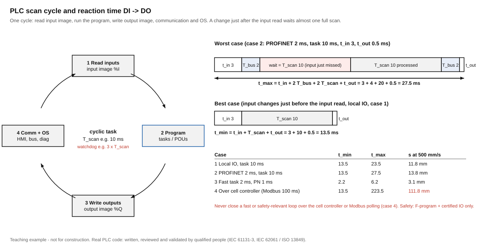

A **cyclic task** runs in four phases, again and again (figure):

1. **Read inputs** – the CPU copies all input channels into the **input process image** (`%I`). During the rest of the cycle the program sees
   this frozen copy, even if the real signal changes. Advantage: every part of the program sees the same value in one cycle (consistency).
2. **Execute the program** – the CPU runs the programs of the task from top to bottom: every FB instance is called, every assignment
   executed. The program writes into the **output process image** (`%Q`), not directly to the terminals.
3. **Write outputs** – the CPU copies the output image to the output channels. Only now does the valve coil switch.
4. **Communication and operating system** – HMI requests, fieldbus acyclic services, diagnostics, online monitoring. On many CPUs this is
   interleaved with the program (time slices), not a separate phase.

The time for one cycle is the **scan time** or **cycle time** T_scan. For a cyclic task with a fixed period (A3) T_scan is the period, e.g.
10 ms; the program itself may need only 3.5 ms of it (the execution time C, B2).

### A2.2 Why the process image matters – three consequences

1. **A pulse shorter than one scan can be lost.** A sensor that is TRUE for 4 ms between two input reads of a 10 ms task is never seen.
   Rule: the shortest signal must last longer than T_scan + input filter (or use a counter card / hardware interrupt / latching input).
2. **The output changes only at the end of the scan.** If the program writes `Valve := TRUE` and later in the same scan `Valve := FALSE`, the
   valve never moves – only the last value is written (the "one writer" rule of G6 avoids this confusion).
3. **A change waits for the next input read.** A signal that changes just after the input read is processed one scan later – this is why the
   worst-case reaction time contains **two** scan times (B1).

### A2.3 Direct (immediate) access

Most PLCs allow direct access to a channel bypassing the image (Siemens `%IW2:P` / `:P`, CODESYS IO update in the task, Rockwell IOT / immediate
output). Use it only for a few fast signals and document why – it breaks the consistency of the image.

## A3. Tasks and priorities

### A3.1 Task types

A **task** decides **when** a program runs (IEC 61131-3 2.7.2). Types:

| Type | Starts | Typical use in an FMS |
|---|---|---|
| Cyclic (periodic) | every T (e.g. 2, 10, 100 ms) | main machine logic (10 ms), fast motion (2 ms), communication (100 ms), diagnostics (1 s) |
| Free-wheeling (continuous) | immediately after the previous cycle ends | old PLCs (Siemens OB1): cycle time varies with load – avoid for timing-critical code |
| Event (interrupt) | on an edge of a variable or hardware signal | encoder index, high-speed counter, fast stop of a drive |
| Startup / shutdown | once at CPU start (cold / warm) or stop | initialise variables, check retentive data, set safe outputs |
| Error | on a cycle overrun, IO fault, programming error | log, set safe state (Siemens OB80, OB82, OB121) |

### A3.2 Priorities and pre-emption

Each task has a **priority**. With **pre-emptive** scheduling (standard in modern PLCs) a higher-priority task interrupts a lower one when it is
released; the lower task continues afterwards. Two important consequences:

- The response time of a low-priority task = its own execution time **plus** all interruptions by higher tasks (B4).
- Data shared between tasks can be **inconsistent**: the 100 ms communication task may read a 32-bit value while the 10 ms task is writing
  it. Rules: one task writes a variable (one writer), copy data between tasks at one place, use the platform's consistent-copy functions for
  structures, keep the number of tasks small (typically 2–4).

### A3.3 The standard task set of a module PLC (example)

| Task | Period | Priority | Content |
|---|---|---|---|
| Fast_Motion | 2 ms | 1 (highest) | motion blocks, high-speed counters, cam switches |
| Main | 10 ms | 2 | device FBs, module state machine and sequence, interlocks |
| Comm | 100 ms | 3 | data block copy to / from the cell controller, heartbeat, OPC UA / Modbus server |
| Diag | 1 s | 4 | statistics, OEE counters, energy, health checks |
| F-task (safety) | e.g. 10–20 ms | own runtime | safety program (separate, item 7) |

These are exactly the tasks of the example "Typical" in B4. The PLC of the simple examples in E and the motor rule in D7 run in a 100 ms tick to
keep the logs short; in a real Main task the same logic runs at 10 ms.

## A4. The IEC 61131-3 software model

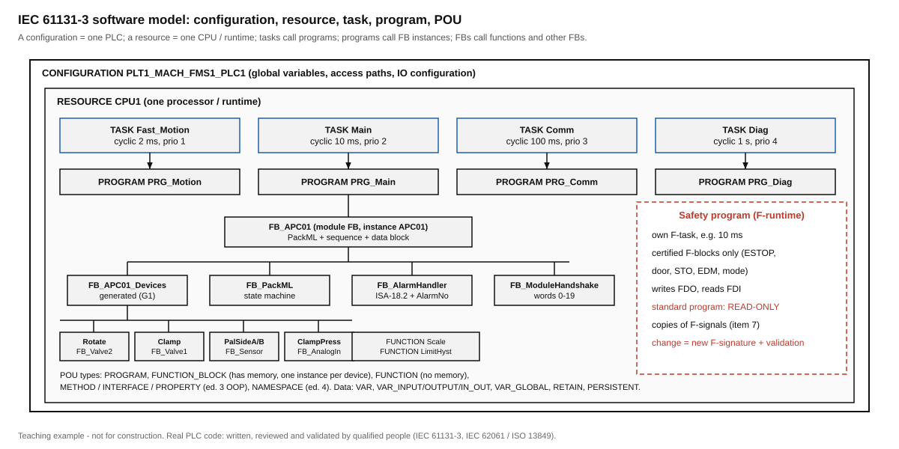

IEC 61131-3 describes a PLC project as a hierarchy (figure):

| Element | Meaning | FMS example |
|---|---|---|
| **Configuration** | the whole PLC system: global variables, access paths, the IO configuration | `PLT1_MACH_FMS1_PLC1` – the PLC of the pool module |
| **Resource** | one processing unit (CPU, core, runtime) inside the configuration | `CPU1` |
| **Task** | the execution control (cyclic, event) with period and priority | `Main` 10 ms priority 2 |
| **Program instance** | a PROGRAM assigned to a task | `PRG_Main WITH Main` |
| **FB instance** | a FUNCTION_BLOCK variable with its own memory, called by a program or another FB | `APC01 : FB_APC01`, `Rotate : FB_Valve2` |
| **Function** | code without memory, returns a value | `Scale()`, `LimitHyst()` |
| **Global variables** | `VAR_GLOBAL` in the configuration or resource; IO symbols with `AT %I/%Q` | generated layer 1 (G1) |
| **Access paths** | named variables exported for HMI / OPC UA (`VAR_ACCESS`) | data block words 0–19 |

The textual form (rarely written by hand, but useful to understand what the engineering tool stores):

```iecst
CONFIGURATION PLT1_MACH_FMS1_PLC1
    RESOURCE CPU1 ON PLC_CPU
        TASK Fast_Motion (INTERVAL := T#2MS,   PRIORITY := 1);
        TASK Main        (INTERVAL := T#10MS,  PRIORITY := 2);
        TASK Comm        (INTERVAL := T#100MS, PRIORITY := 3);
        TASK Diag        (INTERVAL := T#1S,    PRIORITY := 4);
        PROGRAM Motion WITH Fast_Motion : PRG_Motion;
        PROGRAM Main1  WITH Main        : PRG_Main;
        PROGRAM Comm1  WITH Comm        : PRG_Comm;
        PROGRAM Diag1  WITH Diag        : PRG_Diag;
    END_RESOURCE
END_CONFIGURATION
```

## A5. POU types: PROGRAM, FUNCTION_BLOCK, FUNCTION, METHOD, INTERFACE, NAMESPACE

A **POU (program organisation unit)** is a unit of code. The three classic types (ed. 1 and 2) and the object-oriented additions (ed. 3, 2013)
and namespaces (ed. 4, 2025):

| POU | Memory | Instances | Use | Example |
|---|---|---|---|---|
| `PROGRAM` | yes (static) | one, assigned to a task | top level of a task, calls FB instances | `PRG_Main` |
| `FUNCTION_BLOCK` | yes – each instance keeps its own variables between calls | many (one per device) | devices, timers, state machines, sequences | `FB_MotorDol`, `FB_APC01` |
| `FUNCTION` | no – local variables are lost after the call | none (called directly) | calculations, conversions | `Scale(iRaw, 0.0, 10.0)` |
| `METHOD` (ed. 3) | uses the FB's memory + own temporaries | part of an FB or CLASS | named operations of an FB: `Start()`, `Reset()` | `Rotate.Reset()` |
| `PROPERTY` (vendor, CODESYS / TwinCAT) | getter / setter | part of an FB | read-only status for HMI | `Rotate.AtA` |
| `INTERFACE` (ed. 3) | none – only method prototypes | implemented by FBs | same calls for different devices (`I_Device.Reset()`) | all device FBs implement `I_Device` |
| `CLASS` (ed. 3) | like an FB, without inputs / outputs | many | pure OOP code | rare in FMS projects |
| `NAMESPACE` (ed. 4) | – | – | groups POUs and types, avoids name clashes between libraries | `NAMESPACE FMS.Devices … END_NAMESPACE` |

### A5.1 Why FUNCTION_BLOCK is the main building block

A device has **memory**: a motor knows whether it is starting, a valve how long it is already moving, a counter its count. A FUNCTION cannot
remember, so every device becomes an FB, and every physical device gets **one instance** (`SprayPump : FB_MotorDol; RinsePump : FB_MotorDol;`).
The same FB code is used for 30 motors – a fault fixed once is fixed everywhere.

### A5.2 Calling an FB – rules

```iecst
(* declaration *)
VAR
    SprayPump : FB_MotorDol;              (* one instance = one physical motor *)
END_VAR

(* call: inputs assigned in the call, outputs read after the call *)
SprayPump(xRunFb := WASH01_SprayPump_RunFb, xTripped := WASH01_SprayPump_Tripped);
WASH01_SprayPump_Run := SprayPump.qRun;

(* an input may also be written before the call - this is how the module logic gives commands *)
SprayPump.xCmd := bPumpRequest;
```

Rules: (1) call every FB instance **exactly once per scan**, unconditionally (C9); (2) read outputs **after** the call; (3) never write an FB's
output from outside; (4) an input written before the call is used in this call – an input written after the call is used in the **next** scan
(one-scan delay – important when the module logic and the device layer are in different POUs, G2).

### A5.3 Object-oriented features (ed. 3) – when they help

| Feature | Benefit | Caution |
|---|---|---|
| `METHOD` | clear operations instead of many BOOL inputs (`Valve.MoveToA()`) | a method called from two tasks is a consistency risk |
| `EXTENDS` (inheritance) | `FB_Valve2 EXTENDS FB_DeviceBase` shares mode, alarm and HMI code | deep inheritance hides logic – maximum two levels |
| `IMPLEMENTS` (interface) | the module can loop over all devices: `aDev[i].Reset()` | requires references / pointers – platform-specific |
| `THIS^`, `SUPER^` | access to own instance / base | not available on all platforms |

Classic Siemens TIA Portal SCL has no methods and no inheritance (check the version you use – newer Siemens tools such as SIMATIC AX add
object-oriented features); CODESYS, TwinCAT and Schneider EcoStruxure Machine Expert support them, Rockwell only partly (AOIs, no inheritance). A library that must run on several brands therefore uses **plain FBs with structures** (D2) – the style of this
guide.

### A5.4 Namespaces (ed. 4)

IEC 61131-3 ed. 4 (2025) adds namespaces (`NAMESPACE FMS.Devices`), removes the Instruction List language (IL) and clarifies several data-type
rules. Many tools already had a vendor form of namespaces (CODESYS library namespaces, TIA "know-how protected" libraries). Use the namespace or
a short **library prefix** (`FMS_`) so that a device FB of your library never clashes with a vendor block of the same name.

## A6. Data types

### A6.1 Elementary types

| Type | Size | Range | FMS use |
|---|---|---|---|
| `BOOL` | 1 bit | FALSE / TRUE | DI, DO, flags |
| `BYTE`, `WORD`, `DWORD`, `LWORD` | 8 / 16 / 32 / 64 bit | bit strings, no arithmetic | `Status.Bits` (word 4), `Command.Bits` (word 3) |
| `SINT`, `INT`, `DINT`, `LINT` | 8 / 16 / 32 / 64 bit signed | INT −32 768 … 32 767; DINT ±2 147 483 647 | raw analog (INT), counters (DINT) |
| `USINT`, `UINT`, `UDINT`, `ULINT` | unsigned | UINT 0 … 65 535; UDINT 0 … 4 294 967 295 | heartbeat (UINT), event counters (UDINT) |
| `REAL`, `LREAL` | 32 / 64 bit IEEE 754 | REAL ≈ 7 significant digits | engineering values (bar, °C, mm) |
| `TIME`, `LTIME` | 32-bit ms (signed) / 64-bit ns | TIME max 24 d 20 h 31 min 23.647 s | timer presets, step timeouts |
| `DATE`, `TIME_OF_DAY`, `DATE_AND_TIME`, `LDT` | – | – | time stamps (alarm log, F) |
| `STRING[n]`, `WSTRING[n]` | n characters | – | pallet IDs, recipe names, messages |

**REAL precision trap:** a REAL has a 24-bit mantissa, so above 16 777 216 an increment of 1 is lost. Never count parts or accumulate energy
in a REAL; use DINT / UDINT / LREAL.

**TIME trap:** `TIME` is a 32-bit signed number of milliseconds, maximum 2 147 483 647 ms = **24.86 days** (B5). A "running hours" timer in
TIME overflows after 24.86 days. Use LTIME (64-bit) or count seconds in a UDINT.

### A6.2 Derived types – structures, enumerations, arrays, subranges

```iecst
TYPE E_PackMLState : (                      (* enumeration with explicit values = data-block codes *)
        Clearing := 1, Stopped := 2, Starting := 3, Idle := 4, Suspended := 5, Execute := 6,
        Stopping := 7, Aborting := 8, Aborted := 9, Holding := 10, Held := 11, Unholding := 12,
        Suspending := 13, Unsuspending := 14, Resetting := 15, Completing := 16, Complete := 17 ) INT;
END_TYPE

TYPE ST_ModuleDB :                          (* module data block words 0..19 (item 6) *)
STRUCT
    StateCurrent       : INT;    (* w0  *)
    UnitModeCurrent    : INT;    (* w1  *)
    CntrlCmd           : INT;    (* w2  *)
    CmdBits            : WORD;   (* w3  bit0 CmdChangeRequest, bit1 HS.Request, bit2 HS.Ack, bit3 FaultReset *)
    StatusBits         : WORD;   (* w4  bit0 Ready ... bit7 HS.Ready *)
    UnitModeCmd        : INT;    (* w5  *)
    AlarmNo            : INT;    (* w6  *)
    WarningNo          : INT;    (* w7  *)
    ProdProcessedCount : DINT;   (* w8-9   *)
    ProdDefectiveCount : DINT;   (* w10-11 *)
    JobId              : DINT;   (* w12-13 *)
    PalletId           : DINT;   (* w14-15 *)
    LastCycle_s        : REAL;   (* w16-17 *)
    HeartbeatOut       : UINT;   (* w18 *)
    HeartbeatIn        : UINT;   (* w19 *)
END_STRUCT
END_TYPE

TYPE T_Percent : INT (0..100); END_TYPE     (* subrange: the compiler / runtime checks the range *)

VAR
    aStepTimeout : ARRAY[1..4] OF INT := [30, 50, 30, 0];   (* array with initial values *)
END_VAR
```

Rules for an FMS library: one **structure type** per data block and per FB interface group (Cmd, Sts, Alm, Cfg – D2); **enumerations** for
states, with explicit values equal to the codes on the bus (PackML 1–17), so that a cast to INT gives the data-block value; **arrays** for
repeated items (rack places, conveyor zones) with constants for the bounds (no magic numbers, G6).

> **Packing and word order.** A structure that is copied to a Modbus register area must have a defined layout: no automatic padding
> (Siemens "optimised block access" off for the interface DB, or explicit `{attribute 'pack_mode' := '1'}` in CODESYS), and the 32-bit word
> order fixed by item 6 (**high word first**, guide 66 H3). Test the layout with the interface sheet values (G8).

## A7. Variables: scope, initial values, RETAIN and PERSISTENT

| Keyword | Scope | Meaning |
|---|---|---|
| `VAR` | inside the POU | local static variable (in an FB: kept between calls) |
| `VAR_TEMP` | inside the POU | temporary – not kept between calls (like a FUNCTION's locals) |
| `VAR_INPUT` / `VAR_OUTPUT` | interface | copied in / out at the call |
| `VAR_IN_OUT` | interface | passed by reference – the FB works on the caller's variable (large structures, the data block) |
| `VAR_GLOBAL` / `VAR_EXTERNAL` | project | global; `VAR_EXTERNAL` declares the use of a global inside a POU (ed. 3) |
| `VAR CONSTANT` | POU / global | constant – cannot be written |
| `VAR RETAIN` | any | keeps its value after power-off / warm restart |
| `VAR PERSISTENT` (vendor) | any | keeps its value even after a download of a changed program (CODESYS, TwinCAT) |
| `AT %IX0.0` | global | located variable – bound to an IO address (layer 1, G1) |

**Initial value rule.** Every variable has a defined start value: the declared one (`:= T#5S`) or the type default (0, FALSE, empty string).
After a **cold start** all variables get initial values; after a **warm start** RETAIN variables keep their last value. Decide for each
retentive variable what happens if the stored value is no longer valid (e.g. the stacker position after the crane was moved by hand during a
power-off): **never trust a retained position without a plausibility check or a homing** (Resetting state, E3).

| Variable | RETAIN? | Why |
|---|---|---|
| `ProdProcessedCount`, operating hours, energy | yes | OEE and maintenance must not restart at 0 |
| recipe number, parameters (Cfg) | yes (or persistent) | the operator must not re-enter them |
| absolute encoder position | no (the encoder keeps it) | read from the device |
| incremental position | retain + "position valid" flag = FALSE after power-off | force homing |
| step number of a sequence, PackML state | **no** | after power-on the module starts in Stopped; resuming a half step blindly is dangerous (guide 67 I6 rule 5) |
| alarm states | no (rebuilt from conditions) | an alarm must reflect the present condition |

## A8. The five languages – one example in each

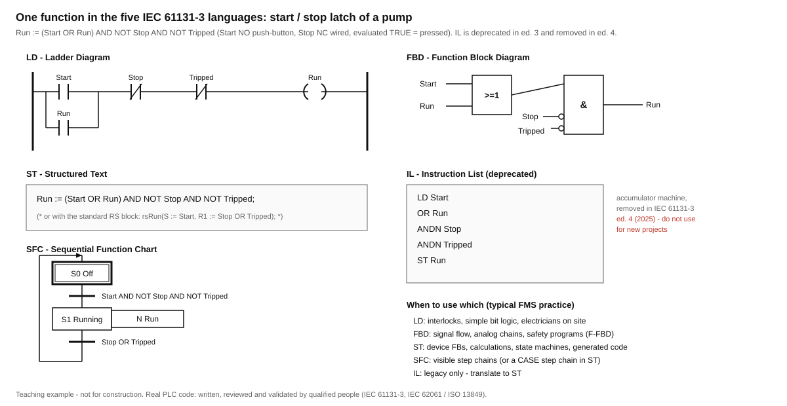

IEC 61131-3 defines **two graphical** languages – Ladder Diagram (LD) and Function Block Diagram (FBD) – **two textual** languages –
Structured Text (ST) and Instruction List (IL, deprecated in ed. 3, removed in ed. 4) – and one **structuring** element, the Sequential Function
Chart (SFC). The figure shows the same small function in each: a pump with Start, Stop and a motor-protection contact. The logic is the classic
**self-holding (latch)**:

```
Run := (Start OR Run) AND NOT Stop AND NOT Tripped
```

### A8.1 LD – Ladder Diagram

Origin: relay circuits. Two vertical power rails; contacts (`--| |--` normally open, `--|/|--` normally closed) in series = AND, in parallel = OR;
the coil `--( )--` on the right is the assignment. The parallel contact `Run` under `Start` is the self-holding contact. Strengths: electricians
read it immediately, online monitoring shows the "power flow". Weaknesses: arithmetic, loops and state machines become unreadable.

### A8.2 FBD – Function Block Diagram

Blocks (`>=1` OR, `&` AND, a circle = negation) connected by lines, signals flow from left to right. Strengths: signal chains, analog
processing, safety programs (most F-editors are FBD). Weaknesses: large logic becomes a "wiring diagram" spread over many pages.

### A8.3 ST – Structured Text

A Pascal-like text language: `:=`, `IF … THEN … ELSIF … ELSE … END_IF`, `CASE … OF … END_CASE`, `FOR`, `WHILE`, `REPEAT`. The latch is one line.
Strengths: device FBs, calculations, state machines, generated code, diff in version control (G7). Weakness: online monitoring is less visual;
loops can take long (watchdog, B6). **ST is the language of this guide** for all FBs and module logic because it is portable between brands and
can be generated (G1).

### A8.4 SFC – Sequential Function Chart

Steps (boxes; double box = initial step), transitions (bars with a condition), actions with qualifiers (`N` non-stored = active while the step is
active, `S` set / `R` reset stored, `L` time-limited, `D` delayed, `P` pulse). Strengths: the sequence is visible; the active step is shown online.
Use for step chains of module sequences (E1). Many integrators instead write the step chain as `CASE iStep OF` in ST (E1.3) – equivalent and
portable.

### A8.5 IL – Instruction List (legacy)

An assembler-like list working on an accumulator (`LD`, `AND`, `ANDN`, `OR`, `ST`). Deprecated since ed. 3 and **removed in ed. 4**; old Siemens
STL and Mitsubishi instruction lists are similar. Do not use for new code; translate legacy IL to ST when the machine is modernised.

### A8.6 Which language when – the rule of this guide

| Task | Language | Why |
|---|---|---|
| Device FBs (D) | ST | logic + timers + numbers, portable, generated calls |
| Module state machine and sequence (E) | ST (`CASE`) or SFC | readable step logic; ST for portability |
| Interlocks between devices | LD or FBD (or ST) | maintenance people can check them online |
| Analog processing, PID | FBD or ST | signal flow |
| Safety program | F-FBD / F-LD with certified blocks only | required by the safety tool and the validation (item 7) |
| Generated IO layer (G) | ST | text, generated, diff-able |

## A9. Vendor mapping: Siemens, CODESYS / Beckhoff, Rockwell, Mitsubishi, Delta

### A9.1 Terms

| IEC 61131-3 | Siemens TIA Portal (S7-1500) | CODESYS / Beckhoff TwinCAT 3 | Rockwell Studio 5000 (Logix) | Mitsubishi GX Works3 (iQ-R / iQ-F) | Delta DIAStudio / ISPSoft (AS / AH) |
|---|---|---|---|---|---|
| Configuration / resource | PLC station / CPU | device / PLC project | controller | project / CPU | project / CPU |
| Task (cyclic) | cyclic interrupt OB30–OB38; OB1 = free cycle | task (cyclic, freewheeling, event) | periodic task (also continuous, event) | fixed-scan program / interrupt | cyclic task / timed interrupt |
| Startup | OB100 | `PLC_PRG` init, `FB_init`, task "startup" | (first-scan bit `S:FS`) | `SM402` first-scan | first-scan flag |
| PROGRAM | OB (organisation block) calling FBs | `PROGRAM` | program (in a task) with routines | program block | program |
| FUNCTION_BLOCK | FB + instance DB | `FUNCTION_BLOCK` | Add-On Instruction (AOI) | FB | FB |
| FUNCTION | FC | `FUNCTION` | (AOI without state, or a routine) | FUN | function |
| Instance memory | instance DB (single or multi-instance) | FB instance in VAR | AOI tag (backing tag) | FB instance | FB instance |
| Global variables | global DB, PLC tags | GVL (global variable list) | controller-scope tags | global labels / devices | global symbols |
| Structure | PLC data type (UDT) | `STRUCT` / DUT | user-defined data type (UDT) | structure | structure |
| Located IO | `%I0.0`, `%IW64` (PLC tags) | `AT %IX0.0` or mapped in the IO config | `Local:1:I.Data.0`, module tags | `X0`, `Y10`, `D100`, labels | `X0.0`, `Y0.0`, `D0` |
| ST language | SCL | ST | Structured Text | ST | ST |
| SFC | GRAPH | SFC | SFC | SFC | SFC |
| Safety program | F-blocks (Safety Advanced) | TwinSAFE / CODESYS Safety | GuardLogix safety task | iQ-R safety CPU | – (external safety controller) |
| Library | global library, types with versions | library (.compiled-library) | AOI / rung import | library | function-block library |

### A9.2 Addressing differences

| Brand | Bit address | Word address | Note |
|---|---|---|---|
| IEC generic (this guide, G1) | `%IX<byte>.<bit>`, `%QX<byte>.<bit>` | `%IW<byte>`, `%QW<byte>` (byte address of a 16-bit word) | address = byte offset in the station image; `%IW2` = bytes 2–3 |
| Siemens | `%I0.0`, `%Q0.1` | `%IW64`, `%QW80` | the analog card has its own start address set in the hardware configuration; S7 uses **big-endian** words |
| CODESYS / TwinCAT | `%IX0.0` | `%IW2` | TwinCAT links variables to IO in the System Manager instead of AT addresses |
| Rockwell | `Local:1:I.Data.0` | `Local:3:I.Ch0Data` | tag-based, no absolute addresses; aliases for readable names |
| Mitsubishi | `X0`, `Y0` (octal / hex numbering by series!) | `D0`, `W0` | device memory, labels recommended |
| Delta | `X0.0`, `Y0.0` | `D0` | AS series: X / Y words with bit index |

The library of this guide uses **symbolic names** everywhere (`APC01_Rotate_PosA`); only the generated layer 1 contains addresses. Porting to
another brand changes layer 1 and the timer / bit syntax, not the logic.

### A9.3 Analog raw ranges by brand (check your card)

| Brand / card family | 4–20 mA raw range | Over / under range |
|---|---|---|
| Siemens S7 (this guide's rule) | 0 … 27 648 | up to 32 511 overrange, 32 767 overflow / wire break; negative values for under-range |
| CODESYS / Beckhoff EL3xxx | 0 … 32 767 | status bits for over / under range, error bit |
| Rockwell 1756 / 1769 | configurable engineering units | channel status flags |
| Mitsubishi | 0 … 32 000 (or 0 … 4 000 / 20 000 by card) | – |
| Delta AS | 0 … 32 000 (or −32 000 …) | – |

### A9.4 Timers and edges by brand

| Function | IEC | Siemens S7-1500 | Rockwell | Note |
|---|---|---|---|---|
| on-delay | `TON` | `TON` (IEC timer, instance DB) | `TON` instruction (`.PRE`, `.ACC`, `.DN`, `.TT`) | Rockwell `.DN` = Q; accumulates in ms |
| off-delay | `TOF` | `TOF` | `TOF` | |
| pulse | `TP` | `TP` | (no direct – use ONS + TON) | |
| rising edge | `R_TRIG` | `R_TRIG` or `P_TRIG` / `|P|` contact | `ONS`, `OSR` | |
| counter up | `CTU` | `CTU` | `CTU` (`.ACC`, `.DN`) | Rockwell counters are DINT |

### A9.5 Practical consequences for a library

1. Write the logic in ST with IEC FB names; keep brand-specific code in a thin layer (bit access, IO mapping, timers if needed).
2. Do not rely on initial values of IN_OUT parameters, on implicit type conversions or on the evaluation order of `AND` (no short-circuit
   guarantee in IEC 61131-3: `IF p <> 0 AND x / p > 1` may divide by zero).
3. Test the library on each target brand with the same unit tests (G8).

### A9.6 Free environments for learning (offline)

| Tool | What you get | Note |
|---|---|---|
| CODESYS Development System + Control Win (SoftPLC) | full IEC 61131-3 incl. OOP, simulation | free download; runs offline after installation |
| Beckhoff TwinCAT 3 XAE | Visual-Studio-based, 7-day renewable runtime licence | real-time on Windows |
| Siemens TIA Portal + PLCSIM | trial licence 21 days | the standard in Europe |
| OpenPLC Editor + Runtime | open source, IEC 61131-3 (ST, LD, FBD, SFC) | good for teaching, not certified |
| This guide's tools | Python models of the FBs and modules (I1) | to check expected results before writing ST |

## A10. Project structure and naming

### A10.1 Folder structure of a module PLC project (example)

```
PLT1_MACH_FMS1_PLC1
├─ 00_Config          tasks, hardware configuration, network
├─ 01_Types           ST_ModuleDB, E_PackMLState, ST_ValveCmd/Sts/Cfg, ST_DevAlarm ...
├─ 02_Lib_Devices     FB_Sensor, FB_AnalogIn, FB_MotorDol, FB_Valve1, FB_Valve2, FB_DriveSto ... (versioned library)
├─ 03_Lib_Module      FB_PackML, FB_ModuleHandshake, FB_AlarmHandler, FB_StepChain
├─ 10_IO_Generated    GVL_APC01 (VAR_GLOBAL with AT), FB_APC01_Devices  - generated, do not edit (G1)
├─ 20_Modules         FB_APC01 (module logic) ...
├─ 30_Programs        PRG_Main, PRG_Comm, PRG_Diag
├─ 40_HMI_Interface   access variables, faceplate structures, alarm texts
└─ 90_Test            unit tests of FBs, simulation models (G8)
```

### A10.2 Naming rules (connect to item 5)

| Object | Rule | Example |
|---|---|---|
| Tag (outside the PLC) | `site.area.cell.unit.group.signal` | `PLT1.MACH.FMS1.APC01.Clamp.PosB` |
| IO symbol (layer 1) | `<unit>_<group>_<signal>` | `APC01_Clamp_PosB` |
| Device FB instance | `<group>` inside the module's device FB | `Clamp : FB_Valve1` |
| Module FB instance | `<unit>` | `APC01 : FB_APC01` |
| FB type | `FB_<Name>` | `FB_Valve1`, `FB_APC01_Devices` |
| Function | verb or noun, no prefix or `F_` | `Scale`, `F_PackMLTarget` |
| Structure / enum type | `ST_` / `E_` | `ST_ModuleDB`, `E_PackMLState` |
| Inputs / outputs of device FBs (codegen rule) | `x` BOOL field input, `i` INT raw analog input, `q` BOOL output, `w` INT analog output | `xPosA`, `iValue`, `qSol`, `wSetpoint` |
| Other variables | `t` TIME, `r` REAL, `n` counter, `e` enum, `a` array, `s` string, `st` structure | `tMove`, `rValue`, `nStep` |
| Constants | upper case with underscores | `T_STEP20_TIMEOUT`, `P_CLAMP_MIN` |

Identifier length: keep IO symbols ≤ 32 characters where the HMI or Modbus tooling has limits; the longest M02 symbol `APC01_ClampPress_Value` has
22 characters.

## A11. Common mistakes and checklist

| Mistake | Consequence | Correct practice |
|---|---|---|
| program written as if it ran once | edges detected repeatedly, counters count every scan | think in scans: use R_TRIG for events |
| free-wheeling main cycle | timing varies with load, timers jitter | cyclic task with fixed period |
| retentive step number | module resumes a half step after power-on | start in Stopped, re-home in Resetting |
| REAL counter | counts lost above 16.7 million | DINT / UDINT |
| TIME for operating hours | overflow after 24.86 days | LTIME or UDINT seconds |
| brand-specific logic everywhere | no reuse on the next project | IEC ST library + thin brand layer |
| several tasks write the same variable | random inconsistent values | one writer, one copy point |

**Checklist A** (owner and integrator)
- [ ] Task set defined (periods, priorities, content), execution times measured at FAT (B4).
- [ ] Project structure and naming rules agreed (A10), identical to the item 5 tag rule.
- [ ] Languages per purpose agreed (A8.6); no IL in new code.
- [ ] RETAIN list reviewed (A7): counters yes, sequence state no, positions only with plausibility.
- [ ] Data block structure packed and word order fixed (A6.2, guide 66 H3).
- [ ] Safety program separate; standard code only reads F-signal copies (A4 figure, D11).

---
# Part B – Timing: reaction time, tasks, response-time analysis, overflow, watchdog

## B1. Reaction time DI → DO – four cases

### B1.1 Theory

The **reaction time** is the time from a change at an input terminal to the change at an output terminal caused by it. It is made of:

| Symbol | Part | Typical value |
|---|---|---|
| t_in | input delay: input filter of the DI card (0.1–20 ms, often 3 ms default) + sensor switching time | 3 ms |
| T_bus | one cycle of the remote-IO bus (PROFINET 1–4 ms, EtherCAT 0.1–1 ms); 0 for local IO | 2 ms |
| T_scan | period of the task that processes the signal | 10 ms |
| t_out | output delay of the DO card (transistor 0.1–0.5 ms, relay 5–10 ms) | 0.5 ms |

**Best case** – the input changes just before the input image is read, the bus delivers it immediately, the result is written at the end of
the same scan:

```
t_min = t_in + T_scan + t_out
```

**Worst case** – the input changes just **after** the input image was read: it waits almost one full scan, is processed in the next scan, and
with remote IO the value waits up to one bus cycle on the way in and one on the way out:

```
t_max = t_in + 2·T_bus + 2·T_scan + t_out
```

(The rule of the example file; some manufacturers state slightly different formulas – e.g. T_bus counted once when bus and task are
synchronised (isochronous mode). Use the formula of your PLC manual for a real calculation.)

During the worst-case reaction time a moving part continues to move: **s = v · t_max / 1000** [mm, with v in mm/s and t in ms].

### B1.2 The four example cases (rule `response`)

| Case | t_in | T_bus | T_scan | t_out | v [mm/s] | t_min [ms] | t_max [ms] | travel during t_max [mm] |
|---|---|---|---|---|---|---|---|---|
| Local IO, main task 10 ms | 3 | 0 | 10 | 0.5 | 500 | 13.5 | 23.5 | 11.8 |
| PROFINET remote IO 2 ms, main task 10 ms | 3 | 2 | 10 | 0.5 | 500 | 13.5 | 27.5 | 13.8 |
| Fast task 2 ms, input filter 0.1 ms, PROFINET 1 ms | 0.1 | 1 | 2 | 0.1 | 500 | 2.2 | 6.2 | 3.1 |
| Signal over the cell controller (Modbus poll 100 ms) | 3 | 100 | 10 | 0.5 | 500 | 13.5 | 223.5 | 111.8 |

Worked example – case 2 (PROFINET remote IO 2 ms, main task 10 ms):

```
t_min = 3.0 + 10.0 + 0.5                       = 13.5 ms
t_max = 3.0 + 2·2.0 + 2·10.0 + 0.5 = 3 + 4 + 20 + 0.5 = 27.5 ms
s     = 500 mm/s · 27.5 ms / 1000              = 13.75 → 13.8 mm
```

Worked example – case 4 (the signal travels over the cell controller, Modbus poll 100 ms – here T_bus is the polling period):

```
t_max = 3.0 + 2·100.0 + 2·10.0 + 0.5 = 223.5 ms   →   s = 500 · 223.5 / 1000 = 111.75 → 111.8 mm
```

### B1.3 What the cases teach

1. **The scan time counts twice** in the worst case. Halving the task period from 10 ms to 5 ms saves 10 ms worst case.
2. **The input filter is often the forgotten part.** The default 3 ms filter of many DI cards is fine for push-buttons, too slow for a fast
   counter. Case 3 (filter 0.1 ms, 2 ms task, PROFINET 1 ms) reaches 6.2 ms worst case – 3.8 times faster than case 1.
3. **Never close a fast loop over the cell controller** (case 4): 223.5 ms and 111.8 mm of travel at 500 mm/s. A signal that stops a motion
   (end position, collision sensor, "pallet not clamped") must be processed in the **module PLC** that drives the motion. The cell controller
   gives **commands**, it does not close control loops (guide 65 D1).
4. **Safety reactions** are calculated with the safety PLC's own response time (F-input delay + F-task + F-output + actuator) and enter the
   safety distance S = K·T + C of ISO 13855 (guide 67 H4) – never with the standard PLC times of this chapter.

### B1.4 Use case – end-position sensor of the APC rotation

The rotation stops by its mechanical end stop and the cylinder cushioning, so the PLC reaction time only decides when the **next step** begins –
10 ms more or less does not matter. Contrast: a stacker crane at 2 m/s that uses a DI "slow-down cam" travels 2000 · 0.0235 = 47 mm during the
case-1 worst case (23.5 ms) – this is why positioning drives use the drive's own position control and the PLC only commands targets.

## B2. Task utilisation

The **utilisation** of a task is the share of the CPU it needs:

```
U_i = C_i / T_i            U = Σ U_i
```

with C_i the worst-case execution time (WCET) and T_i the period. U > 1 means the CPU is overloaded – no schedule can meet all deadlines.

Example "Typical" (integer µs, rule `tasks`):

| Task | T [µs] | C [µs] | Priority | U_i = C/T |
|---|---|---|---|---|
| Fast_Motion | 2 000 | 300 | 1 | 0.15 |
| Main | 10 000 | 3 500 | 2 | 0.35 |
| Comm | 100 000 | 12 000 | 3 | 0.12 |
| Diag | 1 000 000 | 40 000 | 4 | 0.04 |
| **Sum** | | | | **U = 0.66** |

How to get C in practice: the PLC shows the execution time per task (min / max / current) – Siemens "cycle statistics" of the cyclic interrupt
OBs, CODESYS / TwinCAT task monitor, Rockwell task properties. Measure at FAT **with the worst-case program path** (all modules in Execute, all
alarms active, communication load at maximum) and add a margin (e.g. 20 %) for future changes.

## B3. The Liu-Layland bound

Liu and Layland (1973) proved: for n periodic tasks with deadlines equal to their periods, scheduled by **fixed rate-monotonic priorities**
(shorter period → higher priority), all deadlines are met if

```
U ≤ n · (2^(1/n) − 1)
```

| n | bound |
|---|---|
| 1 | 1.0000 |
| 2 | 0.8284 |
| 3 | 0.7798 |
| 4 | **0.7568** |
| ∞ | ln 2 = 0.6931 |

For n = 4: 4·(2^0.25 − 1) = 4·(1.189207 − 1) = 0.7568.

The test is **sufficient, not necessary**: U ≤ bound guarantees all deadlines; U > bound does **not** mean a deadline is missed – it only means
the simple test cannot decide. Then the exact response-time analysis (B4) is needed. The priorities in the example are rate-monotonic (2 ms →
1, 10 ms → 2, 100 ms → 3, 1 s → 4), as in most PLC task sets.

## B4. Response-time analysis – three task sets

### B4.1 The method

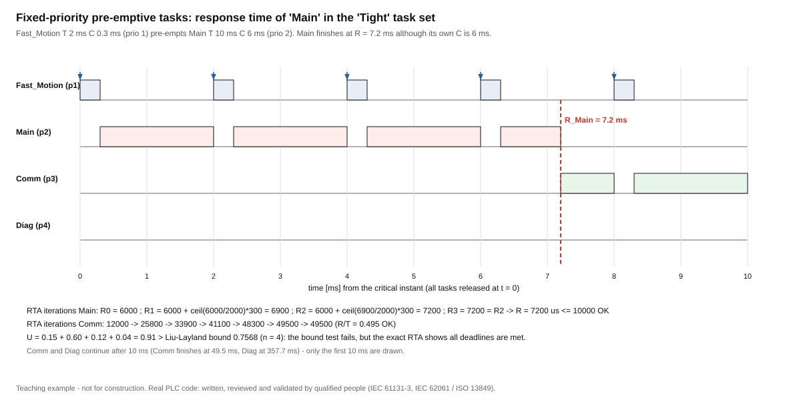

The worst case for a task occurs at the **critical instant**: all higher-priority tasks are released at the same moment as the task itself.
Then the response time R_i of task i is the smallest solution of

```
R_i = C_i + Σ_{j higher priority} ceil(R_i / T_j) · C_j
```

– the task's own work plus every execution of a higher task that is released while task i is not yet finished (`ceil` = round up). It is solved
by iteration (rule `tasks`):

```
R0 = C_i
R_{k+1} = C_i + Σ ceil(R_k / T_j) · C_j
stop when R_{k+1} = R_k   → OK if R ≤ T_i
     or   R_{k+1} > T_i   → MISS (report the first value > T_i)
```

The deadline is the period (the task must finish before it is released again). The figure shows the Tight set from the critical instant: Main is
interrupted four times by Fast_Motion and finishes at 7.2 ms.

### B4.2 Results of the three sets

**Typical** – U = 0.66, Liu-Layland bound = 0.7568 → bound test: passed (schedulable)

| Task | R [µs] | R/T | Result |
|---|---|---|---|
| Fast_Motion | 300 | 0.15 | OK |
| Main | 4 400 | 0.44 | OK |
| Comm | 26 700 | 0.267 | OK |
| Diag | 129 000 | 0.129 | OK |

**Tight (bound test fails, RTA passes)** – U = 0.91, Liu-Layland bound = 0.7568 → bound test: failed (not decided)

| Task | R [µs] | R/T | Result |
|---|---|---|---|
| Fast_Motion | 300 | 0.15 | OK |
| Main | 7 200 | 0.72 | OK |
| Comm | 49 500 | 0.495 | OK |
| Diag | 357 700 | 0.358 | OK |

**Overloaded** – U = 1.14, Liu-Layland bound = 0.7568 → bound test: failed (not decided)

| Task | R [µs] | R/T | Result |
|---|---|---|---|
| Fast_Motion | 300 | 0.15 | OK |
| Main | 8 500 | 0.85 | OK |
| Comm | 100 900 | 1.009 | **MISS** |
| Diag | 1 020 900 | 1.021 | **MISS** |

### B4.3 Worked iterations – set "Tight" (bound test fails, RTA passes)

Tasks: Fast_Motion T 2 000 C 300, Main T 10 000 C **6 000**, Comm T 100 000 C 12 000, Diag T 1 000 000 C 40 000 (µs).

U = 300/2 000 + 6 000/10 000 + 12 000/100 000 + 40 000/1 000 000 = 0.15 + 0.60 + 0.12 + 0.04 = **0.91** > 0.7568 → the bound test fails.

**Fast_Motion** (no higher task): R = C = 300 µs, R/T = 0.15 → OK.

**Main** (higher: Fast_Motion):

```
R0 = 6000
R1 = 6000 + ceil(6000/2000)·300 = 6000 + 3·300 = 6900
R2 = 6000 + ceil(6900/2000)·300 = 6000 + 4·300 = 7200
R3 = 6000 + ceil(7200/2000)·300 = 6000 + 4·300 = 7200 = R2   → R = 7200 µs ≤ 10000 → OK, R/T = 0.72
```

**Comm** (higher: Fast_Motion, Main):

```
R0 = 12000
R1 = 12000 + ceil(12000/2000)·300 + ceil(12000/10000)·6000 = 12000 +  6·300 + 2·6000 = 25800
R2 = 12000 + ceil(25800/2000)·300 + ceil(25800/10000)·6000 = 12000 + 13·300 + 3·6000 = 33900
R3 = 12000 + ceil(33900/2000)·300 + ceil(33900/10000)·6000 = 12000 + 17·300 + 4·6000 = 41100
R4 = 12000 + ceil(41100/2000)·300 + ceil(41100/10000)·6000 = 12000 + 21·300 + 5·6000 = 48300
R5 = 12000 + ceil(48300/2000)·300 + ceil(48300/10000)·6000 = 12000 + 25·300 + 5·6000 = 49500
R6 = 12000 + ceil(49500/2000)·300 + ceil(49500/10000)·6000 = 12000 + 25·300 + 5·6000 = 49500 = R5
→ R = 49500 µs ≤ 100000 → OK, R/T = 0.495
```

**Diag** (higher: all three) converges after 20 iterations: 40 000 → 82 000 → 118 300 → 154 000 → 183 100 → 205 600 → 232 900 → 255 100 →
270 400 → 284 800 → 292 900 → 300 100 → 319 300 → 328 000 → 335 200 → 342 400 → 349 600 → 350 500 → 356 800 → 357 700 → 357 700. R = 357 700 µs
≤ 1 000 000 → OK, R/T = 0.358.

**Conclusion:** U = 0.91 is above the Liu-Layland bound, but the exact analysis shows that all four tasks meet their deadlines. The set is
schedulable – with little reserve in Main (R/T 0.72) and Comm.

### B4.4 Set "Typical" (iterations)

| Task | Iterations R_k [µs] | R | R/T | |
|---|---|---|---|---|
| Fast_Motion | 300 → 300 | 300 | 0.15 | OK |
| Main | 3 500 → 4 100 → 4 400 → 4 400 | 4 400 | 0.44 | OK |
| Comm | 12 000 → 20 800 → 25 800 → 26 400 → 26 700 → 26 700 | 26 700 | 0.267 | OK |
| Diag | 40 000 → 72 000 → 90 800 → 100 800 → 117 800 → 123 700 → 128 100 → 129 000 → 129 000 | 129 000 | 0.129 | OK |

U = 0.66 ≤ 0.7568 → already the bound test says "schedulable"; the RTA confirms it with large reserves.

### B4.5 Set "Overloaded" (iterations)

Main C 7 000, Comm C 25 000: U = 0.15 + 0.70 + 0.25 + 0.04 = **1.14** > 1 → the CPU is overloaded.

| Task | Iterations R_k [µs] | R | R/T | |
|---|---|---|---|---|
| Fast_Motion | 300 → 300 | 300 | 0.15 | OK |
| Main | 7 000 → 8 200 → 8 500 → 8 500 | 8 500 | 0.85 | OK |
| Comm | 25 000 → 49 900 → 67 500 → 84 200 → **100 900** | 100 900 | 1.009 | **MISS** |
| Diag | 40 000 → 99 000 → 150 000 → 217 500 → 301 700 → 402 300 → 512 600 → 631 100 → 757 800 → 885 700 → **1 020 900** | 1 020 900 | 1.021 | **MISS** |

Comm step by step: R1 = 25 000 + ceil(25 000/2 000)·300 + ceil(25 000/10 000)·7 000 = 25 000 + 13·300 + 3·7 000 = 49 900; R2 = 25 000 + 25·300 +
5·7 000 = 67 500; R3 = 25 000 + 34·300 + 7·7 000 = 84 200; R4 = 25 000 + 43·300 + 9·7 000 = 100 900 > 100 000 → MISS. The high-priority tasks
still meet their deadlines – this is typical for fixed priorities: overload hurts the **lowest** tasks first. In a PLC the visible symptoms are:
the communication task overruns (cell controller sees stale data, heartbeat jumps), the diagnostics task lags, and with a cycle-time watchdog
(B6) the CPU may go to STOP.

Fixes, in order of preference: (1) reduce C (optimise the code: no loops over all rack places every 10 ms, move statistics to Diag, avoid string
operations in Main); (2) increase T of tasks that do not need to be fast (Comm 100 → 200 ms: U_Comm 0.125, total 1.015 – still too high; with
Main optimised to 5 000 µs: U = 0.15 + 0.5 + 0.125 + 0.04 = 0.815 → check RTA); (3) a faster CPU; (4) split the cell over two PLCs.

### B4.6 Limits of the analysis

The RTA assumes known worst-case C, independent tasks, no blocking (shared resources, communication locks), zero switching overhead and
deadlines = periods. Real PLCs add OS time (communication, online monitoring – Siemens reserves a configurable "communication load", e.g. 20 %),
task switching overhead and process-image transfer. Use the analysis to **compare designs and find overload early**; confirm with the measured
cycle statistics at FAT.

## B5. Overflow of timers and counters

### B5.1 Time to overflow (rule `overflow`)

```
time to overflow [s] = max_value / increments_per_second
```

| Counter / timer | Max value | Increments per s | Seconds | Days | Years |
|---|---|---|---|---|---|
| TIME (32-bit ms) running timer | 2 147 483 647 | 1000 | 2 147 483.6 | 24.86 | 0.07 |
| INT part counter  1 part / 2 min | 32 767 | 0.00833333 | 3 932 040.0 | 45.51 | 0.12 |
| UINT heartbeat  +1 per 100 ms | 65 535 | 10 | 6 553.5 | 0.08 | 0.0 |
| UDINT event counter  10 per s | 4 294 967 295 | 10 | 429 496 729.5 | 4971.03 | 13.62 |
| DINT seconds counter | 2 147 483 647 | 1 | 2 147 483 647.0 | 24855.13 | 68.1 |

Worked: INT part counter, 1 part per 2 min = 1/120 = 0.008333 parts/s: 32 767 / 0.008333 = 3 932 040 s = 3 932 040 / 86 400 = **45.51 days**.
TIME: 2 147 483 647 ms / 1 000 ms/s = 2 147 483.6 s = **24.86 days** = 24 d 20 h 31 min 23.647 s.

### B5.2 What happens at the overflow

| Type | Behaviour at max + 1 | Consequence |
|---|---|---|
| INT / DINT (signed) | wraps to the most negative value (−32 768) on most PLCs, or causes a runtime error / CPU stop on some | negative part count, OEE report breaks, or a production stop |
| UINT / UDINT (unsigned) | wraps to 0 | counter "restarts" – fine for a heartbeat, wrong for a total |
| TIME accumulated by hand (`tRun := tRun + T#10MS`) | wraps to a negative TIME | elapsed-time comparisons fail |
| IEC timers TON / TOF / TP | internally safe on good implementations (they use the difference of the system time); PT is limited to 24.86 d | a PT above 24 d is not possible in TIME → use LTIME or count minutes |
| CTU | stops at PVmax (32 767) in the rule of this guide | counter stuck at 32 767 |

### B5.3 The UINT heartbeat and wrap-around comparison

The heartbeat of the data block (word 18 / 19, guide 66 H4) is a UINT incremented every second; the example counts every 100 ms, so it wraps after
6 553.5 s = **1 h 49 min**. The wrap is **intended** – a heartbeat must never stop. The receiver therefore must:

- detect a **change** with `<>`, never with `>`: after 65 535 comes 0, and `0 > 65535` is FALSE – a watchdog written with `>` reports
  "partner lost" every 1 h 49 min (a famous real fault);
- compute an **age** with unsigned modulo arithmetic: `nDiff := UINT_TO_UDINT(hbNow - hbLast)` is correct across the wrap because UINT
  subtraction is modulo 65 536 (65 535 → 2 gives 3). Check that your platform does not raise an overflow error on unsigned subtraction.

```iecst
(* heartbeat watchdog - wrap-around safe *)
IF CmdHeartbeat <> uHbLast THEN          (* change, not "greater than" *)
    uHbLast := CmdHeartbeat;
END_IF;
tonHbLost(IN := (CmdHeartbeat = uHbLast), PT := T#3S);   (* no change for 3 s -> partner lost *)
xCcLost := tonHbLost.Q;
```

### B5.4 Design rules

1. Totals that must survive months: **UDINT or ULINT** (UDINT at 10 events/s lasts 13.62 years) – and RETAIN.
2. Running hours: **UDINT seconds** (lasts 136 years) or LTIME – never TIME.
3. Part counters in the data block: `ProdProcessedCount` is **DINT** (68.1 years at 1 count per second) – item 6 chose this deliberately.
4. Heartbeats and sequence numbers: UINT with wrap-around comparison.
5. Time stamps: `DATE_AND_TIME` / `LDT` from the PLC clock, synchronised by NTP (guide 66 A9).

## B6. Jitter, watchdog and cycle-time monitoring

### B6.1 Jitter

**Jitter** = the variation of the start time (or end time) of a periodic task around its ideal period. Causes: higher-priority tasks,
communication load, OS activity. A 10 ms task with ±2 ms jitter is fine for sequences; motion control, PID loops with a derivative part and
sampled measurements (leak test pressure decay, guide 63) need low jitter – put them in a high-priority task or in the drive / measuring device.

Rule: a calculation that uses the period (integrators, rate of change) must use the **measured** time between calls (`dt` from the system
clock), not the nominal period.

### B6.2 Watchdog and cycle-time monitoring

| Monitor | What it checks | Reaction |
|---|---|---|
| Cycle-time watchdog (task) | execution of a task longer than a limit (e.g. 3 × T or a fixed time) | CPU calls the error OB / task exception; often STOP |
| Overrun counter | the task was released while the previous call was still running | counter + diagnostic entry; repeated overruns → alarm |
| Minimum cycle time (free cycle) | the free cycle is not shorter than a minimum | keeps communication time available |
| Communication watchdog (heartbeat) | the partner updates its heartbeat | module: CcLost → no new jobs, finish the current one (guide 66 H4) |
| Fieldbus watchdog | IO device receives cyclic data | IO device sets **substitute values** (outputs 0) after the watchdog time |
| Safety watchdog | F-communication within the F-monitoring time | passivation of F-IO → safe state |

**Endless loops.** A `WHILE` loop whose condition never becomes FALSE stops the task until the watchdog fires – the whole PLC stops. Rules: no
`WHILE` / `REPEAT` waiting for a process signal (a PLC program never waits – it checks the condition in the next scan); `FOR` loops only with
constant bounds; long work split over several scans.

### B6.3 Program example – own cycle monitoring

```iecst
(* in PRG_Main, first lines: measure the real cycle time and count overruns *)
tNow     := LTIME();                                  (* platform time function, ns resolution *)
tCycle   := tNow - tLast;  tLast := tNow;
IF tCycle > tCycleMax THEN tCycleMax := tCycle; END_IF;
IF tCycle > LTIME#15MS THEN nLate := nLate + 1; END_IF;  (* 10 ms task: later than 1.5 T *)
xCycleWarning := nLate > nLateLimit;                   (* -> warning alarm, value on the diagnostics screen *)
```

## B7. Choosing task cycles for an FMS

| Function | Required reaction | Suitable task |
|---|---|---|
| E-stop, guard door, light curtain | ≤ 20–50 ms incl. actuator | **safety task** in the F-runtime (never standard) |
| Cam / position switch of a fast axis | 1–5 ms | Fast_Motion or the drive itself |
| Pneumatic sequences, conveyors, valves, motors | 10–50 ms (mechanics are slower) | Main 10 ms |
| Analog limits (pressure, temperature, level) | 100 ms – 1 s (process time constants) | Main or Comm |
| Data block, heartbeat, cell-controller commands | 50–200 ms | Comm 100 ms |
| OEE counters, energy, statistics | 1 s | Diag |

Rule of thumb: **T_scan ≤ 1/5 of the shortest mechanical time** that the program must observe. A cylinder stroke of 0.3 s and a 10 ms task give
30 samples – plenty; a 2 ms index pulse in a 10 ms task – impossible (use a fast task, an interrupt or a counter card).

## B8. Common mistakes and checklist

| Mistake | Consequence | Correct practice |
|---|---|---|
| reaction time calculated with T_scan once | real worst case twice as long | t_max formula B1 |
| motion stop over the cell controller | 100–200 ms extra reaction, overtravel | local stop in the module PLC |
| U only checked against 1.0 | low tasks miss deadlines at U = 0.9 | RTA (B4) + FAT measurement |
| execution times measured in Idle | overload in Execute | measure with the worst-case path |
| heartbeat compared with `>` | false "partner lost" at the wrap | `<>` and modulo difference (B5.3) |
| WHILE waiting for a sensor | watchdog STOP | state machine, one check per scan |

**Checklist B**
- [ ] Reaction times of all motion-relevant signals calculated (B1) and the travel distance accepted.
- [ ] Task set with C measured at FAT under worst case; RTA with ≥ 20 % reserve in every task.
- [ ] All counters checked for overflow (B5); heartbeats wrap-safe.
- [ ] Cycle-time watchdog and overrun alarm configured and tested (B6).
- [ ] No WHILE / REPEAT on process signals; FOR loops with constant bounds.

---

# Part C – The IEC standard function blocks

## C0. Rules of the trace

IEC 61131-3 defines a small set of **standard function blocks** that every PLC provides: bistables (SR, RS), edge detection (R_TRIG, F_TRIG),
counters (CTU, CTD, CTUD) and timers (TP, TON, TOF). They are the alphabet of PLC logic. This part explains each block with a definition, its
timing diagram and the values of one common example trace (rule `fb_trace`):

- scan-based, **dt = 10 ms**, scan k = 0 … 39 at t = k · 10 ms; PT = 50 ms for the timers, PV = 3 for the counters;
- input signals TRUE on these inclusive scan ranges: **A** 2–8, 11–12, 15–29 · **B** 6–7, 20–22, 32–33 · **RST** 33 · **LD** 0 and 36;
- wiring: TON / TOF / TP IN = A; R_TRIG / F_TRIG CLK = A; CTU CU = A, R = RST; CTD CD = A, LD = LD; SR S1 = A, R = B; RS S = A, R1 = B;
- per scan the blocks are executed in this order, each block exactly once.

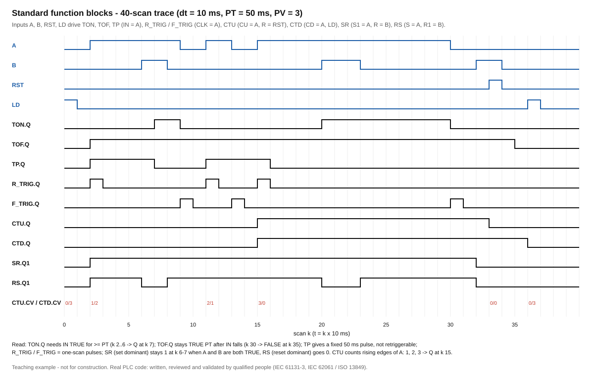

The definitions below are the **reference models** of the rule (the Python tool and the web use the same); a real PLC implements the same
behaviour with its system clock. Platform differences are noted where they exist.

## C1. TON – on-delay timer

**Function:** Q becomes TRUE when IN has been TRUE **continuously** for at least PT. ET (elapsed time) counts from 0 to PT while IN is TRUE. When
IN becomes FALSE, Q and ET reset immediately.

```
TON:  if IN { if start = none: start := t ;  ET := min(PT, t − start) ;  Q := ET ≥ PT }
      else  { start := none ;  ET := 0 ;  Q := FALSE }
```

```
IN  ___/‾‾‾‾‾‾‾‾‾‾‾‾‾‾\____/‾‾‾\___
Q   ________/‾‾‾‾‾‾‾‾‾\____________      Q only if IN lasts ≥ PT
ET     0..PT ramp, holds PT, 0 when IN falls
```

**Trace:** A TRUE at k = 2 (start = 20 ms). ET 0, 10, 20, 30, 40 at k 2–6, at k = 7: ET = 70 − 20 = 50 = PT → **Q = TRUE**. A falls at k = 9 → Q
FALSE, ET 0. A at 11–12 (only 20 ms) – too short, Q stays FALSE (ET reaches 10 only). A from 15: ET 0 … 40 at k 15–19, **Q at k = 20**, held until
A falls at k = 30. Events: (7, 1), (9, 0), (20, 1), (30, 0).

**Uses:** filter / debounce of a signal (D4), "condition true for at least x seconds" (pressure low for 2 s), step timeout (`TON(IN := step
active, PT := T#5S)`), heartbeat watchdog (B5.3).

```iecst
tonPressLow(IN := rClampPress < 4.5, PT := T#2S);   (* pressure low for 2 s *)
xPressLowAlarm := tonPressLow.Q;
```

## C2. TOF – off-delay timer

**Function:** Q becomes TRUE immediately when IN becomes TRUE and stays TRUE for PT **after** IN falls. A new TRUE on IN during the delay restarts
it.

```
TOF:  if IN       { run := TRUE ; fall := none ; ET := 0 ; Q := TRUE }
      else if run { if fall = none: fall := t ; ET := min(PT, t − fall) ; Q := ET < PT }
      else        { ET := 0 ; Q := FALSE }
```

**Trace:** Q TRUE from k = 2. A falls at k = 9 → ET 0 (k 9), 10 (k 10) – A returns at k = 11 → delay cancelled, Q stays TRUE. A falls at 13 → ET
0, 10 – A returns at 15. A falls at k = 30: ET 0, 10, 20, 30, 40 at k 30–34, at k = 35 ET = 50 → **Q = FALSE**. Events: (2, 1), (35, 0). Note that
Q was FALSE at k = 0 and 1 (`run` not yet set) – the block starts FALSE.

**Uses:** keep a fan or an exhaust running for 30 s after the process (M12 marking exhaust), bridge short signal drops (a part sensor that
flickers on a moving conveyor), hold a lamp for a minimum time.

## C3. TP – pulse timer

**Function:** on a rising edge of IN, Q is TRUE for exactly PT, regardless of IN during the pulse (not retriggerable). After the pulse, if IN is
still TRUE, ET stays at PT until IN falls.

```
TP:   if IN and not prevIN and start = none: start := t
      if start ≠ none { el := t − start ;
                        if el < PT { Q := TRUE ; ET := el }
                        else { Q := FALSE ; ET := PT ; if not IN { start := none ; ET := 0 } } }
      else { Q := FALSE ; ET := 0 }
      prevIN := IN
```

**Trace:** rising edge at k = 2 → Q TRUE at k 2–6 (ET 0 … 40), at k = 7 el = 50 → Q FALSE, ET = 50 (A still TRUE). k = 9 A FALSE → ET 0, start
cleared. Rising edge at k = 11 → pulse k 11–15 **although A was FALSE at k 13–14** (the pulse runs to its end), Q FALSE at k = 16, ET held at 50
while A is TRUE (k 16–29), reset at k = 30. The rising edge at k = 15 (A TRUE again) is **ignored** because the pulse of k = 11 is still running –
not retriggerable. Events: (2, 1), (7, 0), (11, 1), (16, 0).

**Uses:** fixed-length outputs: a marking pulse, a 500 ms reset pulse to a drive, a horn pulse. Do not use TP as a "minimum on time" for a valve that
must follow a level command – use TOF or explicit logic.

## C4. R_TRIG and F_TRIG – edge detection

**Function:** R_TRIG.Q is TRUE for **one scan** when CLK changes FALSE → TRUE; F_TRIG.Q for one scan when CLK changes TRUE → FALSE.

```
R_TRIG:  Q := CLK AND NOT M ;  M := CLK        (M starts FALSE)
F_TRIG:  Q := NOT CLK AND P ;  P := CLK        (P starts FALSE in this rule)
```

**Trace:** R_TRIG pulses at k = 2, 11, 15 (rising edges of A) – events (2, 1), (3, 0), (11, 1), (12, 0), (15, 1), (16, 0). F_TRIG pulses at k = 9,
13, 30 (falling edges) – events (9, 1), (10, 0), (13, 1), (14, 0), (30, 1), (31, 0).

> **First-scan pulse of F_TRIG.** In the text of IEC 61131-3 the F_TRIG memory is defined so that the block gives **a pulse in the first scan
> if CLK is FALSE** (the standard body is `Q := NOT CLK AND NOT M; M := NOT CLK;` with M initialised FALSE). Several platforms behave this way,
> others not. The rule of this guide initialises P = FALSE, so there is **no** first-scan pulse. **Check your platform** – a falling-edge pulse
> at power-on can, for example, count a part that does not exist or acknowledge an alarm. Safe practice: initialise the memory explicitly
> (`ftDoorOpened(CLK := TRUE)` in the startup task) or ignore edges in the first scan (`IF NOT xFirstScan THEN …`).

**Uses:** commands that must act once (start, reset, acknowledge), counting events, detecting the change of a step. **Rule: a command from
the HMI or the data block is evaluated on its edge**, not on its level – otherwise a stuck button repeats the command every scan.

## C5. CTU, CTD, CTUD – counters

**CTU (up counter):** counts rising edges of CU; R resets CV to 0; Q = CV ≥ PV.

```
CTU:  edge := CU AND NOT prevCU ;  if R: CV := 0  elif edge and CV < 32767: CV := CV + 1 ;  Q := CV ≥ PV
```

**CTD (down counter):** counts rising edges of CD down; LD loads CV := PV; Q = CV ≤ 0.

```
CTD:  edge := CD AND NOT prevCD ;  if LD: CV := PV  elif edge and CV > −32768: CV := CV − 1 ;  Q := CV ≤ 0
```

**CTUD** combines both (inputs CU, CD, R, LD; outputs QU, QD, CV).

**Trace CTU:** rising edges of A at k = 2, 11, 15 → CV 1, 2, 3; at k = 15 CV = 3 = PV → **Q TRUE**. RST at k = 33 → CV 0, Q FALSE. Events CV (2, 1),
(11, 2), (15, 3), (33, 0); Q (15, 1), (33, 0).

**Trace CTD:** LD at k = 0 → CV = 3. Edges at k = 2, 11, 15 → CV 2, 1, **0** → Q TRUE at k = 15. LD at k = 36 → CV 3, Q FALSE. Events CV (0, 3), (2, 2),
(11, 1), (15, 0), (36, 3); Q (15, 1), (36, 0).

Note: the counter counts **edges**, not scans – A is TRUE for 15 scans from k = 15, but it is counted once. The reset input R has priority over
counting (in the rule: `if R … elif edge …`).

**Uses:** parts per pallet, cycles until tool change, retries ("3 failed clamp attempts → alarm"), conveyor zone occupancy (CTUD). For totals over
months use a DINT / UDINT counter written by hand (`IF rtPart.Q THEN nTotal := nTotal + 1; END_IF`) – CTU's CV is an INT (B5).

## C6. SR and RS – bistables

**SR (set dominant):** `Q1 := S1 OR (NOT R AND Q1)` – if both inputs are TRUE, **set wins**.
**RS (reset dominant):** `Q1 := NOT R1 AND (S OR Q1)` – if both inputs are TRUE, **reset wins**.

**Trace:** A sets both at k = 2. At k = 6–7 A and B are both TRUE: **SR stays 1, RS goes 0**. At k = 8 B is FALSE, A still TRUE → RS is set
again. At k = 20–22 A and B both TRUE → RS 0, SR 1; at k = 23 RS set again by A. At k = 32 A FALSE, B TRUE → both reset. Events SR (2, 1), (32, 0);
RS (2, 1), (6, 0), (8, 1), (20, 0), (23, 1), (32, 0).

**Which one when?** Choose by asking "what must happen if both conditions are present at the same time?"

| Function | Dominance | Why |
|---|---|---|
| Fault memory (set = fault, reset = acknowledge) | **SR (set dominant)** | an acknowledge must not clear a fault that is still present |
| Motor / pump run latch (set = start, reset = stop) | **RS (reset dominant)** | Stop must always win over Start (IEC 60204-1 9.2.5.3) |
| "Part present" memory (set = sensor, reset = pallet left) | depends – usually RS | when the pallet leaves, the memory must clear |

## C7. The full 40-scan trace

Columns: inputs A, B, RST, LD; TON Q / ET [ms]; TOF Q / ET; TP Q / ET; R_TRIG Q (R); F_TRIG Q (F); CTU CV / Q; CTD CV / Q; SR Q1; RS Q1. Values
copied from the reference output of the rule (`iec_std_fb.py --trace`).

| k | A | B | RST | LD | TON Q | TON ET | TOF Q | TOF ET | TP Q | TP ET | R | F | CTU CV | CTU Q | CTD CV | CTD Q | SR | RS |
|---|---|---|---|---|---|---|---|---|---|---|---|---|---|---|---|---|---|---|
| 0 | 0 | 0 | 0 | 1 | 0 | 0 | 0 | 0 | 0 | 0 | 0 | 0 | 0 | 0 | 3 | 0 | 0 | 0 |
| 1 | 0 | 0 | 0 | 0 | 0 | 0 | 0 | 0 | 0 | 0 | 0 | 0 | 0 | 0 | 3 | 0 | 0 | 0 |
| 2 | 1 | 0 | 0 | 0 | 0 | 0 | 1 | 0 | 1 | 0 | 1 | 0 | 1 | 0 | 2 | 0 | 1 | 1 |
| 3 | 1 | 0 | 0 | 0 | 0 | 10 | 1 | 0 | 1 | 10 | 0 | 0 | 1 | 0 | 2 | 0 | 1 | 1 |
| 4 | 1 | 0 | 0 | 0 | 0 | 20 | 1 | 0 | 1 | 20 | 0 | 0 | 1 | 0 | 2 | 0 | 1 | 1 |
| 5 | 1 | 0 | 0 | 0 | 0 | 30 | 1 | 0 | 1 | 30 | 0 | 0 | 1 | 0 | 2 | 0 | 1 | 1 |
| 6 | 1 | 1 | 0 | 0 | 0 | 40 | 1 | 0 | 1 | 40 | 0 | 0 | 1 | 0 | 2 | 0 | 1 | 0 |
| 7 | 1 | 1 | 0 | 0 | 1 | 50 | 1 | 0 | 0 | 50 | 0 | 0 | 1 | 0 | 2 | 0 | 1 | 0 |
| 8 | 1 | 0 | 0 | 0 | 1 | 50 | 1 | 0 | 0 | 50 | 0 | 0 | 1 | 0 | 2 | 0 | 1 | 1 |
| 9 | 0 | 0 | 0 | 0 | 0 | 0 | 1 | 0 | 0 | 0 | 0 | 1 | 1 | 0 | 2 | 0 | 1 | 1 |
| 10 | 0 | 0 | 0 | 0 | 0 | 0 | 1 | 10 | 0 | 0 | 0 | 0 | 1 | 0 | 2 | 0 | 1 | 1 |
| 11 | 1 | 0 | 0 | 0 | 0 | 0 | 1 | 0 | 1 | 0 | 1 | 0 | 2 | 0 | 1 | 0 | 1 | 1 |
| 12 | 1 | 0 | 0 | 0 | 0 | 10 | 1 | 0 | 1 | 10 | 0 | 0 | 2 | 0 | 1 | 0 | 1 | 1 |
| 13 | 0 | 0 | 0 | 0 | 0 | 0 | 1 | 0 | 1 | 20 | 0 | 1 | 2 | 0 | 1 | 0 | 1 | 1 |
| 14 | 0 | 0 | 0 | 0 | 0 | 0 | 1 | 10 | 1 | 30 | 0 | 0 | 2 | 0 | 1 | 0 | 1 | 1 |
| 15 | 1 | 0 | 0 | 0 | 0 | 0 | 1 | 0 | 1 | 40 | 1 | 0 | 3 | 1 | 0 | 1 | 1 | 1 |
| 16 | 1 | 0 | 0 | 0 | 0 | 10 | 1 | 0 | 0 | 50 | 0 | 0 | 3 | 1 | 0 | 1 | 1 | 1 |
| 17 | 1 | 0 | 0 | 0 | 0 | 20 | 1 | 0 | 0 | 50 | 0 | 0 | 3 | 1 | 0 | 1 | 1 | 1 |
| 18 | 1 | 0 | 0 | 0 | 0 | 30 | 1 | 0 | 0 | 50 | 0 | 0 | 3 | 1 | 0 | 1 | 1 | 1 |
| 19 | 1 | 0 | 0 | 0 | 0 | 40 | 1 | 0 | 0 | 50 | 0 | 0 | 3 | 1 | 0 | 1 | 1 | 1 |
| 20 | 1 | 1 | 0 | 0 | 1 | 50 | 1 | 0 | 0 | 50 | 0 | 0 | 3 | 1 | 0 | 1 | 1 | 0 |
| 21 | 1 | 1 | 0 | 0 | 1 | 50 | 1 | 0 | 0 | 50 | 0 | 0 | 3 | 1 | 0 | 1 | 1 | 0 |
| 22 | 1 | 1 | 0 | 0 | 1 | 50 | 1 | 0 | 0 | 50 | 0 | 0 | 3 | 1 | 0 | 1 | 1 | 0 |
| 23 | 1 | 0 | 0 | 0 | 1 | 50 | 1 | 0 | 0 | 50 | 0 | 0 | 3 | 1 | 0 | 1 | 1 | 1 |
| 24 | 1 | 0 | 0 | 0 | 1 | 50 | 1 | 0 | 0 | 50 | 0 | 0 | 3 | 1 | 0 | 1 | 1 | 1 |
| 25 | 1 | 0 | 0 | 0 | 1 | 50 | 1 | 0 | 0 | 50 | 0 | 0 | 3 | 1 | 0 | 1 | 1 | 1 |
| 26 | 1 | 0 | 0 | 0 | 1 | 50 | 1 | 0 | 0 | 50 | 0 | 0 | 3 | 1 | 0 | 1 | 1 | 1 |
| 27 | 1 | 0 | 0 | 0 | 1 | 50 | 1 | 0 | 0 | 50 | 0 | 0 | 3 | 1 | 0 | 1 | 1 | 1 |
| 28 | 1 | 0 | 0 | 0 | 1 | 50 | 1 | 0 | 0 | 50 | 0 | 0 | 3 | 1 | 0 | 1 | 1 | 1 |
| 29 | 1 | 0 | 0 | 0 | 1 | 50 | 1 | 0 | 0 | 50 | 0 | 0 | 3 | 1 | 0 | 1 | 1 | 1 |
| 30 | 0 | 0 | 0 | 0 | 0 | 0 | 1 | 0 | 0 | 0 | 0 | 1 | 3 | 1 | 0 | 1 | 1 | 1 |
| 31 | 0 | 0 | 0 | 0 | 0 | 0 | 1 | 10 | 0 | 0 | 0 | 0 | 3 | 1 | 0 | 1 | 1 | 1 |
| 32 | 0 | 1 | 0 | 0 | 0 | 0 | 1 | 20 | 0 | 0 | 0 | 0 | 3 | 1 | 0 | 1 | 0 | 0 |
| 33 | 0 | 1 | 1 | 0 | 0 | 0 | 1 | 30 | 0 | 0 | 0 | 0 | 0 | 0 | 0 | 1 | 0 | 0 |
| 34 | 0 | 0 | 0 | 0 | 0 | 0 | 1 | 40 | 0 | 0 | 0 | 0 | 0 | 0 | 0 | 1 | 0 | 0 |
| 35 | 0 | 0 | 0 | 0 | 0 | 0 | 0 | 50 | 0 | 0 | 0 | 0 | 0 | 0 | 0 | 1 | 0 | 0 |
| 36 | 0 | 0 | 0 | 1 | 0 | 0 | 0 | 50 | 0 | 0 | 0 | 0 | 0 | 0 | 3 | 0 | 0 | 0 |
| 37 | 0 | 0 | 0 | 0 | 0 | 0 | 0 | 50 | 0 | 0 | 0 | 0 | 0 | 0 | 3 | 0 | 0 | 0 |
| 38 | 0 | 0 | 0 | 0 | 0 | 0 | 0 | 50 | 0 | 0 | 0 | 0 | 0 | 0 | 3 | 0 | 0 | 0 |
| 39 | 0 | 0 | 0 | 0 | 0 | 0 | 0 | 50 | 0 | 0 | 0 | 0 | 0 | 0 | 3 | 0 | 0 | 0 |

## C8. Events

The event list = the scans at which an output changes (k, new value):

| Output | Events (k, value) |
|---|---|
| TON_Q | [(7, 1), (9, 0), (20, 1), (30, 0)] |
| TOF_Q | [(2, 1), (35, 0)] |
| TP_Q | [(2, 1), (7, 0), (11, 1), (16, 0)] |
| RTRIG | [(2, 1), (3, 0), (11, 1), (12, 0), (15, 1), (16, 0)] |
| FTRIG | [(9, 1), (10, 0), (13, 1), (14, 0), (30, 1), (31, 0)] |
| CTU_Q | [(15, 1), (33, 0)] |
| CTD_Q | [(15, 1), (36, 0)] |
| SR | [(2, 1), (32, 0)] |
| RS | [(2, 1), (6, 0), (8, 1), (20, 0), (23, 1), (32, 0)] |
| CTU_CV | [(2, 1), (11, 2), (15, 3), (33, 0)] |
| CTD_CV | [(0, 3), (2, 2), (11, 1), (15, 0), (36, 3)] |

How to read the events to check a PLC implementation: run the same input pattern on the real PLC in a 10 ms task (or in a simulation, G8), log
the outputs per scan and compare the event lists. A difference of exactly one scan at the start of a timer means that the platform starts ET at
the first call with 0 or with dt – document it.

## C9. Typical mistakes

| Mistake | What happens | Correct |
|---|---|---|
| **Timer called conditionally** – `IF xStep20 THEN ton20(IN := TRUE, PT := T#5S); END_IF` | when the step ends, the timer is no longer called – its IN never becomes FALSE, it keeps Q and ET; at the next activation it is already elapsed → immediate timeout | call every timer **once per scan, unconditionally**: `ton20(IN := xStep20, PT := T#5S);` |
| **Timer called twice per scan** (two calls of the same instance) | the second call sees a different IN; ET and Q jump; edge memories inside (TP) behave wrongly | one call per instance; use two instances for two functions |
| **One instance shared by two steps** | step 2 inherits the elapsed time of step 1 if IN stays TRUE across the step change | either one instance per step, or a step timer reset on every step change (E2) |
| **F_TRIG first-scan pulse** not considered | part counted / alarm acknowledged at power-on | initialise or mask the first scan (C4) |
| **SR used for a motor latch** | Start held + Stop pressed → motor keeps running | RS (reset dominant) for run latches |
| **Edge detection on a level command from the HMI omitted** | a command bit that stays TRUE repeats the action every scan | R_TRIG on commands; the sender clears the bit (handshake) |
| **CTU for long totals** | INT overflow, stuck at 32 767 | DINT / UDINT counter (B5) |
| **PT changed while running** | TON compares with the new PT at once – may end immediately | change presets only in a defined state; document |
| **TIME preset > 24.8 days** | not representable in TIME | LTIME or a counter of minutes |
| **Timer in a task with a different period than assumed** | none – IEC timers use the system clock; but a *tick counter* (n · 100 ms) depends on the task period | prefer timers; if ticks are counted, take dt from the task configuration (D7, E2) |

## C10. Checklist

- [ ] Each timer / counter / edge instance is called exactly once per scan, unconditionally.
- [ ] Dominance of every bistable chosen deliberately (SR for fault memories, RS for run latches).
- [ ] All HMI / bus commands edge-triggered.
- [ ] F_TRIG first-scan behaviour of the platform known and handled.
- [ ] Long totals not in CTU; long times not in TIME.
- [ ] The trace of C7 reproduced on the target platform (simulation) before the library is released.

---
# Part D – The device function block standard

## D0. Why a device-FB standard

In an FMS the same device types appear again and again: the kit "FMS (3 HMCs + pool + AGV)" has 95 device-FB instances of only 17 different types
(G5). If every device type is programmed **once**, tested **once** and used everywhere, then:

- every motor behaves the same way (start, stop, faults, reset, no automatic restart) – operators and maintenance can predict it;
- every valve has the same end-position monitoring and the same timeout alarm;
- the HMI uses **one faceplate per type** (D2.3), the alarm list one text table per type;
- a fault found in one installation is fixed in the library and rolled out with a version number;
- the code generator (G1) only has to **instantiate and wire** the FBs – it never writes logic.

The device-FB library is the **direct software twin of the circuit-pattern library** of guide 68: one pattern → one FB type (rule `codegen`,
`fb_types`, D10). The pattern defines the signals; the FB defines the behaviour.

**Scope boundary.** A device FB knows only its own device: its IO, its mode, its faults. It does **not** know the module sequence (when to move)
or other devices (interlocks between devices belong to the module logic, E2.4). This keeps device FBs reusable in every module.

## D1. Interface conventions

### D1.1 Prefixes (rule `codegen` + this guide)

| Prefix | Direction | Type | Meaning | Example (generated call) |
|---|---|---|---|---|
| `x` | input | BOOL | signal from a field input (DI) or a read-only copy of an F-input (FDI) | `xPosA := APC01_Rotate_PosA` |
| `i` | input | INT | raw analog value from an AI channel | `iValue := APC01_ClampPress_Value` |
| `q` | output | BOOL | value for a field output (DO) | `APC01_Rotate_SolA := Rotate.qSolA` |
| `w` | output | INT | raw value for an AO channel | `WASH01_X_Set := X.wSetpoint` |
| `Cmd` | input | ST_…Cmd | commands from the module logic (auto) and the HMI (manual) | `Rotate.Cmd.xToB := TRUE` |
| `Cfg` | input | ST_…Cfg | configuration / parameters (often retentive) | `Rotate.Cfg.tMove := T#5S` |
| `Sts` | output | ST_…Sts | status for the module logic and the HMI | `Rotate.Sts.xAtB` |
| `Alm` | output | ST_DevAlarm | alarm number, active, unacknowledged | `Rotate.Alm.iNo` |

The generated layer (G2) connects only the **field** signals (x, i → inputs; q, w → outputs). Commands, configuration and status are connected by
the module logic (layer 3) through the instance (`Rotate.Cmd…`, `Rotate.Sts…`).

### D1.2 The rules of a device FB

1. **One instance per physical device**, named like the group of the tag (`Rotate`).
2. **One writer per output**: only the device FB writes its `q` outputs; the module logic writes commands, never the output symbol.
3. **Fail-safe defaults**: after a cold start all commands are FALSE, the FB is in its rest state, outputs are FALSE.
4. **No automatic restart** after a fault reset, a mode change or power-on (IEC 60204-1 9.2.5.4): a new start command (edge) is needed.
5. **Every monitored movement has a timeout** with an alarm (moving too long, no feedback, feedback without command).
6. **Status first**: the FB evaluates the field signals at the start of the call, then the commands, then writes the outputs – so the
   status is consistent within the call.
7. **No safety function** inside a standard device FB (D11).
8. **Parameters are not magic numbers**: timeouts and ranges are `Cfg` values with documented defaults.

## D2. Cmd / Sts / Alm / Cfg structures and the HMI faceplate

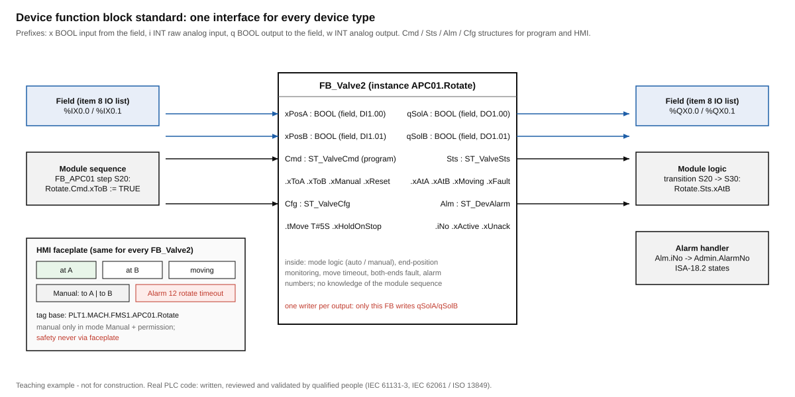

### D2.1 Common structures

```iecst
TYPE ST_DevAlarm :
STRUCT
    iNo      : INT;     (* device alarm number, 0 = none; module adds its range (F7) *)
    xActive  : BOOL;    (* condition present / latched *)
    xUnack   : BOOL;    (* not yet acknowledged *)
END_STRUCT
END_TYPE

TYPE ST_ValveCmd :
STRUCT
    xToA     : BOOL;    (* auto command from the module logic: move to A *)
    xToB     : BOOL;    (* auto command: move to B *)
    xManual  : BOOL;    (* TRUE = manual mode (HMI commands), only with permission (D3) *)
    xManToA  : BOOL;    (* HMI push-button "to A" *)
    xManToB  : BOOL;    (* HMI push-button "to B" *)
    xReset   : BOOL;    (* fault reset (edge) *)
END_STRUCT
END_TYPE

TYPE ST_ValveSts :
STRUCT
    xAtA, xAtB  : BOOL; (* end position reached (debounced, plausible) *)
    xMoving     : BOOL; (* commanded position not yet reached *)
    xFault      : BOOL; (* alarm active *)
    xCmdA, xCmdB: BOOL; (* current command (for the HMI arrows) *)
END_STRUCT
END_TYPE

TYPE ST_ValveCfg :
STRUCT
    tMove        : TIME := T#5S;     (* movement timeout *)
    tSettle      : TIME := T#50MS;   (* end-position debounce *)
    xHoldOnStop  : BOOL := TRUE;     (* double valve: keep the last command on stop (bistable behaviour) *)
END_STRUCT
END_TYPE
```

### D2.2 Device alarm numbers (example convention)

| Device alarm | Meaning (valve) | Meaning (motor, D7) |
|---|---|---|
| 1 | timeout moving to A | no run feedback after start |
| 2 | timeout moving to B | run feedback lost while running |
| 3 | both end positions at the same time (sensor fault) | motor protection tripped |
| 4 | end position lost without command | run feedback without command (contactor welded?) |

The module combines them into its alarm number (F7): e.g. module range 2000 (M02) + device index × 10 + device alarm, or a table in the module
FB. The examples of this guide use the short local numbers (motor 1–4, module 10–13).

### D2.3 The HMI faceplate

One faceplate type per FB type, opened by clicking the device symbol on the module screen. It shows: tag and description, status (at A / at B /
moving / fault), current command, alarm with text, operating mode, and – only in manual mode and with permission – the manual buttons. Rules
(ISA-101 style, guide 65 E3): grey normal states, colour only for abnormal states, the same position of buttons on every faceplate, a
confirmation for movements that can collide, **never** a safety function on a faceplate (no "bridge door" button). The faceplate reads `Sts`
and `Alm`, and writes only `Cmd.xMan…` and `Cmd.xReset` – through the PLC's access rules (operator role, guide 66 G2).

## D3. Operating modes inside a device FB

| Device mode | Who commands | Permission | Typical use |
|---|---|---|---|
| Auto | the module logic (sequence) via `Cmd.xToA / xToB` | module in Production / Maintenance, sequence active | normal production |
| Manual | the operator via the faceplate `Cmd.xManToA / xManToB` | module in Manual mode (PackML unit mode 3) **and** the module allows manual for this device (interlocks fulfilled) | set-up, recovery after a fault |
| Out of service / simulation | nobody (outputs FALSE) / simulated feedback | maintenance role, documented | device removed, virtual commissioning (G8) |

Manual commands are **jog-like** for dangerous motions (move only while the button is pressed) or **step-like** for safe ones (one click = move to
the end position). The decision belongs to the risk assessment of the machine (guide 67 F); in maintenance mode the safety program limits speed or
requires an enabling device (guide 67 H8) – the standard FB cannot replace that.

## D4. FB_Sensor – debounce

A mechanical or inductive sensor can bounce or flicker (vibration, a part passing at the edge of the sensing range). The device FB filters the
signal with an on-delay and an off-delay:

```iecst
FUNCTION_BLOCK FB_Sensor
(* discrete sensor (pattern SENSOR): debounce, status, optional "stuck" monitoring *)
VAR_INPUT
    xOn       : BOOL;                 (* field input, e.g. APC01_PalSideA_On *)
    tOnDelay  : TIME := T#20MS;       (* signal must be TRUE this long *)
    tOffDelay : TIME := T#20MS;       (* signal must be FALSE this long *)
END_VAR
VAR_OUTPUT
    xState    : BOOL;                 (* debounced state *)
    xRising   : BOOL;                 (* one-scan pulse on the debounced rising edge *)
    xFalling  : BOOL;
END_VAR
VAR
    tonOn  : TON;
    tonOff : TON;
    xLast  : BOOL;
END_VAR

tonOn (IN := xOn,      PT := tOnDelay);    (* both timers called every scan *)
tonOff(IN := NOT xOn,  PT := tOffDelay);
IF tonOn.Q THEN
    xState := TRUE;
ELSIF tonOff.Q THEN
    xState := FALSE;
END_IF;                                   (* in between: keep the last state *)
xRising  := xState AND NOT xLast;
xFalling := NOT xState AND xLast;
xLast    := xState;
END_FUNCTION_BLOCK
```

Worked example: a 10 ms task, tOnDelay 20 ms. A flicker of one scan (10 ms FALSE inside a TRUE signal) does not change xState; a real change is
seen after 20–30 ms (two to three scans). The debounce time adds to the reaction time of B1 – choose it per sensor: 0 for a fast counting sensor
(then use the card's hardware filter), 20 ms for a cylinder sensor, 200–500 ms for a level switch in a sloshing tank (WASH01 LevelHigh, F6 shows
what happens without it – chattering).

## D5. FB_AnalogIn – scaling, NE 43 status, substitute value

### D5.1 Theory (rule `analog`)

A 4–20 mA transmitter (guide 68 B5.2) sends 4 mA at the lower range value and 20 mA at the upper. The AI card converts the current into a raw
integer. In the Siemens-style scaling of the example, **raw 0 … 27 648 = 4 … 20 mA** (check your card – A9.3):

```
mA    = 4 + 16 · raw / 27648
value = lo + (hi − lo) · (mA − 4) / 16
```

**NAMUR NE 43** uses the current outside 4–20 mA to signal faults of the loop or the transmitter:

| Current | Status | Meaning |
|---|---|---|
| mA ≤ 3.6 | **BAD** | fault low – wire break, transmitter fault (failure current ≤ 3.6 mA) |
| 3.6 < mA < 3.8 | UNCERTAIN | under range – measured value below the range (still a measurement) |
| 3.8 ≤ mA ≤ 20.5 | **GOOD** | valid measurement (incl. small over / under range) |
| 20.5 < mA < 21.0 | UNCERTAIN | over range |
| mA ≥ 21.0 | **BAD** | fault high – short circuit, transmitter failure current ≥ 21 mA |

Output rule: `value_out` = value clamped to [lo, hi] for GOOD and UNCERTAIN; for BAD the **substitute value** lo is output **and the quality is
BAD** – the module must not use a BAD value for decisions (it raises an alarm and stops the dependent function). The quality corresponds to the
NE 107 categories used in diagnostics (Failure, Out of specification, Maintenance required, Function check).

### D5.2 The eleven example raw values (range 0–10 bar)

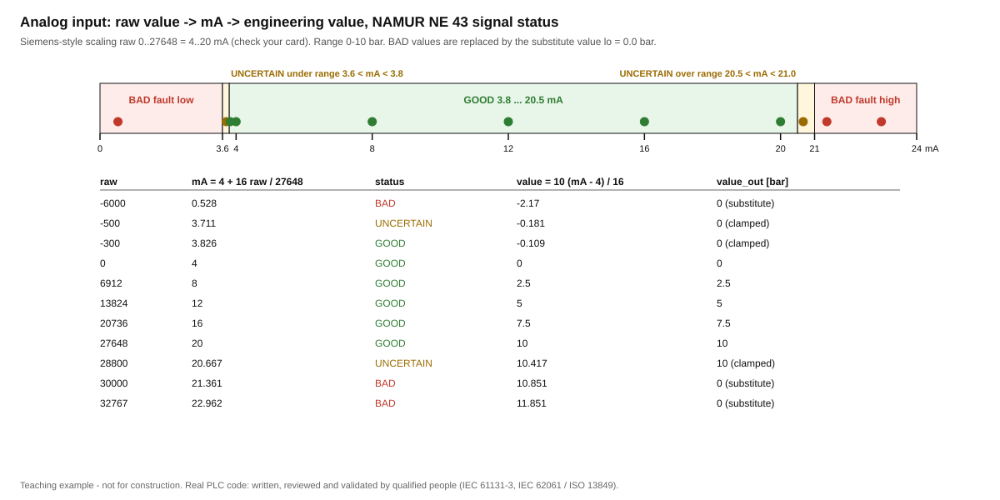

| raw | mA | Status | Text | value (unclamped) [bar] | value_out [bar] |
|---|---|---|---|---|---|
| -6000 | 0.528 | **BAD** | fault low (wire break) | -2.17 | 0.0 |
| -500 | 3.711 | UNCERTAIN | under range | -0.181 | 0.0 |
| -300 | 3.826 | GOOD | ok | -0.109 | 0.0 |
| 0 | 4.0 | GOOD | ok | 0.0 | 0.0 |
| 6912 | 8.0 | GOOD | ok | 2.5 | 2.5 |
| 13824 | 12.0 | GOOD | ok | 5.0 | 5.0 |
| 20736 | 16.0 | GOOD | ok | 7.5 | 7.5 |
| 27648 | 20.0 | GOOD | ok | 10.0 | 10.0 |
| 28800 | 20.667 | UNCERTAIN | over range | 10.417 | 10.0 |
| 30000 | 21.361 | **BAD** | fault high | 10.851 | 0.0 |
| 32767 | 22.962 | **BAD** | fault high | 11.851 | 0.0 |

Worked: raw −6 000: mA = 4 + 16 · (−6 000) / 27 648 = 4 − 3.4722 = **0.528 mA** ≤ 3.6 → BAD (wire break); value = 10 · (0.528 − 4) / 16 = −2.17 bar;
output = substitute 0.0 bar, quality BAD. Raw 28 800: mA = 4 + 16 · 28 800 / 27 648 = 20.667 → UNCERTAIN over range; value 10.417 → clamped to
**10.0**. Raw −300: 3.826 mA ≥ 3.8 → GOOD; value −0.109 → clamped to 0.0 (a small negative zero offset – normal).

Lesson of the table: **the clamped value alone hides the fault**. Raw −6 000 (broken wire), raw 0 (true 0 bar) and raw −300 (0 bar with offset)
all give 0.0 bar – only the status tells them apart. A clamp-pressure check that uses only the value would treat a broken wire like "no
pressure" – correct by luck here; for a "pressure too high" check a broken wire (0.0) would look "OK" – dangerous. Always evaluate the quality.

### D5.3 Listing

```iecst
FUNCTION_BLOCK FB_AnalogIn
(* 4..20 mA analog input (patterns ANALOG_P, ANALOG_T): scaling, NAMUR NE 43 status, substitute value *)
VAR_INPUT
    iValue    : INT;                  (* raw value of the AI channel, e.g. APC01_ClampPress_Value *)
    rLo       : REAL := 0.0;          (* engineering value at 4 mA  *)
    rHi       : REAL := 10.0;         (* engineering value at 20 mA *)
    rSubst    : REAL := 0.0;          (* substitute value for BAD (rule: lo) *)
END_VAR
VAR_OUTPUT
    rmA       : REAL;                 (* loop current, for diagnostics *)
    rRaw      : REAL;                 (* unclamped engineering value *)
    rValue    : REAL;                 (* value to use (clamped or substitute) *)
    iQuality  : INT;                  (* 0 GOOD, 1 UNCERTAIN, 2 BAD *)
    sStatus   : STRING[32];
END_VAR
VAR CONSTANT
    RAW_SPAN    : REAL := 27648.0;    (* Siemens-style 4..20 mA span - check the card *)
    MA_FAULT_LO : REAL := 3.6;
    MA_UNDER    : REAL := 3.8;
    MA_OVER     : REAL := 20.5;
    MA_FAULT_HI : REAL := 21.0;
END_VAR

rmA  := 4.0 + 16.0 * INT_TO_REAL(iValue) / RAW_SPAN;
rRaw := rLo + (rHi - rLo) * (rmA - 4.0) / 16.0;

IF rmA <= MA_FAULT_LO THEN
    iQuality := 2;  sStatus := 'fault low (wire break)';
ELSIF rmA < MA_UNDER THEN
    iQuality := 1;  sStatus := 'under range';
ELSIF rmA <= MA_OVER THEN
    iQuality := 0;  sStatus := 'ok';
ELSIF rmA < MA_FAULT_HI THEN
    iQuality := 1;  sStatus := 'over range';
ELSE
    iQuality := 2;  sStatus := 'fault high';
END_IF;

IF iQuality = 2 THEN
    rValue := rSubst;                                   (* BAD: substitute, module must not use it *)
ELSE
    rValue := LIMIT(rLo, rRaw, rHi);                    (* GOOD / UNCERTAIN: clamp to the range *)
END_IF;
END_FUNCTION_BLOCK
```

Real-project additions: a first-order filter (`rFilt := rFilt + (rValue − rFilt) · dt / tau`) for noisy signals, an on-delay before declaring BAD
(a 50 ms dropout during a contactor switching should not stop the cell), the card's own diagnostic bits (wire-break detection must be enabled
in the hardware configuration), and the unit text for the HMI.

## D6. Limit alarms with hysteresis and on-delay

### D6.1 Theory (rule `limits`)

A limit alarm compares a value with a limit. Two additions prevent false and chattering alarms:

- **on-delay**: the condition must be true for `delay` consecutive samples before the alarm comes ON (filters short peaks);
- **hysteresis (deadband)**: the alarm goes OFF only when the value has moved back by `hyst` (prevents ON / OFF / ON while the value hovers at
  the limit).

```
H alarm: condition v ≥ H ; ON after 'delay' consecutive samples ; OFF immediately when v < H − hyst
L alarm: condition v ≤ L ; ON after 'delay' consecutive samples ; OFF immediately when v > L + hyst
```

Example: H 8.0, L 3.0, hyst 0.2, delay 2, one sample per second.

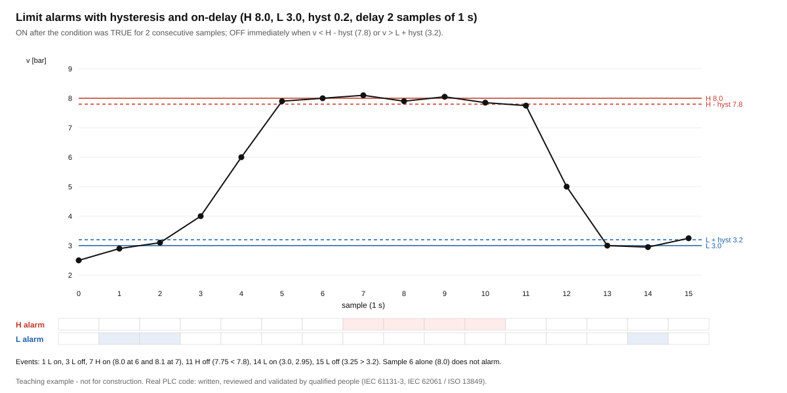

| Sample | v [bar] | H alarm | L alarm |
|---|---|---|---|
| 0 | 2.5 | – | – |
| 1 | 2.9 | – | **ON** |
| 2 | 3.1 | – | **ON** |
| 3 | 4.0 | – | – |
| 4 | 6.0 | – | – |
| 5 | 7.9 | – | – |
| 6 | 8.0 | – | – |
| 7 | 8.1 | **ON** | – |
| 8 | 7.9 | **ON** | – |
| 9 | 8.05 | **ON** | – |
| 10 | 7.85 | **ON** | – |
| 11 | 7.75 | – | – |
| 12 | 5.0 | – | – |
| 13 | 3.0 | – | – |
| 14 | 2.95 | – | **ON** |
| 15 | 3.25 | – | – |

Events: 1 L on, 3 L off, 7 H on, 11 H off, 14 L on, 15 L off.

Walk-through: sample 0 (2.5 ≤ 3.0) – L counter 1, no alarm yet; sample 1 (2.9) – counter 2 = delay → **L ON**. Sample 2 (3.1): condition false
(counter 0) but 3.1 is not > 3.2 → L stays ON (hysteresis). Sample 3 (4.0 > 3.2) → **L OFF**. Sample 6 (8.0 ≥ 8.0) – H counter 1; sample 7 (8.1)
counter 2 → **H ON**. Samples 8–10 (7.9, 8.05, 7.85) all ≥ 7.8 → H stays ON. Sample 11 (7.75 < 7.8) → **H OFF**. Samples 13 (3.0) and 14 (2.95) →
**L ON** at 14; sample 15 (3.25 > 3.2) → **L OFF**.

Without hysteresis the H alarm would have gone OFF at 8 (7.9 < 8.0), ON again at 9 (8.05, but only after 2 samples – no), and OFF at 10 – an
operator sees flickering; without on-delay a single spike would alarm. ISA-18.2 recommends deadbands of about 1–5 % of the range and on / off
delays of a few seconds for pressure and level (F6).

### D6.2 Listing

```iecst
FUNCTION_BLOCK FB_LimitAlarm
(* high / low limit alarm with hysteresis and on-delay, called once per sample (here 1 s, e.g. in the Diag or Comm task) *)
VAR_INPUT
    rValue  : REAL;
    xValid  : BOOL := TRUE;     (* quality GOOD/UNCERTAIN from FB_AnalogIn - BAD handled by its own alarm *)
    rH      : REAL := 8.0;
    rL      : REAL := 3.0;
    rHyst   : REAL := 0.2;
    nDelay  : INT  := 2;        (* consecutive samples *)
END_VAR
VAR_OUTPUT
    xH      : BOOL;
    xL      : BOOL;
END_VAR
VAR
    nH, nL  : INT;
END_VAR

IF NOT xValid THEN              (* a BAD value must not create or clear process alarms *)
    RETURN;
END_IF;

IF rValue >= rH THEN nH := MIN(nH + 1, 32000); ELSE nH := 0; END_IF;
IF rValue <= rL THEN nL := MIN(nL + 1, 32000); ELSE nL := 0; END_IF;

IF NOT xH AND nH >= nDelay THEN xH := TRUE;  ELSIF xH AND rValue < rH - rHyst THEN xH := FALSE; END_IF;
IF NOT xL AND nL >= nDelay THEN xL := TRUE;  ELSIF xL AND rValue > rL + rHyst THEN xL := FALSE; END_IF;
END_FUNCTION_BLOCK
```

(The counter keeps counting while the alarm is ON but has no effect – as in the rule; the `MIN` prevents an INT overflow after 9 hours, B5.)

## D7. FB_MotorDol – complete listing and five scenarios

### D7.1 The motor rule

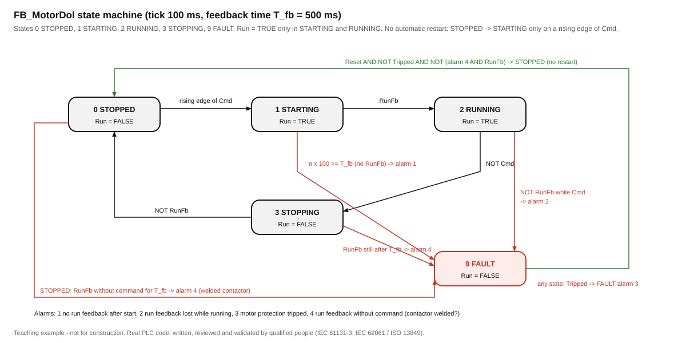

Pattern DOL (guide 68 B1.2): MPCB + contactor; IO `Run` (DO contactor coil), `RunFb` (DI auxiliary contact of the contactor), `Tripped` (DI motor
protection tripped). The FB (rule `motor`, tick 100 ms, feedback time T_fb = 500 ms = 5 ticks) has five states:

| State | No. | Run | Leaves when |
|---|---|---|---|
| STOPPED | 0 | FALSE | rising edge of Cmd → STARTING; RunFb for ≥ T_fb without command → FAULT alarm 4 |
| STARTING | 1 | TRUE | RunFb → RUNNING; no RunFb for T_fb → FAULT alarm 1 |
| RUNNING | 2 | TRUE | Cmd FALSE → STOPPING; RunFb lost while Cmd → FAULT alarm 2 |
| STOPPING | 3 | FALSE | RunFb FALSE → STOPPED; RunFb still after T_fb → FAULT alarm 4 |
| FAULT | 9 | FALSE | Reset AND NOT Tripped AND NOT (alarm 4 AND RunFb) → STOPPED (reset accepted); otherwise "reset rejected" |
| (any) | – | – | Tripped → FAULT alarm 3 |

Order per tick: 1 events (commands, plant faults), 2 plant (contactor follows Run of the previous tick; RunFb after 2 ticks closed; a welded
contactor stays closed), 3 FB. A state entered in this tick is not executed again in this tick; Run is the output of the state after the CASE.
**No automatic restart**: STOPPED → STARTING only on a **rising edge** of Cmd.

### D7.2 Listing – implements the rule exactly

```iecst
FUNCTION_BLOCK FB_MotorDol
(* Motor starter direct-on-line (pattern DOL): command, run feedback, motor protection, 4 alarms, no automatic restart.
   Called once per tick of the task (rule: 100 ms). Times counted in ticks to reproduce the rule exactly;
   a production version may use TON instances instead (same behaviour in a fixed cyclic task). *)
VAR_INPUT
    xRunFb    : BOOL;                 (* DI contactor auxiliary contact, e.g. WASH01_SprayPump_RunFb *)
    xTripped  : BOOL;                 (* DI motor protection tripped *)
    xCmd      : BOOL;                 (* run request (level) from the module logic or the faceplate *)
    xReset    : BOOL;                 (* fault reset, TRUE for one call *)
    tFb       : TIME := T#500MS;      (* feedback time T_fb *)
    tTick     : TIME := T#100MS;      (* period of the calling task *)
END_VAR
VAR_OUTPUT
    qRun      : BOOL;                 (* DO contactor coil, e.g. WASH01_SprayPump_Run *)
    iState    : INT;                  (* 0 STOPPED, 1 STARTING, 2 RUNNING, 3 STOPPING, 9 FAULT *)
    iAlarm    : INT;                  (* 0 none, 1..4 see the alarm table *)
    xFault    : BOOL;
    xRunning  : BOOL;
END_VAR
VAR
    xCmdPrev  : BOOL;
    xCmdEdge  : BOOL;
    xEntered  : BOOL;                 (* a state was entered in this call *)
    n         : DINT;                 (* ticks in STARTING / STOPPING *)
    nFb       : DINT;                 (* ticks of RunFb without command in STOPPED *)
    dFb, dTick: DINT;                 (* ms *)
END_VAR
VAR CONSTANT
    STOPPED : INT := 0;  STARTING : INT := 1;  RUNNING : INT := 2;  STOPPING : INT := 3;  FAULT : INT := 9;
END_VAR

dFb      := TIME_TO_DINT(tFb);
dTick    := TIME_TO_DINT(tTick);
xCmdEdge := xCmd AND NOT xCmdPrev;
xEntered := FALSE;

(* motor protection has priority in every state *)
IF xTripped AND iState <> FAULT THEN
    iState := FAULT;  iAlarm := 3;  xEntered := TRUE;
END_IF;

IF NOT xEntered THEN
    CASE iState OF
    STOPPED:
        IF xRunFb THEN nFb := nFb + 1; ELSE nFb := 0; END_IF;
        IF nFb * dTick >= dFb THEN
            iState := FAULT;  iAlarm := 4;                       (* feedback without command: welded contactor? *)
        ELSIF xCmdEdge THEN
            iState := STARTING;  n := 0;                         (* only an EDGE starts - no automatic restart *)
        END_IF;

    STARTING:
        n := n + 1;
        IF xRunFb THEN
            iState := RUNNING;
        ELSIF n * dTick >= dFb THEN
            iState := FAULT;  iAlarm := 1;                       (* no run feedback after start *)
        END_IF;

    RUNNING:
        IF NOT xCmd THEN
            iState := STOPPING;  n := 0;
        ELSIF NOT xRunFb THEN
            iState := FAULT;  iAlarm := 2;                       (* run feedback lost while running *)
        END_IF;

    STOPPING:
        n := n + 1;
        IF NOT xRunFb THEN
            iState := STOPPED;  nFb := 0;
        ELSIF n * dTick >= dFb THEN
            iState := FAULT;  iAlarm := 4;                       (* contactor does not drop out *)
        END_IF;

    FAULT:
        IF xReset AND NOT xTripped AND NOT (iAlarm = 4 AND xRunFb) THEN
            iState := STOPPED;  iAlarm := 0;  nFb := 0;          (* reset accepted - motor stays OFF *)
        END_IF;                                                  (* else: reset rejected, stays in FAULT *)
    END_CASE;
END_IF;

(* output of the state after the CASE *)
qRun     := (iState = STARTING) OR (iState = RUNNING);
xFault   := iState = FAULT;
xRunning := iState = RUNNING;
xCmdPrev := xCmd;
END_FUNCTION_BLOCK
```

Notes on the listing:

- The FAULT branch in the CASE is skipped in the tick of the trip because of `xEntered` – exactly the rule "a state entered in this tick is not
  executed again". Without this flag a RESET in the same tick as a TRIP could be evaluated in the same call.
- `xCmdPrev` is updated **at the end** – the edge refers to the previous call.
- `qRun` is derived from the state, not set in each branch – one writer, one place, impossible to forget in a new state.
- The welded-contactor check in STOPPED (`nFb`) also catches a contactor that was closed by hand or a jumper left in the cabinet.

### D7.3 The five scenarios (logs from the rule, `device_fb.py --motor A..E`)

**Scenario A – normal start and stop**

Summary: `motor A Normal start and stop final STOPPED alarm 0 Run 0 lines 6`

```
2 event CMD_ON
2 STOPPED -> STARTING
4 STARTING -> RUNNING
20 event CMD_OFF
20 RUNNING -> STOPPING
21 STOPPING -> STOPPED
```

Tick 2: CMD_ON → rising edge → STARTING, Run = TRUE. The plant closes the contactor at tick 3 (from Run of tick 2), RunFb after 2 closed ticks at
tick 4 → RUNNING. Tick 20: CMD_OFF → STOPPING, Run FALSE; tick 21: contactor open → RunFb FALSE → STOPPED. Start time 2 ticks = 200 ms, below
T_fb 500 ms.

**Scenario B – no run feedback (auxiliary contact broken)**

Summary: `motor B No run feedback (auxiliary contact broken) final STOPPED alarm 0 Run 0 lines 15`

```
0 event FB_BROKEN
2 event CMD_ON
2 STOPPED -> STARTING
7 STARTING -> FAULT alarm 1 no run feedback after start
15 event RESET
15 FAULT -> STOPPED reset accepted
18 event CMD_OFF
20 event FB_OK
22 event RESET
25 event CMD_ON
25 STOPPED -> STARTING
27 STARTING -> RUNNING
35 event CMD_OFF
35 RUNNING -> STOPPING
36 STOPPING -> STOPPED
```

What it teaches: (1) the start supervision detects a missing feedback after T_fb (tick 2 + 5 = 7) → alarm 1 – the motor might be running (the
contactor closed, only the contact is broken) or not (contactor coil broken) – the FB cannot know, so it switches off and reports; (2) the reset at
tick 15 is accepted although the contact is still broken (alarm 1 does not block the reset) – and the motor does **not** restart although Cmd is
still TRUE (no edge); (3) the reset at tick 22 does nothing (the FB is already STOPPED – no log line); (4) a new start needs a new rising edge
(tick 25) and now works because the contact was repaired at tick 20.

**Scenario C – feedback lost while running**

Summary: `motor C Feedback lost while running final RUNNING alarm 0 Run 1 lines 12`

```
2 event CMD_ON
2 STOPPED -> STARTING
4 STARTING -> RUNNING
12 event FB_BROKEN
12 RUNNING -> FAULT alarm 2 run feedback lost while running
16 event FB_OK
18 event RESET
18 FAULT -> STOPPED reset accepted
20 event CMD_OFF
22 event CMD_ON
22 STOPPED -> STARTING
24 STARTING -> RUNNING
```

Tick 12: the feedback disappears while the motor should run → alarm 2 immediately (in the same tick – RUNNING has no delay in this rule; a real
FB may add a short filter of 50–100 ms against contact bounce). Reset at 18 accepted, the command is still TRUE but the motor stays off. Only the
OFF (20) → ON (22) sequence restarts it. Final state RUNNING.

**Scenario D – motor protection trips, no restart after reset (IEC 60204-1)**

Summary: `motor D Motor protection trips, no restart after reset final RUNNING alarm 0 Run 1 lines 14`

```
2 event CMD_ON
2 STOPPED -> STARTING
4 STARTING -> RUNNING
10 event TRIP
10 RUNNING -> FAULT alarm 3 motor protection tripped
14 event RESET
14 reset rejected (alarm 3)
16 event TRIP_CLEAR
18 event RESET
18 FAULT -> STOPPED reset accepted
22 event CMD_OFF
25 event CMD_ON
25 STOPPED -> STARTING
27 STARTING -> RUNNING
```

Tick 10: TRIP → FAULT alarm 3 from RUNNING. Tick 14: RESET **rejected** because Tripped is still TRUE – the MPCB must be switched on again
first (TRIP_CLEAR at 16). Tick 18: reset accepted → STOPPED **although Cmd is still TRUE**. This is the central rule of IEC 60204-1 9.2.5.4 /
9.2.6: after a stop caused by a protective device or a fault, the machine must not restart by itself when the fault is cleared or reset; a
deliberate new start command is required. Tick 22 / 25: OFF → ON → normal start.

**Scenario E – contactor welded**

Summary: `motor E Contactor welded final FAULT alarm 4 Run 0 lines 9`

```
2 event CMD_ON
2 STOPPED -> STARTING
4 STARTING -> RUNNING
8 event WELD
12 event CMD_OFF
12 RUNNING -> STOPPING
17 STOPPING -> FAULT alarm 4 run feedback without command (contactor welded?)
25 event RESET
25 reset rejected (alarm 4)
```

Per-tick trace (`device_fb.py --motor E --trace`, first 28 ticks):

```
 k  Cmd  contactor  RunFb  Tripped  state     Run  alarm
--  ---  ---------  -----  -------  --------  ---  -----
 0    0          0      0        0  STOPPED     0      0
 1    0          0      0        0  STOPPED     0      0
 2    1          0      0        0  STARTING    1      0
 3    1          1      0        0  STARTING    1      0
 4    1          1      1        0  RUNNING     1      0
 5    1          1      1        0  RUNNING     1      0
 6    1          1      1        0  RUNNING     1      0
 7    1          1      1        0  RUNNING     1      0
 8    1          1      1        0  RUNNING     1      0
 9    1          1      1        0  RUNNING     1      0
10    1          1      1        0  RUNNING     1      0
11    1          1      1        0  RUNNING     1      0
12    0          1      1        0  STOPPING    0      0
13    0          1      1        0  STOPPING    0      0
14    0          1      1        0  STOPPING    0      0
15    0          1      1        0  STOPPING    0      0
16    0          1      1        0  STOPPING    0      0
17    0          1      1        0  FAULT       0      4
18    0          1      1        0  FAULT       0      4
19    0          1      1        0  FAULT       0      4
20    0          1      1        0  FAULT       0      4
21    0          1      1        0  FAULT       0      4
22    0          1      1        0  FAULT       0      4
23    0          1      1        0  FAULT       0      4
24    0          1      1        0  FAULT       0      4
25    0          1      1        0  FAULT       0      4
26    0          1      1        0  FAULT       0      4
27    0          1      1        0  FAULT       0      4
```

Tick 8: the contacts weld (plant flag) – nothing visible yet, the motor should run anyway. Tick 12: CMD_OFF → STOPPING, Run FALSE – but the
welded contactor stays closed, RunFb stays TRUE. After T_fb (ticks 13–17, n = 5 → 500 ms) → FAULT alarm 4 "run feedback without command (contactor
welded?)". Tick 25: RESET rejected because RunFb is still TRUE – resetting would put the FB into STOPPED with a running motor. The motor **keeps
running** in this scenario: the standard PLC cannot switch it off when the contactor is welded. This is exactly why a hazardous motor needs
**two contactors in series with feedback monitoring (EDM)** controlled by the safety program (pattern CONT_PAIR_EDM, guide 68 B1.5): a single
welded contactor is a single fault that the safety function must tolerate (Category 3 / 4, guide 67 G3). The standard FB only **detects and
reports** it; the energy isolation is the job of the safety circuit, the main switch and the maintenance procedure.

### D7.4 Use in the module and HMI

```iecst
(* in FB_WASH01 (module logic, item 10): request the spray pump in the washing step *)
Dev.SprayPump.xCmd   := (iStep = 30) AND xExecuteActive;     (* level command, edge detected inside the FB *)
Dev.SprayPump.xReset := rtFaultReset.Q;                       (* module fault reset (Clear) as a one-scan pulse *)
(* the generated FB_WASH01_Devices then calls SprayPump(...) and writes WASH01_SprayPump_Run *)
IF Dev.SprayPump.xFault THEN
    iAlarm := 1000 * 10 + 10 + Dev.SprayPump.iAlarm;          (* e.g. 10011..10014: module range M10 x 1000 + device 1 x 10 + alarm *)
END_IF;
```

(The alarm number formula is an example of the "module range × 1000 + n" rule of item 6; with M10 the range 10 000 + n exceeds the
four-digit pattern of guide 66 – define the formula per project and keep it unique within an INT.)

## D8. FB_Valve1 and FB_Valve2

### D8.1 The two valve patterns (guide 68 B4)

| Property | VALVE_SINGLE → FB_Valve1 | VALVE_DOUBLE → FB_Valve2 |
|---|---|---|
| Valve | 5/2 single solenoid, spring return | 5/2 double solenoid, bistable (detent) |
| Outputs | `qSol` | `qSolA`, `qSolB` |
| Rest position | defined by the spring (Sol FALSE → position A) | **none** – the spool stays where it was |
| On power loss / stop (outputs FALSE) | moves to the spring position | **keeps moving** to the last commanded side |
| Typical use | clamp (spring = clamped, M02 Clamp), stopper, door | rotation (M02 Rotate), gripper, press-fit ram |
| Pulse or level | level (energised as long as position B is wanted) | pulse is enough; level gives a defined state – this guide uses level |

### D8.2 End-position monitoring

Each cylinder has two sensors, PosA and PosB. The FB monitors:

| Check | Condition | Alarm |
|---|---|---|
| timeout to A | commanded A, PosA not reached within tMove | 1 |
| timeout to B | commanded B, PosB not reached within tMove | 2 |
| both positions | PosA AND PosB for > tSettle | 3 (sensor fault or sensor shifted) |
| position lost | was at the commanded end, both FALSE without a new command for > tSettle | 4 (pressure loss, mechanical fault) |

### D8.3 Listing FB_Valve2

```iecst
FUNCTION_BLOCK FB_Valve2
(* cylinder with double-solenoid 5/2 valve (pattern VALVE_DOUBLE): auto / manual, end-position monitoring, timeouts *)
VAR_INPUT
    xPosA, xPosB : BOOL;               (* field inputs, e.g. APC01_Rotate_PosA / PosB *)
    Cmd          : ST_ValveCmd;
    Cfg          : ST_ValveCfg;
    xEnable      : BOOL := TRUE;       (* module permission (interlocks, valve supply on) *)
END_VAR
VAR_OUTPUT
    qSolA, qSolB : BOOL;               (* field outputs *)
    Sts          : ST_ValveSts;
    Alm          : ST_DevAlarm;
END_VAR
VAR
    xWantA, xWantB : BOOL;             (* current target *)
    tonMove        : TON;
    tonBoth        : TON;
    tonLost        : TON;
    rtReset        : R_TRIG;
    xWasAtA, xWasAtB : BOOL;           (* the commanded end position had been reached *)
    xLostCond      : BOOL;
END_VAR

(* 1 status *)
tonBoth(IN := xPosA AND xPosB, PT := Cfg.tSettle);
Sts.xAtA := xPosA AND NOT xPosB;
Sts.xAtB := xPosB AND NOT xPosA;

(* 2 commands: auto or manual, never both *)
IF Cmd.xManual THEN
    IF Cmd.xManToA THEN xWantA := TRUE;  xWantB := FALSE; END_IF;
    IF Cmd.xManToB THEN xWantB := TRUE;  xWantA := FALSE; END_IF;
ELSE
    IF Cmd.xToA AND NOT Cmd.xToB THEN xWantA := TRUE;  xWantB := FALSE;
    ELSIF Cmd.xToB AND NOT Cmd.xToA THEN xWantB := TRUE;  xWantA := FALSE;
    ELSIF NOT Cfg.xHoldOnStop THEN xWantA := FALSE; xWantB := FALSE;   (* no command: both coils off *)
    END_IF;                                                             (* bistable valve: spool stays anyway *)
END_IF;

(* 3 monitoring *)
Sts.xMoving := (xWantA AND NOT Sts.xAtA) OR (xWantB AND NOT Sts.xAtB);
tonMove(IN := Sts.xMoving AND xEnable, PT := Cfg.tMove);
IF xWantA AND Sts.xAtA THEN xWasAtA := TRUE; END_IF;
IF xWantB AND Sts.xAtB THEN xWasAtB := TRUE; END_IF;
IF NOT xWantA THEN xWasAtA := FALSE; END_IF;
IF NOT xWantB THEN xWasAtB := FALSE; END_IF;
xLostCond := ((xWasAtA AND NOT xPosA) OR (xWasAtB AND NOT xPosB));   (* left the end position without a new command *)
tonLost(IN := xLostCond, PT := Cfg.tSettle);
rtReset(CLK := Cmd.xReset);
IF rtReset.Q THEN
    Alm.iNo := 0;  Alm.xActive := FALSE;  Alm.xUnack := FALSE;
END_IF;
IF Alm.iNo = 0 THEN
    IF tonMove.Q AND xWantA THEN Alm.iNo := 1;
    ELSIF tonMove.Q AND xWantB THEN Alm.iNo := 2;
    ELSIF tonBoth.Q THEN Alm.iNo := 3;
    ELSIF tonLost.Q THEN Alm.iNo := 4;
    END_IF;
    IF Alm.iNo <> 0 THEN Alm.xActive := TRUE;  Alm.xUnack := TRUE; END_IF;
END_IF;
Sts.xFault := Alm.iNo <> 0;

(* 4 outputs - only this FB writes them *)
qSolA := xEnable AND xWantA AND NOT Sts.xFault;
qSolB := xEnable AND xWantB AND NOT Sts.xFault;
Sts.xCmdA := xWantA;  Sts.xCmdB := xWantB;
END_FUNCTION_BLOCK
```

> **Teaching point on `qSol… := … AND NOT Sts.xFault`.** Switching the coils off on a fault does **not** stop a bistable valve – the spool keeps
> its position and the cylinder completes the stroke (E8, scenario B of the module run). For a double-solenoid valve the fault reaction
> "coils off" only prevents a *new* movement. Stopping a movement needs a **5/3 closed-centre valve** (both coils off → cylinder held), an
> exhaust (5/3 exhausted centre) or the **safety valve** that removes the air supply of the valve terminal (pattern SAFE_VALVE / zone F-DO,
> guide 68 B3.2 and C2.5).

The position-lost check uses a separate named condition `xLostCond` – the review rule "one condition per line, with a name" (G6). Note the
priority of the alarm selection: only the first alarm is stored until reset (first-out inside the device, F4); a real library may keep a bit
field of all active device alarms in addition.

### D8.4 FB_Valve1 (single solenoid) – differences

```iecst
FUNCTION_BLOCK FB_Valve1
(* cylinder with single-solenoid 5/2 valve, spring return to A (pattern VALVE_SINGLE) *)
VAR_INPUT
    xPosA, xPosB : BOOL;               (* e.g. APC01_Clamp_PosA (clamped), APC01_Clamp_PosB (unclamped) *)
    Cmd          : ST_ValveCmd;        (* xToB = energise (move to B), xToA or nothing = spring to A *)
    Cfg          : ST_ValveCfg;
    xEnable      : BOOL := TRUE;
END_VAR
VAR_OUTPUT
    qSol         : BOOL;
    Sts          : ST_ValveSts;
    Alm          : ST_DevAlarm;
END_VAR
(* ... same status / monitoring as FB_Valve2 ... *)
(* output: the solenoid is the only actuator; FALSE = spring position A *)
(* qSol := xEnable AND xWantB AND NOT Sts.xFault; *)
END_FUNCTION_BLOCK
```

The **meaning of A and B must be documented per instance**: for the APC clamp, A = clamped = spring position (safe on air / power loss, guide 68
C2.5 – "the clamp is never de-energised to open"), B = unclamped = solenoid energised. A fault therefore drops the solenoid and **clamps** – the
right reaction for a clamp. For a door cylinder the opposite may be safe – decide with the risk assessment.

## D9. FB_DriveSto

Pattern VFD_STO (guide 68 B1.3): frequency inverter with STO (safe torque off, FDO – written only by the F-program), `Ready` and `Fault` DIs and a
fieldbus channel (speed setpoint, control word, actual speed, status word – PROFIdrive / CiA 402 style).

```iecst
FUNCTION_BLOCK FB_DriveSto
(* inverter with STO (pattern VFD_STO). STO is NOT an output of this FB - the F-program owns it. *)
VAR_INPUT
    xReady       : BOOL;               (* DI inverter ready, e.g. POOL01_Travel_Ready *)
    xFault       : BOOL;               (* DI inverter fault *)
    xStoActive   : BOOL;               (* read-only copy from the F-program: TRUE = torque off *)
    xCmdRun      : BOOL;               (* from the module logic *)
    rSpeedSet    : REAL;               (* % or mm/s *)
    xReset       : BOOL;
    tStart       : TIME := T#2S;       (* time to reach "running" status *)
END_VAR
VAR_OUTPUT
    wCtrlWord    : WORD;               (* fieldbus control word to the drive *)
    iSpeedRef    : INT;                (* scaled setpoint for the fieldbus, 16#4000 = 100 % (PROFIdrive style) *)
    xRunning     : BOOL;
    Alm          : ST_DevAlarm;
END_VAR
(* logic outline:
   - no run command while xStoActive (the drive cannot produce torque anyway; avoid a "start into STO" fault)
   - after STO is released: a NEW run command edge is required (no automatic restart)
   - xFault -> alarm, reset pulse to the drive via the control word (bit 7 fault acknowledge)
   - start supervision: xRunning (status word) within tStart, else alarm
   - speed setpoint ramped by the drive, not by the PLC *)
END_FUNCTION_BLOCK
```

Rule: the **standard program never writes the STO signal**, never "simulates" a released STO and never bridges the safety-controller feedback. It
reads `xStoActive` to show the state on the HMI and to suppress nuisance alarms ("drive not ready" while the door is open is expected, not a
fault).

## D10. The 25 FB types of the library

One FB type per circuit pattern with field IO (rule `codegen`, `fb_types`). Patterns without field IO in the standard program (BUS, RFID, HMI,
IPC, SWITCH, FIREWALL, SAFETY_PLC) have no generated device FB – they are handled by communication blocks of the module (fieldbus device
objects, IO-Link function blocks, OPC UA client) in item 10.

| Pattern | FB type | Field interface (generated) | Main function in the standard program |
|---|---|---|---|
| FEEDER_EXT | `FB_Feeder` | `xSupplyOn` | feeder breaker of an external machine ON – status / alarm "machine not supplied" |
| COUPLING | `FB_SafetyCoupling` | `xEstopIn, xEstopIn2, xZoneFree, xZoneFree2` (F-copies) | shows the hard-wired safety coupling states, discrepancy hint; outputs only in the F-program |
| HANDSHAKE_HW | `FB_HandshakeHw` | `xReady, xBusy, xDone, xFault` → `qRequest, qAck, qEnable, qReset` | 4-phase hard-wired handshake with timeouts (guide 66 H4) |
| DOL | `FB_MotorDol` | `xRunFb, xTripped` → `qRun` | motor start / stop, 4 alarms, no restart (D7) |
| VFD_STO | `FB_DriveSto` | `xReady, xFault` (+ fieldbus) | drive commands, start supervision, reads STO state (D9) |
| CONT_PAIR_EDM | `FB_ContactorPair` | `xEDM` (F-copy) | shows the safety contactor feedback; Enable is an FDO of the F-program |
| DOOR_LOCK | `FB_DoorLock` | `xClosed, xClosed2, xLocked, xLocked2` (F-copies), `xRequest` (DI) | access request logic: request → module to Held / stop → standstill → F-program unlocks; status for HMI |
| DOOR_2CH | `FB_Door2Ch` | `xClosed, xClosed2` (F-copies) | door status for HMI and PackML (door open → Held / Stopped) |
| ESTOP | `FB_Estop` | `xOk, xOk2` (F-copies) | e-stop status for HMI, alarm text, PackML Abort trigger |
| ENABLE | `FB_EnableSwitch` | `xOk, xOk2` (F-copies) | enabling-device status for maintenance mode |
| MODE_SWITCH | `FB_ModeSwitch` | `xAuto, xMaint` (F-copies) | unit mode request (Production / Maintenance) → PackML mode change in Stopped / Idle / Aborted |
| LC | `FB_LightCurtain` | `xOssd1, xOssd2` (F-copies), `xWarn` (DI) | curtain status, contamination warning → maintenance alarm |
| SCANNER | `FB_Scanner` | `xOssd1, xOssd2` (F-copies), `xWarn` → `qFieldA, qFieldB` | field-set selection by the standard program (the F-program checks plausibility), warning field |
| TWOHAND | `FB_TwoHand` | `xLeft, xLeft2, xRight, xRight2` (F-copies) | status only – the two-hand function itself is an F-block |
| VALVE_SINGLE | `FB_Valve1` | `xPosA, xPosB` → `qSol` | cylinder, spring return (D8) |
| VALVE_DOUBLE | `FB_Valve2` | `xPosA, xPosB` → `qSolA, qSolB` | cylinder, bistable (D8) |
| SAFE_VALVE | `FB_SafeValve` | `xFbA, xFbB` (F-copies) | status of the redundant safety valve; coils are FDO |
| SENSOR | `FB_Sensor` | `xOn` | debounce, edges (D4) |
| ANALOG_P | `FB_AnalogIn` | `iValue` | pressure 4–20 mA, NE 43 (D5) |
| ANALOG_T | `FB_AnalogIn` | `iValue` | temperature 4–20 mA (same FB, other range) |
| PUSHBUTTON | `FB_PushButton` | `xPb` → `qLamp` | debounce, edge, lamp (steady / flashing) |
| SIGNAL_TOWER | `FB_SignalTower` | → `qRed, qYellow, qGreen, qBuzzer` | colours from PackML state and alarms (red fault, yellow attention / Held, green Execute) |
| HEATER | `FB_Heater` | `xOnFb, xOverTemp` → `qOn` | heater contactor with feedback, over-temperature (the thermostat also cuts the power hard-wired) |
| UPS_DC | `FB_Ups` | `xUpsOk, xOnBattery` | UPS status, "on battery" → controlled shutdown of the IPC |
| ZONE_OUT | `FB_ZoneOut` | `xFb` (F-copy) | zone release status / EDM for HMI; Release is an FDO |

17 of these 25 types occur in the kit (G5). Twelve of the 25 work mainly on F-copies: they are **display and PackML-trigger blocks**, not safety
blocks.

## D11. Safety devices in the standard program

The split of item 7 (guide 67 I1–I2) in programming terms:

| Allowed in the standard program | Forbidden in the standard program |
|---|---|
| read the F-input copies (`POOL01_Door_Closed`) for HMI, alarms, PackML triggers (door open → Hold) | writing an FDO symbol (`POOL01_Travel_STO`, `POOL01_Door_LockCmd`) – the generated code has **no** assignment for FDO (G1) |
| request functions from the F-program through defined request bits (door unlock request, zone release request, mode request) | evaluating a safety condition and acting on it as the only protection ("if door open then stop motor" in standard code) |
| show diagnostics (discrepancy, test-pulse fault) delivered by the F-program | copying safety logic "for the HMI" and changing it later |
| suppress nuisance alarms when the safety state explains them | resetting a safety function from the standard program without the F-program's reset logic |

The F-program follows its own rules: certified function blocks (e.g. ESTOP1, SFDOOR, two-hand, muting, EDM), a separate F-signature
(checksum) that changes with every modification, a validation record after ISO 13849-2, and access protection. The reset of a safety function
uses the falling edge of the reset button outside the hazard zone (guide 67 I6). PLCopen **Safety** defines standard safety FB interfaces
(SF_EmergencyStop, SF_GuardMonitoring, SF_GuardLocking, SF_TwoHandControlTypeIII, SF_EDM, SF_ModeSelector, SF_SafetyRequest …) – most safety
editors provide equivalents.

## D12. Testing a device FB

| Test | How | Pass criterion |
|---|---|---|
| Unit test against the rule | run the five motor scenarios in a test harness (simulated inputs per tick), compare the log with `device_fb.py --motor A..E` | identical state changes and alarms at the same ticks |
| Boundary values | analog raw values at each NE 43 limit (3.6, 3.8, 20.5, 21.0 mA), negative, 32 767 | status exactly as the table (D5.2) |
| Timing | limit with delay 2: single spike → no alarm | event list as D6 |
| Fault injection | broken feedback, welded contactor, both end positions, sensor flicker | alarm, safe output state, no restart after reset |
| Mode test | manual commands ignored in auto, auto ignored in manual | as specified |
| Code review | listing against the coding standard (G6) | no findings of category "must" |

A minimal test harness in ST (CODESYS / TwinCAT have unit-test frameworks, e.g. TcUnit; in TIA a test OB with assertions):

```iecst
(* test of FB_MotorDol scenario D in a 100 ms test task; k = tick counter *)
CASE k OF
    2:  tMotor.xCmd := TRUE;
    10: xSimTripped := TRUE;
    14: tMotor.xReset := TRUE;
    16: xSimTripped := FALSE;
    18: tMotor.xReset := TRUE;
    22: tMotor.xCmd := FALSE;
    25: tMotor.xCmd := TRUE;
END_CASE;
(* plant model: contactor follows qRun of the previous tick, RunFb after 2 closed ticks *)
IF xRunPrev THEN nOn := nOn + 1; ELSE nOn := 0; END_IF;
tMotor(xRunFb := nOn >= 2, xTripped := xSimTripped);
xRunPrev := tMotor.qRun;
tMotor.xReset := FALSE;                                (* reset only for one tick *)
IF k = 14 THEN Assert(tMotor.iState = 9, 'reset must be rejected while tripped'); END_IF;
IF k = 18 THEN Assert(tMotor.iState = 0 AND NOT tMotor.qRun, 'no restart after reset'); END_IF;
IF k = 27 THEN Assert(tMotor.iState = 2, 'running after new command edge'); END_IF;
k := k + 1;
```

## D13. Checklist

- [ ] One FB type per circuit pattern; interface prefixes x / i / q / w; Cmd / Sts / Alm / Cfg structures.
- [ ] Every FB: fail-safe defaults, no automatic restart, timeouts on every monitored movement, one writer per output.
- [ ] Analog: NE 43 status evaluated, substitute value only with quality BAD, decisions never on BAD values.
- [ ] Limits: hysteresis and on-delay on every process limit.
- [ ] Motors: start supervision, feedback-lost, trip, welded-contactor detection; reset rejected while the cause is present.
- [ ] Valves: bistable behaviour of double-solenoid valves documented; energy isolation by safety valve where motion is hazardous.
- [ ] No FDO written by standard code; F-copies only read.
- [ ] Unit tests of all FB types recorded (D12); faceplate per FB type.

---
# Part E – The module program: sequences inside the PackML state machine

## E0. Structure of a module program

A module program (one per module instance, e.g. `APC01 : FB_APC01`) has the same five sections in every module of the library:

| Section | Content | Source |
|---|---|---|
| 1 Inputs and device layer | call of the generated `FB_<unit>_Devices` (or its device FBs), read F-copies | generated (G1) |
| 2 Command handling | read `Command.CntrlCmd` + `CmdChangeRequest` from the data block, check mode and state, accept / reject | standard (E4) |
| 3 PackML state machine | 17 states, acting-state durations / completion conditions, entry actions | standard skeleton (E3) |
| 4 Sequence (step chain) | the module's own job, active only in Execute (and frozen in Holding / Held / Unholding) | module-specific (E1, E2) |
| 5 Outputs, alarms, data block | device commands from the step, alarm number, `Status.StateCurrent`, `Status.Bits`, counters | standard (E3, F) |

Sections 2, 3 and 5 are identical for all modules – they are written once (as `FB_PackML`, `FB_ModuleHandshake`) or copied from a template.
Only section 4 (and the acting-state work of Resetting, Starting, Completing, Stopping, Aborting, Clearing) changes from module to module. This is
the core idea of ISA-TR88.00.02 (PackML) for discrete machines: **one state model, many sequences**.

## E1. Step chains in SFC and in ST

### E1.1 What a step chain is

A **step chain** (sequence) splits a job into **steps**. In each step some outputs are active (the **actions**); the chain moves to the next step
when the **transition condition** is TRUE. Only one step is active at a time (simple chain); branches (alternative or parallel) are possible.

### E1.2 The APC01 sequence

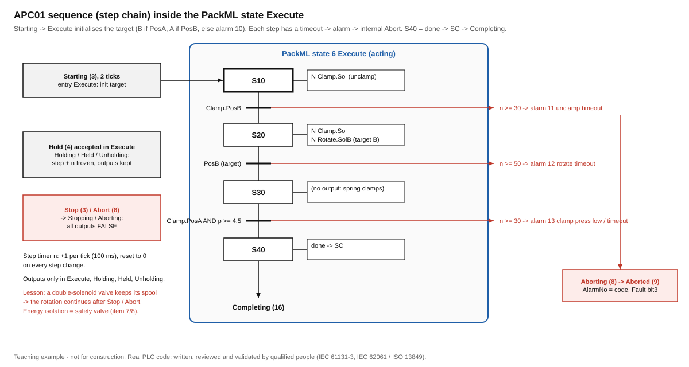

| Step | Action (outputs) | Transition to the next step | Timeout → alarm |
|---|---|---|---|
| S10 Unclamp | `Clamp.Sol` (energise = unclamp) | `Clamp.PosB` (unclamped) → S20 | n ≥ 30 ticks (3 s) → **11** unclamp timeout |
| S20 Rotate | `Clamp.Sol` + `Rotate.SolB` (target B) or `Rotate.SolA` (target A) | PosB (target B) or PosA (target A) → S30 | n ≥ 50 ticks (5 s) → **12** rotate timeout |
| S30 Clamp | none (spring clamps) | `Clamp.PosA` AND `ClampPress` ≥ 4.5 bar → S40 | n ≥ 30 ticks (3 s) → **13** clamp pressure low / clamp timeout |
| S40 Done | – | sequence done → SC of Execute → Completing | – |

The **target** is decided once, when Execute is entered from Starting: B if the rotation is at A, A if it is at B, **alarm 10** if it is in
neither end position (unknown position – never guess a direction).

### E1.3 The same chain in SFC and in ST

SFC (graphical, figure) and ST `CASE` are equivalent:

```iecst
CASE iStep OF
    10: (* unclamp *)
        IF xClampPosB THEN iStep := 20; nStep := 0;
        ELSIF nStep >= T_S10 THEN iAlarm := 11; END_IF;
    20: (* rotate *)
        IF (xTargetB AND xRotPosB) OR (NOT xTargetB AND xRotPosA) THEN iStep := 30; nStep := 0;
        ELSIF nStep >= T_S20 THEN iAlarm := 12; END_IF;
    30: (* clamp and check pressure *)
        IF xClampPosA AND rClampPress >= P_CLAMP_MIN THEN iStep := 40;
        ELSIF nStep >= T_S30 THEN iAlarm := 13; END_IF;
END_CASE;
```

Step numbers in tens (10, 20, 30) leave room for inserting steps later without renumbering (15 between 10 and 20) – a common convention.

### E1.4 Rules for step chains

1. **Actions are derived from the step, not set and reset in transitions** ("N" actions). The outputs are computed in one place from the
   active step (section 5). Set / reset actions (S / R) spread over many steps are the most frequent source of "output stays on" errors.
2. **One transition per scan.** A chain advances at most one step per scan; the new step's actions become active in the same scan, its
   transition is evaluated in the next scan.
3. **Every step that waits for the process has a timeout** with its own alarm number.
4. **The step number is visible** on the HMI and in the data block (or a diagnostic word) – the maintenance person must see where the
   sequence waits and for which signal ("S20 waiting for PosB").
5. **No waiting loops** – the chain is evaluated once per scan (B6).
6. **Restart rule**: after Stop, Abort or power-on the chain starts again at its first step from a defined state (Resetting), never in the middle.

## E2. Step timer, transitions, timeouts, interlocks

### E2.1 Step timer

The step timer measures the time since the step was entered. Two equivalent forms:

```iecst
(* (a) tick counter - used in the example rule, exact in a fixed 100 ms task *)
nStep := nStep + 1;                  (* every call in Execute *)
(* on a step change: nStep := 0 *)

(* (b) TON with the "step changed" reset - independent of the task period *)
xStepChanged := iStep <> iStepLast;  iStepLast := iStep;
tonStep(IN := NOT xStepChanged AND xSeqActive, PT := T#1H);   (* ET = time in the step *)
IF tonStep.ET >= aStepTimeout[iStep / 10] THEN ... END_IF;
```

Form (b) is preferred in real projects (the step time does not depend on the task period and is shown in seconds on the HMI); form (a) is used in
the example so that the logs are exact integers.

### E2.2 Transition conditions

A transition condition should use **status of device FBs** (`Rotate.Sts.xAtB`), not raw inputs – the device FB has already debounced and
checked plausibility (both sensors). Conditions combine:

- the **expected state** (end position reached, pressure OK);
- **permissives** (valve supply on, no device fault);
- optionally a **minimum time** in the step (settling of a clamp).

### E2.3 Timeouts – how to choose them

```
timeout ≈ 1.5 … 3 × the normal duration, but well below the time an operator would wait before calling maintenance
```

Example APC01: unclamp normal 0.8 s (8 ticks) → timeout 3 s; rotation normal 3.0 s (30 ticks) → timeout 5 s; clamp + pressure normal 1.0 s → timeout
3 s. Record the real durations at commissioning (min / mean / max of 100 cycles) and set the timeouts from them; a slowly growing duration
(pneumatic leak, worn bearing) is an early-warning signal for maintenance (store the last duration per step in the Diag task).

### E2.4 Interlocks

| Type | Example | Where |
|---|---|---|
| Device-internal | a valve does not move while its own fault is active | device FB |
| Between devices of one module | do not rotate while clamped (S20 needs Clamp.PosB), do not unclamp while the machine table pushes | module logic: transition conditions + `xEnable` of the device FB |
| Between modules | the APC may rotate only when the machine reports "APC area free" and the pool fork is retracted | module logic via the cell controller handshake or hard-wired signals (M01 COUPLING, HANDSHAKE_HW) |
| Safety | rotation hazardous for a person in the pool zone | **F-program**: valve supply via a zone F-DO / safety valve (guide 68 C2.5) |

An interlock in the standard program prevents **damage and wrong sequences**; it is not a protection of persons.

## E3. The sequence inside the PackML state machine

### E3.1 Where the sequence lives

| PackML state | What the module does | APC01 example |
|---|---|---|
| Stopped (2) | nothing moves; waits for Reset | outputs FALSE |
| Resetting (15) | homing, checks, initialisation – then SC | 5 ticks (example: no homing – a real APC would check the end position here, E8.4) |
| Idle (4) | ready, waits for Start (job) | Ready bit |
| Starting (3) | preparation – then SC | 2 ticks; on SC: initialise the sequence (target) |
| **Execute (6)** | **the sequence runs**; when it is done → SC | steps S10–S40 |
| Completing (16) | finishing work – then SC | 2 ticks |
| Complete (17) | job done, counter +1, waits for Reset (next job) | Done bit, `ProdProcessedCount` + 1 |
| Holding (10) / Held (11) / Unholding (12) | internal pause: **sequence frozen**, outputs kept (example rule) | step and n kept |
| Suspending / Suspended / Unsuspending | external wait (starved / blocked) | not used in the scenarios |
| Stopping (7) | controlled stop – then Stopped | 2 ticks, outputs FALSE, step 0 |
| Aborting (8) | fast stop on a fault – then Aborted | 1 tick, outputs FALSE, step kept for diagnosis |
| Aborted (9) | stopped after a fault, waits for Clear | AlarmNo shown |
| Clearing (1) | fault acknowledged – then Stopped | 2 ticks, AlarmNo := 0 |

### E3.2 Acting states, SC and durations

An **acting** state does work and ends itself with **SC** (state complete); a **wait** state waits for a command. In the example rule each acting
state has a duration in ticks: Resetting 5, Starting 2, Completing 2, Stopping 2, Aborting 1, Clearing 2, Holding 1, Unholding 1, Suspending 1,
Unsuspending 1. In a real module the SC comes from a **completion condition** (homing done, door closed, spindle stopped) with a timeout – the
fixed durations are a simplification of the example.

### E3.3 Holding versus Stopping versus Aborting – the outputs

This is the most important design decision of a module program, and the scenarios of E7 show its consequences:

| State | Outputs in the example rule | Physical consequence for APC01 |
|---|---|---|
| Holding / Held | outputs of the current step **kept** | S20 Held: Clamp.Sol and Rotate.SolB stay ON – the rotation **continues** to its end (scenario D) |
| Stopping | all outputs FALSE | clamp spring clamps; the double valve keeps its spool – rotation continues (scenario E) |
| Aborting | all outputs FALSE | same – rotation continues; if the rotation was jammed, it continues when the jam is released (scenario B) |

The lesson: **"outputs FALSE" is not "motion stops"**. What happens depends on the actuator: a single-solenoid valve moves to its spring
position, a double-solenoid valve keeps its position (and the cylinder completes the stroke), a 5/3 closed-centre valve holds the cylinder
(with the risk of creeping), a motor coasts, a servo axis stops with its programmed deceleration, a hydraulic press may fall. The program must be
designed together with the pneumatic / hydraulic / electrical circuit and the risk assessment.

### E3.4 Mode handling

PackML unit modes (guide 65 C2): Production (all commands), Maintenance (no Suspend / Unsuspend), Manual (Reset, Start, Stop, Abort, Clear). Mode
change only in Stopped, Idle or Aborted. In Manual mode the sequence is not used; device FBs accept faceplate commands (D3).

## E4. Command handling over the data block

### E4.1 The protocol (item 6)

The cell controller writes `Command.CntrlCmd` (word 2) **and** sets `CmdChangeRequest` (bit 0 of word 3) in the same write. The module:

1. sees `CmdChangeRequest = 1`;
2. checks: is the command allowed in the current mode, and is there an edge (state, command) in the state model – or the special rules for
   Stop and Abort (E5);
3. accepts (new state) or rejects (state unchanged, optional warning / log);
4. clears `CntrlCmd := 0` and `CmdChangeRequest := 0` (rule `module_run`).

The cell controller sees the result in `Status.StateCurrent` (word 0).

> **Who clears CmdChangeRequest?** In the item 9 rule the **module** clears CntrlCmd and CmdChangeRequest after evaluating the command
> (a "consumed" signal). Guide 66 H2.2 describes the variant where the **cell controller** clears the bit after it sees the new state or after a
> time-out. Both work, but **both partners must use the same variant**: if the module clears it and the cell controller also writes it again
> every poll, a command can be executed twice; if nobody clears it, the next command is never seen as new. Fix the variant in the interface
> sheet (guide 66 H7) and test it at the software FAT (G8).

### E4.2 Status bits (rule `module_run` d)

```
Status.Bits = Ready (bit0, Idle) + Busy (bit1, acting states and Execute) + Done (bit2, Complete)
            + Fault (bit3, AlarmNo ≠ 0) + Auto (bit5, always in the example) + PartPresent (bit6, PalSideA or PalSideB)
```

| State | Ready 1 | Busy 2 | Done 4 | Fault 8 | Auto 32 | Part 64 | **Bits** |
|---|---|---|---|---|---|---|---|
| Stopped | | | | | ✓ | ✓ | **96** |
| Resetting, Starting, Execute, Completing, Stopping, Clearing, Holding, Unholding | | ✓ | | | ✓ | ✓ | **98** |
| Idle | ✓ | | | | ✓ | ✓ | **97** |
| Complete | | | ✓ | | ✓ | ✓ | **100** |
| Held | | | | | ✓ | ✓ | **96** |
| Aborting with alarm | | ✓ | | ✓ | ✓ | ✓ | **106** |
| Aborted with alarm | | | | ✓ | ✓ | ✓ | **104** |

(Both pallet sensors are TRUE in the example – a pallet is always present.)

## E5. The APC01 rule

Rule `module_run` in short (tick 100 ms):

- **Initial:** Stopped, step 0, AlarmNo 0, count 0; plant: rotation at A (x = 0), spool A, clamp clamped (x = 0), clamped for 3 ticks.
- **Per tick:** (1) events (commands written into the data block, plant faults: JAM_ROT / UNJAM_ROT, PRESS_LOW / PRESS_OK); (2) plant with the
  outputs of the previous tick: double valve spool = A if SolA only, B if SolB only, else unchanged; rotation x moves 1 per tick toward 0 or 30
  unless jammed; clamp x moves 1 per tick toward 8 (Sol TRUE, unclamping) or 0 (Sol FALSE, spring clamps); PosA = x 0, PosB = x 30; Clamp.PosA
  = clamped (x 0), Clamp.PosB = unclamped (x 8); clamp pressure 6.0 bar (3.8 with PRESS_LOW) after 3 clamped ticks, else 0.5 bar; (3) PLC: command
  (E4) → state action (acting-state durations, SC, entry actions, Execute sequence) → outputs → data block.
- **Command accepted** if allowed in mode Production and (an edge (state, command) exists, or Stop from any state except Stopped, Stopping,
  Aborting, Aborted, Clearing → Stopping, or Abort from any state except Aborting, Aborted → Aborting).
- **Entry actions:** Execute from Starting → initialise target (alarm 10 if no end position), step 10; Clearing → AlarmNo 0; Complete → count + 1;
  Stopped / Idle / Aborted / Stopping / Completing → step 0 (Aborting keeps the step for diagnosis).
- **Alarm** in Execute → AlarmNo = code and internal Abort in the same tick.

## E6. The complete APC01 listing

### E6.1 Helper functions

```iecst
FUNCTION F_PackMLTarget : INT
(* returns the target state of command iCmd in state iState, or 0 if the command is not allowed.
   Edges of item 5 + the Stop and Abort envelopes. Codes: states 1..17, commands 1..9 (A0.3). *)
VAR_INPUT
    iState : INT;
    iCmd   : INT;
END_VAR
F_PackMLTarget := 0;
CASE iCmd OF
    1: (* Reset *)     IF iState = 2 OR iState = 17 THEN F_PackMLTarget := 15; END_IF;   (* Stopped, Complete -> Resetting *)
    2: (* Start *)     IF iState = 4  THEN F_PackMLTarget := 3;  END_IF;                 (* Idle -> Starting *)
    4: (* Hold *)      IF iState = 6  THEN F_PackMLTarget := 10; END_IF;                 (* Execute -> Holding *)
    5: (* Unhold *)    IF iState = 11 THEN F_PackMLTarget := 12; END_IF;                 (* Held -> Unholding *)
    6: (* Suspend *)   IF iState = 6  THEN F_PackMLTarget := 13; END_IF;                 (* Execute -> Suspending *)
    7: (* Unsuspend *) IF iState = 5  THEN F_PackMLTarget := 14; END_IF;                 (* Suspended -> Unsuspending *)
    9: (* Clear *)     IF iState = 9  THEN F_PackMLTarget := 1;  END_IF;                 (* Aborted -> Clearing *)
    3: (* Stop *)      IF NOT (iState = 2 OR iState = 7 OR iState = 8 OR iState = 9 OR iState = 1) THEN
                           F_PackMLTarget := 7;                                          (* -> Stopping *)
                       END_IF;
    8: (* Abort *)     IF NOT (iState = 8 OR iState = 9) THEN F_PackMLTarget := 8; END_IF;  (* -> Aborting *)
END_CASE;
END_FUNCTION

FUNCTION F_ModeAllows : BOOL
(* unit modes: 1 Production (all), 2 Maintenance (no Suspend/Unsuspend), 3 Manual (Reset, Start, Stop, Abort, Clear) *)
VAR_INPUT
    iMode : INT;
    iCmd  : INT;
END_VAR
CASE iMode OF
    1: F_ModeAllows := (iCmd >= 1) AND (iCmd <= 9);
    2: F_ModeAllows := (iCmd >= 1) AND (iCmd <= 9) AND (iCmd <> 6) AND (iCmd <> 7);
    3: F_ModeAllows := (iCmd = 1) OR (iCmd = 2) OR (iCmd = 3) OR (iCmd = 8) OR (iCmd = 9);
ELSE
    F_ModeAllows := FALSE;
END_CASE;
END_FUNCTION

FUNCTION F_ScTarget : INT
(* target of the SC edge of an acting state, 0 for wait states *)
VAR_INPUT
    iState : INT;
END_VAR
CASE iState OF
    15: F_ScTarget := 4;    (* Resetting -> Idle *)
    3:  F_ScTarget := 6;    (* Starting -> Execute *)
    6:  F_ScTarget := 16;   (* Execute -> Completing (when the sequence is done) *)
    16: F_ScTarget := 17;   (* Completing -> Complete *)
    10: F_ScTarget := 11;   (* Holding -> Held *)
    12: F_ScTarget := 6;    (* Unholding -> Execute *)
    13: F_ScTarget := 5;    (* Suspending -> Suspended *)
    14: F_ScTarget := 6;    (* Unsuspending -> Execute *)
    7:  F_ScTarget := 2;    (* Stopping -> Stopped *)
    8:  F_ScTarget := 9;    (* Aborting -> Aborted *)
    1:  F_ScTarget := 2;    (* Clearing -> Stopped *)
ELSE
    F_ScTarget := 0;
END_CASE;
END_FUNCTION
```

### E6.2 The module FB

```iecst
FUNCTION_BLOCK FB_APC01
(* Module M02 APC01 - automatic pallet changer. PackML state machine (item 5) + sequence S10..S40 + data block (item 6).
   Implements the rule 'module_run' of item9_examples.json. Called in a 100 ms task (example); in a real Main task of 10 ms
   multiply the tick constants by 10 or use TON step timers (E2.1).
   Inputs = status of the device layer (generated FB_APC01_Devices, G2); outputs = commands to the device layer. *)
VAR_INPUT
    xRotPosA, xRotPosB     : BOOL;     (* Rotate end positions (debounced) *)
    xClampPosA             : BOOL;     (* Clamp.PosA = clamped *)
    xClampPosB             : BOOL;     (* Clamp.PosB = unclamped *)
    rClampPress            : REAL;     (* bar, from FB_AnalogIn ClampPress (quality checked by the caller) *)
    xPalSideA, xPalSideB   : BOOL;
    iMode                  : INT := 1; (* 1 Production *)
END_VAR
VAR_IN_OUT
    DB                     : ST_ModuleDB;   (* data block words 0..19 of APC01 *)
END_VAR
VAR_OUTPUT
    qRotSolA, qRotSolB     : BOOL;     (* -> Rotate (FB_Valve2) commands *)
    qClampSol              : BOOL;     (* -> Clamp (FB_Valve1): TRUE = unclamp *)
    iStep                  : INT;      (* 0, 10, 20, 30 - for HMI / diagnosis *)
END_VAR
VAR
    iState     : INT := 2;             (* PackML state, starts in Stopped *)
    iNext      : INT;                  (* state requested in this tick, 0 = none *)
    iFrom      : INT;
    nState     : INT;                  (* ticks in the current acting state *)
    nStep      : INT;                  (* ticks in the current step *)
    xTargetB   : BOOL;                 (* TRUE = rotate to B *)
    iAlarm     : INT;                  (* alarm raised in this tick *)
    iCmd       : INT;
    iDur       : INT;
END_VAR
VAR CONSTANT
    T_S10 : INT := 30;   T_S20 : INT := 50;   T_S30 : INT := 30;    (* step timeouts in ticks (100 ms) *)
    P_CLAMP_MIN : REAL := 4.5;                                      (* bar *)
    CMDBIT_CHANGE : WORD := 16#0001;
END_VAR

iNext  := 0;
iAlarm := 0;

(* ---------- (a) COMMAND from the data block ---------- *)
IF (DB.CmdBits AND CMDBIT_CHANGE) <> 0 THEN
    iCmd := DB.CntrlCmd;
    IF F_ModeAllows(iMode, iCmd) THEN
        iNext := F_PackMLTarget(iState, iCmd);       (* 0 = rejected: state unchanged (log / warning) *)
    END_IF;
    DB.CntrlCmd := 0;                                (* command consumed *)
    DB.CmdBits  := DB.CmdBits AND NOT CMDBIT_CHANGE;
END_IF;

(* ---------- (b) STATE ACTION (only if no state was entered by a command in this tick) ---------- *)
IF iNext = 0 THEN
    CASE iState OF
    15: iDur := 5;   (* Resetting   *)
    3:  iDur := 2;   (* Starting    *)
    16: iDur := 2;   (* Completing  *)
    7:  iDur := 2;   (* Stopping    *)
    8:  iDur := 1;   (* Aborting    *)
    1:  iDur := 2;   (* Clearing    *)
    10, 12, 13, 14: iDur := 1;   (* Holding, Unholding, Suspending, Unsuspending *)
    ELSE
        iDur := 0;   (* wait states and Execute *)
    END_CASE;

    IF iDur > 0 THEN                                  (* acting state with a duration *)
        nState := nState + 1;
        IF nState >= iDur THEN
            iNext := F_ScTarget(iState);              (* SC *)
        END_IF;
    ELSIF iState = 6 THEN                             (* Execute: run the sequence *)
        nStep := nStep + 1;
        CASE iStep OF
        10: IF xClampPosB THEN iStep := 20; nStep := 0;
            ELSIF nStep >= T_S10 THEN iAlarm := 11; END_IF;
        20: IF (xTargetB AND xRotPosB) OR (NOT xTargetB AND xRotPosA) THEN iStep := 30; nStep := 0;
            ELSIF nStep >= T_S20 THEN iAlarm := 12; END_IF;
        30: IF xClampPosA AND rClampPress >= P_CLAMP_MIN THEN iStep := 40;
            ELSIF nStep >= T_S30 THEN iAlarm := 13; END_IF;
        END_CASE;
        IF iStep = 40 THEN
            iNext := 16;                              (* sequence done: SC Execute -> Completing *)
        ELSIF iAlarm <> 0 THEN
            DB.AlarmNo := iAlarm;
            iNext := 8;                               (* internal Abort -> Aborting *)
        END_IF;
    END_IF;                                           (* Holding/Held/Unholding: the sequence is frozen *)
END_IF;

(* ---------- state change + ENTRY ACTIONS ---------- *)
IF iNext <> 0 THEN
    iFrom  := iState;
    iState := iNext;
    nState := 0;
    CASE iState OF
    6:  IF iFrom = 3 THEN                             (* Execute entered from Starting: initialise the sequence *)
            iStep := 10;  nStep := 0;
            IF xRotPosA THEN xTargetB := TRUE;
            ELSIF xRotPosB THEN xTargetB := FALSE;
            ELSE                                      (* unknown position: never guess a direction *)
                DB.AlarmNo := 10;
                iState := 8;  iStep := 0;            (* internal Abort in the same tick *)
            END_IF;
        END_IF;
    1:  DB.AlarmNo := 0;                              (* Clearing *)
    17: DB.ProdProcessedCount := DB.ProdProcessedCount + 1;   (* Complete *)
    2, 4, 9, 7, 16: iStep := 0;                       (* Stopped, Idle, Aborted, Stopping, Completing *)
    END_CASE;                                         (* Aborting keeps the step for diagnosis *)
END_IF;

(* ---------- (c) OUTPUTS - one place, derived from state and step ---------- *)
IF iState = 6 OR iState = 10 OR iState = 11 OR iState = 12 THEN    (* Execute, Holding, Held, Unholding *)
    qClampSol := (iStep = 10) OR (iStep = 20);
    qRotSolB  := (iStep = 20) AND xTargetB;
    qRotSolA  := (iStep = 20) AND NOT xTargetB;
ELSE
    qClampSol := FALSE;                               (* clamp spring clamps *)
    qRotSolA  := FALSE;                               (* double valve keeps its spool - rotation may continue! *)
    qRotSolB  := FALSE;
END_IF;

(* ---------- (d) DATA BLOCK (item 6) ---------- *)
DB.StateCurrent := iState;
DB.StatusBits := 16#0020;                                                     (* bit5 Auto *)
IF iState = 4 THEN DB.StatusBits := DB.StatusBits OR 16#0001; END_IF;         (* bit0 Ready: Idle *)
IF iState = 3 OR iState = 6 OR iState = 16 OR iState = 15 OR iState = 10 OR iState = 12
   OR iState = 13 OR iState = 14 OR iState = 7 OR iState = 8 OR iState = 1 THEN
    DB.StatusBits := DB.StatusBits OR 16#0002;                                (* bit1 Busy *)
END_IF;
IF iState = 17 THEN DB.StatusBits := DB.StatusBits OR 16#0004; END_IF;        (* bit2 Done: Complete *)
IF DB.AlarmNo <> 0 THEN DB.StatusBits := DB.StatusBits OR 16#0008; END_IF;    (* bit3 Fault *)
IF xPalSideA OR xPalSideB THEN DB.StatusBits := DB.StatusBits OR 16#0040; END_IF;   (* bit6 PartPresent *)
END_FUNCTION_BLOCK
```

Structure notes:

- **At most one state change per tick from (a) or (b)**, plus the special case alarm 10 at the entry of Execute (Execute → Aborting in the same
  tick). This reproduces "a state entered in this tick is not executed again in this tick".
- The **entry actions are in one place** – a new entry action cannot be forgotten in one of several transition branches.
- **Outputs are computed in one place** from state and step (rule E1.4-1).
- The sequence code (`CASE iStep`) is the only module-specific part; everything else is the standard skeleton.
- Step 40 is a pseudo-step: reaching it ends the sequence in the same tick.

### E6.3 Calling the module in the program

```iecst
PROGRAM PRG_Main                      (* example: 100 ms task for the APC rule; real: 10 ms with TON step timers *)
VAR
    Dev   : FB_APC01_Devices;         (* generated (G2): device FB instances + IO mapping *)
    APC01 : FB_APC01;                 (* module logic *)
END_VAR
VAR_EXTERNAL
    DB_APC01 : ST_ModuleDB;           (* data block, also mapped to the Modbus / OPC UA server (Comm task) *)
END_VAR

(* 1 module logic uses the device status of the previous call and writes the device commands *)
APC01(xRotPosA   := Dev.Rotate.Sts.xAtA,   xRotPosB   := Dev.Rotate.Sts.xAtB,
      xClampPosA := Dev.Clamp.Sts.xAtA,    xClampPosB := Dev.Clamp.Sts.xAtB,
      rClampPress:= Dev.ClampPress.rValue,
      xPalSideA  := Dev.PalSideA.xState,   xPalSideB  := Dev.PalSideB.xState,
      iMode      := DB_APC01.UnitModeCurrent,
      DB         := DB_APC01);
Dev.Rotate.Cmd.xToA := APC01.qRotSolA;
Dev.Rotate.Cmd.xToB := APC01.qRotSolB;
Dev.Clamp.Cmd.xToB  := APC01.qClampSol;      (* B = unclamped *)

(* 2 device layer: reads the inputs, executes the commands, writes the outputs (generated call lines) *)
Dev();
END_PROGRAM
```

The module reads the device status of the **previous** call of `Dev` and its commands are executed by `Dev` in the **same** scan – one scan of
delay on the input side, none on the output side. With 10 ms this is irrelevant; it must only be **the same everywhere** (fixed call order:
module logic, then device layer – or the reverse – defined in the coding standard, G6).

## E7. The five scenarios with data-block values

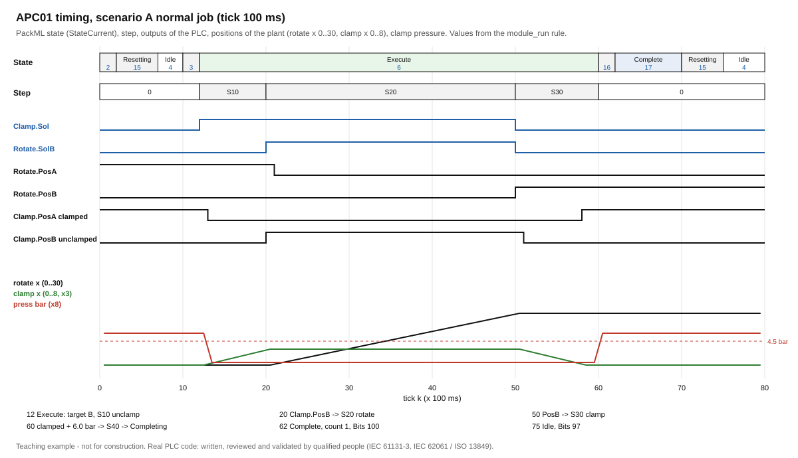

Logs from the rule (`module_sequence.py --scenario A..E --log`). Every state line shows the data-block values: `StateCurrent` (word 0), `AlarmNo`
(word 6), `Bits` (word 4) and `count` (`ProdProcessedCount`, words 8–9).

### E7.1 Scenario A – normal job

Summary: `run A Normal job final Idle 4 alarm 0 count 1 bits 97 rx 30 spool B lines 23`

```
2 event CMD Reset
2 cmd Reset accepted: Stopped -> Resetting
2 state Resetting StateCurrent=15 AlarmNo=0 Bits=98 count=0
7 SC: Resetting -> Idle
7 state Idle StateCurrent=4 AlarmNo=0 Bits=97 count=0
10 event CMD Start
10 cmd Start accepted: Idle -> Starting
10 state Starting StateCurrent=3 AlarmNo=0 Bits=98 count=0
12 SC: Starting -> Execute
12 sequence start: target B, step S10
12 state Execute StateCurrent=6 AlarmNo=0 Bits=98 count=0
20 step S10 -> S20
50 step S20 -> S30
60 step S30 -> S40
60 SC: Execute -> Completing (sequence done)
60 state Completing StateCurrent=16 AlarmNo=0 Bits=98 count=0
62 SC: Completing -> Complete
62 state Complete StateCurrent=17 AlarmNo=0 Bits=100 count=1
70 event CMD Reset
70 cmd Reset accepted: Complete -> Resetting
70 state Resetting StateCurrent=15 AlarmNo=0 Bits=98 count=1
75 SC: Resetting -> Idle
75 state Idle StateCurrent=4 AlarmNo=0 Bits=97 count=1
```

Walk-through with the plant (figure above): tick 2 Reset accepted (Stopped → Resetting, 5 ticks) → Idle at 7, Bits 97 (Ready + Auto + Part). Tick 10
Start → Starting (2 ticks) → **Execute at 12**: the rotation is at A → target B, step S10, Clamp.Sol ON. The clamp unclamps 1 position per tick
from tick 13 and reaches x = 8 (Clamp.PosB) at tick 20 → **S20**: Rotate.SolB ON (Clamp.Sol stays ON). The rotation starts at tick 21 and needs 30
ticks → PosB at tick 50 → **S30**: all outputs off, the spring clamps from tick 51, clamped at tick 58, pressure 6.0 bar after 3 clamped ticks at tick
60 ≥ 4.5 → **S40 → SC → Completing** at 60, Complete at 62 with count 1, Bits 100 (Done). Tick 70 Reset → Idle at 75. Final: Idle 4, alarm 0,
count 1, Bits 97, rotation at x = 30 (B), spool B.

Cycle time of the job: Start (10) → Complete (62) = 52 ticks = 5.2 s, of which unclamp 0.8 s, rotation 3.0 s, clamp + pressure 1.0 s, PackML overhead
(Starting 0.2 s, Completing 0.2 s).

### E7.2 Scenario B – rotate jams → timeout → Abort → recovery

Summary: `run B Rotate jams -> timeout -> Abort -> recovery final Complete 17 alarm 0 count 1 bits 100 rx 0 spool A lines 41`

```
2 event CMD Reset
2 cmd Reset accepted: Stopped -> Resetting
2 state Resetting StateCurrent=15 AlarmNo=0 Bits=98 count=0
7 SC: Resetting -> Idle
7 state Idle StateCurrent=4 AlarmNo=0 Bits=97 count=0
10 event CMD Start
10 cmd Start accepted: Idle -> Starting
10 state Starting StateCurrent=3 AlarmNo=0 Bits=98 count=0
12 SC: Starting -> Execute
12 sequence start: target B, step S10
12 state Execute StateCurrent=6 AlarmNo=0 Bits=98 count=0
20 step S10 -> S20
30 event JAM_ROT
70 ALARM 12 rotate timeout in S20 -> internal Abort: Execute -> Aborting
70 state Aborting StateCurrent=8 AlarmNo=12 Bits=106 count=0
71 SC: Aborting -> Aborted
71 state Aborted StateCurrent=9 AlarmNo=12 Bits=104 count=0
90 event UNJAM_ROT
95 event CMD Clear
95 cmd Clear accepted: Aborted -> Clearing
95 state Clearing StateCurrent=1 AlarmNo=0 Bits=98 count=0
97 SC: Clearing -> Stopped
97 state Stopped StateCurrent=2 AlarmNo=0 Bits=96 count=0
100 event CMD Reset
100 cmd Reset accepted: Stopped -> Resetting
100 state Resetting StateCurrent=15 AlarmNo=0 Bits=98 count=0
105 SC: Resetting -> Idle
105 state Idle StateCurrent=4 AlarmNo=0 Bits=97 count=0
110 event CMD Start
110 cmd Start accepted: Idle -> Starting
110 state Starting StateCurrent=3 AlarmNo=0 Bits=98 count=0
112 SC: Starting -> Execute
112 sequence start: target A, step S10
112 state Execute StateCurrent=6 AlarmNo=0 Bits=98 count=0
120 step S10 -> S20
150 step S20 -> S30
160 step S30 -> S40
160 SC: Execute -> Completing (sequence done)
160 state Completing StateCurrent=16 AlarmNo=0 Bits=98 count=0
162 SC: Completing -> Complete
162 state Complete StateCurrent=17 AlarmNo=0 Bits=100 count=1
```

What happened physically (from the per-tick trace, `--trace`): the rotation started at tick 21 and is jammed at x = 9 from tick 30. S20 waits; after
50 ticks in S20 (tick 70) → **alarm 12** → internal Abort → Aborting (StateCurrent 8, AlarmNo 12, Bits 106 = Busy + Fault + Auto + Part) → Aborted
at 71 (Bits 104). All outputs are now FALSE: the clamp spring **clamps the pallet while the rotation stands half-way** (x = 9) – and the double
valve **keeps its spool B**. At tick 90 the jam is removed (UNJAM_ROT): **the rotation continues on its own** from x = 9 to x = 30, reached at tick
110 – through Aborted, Clearing (95), Stopped (97), Resetting (100) and Idle (105), without any command. At tick 105 the module reports Idle
(Ready) while the rotation is still moving (x = 25). The Start at 110 → Execute at 112: the rotation is now at B → target **A**, the next job
rotates back. Final: Complete 17, count 1, rotation at A.

**The lesson of scenario B:** a module in Aborted / Stopped / Idle is **not** in a safe, energy-free state when it has bistable actuators. Removing
the jam (a person's hand in the APC!) released stored pneumatic energy. Consequences for the design:

1. **Energy isolation** for maintenance and fault clearing is done by the **safety valve** (dump valve) that exhausts the valve terminal of the
   APC – switched by a zone F-DO of the pool / cell safety controller (guide 68 C2.5, guide 67 I3, SF1). Opening the pool door must exhaust the APC.
2. The **Abort reaction** of a module with a double-solenoid valve should also exhaust or block the cylinder (5/3 closed or exhausted centre, or
   the safety valve) – "outputs FALSE" is not enough.
3. **Resetting must verify the end positions** (E8.4): an Idle with the rotation between the end positions (tick 105) should not be possible.
4. The clamp clamping on a half-rotated pallet may damage the pallet or the clamp – the clamp logic in Aborting should depend on the rotation
   position (clamp only in an end position), decided with the mechanical designer.

### E7.3 Scenario C – clamp pressure low

Summary: `run C Clamp pressure low final Complete 17 alarm 0 count 1 bits 100 rx 0 spool A lines 42`

```
0 event PRESS_LOW
2 event CMD Reset
2 cmd Reset accepted: Stopped -> Resetting
2 state Resetting StateCurrent=15 AlarmNo=0 Bits=98 count=0
7 SC: Resetting -> Idle
7 state Idle StateCurrent=4 AlarmNo=0 Bits=97 count=0
10 event CMD Start
10 cmd Start accepted: Idle -> Starting
10 state Starting StateCurrent=3 AlarmNo=0 Bits=98 count=0
12 SC: Starting -> Execute
12 sequence start: target B, step S10
12 state Execute StateCurrent=6 AlarmNo=0 Bits=98 count=0
20 step S10 -> S20
50 step S20 -> S30
80 ALARM 13 clamp pressure low / clamp timeout in S30 -> internal Abort: Execute -> Aborting
80 state Aborting StateCurrent=8 AlarmNo=13 Bits=106 count=0
81 SC: Aborting -> Aborted
81 state Aborted StateCurrent=9 AlarmNo=13 Bits=104 count=0
100 event PRESS_OK
105 event CMD Clear
105 cmd Clear accepted: Aborted -> Clearing
105 state Clearing StateCurrent=1 AlarmNo=0 Bits=98 count=0
107 SC: Clearing -> Stopped
107 state Stopped StateCurrent=2 AlarmNo=0 Bits=96 count=0
110 event CMD Reset
110 cmd Reset accepted: Stopped -> Resetting
110 state Resetting StateCurrent=15 AlarmNo=0 Bits=98 count=0
115 SC: Resetting -> Idle
115 state Idle StateCurrent=4 AlarmNo=0 Bits=97 count=0
120 event CMD Start
120 cmd Start accepted: Idle -> Starting
120 state Starting StateCurrent=3 AlarmNo=0 Bits=98 count=0
122 SC: Starting -> Execute
122 sequence start: target A, step S10
122 state Execute StateCurrent=6 AlarmNo=0 Bits=98 count=0
130 step S10 -> S20
160 step S20 -> S30
170 step S30 -> S40
170 SC: Execute -> Completing (sequence done)
170 state Completing StateCurrent=16 AlarmNo=0 Bits=98 count=0
172 SC: Completing -> Complete
172 state Complete StateCurrent=17 AlarmNo=0 Bits=100 count=1
```

The supply pressure is low from the start (PRESS_LOW): the clamp closes mechanically (Clamp.PosA at tick 58) but the pressure reaches only 3.8 bar
< 4.5 bar. S30 waits 30 ticks (tick 50 → 80) → **alarm 13** → Aborted. The operator restores the pressure (100), clears (105), resets (110) and starts
(120): the rotation is at B (it finished in the first attempt), so the target is A. Final: Complete, count 1.

Design notes: (1) a clamp-pressure monitoring in S30 only checks at the end of the clamping – a pressure drop **during machining** must also be
monitored (continuous limit alarm with on-delay, D6, while the pallet is clamped); (2) guide 68 C2.5 lists "clamp pressure low → **Held**" as the
PackML reaction for the running machine; in the APC sequence of item 9 the low pressure at the end of S30 is treated as a sequence failure
(**alarm → Abort**). Both are sensible in their place: during the APC cycle the job cannot be completed (Abort), during machining the machine should
pause safely (Held / feed hold) – define it per module in the state-reaction matrix (guide 65 C2.6).

### E7.4 Scenario D – Hold and Unhold during the rotation

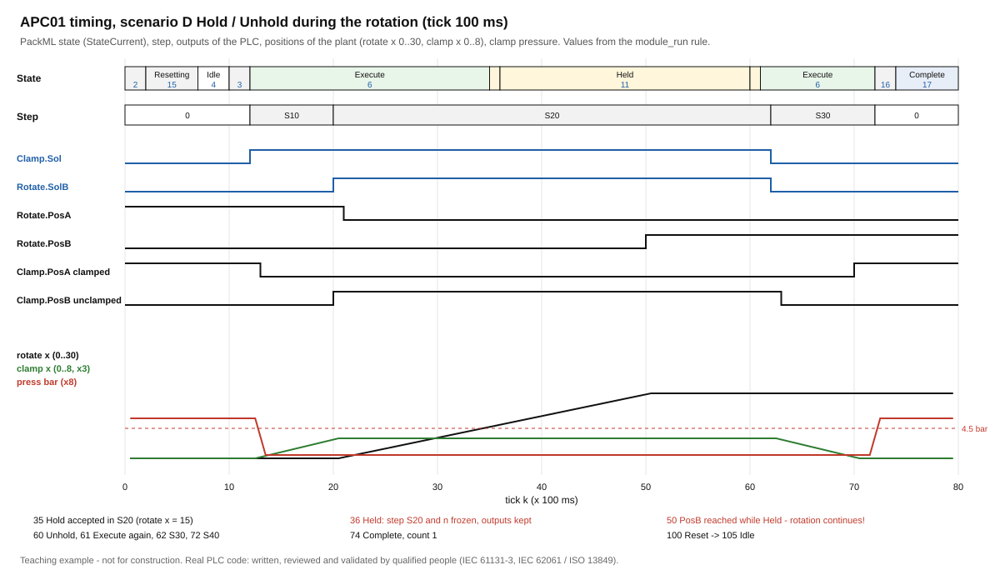

Summary: `run D Hold and Unhold during the rotation final Idle 4 alarm 0 count 1 bits 97 rx 30 spool B lines 33`

```
2 event CMD Reset
2 cmd Reset accepted: Stopped -> Resetting
2 state Resetting StateCurrent=15 AlarmNo=0 Bits=98 count=0
7 SC: Resetting -> Idle
7 state Idle StateCurrent=4 AlarmNo=0 Bits=97 count=0
10 event CMD Start
10 cmd Start accepted: Idle -> Starting
10 state Starting StateCurrent=3 AlarmNo=0 Bits=98 count=0
12 SC: Starting -> Execute
12 sequence start: target B, step S10
12 state Execute StateCurrent=6 AlarmNo=0 Bits=98 count=0
20 step S10 -> S20
35 event CMD Hold
35 cmd Hold accepted: Execute -> Holding
35 state Holding StateCurrent=10 AlarmNo=0 Bits=98 count=0
36 SC: Holding -> Held
36 state Held StateCurrent=11 AlarmNo=0 Bits=96 count=0
60 event CMD Unhold
60 cmd Unhold accepted: Held -> Unholding
60 state Unholding StateCurrent=12 AlarmNo=0 Bits=98 count=0
61 SC: Unholding -> Execute
61 state Execute StateCurrent=6 AlarmNo=0 Bits=98 count=0
62 step S20 -> S30
72 step S30 -> S40
72 SC: Execute -> Completing (sequence done)
72 state Completing StateCurrent=16 AlarmNo=0 Bits=98 count=0
74 SC: Completing -> Complete
74 state Complete StateCurrent=17 AlarmNo=0 Bits=100 count=1
100 event CMD Reset
100 cmd Reset accepted: Complete -> Resetting
100 state Resetting StateCurrent=15 AlarmNo=0 Bits=98 count=1
105 SC: Resetting -> Idle
105 state Idle StateCurrent=4 AlarmNo=0 Bits=97 count=1
```

Hold arrives at tick 35 in S20 (the rotation is at x = 15). Holding (1 tick) → Held at 36 (StateCurrent 11, Bits 96 – Held is a wait state, not
Busy). The sequence is **frozen** (step S20, step timer kept), but **the outputs are kept**: Rotate.SolB stays ON and **the rotation continues and
reaches B at tick 50 while the module reports Held**. Unhold at 60 → Unholding → Execute at 61; at tick 62 S20 sees PosB → S30 → clamped and
pressurised at 72 → Completing → Complete at 74.

**The lesson of scenario D:** "Held" in PackML means *the module has paused its procedure*, not *all motion has stopped*. With this rule the
rotation completes during Held. Whether that is acceptable depends on why Hold was requested:

| Hold reason | Acceptable that the current motion completes? | Better design |
|---|---|---|
| operator wants to look at the part | usually yes (the motion is short, guarded) | accept Hold only at step boundaries (finish the step, then hold) |
| downstream not ready | yes | Suspend instead of Hold (external reason) |
| the operator wants to **enter** the area | **no** | door request → F-program stops / exhausts (safety), the standard program goes to Held as a consequence |
| a fault of a device of this module | depends | Abort with energy isolation (scenario B) |

Also note that the step timer is frozen while Held – otherwise S20 would time out (alarm 12) after the Unhold if the Held lasted longer than 5 s.

### E7.5 Scenario E – wrong commands and Stop

Summary: `run E Wrong commands and Stop final Idle 4 alarm 0 count 0 bits 97 rx 30 spool B lines 28`

```
2 event CMD Start
2 cmd Start rejected in Stopped
5 event CMD Reset
5 cmd Reset accepted: Stopped -> Resetting
5 state Resetting StateCurrent=15 AlarmNo=0 Bits=98 count=0
10 SC: Resetting -> Idle
10 state Idle StateCurrent=4 AlarmNo=0 Bits=97 count=0
15 event CMD Unhold
15 cmd Unhold rejected in Idle
20 event CMD Start
20 cmd Start accepted: Idle -> Starting
20 state Starting StateCurrent=3 AlarmNo=0 Bits=98 count=0
22 SC: Starting -> Execute
22 sequence start: target B, step S10
22 state Execute StateCurrent=6 AlarmNo=0 Bits=98 count=0
25 event CMD Start
25 cmd Start rejected in Execute
30 step S10 -> S20
40 event CMD Stop
40 cmd Stop accepted: Execute -> Stopping
40 state Stopping StateCurrent=7 AlarmNo=0 Bits=98 count=0
42 SC: Stopping -> Stopped
42 state Stopped StateCurrent=2 AlarmNo=0 Bits=96 count=0
50 event CMD Reset
50 cmd Reset accepted: Stopped -> Resetting
50 state Resetting StateCurrent=15 AlarmNo=0 Bits=98 count=0
55 SC: Resetting -> Idle
55 state Idle StateCurrent=4 AlarmNo=0 Bits=97 count=0
```

Command acceptance in practice: **Start in Stopped is rejected** (a Reset is needed first – the module must be initialised), **Unhold in Idle is
rejected** (no edge Idle –Unhold→), **Start in Execute is rejected** (already running; the cell controller's repeated write is ignored safely).
Stop at tick 40 (S20, rotation at x = 10) → Stopping (2 ticks, step 0 on entry) → Stopped at 42 (Bits 96). All outputs FALSE: the clamp spring
clamps (clamped at tick 48) **while the rotation continues** to B (reached at tick 60, during Stopped / Resetting / Idle) – the same physical
effect as in scenario B. Reset at 50 → Idle at 55 – again an Idle with the rotation between the end positions until tick 60. Final count 0 (the job
was not completed).

What the cell controller must do with rejected commands: read `StateCurrent` after the command; if it did not change within the time-out (e.g.
2 s), log "command rejected" and do **not** repeat it blindly (guide 65 D2).

### E7.6 Summary of the five runs

| Scenario | Final state | StateCurrent | AlarmNo | count | Bits | Rotation | Log lines |
|---|---|---|---|---|---|---|---|
| A normal job | Idle | 4 | 0 | 1 | 97 | x 30 (B), spool B | 23 |
| B jam → abort → recovery | Complete | 17 | 0 | 1 | 100 | x 0 (A), spool A | 41 |
| C clamp pressure low | Complete | 17 | 0 | 1 | 100 | x 0 (A), spool A | 42 |
| D Hold / Unhold | Idle | 4 | 0 | 1 | 97 | x 30 (B), spool B | 33 |
| E wrong commands, Stop | Idle | 4 | 0 | 0 | 97 | x 30 (B), spool B | 28 |

## E8. Lessons: energy, Hold, Stop, recovery

### E8.1 The actuator decides what a stop means

| Actuator | Outputs FALSE → | Program / circuit measure |
|---|---|---|
| single-solenoid valve, spring | moves to spring position | choose the spring position = safe position (clamp clamped) |
| double-solenoid valve | keeps position, completes stroke | 5/3 centre position or safety exhaust valve; Abort exhausts |
| motor DOL | coasts to stop | brake motor where run-down is hazardous; STO / contactors by the F-program |
| servo / VFD axis | ramp stop (Stop category 1) or STO (category 0) | stop categories (guide 67 H10) |
| hydraulic cylinder | holds (closed centre) or falls (gravity) | load-holding valves, SAFE_VALVE (press) |
| vacuum gripper | drops the part | vacuum reservoir / check valve; never release on stop |

### E8.2 Stop, Abort and the stop categories of IEC 60204-1

PackML Stop and Abort are **operational** states of the standard program. They are not the safety stop functions of IEC 60204-1 9.2.2 (category 0
uncontrolled stop by immediate removal of power, category 1 controlled stop then removal of power, category 2 controlled stop with power
maintained). A practical mapping: e-stop → F-program category 0 or 1 + standard program **Abort** (it sees the e-stop copy); controlled stop by the
operator or the cell controller → PackML **Stop** (the module stops at a safe point, power stays on); a device fault → module **Abort**.

### E8.3 Recovery after Abort – the safe procedure

1. Find the cause (AlarmNo, step at the moment of the alarm – Aborting keeps the step for this reason).
2. Make the area safe (door request → F-program, energy isolation).
3. Remove the cause (jam, pressure).
4. **Clear** (acknowledge) → Stopped.
5. **Reset** → Resetting: home / verify all devices, bring the module to its initial position (E8.4).
6. **Start** a new job – never "continue" a half-done step.

### E8.4 Improvement for Resetting (exercise in I10)

In the example rule Resetting only waits 5 ticks. A real APC Resetting would: (1) wait until the rotation is in an end position (PosA xor PosB),
with a timeout → alarm; (2) ensure the clamp is clamped with pressure ≥ 4.5 bar; (3) only then SC → Idle. With this rule the Idle at tick 105 of
scenario B (rotation at x = 25) would have been delayed until tick 110. The rule of the example is kept simple on purpose so that the lesson of
scenario B is visible.

## E9. Handshake and heartbeat

The module data block also carries the **job handshake** (word 3 bit1 HS.Request, bit2 HS.Ack; word 4 bit7 HS.Ready) and the **heartbeats** (words
18 / 19). Guide 66 H4–H5 and H8 give the complete handshake state machine (`FB_ModuleHandshake`) with four scenarios. In the module program:

- the PackML Start command and the job handshake are **two ways** of starting a job – a project uses one of them consistently (the library
  default: CntrlCmd Start + Job.Id in the same write);
- the module's own heartbeat (+1 per second) is written in the Comm task; the watchdog on the cell controller's heartbeat (3 s, wrap-around safe,
  B5.3) sets `CcLost`: the module finishes the current job but accepts no new one; it does **not** stop a running machining cycle because the
  network is down.

## E10. Manual mode and maintenance

| Function | Mode | Rule |
|---|---|---|
| Move a single device (faceplate) | Manual (PackML unit mode 3), module Stopped or Idle | device interlocks active, jog for hazardous motion, F-program limits (enabling device, reduced speed) |
| Run the sequence step by step | Maintenance (unit mode 2) | "step" button confirms each transition; timeouts still active |
| Dry cycle without parts | Maintenance | part sensors simulated **only** in the simulation mode of the device FB, clearly shown on the HMI, reset at mode change |
| Force IO | engineering tool | only with a written permit, logged, removed before handover; forces are a frequent cause of accidents |

After returning from Manual / Maintenance to Production the module must pass Resetting (verify positions) before it accepts Start.

## E11. Checklist

- [ ] Module program built from the standard skeleton: command handling, PackML, sequence, outputs, data block.
- [ ] Every step: actions derived in one place, transition on device status, timeout with alarm, visible step number.
- [ ] Execute entry checks the start position (alarm 10-type check) – never guess a direction.
- [ ] Behaviour of every actuator in Held, Stopping, Aborting decided with the circuit designer; energy isolation by the safety circuit.
- [ ] Resetting verifies positions and pressures before Idle.
- [ ] Command protocol (who clears CmdChangeRequest) fixed in the interface sheet; rejected commands logged, not repeated.
- [ ] Status bits and StateCurrent as in E4.2, tested for every state.
- [ ] Five scenario tests (A–E or the module's own) recorded in the simulation before the FAT (G8).

---
# Part F – Alarms after ISA-18.2 / IEC 62682

## F1. The alarm life cycle

An **alarm** is an audible and / or visible means of indicating to the operator an equipment malfunction, process deviation or abnormal
condition **requiring a response** (ISA-18.2 / IEC 62682 definition). The last three words are the key: a message that needs no operator action is
**not** an alarm – it is an event or a status message, and it belongs in the event log, not in the alarm list.

ISA-18.2 manages alarms through a life cycle (guide 65 E1 explains it in depth):

| Stage | Content | FMS deliverable |
|---|---|---|
| Philosophy | goals, definitions, priorities, colours, KPIs, roles | alarm philosophy document of the cell (owner) |
| Identification | which conditions could be alarms (from risk assessment, FMEA, operating experience) | candidate list per module |
| **Rationalisation** | for each candidate: consequence, operator action, time to respond, priority, set point, deadband, delays, text | **master alarm database** |
| Detailed design | implementation in PLC (numbers, conditions), HMI (texts, colours), suppression logic | PLC alarm FBs (F8), HMI alarm list |
| Implementation | programming, testing | software FAT (G8) |
| Operation | the operator responds; shelving, OOS by procedure | operator training |
| Maintenance | OOS for repair, testing | permit procedure |
| Monitoring & assessment | KPIs: alarm rate, floods, chattering, standing, top 10 | `alarm_kpi.py` (item 5), monthly review |
| Management of change | every new / changed alarm goes through rationalisation | change log (G9) |
| Audit | periodic check against the philosophy | yearly |

## F2. The alarm state machine

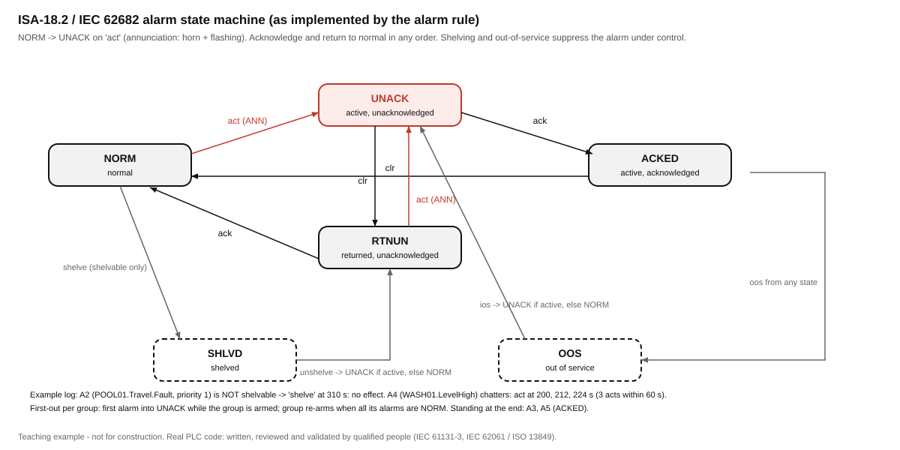

The state machine implemented by the rule `alarms` (a simplified form of the ISA-18.2 states):

| State | Meaning | HMI |
|---|---|---|
| NORM | normal – condition not present, nothing to acknowledge | not in the list |
| UNACK | active, unacknowledged | **flashing**, horn |
| ACKED | active, acknowledged | steady colour |
| RTNUN | returned to normal, unacknowledged | flashing (dim) – "it happened, please look" |
| SHLVD | shelved – temporarily suppressed by the operator (with a time limit in practice) | shelved list |
| OOS | out of service – suppressed for maintenance by a permit | OOS list |

Transitions (rule):

| From | Event | To |
|---|---|---|
| NORM | act | **UNACK** (annunciation) |
| UNACK | ack | ACKED |
| UNACK | clr | RTNUN |
| ACKED | clr | NORM |
| RTNUN | ack | NORM |
| RTNUN | act | **UNACK** (annunciation again) |
| NORM, UNACK, ACKED, RTNUN | shelve (only if the alarm is **shelvable**) | SHLVD |
| SHLVD | unshelve | UNACK if the condition is active, else NORM |
| any except OOS | oos | OOS |
| OOS | ios (in service) | UNACK if active, else NORM |
| every other combination | – | unchanged, logged "no effect" (act / clr still update the condition) |

**Annunciation** = a transition into UNACK (horn and flashing). **First-out** (F4), **chattering** (≥ 3 act events of the same alarm within 60 s)
and **standing alarms** (UNACK or ACKED at the end) are evaluated as well.

## F3. The example alarm log

Five alarms of the cell (tag, priority 1 high / 2 medium / 3 low, first-out group, shelvable):

| Id | Tag | Priority | Group | Shelvable |
|---|---|---|---|---|
| A1 | `PLT1.MACH.FMS1.UTIL01.AirPress.Low` | 1 | CELL | yes |
| A2 | `PLT1.MACH.FMS1.POOL01.Travel.Fault` | 1 | CELL | **no** |
| A3 | `PLT1.MACH.FMS1.APC01.ClampPress.Low` | 2 | CELL | yes |
| A4 | `PLT1.MACH.FMS1.WASH01.LevelHigh.On` | 3 | WASH | yes |
| A5 | `PLT1.MACH.FMS1.CMM01.CmmSup.Off` | 3 | CMM | yes |

Log (rule `alarms`, `alarm_isa182.py --log`): time [s], alarm, event, state change, annunciation (ANN), first-out (FO).

| t [s] | Alarm | Event | From → To | ANN | First-out |
|---|---|---|---|---|---|
| 100 | A1 | act | NORM → UNACK | ANN | FO |
| 101 | A2 | act | NORM → UNACK | ANN |  |
| 102 | A3 | act | NORM → UNACK | ANN |  |
| 130 | A1 | ack | UNACK → ACKED |  |  |
| 131 | A2 | ack | UNACK → ACKED |  |  |
| 132 | A3 | ack | UNACK → ACKED |  |  |
| 160 | A1 | clr | ACKED → NORM |  |  |
| 170 | A2 | clr | ACKED → NORM |  |  |
| 175 | A3 | clr | ACKED → NORM |  |  |
| 200 | A4 | act | NORM → UNACK | ANN | FO |
| 205 | A4 | clr | UNACK → RTNUN |  |  |
| 212 | A4 | act | RTNUN → UNACK | ANN |  |
| 218 | A4 | clr | UNACK → RTNUN |  |  |
| 224 | A4 | act | RTNUN → UNACK | ANN |  |
| 230 | A4 | clr | UNACK → RTNUN |  |  |
| 240 | A4 | shelve | RTNUN → SHLVD |  |  |
| 250 | A4 | act | SHLVD → SHLVD (no effect) |  |  |
| 260 | A4 | clr | SHLVD → SHLVD (no effect) |  |  |
| 300 | A2 | act | NORM → UNACK | ANN | FO |
| 310 | A2 | shelve | UNACK → UNACK (no effect) |  |  |
| 320 | A2 | ack | UNACK → ACKED |  |  |
| 330 | A2 | clr | ACKED → NORM |  |  |
| 340 | A2 | ack | NORM → NORM (no effect) |  |  |
| 400 | A3 | act | NORM → UNACK | ANN | FO |
| 410 | A3 | clr | UNACK → RTNUN |  |  |
| 420 | A3 | act | RTNUN → UNACK | ANN |  |
| 430 | A3 | ack | UNACK → ACKED |  |  |
| 500 | A5 | oos | NORM → OOS |  |  |
| 510 | A5 | act | OOS → OOS (no effect) |  |  |
| 600 | A5 | ios | OOS → UNACK | ANN | FO |
| 610 | A5 | ack | UNACK → ACKED |  |  |
| 700 | A1 | act | NORM → UNACK | ANN |  |
| 705 | A1 | clr | UNACK → RTNUN |  |  |
| 900 | A4 | unshelve | SHLVD → NORM |  |  |
| 905 | A4 | ack | NORM → NORM (no effect) |  |  |

Final result: `{'A1': 'RTNUN', 'A2': 'NORM', 'A3': 'ACKED', 'A4': 'NORM', 'A5': 'ACKED'} ann {'A1': 2, 'A2': 2, 'A3': 3, 'A4': 3, 'A5': 1} chatter ['A4'] standing ['A3', 'A5'] fo {'CELL': 'A3', 'WASH': None, 'CMM': 'A5'}`

### F3.1 Reading the log – episode by episode

**100–175 s – a cascade.** Air pressure low (A1) at 100 s, one second later the stacker travel drive faults (A2) and the APC clamp pressure drops (A3)
– both are **consequences** of the low air pressure (the drive's brake or a pneumatic function, the clamp). The operator sees three flashing
alarms; the **first-out** marker on A1 tells him where to start. All three are acknowledged (130–132 s) and clear after the air is restored
(160–175 s) – ACKED + clr → NORM. When all CELL alarms are NORM (175 s) the group is re-armed.

**200–260 s – chattering.** The washer high-level switch A4 goes act / clr / act / clr / act within 24 s (200, 212, 224) – three acts within 60 s →
**chattering**. Each act from RTNUN is a new annunciation (horn three times). The operator shelves A4 at 240 s (it is RTNUN at that moment – shelving
from RTNUN is allowed). The act at 250 s and clr at 260 s while shelved have **no effect** on the state (but the condition is tracked). Root cause in
practice: a level switch in a sloshing tank without a delay – fix with an on-delay / off-delay (D4, D6), not with shelving.

**300–340 s – a non-shelvable alarm.** The stacker travel fault A2 comes again (first-out of CELL). The operator tries to shelve it at 310 s – **no
effect**, A2 is configured not shelvable (priority 1, a fault that stops the pool must not disappear from the list). He acknowledges it (320 s), it
clears (330 s, ACKED → NORM), the acknowledge at 340 s on a NORM alarm has no effect.

**400–430 s – return and re-alarm.** A3 comes (first-out, CELL re-armed after 330 s), clears without acknowledgement (RTNUN), comes again at 420 s
(new annunciation), is acknowledged at 430 s and **stays active** (ACKED) until the end → a **standing alarm**.

**500–610 s – out of service.** The CMM supply alarm A5 is put out of service at 500 s (the CMM is being repaired – maintenance permit). The act at 510
s has no effect in OOS. When A5 is returned to service at 600 s (ios) its condition is still active → **UNACK** with annunciation and first-out of
group CMM: the operator is told immediately that the condition is still there. Acknowledged at 610 s, standing at the end.

**700–705 s – a short alarm.** A1 comes and goes in 5 s without acknowledgement → RTNUN at the end (not standing, but still to be acknowledged). No
first-out: the CELL group was disarmed by A3 at 400 s (A3 is still ACKED).

**900–905 s – unshelve.** A4 is unshelved at 900 s; its condition is inactive → NORM directly (no annunciation). The ack at 905 s has no effect.

Final states: A1 RTNUN, A2 NORM, A3 ACKED, A4 NORM, A5 ACKED. Annunciations: A1 2, A2 2, A3 3, A4 3, A5 1 (11 horn events). Chattering: A4.
Standing: A3, A5. First-out at the end: CELL = A3, WASH = none, CMM = A5.

## F4. First-out

In a cascade the first alarm is usually the cause, the following ones are consequences. **First-out** marks the first alarm of a group:

- the group starts **armed**;
- the first alarm of the group that goes **into UNACK** while the group is armed becomes the first-out, the group is disarmed;
- after each event, if **all** alarms of the group are NORM, the group is re-armed and the first-out cleared.

Choose groups by **cause relationships**: alarms that can trigger each other belong to one group (CELL: air, pool, APC); independent units have
their own group (WASH, CMM). In a PLC the first-out is cheap to implement (F8) and very valuable at 3 a.m. Machines with many interlocks (a press, a
washer) often show a first-out code on the HMI ("first fault: 12 rotate timeout").

## F5. Shelving, out-of-service, suppression

| Mechanism | Who | Why | Rules |
|---|---|---|---|
| **Shelving** | operator | temporarily remove a nuisance alarm (chattering, known faulty sensor) | only alarms marked shelvable (never priority-1 safety-relevant alarms); **time limit** (e.g. 8 h / end of shift) with automatic unshelve; shown in a shelved list; logged |
| **Out of service (OOS)** | maintenance with a permit | equipment removed or under repair | permit procedure, return-to-service check; shown on the HMI; logged |
| **Designed suppression** (state-based) | the program | alarms that are meaningless in the current state | e.g. "drive not ready" suppressed while STO is active (D9), washer level alarms suppressed while the washer is in Stopped and drained; documented in the rationalisation |
| **Alarm flood suppression** | the program | after a cell e-stop dozens of consequential alarms | e-stop → suppress the dependent alarms of the zone, show "e-stop zone 2" as one alarm |

The rule `alarms` implements shelving and OOS; designed suppression belongs to the module logic (it decides which conditions are alarms in which
PackML state).

## F6. Chattering, standing alarms and KPIs

| KPI (EEMUA 191 / ISA-18.2, typical targets) | Target | Example |
|---|---|---|
| Average alarm rate per operator | ≤ 1 per 10 min (~ 6 per hour) "very likely acceptable", ≤ 2 per 10 min "manageable" | — |
| Peak alarms per 10 min | < 10 | the 100–102 s cascade: 3 in 2 s – fine |
| Alarm floods (> 10 in 10 min) | < 1 % of the time | — |
| Chattering alarms | 0 | A4 – must be fixed (deadband / delay) |
| Standing alarms (> 24 h) | < 5 | A3, A5 at the end of the log |
| Priority distribution | high ~5 %, medium ~15 %, low ~80 % | example: 2 high, 1 medium, 2 low |
| Shelved alarms | few, all time-limited | A4 shelved for 660 s |

The item 5 tool `alarm_kpi.py` computes these KPIs from an alarm log; guide 65 E2 works through a full log.

**Chattering definition of the rule:** ≥ 3 'act' events of the same alarm within any 60 s window (t_last − t_first ≤ 60 for 3 consecutive acts). A4:
200, 212, 224 → 24 s ≤ 60 → chattering.

## F7. Design rules: priority, rationalisation, numbers, texts

### F7.1 Priority

Priority comes from **consequence** and **time to respond** (rationalisation), not from the opinion of the programmer:

| Consequence if the operator does not respond | Time to respond < 5 min | 5–15 min | > 15 min |
|---|---|---|---|
| severe (equipment damage, long stop, quality escape) | 1 high | 1 high | 2 medium |
| moderate (stop of a module, scrap) | 1 high | 2 medium | 3 low |
| minor (efficiency loss) | 2 medium | 3 low | 3 low / event |

Safety: personnel protection is done by the safety system, not by an alarm and an operator action. An alarm can **inform** about a safety
function (e-stop pressed, door open) – with a clear text – but the protection does not depend on it.

### F7.2 The master alarm database (one row per alarm)

| Field | Example (A3) |
|---|---|
| Alarm number (= `Admin.AlarmNo` value) | module code 13 of M02 (item 6 rule: 2013 in a project-wide numbering) |
| Tag | `PLT1.MACH.FMS1.APC01.ClampPress.Low` |
| Condition | S30 not reached within 3 s (Clamp.PosA AND ClampPress ≥ 4.5 bar) |
| Priority / group / shelvable | 2 / CELL / yes |
| Cause(s) | supply pressure low, clamp leakage, pressure transmitter fault |
| Consequence | pallet not clamped safely, APC job aborted |
| Operator action | check air supply (UTIL01), check clamp, Clear + Reset + Start |
| Time to respond | < 15 min (the machine waits) |
| Set point / deadband / delay | 4.5 bar, –, 3 s (step timeout) |
| Message text (≤ 60 characters) | `APC01 clamp pressure low / clamp timeout (S30)` |
| PackML reaction | Abort |

### F7.3 Alarm numbers and the data block

`Admin.AlarmNo` (word 6) carries **one** number – the active alarm of the module with the highest priority (or the first-out). The rule of item 6:
**module range × 1000 + n** (M02 → 2001–2999), so that the number alone identifies the module type in the cell controller and in MES statistics. The
examples of this guide use the module-local codes (10–13 for APC01, 1–4 for motor faults); a project must fix the full numbering in the master alarm
database and use it consistently in PLC, HMI and cell controller. Detailed alarm states (all active alarms) are transported via OPC UA Alarms &
Conditions or the HMI's own alarm system, not via the single data-block word.

### F7.4 Message texts

1. Start with the **object** (tag or plain-language device name), then **what** is wrong, then where / which step: `APC01 rotate timeout (S20, target B)`.
2. Use the operator's language; no programmer's jargon (`xRotPosB timeout` is wrong).
3. One alarm = one cause class; do not combine unrelated causes.
4. The operator action and the causes are in the alarm help (HMI "info" button), not in the 60-character text.
5. Same text pattern for the same FB type in every module (generated from the FB type + instance, G1).

## F8. Implementation in the PLC

```iecst
FUNCTION_BLOCK FB_AlarmIsa
(* one alarm after the ISA-18.2 state machine (rule 'alarms'). States: 0 NORM, 1 UNACK, 2 ACKED, 3 RTNUN, 4 SHLVD, 5 OOS *)
VAR_INPUT
    xCond      : BOOL;        (* process condition (already filtered: hysteresis, delays) *)
    xAck       : BOOL;        (* operator acknowledge (edge) *)
    xShelve    : BOOL;        (* operator shelve (edge) *)
    xUnshelve  : BOOL;
    xOos       : BOOL;        (* maintenance: out of service (edge) *)
    xIos       : BOOL;        (* return to service (edge) *)
    xShelvable : BOOL;        (* configuration from the master alarm database *)
END_VAR
VAR_OUTPUT
    iState     : INT;         (* 0..5 *)
    xAnnounce  : BOOL;        (* TRUE for one call on a transition into UNACK -> horn, first-out logic *)
    xStanding  : BOOL;        (* UNACK or ACKED *)
END_VAR
VAR
    rtAct, ftAct, rtAck, rtShelve, rtUnshelve, rtOos, rtIos : R_TRIG;
    iOld : INT;
END_VAR

rtAct(CLK := xCond);  ftAct(CLK := NOT xCond);
rtAck(CLK := xAck);   rtShelve(CLK := xShelve);  rtUnshelve(CLK := xUnshelve);
rtOos(CLK := xOos);   rtIos(CLK := xIos);
iOld := iState;

IF rtOos.Q AND iState <> 5 THEN
    iState := 5;
ELSIF rtIos.Q AND iState = 5 THEN
    iState := SEL(xCond, 0, 1);                                    (* UNACK if active, else NORM *)
ELSIF rtShelve.Q AND xShelvable AND iState <= 3 THEN
    iState := 4;
ELSIF rtUnshelve.Q AND iState = 4 THEN
    iState := SEL(xCond, 0, 1);
ELSE
    CASE iState OF
    0: IF rtAct.Q THEN iState := 1; END_IF;                        (* NORM  + act -> UNACK *)
    1: IF rtAck.Q THEN iState := 2; ELSIF ftAct.Q THEN iState := 3; END_IF;   (* UNACK *)
    2: IF ftAct.Q THEN iState := 0; END_IF;                        (* ACKED + clr -> NORM *)
    3: IF rtAck.Q THEN iState := 0; ELSIF rtAct.Q THEN iState := 1; END_IF;   (* RTNUN *)
    END_CASE;                                                      (* 4 SHLVD, 5 OOS: act / clr no effect *)
END_IF;

xAnnounce := (iState = 1) AND (iOld <> 1);
xStanding := (iState = 1) OR (iState = 2);
END_FUNCTION_BLOCK
```

First-out of a group (in the module or a cell alarm FB):

```iecst
(* aAlm : ARRAY[1..N] OF FB_AlarmIsa, all of the same group *)
xAllNorm := TRUE;
FOR i := 1 TO N DO
    IF aAlm[i].xAnnounce AND xArmed THEN
        iFirstOut := i;  xArmed := FALSE;
    END_IF;
    IF aAlm[i].iState <> 0 THEN xAllNorm := FALSE; END_IF;
END_FOR;
IF xAllNorm THEN xArmed := TRUE;  iFirstOut := 0; END_IF;
```

(The rule processes one event at a time; in a PLC several alarms can come in the same scan – then the loop order decides the first-out. Put
the alarms in the order of their typical cause chain, or time-stamp them with the PLC clock and let the HMI decide.)

Practical notes: most HMI / SCADA systems have their own ISA-18.2-style alarm server (acknowledge, shelve, OOS, time stamps) – then the PLC
delivers only the **conditions** (a bit per alarm, with delays and suppression done in the PLC), and the state machine runs in the alarm server.
Time stamps should be taken **in the PLC** at the moment of the condition change (sequence of events) and transported with the alarm.

## F9. Checklist

- [ ] Alarm philosophy agreed; every alarm requires an operator action (otherwise an event).
- [ ] Master alarm database with priority, cause, consequence, action, set point, deadband, delays, text, PackML reaction.
- [ ] Priority distribution approx. 5 / 15 / 80 %; priority-1 alarms not shelvable.
- [ ] Hysteresis and delays on all analog and level alarms; no chattering alarm at SAT.
- [ ] First-out groups defined by cause chains.
- [ ] Shelving time-limited and logged; OOS only with permit; return to service re-annunciates active alarms.
- [ ] `Admin.AlarmNo` numbering = master database, identical in PLC, HMI, cell controller.
- [ ] KPIs measured after start of production (alarm rate, floods, chattering, standing, top 10) and reviewed monthly.

---

# Part G – Code generation, quality, tests and effort

## G1. The generation rule

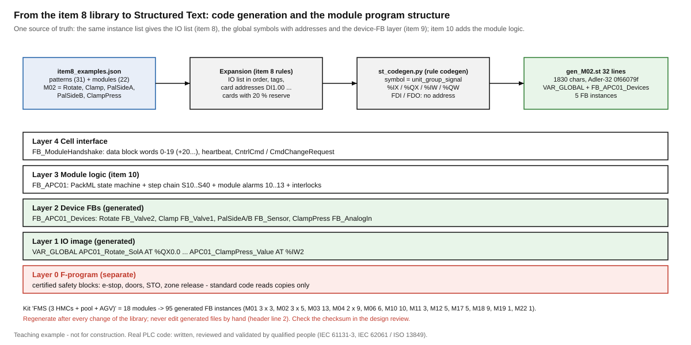

The item 8 library describes every module as an ordered list of circuit-pattern instances; its expansion gives the IO list with tags and card
addresses (guide 68 B0). The rule `codegen` turns the same expansion into IEC 61131-3 Structured Text (layers 1 and 2 of the program):

**Symbols.** `symbol = unit + '_' + group + '_' + signal` (unit = unit code + '01', e.g. `APC01`).

**Station image addresses** (base 0 per module station, k counted per IO type in expansion order):

| IO | Address rule | Example |
|---|---|---|
| DI k | byte = 2 · (k div 16) + (k mod 16) div 8, bit = k mod 8 → `%IX<byte>.<bit>` | k = 8 → `%IX1.0` (M03 `TravLimR`) |
| AI k | byte = 2 · cards_DI + 8 · (k div 4) + 2 · (k mod 4) → `%IW<byte>` | M02: 1 DI card → AI 0 at `%IW2` |
| DO k | like DI → `%QX<byte>.<bit>` | `%QX0.0` |
| AO k | byte = 2 · cards_DO + 4 · (k div 2) + 2 · (k mod 2) → `%QW<byte>` | – (no AO in the example modules) |
| FDI / FDO | **no** %I / %Q address in the standard program | F-copies are plain BOOL globals |

The number of cards comes from the item 8 rule with 20 % reserve (DI / DO cards of 16, AI cards of 4). Each DI card of 16 channels occupies 2 bytes; the
AI area follows the DI area. This is a **teaching address scheme** of one IO station image; a real hardware configuration assigns the start
addresses per card (Siemens) or links variables (TwinCAT) – the generator then reads the real start addresses from the hardware configuration export.

**Text** (lines joined with '\n', final '\n'):

1. header line 1: `(* AUTO-GENERATED from the item 8 circuit library: <code> <unit> - <title> *)`
2. header line 2: `(* IO: <n> points (DI a, DO b, AI c, AO d, FDI e, FDO f) - do not edit by hand, regenerate *)`
3. `VAR_GLOBAL` – one line per IO point in expansion order: DI / DO / AI / AO with `AT` address and type BOOL / INT; FDI `: BOOL;` with the comment
   "F-input, read-only copy from the F-program"; FDO `: BOOL;` with "F-output, written only by the F-program"; every comment carries
   `<tag> | <card address> | <description>`; `END_VAR`
4. empty line, `FUNCTION_BLOCK FB_<unit>_Devices`, `VAR` with one instance per pattern instance that has IO (`<group> : <FB type>; (* <pattern> *)`),
   `END_VAR`
5. per instance a call line with `x<Signal> := <sym>` for DI and FDI and `i<Signal> := <sym>` for AI in IO order (`<group>();` if none), then
   `<sym> := <group>.q<Signal>;` for each DO and `<sym> := <group>.w<Signal>;` for each AO – **no line for FDO** (the F-program writes them)
6. `END_FUNCTION_BLOCK`

**Checksum:** Adler-32 of the UTF-8 text (8 hex digits, lower case) – a fingerprint that proves that two copies are identical.

## G2. The generated M02 code (complete)

`st_codegen.py --module M02` (32 lines, 1 830 characters, Adler-32 `0f66079f`, 5 FB instances):

```iecst
(* AUTO-GENERATED from the item 8 circuit library: M02 APC01 - Automatic pallet changer (APC) *)
(* IO: 10 points (DI 6, DO 3, AI 1, AO 0, FDI 0, FDO 0) - do not edit by hand, regenerate *)
VAR_GLOBAL
  APC01_Rotate_SolA AT %QX0.0 : BOOL; (* PLT1.MACH.FMS1.APC01.Rotate.SolA | DO1.00 | solenoid A *)
  APC01_Rotate_SolB AT %QX0.1 : BOOL; (* PLT1.MACH.FMS1.APC01.Rotate.SolB | DO1.01 | solenoid B *)
  APC01_Rotate_PosA AT %IX0.0 : BOOL; (* PLT1.MACH.FMS1.APC01.Rotate.PosA | DI1.00 | end position A *)
  APC01_Rotate_PosB AT %IX0.1 : BOOL; (* PLT1.MACH.FMS1.APC01.Rotate.PosB | DI1.01 | end position B *)
  APC01_Clamp_Sol AT %QX0.2 : BOOL; (* PLT1.MACH.FMS1.APC01.Clamp.Sol | DO1.02 | solenoid *)
  APC01_Clamp_PosA AT %IX0.2 : BOOL; (* PLT1.MACH.FMS1.APC01.Clamp.PosA | DI1.02 | end position A *)
  APC01_Clamp_PosB AT %IX0.3 : BOOL; (* PLT1.MACH.FMS1.APC01.Clamp.PosB | DI1.03 | end position B *)
  APC01_PalSideA_On AT %IX0.4 : BOOL; (* PLT1.MACH.FMS1.APC01.PalSideA.On | DI1.04 | sensor signal *)
  APC01_PalSideB_On AT %IX0.5 : BOOL; (* PLT1.MACH.FMS1.APC01.PalSideB.On | DI1.05 | sensor signal *)
  APC01_ClampPress_Value AT %IW2 : INT; (* PLT1.MACH.FMS1.APC01.ClampPress.Value | AI1.00 | pressure 4-20 mA *)
END_VAR

FUNCTION_BLOCK FB_APC01_Devices
VAR
  Rotate : FB_Valve2; (* VALVE_DOUBLE *)
  Clamp : FB_Valve1; (* VALVE_SINGLE *)
  PalSideA : FB_Sensor; (* SENSOR *)
  PalSideB : FB_Sensor; (* SENSOR *)
  ClampPress : FB_AnalogIn; (* ANALOG_P *)
END_VAR
Rotate(xPosA := APC01_Rotate_PosA, xPosB := APC01_Rotate_PosB);
APC01_Rotate_SolA := Rotate.qSolA;
APC01_Rotate_SolB := Rotate.qSolB;
Clamp(xPosA := APC01_Clamp_PosA, xPosB := APC01_Clamp_PosB);
APC01_Clamp_Sol := Clamp.qSol;
PalSideA(xOn := APC01_PalSideA_On);
PalSideB(xOn := APC01_PalSideB_On);
ClampPress(iValue := APC01_ClampPress_Value);
END_FUNCTION_BLOCK
```

How to read it:

- **10 IO points** of the item 8 IO list (guide 68 C2.2): DI 6 (`%IX0.0`–`%IX0.5`), DO 3 (`%QX0.0`–`%QX0.2`), AI 1 (`%IW2` – after the 2 bytes of
  the one DI card). The comment of every symbol carries the full tag and the card address `DI1.00` of the IO list / terminal plan – the
  electrician and the programmer talk about the same point.
- The order of the symbols is the **expansion order** (instance by instance: Rotate SolA, SolB, PosA, PosB, Clamp Sol, PosA, PosB, PalSideA,
  PalSideB, ClampPress) – not sorted by type. Addresses are counted per type: the 1st DI (`Rotate.PosA`) is `%IX0.0` although it is the 3rd line.
- **5 device FB instances**, named like the groups: `Rotate : FB_Valve2`, `Clamp : FB_Valve1`, `PalSideA`, `PalSideB : FB_Sensor`,
  `ClampPress : FB_AnalogIn`.
- Each call wires only the **field inputs**; each DO symbol is written from the FB output `q<Signal>` **directly after** the call – one writer per
  output.
- Commands (`Rotate.Cmd`), configuration and status are not generated – they are connected by the module logic (E6.3).

## G3. M03 and M10 excerpts

**M03 POOL01** (70 lines, 5 169 characters, Adler-32 `b0c1f5f1`, 13 FB instances) – a module with safety IO. Start of the global list:

```iecst
(* AUTO-GENERATED from the item 8 circuit library: M03 POOL01 - Pallet pool + stacker crane *)
(* IO: 31 points (DI 11, DO 4, AI 0, AO 0, FDI 11, FDO 5) - do not edit by hand, regenerate *)
VAR_GLOBAL
  POOL01_DriveSup_Enable : BOOL; (* PLT1.MACH.FMS1.POOL01.DriveSup.Enable | FDO1.00 | F-output, written only by the F-program *)
  POOL01_DriveSup_EDM : BOOL; (* PLT1.MACH.FMS1.POOL01.DriveSup.EDM | FDI1.00 | F-input, read-only copy from the F-program *)
  POOL01_Travel_STO : BOOL; (* PLT1.MACH.FMS1.POOL01.Travel.STO | FDO1.01 | F-output, written only by the F-program *)
  POOL01_Travel_Ready AT %IX0.0 : BOOL; (* PLT1.MACH.FMS1.POOL01.Travel.Ready | DI1.00 | inverter ready *)
  POOL01_Travel_Fault AT %IX0.1 : BOOL; (* PLT1.MACH.FMS1.POOL01.Travel.Fault | DI1.01 | inverter fault *)
  POOL01_Hoist_STO : BOOL; (* PLT1.MACH.FMS1.POOL01.Hoist.STO | FDO1.02 | F-output, written only by the F-program *)
  POOL01_Hoist_Ready AT %IX0.2 : BOOL; (* PLT1.MACH.FMS1.POOL01.Hoist.Ready | DI1.02 | inverter ready *)
  POOL01_Hoist_Fault AT %IX0.3 : BOOL; (* PLT1.MACH.FMS1.POOL01.Hoist.Fault | DI1.03 | inverter fault *)
  (* ... 15 lines omitted: Hoist, Fork, Door (FDI copies, LockCmd FDO, Request AT %IX0.6), Estop, Enable, Mode ... *)
  POOL01_TravLimF_On AT %IX0.7 : BOOL; (* PLT1.MACH.FMS1.POOL01.TravLimF.On | DI1.07 | sensor signal *)
  POOL01_TravLimR_On AT %IX1.0 : BOOL; (* PLT1.MACH.FMS1.POOL01.TravLimR.On | DI1.08 | sensor signal *)
  POOL01_PalOnFork_On AT %IX1.1 : BOOL; (* PLT1.MACH.FMS1.POOL01.PalOnFork.On | DI1.09 | sensor signal *)
  (* ... 4 lines omitted: ForkMid AT %IX1.2, Tower Red / Yellow / Green ... *)
  POOL01_Tower_Buzzer AT %QX0.3 : BOOL; (* PLT1.MACH.FMS1.POOL01.Tower.Buzzer | DO1.03 | buzzer *)
END_VAR
```

Device FB part:

```iecst
FUNCTION_BLOCK FB_POOL01_Devices
VAR
  DriveSup : FB_ContactorPair; (* CONT_PAIR_EDM *)
  Travel : FB_DriveSto; (* VFD_STO *)
  Hoist : FB_DriveSto; (* VFD_STO *)
  Fork : FB_DriveSto; (* VFD_STO *)
  Door : FB_DoorLock; (* DOOR_LOCK *)
  Estop : FB_Estop; (* ESTOP *)
  Enable : FB_EnableSwitch; (* ENABLE *)
  Mode : FB_ModeSwitch; (* MODE_SWITCH *)
  TravLimF : FB_Sensor; (* SENSOR *)
  TravLimR : FB_Sensor; (* SENSOR *)
  PalOnFork : FB_Sensor; (* SENSOR *)
  ForkMid : FB_Sensor; (* SENSOR *)
  Tower : FB_SignalTower; (* SIGNAL_TOWER *)
END_VAR
DriveSup(xEDM := POOL01_DriveSup_EDM);
Travel(xReady := POOL01_Travel_Ready, xFault := POOL01_Travel_Fault);
Hoist(xReady := POOL01_Hoist_Ready, xFault := POOL01_Hoist_Fault);
Fork(xReady := POOL01_Fork_Ready, xFault := POOL01_Fork_Fault);
Door(xClosed := POOL01_Door_Closed, xClosed2 := POOL01_Door_Closed2, xLocked := POOL01_Door_Locked, xLocked2 := POOL01_Door_Locked2, xRequest := POOL01_Door_Request);
Estop(xOk := POOL01_Estop_Ok, xOk2 := POOL01_Estop_Ok2);
Enable(xOk := POOL01_Enable_Ok, xOk2 := POOL01_Enable_Ok2);
Mode(xAuto := POOL01_Mode_Auto, xMaint := POOL01_Mode_Maint);
TravLimF(xOn := POOL01_TravLimF_On);
TravLimR(xOn := POOL01_TravLimR_On);
PalOnFork(xOn := POOL01_PalOnFork_On);
ForkMid(xOn := POOL01_ForkMid_On);
Tower();
POOL01_Tower_Red := Tower.qRed;
POOL01_Tower_Yellow := Tower.qYellow;
POOL01_Tower_Green := Tower.qGreen;
POOL01_Tower_Buzzer := Tower.qBuzzer;
END_FUNCTION_BLOCK
```

What M03 shows: 11 FDI and 5 FDO are declared as **plain BOOL without address** – the F-program owns these channels and copies the inputs into the
standard program; the FDO symbols (`POOL01_DriveSup_Enable`, `POOL01_Travel_STO`, …, `POOL01_Door_LockCmd`) are **never written** by the generated
code: `Travel(xReady := …, xFault := …);` has no STO output line, `Door(…)` has no LockCmd line. The DI addresses run on into the second byte
(`POOL01_TravLimR_On AT %IX1.0` = DI k = 8). The signal tower `Tower();` has no inputs – only outputs. 31 points but only 15 with an address.

**M10 WASH01** (56 lines, 4 004 characters, Adler-32 `5ab5ac95`, 10 FB instances) – a module with three motors, a heater and an analog
temperature:

```iecst
FUNCTION_BLOCK FB_WASH01_Devices
VAR
  SprayPump : FB_MotorDol; (* DOL *)
  RinsePump : FB_MotorDol; (* DOL *)
  Heater : FB_Heater; (* HEATER *)
  TankTemp : FB_AnalogIn; (* ANALOG_T *)
  LevelLow : FB_Sensor; (* SENSOR *)
  LevelHigh : FB_Sensor; (* SENSOR *)
  Door : FB_Door2Ch; (* DOOR_2CH *)
  DoorCyl : FB_Valve1; (* VALVE_SINGLE *)
  Conveyor : FB_MotorDol; (* DOL *)
  Estop : FB_Estop; (* ESTOP *)
END_VAR
SprayPump(xRunFb := WASH01_SprayPump_RunFb, xTripped := WASH01_SprayPump_Tripped);
WASH01_SprayPump_Run := SprayPump.qRun;
RinsePump(xRunFb := WASH01_RinsePump_RunFb, xTripped := WASH01_RinsePump_Tripped);
WASH01_RinsePump_Run := RinsePump.qRun;
Heater(xOnFb := WASH01_Heater_OnFb, xOverTemp := WASH01_Heater_OverTemp);
WASH01_Heater_On := Heater.qOn;
TankTemp(iValue := WASH01_TankTemp_Value);
LevelLow(xOn := WASH01_LevelLow_On);
LevelHigh(xOn := WASH01_LevelHigh_On);
Door(xClosed := WASH01_Door_Closed, xClosed2 := WASH01_Door_Closed2);
DoorCyl(xPosA := WASH01_DoorCyl_PosA, xPosB := WASH01_DoorCyl_PosB);
WASH01_DoorCyl_Sol := DoorCyl.qSol;
Conveyor(xRunFb := WASH01_Conveyor_RunFb, xTripped := WASH01_Conveyor_Tripped);
WASH01_Conveyor_Run := Conveyor.qRun;
Estop(xOk := WASH01_Estop_Ok, xOk2 := WASH01_Estop_Ok2);
END_FUNCTION_BLOCK
```

Three `FB_MotorDol` instances (SprayPump, RinsePump, Conveyor) – the motor FB of D7 is used three times in one module; `TankTemp : FB_AnalogIn` is the
same FB type as `ClampPress` of M02 with another range (pattern ANALOG_T); the two door switches are F-copies (`FB_Door2Ch`); the heater's safety
thermostat is also wired in the power circuit (guide 68 B1.4) – the FB only reports it.

## G4. Why generate

| Without generation | With generation |
|---|---|
| the programmer types 210 IO symbols of the kit from a spreadsheet – typing errors, swapped addresses | symbols, addresses and comments come from the same expansion as the drawings and terminal plans |
| every module written slightly differently | identical structure in all 18 modules – a technician who knows one knows all |
| a change in the library (new sensor) is forgotten in the PLC | regenerate → the diff shows exactly the new lines; the checksum changes |
| FDO written by mistake in standard code | impossible – the generator writes no FDO line; a review rule checks it |
| IO check at FAT against a hand-typed list | IO check against the same IO list that generated the code (guide 68 E8) |

Generation is common practice in larger integrators (EPLAN → TIA Openness, CODESYS scripting / PLCopen XML import, TwinCAT Automation Interface,
Siemens SiVArc / Modular Application Creator, Rockwell Studio 5000 Application Code Manager). The generator of this guide shows the principle with
plain text; real tools import the generated objects via the vendor's XML or API.

**What is generated and what is written by hand:**

| Layer | Generated? | Why |
|---|---|---|
| 1 IO image (globals with addresses) | yes | pure data from the IO list |
| 2 device FB instances and calls | yes | pure wiring |
| device FB **types** (library) | no – written once, tested, versioned | logic |
| 3 module logic (sequence, PackML) | template generated, sequence written by hand | process knowledge |
| 4 data block interface | yes (from the item 6 table, `datablock_map.py`) | fixed layout |
| alarm texts | generated per FB type + instance, edited in the master database | consistency |

**Rules for generated files:** never edit by hand (header line 2); keep them in a separate folder (A10.1 `10_IO_Generated`); regenerate after every
library change and **compare the checksum** in the design review; commit generator input (the library JSON), the generator version and the output
together (G7).

## G5. FB instances per module and for the kit

FB instances generated per library module (one instance of each module):

| M01 | M02 | M03 | M04 | M05 | M06 | M07 | M08 | M09 | M10 | M11 | M12 | M13 | M14 | M15 | M16 | M17 | M18 | M19 | M20 | M21 | M22 |
|---|---|---|---|---|---|---|---|---|---|---|---|---|---|---|---|---|---|---|---|---|---|
| 3 | 5 | 13 | 9 | 7 | 6 | 12 | 15 | 3 | 10 | 3 | 5 | 10 | 8 | 12 | 11 | 5 | 9 | 1 | 0 | 0 | 1 |

Sum over the 22 library modules: 148 instances. The **kit** "FMS (3 HMCs + pool + AGV)" contains 18 module instances – M01 × 3, M02 × 3, M03, M04 × 2, M06,
M10, M11, M12, M17, M18, M19, M20, M22:

```
M01 3 × 3 =  9    M02 3 × 5 = 15    M03 13    M04 2 × 9 = 18    M06 6    M10 10
M11 3    M12 5    M17 5    M18 9    M19 1    M20 0    M22 1
total = 9 + 15 + 13 + 18 + 6 + 10 + 3 + 5 + 5 + 9 + 1 + 0 + 1 = 95 FB instances
```

Patterns without field IO (BUS, RFID, HMI, IPC, SWITCH, FIREWALL, SAFETY_PLC) generate no instance: M01 has 4 pattern instances but 3 FB instances (BUS
excluded), M04 11 but 9 (RFID, HMI), M18 10 but 9 (SAFETY_PLC), M20 none. The 95 instances use 22 FB type names but only 17 different code bodies (wrappers share a base FB) – the **library to write and test is 17
FBs, not 95**; this is the economic argument for the device-FB standard (G10).

Per-module code statistics of all 22 modules (`st_codegen.py --all`):

| Module | Unit | IO | DI | DO | AI | AO | FDI | FDO | FB inst. | Lines | Chars | Adler-32 |
|---|---|---|---|---|---|---|---|---|---|---|---|---|
| M01 | MC01 | 8 | 2 | 0 | 0 | 0 | 4 | 2 | 3 | 23 | 1654 | 5896f743 |
| M02 | APC01 | 10 | 6 | 3 | 1 | 0 | 0 | 0 | 5 | 32 | 1830 | 0f66079f |
| M03 | POOL01 | 31 | 11 | 4 | 0 | 0 | 11 | 5 | 13 | 70 | 5169 | b0c1f5f1 |
| M04 | LS01 | 20 | 8 | 6 | 1 | 0 | 4 | 1 | 9 | 53 | 3320 | 5081ccf8 |
| M05 | ROB01 | 25 | 6 | 4 | 0 | 0 | 12 | 3 | 7 | 52 | 4354 | 30141e7d |
| M06 | AGVST01 | 19 | 10 | 7 | 0 | 0 | 2 | 0 | 6 | 47 | 3247 | 32ecb364 |
| M07 | CONV01 | 23 | 16 | 5 | 0 | 0 | 2 | 0 | 12 | 61 | 3889 | 5a9f52ce |
| M08 | ASRS01 | 33 | 13 | 4 | 0 | 0 | 11 | 5 | 15 | 76 | 5522 | ec9b5c27 |
| M09 | TOOL01 | 3 | 3 | 0 | 0 | 0 | 0 | 0 | 3 | 18 | 888 | c265092b |
| M10 | WASH01 | 22 | 12 | 5 | 1 | 0 | 4 | 0 | 10 | 56 | 4004 | 5ab5ac95 |
| M11 | CMM01 | 3 | 2 | 0 | 1 | 0 | 0 | 0 | 3 | 18 | 861 | 5e99fca3 |
| M12 | MARK01 | 10 | 6 | 2 | 0 | 0 | 2 | 0 | 5 | 31 | 2017 | 36855694 |
| M13 | ST01 | 20 | 9 | 3 | 0 | 0 | 8 | 0 | 10 | 52 | 3546 | 76811aa0 |
| M14 | TEST01 | 16 | 7 | 6 | 1 | 0 | 2 | 0 | 8 | 47 | 2845 | 0af4351b |
| M15 | WELD01 | 29 | 12 | 1 | 0 | 0 | 12 | 4 | 12 | 63 | 5195 | ee3c18f8 |
| M16 | PRESS01 | 25 | 9 | 3 | 1 | 0 | 10 | 2 | 11 | 59 | 4459 | 73332741 |
| M17 | UTIL01 | 7 | 4 | 1 | 2 | 0 | 0 | 0 | 5 | 27 | 1555 | b929ce18 |
| M18 | SAFE01 | 20 | 1 | 5 | 0 | 0 | 10 | 4 | 9 | 52 | 3406 | 07e4de5b |
| M19 | CC01 | 2 | 2 | 0 | 0 | 0 | 0 | 0 | 1 | 13 | 550 | 2f659c79 |
| M20 | SCADA01 | 0 | 0 | 0 | 0 | 0 | 0 | 0 | 0 | 9 | 265 | 37d04975 |
| M21 | MESCON01 | 0 | 0 | 0 | 0 | 0 | 0 | 0 | 0 | 9 | 314 | 27b95b1a |
| M22 | NET01 | 2 | 2 | 0 | 0 | 0 | 0 | 0 | 1 | 13 | 581 | 6ccca687 |

## G6. Coding standard

A coding standard is a written set of rules that every program of the project follows; the owner prescribes it (or accepts the integrator's) and
checks it in code reviews. It is based on the **PLCopen Coding Guidelines** (2016) and the conventions of this guide.

### G6.1 Rules (example – category M = must, S = should)

| No. | Rule | Cat. |
|---|---|---|
| N1 | Names as in A10.2 (symbols from tags, FB_ / ST_ / E_ prefixes, x / i / q / w for FB field interface) | M |
| N2 | English identifiers and comments; no abbreviations outside the project glossary | S |
| S1 | Program structure as in A10.1 and E0 (layers, folders) | M |
| S2 | One FB per device type, one instance per device | M |
| S3 | Fixed call order per task: inputs / devices → module logic → outputs (or as defined) – documented | M |
| S4 | Every FB instance called exactly once per scan, unconditionally (timers, edges, counters included) | M |
| W1 | **One writer per variable**: every output and every global is written in exactly one place | M |
| W2 | Outputs of a sequence derived from the step in one place (no S / R actions spread over steps) | M |
| W3 | No direct writes to IO symbols from module logic – only via device FBs | M |
| C1 | **No magic numbers**: constants (`T_S20`, `P_CLAMP_MIN`) or Cfg parameters with units in the comment | M |
| C2 | Every POU has a header comment: purpose, author, version, change history (or in Git) | M |
| C3 | Comment the *why*, not the *what* | S |
| T1 | No WHILE / REPEAT on process signals; FOR with constant bounds | M |
| T2 | No pointer arithmetic; references only where the platform supports them safely | M |
| T3 | Explicit type conversions (`INT_TO_REAL`), no implicit narrowing | M |
| T4 | No division without a zero check; no array index without a range check | M |
| F1 | No safety function in the standard program; no write to FDO symbols | M |
| F2 | F-signal copies are read-only; bridging / forcing forbidden in production | M |
| A1 | Every timeout and fault produces an alarm with a number from the master database | M |
| V1 | Program sources exported as text and versioned in Git (G7) | M |
| V2 | Generated files not edited; regenerated and checksum compared | M |
| R1 | Code review (four-eyes) before every release; findings tracked | M |

### G6.2 Static checks

Many tools check rules automatically: CODESYS Static Analysis, TwinCAT Static Analysis, Siemens TIA Portal "Test Suite" (style guide check), itris
Automation Square PLC Checker, and for safety programs the certified tool's own checks. A simple text-based check (e.g. "no line assigns an FDO symbol",
"no `WHILE`", "every TON instance appears exactly once with `(`") can run on the exported source in the Git pipeline.

## G7. Version control for PLC projects

### G7.1 The problem

PLC projects are traditionally binary archives (`.zap`, `.project`, `.ACD`) – diffs are impossible, and "which version runs on the PLC?" is a
frequent question after commissioning.

### G7.2 Practice

| Step | How |
|---|---|
| Export to text | ST / SCL sources, PLCopen XML, TIA Openness / SIMATIC AX, CODESYS Git integration, TwinCAT (sources are text files – native Git), Rockwell L5X |
| Repository | Git server on the factory network (offline: a local Gitea / plain bare repo on the engineering server) – no internet needed |
| Branches | `main` = released (= what runs on the PLC), feature branches for changes, tags per release (`APC01_v1.3.0`) |
| Commit message | what, why, ticket / change request number |
| Diff and review | merge request with a reviewer; the diff of ST text is readable |
| Release | build in the engineering tool, download, **compare online / offline** (the tool shows differences), archive the binary with the tag |
| Back-up of the PLC | the PLC's retentive data and the running program are uploaded periodically and compared with the release |

### G7.3 What goes into the repository

Library JSON (item 8), generator version and generated files, device-FB library with version, module programs, HMI project export, alarm database
(CSV), interface sheets, test scripts and test records, the safety program's printout and its F-signature (the safety program itself is
archived in its certified format).

## G8. Testing: unit tests, simulation, virtual commissioning, software FAT and SAT

### G8.1 Test levels

| Level | Object | Method | Pass criterion |
|---|---|---|---|
| Unit test | one device FB | test harness with simulated inputs per scan (D12) | logs = reference (`device_fb.py`) |
| Module test | one module FB + its device FBs | **plant model** of the module (like the APC model of the rule: valve positions per tick, pressure) | scenarios A–E behave as specified |
| Integration test | all modules + cell controller | virtual commissioning: the PLC (soft-PLC or PLCSIM) runs against a simulated plant and a real / simulated cell controller | job flow, handshakes, error paths of guide 65 F |
| Software FAT | complete PLC + HMI + cell controller, at the integrator, with simulated or real IO | test protocol per function, witnessed by the owner | all test cases passed or accepted deviations |
| Cabinet FAT | wiring, IO per tag | guide 68 E8 | each IO point checked |
| SAT | on site, with the real plant | IO check, function tests, safety validation, performance test | acceptance protocol |

### G8.2 Simulation and virtual commissioning in this project

The plant models of the tools are minimal **digital twins** of the modules: `module_sequence.py` simulates the APC valves, positions and pressure
per tick; `device_fb.py` the contactor and its feedback; `handshake_sim.py` (item 6) the cell-controller handshake; `cell_controller_sim.py` and the
`fmsctl/sim/virtual_plant.py` of this repository a whole cell. Virtual commissioning connects the **real PLC program** to such models (via OPC UA,
Modbus or the soft-PLC's IO image) and runs the scenarios before the hardware exists – typical savings reported by integrators: 30–70 % of on-site
commissioning time and far fewer surprises (e.g. scenario B's "rotation continues after Abort" is visible in the model).

### G8.3 Software FAT checklist (per module)

- [ ] All states of PackML reachable as specified; forbidden commands rejected (scenario E type tests).
- [ ] Data block: StateCurrent, Bits, AlarmNo, counters, heartbeat correct for every state (E4.2 table).
- [ ] Every step timeout provoked → correct alarm number and text, PackML reaction (scenarios B, C).
- [ ] Hold / Stop / Abort in every step → behaviour of every actuator as designed (scenarios D, E).
- [ ] Device FBs: every fault injected (feedback broken, trip, welded, sensor both, NE 43 limits).
- [ ] No automatic restart after any reset (motor D-type tests).
- [ ] Mode changes only in Stopped / Idle / Aborted; manual commands only in Manual.
- [ ] Cell-controller interface: command protocol, rejected commands, heartbeat loss (3 s), word order of 32-bit values.
- [ ] Alarm list: numbers, texts, priorities, first-out, shelving rules as in the master database.
- [ ] Task load measured with all modules in Execute (B4) – reserve ≥ 20 %.
- [ ] Generated files: checksum equals the design-review value; no FDO written.
- [ ] Source in Git, release tag, online / offline comparison equal.

### G8.4 SAT additions

IO check against the IO list with the real devices (each sensor actuated, each output observed), real timings recorded and timeouts adjusted (E2.3),
the safety validation of the F-program (separate, guide 67 G11), a performance run (e.g. 8 h or 72 h without unplanned stop), alarm KPIs of the run
(F6), and the handover of the final source code to the owner.

## G9. Change management

1. **Change request** (who, why, what) with a number; impact analysis: which modules, IO, alarms, HMI, safety?
2. If the change touches IO: change the **library / project JSON** → regenerate drawings, IO list and code (one source of truth, guide 68 E10).
3. Implement in a branch, review, test in simulation (module scenarios + regression of the unchanged scenarios).
4. If the change touches the **safety program**: safety impact analysis, new F-signature, re-validation of the affected safety functions – by a
   qualified person.
5. Download in a planned stop with a rollback plan (previous release ready); online changes only for small, reviewed changes.
6. Update documentation, alarm database, test records; tag the release; inform operators.

## G10. Effort estimate and how an integrator quotes

### G10.1 The method (rule `effort`)

```
engineering  eng  = Σ qty_i × coefficient_i [h]
test         test = test_factor × eng
documentation doc = doc_factor × eng
project mgmt  pm  = pm_factor × (eng + test + doc)
subtotal          = eng + test + doc + pm
contingency       = contingency_factor × subtotal
total             = subtotal + contingency            person-weeks = total / hours_per_week
```

### G10.2 The kit worked in full (`plc_effort.py --kit`)

| Item | Quantity | h per unit | Hours | Source |
|---|---|---|---|---|
| io_std (DI + DO + AI + AO) | 144 | 0.5 | 72.0 | item 8 kit (revised library) |
| io_safe (FDI + FDO) | 66 | 1.0 | 66.0 | item 8 kit |
| fb_instances | 95 | 1.5 | 142.5 | codegen over the kit (G5) |
| seq_steps | 120 | 1.5 | 180.0 | estimate |
| safety_functions | 6 | 8.0 | 48.0 | item 7 SF1–SF6 |
| interfaces | 22 | 8.0 | 176.0 | data-block interfaces of the modules with a controller |
| hmi_screens | 30 | 6.0 | 180.0 | estimate |
| alarms | 400 | 0.25 | 100.0 | estimate |
| recipes_params | 150 | 0.2 | 30.0 | estimate |
| **engineering** | | | **994.5** | |

```
test        = 0.4  × 994.5                        = 397.8 h
doc         = 0.15 × 994.5                        = 149.175 → 149.2 h
pm          = 0.1  × (994.5 + 397.8 + 149.175)    = 154.1475 → 154.1 h
subtotal    = 994.5 + 397.8 + 149.175 + 154.1475  = 1695.6225 → 1695.6 h
contingency = 0.15 × 1695.6225                    = 254.343 → 254.3 h
total       = 1695.6225 + 254.343                 = 1949.97 → 1950.0 h
person-weeks = 1949.97 / 38                       = 51.3
```

The kit's PLC software is about **1 950 hours ≈ 51 person-weeks** – e.g. two programmers for six months, plus the safety engineer's validation and the
commissioning on site (often quoted separately). Note what dominates: IO handling is only 138 h (7 % of the total); sequences, interfaces, HMI and
alarms are 636 h of the 994.5 engineering hours. A quote of "IO × 1 h" (210 h) would be wrong by a factor of 9.

### G10.3 How an integrator quotes

1. **Quantities from the design** – IO from the IO list (item 8), FB instances from the generator, sequence steps from the sequence descriptions,
   interfaces from the interface matrix (item 1), screens from the HMI concept, alarms from the master database (or a rate per module).
2. **Coefficients from own history** – the coefficients of the example are teaching values; a mature integrator tracks hours per item in every
   project and uses the median of the last ten projects. Library reuse lowers the coefficients for fb_instances and seq_steps strongly (a tested
   FB_MotorDol costs 0.5 h per instance instead of 4 h).
3. **Factors for test, documentation, PM** – from history; test 30–50 % of engineering is realistic when virtual commissioning is included.
4. **Contingency** by risk: 10 % for repeat projects, 20–30 % for new technology or unclear requirements.
5. **Separate items**: safety validation, on-site commissioning (days × people × travel), training, warranty support, licences (engineering tool,
   runtime, OPC UA), change requests at an agreed hourly rate.
6. **Owner's check**: ask for the quantity sheet behind the quote; compare quantities with your own design (IO list, step list); a too-low quote
   usually means missing tests and documentation – the cost appears later as delays.

## G11. Checklist

- [ ] IO layer and device-FB instances generated from the library; checksum recorded at design review.
- [ ] Coding standard agreed; static checks and code reviews done; no "must" findings open.
- [ ] Sources in Git with release tags; online / offline comparison at every release.
- [ ] Unit, module and integration tests in simulation before FAT; software FAT checklist completed (G8.3).
- [ ] Change procedure with impact analysis; safety changes re-validated.
- [ ] Effort quoted from quantities × coefficients with documented factors; owner checked the quantity sheet.

---
# Part H – Three use cases

The three reference cases of guides 61–68 show how the same principles produce different PLC programs. For each case: the control architecture,
the task set, the typical device FBs, the module sequences, the critical PLC topics, and what is different from the other cases.

## H1. Machining FMS – the kit "FMS (3 HMCs + pool + AGV)"

### H1.1 Architecture

| Item | Choice (example) |
|---|---|
| Modules | 18 (M01 × 3, M02 × 3, M03, M04 × 2, M06, M10, M11, M12, M17, M18, M19, M20, M22) |
| PLCs | one PLC for the pool + APCs + load stations (M02, M03, M04), one for washer + marking + utilities (M10, M12, M17), one safety controller (M18), machines with their own CNC-PLC (M01 interface only), CMM with its own controller (M11 interface) |
| Cell controller | M19 (IPC), data block per module over Modbus TCP / OPC UA (guide 66) |
| IO | 210 points (144 standard, 66 safety), 95 device-FB instances of 17 types |
| Effort | 1 950 h ≈ 51.3 person-weeks (G10) |

### H1.2 What is special in the PLC programs

1. **Long autonomous cycles** – a pallet machines for 20–60 min. The PLC programs of the pool and APC are short sequences (APC 5.2 s, stacker
   moves 30–60 s) but they must never block a machine: **Suspend** (external: no pallet, no free place) is used much more than Hold.
2. **The stacker crane (M03)** is a positioning task: three VFD_STO drives, the positions are controlled by the drives (or a motion controller with
   PLCopen Motion blocks MC_MoveAbsolute, MC_Home, MC_Power, MC_Stop); the PLC sequence commands "move from place i to place j" (`Move.From`,
   `Move.To`, data block words 20–21) and tracks the pallet in the rack (retentive rack table with plausibility check after power-on – A7).
3. **Pallet tracking** – the PLC knows which pallet is where (RFID read at the load station, M04); a mismatch "pallet ID expected 17, read 23" is an
   alarm that stops the move – the most important data-integrity check of an FMS.
4. **Machine interface (M01)** – the PLC does not program the machine; it exchanges door / clamp / ready signals over the hard-wired COUPLING and the
   fieldbus BUS, with handshake timeouts (HANDSHAKE pattern logic, guide 66 H4).
5. **Washer (M10)** – three motors (FB_MotorDol), heater with temperature control (FB_AnalogIn + a two-point or PID controller with the safety
   thermostat as hard-wired backup), level switches with **long debounce** (chattering example A4, F3).
6. **Task set** – 10 ms Main is sufficient everywhere (pneumatics, conveyors); the stacker drives position themselves; no 2 ms task needed unless a
   motion controller runs in the PLC.

### H1.3 Typical module sequences (step lists)

| Module | Sequence in Execute (steps) |
|---|---|
| M02 APC | S10 unclamp → S20 rotate → S30 clamp + pressure → S40 done (E) |
| M03 pool | S10 check target place free / occupied → S20 travel + hoist to source → S30 fork out → S40 lift → S50 fork in (check PalOnFork) → S60 travel to target → S70 fork out → S80 lower → S90 fork in → S100 update rack table |
| M04 load station | S10 release to operator (light curtain muting off, door open) → S20 wait for operator release button → S30 read RFID → S40 rotate to pool side → S50 hand-over handshake |
| M10 washer | S10 door close → S20 conveyor in → S30 spray (time) → S40 rinse → S50 blow / drip → S60 door open → S70 conveyor out |

## H2. Assembly line – compressor heads

### H2.1 Architecture

| Item | Choice (example, guide 68 F2) |
|---|---|
| Modules | conveyor M07 (3 zones), 4 × assembly station M13 (screwdriving + press-fit), test station M14, marking M12, load station M04, cell infrastructure M17, M18, M19 |
| PLC | one line PLC (standard) + one safety PLC; nutrunners and leak testers with their own controllers (BUS) |
| Cycle | takt 60 s, many short sequences in parallel |

### H2.2 What is different from the machining FMS

1. **Takt-driven, short cycles** – every station runs its sequence every 60 s; seconds matter. The step durations are measured permanently (E2.3)
   and shown as a station Gantt; the bottleneck station is visible in the data block (`LastCycle_s`).
2. **Conveyor zone logic** – zones with stoppers (VALVE_SINGLE) and sensors (Z1In / Z1Out …): accumulation logic "release a carrier into the next zone
   only if the zone is free", implemented as a small state machine per zone (free → incoming → occupied → outgoing); counters (CTUD) for buffer
   occupancy. Typical error: a carrier that slips past a stopper – the zone counts become wrong → plausibility check of occupancy against sensors.
3. **Process data per part** – torque and angle from the nutrunner (`Asm.Torque_Nm`, `Asm.Angle_deg`, data block words 21–24), leak rate from the
   tester: the PLC collects the results, sets OK / NOK and hands the data with the serial number to the MES (traceability). **Result handshake**:
   the PLC releases the carrier only after the MES acknowledged the result (or buffers results when the MES is down).
4. **Operator interaction** – pick-to-light (PUSHBUTTON lamps), two-hand control and light curtains at manual stations (the safety part in the
   F-program; the standard program guides the operator: which part, which step, OK / NOK).
5. **Recipes / variants** – many variants on one line: the recipe number (`Asm.RecipeNo`) selects screw programs, press-fit forces, test
   programs; recipe parameters are retentive, versioned and checked (range checks) before Start.
6. **Rework path** – NOK parts are diverted; the PLC must never let a NOK part continue (interlock "NOK flag → divert", tested at FAT).

## H3. Robot welding cell – base frames

### H3.1 Architecture

| Item | Choice (example, guide 68 F3) |
|---|---|
| Modules | 2 × welding cell M15 (robot + power source + 2-station turntable), load station, marking, infrastructure |
| PLC | cell PLC (standard + safety); robot controller and welding power source with their own programs (BUS, COUPLING) |
| Cycle | 5–15 min per frame, operator loads side A while the robot welds side B |

### H3.2 What is different

1. **The PLC is the cell master, the robot is a device** – the PLC selects the job (`Weld.JobNo`), starts the robot program over the fieldbus, and
   supervises it with a handshake (job request → robot busy → job done / fault). The robot program itself (KRL, RAPID, INFORM) is written by the robot
   programmer; the interface signals are defined in a **robot interface sheet** (like the data block).
2. **Turntable sequence with operator side** – side A with the operator (light curtain, two-hand or release button), side B with the robot; the
   turntable (VFD_STO) rotates only when the light curtain is free, the operator released, the robot is in its home position (safe zone check) – the
   safety part (robot home monitoring by safe robot functions, turntable STO) is in the safety systems, the standard program sequences it.
3. **Welding process supervision** – arc-on time (`Weld.ArcOnTime_s`), wire feed, gas flow, current: limits with hysteresis and delays (D6), results
   stored per frame; nozzle cleaning and wire cutting every n frames (CTU).
4. **Fume extraction** – DOL motor (FB_MotorDol) with run-on (TOF 60 s after welding).
5. **Safety interplay is denser** – COUPLING with the robot (e-stop in both directions, safe zones), DOOR_LOCK for maintenance access,
   light curtain at the load side; the cell PLC's standard program must react to every safety state change (Held / Aborted) without ever
   deciding safety itself.

## H4. What the three cases teach

| Topic | Machining FMS | Assembly line | Welding cell |
|---|---|---|---|
| Dominant PLC task | logistics (pallets, rack, transport) | takt sequences + quality data | coordination of robot + turntable + operator |
| Critical data | pallet ID / place tracking | serial number + results (traceability) | job number, weld data per frame |
| Typical PackML use | Suspend (starved / blocked) | Execute / Complete per carrier, Held for operator | Held for operator side, Aborted on robot fault |
| Device FBs | VFD_STO drives, valves, sensors | stoppers, nutrunner interface, pick lights | robot interface, turntable drive, fume motor |
| Timing | relaxed (10 ms) | takt-critical (step durations matter) | robot interface 10 ms, safety in robot / F-PLC |
| Main risk in programming | wrong pallet tracking after power-off | NOK part continues | turntable rotates while the operator side is not clear (safety system must prevent) |

The **same layered structure** (IO → device FBs → module logic → data block) and the **same standards** (PackML, ISA-18.2, coding standard) fit
all three. The differences are in the **sequences** and in the **data** handled – which is exactly the module-specific part that item 10 adds for
every module.

---

# Part I – Tools and reference

## I1. Offline Python tools (`tools/fmse/`)

All tools are Python 3 standard library only, run offline, read `tools/fmse/examples/item9_examples.json` (and the item 8 library for the code
generator and the effort) and apply the `_rules` exactly. Every tool has `--selftest` and `--json`; `python tools/fmse/run_all_selftests.py` runs
all self-tests of the folder. Detailed options: `tools/fmse/README.md`, section "Item 9".

| Tool | What it does | Typical commands | Chapters |
|---|---|---|---|
| `plc_timing.py` | reaction time DI → DO (t_min, t_max, travel), task utilisation, Liu-Layland bound, response-time analysis with the iteration list, overflow times | (no option = all three parts) · `--response` · `--response --t-in 3 --t-bus 2 --t-scan 10 --t-out 0.5 --v 500` · `--tasks` · `--tasks --task Fast:2000:300:1 --task Main:10000:3500:2` · `--overflow` · `--overflow --max 32767 --rate 0.5` · `--md timing.md` · `--json` · `--selftest` | B1–B5 |
| `iec_std_fb.py` | reference models of TON, TOF, TP, R_TRIG, F_TRIG, CTU, CTD, SR, RS; the 40-scan trace and events; ASCII timing diagram; own PT / PV / signal ranges | `--trace` · `--trace --diagram` · `--pt 30 --pv 2 --a 2-8,11-12 --b 6-7 --rst 33 --ld 0,36` · `--csv trace.csv --md trace.md` · `--json` · `--selftest` | C |
| `device_fb.py` | FB_AnalogIn (scaling, NE 43, substitute), limit alarm (hysteresis, on-delay), FB_MotorDol with plant model | (no option = summary) · `--analog` · `--analog --raw 13824,-6000 --lo 0 --hi 16` · `--limits` · `--limits --values 2.5,2.9,3.1,8.1,8.2 --H 8 --L 3 --hyst 0.2 --delay 2` · `--motor A` … `--motor E` / `ALL` · `--motor E --trace` · `--motor A --events 2:CMD_ON,12:TRIP` · `--json` · `--selftest` | D5–D7 |
| `module_sequence.py` | APC01 sequence inside PackML with the data block and the plant model | (no option = summary A–E) · `--scenario B --log` · `--scenario D --trace` · `--scenario A --events "2:CMD Reset,10:CMD Start,30:JAM_ROT"` · `--csv run_log.csv --md run.md` · `--json` · `--selftest` | E5–E7 |
| `alarm_isa182.py` | ISA-18.2 state machine, annunciation, first-out, chattering, standing alarms | `--log` · `--events "100:A1:act,110:A1:ack,120:A1:clr" --log` · `--csv alarms.csv --md alarms.md` · `--json` · `--selftest` | F2–F6 |
| `st_codegen.py` | Structured Text from the item 8 library: VAR_GLOBAL with addresses + FB_<unit>_Devices; statistics and Adler-32 | `--module M02` · `--module M03 --out M03.st` · `--all` · `--all --out-dir st_out --md codegen.md` · `--kit` · `--json` · `--selftest` | G1–G5 |
| `plc_effort.py` | PLC software effort for a quote | (no option = `--kit`) · `--kit` · `--qty io_std=300,io_safe=40,fb_instances=120,seq_steps=200,alarms=600` · `--kit --qty hmi_screens=45 --factor contingency_factor=0.2 --md effort.md` · `--json` · `--selftest` | G10 |

Example session (real output of the tools, shortened with "…"; values identical to this guide):

```
> python tools/fmse/plc_timing.py --response
REACTION TIME DI -> DO  t_min = t_in + T_scan + t_out ; t_max = t_in + 2*T_bus + 2*T_scan + t_out
case                                                  t_min ms  t_max ms  travel during t_max mm
Local IO, main task 10 ms                                13.50     23.50                    11.8
PROFINET remote IO 2 ms, main task 10 ms                 13.50     27.50                    13.8
Fast task 2 ms, input filter 0.1 ms, PROFINET 1 ms        2.20      6.20                     3.1
Signal over the cell controller (Modbus poll 100 ms)     13.50    223.50                   111.8

> python tools/fmse/plc_timing.py --tasks
TASK SET Tight (bound test fails, RTA passes):  U = 0.9100, Liu-Layland bound = 0.7568 -> bound test fails (not a proof of a miss) ; RTA: all deadlines met
task         prio     T us   C us    R us    R/T  result  iterations R0, R1, ...
Fast_Motion     1     2000    300     300  0.150  OK      300, 300
Main            2    10000   6000    7200  0.720  OK      6000, 6900, 7200, 7200
Comm            3   100000  12000   49500  0.495  OK      12000, 25800, 33900, 41100, 48300, 49500, 49500
…
> python tools/fmse/device_fb.py --motor E --trace
MOTOR E Contactor welded: final FAULT, alarm 4 run feedback without command (contactor welded?), Run 0, 9 log lines
…
> python tools/fmse/module_sequence.py --scenario B --log
MODULE PROGRAM APC01 (M02)  PackML mode Production, K = 200 ticks x 100 ms, time-outs S10 30, S20 50, S30 30 ticks, clamp pressure >= 4.5 bar
  2 event CMD Reset
  2 cmd Reset accepted: Stopped -> Resetting
…
> python tools/fmse/st_codegen.py --module M02 --out gen_M02.st
…
(* 32 lines, 1830 characters, Adler-32 0f66079f, 5 FB instances *)

> python tools/fmse/plc_effort.py --kit
…
TOTAL                                                     1950.0
  = 51.3 person-weeks at 38 h/week
```


Tools of earlier items used with item 9: `packml_sim.py` (item 5 – PackML rules and scenarios), `alarm_kpi.py` (item 5 – alarm KPIs), `datablock_map.py`
and `handshake_sim.py` (item 6 – data block and handshake), `modbus_codec.py` (item 6 – register encoding), `circuit_library.py` and
`library_check.py` (item 8 – IO lists), `safety_pl.py` (item 7). The real control package `fmsctl/` (Doctor paper 53–56) contains PLC interface files
in SCL and ST and a virtual plant (`fmsctl/sim/virtual_plant.py`) for virtual commissioning.

## I2. The web tab item 9

Open `/?feitem=9#fmse` on the local server of the twin (offline). The page uses the same JSON and the same rules as the tools; its numbers are identical
to this guide.

| If you want to … | open the section for |
|---|---|
| calculate a reaction time and the travel distance | reaction time (B1) |
| check a task set (U, bound, RTA iterations) | tasks / RTA (B2–B4) |
| see when a counter overflows | overflow (B5) |
| step through the standard FBs scan by scan | standard FB trace (C) |
| test analog scaling, NE 43 and limit alarms | analog / limits (D5–D6) |
| run the motor FB scenarios | motor FB (D7) |
| run the APC01 module with the data block | module run (E7) |
| replay the alarm log | ISA-18.2 alarms (F3) |
| generate ST code for a module | code generator (G1–G3) |
| estimate the PLC effort | effort (G10) |

## I3. Buy list – PLC platforms and software tools

Examples of product families (no recommendation; check current versions, local support and the factory standard):

| Category | Examples | Note |
|---|---|---|
| PLC (hardware) | Siemens S7-1500 / ET 200SP CPU, Rockwell ControlLogix / CompactLogix, Mitsubishi iQ-R / iQ-F, Omron NX / NJ, Schneider Modicon M580 / M262, Delta AS / AH, B&R X20 | choose the factory standard – spare parts, training, maintenance know-how |
| Soft-PLC / IPC | Beckhoff TwinCAT 3 on CX / C60xx, CODESYS Control RTE / Linux on IPCs, Siemens S7-1500 Software Controller | high data volume, motion, PLC + edge |
| Safety PLC | Siemens F-CPU, Rockwell GuardLogix, Pilz PSS 4000 / PNOZmulti, Beckhoff TwinSAFE, Omron NX-SL | certified tool and blocks; validation |
| Engineering tools | TIA Portal, Studio 5000, GX Works3, Sysmac Studio, EcoStruxure Machine Expert, CODESYS, TwinCAT XAE, DIAStudio | licences per seat; offline installation possible |
| Simulation / virtual commissioning | PLCSIM / PLCSIM Advanced, CODESYS simulation, TwinCAT usermode runtime, Emulate3D, Siemens NX MCD / Process Simulate, ISG-virtuos, Python plant models (this guide) | start with simple models (G8.2) |
| Unit test / static analysis | TcUnit (TwinCAT), CODESYS Test Manager / Static Analysis, TIA Test Suite, itris PLC Checker | integrate in the Git workflow |
| Version control | Git (self-hosted: Gitea, GitLab CE), vendor tools (TIA Multiuser / Version Control Interface, AssetCentre, versiondog / octoplant) | offline factory network |
| Alarm management | SCADA alarm servers (WinCC, Ignition, AVEVA, FactoryTalk), alarm KPI tools | ISA-18.2 features: shelving, OOS, KPIs |

## I4. Standards and references

| Standard / document | Content used in this guide |
|---|---|
| **IEC 61131-1** | PLC general information, definitions |
| **IEC 61131-2** | PLC equipment requirements and tests (24 V, IO types, EMC) |
| **IEC 61131-3 ed. 3 (2013)** | programming languages: software model, POUs, data types, standard FBs, LD / FBD / ST / IL / SFC, OOP (methods, interfaces, classes) |
| **IEC 61131-3 ed. 4 (2025)** | namespaces, IL removed, clarifications |
| **IEC 61131-8** | guidelines for the application and implementation of programming languages (technical report) |
| **IEC 61131-10** | PLC open XML exchange format |
| **PLCopen Coding Guidelines** (v1.0, 2016) | naming, comments, structure, rules for safe and maintainable code |
| **PLCopen Motion Control** (Part 1–6) | MC_Power, MC_Home, MC_MoveAbsolute … for the stacker and turntables |
| **PLCopen Safety** (Part 1–2) | standard safety FB interfaces (SF_EmergencyStop, SF_GuardLocking, SF_EDM …) |
| **PLCopen XML** | exchange of PLC projects between tools (basis for code generation import) |
| **ISA-TR88.00.02** (PackML, OMAC) | state model, commands, unit modes, PackTags (item 5) |
| **ISA-88 / IEC 61512** | batch control models (procedural model behind PackML) |
| **ISA-18.2 / IEC 62682** | management of alarm systems: life cycle, states, rationalisation, KPIs |
| **EEMUA 191** | alarm systems – a guide to design, management and procurement (benchmarks for alarm rates) |
| **ISA-101** | HMI design (faceplates, colours) |
| **NAMUR NE 43** | signal levels for failure information of digital transmitters (3.6 / 21 mA) |
| **NAMUR NE 107** | self-monitoring and diagnosis of field devices (status categories) |
| **IEC 60204-1** | electrical equipment of machines: stop categories (9.2.2), no automatic restart (9.2.5.4, 9.2.6), control functions |
| **ISO 13849-1 / -2** | safety-related parts of control systems, incl. software requirements (SRESW / SRASW, 4.6) and validation |
| **IEC 62061** | functional safety of machinery (SIL), incl. software requirements for application programs |
| **IEC 61508-3** | functional safety – software requirements (basis for certified safety tools and blocks) |
| **IEC 62443-3-3 / -4-2** | security requirements for control systems / components (access rights to PLC programs, guide 66 G) |
| Liu, C. L.; Layland, J. W. (1973): Scheduling algorithms for multiprogramming in a hard-real-time environment, J. ACM 20(1) | utilisation bound (B3) |
| Joseph, M.; Pandya, P. (1986): Finding response times in a real-time system, Computer Journal 29(5) | response-time analysis (B4) |
| John, K.-H.; Tiegelkamp, M.: IEC 61131-3: Programming Industrial Automation Systems (Springer) | textbook on the standard |
| Guides 65 (PackML, alarms), 66 (data block, handshake), 67 (safety), 68 (circuits, IO lists) of this folder | the inputs of this guide |

**Use the current editions.** This guide explains the ideas in simple words; it does not replace the standard texts or the PLC manuals.

## I5. Consolidated checklists

**Design review (owner + integrator)**
- [ ] Task set and RTA with measured C; reaction times of motion signals; overflow review (B).
- [ ] Device-FB library: 17+ FB types with interface standard, unit tests, faceplates (D).
- [ ] Module skeleton: command handling, PackML, sequence, outputs, data block; actuator behaviour in Held / Stop / Abort agreed (E).
- [ ] Master alarm database rationalised; priorities, groups, shelvable flags (F).
- [ ] Generated IO layer with checksum; coding standard; Git repository (G).
- [ ] Safety program separate, owned by the safety engineer; F-copies read-only (D11).

**Software FAT** – G8.3. **SAT** – G8.4.

**Operation (first 3 months)**
- [ ] Alarm KPIs monthly; chattering and standing alarms eliminated.
- [ ] Step durations trended; timeouts adjusted with data.
- [ ] Every change through change management; the PLC program equals the Git release.

## I6. Limits

- The rules of the example file are **simplified teaching models**: tick-based timing (100 ms), fixed acting-state durations, a plant model with
  1 position per tick, no noise, no simultaneity of events within a tick except the defined order.
- The reaction-time formula is a generic worst-case estimate; real PLCs (isochronous mode, IO update in the task, interrupt inputs) differ – use the
  manufacturer's formula.
- The RTA ignores blocking, OS overhead and communication load; it is a design check, not a guarantee.
- The device FBs are reduced to the essentials of each lesson; a production library adds simulation mode, diagnostics, HMI interfaces, more alarms and
  platform-specific details.
- The code generator produces a teaching address scheme of one IO station image; real projects take addresses from the hardware configuration.
- The effort coefficients are example values – replace them with your own history.
- Nothing in this guide is a safety function. Safety functions: certified F-blocks, qualified people, validation.

## I7. Glossary

| Term | Meaning |
|---|---|
| Acting state | PackML state that does work and ends itself with SC (Resetting, Starting, Execute …) |
| Adler-32 | simple checksum used to fingerprint generated code |
| Annunciation | horn + flashing when an alarm goes into UNACK |
| Chattering | an alarm that switches on and off repeatedly in a short time (≥ 3 acts in 60 s in the rule) |
| CmdChangeRequest | bit 0 of `Command.Bits` (word 3): a new PackML command is in `CntrlCmd` |
| Critical instant | all tasks released at the same time – worst case for response times |
| Cycle time / scan time | time of one execution of a cyclic task |
| Debounce | filter that ignores short changes of a discrete signal |
| Device FB | function block for one device type (motor, valve, sensor) |
| EDM | external device monitoring – feedback of safety contactors |
| F-program | safety program in the certified F-runtime |
| First-out | the first alarm of a group in a cascade |
| FB instance | a variable of an FB type with its own memory |
| Hysteresis (deadband) | difference between the ON and OFF thresholds of a limit |
| Jitter | variation of the start time of a periodic task |
| Liu-Layland bound | utilisation limit n(2^(1/n) − 1) for rate-monotonic scheduling |
| NE 43 | NAMUR recommendation for 4–20 mA fault currents |
| OOS | out of service – alarm suppressed for maintenance |
| PackML | ISA-TR88.00.02 state model for machines (17 states, 9 commands) |
| POU | program organisation unit: PROGRAM, FUNCTION_BLOCK, FUNCTION (+ METHOD …) |
| Process image | copy of all inputs / outputs used during one cycle |
| RETAIN | variable that keeps its value after power-off |
| RTA | response-time analysis |
| RTNUN | alarm returned to normal, not yet acknowledged |
| SC | state complete – the acting state has finished |
| Shelving | temporary suppression of an alarm by the operator |
| Standing alarm | alarm that stays active (UNACK / ACKED) for a long time |
| Step chain | sequence of steps with actions and transitions |
| Substitute value | value output by an analog FB when the signal is BAD |
| STO | safe torque off – drive safety function, owned by the F-program |
| Watchdog | monitor that detects a task overrun or a lost partner |

## I8. Figures of this guide

| File | Content | Chapter |
|---|---|---|
| `img/69_scan_cycle.svg` | scan cycle (read, program, write, comm) and best / worst reaction time timeline with the four cases | A2, B1 |
| `img/69_software_model.svg` | IEC 61131-3 configuration – resource – tasks – programs – FB instances, F-program separate | A4 |
| `img/69_five_languages.svg` | the pump latch in LD, FBD, ST, SFC and IL; which language when | A8 |
| `img/69_task_rta.svg` | fixed-priority schedule of the Tight set from the critical instant, R_Main = 7.2 ms, RTA iterations | B4 |
| `img/69_fb_trace.svg` | 40-scan timing diagram of TON, TOF, TP, R_TRIG, F_TRIG, CTU, CTD, SR, RS | C |
| `img/69_device_fb_interface.svg` | device FB interface standard (x / i / q / w, Cmd / Sts / Alm / Cfg) and the HMI faceplate | D1–D2 |
| `img/69_analog_ne43.svg` | 4–20 mA scale with NE 43 bands and the eleven example raw values | D5 |
| `img/69_limit_hyst.svg` | limit alarms H / L with hysteresis and on-delay over 16 samples | D6 |
| `img/69_motor_states.svg` | FB_MotorDol state machine with alarms 1–4 and the reset rule | D7 |
| `img/69_apc_sequence.svg` | APC01 step chain S10–S40 inside Execute, timeouts, Hold / Stop / Abort | E1, E3 |
| `img/69_apc_timing.svg` | APC01 scenario A: state, step, outputs, positions, pressure per tick | E7.1 |
| `img/69_apc_hold.svg` | APC01 scenario D: Held with the rotation continuing | E7.4 |
| `img/69_alarm_states.svg` | ISA-18.2 alarm state machine with shelving and OOS | F2 |
| `img/69_codegen_flow.svg` | from the item 8 library to ST: generation chain and program layers 0–4 | G1 |

## I9. How the numbers were checked

- Every worked value of this guide – the four reaction-time cases, U, bound and the RTA iterations of the three task sets, the five overflow times, the
  40-scan trace and its events, the eleven analog values, the 16 limit samples and events, the five motor logs, the five module-run logs with their
  data-block values, the alarm log with final states, annunciations, chattering, standing and first-out, the three generated files with lines,
  characters and Adler-32, the FB instances per module and for the kit, and the effort estimate – was taken from the reference output of the project
  lead, produced from the JSON `_rules`.
- Independently, a stdlib-Python scratch script written only from the `_rules` text recomputed the RTA iterations, the effort sums and the APC01
  module run per tick (state, step, outputs, positions, pressure) – the per-tick values were used for the timing figures `69_apc_timing.svg` and
  `69_apc_hold.svg` and for the plant positions quoted in E7 (e.g. rotation at x = 15 when Hold arrives, jam at x = 9, rotation at B at tick 110 in
  scenario B). They agree with the reference logs and with the `--trace` output of `module_sequence.py`.
- The tables of C7 (trace), D5.2 (analog), D6 (limits), D7.3 (motor logs), E7 (module logs), F3 (alarm log) and G2–G5 (generated code and statistics)
  were inserted from the reference output and the tool output **unchanged** by a script.
- The ST listings of D and E implement the rules; they are teaching code and have not been compiled on a specific PLC – compile and test them on your
  platform (A9.5, G8) before use.

## I10. Exercises with solutions

Try each exercise first, then check the solution (all values are examples; rules of `item9_examples.json`).

**1 – Reaction time.** Local IO, t_in 3 ms, task 5 ms, t_out 0.5 ms. t_min, t_max and travel at 500 mm/s? Solution: t_min = 3 + 5 + 0.5 = **8.5 ms**;
t_max = 3 + 0 + 10 + 0.5 = **13.5 ms**; s = 500 · 13.5 / 1000 = **6.8 mm** (6.75).

**2 – Remote IO.** Case 1 but with PROFINET 4 ms. t_max? Solution: 3 + 2 · 4 + 2 · 10 + 0.5 = **31.5 ms** (+8 ms against local IO).

**3 – Utilisation.** Tasks 2 ms / 0.4 ms, 10 ms / 4 ms, 100 ms / 20 ms. U and bound test? Solution: U = 0.2 + 0.4 + 0.2 = **0.8**; bound n = 3: 3 · (2^(1/3) − 1) =
**0.7798** → U > bound → not decided, RTA needed.

**4 – RTA.** For exercise 3, response time of the 10 ms task? Solution: R0 = 4 000; R1 = 4 000 + ceil(4 000 / 2 000) · 400 = 4 800; R2 = 4 000 + ceil(4 800 /
2 000) · 400 = 5 200; R3 = 4 000 + 3 · 400 = 5 200 → **R = 5 200 µs ≤ 10 000 OK**.

**5 – RTA 2.** And the 100 ms task of exercise 3? Solution: R0 = 20 000; R1 = 20 000 + 10 · 400 + 2 · 4 000 = 32 000; R2 = 20 000 + 16 · 400 + 4 · 4 000 = 42 400;
R3 = 20 000 + 22 · 400 + 5 · 4 000 = 48 800; R4 = 20 000 + 25 · 400 + 5 · 4 000 = 50 000; R5 = 20 000 + 25 · 400 + 5 · 4 000 = 50 000 → **R = 50 000 µs, R/T 0.5 OK**.

**6 – Overflow.** A UDINT counts encoder pulses at 5 000 per second. When does it overflow? Solution: 4 294 967 295 / 5 000 = 858 993 s = **9.94 days** –
use ULINT or reset per move.

**7 – Heartbeat.** Why is `IF HbIn > HbLast THEN …` wrong for a UINT heartbeat? Solution: after 65 535 the value wraps to 0; 0 > 65 535 is FALSE → the
watchdog sees "no change" and reports a lost partner every 65 536 increments (1 h 49 min at 10 per second). Use `<>` (B5.3).

**8 – TON.** A = TRUE on scans 2–5 only (dt 10 ms), PT 50 ms. Does TON.Q become TRUE? Solution: ET at scan 5 = 50 − 20 = 30 ms < 50 → **no**.

**9 – TP.** In the trace, why is TP.Q still TRUE at scan 13 although A is FALSE? Solution: TP is a pulse timer: the pulse started at scan 11 runs for PT
= 50 ms regardless of IN (scans 11–15).

**10 – SR or RS.** Fault memory "pressure low" with acknowledge button: which bistable? Solution: **SR** (set dominant) – an acknowledge while the
pressure is still low must not clear the fault.

**11 – Analog.** Raw value 27 000 (Siemens scaling, 0–16 bar). mA, status, value? Solution: mA = 4 + 16 · 27 000 / 27 648 = **19.625 mA** → GOOD; value =
16 · (19.625 − 4) / 16 = **15.625 bar**.

**12 – Analog 2.** Raw −5 000? Solution: mA = 4 − 2.894 = **1.106 mA** ≤ 3.6 → **BAD** (wire break) → substitute lo = 0, quality BAD; value would be
−2.894 bar.

**13 – Limit.** H 8.0, hyst 0.2, delay 2. Values 8.1, 7.9, 8.1, 8.1, 7.7. When is H ON / OFF? Solution: sample 0 count 1; sample 1 (7.9 < 8.0) count 0;
sample 2 count 1; sample 3 count 2 → **ON at 3**; sample 4: 7.7 < 7.8 → **OFF at 4**.

**14 – Motor.** In scenario D, what would happen with an FB that restarts automatically when the fault is reset and Cmd is still TRUE? Solution: at
tick 18 the motor would start without a new command – forbidden by IEC 60204-1 9.2.5.4 / 9.2.6; a person who cleared the trip at the motor could be
injured. The FB requires a rising edge of Cmd (tick 25).

**15 – Welded contactor.** Why does FB_MotorDol reject the reset in scenario E? Solution: RunFb is still TRUE with alarm 4 – the contactor is still closed;
STOPPED would claim "motor off" while it runs, and STOPPED would raise alarm 4 again after 500 ms. The motor must be isolated (main switch / safety
contactor) and the contactor replaced.

**16 – Status bits.** The APC is Aborted with alarm 13. Value of `Status.Bits`? Solution: Fault 8 + Auto 32 + PartPresent 64 = **104** (not Busy, not
Ready).

**17 – Command.** The cell controller sends Start while APC01 is Stopped. What happens and what should the cell controller do? Solution: rejected (no
edge Stopped –Start→; scenario E tick 2); StateCurrent stays 2. The cell controller must send Reset first and wait for Idle (4), then Start.

**18 – Scenario B.** After UNJAM_ROT at tick 90 the module is Aborted. Why does the rotation move although all outputs are FALSE, and what is the fix?
Solution: the double-solenoid valve keeps its spool B; the cylinder still has supply pressure and completes the stroke when the jam is released. Fix: a
safety exhaust valve for the APC valve terminal switched by the zone F-DO (door / maintenance), Abort reaction that exhausts or blocks (5/3 centre),
energy isolation in the maintenance procedure.

**19 – Scenario D.** The rotation reached B during Held. Name two design options to avoid moving during Held. Solution: (a) accept Hold only at step
boundaries (finish S20, then hold before S30); (b) use a 5/3 closed-centre valve and switch both coils off in Holding; (c) treat "person wants to enter"
as a safety request (F-program) rather than Hold.

**20 – Alarm.** The operator tries to shelve A2 (stacker travel fault). What happens and why? Solution: no effect – A2 is configured not shelvable
(priority 1, a pool-stopping fault). The log shows `310 A2 shelve UNACK -> UNACK (no effect)`.

**21 – First-out.** At 700 s A1 comes again but is not marked first-out. Why? Solution: the CELL group was disarmed at 400 s by A3, and A3 is still ACKED
(not NORM) – the group is re-armed only when all its alarms are NORM.

**22 – Chattering fix.** A4 chatters (200, 212, 224 s). What do you change in the PLC? Solution: an on-delay and off-delay on the level switch (e.g. 5 s / 10
s – D4) or a level transmitter with hysteresis; shelving only hides the symptom.

**23 – Codegen address.** A module has DI k = 17. Address? Solution: byte = 2 · (17 div 16) + (17 mod 16) div 8 = 2 + 0 = 2, bit = 17 mod 8 = 1 → **%IX2.1**.

**24 – Codegen AI.** A module has 20 DI (cards with 20 % reserve: 20 · 1.2 = 24 → 2 cards) and 3 AI. Address of AI k = 2? Solution: byte = 2 · 2 + 8 · 0 + 2 ·
2 = **8 → %IW8**.

**25 – FDO.** Why is there no line `POOL01_Travel_STO := Travel.qSTO;` in gen_M03? Solution: STO is an FDO – written only by the F-program; the generator
writes no assignment for FDO (rule `codegen`), so the standard program cannot switch the safe torque off by mistake.

**26 – Kit FB count.** A kit has M01 × 2, M02 × 2, M03, M10. FB instances? Solution: 2 · 3 + 2 · 5 + 13 + 10 = **39**.

**27 – Effort.** Same coefficients and factors, but alarms 600 instead of 400 and hmi_screens 40. Total? Solution: eng = 994.5 + 200 · 0.25 + 10 · 6 = 1 104.5;
test 441.8; doc 165.675; pm 0.1 · 1 711.975 = 171.1975; subtotal 1 883.1725; contingency 282.4759; total **2 165.6 h** = **57.0 person-weeks**.

**28 – Coding standard.** Find the rule violations: `IF xStep20 THEN tonMove(IN := TRUE, PT := T#5S); END_IF; APC01_Rotate_SolB := xStep20;` Solution:
timer called conditionally (S4, C9); output symbol written by module logic instead of the device FB (W3); magic number T#5S (C1).

---

*End of guide 69. Next: guide 70 – the module library of complete PLC programs (one module FB per module M01–M22 built on the device-FB library, the
PackML skeleton and the generated IO layer of this guide, plus the cell-controller logic).*
