# 70 A – PLC library part A: the program standard and the complete device function-block library – four design decisions, the device FB library with 19 unit tests, command interface, alarm manager, library engineering (textbook)

> Tab **FMS engineering → item 10, part A** (`/?feitem=10#fmse`). Contract: guide 60.
> State: **November 2026** (first edition, written as a full textbook). Previous items: guide 61 (FMS types, pipeline, module standard
> M01–M22), guide 62 (product → process → machines), guide 63 (elements catalogue), guide 64 (capacity, layout, simulation), guide 65
> (control architecture, naming, PackML), guide 66 (communication, module data block), guide 67 (electrical and safety principles), guide 68
> (module library – circuits, IO lists, tags), guide 69 (PLC programming principles, device-FB standard, code generation).
> **Item 10 has three parts.** This guide is **part A** – the program standard and the device FB library. **Part B**
> (`70_plc_library_B_modules.md`, next round) uses this library to write the complete module programs M01–M22 with the PackML core
> (`FB_PackMLCore`), the sequences and the homing chains. **Part C** (`70_plc_library_C_cell_controller.md`, the round after) writes the cell
> controller side and the virtual commissioning of the kit. Where this guide says "→ part B" or "→ part C", the topic is finished there.
> **All numbers in this guide are examples.** They are not data from a real project, a real PLC, a real catalogue or a real supplier.
> All worked results use the shared file `tools/fmse/examples/item10a_examples.json` with the rules written in its `_rules` section (`common`,
> one rule per FB, `FB_CmdIf`, `alarm_manager`, `fb_library`) and the four decisions `D1`–`D4`. Everything in that file is **deterministic**:
> the soft PLC `tools/fmse/st_sim.py`, the library tool `tools/fmse/fb_library.py`, the web tab and this guide must give **identical**
> results. Every log in this guide is the reference output of the project lead, and every log was re-computed independently from the rule
> text (section F5).
> **The code in this guide is teaching code, not released software.** Real PLC programs are written, reviewed, tested and validated by qualified
> people, with the manuals of the PLC actually used. **Safety functions are never programmed in the standard program**: they live only in the
> safety (F-) program, built from certified blocks by a qualified functional-safety engineer and validated after ISO 13849-2 / IEC 62061
> (guide 67 G11). Eleven of the blocks in this guide (FB_Safe2Ch and its five wrappers, FB_Edm and its three wrappers, FB_TwoHand) only
> **mirror** safety signals for diagnosis – they never switch anything.
> Standards: see F3 (IEC 61131-3, PLCopen coding guidelines and PLCopen Safety, ISA-TR88.00.02 PackML, ISA-18.2 / IEC 62682, IEC 60204-1,
> ISO 13849-1, IEC 62061, IEC 60073, NAMUR NE 43 / NE 107, VDI 2206 / VDI 3693 for virtual commissioning). **Use the current editions** – this
> guide explains the ideas in simple words, it does not replace the standard texts or the PLC manuals.

## How to use this guide

Guide 69 taught the **principles**: the scan, the tasks, the IEC 61131-3 software model, the device-FB idea, the sequence inside PackML, the
alarm life cycle, the code generator. It used **teaching versions** of a few blocks (FB_MotorDol, FB_AnalogIn, FB_Valve2 …) and one teaching
module (APC01). Its five APC01 scenarios also showed four weak points that a real factory cannot accept:

1. **Who clears the command bit?** In item 9 the module cleared `CmdChangeRequest`; in guide 66 the cell controller did. If both sides write
   the same data-block word, a late write of one side erases the other side's write – a **race** (scenario E of item 9 and guide 66 H2.2).
2. **Local alarm numbers.** Item 9 used module-local codes (10, 11, 12, 13 for APC01; 1–4 for a motor). The cell controller and the MES
   cannot tell from "12" which module and which device is in trouble.
3. **Held or Abort for clamp pressure?** Guide 68 C2.5 said "clamp pressure low → Held"; the item 9 module run aborted on it. Both cannot be
   right – the answer depends on *when* the pressure is low.
4. **Idle with the rotation half-way.** Item 9 scenarios B and E ended in Idle with the APC rotation between its end positions, because
   Resetting was a fixed time. The next Start would begin from an unknown position.

Part A of item 10 solves these four problems with **four written decisions** (D1–D4) and then writes the **complete device FB library** that
all 22 modules of the module standard need – 18 device code bodies plus 8 thin wrappers plus the module standard blocks `FB_CmdIf` and
`FB_AlarmMgr`, tested with 19 unit tests. Every block has: purpose, interface, rule, full ST listing, a unit test with its reference log explained line by line, a
faceplate, an alarm table with suggested classes, commissioning tests and typical field faults.

> *"I have the circuits (guide 68) and the programming principles (guide 69). Give me the standard program blocks that I can put into any FMS
> module, that behave the same everywhere, that are tested, and that the next programmer can maintain."*

That is the question this guide answers. The library is the **software twin of the circuit-pattern library** of guide 68: one circuit pattern →
one FB type; the code generator of item 9 instantiates and wires the FBs; part B adds the module logic on top.

The guide has six parts: **A** the program standard – structure, tasks, naming, the data block with one writer per word, the four decisions as
separate chapters, the common rules of all FBs · **B** the device FB library – one chapter per FB with listing, test and commissioning ·
**C** the module standard blocks – command interface, command acceptance matrix, alarm manager, signal tower colours · **D** library
engineering – versions, release, testing with the soft PLC, review, documentation, code generator · **E** three use cases (machining kit,
assembly line, welding cell) · **F** tools, standards, figures, checks, glossary and 30 exercises with solutions.

**How to read it.** Read Part A completely – it is the contract that every block of Part B follows; the four decisions are the most important
pages of item 10 because they change the interface between the module and the cell controller. Then read Part B with the listings open and
**type at least three FBs** (FB_Valve1, FB_Safe2Ch, FB_CmdIf) into a free IEC 61131-3 environment (guide 69 A9.6) and run the unit tests of
this guide; compare your log with the reference log line by line. Part C is short but central: the command matrix and the alarm manager are
used by every module of part B. Part D is what makes a library survive 15 years. Part E shows how many instances of which block a real FMS
needs. Do the exercises of F8 – they are built from the same rules.

**What is new compared with guide 69.** Guide 69 explained *how* to write device FBs and used a `Cmd / Sts / Alm / Cfg` structure interface for
teaching. The library of item 10 uses **flat inputs and outputs** with the prefixes of item 9 (`x`, `i`, `r`, `q`, `w`) and configuration
values in milliseconds (`tMove_ms`) because (a) flat interfaces can be tested by the soft PLC with simple event lists, (b) the code generator
wires them without structure types, and (c) every PLC brand supports them without changes. The HMI faceplate structure of guide 69 D2 is built
**around** the FB in the module (part B). This is a typical "major version" change (D1.2): FB_Sensor and FB_Valve2 of guide 69 are the
**teaching versions 0.x**; the library of this guide is **version 1.0.0**.

## Contents

**Part A – The program standard**
- A0 Purpose, where in the twin, the three parts of item 10 · A1 Why a program standard – ten field problems · A2 Project structure: tasks,
  program units, the module FB hierarchy, the scan order · A3 Naming and prefixes · A4 The data block: one writer per word ·
  A5 Decision D1 – the 4-phase command echo · A6 Decision D2 – alarm numbers M × 1000 + 10 × i + a · A7 Decision D3 – alarm classes A / B / C ·
  A8 Decision D4 – Resetting homes the module · A9 Common rules of every library FB (time base, edges, test bench, log) · A10 Checklist

**Part B – The device FB library**
- B0 Overview, mirror principle, how to read a block chapter · B1 FB_Sensor · B2 FB_Valve1 and FB_Valve2 · B3 FB_MotorDol (item 9 recap) ·
  B4 FB_DriveSto · B5 FB_AnalogIn and FB_LimitAlarm (item 9 recap) · B6 FB_Heater · B7 FB_PushButton · B8 FB_SignalTower · B9 FB_HandshakeHw ·
  B10 FB_Feeder · B11 FB_Ups · B12 FB_Safe2Ch and its wrappers FB_Estop, FB_Door2Ch, FB_EnableSwitch, FB_LightCurtain, FB_SafetyCoupling ·
  B13 FB_Edm and its wrappers FB_ZoneOut, FB_ContactorPair, FB_SafeValve · B14 FB_ModeSwitch · B15 FB_TwoHand · B16 FB_Scanner ·
  B17 FB_DoorLock · B18 The alarm codes of all FBs in one table · B19 Checklist

**Part C – The module standard blocks**
- C1 FB_CmdIf – the command interface (test C1) · C2 The command acceptance matrix · C3 FB_AlarmMgr – the alarm manager (APC01 log) ·
  C4 Signal tower colour logic after IEC 60204-1 and IEC 60073 · C5 How the standard blocks sit in the module FB (bridge to part B) · C6 Checklist

**Part D – Library engineering**
- D1 Versions and the change log · D2 The library release process · D3 Testing with the soft PLC: unit tests, test vectors, regression ·
  D4 Static checks · D5 Code review checklist · D6 Documentation of a library block · D7 How the item 9 code generator uses the library ·
  D8 Porting the library to Siemens, CODESYS / Beckhoff and Rockwell · D9 Checklist

**Part E – Three use cases**
- E1 Machining FMS – the kit (95 instances) · E2 Assembly line (89 instances) · E3 Robot welding cell (53 instances) · E4 What the three cases teach

**Part F – Tools and reference**
- F1 Offline Python tools · F2 The web tab item 10 · F3 Standards and references · F4 Figures of this guide · F5 How the numbers were checked ·
  F6 Limits · F7 Glossary · F8 Exercises with solutions

---

# Part A – The program standard

## A0. Purpose, where in the twin, the three parts of item 10

### A0.1 Purpose

A **program standard** is a written set of rules plus a tested set of blocks that every PLC program of a factory follows. It answers four questions
once, for all modules and all programmers:

| Question | Answer in this guide |
|---|---|
| How is a module program built? | A2: one module FB = command interface + mode handling + PackML core + sequences + alarm manager + device FBs + data-block mapping + HMI interface |
| How are things named? | A3: prefixes `x i r q w t n`, FB names `FB_`, types `ST_` / `E_`, instances like the tag group of item 8 |
| How does the module talk to the cell controller? | A4 and A5: the data block of item 6 with **one writer per word** and the **4-phase command echo** |
| How are faults numbered and handled? | A6 and A7: alarm number **M × 1000 + 10 × i + a**, alarm class **A / B / C** decides Abort / Hold / warning; A8: Resetting **homes** |

Part B then delivers the blocks; Part C delivers the two module-level blocks; Part D explains how the library is kept alive.

### A0.2 Where in the twin

| Chapter | Web tab item 10 (`/?feitem=10#fmse`) | Tool (`tools/fmse/`) |
|---|---|---|
| A4 one writer per word | data block / ownership table | `fb_library.py --cmdmatrix` (with the ownership table) |
| A5 D1 command echo, C1–C2 | command interface, acceptance matrix | `st_sim.py --test FB_CmdIf`, `fb_library.py --cmdmatrix` |
| A6–A7 D2/D3, C3 | alarm manager | `fb_library.py --alarms` |
| B device FBs | FB library: interface, test, log | `fb_library.py --list`, `fb_library.py --interface FB_Valve1`, `st_sim.py --test` |
| B listings | ST source | `tools/fmse/plc_lib/*.st`, checked by `plc_lib_check.py` |
| D3 unit tests | test bench | `st_sim.py --test` (all 19 tests) |

The section letters of the web tab are given as a guide; the tab lists its own sections in its header. Earlier tools used together with this guide:
`packml_sim.py` (item 5, the PackML tables used by FB_CmdIf), `datablock_map.py` and `handshake_sim.py` (item 6, data block and handshake),
`circuit_library.py` (item 8, IO lists and the expansion order used by the alarm numbers), `safety_pl.py` (item 7), `device_fb.py`,
`module_sequence.py`, `alarm_isa182.py` and `st_codegen.py` (item 9). The real control package `fmsctl/` (Doctor paper 53–56) has PLC interface files
`fmsctl/plc/siemens_v12_interface.scl` and `delta_v12_interface.st`; they will be aligned with decisions D1 and D2 in part C.

### A0.3 The three parts of item 10

| Part | Guide | Content | Status |
|---|---|---|---|
| **A** | `70_plc_library_A_standard_fbs.md` (this guide) | program standard, decisions D1–D4, device FB library (18 code bodies + 8 wrappers, 19 unit tests), FB_CmdIf, FB_AlarmMgr, library engineering | this round |
| B | `70_plc_library_B_modules.md` | FB_PackMLCore, the module template, the 22 module programs M01–M22 with sequences, homing chains, alarm tables (generated from the library), module unit tests | next round |
| C | `70_plc_library_C_cell_controller.md` | the cell controller side of D1 (echo, time-out), job dispatching, virtual commissioning of the kit with the soft PLC and the plant models (VDI 2206 / VDI 3693), FAT / SAT test plans | the round after |

### A0.4 PackML numbers used in this guide (item 5, guide 65 C2, guide 66 H2.2)

| State | No. | | Command | No. |
|---|---|---|---|---|
| Clearing | 1 | | Reset | 1 |
| Stopped | 2 | | Start | 2 |
| Starting | 3 | | Stop | 3 |
| Idle | 4 | | Hold | 4 |
| Suspended | 5 | | Unhold | 5 |
| Execute | 6 | | Suspend | 6 |
| Stopping | 7 | | Unsuspend | 7 |
| Aborting | 8 | | Abort | 8 |
| Aborted | 9 | | Clear | 9 |
| Holding | 10 | | (0 = no command) | 0 |
| Held | 11 | | | |
| Unholding | 12 | | | |
| Suspending | 13 | | Unit mode | No. |
| Unsuspending | 14 | | Production | 1 |
| Resetting | 15 | | Maintenance | 2 |
| Completing | 16 | | Manual | 3 |
| Complete | 17 | | | |

These are the numbers of `web/fmse5_data.js`, `packml_sim.py` and the corrected table of guide 66 H2.2 (Abort = 8, Clear = 9). An earlier version of
guide 66 had Abort = 5 … Unsuspend = 8 – if you find that table in an old interface sheet, correct it before the interface test.

## A1. Why a program standard – ten field problems

A program standard is not bureaucracy. Each rule of this guide exists because its absence caused a real kind of failure on real machines. The
ten problems below are typical; each row names the rule that prevents it.

| # | Field problem (typical) | What went wrong | Rule of this guide |
|---|---|---|---|
| 1 | The cell controller sent Start; the module started twice | both sides wrote word 3; a late write of the cell controller re-created the request after the module had cleared it | A4 one writer per word, A5 D1 echo |
| 2 | "Alarm 12" on the cell screen – nobody knew which machine | module-local alarm codes | A6 D2 alarm number M × 1000 + 10 × i + a |
| 3 | A pallet was machined unclamped after a pressure drop | clamp pressure alarm only led to Held – the spindle continued the current cut | A7 D3 class A "pressure lost while machining" |
| 4 | Every short pressure dip aborted the job, 2 h of machining lost | the opposite: every pressure alarm was an Abort, even in the clamp step | A7 D3 class B "pressure not reached in the clamp step" |
| 5 | After a reset the APC rotated into the machine | Idle was reached with the rotation half-way; Start began from the wrong side | A8 D4 homing in Resetting |
| 6 | One valve FB raised a timeout, the next one did not – same fault | two programmers, two valve FBs | B: one library, one test per FB |
| 7 | A drive tripped "fault" every time the door was opened | STO (a normal safety stop) was treated like a drive fault | B4 FB_DriveSto: STO → NOT READY, not FAULT |
| 8 | The HMI showed "door closed" while the door was open | the standard program evaluated only one of two door channels | B12 FB_Safe2Ch mirrors both channels, discrepancy |
| 9 | A bug fix in a valve FB broke a running line | the "fixed" FB was copied into an old project without a test | D1 versions, D3 regression tests |
| 10 | A change of the safety reaction "for the HMI" in the standard program | safety logic copied into standard code | B0 mirror principle, F-program only |

Problems 1–5 are exactly the four weak points of item 9 that the decisions D1–D4 fix. Problems 6–10 are the classical reasons for a device-FB
library (guide 69 D0).

**The economic argument (guide 69 G5, recomputed in E1).** The kit "FMS (3 HMCs + pool + AGV)" has **95** device-FB instances. They use **22 FB type
names**; seven of them (FB_Estop, FB_Door2Ch, FB_EnableSwitch, FB_LightCurtain, FB_SafetyCoupling, FB_ZoneOut, FB_ContactorPair) are thin wrappers of two
base blocks (FB_Safe2Ch, FB_Edm), so the kit needs **17 different code bodies**. Writing and testing 17 bodies once is much cheaper than
writing 95 instances "by hand" – and a fault found in one instance is fixed in all.

## A2. Project structure: tasks, program units, the module FB hierarchy, the scan order

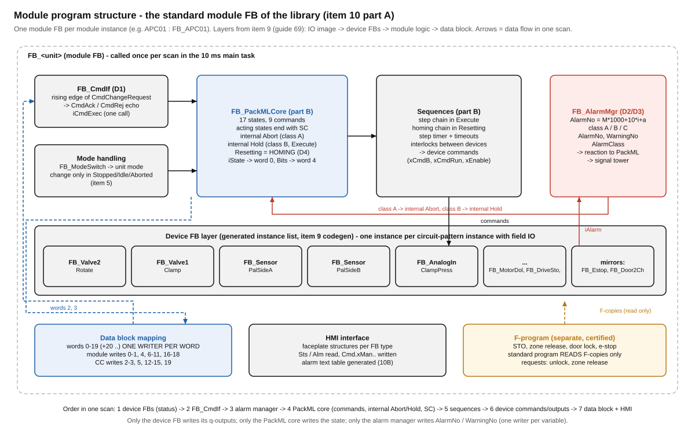

### A2.1 Tasks (OBs) of a module PLC

Guide 69 A3 and B7 explained tasks and response-time analysis. The library uses one standard task set (example values):

| Task | Cycle | Priority | Content | Siemens S7-1500 | CODESYS / TwinCAT | Rockwell Logix |
|---|---|---|---|---|---|---|
| Main | 10 ms | high | all module FBs (device FBs, FB_CmdIf, FB_AlarmMgr, PackML core, sequences) | OB30–OB38 cyclic interrupt 10 ms (or OB1 if the cycle is short and stable) | task "PlcTask" cyclic 10 ms | periodic task 10 ms |
| Comm | 100 ms | medium | data block mapping to the Modbus / OPC UA server, heartbeat, diagnostics buffer | OB1 (free cycle) with MB_SERVER, or OPC UA server in the CPU | task "Comm" 100 ms, Modbus slave device / OPC UA server | continuous task, MSG instructions / EtherNet/IP adapter |
| Diag | 1 s | low | counters, statistics, cycle-time monitoring, retain write-back | OB3x 1 s | task 1 s | periodic 1 s |
| Startup | once | – | initialise, check retentive data, force all modules to Stopped | OB100 | `FB_init` / first-cycle flag | first scan bit `S:FS` |
| Fault | event | – | log and stop on time error, rack failure | OB80, OB82, OB86, OB121 | exception handler | major / minor fault routines |
| F-program | e.g. 20 ms | separate | safety functions (certified blocks) | F-runtime group (OB123 / FOB) | TwinSAFE / Safety PLC project | GuardLogix safety task |

**Why the device FBs and the module logic are in the same task.** The device FBs produce the status that the sequence uses; the sequence produces
the commands that the device FBs turn into outputs. If they ran in different tasks, the sequence could see a half-updated status (a valve FB has
updated `xAtB` but not yet `xBusy`). One task = one consistent picture per scan (guide 69 A2.2).

**Why the data block is mapped in a slower task.** The Modbus / OPC UA server answers requests asynchronously. The module FB reads the
received words **once at the start** of its call and writes its words **once at the end**, into an interface structure; the Comm task copies that
structure to and from the server area. This decoupling gives two guarantees: (1) the module never sees a word change in the middle of its own
scan, and (2) a burst of Modbus requests can never lengthen the 10 ms main task. In TIA Portal this is a `DB_Interface` with two halves; in CODESYS a
`GVL_Interface` copied with `MEMCPY` or structure assignment; on Logix a UDT copied with `COP` / `CPS` (CPS = synchronous copy, cannot be
interrupted – use it for the interface).

### A2.2 Program units and folders (example structure)

```
Project_FMS1_PLC01/
  00_Lib_FMS/                       library (read-only in projects, version tag e.g. 1.0.0)
     Types/  ST_DbStatus, ST_DbCommand, E_PackMLState, E_PackMLCmd, E_UnitMode, E_AlarmClass
     Device/ FB_Sensor, FB_Valve1, FB_Valve2, FB_MotorDol, FB_DriveSto, FB_AnalogIn, FB_LimitAlarm, FB_Heater,
             FB_PushButton, FB_SignalTower, FB_HandshakeHw, FB_Feeder, FB_Ups, FB_ModeSwitch, FB_Scanner, FB_DoorLock
     Safety mirrors/  FB_Safe2Ch (+ FB_Estop, FB_Door2Ch, FB_EnableSwitch, FB_LightCurtain, FB_SafetyCoupling),
                      FB_Edm (+ FB_ZoneOut, FB_ContactorPair, FB_SafeValve), FB_TwoHand
     Module/ FB_CmdIf, FB_AlarmMgr, F_CmdAllowed, FB_PackMLCore (part B)
     Test/   test programs, test vectors (part D3)
  10_IO/                            generated: VAR_GLOBAL with addresses per module (item 9 codegen)
  20_Devices/                       generated: FB_<unit>_Devices per module (item 9 codegen)
  30_Modules/                       hand-written / template: FB_<unit> module logic (part B)
  40_Interface/                     DB_Interface per module (words 0..19 + module part), Modbus / OPC UA mapping
  50_HMI/                           faceplate structures, alarm text export (generated, part B)
  60_Tasks/                         task configuration, OB / program calls
  90_Docs/                          interface sheet, alarm list, change log of the project
```

Rules of the structure:

1. The library folder is **read-only** in a project. A project that needs a change asks for a new library version (D2); it never edits a
   library block locally ("forking" is the main reason why libraries die).
2. Generated folders (10, 20, 50) are **never edited by hand** – they are regenerated from the item 8 library when the IO list changes
   (guide 69 G1).
3. Only folder 30 contains hand-written module logic, and even that follows the module template of part B.
4. The interface folder 40 is the **only** place where the data block is touched – A4.

### A2.3 The module FB hierarchy

One module FB per module instance (`APC01 : FB_APC01`). Inside, always the same eight elements:

| Element | Block | Writes | Reads | Chapter |
|---|---|---|---|---|
| 1 Device layer | `FB_<unit>_Devices` (generated) with one device FB per pattern instance | the field outputs `q…`, device status | field inputs, F-copies, device commands | B, guide 69 G1 |
| 2 Command interface | `FB_CmdIf` | CmdAck, CmdRej (word 4 bits 8, 9), `iCmdExec`, `iLastCmd` | words 2, 3 | A5, C1 |
| 3 Mode handling | `FB_ModeSwitch` + mode logic | requested unit mode | key switch F-copies, word 5 | B14 |
| 4 Alarm manager | `FB_AlarmMgr` | `Admin.AlarmNo` (word 6), `Admin.WarningNo` (word 7), `AlarmClass`, reaction requests | device alarms, module alarms | A6, A7, C3 |
| 5 PackML core | `FB_PackMLCore` | `Status.StateCurrent` (word 0), unit mode (word 1), Status.Bits 0–7 | `iCmdExec`, reaction requests, SC of the sequences | → part B |
| 6 Sequences | step chains per acting state (Execute, Resetting = homing, Starting, Completing …) | device commands (`xCmdB`, `xCmdRun`, `xEnable`) | device status, state | → part B |
| 7 Data-block mapping | interface structure | words 0–1, 4, 6–11, 16–18 (+ module part) | words 2–3, 5, 12–15, 19 | A4 |
| 8 HMI interface | faceplate structures | status for the HMI | HMI manual commands, horn acknowledge | B (faceplates), part B |

**One writer per variable inside the module, too.** Only the device FB writes its `q`-outputs; only FB_CmdIf writes CmdAck / CmdRej; only the PackML
core writes the state; only the alarm manager writes AlarmNo / WarningNo; only the sequence writes the device commands. A variable written in two places
is a finding of the code review (D5) and of the static check (D4).

### A2.4 The scan order inside the module FB

```
 1  read interface   copy words 2-3, 5, 12-15, 19 from DB_Interface into local variables (snapshot)
 2  device FBs       call FB_<unit>_Devices: every device FB evaluates its inputs -> status + iAlarm
 3  mode             FB_ModeSwitch -> requested mode ; mode change only in Stopped / Idle / Aborted (item 5)
 4  command          FB_CmdIf(iCntrlCmd, xCmdChangeRequest, iState, iMode) -> CmdAck / CmdRej / iCmdExec
 5  alarms           collect device + module alarms -> FB_AlarmMgr -> AlarmNo, WarningNo, AlarmClass, iReaction (1 Abort, 2 Hold)
 6  PackML core      iCmdExec, iReaction = 1 (class A: internal Abort), iReaction = 2 (class B: internal Hold, only in Execute), SC from step 7 of the last scan -> new state
 7  sequences        the step chain of the current state -> device commands for the NEXT call of the device FBs ; SC
 8  outputs          (the device FBs wrote their q-outputs in step 2 from the commands of the previous scan)
 9  write interface  words 0-1, 4, 6-11, 16-18 into DB_Interface ; signal tower and HMI structures
```

Two consequences of this order:

- A device command set by the sequence in step 7 reaches the field output in step 2 of the **next** scan – one scan of delay (10 ms). This is the
  normal "status first, then commands" rule of guide 69 D1.2 (rule 6). It makes every FB call see consistent inputs.
- FB_CmdIf (step 4) evaluates the command with the **state of the previous scan**, and the PackML core (step 6) executes it in the same scan. So a
  command is accepted or rejected against a well-defined state – the one the cell controller saw in word 0.

> **Variant.** Some programmers call the device FBs twice (inputs at the start, outputs at the end) to remove the one-scan delay. The library does
> not do this: a 10 ms delay is irrelevant for pneumatics and conveyors, and a second call doubles the timer counting of the tick-based FBs (A9).
> If a fast reaction is needed (a fast stop on a sensor), use a fast task or a hardware function of the drive (guide 69 B1).

## A3. Naming and prefixes

### A3.1 Variables

| Prefix | Type | Direction | Meaning | Example |
|---|---|---|---|---|
| `x` | BOOL | input / output / local | logical signal, status, command | `xPosA`, `xBusy`, `xCmdB` |
| `q` | BOOL | output | value for a field output (DO) – written only by this FB | `qSol`, `qSolA`, `qLamp` |
| `i` | INT | in / out | integer: state, alarm, step, raw analog | `iState`, `iAlarm`, `iStep` |
| `r` | REAL | in / out | engineering value | `rTemp`, `rSp`, `rHyst` |
| `w` | WORD | output | word for a field device or bus | `wCtrl` (drive control word) |
| `t…_ms` | DINT | config input | a time in milliseconds | `tMove_ms`, `tDisc_ms` |
| `b` | BOOL | config input | a configuration switch (not a process signal) | `bInverted` |
| `n` | DINT | local | counter of calls (time base) | `n`, `nl`, `nb`, `nd` |
| `e` / `rst` | BOOL | local | edge of an input (one call) | `rst := xReset AND NOT xResetPrev` |

Notes on the choice:

- **Times as `DINT` in ms, not `TIME`.** The library counts calls (A9), so the configuration value is a plain number that the soft PLC, the web tab and
  every PLC brand handle identically. A project that prefers `TIME` can wrap the FB (`tMove_ms := TIME_TO_DINT(tMove)`), which is a MINOR change.
- **`q` only for real field outputs.** `qSol` goes to a terminal; `wCtrl` goes to a drive over the bus; `xCmdAck` goes to the data block. This lets the
  static check (D4) verify that every `q` output is assigned to exactly one `%Q` symbol in the generated layer.
- **Positive logic in names.** `xOk` (TRUE = good), `xClosedOk`, `xFree` – never `xNotOk`. A signal that is physically inverted (NC contact) is
  inverted **inside** the FB, with a configuration switch (`bInverted` of FB_Edm).

### A3.2 Blocks, types, instances

| Element | Rule | Example |
|---|---|---|
| Function block type | `FB_` + device or function in CamelCase | `FB_Valve2`, `FB_CmdIf`, `FB_AlarmMgr` |
| Function | `F_` + verb/noun | `F_CmdAllowed`, `F_AlarmNo` |
| Structure type | `ST_` | `ST_DbStatus`, `ST_HmiValve` |
| Enumeration | `E_` | `E_PackMLState`, `E_AlarmClass` |
| Global variable list / DB | `GVL_` / `DB_` | `GVL_Lib` (library constants), `DB_Interface_APC01` |
| Constant | `GC_` + UPPER | `GC_CYCLE_MS` |
| Device FB instance | the tag **group** of item 8, unchanged | `Rotate`, `Clamp`, `ClampPress`, `Estop` |
| Module FB instance | the unit code + number | `APC01`, `POOL01`, `WASH01` |
| IO symbol (generated) | `unit_group_signal` | `APC01_Rotate_PosA` |
| Alarm text key | `ALM_<AlarmNo>` | `ALM_2011` → "APC01 Rotate: end position not reached" |

The instance name is the **group** of the item 5 / item 8 tag (`PLT1.MACH.FMS1.APC01.Rotate.PosA` → instance `Rotate` in module `APC01`). The
electrician, the programmer, the HMI designer and the alarm list use the same word (guide 68 E12, guide 69 A10.2).

### A3.3 Library namespace

Two libraries in one project can both contain `FB_Valve`. IEC 61131-3 edition 4 has namespaces; CODESYS / TwinCAT libraries have a namespace
(`FMS.FB_Valve1`); TIA Portal global libraries use type folders and version numbers; Logix uses AOI names with a prefix. The rule: the FMS library
uses the namespace / prefix `FMS` where the platform supports it, and its version is visible in every block header (D6).

## A4. The data block: one writer per word

### A4.1 The rule

> **Every word of the module data block has exactly one writer.** Words 0–1, 4, 6–11 and 16–18 are written **only by the module**; words 2–3, 5,
> 12–15 and 19 are written **only by the cell controller**. A bit inside a word belongs to the writer of the word. (Decision D1.)

Why so strict? Modbus TCP (FC16 "write multiple registers") and OPC UA (Write service) transfer **whole registers / values**. There is no "set bit 0
of word 3 and leave the rest" in the protocol: the writer always sends the full word from its own memory. If two partners write the same word, the word
holds whatever arrived **last** – and the arrival order depends on poll times, task times and network delay, i.e. it is random. A random result is
not a "rare bug"; on a line that exchanges 10 commands per minute it happens every few days. The only fix is a structural one: one writer.

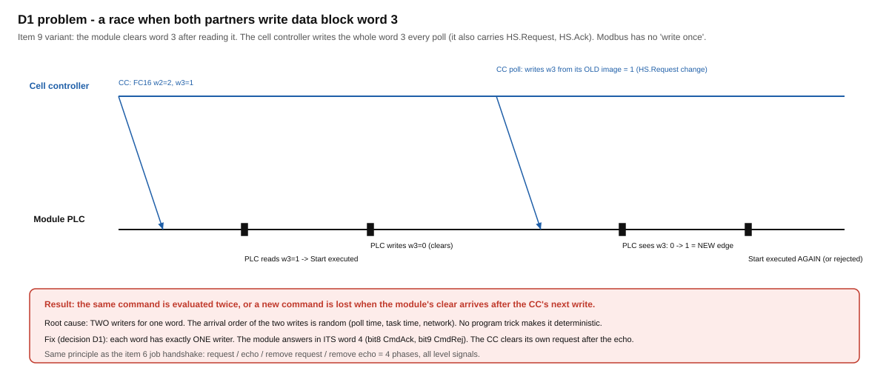

### A4.2 The ownership table of words 0–19

| Word | Name | Type | Writer | Reader | Content | Changes in item 10 |
|---|---|---|---|---|---|---|
| 0 | Status.StateCurrent | INT | **module** | CC | PackML state 1–17 | – |
| 1 | Status.UnitModeCurrent | INT | **module** | CC | 1 Production · 2 Maintenance · 3 Manual | – |
| 2 | Command.CntrlCmd | INT | **CC** | module | PackML command 1–9, 0 = none | module no longer clears it (D1) |
| 3 | Command.Bits | WORD | **CC** | module | bit0 CmdChangeRequest · bit1 HS.Request · bit2 HS.Ack · bit3 FaultReset · bit8–15 spare | module no longer clears bit0 (D1) |
| 4 | Status.Bits | WORD | **module** | CC | bit0 Ready · bit1 Busy · bit2 Done · bit3 Fault · bit4 Warning · bit5 Auto · bit6 PartPresent · bit7 HS.Ready · **bit8 CmdAck · bit9 CmdRej** · bit10–15 spare | bits 8 and 9 new (D1) |
| 5 | Command.UnitMode | INT | **CC** | module | requested mode (accepted only in Stopped / Idle / Aborted) | – |
| 6 | Admin.AlarmNo | INT | **module** | CC | most severe active class A/B alarm, M × 1000 + 10 × i + a | formula fixed (D2), choice by class (D3) |
| 7 | Admin.WarningNo | INT | **module** | CC | earliest active class C alarm or command rejection M × 1000 + 900 + cmd | formula fixed (D2) |
| 8–9 | Admin.ProdProcessedCount | DINT | **module** | CC | parts / cycles processed | – |
| 10–11 | Admin.ProdDefectiveCount | DINT | **module** | CC | defective parts | – |
| 12–13 | Job.Id | DINT | **CC** | module | job / work order number | – |
| 14–15 | Job.PalletId | DINT | **CC** | module | pallet / carrier ID expected by the cell controller | guide 66 said "in/out" – now **CC only**; a pallet ID **read** by the module (RFID) goes into the module part (word 20 +) |
| 16–17 | Status.LastCycle_s | REAL | **module** | CC | last cycle time, IEEE 754 | – |
| 18 | Status.Heartbeat | UINT | **module** | CC | +1 per second, CC time-out 3 s | – |
| 19 | Command.Heartbeat | UINT | **CC** | module | +1 per second, module time-out 3 s | – |

Count: the module writes 12 words (0, 1, 4, 6, 7, 8, 9, 10, 11, 16, 17, 18); the cell controller writes 8 words (2, 3, 5, 12, 13, 14, 15, 19). 12 + 8 = 20 –
every word has exactly one owner. The **module part** (word 20 +, guide 66 H2.3) follows the same rule: every row there already has a single direction
"in" or "out"; part B adds the module parts of the modules that do not have one yet.

> **Note on word 14–15 (Job.PalletId).** Guide 66 H2.1 marks it "in/out". With the one-writer rule a word cannot be both. The library uses: the cell
> controller writes the **expected** pallet ID in words 14–15; a module that reads an RFID tag reports the **read** ID in its module part (e.g. M04
> words 22 +), and raises an alarm "pallet ID mismatch" if the two differ. This is the data-integrity check of guide 69 H1.2 (3), now with two
> separate words. Treat the guide 66 marking as superseded by this table.

### A4.3 Status.Bits with the new bits 8 and 9

```
Status.Bits = Ready (bit0, state Idle) + Busy (bit1, acting states and Execute) + Done (bit2, Complete) + Fault (bit3, AlarmNo <> 0)
            + Warning (bit4, WarningNo <> 0) + Auto (bit5, mode Production) + PartPresent (bit6) + HS.Ready (bit7)
            + CmdAck (bit8, 256) + CmdRej (bit9, 512)
```

Example values (APC01 with a pallet present, mode Production): Idle without alarm = 1 + 32 + 64 = **97**; Idle in the call where a Start is accepted
(state already Starting, CmdAck set) = 2 + 32 + 64 + 256 = **354**; Stopped with a rejected Start, warning 2902 present = 16 + 32 + 64 + 512 = **624**.
The cell controller decodes them with masks: `ack = (bits AND 256) <> 0`, `rej = (bits AND 512) <> 0`.

### A4.4 How each platform enforces "one writer"

The rule is logical; the platform helps to enforce it:

| Platform | Mechanism | How to enforce the rule |
|---|---|---|
| Siemens S7-1500, MB_SERVER | one DB (holding registers) for the whole block; the client can write any register | PLC program never writes words 2–3, 5, 12–15, 19 (static check D4); optional: two DBs – one "receive" (CC words) and one "send" (module words) – and a mapping so that a CC write into a module word is overwritten in the next Comm cycle and logged |
| Siemens, OPC UA server | node access level per variable | module words `AccessLevel = CurrentRead` only; CC words `CurrentRead + CurrentWrite`; set in the server interface (companion specification style) |
| CODESYS / TwinCAT Modbus slave | holding registers (read/write) and input registers (read only) | either split (module words as input registers – then the CC reads two areas) or one holding area with the program-side rule; TwinCAT OPC UA: `{attribute 'OPC.UA.DA.Access' := '1'}` for read only |
| Rockwell Logix, EtherNet/IP | produced / consumed tags or adapter assemblies | the protocol separates directions: input assembly = module words, output assembly = CC words – one writer by construction |
| Rockwell, Modbus via module (ProSoft / MVI) | register blocks per direction | configure "read" and "write" blocks separately |
| Python cell controller (`fmsctl/`) | Modbus client | write only words 2–3, 5, 12–15, 19; a unit test of the client checks the address list (part C) |

## A5. Decision D1 – the 4-phase command echo

### A5.1 The problem

The command protocol of item 6 (guide 66 H2.2): the cell controller writes `CntrlCmd` (word 2) and sets `CmdChangeRequest` (word 3 bit 0) in the same
FC16 write; the module executes the command if it is allowed. The open question was **who clears the request**:

- **Item 9 (guide 69 E4.1):** the module clears `CntrlCmd` and `CmdChangeRequest` after reading them ("consumed" signal).
- **Guide 66 H2.2:** the cell controller clears the bit after it sees the new state, or after a time-out of 2 s.

The first variant violates the one-writer rule (both sides write word 3, and word 2). The figure of A4.1 shows the race: the cell controller writes
word 3 again in its next poll (because word 3 also carries HS.Request / HS.Ack, it is written whenever any of those bits change) – from its **old**
image, in which bit 0 is still 1. The module sees 0 → 1 again and evaluates the command a second time. The second variant is clean but has no
**answer** for a rejected command: if the command is not allowed, the state does not change, and the cell controller waits 2 s for a state change
that never comes – it cannot distinguish "rejected" from "module not responding".

### A5.2 The options

| Criterion | Option 1: module clears (item 9) | Option 2: CC clears after new state (guide 66) | **Option 3: 4-phase echo (chosen)** |
|---|---|---|---|
| Writers of word 3 | module **and** CC | CC only | CC only |
| Race possible | **yes** (A4.1) | no | no |
| Accepted / rejected visible to the CC | indirect (state changes or not) | indirect, rejection = time-out after 2 s | **direct**: CmdAck or CmdRej in word 4 |
| Time until the CC knows the result | 1 poll (if no race) | 1 poll (accepted) / 2 s (rejected) | 1 poll (both) |
| Same command twice | possible (race) | impossible | impossible (new rising edge needed) |
| Commands without state change (e.g. Reset in Complete re-enters Resetting) | OK | difficult (no visible change → time-out) | OK – echo is independent of the state |
| Effort | lowest | low | low – two bits and one rule more |
| Resembles | – | – | the 4-phase job handshake of item 6 (guide 66 H4) |

### A5.3 The choice and the exact rule

**Option 3** is chosen (decision D1, `choice: 2` in the JSON – counted from 0). The rule, word for word from `item10a_examples.json`:

> One writer per word: words 0–1, 4, 6–11, 16–18 are written ONLY by the module, words 2–3, 5, 12–15, 19 ONLY by the cell controller. CC writes CntrlCmd +
> sets CmdChangeRequest in ONE FC16 write. Module: on the RISING edge of CmdChangeRequest evaluate the command (state + mode table of item 5) →
> Status.Bits bit8 CmdAck (accepted, command executed in the same scan) or bit9 CmdRej (rejected, Admin.WarningNo = module × 1000 + 900 + command). CC:
> on CmdAck or CmdRej clear CmdChangeRequest (and CntrlCmd = 0). Module: when CmdChangeRequest is FALSE clear CmdAck and CmdRej. CC time-out 2 s without
> echo → communication alarm. A new command needs a new rising edge (no command is executed twice).

The four phases:

| Phase | Who | Action | Word(s) | Condition to go on |
|---|---|---|---|---|
| 1 Request | CC | `CntrlCmd := cmd`, `CmdChangeRequest := 1` in one FC16 write | 2, 3 | – |
| 2 Echo | module | on the rising edge: evaluate; `CmdAck := 1` (and execute) **or** `CmdRej := 1` (and set WarningNo) | 4 (and 7) | CC sees Ack or Rej |
| 3 Remove request | CC | `CmdChangeRequest := 0`, `CntrlCmd := 0` | 2, 3 | module sees request = 0 |
| 4 Remove echo | module | `CmdAck := 0`, `CmdRej := 0` | 4 | CC sees both 0 → free for the next command |

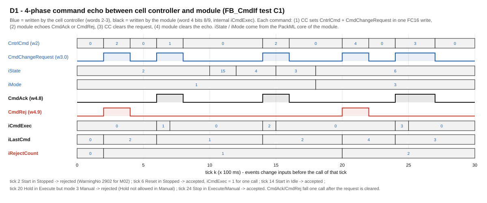

### A5.4 Why each detail of the rule matters

1. **"in ONE FC16 write".** If CntrlCmd and the request bit came in two writes, the module could see the request with the *old* command (word 3
   arrives first). FC16 writes contiguous registers 2–3 in one frame; the Modbus server of the PLC applies a frame atomically (check the manual: Siemens
   MB_SERVER, CODESYS Modbus slave and Logix adapters do; some gateways do **not** – then use a sequence counter, A5.8).
2. **"on the RISING edge".** The module must evaluate a command exactly once. A level would execute it in every scan while the bit is 1 – a Start
   accepted in Idle would, one scan later, be evaluated again in Starting (and rejected, with a misleading warning).
3. **"command executed in the same scan".** FB_CmdIf outputs `iCmdExec` for **one call**; the PackML core uses it in the same scan (A2.4 step 6).
   So the state the CC reads together with CmdAck is already the new state (Idle + Start → Starting).
4. **"Admin.WarningNo = module × 1000 + 900 + command".** The rejection is logged as a **class C warning** with a number that says which command
   was refused: M02 rejecting Start (2) → **2902**; M02 rejecting Hold (4) → **2904**; M10 rejecting Clear (9) → **10909**.
5. **"when CmdChangeRequest is FALSE clear CmdAck and CmdRej".** The echo stays as long as the request stays; this is what makes the handshake
   independent of poll times. A CC that polls every 500 ms still sees the echo.
6. **"CC time-out 2 s without echo".** 2 s = about 20 polls of 100 ms; if neither Ack nor Rej comes, the module program is not running, the
   connection is lost, or the module has an older library without D1 (a version mismatch – a classic commissioning finding).
7. **"A new command needs a new rising edge".** If the CC writes a second command while the request is still 1, the module ignores it. The CC
   must complete phases 3 and 4 first. This serialises commands – exactly what PackML needs (one state transition at a time).

### A5.5 Worked example – test C1 (reference log)

The unit test of FB_CmdIf drives the inputs as the cell controller and the PackML core would. Inputs: `iCntrlCmd`, `xCmdChangeRequest` (written by
the CC), `iState`, `iMode` (from the module). Default `iState` 2 (Stopped), `iMode` 1 (Production). Events and log:

```
TEST FB_CmdIf | C1 4-phase command echo with accept and reject | 14 lines
    0 init xCmdAck=0 xCmdRej=0 iCmdExec=0 iLastCmd=0 iRejectCount=0
    2 xCmdRej=1 iLastCmd=2 iRejectCount=1
    4 xCmdRej=0
    6 xCmdAck=1 iCmdExec=1 iLastCmd=1
    7 iCmdExec=0
    8 xCmdAck=0
    14 xCmdAck=1 iCmdExec=2 iLastCmd=2
    15 iCmdExec=0
    16 xCmdAck=0
    20 xCmdRej=1 iLastCmd=4 iRejectCount=2
    22 xCmdRej=0
    24 xCmdAck=1 iCmdExec=3 iLastCmd=3
    25 iCmdExec=0
    27 xCmdAck=0
```

| Tick | Event (input change before the call) | What FB_CmdIf does | Phase |
|---|---|---|---|
| 0 | – (Stopped, Production) | init: all outputs 0 | – |
| 2 | CC: `iCntrlCmd=2` (Start), `xCmdChangeRequest=1` | rising edge; Start in Stopped? No edge (Stopped, Start) in the item 5 model → **rejected**: `xCmdRej=1`, `iLastCmd=2`, `iRejectCount=1`; module sets WarningNo 2902 | 1 → 2 |
| 4 | CC: `iCntrlCmd=0`, `xCmdChangeRequest=0` | request FALSE → `xCmdRej=0` | 3 → 4 |
| 6 | CC: Reset (1), request 1 | rising edge; (Stopped, Reset) → Resetting exists, Reset allowed in Production → **accepted**: `xCmdAck=1`, `iCmdExec=1` (one call), `iLastCmd=1` | 1 → 2 |
| 7 | – | `iCmdExec` back to 0 (the PackML core executed Reset in tick 6); `xCmdAck` stays because the request stays | 2 |
| 8 | CC clears | `xCmdAck=0` | 3 → 4 |
| 10, 12 | `iState=15` (Resetting), then `iState=4` (Idle) – the PackML core moved on | no output change (no edge) | – |
| 14 | CC: Start (2), request 1 | (Idle, Start) → Starting → **accepted**, `iCmdExec=2` | 1 → 2 |
| 15 | `iState=3` (Starting) | `iCmdExec=0` | 2 |
| 16 | CC clears | `xCmdAck=0` | 3 → 4 |
| 18 | `iState=6` (Execute), `iMode=3` (Manual) | no output change (in a real module the mode cannot change in Execute – the test sets it to prove the mode check) | – |
| 20 | CC: Hold (4), request 1 | (Execute, Hold) is an edge, **but** Hold is not in the Manual command set {Reset, Start, Stop, Abort, Clear} → **rejected**, `iRejectCount=2`, WarningNo 2904 | 1 → 2 |
| 22 | CC clears | `xCmdRej=0` | 3 → 4 |
| 24 | CC: Stop (3), request 1 | Stop allowed from Execute and in Manual → **accepted**, `iCmdExec=3` | 1 → 2 |
| 25 | – | `iCmdExec=0` | 2 |
| 27 | CC clears (it waited 3 ticks this time) | `xCmdAck=0` – the echo simply stays longer; the protocol does not care about the poll time | 3 → 4 |

The log has 14 lines: 1 init line + 13 change lines. Note in particular tick 27: the CC took 300 ms to clear; the echo was visible all the time. With
option 1 (module clears) there would have been no stable signal for the CC to see.

### A5.6 The cell-controller side (preview of part C)

```python
# cell controller, one module, called every poll (100 ms) - Python sketch, stdlib only (part C writes the real one)
def send_command(mb, cmd, now):                  # mb = Modbus client of this module
    st = mb.state                                # 'IDLE', 'WAIT_ECHO', 'WAIT_CLEAR'
    if st == 'IDLE':
        mb.write_registers(2, [cmd, mb.cmd_bits | 0x0001])   # phase 1: words 2 and 3 in ONE FC16 write
        mb.state, mb.t0 = 'WAIT_ECHO', now
    elif st == 'WAIT_ECHO':
        bits = mb.read_registers(4, 1)[0]
        if bits & 0x0100 or bits & 0x0200:          # phase 2 seen: CmdAck (256) or CmdRej (512)
            mb.result = 'ACK' if bits & 0x0100 else 'REJ'
            mb.write_registers(2, [0, mb.cmd_bits & ~0x0001])  # phase 3: clear request and command
            mb.state = 'WAIT_CLEAR'
        elif now - mb.t0 > 2.0:
            mb.alarm('command echo time-out')      # module not answering / old library
            mb.write_registers(2, [0, mb.cmd_bits & ~0x0001]); mb.state = 'IDLE'
    elif st == 'WAIT_CLEAR':
        bits = mb.read_registers(4, 1)[0]
        if not (bits & 0x0300):                    # phase 4 seen: both echoes removed
            mb.state = 'IDLE'                      # free for the next command
```

`mb.cmd_bits` is the CC's own image of word 3 (bits 1–3: HS.Request, HS.Ack, FaultReset). The CC always writes word 3 from this image – it is the only
writer, so its image is always the truth.

### A5.7 Implementation notes per platform

| Topic | Siemens (TIA, S7-1500) | CODESYS / TwinCAT | Rockwell Logix |
|---|---|---|---|
| Edge of word 3 bit 0 | `R_TRIG` instance or `xReqPrev` static, as in the listing | same | `ONS` / `OSR` instruction, or a `xReqPrev` tag in the AOI |
| Bit access to word 3 / 4 | slice access `wBits.%X0`, `wBits.%X8` | `wBits.0`, `wBits.8` | `Bits.0`, `Bits.8` (DINT/INT bit access) |
| Atomic write of words 2–3 | MB_SERVER applies one FC16 frame in one call | Modbus slave: one frame consistent | Ethernet/IP: the whole output assembly is consistent per RPI |
| Snapshot at scan start | copy `DB_Interface.Rx` to a local struct at the start of the module FB | structure assignment | `CPS` (synchronous copy) |
| Where FB_CmdIf runs | in the module FB, main task | same | in the module AOI / routine, periodic task |
| OPC UA instead of Modbus | write words 2 and 3 as one structure node or use a method call `SendCommand(cmd)` that returns Ack / Rej | same (TwinCAT methods via `{attribute 'TcRpcEnable'}`) | OPC UA via FactoryTalk Linx Gateway – structure write |

**OPC UA method variant.** With OPC UA the whole echo can be a **method call**: `SendCommand(cmd) → (accepted, warningNo)`. The server executes the
method synchronously in the PLC (or queues it) and returns the result in the call – a 2-phase exchange that the protocol makes reliable. The library
keeps the data-block echo as the **common denominator** (Modbus must work); a project that uses OPC UA methods maps the method onto FB_CmdIf inputs.

### A5.8 Variants for imperfect transports

- **Gateway that splits FC16 into two writes.** Use a **sequence number**: the CC writes `CntrlCmd` and a command counter in word 3 bits 8–15
  (spare); the module evaluates when the counter changes **and** the request bit is 1. This is a MINOR extension (D1.2) – the echo still works.
- **Very slow CC (poll 1 s).** No change needed – the echo waits. Only the time-out (2 s) must be at least 2 poll periods + the module cycle.
- **Two cell controllers (redundant).** Only the **active** one writes words 2–3, 5, 12–15, 19 – the standby only reads. The switch-over logic must
  guarantee one writer (part C).

### A5.9 Test cases for D1 (software FAT)

| # | Test | Expected | Fails if |
|---|---|---|---|
| D1-1 | Start in Stopped | CmdRej, WarningNo M902, state unchanged | module accepts (wrong table) |
| D1-2 | Reset in Stopped | CmdAck, state Resetting in the same poll | no echo (old library) |
| D1-3 | CC keeps the request 1 for 5 s | CmdAck stays 5 s; command executed **once** | executed twice |
| D1-4 | CC writes a new command while request = 1 | ignored, no new echo | executed (level evaluation) |
| D1-5 | Request bit set, module PLC in STOP | CC time-out after 2 s, communication alarm | CC waits forever |
| D1-6 | Hold in Execute with mode Manual | CmdRej, WarningNo M904 | accepted (mode check missing) |
| D1-7 | Static check of the CC client | writes only words 2–3, 5, 12–15, 19 | writes word 4 |
| D1-8 | Static check of the PLC | no write to words 2–3, 5, 12–15, 19 | `CntrlCmd := 0` in the PLC (item 9 style) |

### A5.10 Typical mistakes

1. **The PLC still clears word 3** (an old item 9 module copied into a new project): the echo works most of the time, but the race of A4.1 comes back.
   Static check D1-8 finds it.
2. **CmdAck set but the command not executed** – FB_CmdIf was called **after** the PackML core in the scan. Then the core sees `iCmdExec` one
   scan late and in the meantime the state could have changed. Keep the scan order of A2.4.
3. **The CC clears the request only on CmdAck**, not on CmdRej – after the first rejected command the CC waits until its time-out, every time.
4. **The CC checks "state changed" instead of the echo** – commands that do not change the visible state for some time (a Reset whose Resetting takes
   1 poll) produce false time-outs.
5. **The HMI writes word 2 for "local operation"** – a second writer. Local operator commands go through the HMI interface of the module, not through the
   cell-controller words; the module arbitrates (mode Manual, part B).

## A6. Decision D2 – alarm numbers M × 1000 + 10 × i + a

### A6.1 The problem

Item 9 used module-local alarm codes: APC01 had 10 (no end position at Start), 11 (unclamp timeout), 12 (rotate timeout), 13 (clamp pressure low);
FB_MotorDol had 1–4. Guide 66 asked for "module range × 1000 + n" but did not say how n is built. Consequences of local codes in a real cell:

- the cell controller shows "APC02 alarm 12" – the operator must look up a module-specific table;
- the MES statistic "top 10 alarms of the line" mixes alarm 12 of the APC (rotate timeout) with alarm 12 of the washer (something else);
- two programmers number the same device fault differently; the HMI alarm text table and the PLC drift apart after the first change.

### A6.2 The options

| Criterion | Option 1: local codes per module (item 9) | **Option 2: M × 1000 + 10 × i + a (chosen)** |
|---|---|---|
| Unique in the cell | no (needs unit + code) | yes for the module **type**; with the unit (APC02) unique in the cell |
| Readable without a table | no | yes: 2011 → M02, device 1, alarm 1 |
| Text table | hand-written per module | **generated** from the library: FB type alarm texts × instance list (part B) |
| Same number in PLC, HMI, CC, MES | only by discipline | by construction |
| Range | small | INT up to 22 999 (M22) < 32 767 |
| Number of devices per module | unlimited | 89 usable (i = 1…89, see A6.4) – enough (largest module M08 has 15 FB instances) |
| Alarms per device | unlimited | 9 (a = 1…9) – enough for a device FB (the library uses at most 4) |

### A6.3 The rule

> AlarmNo = M × 1000 + 10 × i + a. M = module number (M02 → 2), i = instance number of the device FB in the module expansion order of item 8 (1..99, only
> instances with an FB), a = local alarm code of the FB (1..9); module-level alarms (sequence, homing, communication) use i = 0 (M × 1000 + 1..9) and
> 900 + n for command rejections (warnings). Example: APC01 (M02) instance 1 'Rotate' (FB_Valve2) alarm 1 'did not reach end position' → 2011. INT range is
> enough (M22 → 22999). Guide 66 '4 digits' becomes '4–5 digits'.

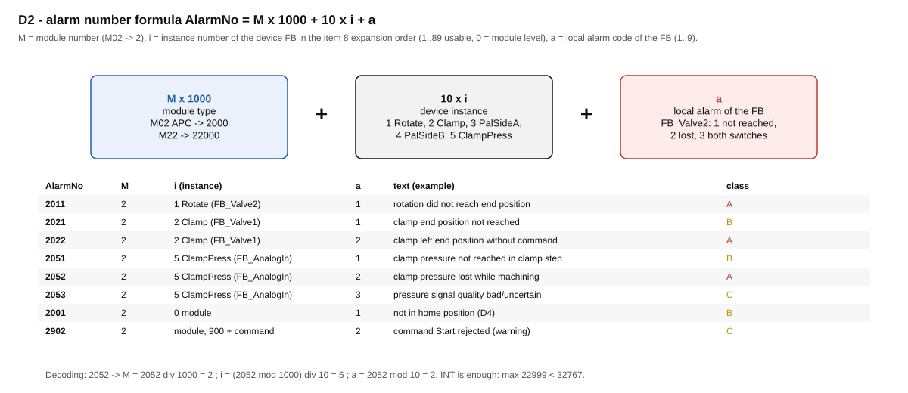

Decoding (for the cell controller, the MES and the commissioning engineer):

```
M = AlarmNo DIV 1000            module type      2052 DIV 1000 = 2      -> M02 APC
r = AlarmNo MOD 1000            rest             2052 MOD 1000 = 52
i = r DIV 10                    instance         52 DIV 10 = 5          -> ClampPress (5th FB instance of M02)
a = r MOD 10                    local alarm      52 MOD 10 = 2          -> FB_AnalogIn alarm 2 of this module
if r >= 900: command rejection, command = r - 900
if i = 0:    module-level alarm a
```

### A6.4 Worked examples

**M02 APC01** – instance list in the item 8 expansion order (guide 68 C2.2, guide 69 G2): 1 `Rotate` FB_Valve2 · 2 `Clamp` FB_Valve1 · 3 `PalSideA` FB_Sensor ·
4 `PalSideB` FB_Sensor · 5 `ClampPress` FB_AnalogIn.

| AlarmNo | i | a | Text (example) | Class (D3) |
|---|---|---|---|---|
| 2001 | 0 | 1 | APC01: not in home position (D4) | B |
| 2011 | 1 | 1 | APC01 Rotate: end position not reached | A |
| 2012 | 1 | 2 | APC01 Rotate: left the end position without command | A |
| 2013 | 1 | 3 | APC01 Rotate: both end switches on | B |
| 2021 | 2 | 1 | APC01 Clamp: end position not reached | B |
| 2022 | 2 | 2 | APC01 Clamp: left the end position without command | A |
| 2023 | 2 | 3 | APC01 Clamp: both end switches on | B |
| 2031, 2041 | 3, 4 | 1 | APC01 PalSideA / PalSideB: module-defined sensor alarm (e.g. pallet expected but not present) | C |
| 2051 | 5 | 1 | APC01 ClampPress: clamp pressure not reached in the clamp step | B |
| 2052 | 5 | 2 | APC01 ClampPress: clamp pressure lost while clamped in a machining state | A |
| 2053 | 5 | 3 | APC01 ClampPress: signal quality bad / uncertain | C |
| 2902 | (900) | 2 | APC01: command Start rejected | C (warning) |

**M03 POOL01** – 1 DriveSup FB_ContactorPair · 2 Travel FB_DriveSto · 3 Hoist FB_DriveSto · 4 Fork FB_DriveSto · 5 Door FB_DoorLock · 6 Estop FB_Estop · 7 Enable
FB_EnableSwitch · 8 Mode FB_ModeSwitch · 9 TravLimF · 10 TravLimR · 11 PalOnFork · 12 ForkMid (FB_Sensor) · 13 Tower FB_SignalTower.

| Fault | Calculation | AlarmNo |
|---|---|---|
| Hoist drive: ready lost while running (FB_DriveSto a = 3) | 3000 + 10 · 3 + 3 | **3033** |
| Travel drive fault (a = 1) | 3000 + 20 + 1 | **3021** |
| Door: locked but not closed (FB_DoorLock a = 3) | 3000 + 50 + 3 | **3053** |
| E-stop discrepancy (FB_Estop = FB_Safe2Ch a = 1) | 3000 + 60 + 1 | **3061** |
| Pallet on fork sensor: module alarm "pallet lost during travel" (module-defined a = 1) | 3000 + 110 + 1 | **3111** |

**M10 WASH01** – 1 SprayPump · 2 RinsePump (FB_MotorDol) · 3 Heater · 4 TankTemp (FB_AnalogIn) · 5 LevelLow · 6 LevelHigh (FB_Sensor) · 7 Door (FB_Door2Ch) · 8 DoorCyl
(FB_Valve1) · 9 Conveyor (FB_MotorDol) · 10 Estop.

| Fault | AlarmNo |
|---|---|
| Heater over-temperature (FB_Heater a = 1) | 10 000 + 30 + 1 = **10031** |
| Heater: no contactor feedback (a = 2) | **10032** |
| Conveyor motor protection tripped (FB_MotorDol a = 3) | 10 000 + 90 + 3 = **10093** |
| Estop discrepancy (i = 10!) | 10 000 + 100 + 1 = **10101** |
| Clear rejected (900 + 9) | **10909** |

The M10 examples show the "4–5 digits" of the rule: modules M10–M22 have five-digit numbers. The largest possible number is M22 with r = 999 → **22 999**.

> **Note on the instance range.** The rule text allows i = 1…99, but the numbers 900–999 are reserved for command rejections (900 + n). An instance i = 90…99
> would collide (i = 90, a = 2 → r = 902 = "Start rejected"). **Library convention: i = 1…89.** The largest module of the standard (M08 AS/RS) has 15 FB
> instances; a module with more than 89 devices must be split. The library check (D4) tests this limit.

### A6.5 What counts as an instance

- Only pattern instances **with an FB** are numbered (guide 69 G5): M01 has 4 pattern instances but its BUS has no FB → i = 1 Supply, 2 Safety, 3 PalAtApc.
- The order is the **expansion order** of the item 8 library – the same order as the IO list and the generated `FB_<unit>_Devices`. Never renumber by hand;
  if a device is added in the middle of the list, all following numbers shift → that is a **MAJOR** change of the module (D1) and needs a new alarm text export
  for HMI and cell controller. Therefore: add new devices **at the end** of a module's pattern list when a module is already in operation.
- A wrapper with two base blocks (FB_SafetyCoupling, FB_SafeValve) is **one** instance; its two halves use different local codes a (B12.8, B13.6).

### A6.6 Module-level alarms (i = 0)

| a | Module alarm (library standard, example) | Class |
|---|---|---|
| 1 | not in home position (D4) – homing not possible because motion is not allowed | B |
| 2 | homing time-out (the homing sequence did not finish) | A |
| 3 | sequence step time-out without a device alarm (e.g. waiting for a part) | B |
| 4 | communication: cell-controller heartbeat lost (word 19 not changing for 3 s) | B (Execute → Hold) |
| 5 | data plausibility (pallet ID mismatch, job data invalid) | A |
| 6 | safety system not OK (F-program reports a fault, not a normal stop) | A |
| 7–9 | module-specific | per module |

Part B fills a = 7–9 per module and generates the complete text table.

### A6.7 Text table generation (preview of part B)

The alarm text of every number is built from three parts: the **unit** (APC01), the **instance group** (Rotate) and the **FB alarm text** (from the library
table B18): "APC01 Rotate: end position not reached". The library delivers the FB alarm texts once (in English plus the factory languages); the generator
multiplies them with the instance list of each module. Result: one CSV with `AlarmNo; Class; Text_en; Text_de; …` per module, imported identically into the
HMI, the cell controller and the MES. A text change is made **once** in the library.

### A6.8 Implementation notes per platform

| Topic | Siemens | CODESYS / TwinCAT | Rockwell |
|---|---|---|---|
| Computing the number | inside FB_AlarmMgr: `iModule * 1000 + 10 * iInst + iCode` (INT) | same | AOI or CPT instruction |
| Alarm system of the HMI | ProDiag or Program_Alarm (alarm ID = AlarmNo), or discrete HMI alarms from a bit array | TwinCAT EventLogger (event ID = AlarmNo), CODESYS Alarm Manager | ALMD / ALMA instructions or FactoryTalk A&E; tag-based alarms with the number in the message |
| Data block | word 6 / 7 as INT | same | INT in the UDT |
| Full list of active alarms | via OPC UA Alarms & Conditions or the HMI alarm system (guide 69 F7.3) – the data block carries only the most severe | same | same |

### A6.9 Test cases for D2

| # | Test | Expected |
|---|---|---|
| D2-1 | Force a rotate jam at APC02 | AlarmNo 2011 in APC02 word 6; HMI text "APC02 Rotate: end position not reached" |
| D2-2 | Decode every number of the generated table with the formula | i matches the instance list, a matches the FB alarm list |
| D2-3 | Number range per module | all numbers between M × 1000 + 1 and M × 1000 + 999 |
| D2-4 | Uniqueness | no number twice in a module table |
| D2-5 | Rejection warning | Start in Stopped → WarningNo M902 |

## A7. Decision D3 – alarm classes A / B / C

### A7.1 The problem

Guide 68 C2.5: "PackML: rotate = Execute step; clamp pressure low → **Held**." Item 9 module run (guide 69 E7.3, scenario C): clamp pressure low →
alarm 13 → **Abort**. Both are reasonable in one situation and wrong in the other:

- In the **clamp step** (S30) the clamp has just closed and the pressure does not build up – the pallet may sit on a chip. The operator can clean the
  locating surfaces and repeat the step. Abort would throw away the job (Clear, Reset, new job) for nothing – **Held** is right.
- **While machining** (the machine tool cuts, the APC is clamped in the machine area) the pressure drops – the pallet may move under the cutting force:
  the tool breaks, the part is scrap, the spindle can be damaged. Continuing "until the operator reacts" is wrong – **Abort** plus a feed hold to the
  machine is right.

The device is the same (ClampPress, FB_AnalogIn); the reaction depends on **when** the condition occurs. So the device FB cannot decide the reaction.

### A7.2 The options

| Criterion | Option 1: always Held (guide 68) | Option 2: always Abort (item 9) | **Option 3: by alarm class per alarm and phase (chosen)** |
|---|---|---|---|
| Pressure lost while machining | **dangerous** (continues) | correct | correct (class A) |
| Pressure not reached in the clamp step | correct | job lost for nothing | correct (class B) |
| Filter dirty, UPS on battery | stops production for a warning | stops production | no stop (class C) |
| Where is the decision | nowhere (fixed) | nowhere (fixed) | in the alarm table of the module (one column "class") |
| Effort | lowest | lowest | one class per alarm + one alarm per phase where needed |

### A7.3 The rule

> Every alarm has a class: **A** = stop at once (PackML internal Abort: equipment or product at risk, e.g. clamp pressure LOST while the spindle cuts, drive
> fault, feedback lost while moving), **B** = controlled pause (internal Hold from Execute: the operator can fix it and continue, e.g. clamp pressure NOT
> REACHED during the clamping step, end position not reached at a step), **C** = warning only (no state change: filter dirty, UPS on battery, a rejected
> command). Clamp pressure: monitored with two different alarms: 'pressure not reached in the clamp step' (class B → Held, operator re-seats the pallet,
> Unhold repeats the step) and 'pressure lost while clamped in a machining state' (class A → Abort + feed hold over the coupling).

| Class | PackML reaction | Signal tower | Horn | Operator action | Job |
|---|---|---|---|---|---|
| **A** | internal **Abort** from any state (→ Aborting → Aborted) | red | yes | find the cause, Clear → Stopped, Reset (homing) → Idle | lost (re-planned by the cell controller) |
| **B** | internal **Hold** if the module is in Execute (→ Holding → Held); in other states the state stays and the alarm is shown | yellow | yes | fix it, Unhold → the step is repeated | continues |
| **C** | none (warning) | yellow | no | plan maintenance | continues |

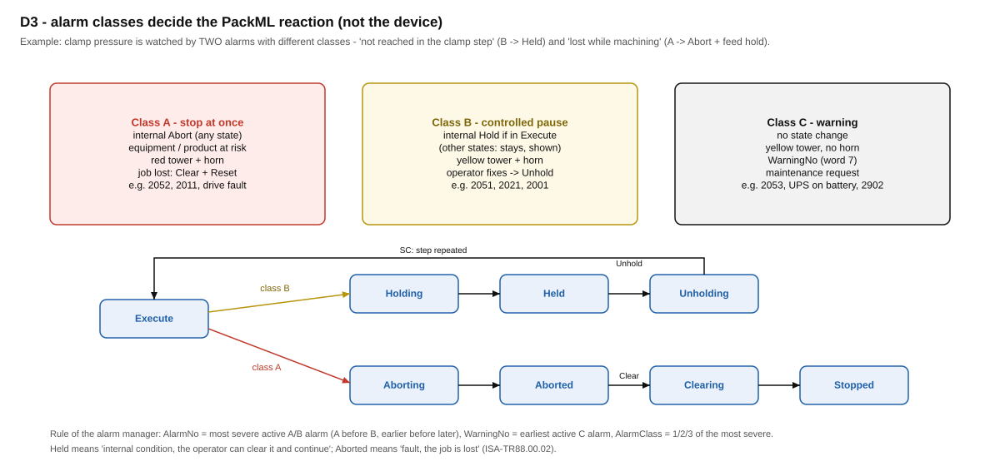

**Why "Hold only from Execute".** PackML allows Hold only from Execute (item 5 table). A class B alarm in Idle (e.g. "clamp end position not reached" during a
manual test) has nothing to hold – the module stays in Idle, the alarm is shown, and a Start is still possible only if the sequence's start conditions are
true (part B: the start interlock checks "no active class A/B alarm"). A class B alarm in Resetting keeps the module in Resetting (D4).

**Why Abort and not Stop for class A.** Stop is a **controlled** stop commanded from outside (the job may be finished cleanly in Stopping); Abort is the
PackML state for "fault – stop now". The F-program reacts to safety faults independently (stop category 0/1), the standard program follows with Abort so that
the state seen by the cell controller is "Aborted" (job lost) and not "Stopped" (controlled).

### A7.4 Typical alarms and classes per module type (examples – decide per project with the risk assessment)

| Module type | Class A (Abort) | Class B (Hold from Execute) | Class C (warning) |
|---|---|---|---|
| M01 machine tool interface | machine fault via coupling, safety coupling discrepancy | machine not ready at hand-over, door not open in time | machine feeder breaker off while idle |
| M02 APC | rotation not reached / lost position, clamp pressure lost while machining, clamp left end position | clamp end position not reached, clamp pressure not reached in clamp step, not in home position | pressure signal uncertain, pallet sensor plausibility |
| M03 pallet pool | drive fault, ready lost while moving, pallet lost from fork, rack table mismatch, door locked-not-closed | target place occupied, fork not centred at a step | enabling switch discrepancy while not in maintenance |
| M04 load station | rotary drive fault, clamp pressure lost during rotation | operator release missing, clamp not reached, part not detected | light curtain contamination warning |
| M05 robot cell | robot fault, safety coupling fault | robot not in home at hand-over, gripper not closed | gripper air pressure low warning |
| M06 AGV station | transfer motor tripped while transferring | AGV handshake time-out (partner not busy) | scanner warning field |
| M07 conveyor | zone motor tripped with a carrier between zones | carrier not arrived in zone time | stopper sensor plausibility |
| M08 AS/RS | as M03 | as M03 | as M03 |
| M09 tool management | presetter fault while measuring | tool not found | presetter feeder off |
| M10 washer | heater over-temperature, level low with pump running | door not closed at start of spray, temperature not reached | filter dirty, heater signal uncertain |
| M11 measuring | CMM fault during measuring | part not present | room temperature out of band |
| M12 marking | laser enclosure opened during marking | code not readable (retry) | exhaust motor warning |
| M13 assembly | press-fit force exceeded (product at risk) | part missing, operator release missing | nutrunner feeder off while idle |
| M14 test station | test pressure lost with part clamped | seal not reached | test pressure signal uncertain |
| M15 welding | robot / power source fault, turntable drive fault | wire empty, gas flow low before arc | nozzle cleaning due |
| M16 press | press over-travel, pressure out of limit | part missing | oil temperature high warning |
| M17 utilities | – (utilities rarely abort) | air pressure low (Hold all consumers) | dryer fault, coolant level low |
| M18 safety controller | F-program fault (not a normal stop) | – | e-stop discrepancy after reset |
| M19 cell controller / M22 network | – | – | UPS on battery, UPS fault |

Observation: **class A is rare** and always means "something can break or a product becomes scrap". Most device alarms are B. Class C is for
conditions that need a maintenance action but do not stop the process.

### A7.5 Worked example – the clamp pressure in two phases

FB_AnalogIn (B5) gives the pressure value and quality; the module evaluates three alarms with the instance number 5:

```iecst
(* in FB_APC01 (part B): clamp pressure alarms with two classes - D3 *)
xPressOk := ClampPress.iQuality <> 2 AND ClampPress.rValue >= rPressMin;      (* rPressMin e.g. 4.5 bar *)
(* a = 1, class B: not reached in the clamp step S30 - time-out of the step *)
xAlm5_1 := (iState = 6) AND (iStep = 30) AND (nStep * GC_CYCLE_MS >= tClamp_ms) AND NOT xPressOk;
(* a = 2, class A: lost while clamped in a machining state (machine cuts: coupling signal from M01) *)
tonLost(IN := xClamped AND xMachineCutting AND NOT xPressOk, PT := T#200MS);   (* short filter against spikes *)
xAlm5_2 := tonLost.Q;
(* a = 3, class C: quality not GOOD - FB_AnalogIn raises iAlarm = 3 itself *)
xAlm5_3 := ClampPress.iAlarm = 3;
(* FB_AlarmMgr takes ONE event per call (iEvent 1 raise / 2 clear, iInst, iCode, iClass) - the module turns condition edges into events *)
rt51(CLK := xAlm5_1);  ft51(CLK := xAlm5_1);   (* R_TRIG / F_TRIG instances, one pair per alarm condition *)
IF rt51.Q THEN AlarmMgr(iEvent := 1, iInst := 5, iCode := 1, iClass := 2); END_IF;   (* 2051 class B on  *)
IF ft51.Q THEN AlarmMgr(iEvent := 2, iInst := 5, iCode := 1, iClass := 2); END_IF;   (* 2051 off *)
rt52(CLK := xAlm5_2);  ft52(CLK := xAlm5_2);
IF rt52.Q THEN AlarmMgr(iEvent := 1, iInst := 5, iCode := 2, iClass := 1); END_IF;   (* 2052 class A *)
IF ft52.Q THEN AlarmMgr(iEvent := 2, iInst := 5, iCode := 2, iClass := 1); END_IF;
(* a = 3 the same way from xAlm5_3 with iClass := 3 (C) *)
AlarmMgr(iEvent := 0);                          (* evaluate once per scan without a new event *)
```

Sequence of events in a real case: the pallet sits on a chip; in S30 the pressure stays at 3.8 bar → after `tClamp_ms` alarm **2051 (B)** → Holding → Held,
tower yellow, horn. The operator opens the door (the F-program allows it in Held after standstill), cleans, closes, presses Unhold → Unholding → Execute,
step S30 is repeated, pressure 6.0 bar, the job continues. Later, during machining, a hose bursts: pressure falls below 4.5 bar for 200 ms → alarm **2052 (A)**
→ Aborting, the coupling to the machine tool (M01) drops "pallet clamped OK" → the machine CNC stops the feed (its own reaction), tower red. The job is lost; the
cell controller re-plans it after Clear and Reset (homing).

### A7.6 Classes and ISA-18.2 priorities

The alarm **class** of this guide is a **reaction class** (what the machine does). The ISA-18.2 **priority** (guide 69 F7.1) is an **operator response class**
(how fast the operator must act, and what happens if not). They are related but not the same:

| Class | Typical ISA-18.2 priority | Why |
|---|---|---|
| A | high (or urgent) | the machine stopped itself; production is lost until the operator acts |
| B | medium (high for a bottleneck machine) | the module waits in Held; the operator must act within minutes |
| C | low | no immediate consequence; maintenance within a shift / week |

Keep both columns in the master alarm database (guide 69 F7.2): class for the PLC, priority for the HMI.

### A7.7 Implementation notes per platform

| Topic | Siemens | CODESYS / TwinCAT | Rockwell |
|---|---|---|---|
| Class per alarm | a constant table `ARRAY[0..89, 1..9] OF SINT` in the module DB (generated) | same in a GVL | DINT array in the module AOI parameters |
| HMI alarm class | WinCC alarm classes ("Errors", "Warnings", own classes "A", "B", "C" with colours) | EventLogger severity (Critical / Error / Warning) | FT A&E severity 1–1000 (e.g. A 900, B 500, C 100) |
| Internal Abort | the alarm manager sets `iReaction = 1` (Abort); the PackML core treats it like the command Abort (but without echo) | same | same |
| Feed hold to the machine (class A while machining) | standard signal over the coupling + the machine's own reaction; a safety-relevant feed hold goes through the F-coupling | same | same |

### A7.8 Test cases for D3

| # | Test | Expected |
|---|---|---|
| D3-1 | Class B alarm in Execute | Holding → Held, tower yellow + horn, Unhold repeats the step |
| D3-2 | Class B alarm in Idle | state stays Idle, alarm shown, Start rejected by the start interlock |
| D3-3 | Class A alarm in any state | Aborting → Aborted, tower red + horn |
| D3-4 | Class C alarm in Execute | no state change, WarningNo set, yellow, no horn |
| D3-5 | A and B active together | AlarmNo = the A alarm, reaction Abort |
| D3-6 | Clamp pressure low in S30 vs. while machining | 2051 Held vs. 2052 Abort (A7.5) |

## A8. Decision D4 – Resetting homes the module

### A8.1 The problem

In item 9 the acting state Resetting lasted a fixed 5 ticks and then went to Idle (rule `module_run`). Scenario B (rotate jams → time-out → Abort →
recovery) and scenario E (wrong commands and Stop) ended in **Idle with the rotation between its end positions**. The next Start initialises the target
"B if at A, A if at B, alarm 10 if neither" – so it would at least refuse to start; but a module that reports **Ready** (word 4 bit 0) while a
cylinder is half-way is lying to the cell controller, which then dispatches a job that cannot run.

### A8.2 The options

| Criterion | Option 1: fixed time (item 9) | **Option 2: homing sequence with checks (chosen)** |
|---|---|---|
| Idle means | "time has passed" | "ready **and** every device in its home position" |
| Ready bit reliable for the CC | no | yes |
| Recovery after Abort | manual (operator moves the cylinder in Manual mode) | automatic if motion is allowed, else alarm 'not in home position' |
| Effort | none | one homing step chain per module (part B) |

### A8.3 The rule

> Resetting runs a HOMING sequence: (1) all outputs to the defined home command, (2) every device FB must report its home position (xAtA / stopped / not busy)
> within its timeout, (3) no active class A/B alarm, (4) safety OK (F-program status). Only then SC → Idle. A device that is between end positions is driven to
> its home position ONLY if the module is in a state where motion is allowed (guards closed, safety OK); else alarm 'not in home position' (class B, i = 0,
> a = 1) and the module stays in Resetting until homed or Stop/Abort. Abort and Stop never move a device – they only switch outputs to the fail-safe value
> (de-energise) – so Resetting is the place where the module returns to a known state.

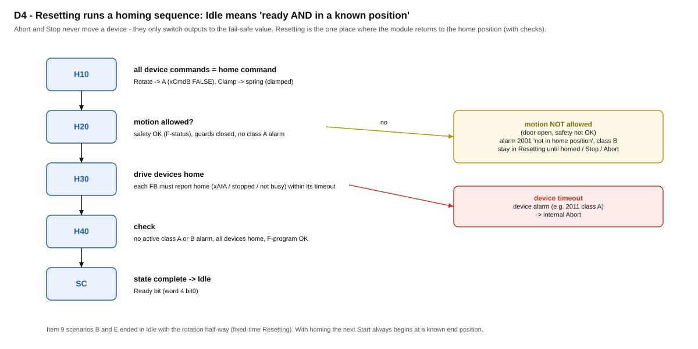

### A8.4 Home position per device type (library standard, example)

| Device FB | Home command | "Home reached" condition | Moves during homing? | Note |
|---|---|---|---|---|
| FB_Valve1 | `xCmdB := FALSE` (spring side A) | `xAtA AND NOT xBusy` | yes – by the spring, even when `xEnable` is FALSE | define A = safe side per instance (clamp: A = clamped) |
| FB_Valve2 | `xCmdB := FALSE` (side A), `xEnable := TRUE` | `xAtA AND NOT xBusy` | yes – needs valve supply and coil | APC rotation: A = pool side (example) |
| FB_MotorDol | `xCmd := FALSE` | `iState = 0` (STOPPED) | no | |
| FB_DriveSto (conveyor, turntable) | `xCmdRun := FALSE` | `iState <> 2` | no | |
| FB_DriveSto (positioning axis) | reference run in the drive (MC_Home / drive homing mode) | drive status "homed" + position in window | yes | axis homing is a module step (part B) |
| FB_Heater | keep `xEnable` as required by the recipe | no error | no | the bath may stay warm in Idle |
| FB_HandshakeHw | `xStart := FALSE` | `iStep = 0`, partner `xBusy` FALSE | no | a partner still busy blocks homing |
| FB_SignalTower, FB_PushButton | – | – | no | |
| Safety mirrors | – | `xOk` TRUE (safety OK) | no | condition (4) of the rule |

**Abort and Stop do not move – but de-energising can.** A single-solenoid valve springs to A when its output drops; a double-solenoid valve keeps its spool
(guide 69 E8.1). "Never move a device" in the rule means: the program does not **command** a motion in Stopping / Aborting; the **fail-safe** position of each
actuator (spring side, brake, closed-centre valve) is designed into the circuit (guide 68 B4) and the risk assessment.

### A8.5 Worked example – APC01 homing chain (sketch; complete module in part B)

```iecst
(* inside FB_APC01, state Resetting (15) = homing - decision D4 ; called every scan while iState = 15 *)
xAllHome   := Dev.Rotate.xAtA AND NOT Dev.Rotate.xBusy AND Dev.Clamp.xAtA AND NOT Dev.Clamp.xBusy;
xMotionOk  := xSafetyOk AND xZoneFree AND (AlarmMgr.iReaction <> 1);     (* F-copies: safety OK, pool zone released *)

CASE iHomeStep OF
0:  (* H10 - entry: home commands *)
    Dev.Rotate.xCmdB := FALSE;                  (* rotation home = side A *)
    Dev.Clamp.xCmdB  := FALSE;                  (* clamp home = A = clamped (spring) *)
    nHome := 0;
    iHomeStep := 20;
20: (* H20 - motion allowed? *)
    IF xAllHome THEN
        iHomeStep := 40;
    ELSIF xMotionOk THEN
        iHomeStep := 30;  nHome := 0;
    END_IF;
30: (* H30 - drive the devices home; the device FBs supervise their own movement time *)
    nHome := nHome + 1;
    IF xAllHome THEN
        iHomeStep := 40;
    ELSIF NOT xMotionOk THEN
        iHomeStep := 20;                        (* door opened during homing: wait, alarm 2001 *)
    ELSIF nHome * GC_CYCLE_MS >= tHoming_ms THEN
        xAlmHomeTimeout := TRUE;                (* module alarm a = 2 -> 2002, class A -> Abort *)
    END_IF;
40: (* H40 - final check *)
    IF xAllHome AND AlarmMgr.iAlarmNo = 0 AND xSafetyOk THEN
        xResettingSC := TRUE;                   (* SC -> the PackML core goes to Idle *)
        iHomeStep := 0;
    ELSIF NOT xAllHome THEN
        iHomeStep := 20;
    END_IF;
END_CASE;
(* module alarm i = 0, a = 1 'not in home position' (class B): not home and motion not allowed *)
xAlmNotHome := (iHomeStep = 20) AND NOT xAllHome AND NOT xMotionOk;
(* Valve enable: motion only when allowed (Valve2 keeps its spool when disabled; Valve1 springs to A anyway) *)
Dev.Rotate.xEnable := xMotionOk;
Dev.Clamp.xEnable  := xMotionOk;
```

How the chain handles the item 9 situations:

| Situation at Reset | What happens | Result |
|---|---|---|
| Rotation at A, clamped (normal) | H10 → H20: all home → H40 → SC | Idle in 3 scans |
| Rotation half-way (item 9 B/E), pool door closed | H20: motion OK → H30: Rotate drives to A (FB_Valve2 tMove 2 s) → H40 → SC | Idle after the move |
| Rotation half-way, pool door open | H20 waits, alarm **2001** (B) – tower yellow, horn | stays in Resetting; door closed → H30 → Idle |
| Rotation jammed again | FB_Valve2 alarm 1 after tMove → **2011** (A) → Aborting | Aborted – the jam must be removed |

### A8.6 Typical mistakes

1. **Homing in Stopping or Aborting.** "Let us move the rotation home when the operator presses Stop" – a Stop must make the machine *calmer*, not start a motion;
   and Abort is the reaction to a fault – moving is exactly what must not happen. Only Resetting homes.
2. **No motion check.** A homing that drives a cylinder while the maintenance door is open relies only on the F-program cutting the valve supply. It will (if the
   circuit is right), but then the device FB raises a time-out and the module aborts – an unclear message. With the check the operator sees "2001 not in home
   position" and knows what to do.
3. **Timeout of the chain shorter than the device timeouts.** Then the chain alarm 2002 comes before the device alarm 2011 and hides the real cause. Rule:
   `tHoming_ms` > the sum of the device movement times of the chain.
4. **Ready bit set before the check.** Ready = state Idle; the check is inside Resetting – so the Ready bit is automatically correct if the PackML core sets
   Idle only on SC.

### A8.7 Test cases for D4

| # | Test | Expected |
|---|---|---|
| D4-1 | Reset with all devices home | Idle within a few scans |
| D4-2 | Rotation half-way, guards closed | rotation moves to A, then Idle |
| D4-3 | Rotation half-way, door open | stays in Resetting, alarm 2001 B; close door → homing continues |
| D4-4 | Stop during homing | Stopping → Stopped; outputs de-energised; no further motion |
| D4-5 | Rotate jammed during homing | 2011 A → Aborted |
| D4-6 | Ready bit | only in Idle after a successful homing |

## A9. Common rules of every library FB

### A9.1 The time base: counting calls

All FBs of the library measure time by **counting their own calls** (rule `common`):

> tick = 100 ms = the cycle of the test bench (in a real PLC the FB runs in the 10 ms main task – only the time base changes). Every FB is called exactly once
> per tick. […] Times: a counter n counts calls; a time is reached when n × 100 ≥ t_ms.

In ST: `n * GC_CYCLE_MS >= tMove_ms`, where `GC_CYCLE_MS` is a library constant = the cycle time of the task in which the FBs run (100 in the test bench, 10 in
the real main task). Example: `tMove_ms = 2000` → 20 calls in the test bench, 200 calls in a 10 ms task – the same 2 s.

Why count calls and not use TON?

| Aspect | Counting calls (library) | TON instances (guide 69 teaching FBs) |
|---|---|---|
| Deterministic in a test | yes – the same event list gives the same log on every machine | depends on the real clock of the test PC |
| Soft PLC / web tab identical to the PLC | yes | needs a simulated clock |
| Accuracy in a real PLC | ± one task cycle (10 ms) **if the task is cyclic and does not overrun** | ± one cycle, independent of overruns |
| Behaviour when the task overruns | times become longer (calls are missing) | correct |
| Memory | one DINT per timer | one TON instance (~ 20–30 bytes) per timer |

The condition "cyclic task, no overrun" is checked by the cycle-time monitoring of guide 69 B6. A project that runs the library in a **free-running** task (OB1
with variable cycle) must replace the counting with TON (a library variant, D8) – never mix both in one project.

**Counter overflow.** `n` is a DINT and the comparison multiplies it by the cycle: `n * GC_CYCLE_MS`. If `n` could grow without limit, the product would
overflow long before `n` itself (2^31 / 100 ≈ 21.5 million calls). The library therefore **saturates** every counter at `GC_N_MAX = 1 000 000` calls (`TYPES.st`):
`n := MIN(n + 1, GC_N_MAX)`. Then `n * GC_CYCLE_MS` ≤ 10^8 for a cycle of 100 ms – far below 2^31 – and the longest time that can be monitored is 1 000 000 × 100 ms
= **27.8 h** in the test bench or 1 000 000 × 10 ms = **2.8 h** in a 10 ms task – far more than any monitoring time of a device (the longest default in the library is the
handshake job time, 10 s). Saturation does not change a single result of the tests (the largest counter in the tests reaches 50).

**TON variant.** `tools/fmse/plc_lib/README.md` shows how to replace a counter by a TON (`tonMove(IN := xMoving AND xEnable AND NOT xReached, PT := DINT_TO_TIME(tMove_ms))`).
Two differences to remember: a TON reaches PT **one call later** than the counter (its elapsed time starts at 0 in its first call), and it does not pause while
`xEnable` is FALSE unless the IN condition is written so. The counter version is the **reference** – the unit tests are defined with it.

### A9.2 Edges inside the FB

> Edges (xReset, xRequest, xHornAck, xPb, xCmdChangeRequest) are detected inside the FB: e = x AND NOT x_prev (x_prev starts FALSE).

So the caller passes **levels**; the FB makes the edge. Two consequences:

- A reset button held for 10 s resets **once** (rising edge) – a broken (stuck) reset button cannot reset every new fault automatically.
- `x_prev` starts FALSE: if an input is TRUE in the first call, that first call sees a rising edge. Example: a reset button pressed during power-on is treated as
  a reset in the first call. For FB_Safe2Ch this is harmless (it only resets if both channels are closed and no discrepancy); the module can additionally block
  all resets in the first scan.

### A9.3 Inputs are persistent; one call per tick

In the test bench an event `<tick> name=value` changes an input **before** the call of that tick, and the input keeps its value until the next event. This is
exactly how a PLC input behaves (a level held in the process image). Each FB instance is called **exactly once per tick** – a second call in the same scan would
count time twice (A2.4 variant).

### A9.4 The log format (how to read every test of Part B)

> Log: tick 0 = 'init' with all outputs after the first call; then one line per tick listing only the outputs whose value changed (BOOL as 1/0, numbers as
> integers or shortest decimal).

Example (FB_Valve1, test V1):

```
    0 init qSol=0 xAtA=1 xAtB=0 xBusy=0 xError=0 iAlarm=0     <- all outputs after the first call
    2 qSol=1 xAtA=0 xBusy=1                                  <- in tick 2 these three outputs changed
    8 xAtB=1 xBusy=0
```

A missing tick means "no output changed". The **events** (input changes) are listed separately for each test in Part B. With the events and the log a test is
completely described – it can be re-run on any PLC (D3).

### A9.5 Default input values of the tests

> Valve xPosA TRUE (starts at A), xEnable TRUE ; DriveSto xSto TRUE ; Heater rTemp 20.0, xTempGood TRUE, rSp 60.0 ; SignalTower iState 2 ; Feeder xSupplyOn TRUE ;
> Ups xUpsOk TRUE ; Edm xFb TRUE ; Scanner iField 1 ; DoorLock all four TRUE ; CmdIf iState 2, iMode 1 ; all others FALSE / 0.

These are the "normal rest" values of each device (a valve at A, STO active after power-on, a door closed and locked …). They are also the recommended
**initial values** for simulation (virtual commissioning, part C).

### A9.6 Behaviour rules shared by all device FBs

1. **Status first, then commands, then outputs** (guide 69 D1.2 rule 6) – every listing evaluates the inputs, then the state logic, then writes the outputs
   at the end.
2. **An error does not change the outputs of a control block** unless the rule says so (FB_Valve: "an error does NOT change the outputs – the module decides the
   reaction by alarm class"). The module's alarm manager and PackML core decide (D3); the device FB only reports. Exceptions with a physical reason:
   FB_Heater switches off on any error (a heater has no "hold position"), FB_HandshakeHw drops its request (the partner must see the abort).
3. **Errors are latched** and cleared only by a **rising edge of xReset** while the cause is gone (FB_Valve: not both switches on; FB_Edm: feedback OK; FB_Safe2Ch:
   both channels were open). A reset never moves anything by itself.
4. **No automatic restart inside a device FB.** A device FB follows a **level** command (xCmdB, xCmdRun, xStart, xCmd for the motor with an edge). The module
   guarantees that the command level is FALSE after Stop, Abort, Hold and power-on (part B) – that is where the restart protection of IEC 60204-1 9.2.5.4 lives
   for the level-commanded blocks. FB_MotorDol additionally needs a rising edge (item 9). B4 and B9 discuss what this means for drives and handshakes.
5. **Local alarm codes 1…9**, one `iAlarm` output (0 = none). The module builds the full number (D2) and the class (D3).
6. **No safety function.** Mirror blocks read F-copies only (B0).
7. **Fail-safe initial values.** After a cold start all outputs are FALSE / 0 (FB_Valve2: `qSolA` TRUE only because the default command is "A" and the enable is TRUE;
   the module sets `xEnable := FALSE` until it allows motion).

## A10. Checklist – Part A

- [ ] Task set fixed (Main 10 ms with all module FBs, Comm 100 ms with the interface, Diag 1 s); cycle-time monitoring active (A2.1).
- [ ] Project structure with a read-only library folder, generated folders and a single interface folder (A2.2).
- [ ] Module FB with the eight elements and the scan order of A2.4; one writer per variable inside the module (A2.3).
- [ ] Naming: prefixes `x q i r w t_ms b n`, `FB_ F_ ST_ E_ GC_`, instances = tag groups (A3).
- [ ] Data block ownership table in the interface sheet: module 0–1, 4, 6–11, 16–18; CC 2–3, 5, 12–15, 19; Job.PalletId CC only (A4).
- [ ] D1: 4-phase echo, CmdAck bit 8, CmdRej bit 9, rising edge, WarningNo M × 1000 + 900 + cmd, CC time-out 2 s (A5).
- [ ] D2: AlarmNo = M × 1000 + 10 × i + a, i = 1…89 in expansion order, module alarms i = 0, rejections 900 + n (A6).
- [ ] D3: a class A / B / C for every alarm; two clamp-pressure alarms where the phase matters (A7).
- [ ] D4: homing chain in Resetting with motion check, alarm M001 'not in home position' (A8).
- [ ] Library rules: time base by calls, edges inside, levels outside, errors latched, no automatic restart, no safety function (A9).

---

# Part B – The device FB library

## B0. Overview, mirror principle, how to read a block chapter

### B0.1 The library at a glance

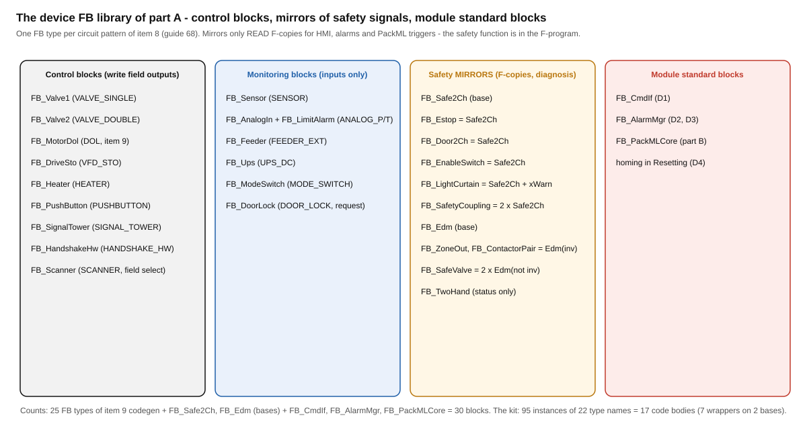

| # | FB | Pattern (guide 68) | Kind | Local alarms | Test (ref) | Used in modules (library) |
|---|---|---|---|---|---|---|
| B1 | FB_Sensor | SENSOR | monitoring | – (module-defined) | S1 | almost all (26 instances in the kit) |
| B2 | FB_Valve1 | VALVE_SINGLE | control | 1, 2, 3 | V1, V2, V3 | M02, M04, M07, M10, M12, M14 |
| B2 | FB_Valve2 | VALVE_DOUBLE | control | 1, 2, 3 | V4 | M02, M13 |
| B3 | FB_MotorDol | DOL | control | 1, 2, 3, 4 | item 9 A–E | M06, M07, M10, M12, M15, M17 |
| B4 | FB_DriveSto | VFD_STO | control | 1, 3 | D1 | M03, M04, M05, M08, M15 |
| B5 | FB_AnalogIn (+ FB_LimitAlarm) | ANALOG_P, ANALOG_T | monitoring | 3 quality (FB) ; 1, 2 process alarms (module) | item 9 analog / limits | M02, M04, M10, M11, M14, M16, M17 |
| B6 | FB_Heater | HEATER | control | 1, 2, 3, 4 | H1 | M10 |
| B7 | FB_PushButton | PUSHBUTTON | operator | – | P1 | M04, M13, M18 |
| B8 | FB_SignalTower | SIGNAL_TOWER | operator | – | T1 | M03, M04, M14, M18 |
| B9 | FB_HandshakeHw | HANDSHAKE_HW | control | 1, 2, 3, 4 | HS1 | M06 (AGV), any hard-wired partner |
| B10 | FB_Feeder | FEEDER_EXT | monitoring | 1 | F1 | M01, M11, M12, M13, M14, M15 |
| B11 | FB_Ups | UPS_DC | monitoring | 1, 2 | U1 | M19, M22 |
| B12 | FB_Safe2Ch (+ 5 wrappers) | ESTOP, DOOR_2CH, ENABLE, LC, COUPLING | **mirror** | 1 (+ wrapper codes) | E1 | M01, M03, M04, M07, M10, M12, M13, M14, M15, M18 |
| B13 | FB_Edm (+ 3 wrappers) | ZONE_OUT, CONT_PAIR_EDM, SAFE_VALVE | **mirror** | 1 (+ wrapper codes) | Z1 | M03, M18, (safe valves) |
| B14 | FB_ModeSwitch | MODE_SWITCH | monitoring (F-copies) | 1 | M1 | M03, M18 |
| B15 | FB_TwoHand | TWOHAND | **mirror** | 1 | W1 | M13 |
| B16 | FB_Scanner | SCANNER | control (field select) + mirror | 2 | SC1 | M06 |
| B17 | FB_DoorLock | DOOR_LOCK | request + mirror | 1, 2, 3 | L1 | M03, M15 |
| C1 | FB_CmdIf | (module standard) | module | – (warning M900 + cmd) | C1 | every module |
| C3 | FB_AlarmMgr | (module standard) | module | – | alarm manager log | every module |

**Count (rule `fb_library`).** The 25 circuit patterns with field IO of the item 9 code generator (`codegen.fb_types`, guide 69 D10) map to **24 distinct FB types**
(ANALOG_P and ANALOG_T share FB_AnalogIn). Of these 24, eight are wrappers (FB_Estop, FB_Door2Ch, FB_EnableSwitch, FB_LightCurtain, FB_SafetyCoupling on FB_Safe2Ch;
FB_ZoneOut, FB_ContactorPair, FB_SafeValve on FB_Edm). So the device layer has **16 own code bodies + the 2 bases FB_Safe2Ch, FB_Edm = 18 device code bodies**, plus
FB_LimitAlarm (item 9), plus the module standard blocks **FB_CmdIf** and **FB_AlarmMgr** and the function **F_CmdAllowed** of part A – and **FB_PackMLCore**, which comes
in part B. The real library `tools/fmse/plc_lib/` has 31 files: `TYPES.st`, `F_CmdAllowed.st` and 29 FB files. Part A tests **16 device FBs and FB_CmdIf with 19 unit
tests** (FB_Valve1 has three); FB_MotorDol, FB_AnalogIn and FB_LimitAlarm keep their item 9 tests (`item9_examples.json` motor / analog / limits).

**The listings of Parts B and C are the library source.** Every listing is copied from the released file `tools/fmse/plc_lib/<name>.st` (version 1.0.0) without the long
file header (purpose, interface table, alarm table, timing and Siemens notes – read it in the file). `st_sim.py --test` runs exactly these files and reproduces every
reference log of this guide. The source style: two `VAR_INPUT` sections (signals, then configuration with the example defaults), edges with `R_TRIG` instances
(`rtReset(CLK := xReset); xRst := rtReset.Q;` – identical to the rule `x AND NOT x_prev`), state numbers as qualified enumerations from `TYPES.st`
(`E_DriveState.FAULT`), counters named after their purpose (`nMove`, `nLost`, `nBoth` for the rule's `n`, `nl`, `nb`).

### B0.2 The mirror principle

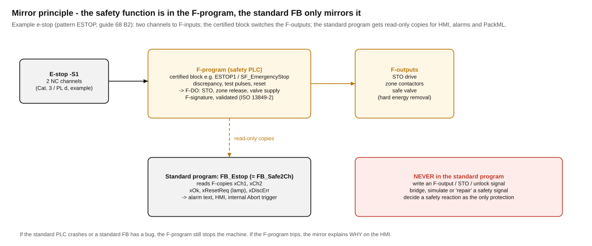

Eleven blocks of this library work on **F-copies** – read-only copies of safety inputs or outputs that the F-program provides to the standard program (guide 69
D11, generated as plain BOOL globals without address). They are **mirrors**:

| Mirror block | The safety function is done by … (in the F-program) | The mirror gives the standard program … |
|---|---|---|
| FB_Safe2Ch, FB_Estop | certified e-stop block (e.g. SF_EmergencyStop, ESTOP1) | e-stop state, reset-request lamp, discrepancy diagnosis, PackML Abort trigger |
| FB_Door2Ch | guard monitoring block (SF_GuardMonitoring) | door state for HMI, Held / Stopped trigger |
| FB_EnableSwitch | enabling device block (SF_EnableSwitch) | enabling state in maintenance mode |
| FB_LightCurtain | ESPE block / muting (SF_ESPE, SF_MutingPar) | curtain free / interrupted, contamination warning |
| FB_SafetyCoupling | coupling logic between two safety systems (e-stop in both directions, zone free) | coupling states, discrepancy |
| FB_Edm, FB_ZoneOut, FB_ContactorPair | EDM block (SF_EDM) and the zone F-DO | contactor / zone feedback diagnosis ("welded") |
| FB_SafeValve | safe valve block (two valves with feedback, SF_EDM per valve) | valve feedback diagnosis |
| FB_TwoHand | two-hand block type IIIC (SF_TwoHandControlTypeIII) | status, "not simultaneous – release both" hint |
| FB_Scanner (OSSD part) | scanner OSSD → F-input, field-set plausibility in the scanner / F-program | free / not free, warning field |
| FB_DoorLock (status part) | guard locking block (SF_GuardLocking) – unlocks after standstill | door / lock status, request to unlock |

**Rules for mirrors** (guide 67 I1–I2, guide 69 D11):

1. A mirror **never writes** an F-output, an STO signal or a lock command. The generated code has no assignment for FDO symbols (guide 69 G1); the static check
   (D4) verifies that no library block has an output that is wired to an FDO.
2. A mirror can **request** something from the F-program through a defined request bit (FB_DoorLock `xUnlockReq`) – the F-program decides.
3. A mirror's diagnosis (e.g. discrepancy) **duplicates** the F-program's own diagnosis for the operator; the F-program's diagnosis is the authoritative one. If
   they differ (e.g. different discrepancy times), the operator gets confusing messages – **align the times** (`tDisc_ms` = the discrepancy time configured in the
   F-block).
4. The mirror's `xOk` / `xSafe` may be used as a **PackML trigger** (e-stop pressed → internal Abort; door opened → Hold) and to **suppress nuisance alarms**
   (a drive is "not ready" because STO is active – expected). It must **never** be the only protection.

If the standard PLC crashed or a mirror had a bug, the F-program would still stop the machine. If the F-program trips, the mirror tells the operator **why**.

### B0.3 How to read a block chapter

Every chapter of Part B has the same sections:

1. **Purpose and where used** – the circuit pattern of guide 68 and the modules that use it.
2. **Interface** – inputs, outputs, configuration with defaults (from `fb_interfaces`).
3. **The rule** – the exact behaviour (from `_rules`), explained in words, often with a state diagram.
4. **Listing** – complete ST that implements the rule exactly (library 1.0.0, teaching code).
5. **Unit test** – events, reference log, line-by-line explanation; timing diagram for the important blocks.
6. **HMI faceplate** – what the faceplate shows and which commands it may write.
7. **Alarm table** – local codes, texts, suggested class (D3) – the module decides the final class.
8. **Commissioning test** – the steps on the real machine (cold commissioning with the IO test, then hot).
9. **Typical mistakes and field faults.**

All listings use the global constants of `TYPES.st` (load it first):

```iecst
VAR_GLOBAL CONSTANT
  GC_CYCLE_MS : DINT := 100;                  (* time base of the call counters [ms]: 100 test bench, 10 in the 10 ms main task *)
  GC_N_MAX : DINT := 1000000;                 (* counters stop here (no overflow, 27 h at 100 ms) *)
  GC_BLINK_HALF_MS : DINT := 500;             (* half period of the 1 Hz blink [ms] *)
  GC_LIB_VERSION : WORD := 16#0100;           (* library version 1.0.0 *)
END_VAR
```

`TYPES.st` also defines the enumerations `E_AlarmClass`, `E_Reaction`, `E_AlarmEvent`, `E_PackMLState`, `E_PackMLCmd`, `E_Mode`, `E_DriveState`, `E_MotorState`,
`E_HsStep`, `E_Quality`, `E_AiStatus` with the numbers of A0.4 (TIA Portal has no enumerations in SCL – use INT constants with the same values).

## B1. FB_Sensor – debounce with separate on and off times

### B1.1 Purpose and where used

Pattern SENSOR (guide 68 B5): a discrete PNP sensor (inductive, optical, cylinder reed switch, level switch, pressure switch) on a DI. The FB filters bounce and
flicker. It is the most frequent block: 26 of the 95 kit instances (E1). Typical settings (examples): cylinder / position sensor 20–50 ms, part-present sensor on a
conveyor 50–100 ms, level switch in a sloshing tank 500–2000 ms, counting sensor 0 ms (use the hardware filter of the card instead).

### B1.2 Interface

| Name | Dir | Type | Default | Meaning |
|---|---|---|---|---|
| `xOn` | in | BOOL | FALSE | field input (e.g. `APC01_PalSideA_On`) |
| `tOn_ms` | cfg | DINT | 0 | the input must be TRUE this long before `xValue` becomes TRUE |
| `tOff_ms` | cfg | DINT | 0 | the input must be FALSE this long before `xValue` becomes FALSE |
| `xValue` | out | BOOL | FALSE | debounced value |

### B1.3 The rule

> debounce: if xOn <> xValue: cnt += 1 ; if cnt × 100 >= (tOn_ms if xOn else tOff_ms): xValue = xOn, cnt = 0 ; else cnt = 0. Outputs xValue (init FALSE).

In words: as long as the raw input differs from the debounced value, count; when the count reaches the time of the **new** direction, take the new value. Any call
in which the raw input equals the debounced value restarts the count – a single bounce restarts the whole delay. With `tOn_ms = 0` and `tOff_ms = 0` the FB is a
plain copy: with 0 ms the first differing call already reaches `1 × 100 >= 0`, so `xValue` follows **in the same call**.

Effective delay: a change is accepted after `ceil(t_ms / GC_CYCLE_MS)` calls of stable signal (at least 1 call). Example 10 ms task, `tOn_ms = 30` → 3 calls =
30 ms.

### B1.4 Listing

```iecst
(* source: tools/fmse/plc_lib/FB_Sensor.st - library 1.0.0, file header omitted *)
FUNCTION_BLOCK FB_Sensor
VAR_INPUT  (* signals *)
  xOn : BOOL;                               (* sensor input (DI) *)
END_VAR
VAR_INPUT  (* configuration (set once, defaults = example values) *)
  tOn_ms : DINT := 0;                       (* debounce time 0 -> 1 [ms] *)
  tOff_ms : DINT := 0;                      (* debounce time 1 -> 0 [ms] *)
END_VAR
VAR_OUTPUT  (* outputs *)
  xValue : BOOL;                            (* debounced value *)
END_VAR
VAR  (* internal *)
  nCnt : DINT;                              (* calls with input <> value *)
  tLim : DINT;                              (* active debounce time *)
END_VAR
IF xOn <> xValue THEN
  nCnt := MIN(nCnt + 1, GC_N_MAX);
  IF xOn THEN
    tLim := tOn_ms;
  ELSE
    tLim := tOff_ms;
  END_IF
  IF nCnt * GC_CYCLE_MS >= tLim THEN
    xValue := xOn;
    nCnt := 0;
  END_IF
ELSE
  nCnt := 0;
END_IF
END_FUNCTION_BLOCK
```

### B1.5 Unit test S1 – bounce ignored, 300 ms on / 200 ms off

Configuration `tOn_ms = 300`, `tOff_ms = 200`. Events: 2 `xOn=1` · 3 `xOn=0` · 4 `xOn=1` · 10 `xOn=0` · 11 `xOn=1` · 12 `xOn=0`.

```
TEST FB_Sensor | S1 debounce: bounce ignored, 300 ms on / 200 ms off | 3 lines
    0 init xValue=0
    6 xValue=1
    13 xValue=0
```

| Tick | xOn | nCnt after the call | xValue | Explanation |
|---|---|---|---|---|
| 0, 1 | 0 | 0 | 0 | init, raw = debounced |
| 2 | 1 | 1 | 0 | 1 × 100 = 100 < 300 |
| 3 | 0 | 0 | 0 | bounce: raw = debounced → count restarts |
| 4 | 1 | 1 | 0 | new start of the on-delay |
| 5 | 1 | 2 | 0 | 200 < 300 |
| 6 | 1 | 0 | **1** | 3 × 100 = 300 ≥ 300 → **xValue = 1** (log line 6) |
| 7–9 | 1 | 0 | 1 | stable |
| 10 | 0 | 1 | 1 | off-delay starts, 100 < 200 |
| 11 | 1 | 0 | 1 | bounce back to 1 = debounced → restart |
| 12 | 0 | 1 | 1 | off-delay starts again |
| 13 | 0 | 0 | **0** | 2 × 100 = 200 ≥ 200 → **xValue = 0** (log line 13) |

Lesson: the sensor was "on" at tick 2 but the program sees it at tick 6 – the first pulse (ticks 2–3) was shorter than 300 ms and was ignored completely. A
debounce time is a **reaction delay** that adds to the reaction time of guide 69 B1; choose it as short as the process allows.

### B1.6 HMI faceplate

Small faceplate (often only a symbol on the module screen): raw state (LED grey/green), debounced state, configured times (maintenance role may change
them – the change is logged). Sensors have no commands. In **simulation mode** (virtual commissioning, part C) the faceplate can force `xOn` – only in the
simulation project, never on the real machine.

### B1.7 Alarms

FB_Sensor has **no own alarm** – a sensor cannot know whether its state is wrong. The **module** defines sensor alarms with the sensor's instance number (D2):
plausibility ("pallet present at side A and side B but only one pallet in the system"), expectation ("part expected at the end of the step but not detected"),
stuck ("sensor never changed for 100 cycles of the machine" – a maintenance hint, class C). Example: APC01 PalSideA i = 3 → 2031.

### B1.8 Commissioning test

1. IO test (cold): actuate the sensor with a metal target / reflector; check the raw input on the PLC and the LED on the sensor; check the tag on the HMI.
2. Debounce: watch `xValue` in the PLC trace while the target vibrates at the edge of the range; increase `tOn_ms` until the debounced value is stable.
3. Switching distance: for an inductive sensor, measure the distance at which it switches; the target must be well inside (≤ 0.8 × rated distance, guide 68 B5).
4. Document the final times in the parameter list of the module.

### B1.9 Typical mistakes and field faults

| Fault | Symptom | Cause / fix |
|---|---|---|
| debounce 0 on a level switch | level alarm chatters (guide 69 F6) | waves in the tank; use 500–2000 ms |
| debounce 500 ms on a cylinder sensor | sequence is slow, step times grow by 0.5 s per step | use 20–50 ms; long debounce hides nothing, it only costs time |
| sensor at the edge of its range | random short drops (flicker) | mechanical adjustment, not a longer debounce |
| two-wire sensor on a PNP input with high leakage current | input stays TRUE | use 3-wire PNP sensors or check the card's leakage limit |
| debounce in the module **and** in the FB | double delay | one place: the FB |

## B2. FB_Valve1 and FB_Valve2 – cylinders with end-position monitoring

### B2.1 Purpose and where used

Patterns VALVE_SINGLE (FB_Valve1, 5/2 single solenoid, spring return) and VALVE_DOUBLE (FB_Valve2, 5/2 double solenoid, bistable) of guide 68 B4, with two end
switches `PosA` and `PosB`. Used in M02 (rotate: Valve2, clamp: Valve1), M04 (clamp), M07 (stoppers), M10 (door cylinder), M12 (clamp), M13 (press-fit: Valve2),
M14 (seals). Guide 69 D8 explained the two valve types and why "outputs FALSE" does not stop a bistable valve.

| Property | FB_Valve1 | FB_Valve2 |
|---|---|---|
| Valve | 5/2 single solenoid, spring return | 5/2 double solenoid, detent (bistable) |
| Outputs | `qSol` (TRUE → position B) | `qSolA`, `qSolB` |
| `xEnable = FALSE` | coil off → the spring moves the cylinder to **A** | both coils off → the spool **holds** its position |
| Typical home | A = spring side = safe side (clamp: clamped) | A by definition of the module |

### B2.2 Interface

| Name | Dir | Type | Default | Meaning |
|---|---|---|---|---|
| `xPosA`, `xPosB` | in | BOOL | TRUE / FALSE (test default: starts at A) | end switches |
| `xCmdB` | in | BOOL | FALSE | TRUE = go to / stay at B, FALSE = A (level, from the sequence) |
| `xEnable` | in | BOOL | TRUE | permission (module allows motion, valve supply on); FALSE: Valve1 springs to A, Valve2 holds |
| `xReset` | in | BOOL | FALSE | fault reset (rising edge inside) = retry |
| `tMove_ms` | cfg | DINT | 2000 | maximum movement time |
| `tLost_ms` | cfg | DINT | 300 | end position may be missing this long without command |
| `tBoth_ms` | cfg | DINT | 200 | both switches may be on this long |
| `qSol` (Valve1) / `qSolA`, `qSolB` (Valve2) | out | BOOL | | coils |
| `xAtA`, `xAtB` | out | BOOL | | end position (plausible: only one switch) |
| `xBusy` | out | BOOL | | movement running (commanded position not yet reached, no error) |
| `xError` | out | BOOL | | alarm latched |
| `iAlarm` | out | INT | | 0, 1 not reached, 2 lost, 3 both switches |

### B2.3 The rule

> Order: rst = edge(xReset) ; atA = xPosA AND NOT xPosB ; atB = xPosB AND NOT xPosA ; reached = atB if xCmdB else atA ;
> (1) if xError and rst and NOT (xPosA AND xPosB): xError = FALSE, iAlarm = 0, moving = NOT reached, n = 0, nl = 0 (retry) ;
> (2) if xCmdB <> prevCmd (prevCmd starts 'none' → TRUE at the first call): moving = TRUE, n = 0 ;
> (3) nb = nb+1 if xPosA AND xPosB else 0 ;
> (4) if NOT xError: if nb × 100 >= tBoth_ms: error, iAlarm 3 'both end switches on', moving = FALSE ; elif moving: nl = 0 ; if xEnable: n += 1 ; if reached:
> moving = FALSE elif n × 100 >= tMove_ms: error, iAlarm 1 'end position not reached', moving = FALSE ; elif xEnable: nl = nl+1 if NOT reached else 0 ; if nl × 100
> >= tLost_ms: error, iAlarm 2 'left the end position without command' ; else nl = 0 ;
> (5) outputs: Valve1 qSol = xCmdB AND xEnable ; Valve2 qSolB = xCmdB AND xEnable, qSolA = NOT xCmdB AND xEnable (an error does NOT change the outputs – the module
> decides the reaction by alarm class) ; xAtA = atA ; xAtB = atB ; xBusy = moving AND NOT xError ; prevCmd = xCmdB.

The logic as a small state model:

| Situation | Condition | Counter | Alarm when |
|---|---|---|---|
| **Moving** (after a new command or a retry) | `moving` TRUE | `n` counts only while `xEnable` (paused when disabled) | `n × tick ≥ tMove_ms` and target not reached → **1** |
| **At target, enabled** | `moving` FALSE, `xEnable` | `nl` counts while the target position is missing | `nl × tick ≥ tLost_ms` → **2** (pressure loss, cylinder pushed back, sensor moved) |
| **Disabled, not moving** | `xEnable` FALSE | `nl = 0` | no lost-position check (Valve1 springs back legally) |
| **Both switches** | `xPosA AND xPosB` | `nb` | `nb × tick ≥ tBoth_ms` → **3** (sensor fault, wrong sensor position, wire short) – has priority |

Design choices behind the rule:

1. **One "not reached" alarm for both directions.** The module knows the direction from `xCmdB`; the alarm text says "end position not reached" and the HMI shows
   the commanded side. (Guide 69 D8 had 1 = to A, 2 = to B – the library merges them and uses 2 for "lost".)
2. **Movement time paused while disabled.** If the safety zone removes the valve supply in the middle of a stroke (door opened), the cylinder stops (or springs back);
   when the supply returns the movement continues and the remaining time is still available. Without the pause every door opening during a stroke would end in a
   time-out alarm.
3. **The error does not switch the coils.** For a bistable valve, switching the coils off does not stop the movement anyway (guide 69 E8.1); for a single valve,
   switching off means "spring back" – a motion that the module may not want (a clamp would clamp; a stopper would close on a moving carrier). So the decision is the
   module's: class A → Abort → the module sets `xEnable` / commands as defined for Aborting; class B → Hold → the outputs are kept.
4. **Reset = retry.** After a "not reached" alarm the reset sets `moving` again if the target is not reached, with a fresh `tMove_ms` – the operator removes the jam and
   presses reset, the cylinder continues to the same target.
5. **Reset refused while both switches are on.** The cause (alarm 3) is still present; a reset would be pointless.

### B2.4 Listing FB_Valve1

```iecst
(* source: tools/fmse/plc_lib/FB_Valve1.st - library 1.0.0, file header omitted *)
FUNCTION_BLOCK FB_Valve1
VAR_INPUT  (* signals *)
  xPosA : BOOL := TRUE;                     (* end switch A (DI); default: starts at A *)
  xPosB : BOOL;                             (* end switch B (DI) *)
  xCmdB : BOOL;                             (* TRUE = go to / stay at B, FALSE = A *)
  xEnable : BOOL := TRUE;                   (* FALSE = outputs off *)
  xReset : BOOL;                            (* fault reset, rising edge *)
END_VAR
VAR_INPUT  (* configuration (set once, defaults = example values) *)
  tMove_ms : DINT := 2000;                  (* max. time to reach the end position [ms] *)
  tLost_ms : DINT := 300;                   (* end position lost without command [ms] *)
  tBoth_ms : DINT := 200;                   (* both end switches on [ms] *)
END_VAR
VAR_OUTPUT  (* outputs *)
  qSol : BOOL;                              (* solenoid (DO): TRUE = B *)
  xAtA : BOOL;                              (* at end position A *)
  xAtB : BOOL;                              (* at end position B *)
  xBusy : BOOL;                             (* moving (supervised) *)
  xError : BOOL;                            (* error latched (see alarms) *)
  iAlarm : INT;                             (* local alarm code (0 = none) *)
END_VAR
VAR  (* internal *)
  rtReset : R_TRIG;                         (* edge of xReset *)
  xRst : BOOL;                              (* reset pulse *)
  xA : BOOL;                                (* at A (decoded) *)
  xB : BOOL;                                (* at B (decoded) *)
  xReached : BOOL;                          (* commanded end position reached *)
  xMoving : BOOL;                           (* movement supervised *)
  xPrevCmd : BOOL;                          (* command of the last call *)
  xFirst : BOOL := TRUE;                    (* first call *)
  nMove : DINT;                             (* calls while moving and enabled *)
  nLost : DINT;                             (* calls out of position *)
  nBoth : DINT;                             (* calls with both switches on *)
END_VAR
(* step 0: edge of the reset and position decode *)
rtReset(CLK := xReset);
xRst := rtReset.Q;
xA := xPosA AND NOT xPosB;
xB := xPosB AND NOT xPosA;
IF xCmdB THEN
  xReached := xB;
ELSE
  xReached := xA;
END_IF
(* (1) reset of an error = retry: supervise the movement again if the end position is not reached *)
IF xError AND xRst AND NOT (xPosA AND xPosB) THEN
  xError := FALSE;
  iAlarm := 0;
  xMoving := NOT xReached;
  nMove := 0;
  nLost := 0;
END_IF
(* (2) new command or first call: start the movement supervision *)
IF xFirst OR (xCmdB <> xPrevCmd) THEN
  xMoving := TRUE;
  nMove := 0;
END_IF
(* (3) both end switches on at the same time *)
IF xPosA AND xPosB THEN
  nBoth := MIN(nBoth + 1, GC_N_MAX);
ELSE
  nBoth := 0;
END_IF
(* (4) supervision - an error latches until a reset *)
IF NOT xError THEN
  IF nBoth * GC_CYCLE_MS >= tBoth_ms THEN
    xError := TRUE;
    iAlarm := 3;                              (* both end switches on *)
    xMoving := FALSE;
  ELSIF xMoving THEN
    nLost := 0;
    IF xEnable THEN                           (* the movement timer pauses while disabled *)
      nMove := MIN(nMove + 1, GC_N_MAX);
      IF xReached THEN
        xMoving := FALSE;
      ELSIF nMove * GC_CYCLE_MS >= tMove_ms THEN
        xError := TRUE;
        iAlarm := 1;                          (* end position not reached *)
        xMoving := FALSE;
      END_IF
    END_IF
  ELSIF xEnable THEN
    IF NOT xReached THEN
      nLost := MIN(nLost + 1, GC_N_MAX);
    ELSE
      nLost := 0;
    END_IF
    IF nLost * GC_CYCLE_MS >= tLost_ms THEN
      xError := TRUE;
      iAlarm := 2;                            (* left the end position without command *)
    END_IF
  ELSE
    nLost := 0;
  END_IF
END_IF
(* (5) outputs - an error does NOT switch the solenoid(s): the module reacts by alarm class (D3) *)
qSol := xCmdB AND xEnable;
xAtA := xA;
xAtB := xB;
xBusy := xMoving AND NOT xError;
xPrevCmd := xCmdB;
xFirst := FALSE;
END_FUNCTION_BLOCK
```

### B2.5 Listing FB_Valve2

```iecst
(* source: tools/fmse/plc_lib/FB_Valve2.st - library 1.0.0, file header omitted *)
FUNCTION_BLOCK FB_Valve2
VAR_INPUT  (* signals *)
  xPosA : BOOL := TRUE;                     (* end switch A (DI); default: starts at A *)
  xPosB : BOOL;                             (* end switch B (DI) *)
  xCmdB : BOOL;                             (* TRUE = go to / stay at B, FALSE = A *)
  xEnable : BOOL := TRUE;                   (* FALSE = outputs off *)
  xReset : BOOL;                            (* fault reset, rising edge *)
END_VAR
VAR_INPUT  (* configuration (set once, defaults = example values) *)
  tMove_ms : DINT := 2000;                  (* max. time to reach the end position [ms] *)
  tLost_ms : DINT := 300;                   (* end position lost without command [ms] *)
  tBoth_ms : DINT := 200;                   (* both end switches on [ms] *)
END_VAR
VAR_OUTPUT  (* outputs *)
  qSolA : BOOL;                             (* solenoid A (DO) *)
  qSolB : BOOL;                             (* solenoid B (DO) *)
  xAtA : BOOL;                              (* at end position A *)
  xAtB : BOOL;                              (* at end position B *)
  xBusy : BOOL;                             (* moving (supervised) *)
  xError : BOOL;                            (* error latched (see alarms) *)
  iAlarm : INT;                             (* local alarm code (0 = none) *)
END_VAR
VAR  (* internal *)
  rtReset : R_TRIG;                         (* edge of xReset *)
  xRst : BOOL;                              (* reset pulse *)
  xA : BOOL;                                (* at A (decoded) *)
  xB : BOOL;                                (* at B (decoded) *)
  xReached : BOOL;                          (* commanded end position reached *)
  xMoving : BOOL;                           (* movement supervised *)
  xPrevCmd : BOOL;                          (* command of the last call *)
  xFirst : BOOL := TRUE;                    (* first call *)
  nMove : DINT;                             (* calls while moving and enabled *)
  nLost : DINT;                             (* calls out of position *)
  nBoth : DINT;                             (* calls with both switches on *)
END_VAR
(* step 0: edge of the reset and position decode *)
rtReset(CLK := xReset);
xRst := rtReset.Q;
xA := xPosA AND NOT xPosB;
xB := xPosB AND NOT xPosA;
IF xCmdB THEN
  xReached := xB;
ELSE
  xReached := xA;
END_IF
(* (1) reset of an error = retry: supervise the movement again if the end position is not reached *)
IF xError AND xRst AND NOT (xPosA AND xPosB) THEN
  xError := FALSE;
  iAlarm := 0;
  xMoving := NOT xReached;
  nMove := 0;
  nLost := 0;
END_IF
(* (2) new command or first call: start the movement supervision *)
IF xFirst OR (xCmdB <> xPrevCmd) THEN
  xMoving := TRUE;
  nMove := 0;
END_IF
(* (3) both end switches on at the same time *)
IF xPosA AND xPosB THEN
  nBoth := MIN(nBoth + 1, GC_N_MAX);
ELSE
  nBoth := 0;
END_IF
(* (4) supervision - an error latches until a reset *)
IF NOT xError THEN
  IF nBoth * GC_CYCLE_MS >= tBoth_ms THEN
    xError := TRUE;
    iAlarm := 3;                              (* both end switches on *)
    xMoving := FALSE;
  ELSIF xMoving THEN
    nLost := 0;
    IF xEnable THEN                           (* the movement timer pauses while disabled *)
      nMove := MIN(nMove + 1, GC_N_MAX);
      IF xReached THEN
        xMoving := FALSE;
      ELSIF nMove * GC_CYCLE_MS >= tMove_ms THEN
        xError := TRUE;
        iAlarm := 1;                          (* end position not reached *)
        xMoving := FALSE;
      END_IF
    END_IF
  ELSIF xEnable THEN
    IF NOT xReached THEN
      nLost := MIN(nLost + 1, GC_N_MAX);
    ELSE
      nLost := 0;
    END_IF
    IF nLost * GC_CYCLE_MS >= tLost_ms THEN
      xError := TRUE;
      iAlarm := 2;                            (* left the end position without command *)
    END_IF
  ELSE
    nLost := 0;
  END_IF
END_IF
(* (5) outputs - an error does NOT switch the solenoid(s): the module reacts by alarm class (D3) *)
qSolB := xCmdB AND xEnable;
qSolA := NOT xCmdB AND xEnable;
xAtA := xA;
xAtB := xB;
xBusy := xMoving AND NOT xError;
xPrevCmd := xCmdB;
xFirst := FALSE;
END_FUNCTION_BLOCK
```

The two listings differ only in the output section. A real library could share the monitoring in a common base FB (`FB_ValveCore`, `EXTENDS` in IEC 61131-3 ed. 3)
or a function; the library keeps two flat blocks because Logix AOIs and older Siemens projects have no inheritance (D8), and because a reader sees the complete logic
in one place.

### B2.6 Unit test V1 – normal A → B → A (FB_Valve1)

Events: 2 `xCmdB=1, xPosA=0` · 8 `xPosB=1` · 15 `xCmdB=0, xPosB=0` · 21 `xPosA=1`. (In the test the "plant" is the event list: the cylinder leaves A in the same tick as
the command, reaches B 6 ticks = 600 ms later.)

```
TEST FB_Valve1 | V1 normal: A -> B -> A | 5 lines
    0 init qSol=0 xAtA=1 xAtB=0 xBusy=0 xError=0 iAlarm=0
    2 qSol=1 xAtA=0 xBusy=1
    8 xAtB=1 xBusy=0
    15 qSol=0 xAtB=0 xBusy=1
    21 xAtA=1 xBusy=0
```

| Line | Explanation |
|---|---|
| `0 init` | first call: `xInit` FALSE → `moving := TRUE`; but A is reached (`xCmdB` FALSE, `xAtA` TRUE) → `moving := FALSE` in the same call; `xBusy = 0` |
| `2 qSol=1 xAtA=0 xBusy=1` | new command B → `moving`, `n = 1`; coil on; the cylinder has left A (no switch on) |
| `8 xAtB=1 xBusy=0` | B reached after `n = 7` calls (700 ms < 2000) → not moving |
| `15 qSol=0 xAtB=0 xBusy=1` | command A → coil off (spring), moving; B switch off |
| `21 xAtA=1 xBusy=0` | A reached after 7 calls |

Ticks 9–14: at B, enabled, `nl = 0` every call (target present) – no lost alarm.

### B2.7 Unit test V2 – jam, alarm 1, reset, retry (FB_Valve1)

Events: 2 `xCmdB=1, xPosA=0` · 30 `xReset=1` · 31 `xReset=0` · 36 `xPosB=1`.

```
TEST FB_Valve1 | V2 jam: B not reached -> alarm 1 -> reset -> retry ok | 5 lines
    0 init qSol=0 xAtA=1 xAtB=0 xBusy=0 xError=0 iAlarm=0
    2 qSol=1 xAtA=0 xBusy=1
    21 xBusy=0 xError=1 iAlarm=1
    30 xBusy=1 xError=0 iAlarm=0
    36 xAtB=1 xBusy=0
```

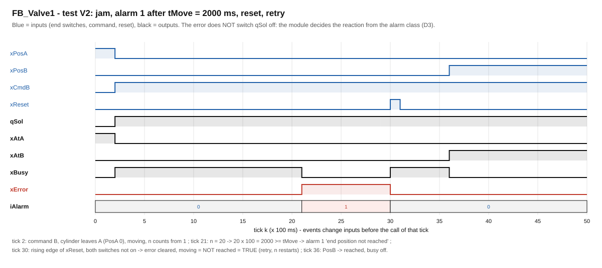

| Line | Explanation |
|---|---|
| `2 …` | movement to B starts, `n = 1` at tick 2 |
| `21 xBusy=0 xError=1 iAlarm=1` | `n = 20` at tick 21 (ticks 2…21) → 20 × 100 = 2000 ≥ 2000 → **alarm 1** 'end position not reached'; `qSol` stays 1 (no change in the log!) |
| `30 xBusy=1 xError=0 iAlarm=0` | rising edge of `xReset`, both switches not on → error cleared; `moving := NOT reached = TRUE` → retry with `n = 0` (then `n = 1` in the same call) |
| `36 xAtB=1 xBusy=0` | the jam was removed, B reached 7 calls after the retry |

**Use in the module.** In APC01 the clamp alarm 1 (2021) is class B: in Execute the module goes to Held, the outputs are kept (the clamp coil stays on = keeps
trying to unclamp), the operator removes the cause, presses Unhold – the module's Unholding sends the reset pulse to the FB (retry) and continues the step.

### B2.8 Unit test V3 – lost position, both switches, disable (FB_Valve1)

Events: 5 `xPosA=0` · 12 `xReset=1, xPosA=1` · 13 `xReset=0` · 20 `xPosB=1` · 25 `xReset=1` · 26 `xReset=0, xPosB=0` · 27 `xReset=1` · 28 `xReset=0` · 32
`xEnable=0, xCmdB=1`.

```
TEST FB_Valve1 | V3 lost position + both switches + disable | 9 lines
    0 init qSol=0 xAtA=1 xAtB=0 xBusy=0 xError=0 iAlarm=0
    5 xAtA=0
    7 xError=1 iAlarm=2
    12 xAtA=1 xError=0 iAlarm=0
    20 xAtA=0
    21 xError=1 iAlarm=3
    26 xAtA=1
    27 xError=0 iAlarm=0
    32 xBusy=1
```

| Line | Explanation |
|---|---|
| `5 xAtA=0` | the cylinder leaves A **without a command** (e.g. pushed back, air loss) – `nl = 1` |
| `7 xError=1 iAlarm=2` | `nl = 3` (ticks 5, 6, 7) → 300 ≥ `tLost_ms` 300 → **alarm 2** 'left the end position without command' |
| `12 xAtA=1 xError=0 iAlarm=0` | back at A and a reset edge in the same tick → cleared; `moving := NOT reached = FALSE` (A is reached) – no movement |
| `20 xAtA=0` | B switch also on → `xAtA` = PosA AND NOT PosB = 0; `nb = 1` |
| `21 xError=1 iAlarm=3` | `nb = 2` → 200 ≥ `tBoth_ms` → **alarm 3** 'both end switches on' |
| (25) | reset edge while both switches are still on → **refused** (no log line) |
| `26 xAtA=1` | PosB off → only PosA → at A again (error still latched) |
| `27 xError=0 iAlarm=0` | second reset, cause gone → cleared |
| `32 xBusy=1` | command B while **disabled**: `moving` TRUE (busy) but `qSol = xCmdB AND xEnable = 0` – no coil, `n` does not count → no alarm up to the end of the test (tick 39) |

The last line is important for the module: a disabled valve with a pending command shows **busy**, not an error – the operator sees "waiting for permission".

### B2.9 Unit test V4 – bistable valve: disable holds, timer pauses (FB_Valve2)

Events: 2 `xCmdB=1, xPosA=0` · 6 `xEnable=0` · 20 `xEnable=1` · 24 `xPosB=1` · 30 `xEnable=0` · 35 `xCmdB=0` · 38 `xEnable=1, xPosB=0` · 41 `xPosA=1`.

```
TEST FB_Valve2 | V4 bistable: disable holds, timer pauses | 9 lines
    0 init qSolA=1 qSolB=0 xAtA=1 xAtB=0 xBusy=0 xError=0 iAlarm=0
    2 qSolA=0 qSolB=1 xAtA=0 xBusy=1
    6 qSolB=0
    20 qSolB=1
    24 xAtB=1 xBusy=0
    30 qSolB=0
    35 xBusy=1
    38 qSolA=1 xAtB=0
    41 xAtA=1 xBusy=0
```

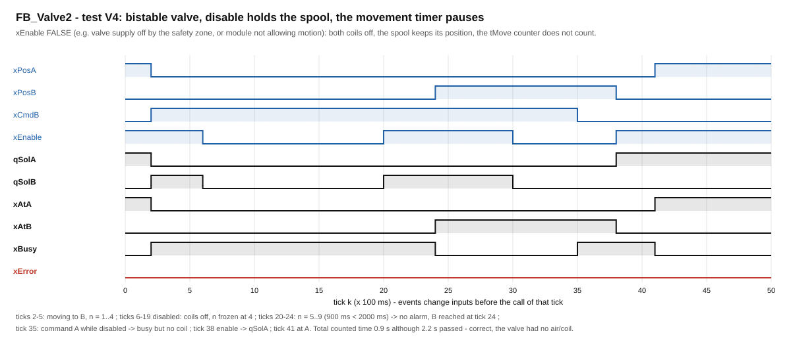

| Line | Explanation |
|---|---|
| `0 init qSolA=1` | default command A and enable TRUE → coil A on (a bistable valve may keep the coil of the current side on – level control, guide 69 D8.1) |
| `2 …` | command B: coil A off, coil B on, moving; `n = 1` |
| `6 qSolB=0` | disabled: both coils off, the spool holds (it stays on B); `n` frozen at 4 (ticks 2–5) |
| `20 qSolB=1` | enabled again: coil B on, `n` continues: 5 at tick 20 |
| `24 xAtB=1 xBusy=0` | B reached at `n = 9` → 900 ms counted although 2.2 s of real time passed – correct, the cylinder had no drive force for 1.4 s |
| `30 qSolB=0` | disabled at B: coils off; no lost check while disabled |
| `35 xBusy=1` | command A while disabled → busy, no coil |
| `38 qSolA=1 xAtB=0` | enabled: coil A on, the cylinder leaves B |
| `41 xAtA=1 xBusy=0` | A reached |

### B2.10 Known limitation of 1.0.0 – FB_Valve1 re-enabled at B

Re-run the rule with this scenario (not part of the reference tests, computed with the same rule): Valve1 at B with `xCmdB = 1`; the module disables it (`xEnable = 0`)
at tick 12 → the spring moves the cylinder to A (PosB off at 13, PosA on at 18); the module enables it again at tick 25 with `xCmdB` still 1 → the coil pulls the cylinder
back towards B (PosA off at 26, PosB on at 32).

```
    0 init qSol=0 xAtA=1 xAtB=0 xBusy=0 xError=0 iAlarm=0
    2 qSol=1 xAtA=0 xBusy=1
    8 xAtB=1 xBusy=0
    12 qSol=0
    13 xAtB=0
    18 xAtA=1
    25 qSol=1
    26 xAtA=0
    27 xError=1 iAlarm=2
    32 xAtB=1
```

At tick 27 the FB raises **alarm 2 'left the end position without command'** – although the cylinder is simply travelling back to B. Reason: the command did not
change (still B), so `moving` is not set; enabled and not at B → `nl` counts from tick 25 → 300 ms → alarm. The rule is correct for its purpose (detect an
**uncommanded** loss of position) but a Valve1 that sprang back while disabled needs a **new movement** after re-enable.

**Library 1.0.0 usage rule:** when the module disables a FB_Valve1 that is commanded to B, it also sets `xCmdB := FALSE` (the spring goes to A anyway); after re-enable
it commands B again – a new command starts a monitored movement. This is what Holding / Unholding and the homing chain of part B do. **Proposed fix for 1.1.0**
(MINOR, D1): a rising edge of `xEnable` while `NOT xReached` sets `moving := TRUE, n := 0` in FB_Valve1. (FB_Valve2 does not have the problem: its spool holds while
disabled.)

### B2.11 HMI faceplate (both valves)

```
 ┌─ APC01 Rotate  (FB_Valve2) ─────────────────────────┐
 │  [A ●]  ════════▶  [B ○]       moving to B  1.3 s    │   position: A / B / between / both (fault)
 │  command: B      enable: yes   last move: 0.7 s      │   last movement time (trend: wear, low pressure)
 │  alarm: –                                            │
 │  ── manual (mode Manual + permission) ────────────   │
 │  [ to A ]  [ to B ]          [ reset ]               │   writes only HMI command bits; the module arbitrates
 └──────────────────────────────────────────────────────┘
```

Rules: the manual buttons are visible only in Manual mode with the operator role; the module accepts them only when the interlocks of the module allow the movement
(part B); for movements that can collide, the faceplate asks for confirmation. Add a **movement-time trend**: a cylinder that needs more and more time (0.7 → 1.2 → 1.6 s)
announces low air pressure, a dirty guide or a worn seal long before the alarm 1 comes – a cheap predictive-maintenance signal (store `n × tick` at every reached
end position in the module).

### B2.12 Alarm table

| a | Text | FB_Valve1 suggested class | FB_Valve2 suggested class | APC01 example |
|---|---|---|---|---|
| 1 | end position not reached | B (A if a half-way position is dangerous) | A or B | Rotate 2011 **A** (pallet half-rotated in the machine area); Clamp 2021 **B** |
| 2 | left the end position without command | A when it holds a load (clamp), else B | A | Rotate 2012 A; Clamp 2022 **A** (pallet may come loose) |
| 3 | both end switches on | B | B | 2013, 2023 B (sensor fault, nothing moves) |

> **Note on the APC classes.** D3 lists "end position not reached at a step" as a typical class B example; the APC01 class table of the reference
> (`alarm_manager.classes`) gives the **rotation** alarm 1 class **A** and the **clamp** alarm 1 class **B**. This is the intended per-module decision: a rotation that
> stops half-way leaves the pallet in the swing area between machine and pool (collision risk with the machine door and the stacker), while an unclamp that did not finish
> is harmless. The class is decided per alarm and module in the risk assessment – not per FB type.

### B2.13 Commissioning test

1. IO test: with the module in Manual and the valve supply on, press "to B" / "to A" on the faceplate; check that the **right** cylinder moves in the **right** direction and
   that `PosA` / `PosB` light at the right ends (swapped sensors are the most frequent wiring fault – guide 68 C2.5 "the APC rotates into the machine during maintenance").
2. Measure the movement times (5 strokes each way); set `tMove_ms` to about 2 × the longest measured time (example: 0.7 s measured → 1.5–2 s).
3. Lost-position test: with the cylinder at B, remove the air for a moment (or move the sensor) → alarm 2 after `tLost_ms`.
4. Both-switches test: hold a metal target in front of the second sensor → alarm 3 after `tBoth_ms`.
5. Disable test: open the guard during a stroke (the safety zone removes the valve supply) → busy continues, no alarm; close the guard → the stroke completes.
6. Single-solenoid valve: switch off the valve supply at B → the spring moves to A (and no alarm while disabled); check that this is the **safe** direction.

### B2.14 Typical mistakes and field faults

| Fault | Symptom | Cause / fix |
|---|---|---|
| PosA and PosB swapped | the FB reports "reached" at the wrong end, the next step starts too early, or alarm 1 every time | fix the wiring / tag; check during the IO test |
| `tMove_ms` too short | alarm 1 in the cold morning (oil viscosity, lower pressure) | 2 × the measured time |
| throttle (flow control) closed during maintenance | slow movement → alarm 1 | movement-time trend shows it early |
| sensor touched by the moving part (mechanical) | flickering PosB → alarm 2 at B | mount the sensor so that the target stops in the middle of the sensing area |
| double valve without coil-on level control | after a power-off the spool position is unknown | home (D4) and level control |
| module writes `qSol` directly in a special step | two writers; the FB's status no longer matches | only the FB writes `qSol`; the module writes `xCmdB` |

## B3. FB_MotorDol – motor starter direct-on-line (item 9 recap)

### B3.1 Purpose and where used

Pattern DOL (guide 68 B1.2): motor protection circuit breaker + contactor; IO `Run` (DO coil), `RunFb` (DI auxiliary contact), `Tripped` (DI motor protection).
Used for pumps, fans, conveyor zones, fume extraction, transfer conveyors (M06, M07, M10, M12, M15, M17 – 6 instances in the kit). The library keeps the item 9
rule **unchanged** (rule `motor` of `item9_examples.json`, guide 69 D7) – the five scenarios A–E remain its unit tests.

### B3.2 Interface (library 1.0.0)

| Name | Dir | Type | Default | Meaning |
|---|---|---|---|---|
| `xRunFb` | in | BOOL | FALSE | contactor auxiliary contact |
| `xTripped` | in | BOOL | FALSE | motor protection tripped |
| `xCmd` | in | BOOL | FALSE | run request (level); a **rising edge** starts the motor |
| `xReset` | in | BOOL | FALSE | fault reset (TRUE for one call; the module passes an edge) |
| `tFb_ms` | cfg | DINT | 500 | feedback time |
| `qRun` | out | BOOL | | contactor coil |
| `iState` | out | INT | | 0 STOPPED, 1 STARTING, 2 RUNNING, 3 STOPPING, 9 FAULT |
| `iAlarm` | out | INT | | 1 no feedback after start, 2 feedback lost, 3 tripped, 4 feedback without command |
| `xFault`, `xRunning` | out | BOOL | | |

The only difference to the guide 69 listing is the time base: `tFb_ms` (DINT) and `GC_CYCLE_MS` instead of `tFb : TIME` and `tTick : TIME` – the same change as all
other library blocks (A3.1). Behaviour and logs are identical.

### B3.3 Listing (library form of guide 69 D7.2)

```iecst
(* source: tools/fmse/plc_lib/FB_MotorDol.st - library 1.0.0, file header omitted *)
FUNCTION_BLOCK FB_MotorDol
VAR_INPUT  (* signals *)
  xRunFb : BOOL;                            (* contactor auxiliary contact (DI) *)
  xTripped : BOOL;                          (* motor protection tripped (DI) *)
  xCmd : BOOL;                              (* run command from the sequence *)
  xReset : BOOL;                            (* fault reset, rising edge *)
END_VAR
VAR_INPUT  (* configuration (set once, defaults = example values) *)
  tFb_ms : DINT := 500;                     (* feedback time [ms] *)
END_VAR
VAR_OUTPUT  (* outputs *)
  qRun : BOOL;                              (* contactor (DO) *)
  iState : INT;                             (* 0 stopped, 1 starting, 2 running, 3 stopping, 9 fault *)
  xError : BOOL;                            (* error latched (see alarms) *)
  iAlarm : INT;                             (* local alarm code (0 = none) *)
END_VAR
VAR  (* internal *)
  rtCmd : R_TRIG;                           (* edge of xCmd *)
  rtReset : R_TRIG;                         (* edge of xReset *)
  n : DINT;                                 (* calls in STARTING / STOPPING *)
  nFb : DINT;                               (* calls with feedback while stopped *)
  xEntered : BOOL;                          (* FAULT entered by the trip in this call *)
END_VAR
rtCmd(CLK := xCmd);
rtReset(CLK := xReset);
xEntered := FALSE;
IF xTripped AND iState <> E_MotorState.FAULT THEN
  iState := E_MotorState.FAULT;
  iAlarm := 3;                                (* motor protection tripped *)
  xEntered := TRUE;
END_IF
IF NOT xEntered THEN
  CASE iState OF
    E_MotorState.STOPPED:
      IF xRunFb THEN
        nFb := MIN(nFb + 1, GC_N_MAX);
      ELSE
        nFb := 0;
      END_IF
      IF nFb * GC_CYCLE_MS >= tFb_ms THEN
        iState := E_MotorState.FAULT;
        iAlarm := 4;                          (* feedback without command *)
      ELSIF rtCmd.Q THEN
        iState := E_MotorState.STARTING;
        n := 0;
      END_IF
    E_MotorState.STARTING:
      n := MIN(n + 1, GC_N_MAX);
      IF xRunFb THEN
        iState := E_MotorState.RUNNING;
      ELSIF n * GC_CYCLE_MS >= tFb_ms THEN
        iState := E_MotorState.FAULT;
        iAlarm := 1;                          (* no run feedback after start *)
      END_IF
    E_MotorState.RUNNING:
      IF NOT xCmd THEN
        iState := E_MotorState.STOPPING;
        n := 0;
      ELSIF NOT xRunFb THEN
        iState := E_MotorState.FAULT;
        iAlarm := 2;                          (* run feedback lost while running *)
      END_IF
    E_MotorState.STOPPING:
      n := MIN(n + 1, GC_N_MAX);
      IF NOT xRunFb THEN
        iState := E_MotorState.STOPPED;
        nFb := 0;
      ELSIF n * GC_CYCLE_MS >= tFb_ms THEN
        iState := E_MotorState.FAULT;
        iAlarm := 4;                          (* feedback without command *)
      END_IF
    E_MotorState.FAULT:
      IF rtReset.Q AND NOT xTripped AND NOT (iAlarm = 4 AND xRunFb) THEN
        iState := E_MotorState.STOPPED;
        iAlarm := 0;
        nFb := 0;
      END_IF
  END_CASE
END_IF
qRun := iState = E_MotorState.STARTING OR iState = E_MotorState.RUNNING;
xError := iState = E_MotorState.FAULT;
END_FUNCTION_BLOCK
```

### B3.4 The five unit tests (item 9, `device_fb.py --motor A..E`)

| Scenario | Content | Final | Log lines |
|---|---|---|---|
| A | normal start and stop | STOPPED, alarm 0, Run 0 | 6 |
| B | no run feedback (auxiliary contact broken) → alarm 1, reset | STOPPED, alarm 0, Run 0 | 15 |
| C | feedback lost while running → alarm 2, reset, restart with a new edge | RUNNING, alarm 0, Run 1 | 12 |
| D | motor protection trips → alarm 3, reset rejected while tripped, no restart after reset, new command edge | RUNNING, alarm 0, Run 1 | 14 |
| E | contactor welded → alarm 4, reset rejected while RunFb | FAULT, alarm 4, Run 0 | 9 |

Scenario A (reference log of item 9):

```
2 event CMD_ON
2 STOPPED -> STARTING
4 STARTING -> RUNNING
20 event CMD_OFF
20 RUNNING -> STOPPING
21 STOPPING -> STOPPED
```

The full logs and their explanation are in guide 69 D7.3. They use the item 9 log format (events and state changes), not the item 10 output-change format – the
soft PLC `st_sim.py` can print both (D3).

### B3.5 Faceplate, alarms, commissioning

Faceplate: state (stopped / starting / running / stopping / fault), run hours and starts (from the module, Diag task), alarm, manual start / stop (jog for
hazardous drives) in Manual mode.

| a | Text | Suggested class |
|---|---|---|
| 1 | no run feedback after start | B (A for a pump that protects something, e.g. coolant for a spindle) |
| 2 | run feedback lost while running | A if a carrier / part is in transit (conveyor zone), else B |
| 3 | motor protection tripped | A for transport, B for auxiliaries (filter pump) |
| 4 | run feedback without command (contactor welded?) | A – the motor may run uncontrolled; the safety circuit must be able to switch it off (CONT_PAIR_EDM, guide 68 B1.5) |

Commissioning: direction of rotation (jog), current with a clamp meter against the MPCB setting, feedback time (watch `iState` in a trace while starting), trip
test (MPCB test button) → alarm 3, reset rejected while the MPCB is off, no restart after reset (IEC 60204-1 9.2.5.4). Field faults: worn auxiliary contact (alarm 1
sporadically), MPCB set too low (trips on start-up of a cold pump), welded contactor after many starts under load (alarm 4).

## B4. FB_DriveSto – frequency inverter with STO

### B4.1 Purpose and where used

Pattern VFD_STO (guide 68 B1.3): an inverter with **STO** (safe torque off) wired to an F-output of the safety system, `Ready` and `Fault` DIs, and a fieldbus channel
(control word, speed setpoint). Used for the stacker axes of the pool and the AS/RS (M03 Travel, Hoist, Fork; M08), the rotary table of the load station (M04),
turntables (M15). 5 instances in the kit.

The essential idea: **STO is a normal safety stop, not a drive fault.** When a door opens, the F-program switches STO; the drive loses torque and reports "not ready"
(on most drives "STO active" is a status, not a fault). The FB must therefore go to NOT READY (and show a warning if the module still requests running), but it must
**not** raise a drive fault – otherwise every door opening would be an alarm (field problem 7 of A1).

### B4.2 Interface

| Name | Dir | Type | Default | Meaning |
|---|---|---|---|---|
| `xReady` | in | BOOL | FALSE | DI drive ready (no fault, DC link charged, enable possible) |
| `xFault` | in | BOOL | FALSE | DI drive fault |
| `xSto` | in | BOOL | **TRUE** | read-only F-copy of the STO state: TRUE = torque off (safe default after power-on) |
| `xCmdRun` | in | BOOL | FALSE | run request from the module (level) |
| `xReset` | in | BOOL | FALSE | fault reset (edge inside) |
| `wCtrl` | out | WORD | 0 | control word to the drive: bit0 ON/enable (1), bit1 RUN (2), bit7 fault acknowledge (128, one call) |
| `iState` | out | INT | 0 | 0 NOT READY, 1 READY, 2 RUNNING, 9 FAULT |
| `xWarn` | out | BOOL | | run requested while torque is off |
| `xError` | out | BOOL | | state = FAULT |
| `iAlarm` | out | INT | | 1 drive fault, 3 ready lost while running |

### B4.3 The rule and the state diagram

> rst = edge(xReset) ; ack = FALSE ; if xFault and state <> 9: state 9, iAlarm 1 'drive fault' ; elif state 0: if xReady and NOT xSto: 1 ; elif state 1: if xSto or NOT
> xReady: 0 elif xCmdRun: 2 ; elif state 2: if xSto: 0 (STO is a normal safety stop, not a drive fault) elif NOT xReady: 9, iAlarm 3 'ready lost while running' elif NOT
> xCmdRun: 1 ; elif state 9: if rst and NOT xFault: 0, iAlarm 0, ack = TRUE. One transition per call. Outputs: iState ; xError = state = 9 ; xWarn = xCmdRun AND xSto (run
> requested while torque is off) ; wCtrl = (0 if xSto else 1) [bit0 ON/enable] + (2 if state = 2) [bit1 RUN] + (128 if ack) [bit7 fault acknowledge, one call].

| From | To | Condition | Alarm |
|---|---|---|---|
| any (≠ 9) | 9 FAULT | `xFault` | 1 drive fault |
| 0 NOT READY | 1 READY | `xReady AND NOT xSto` | – |
| 1 READY | 0 NOT READY | `xSto OR NOT xReady` | – |
| 1 READY | 2 RUNNING | `xCmdRun` | – |
| 2 RUNNING | 0 NOT READY | `xSto` (safety stop) | – (only `xWarn` if run still requested) |
| 2 RUNNING | 9 FAULT | `NOT xReady` (without STO) | 3 ready lost while running |
| 2 RUNNING | 1 READY | `NOT xCmdRun` | – |
| 9 FAULT | 0 NOT READY | rising edge of `xReset` AND `NOT xFault` | cleared, `wCtrl` bit7 for one call |

The control word follows the PROFIdrive / CiA 402 idea in a simplified form: bit0 "ON / enable operation" is set whenever STO is not active (the drive may be enabled),
bit1 "RUN" only in RUNNING, bit7 "fault acknowledge" is a one-call pulse. A real drive needs its own state machine on the control word (e.g. CiA 402: Shutdown 0x06 →
Switch on 0x07 → Enable operation 0x0F, fault reset 0x80 edge); the library maps `wCtrl` onto the drive profile in a small adapter per drive brand (D8) – the FB logic
stays the same.

### B4.4 Listing

```iecst
(* source: tools/fmse/plc_lib/FB_DriveSto.st - library 1.0.0, file header omitted *)
FUNCTION_BLOCK FB_DriveSto
VAR_INPUT  (* signals *)
  xReady : BOOL;                            (* drive ready (DI) *)
  xFault : BOOL;                            (* drive fault (DI) *)
  xSto : BOOL := TRUE;                      (* F-copy: TRUE = torque off *)
  xCmdRun : BOOL;                           (* run command from the sequence *)
  xReset : BOOL;                            (* fault reset, rising edge *)
END_VAR
VAR_OUTPUT  (* outputs *)
  wCtrl : WORD;                             (* bit0 enable, bit1 run, bit7 fault ack *)
  iState : INT;                             (* 0 not ready, 1 ready, 2 running, 9 fault *)
  xWarn : BOOL;                             (* run requested while torque off *)
  xError : BOOL;                            (* error latched (see alarms) *)
  iAlarm : INT;                             (* local alarm code (0 = none) *)
END_VAR
VAR  (* internal *)
  rtReset : R_TRIG;                         (* edge of xReset *)
  xRst : BOOL;                              (* reset pulse *)
  xAck : BOOL;                              (* fault acknowledge, one call *)
END_VAR
rtReset(CLK := xReset);
xRst := rtReset.Q;
xAck := FALSE;
IF xFault AND iState <> E_DriveState.FAULT THEN
  iState := E_DriveState.FAULT;
  iAlarm := 1;                                (* drive fault *)
ELSE
  CASE iState OF                              (* one transition per call *)
    E_DriveState.NOT_READY:
      IF xReady AND NOT xSto THEN
        iState := E_DriveState.READY;
      END_IF
    E_DriveState.READY:
      IF xSto OR NOT xReady THEN
        iState := E_DriveState.NOT_READY;
      ELSIF xCmdRun THEN
        iState := E_DriveState.RUNNING;
      END_IF
    E_DriveState.RUNNING:
      IF xSto THEN
        iState := E_DriveState.NOT_READY;     (* STO = normal safety stop *)
      ELSIF NOT xReady THEN
        iState := E_DriveState.FAULT;
        iAlarm := 3;                          (* ready lost while running *)
      ELSIF NOT xCmdRun THEN
        iState := E_DriveState.READY;
      END_IF
    E_DriveState.FAULT:
      IF xRst AND NOT xFault THEN
        iState := E_DriveState.NOT_READY;
        iAlarm := 0;
        xAck := TRUE;
      END_IF
  END_CASE
END_IF
xError := iState = E_DriveState.FAULT;
xWarn := xCmdRun AND xSto;
wCtrl := 16#0000;
IF NOT xSto THEN
  wCtrl := wCtrl OR 16#0001;                  (* bit0 ON / enable *)
END_IF
IF iState = E_DriveState.RUNNING THEN
  wCtrl := wCtrl OR 16#0002;                  (* bit1 RUN *)
END_IF
IF xAck THEN
  wCtrl := wCtrl OR 16#0080;                  (* bit7 fault acknowledge *)
END_IF
END_FUNCTION_BLOCK
```

### B4.5 Unit test D1 – STO release, run, STO stop, fault, reset, ready lost

Events: 2 `xSto=0` · 3 `xReady=1` · 5 `xCmdRun=1` · 10 `xSto=1` · 12 `xSto=0` · 15 `xFault=1` · 17 `xReset=1` · 18 `xReset=0` · 20 `xFault=0` · 21 `xReset=1` · 22
`xReset=0` · 25 `xReady=0` · 26 `xReady=1` · 30 `xCmdRun=0`.

```
TEST FB_DriveSto | D1 STO release, run, STO stop, fault, reset | 12 lines
    0 init wCtrl=0 iState=0 xWarn=0 xError=0 iAlarm=0
    2 wCtrl=1
    3 iState=1
    5 wCtrl=3 iState=2
    10 wCtrl=0 iState=0 xWarn=1
    12 wCtrl=1 iState=1 xWarn=0
    13 wCtrl=3 iState=2
    15 wCtrl=1 iState=9 xError=1 iAlarm=1
    21 wCtrl=129 iState=0 xError=0 iAlarm=0
    22 wCtrl=1 iState=1
    23 wCtrl=3 iState=2
    25 wCtrl=1 iState=9 xError=1 iAlarm=3
```

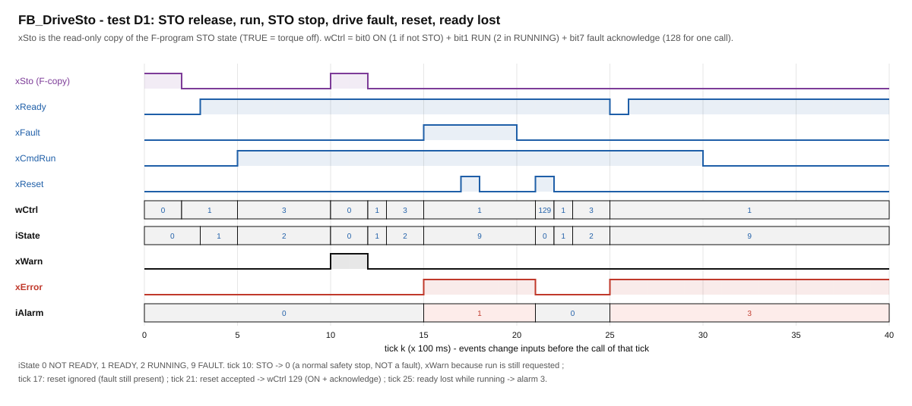

| Line | Explanation |
|---|---|
| `0 init` | STO active (default), not ready → state 0, `wCtrl = 0` |
| `2 wCtrl=1` | the F-program releases STO → bit0 ON; the drive is not ready yet → state stays 0 |
| `3 iState=1` | drive ready and no STO → READY |
| `5 wCtrl=3 iState=2` | run requested → RUNNING, `wCtrl` = 1 + 2 = 3 |
| `10 wCtrl=0 iState=0 xWarn=1` | door opened → STO → **NOT READY (no fault!)**; `xWarn` because the module still requests running – the module should have gone to Held / Stopped and removed the request |
| `12 wCtrl=1 iState=1 xWarn=0` | STO released → READY (one transition per call) |
| `13 wCtrl=3 iState=2` | `xCmdRun` is still TRUE → RUNNING again (see B4.6!) |
| `15 wCtrl=1 iState=9 xError=1 iAlarm=1` | drive fault → FAULT, alarm 1; bit0 stays (STO not active) |
| (17) | reset edge while `xFault` is still TRUE → refused (no log line) |
| `21 wCtrl=129 iState=0 …` | fault gone (tick 20), reset edge → NOT READY, `wCtrl` = 1 + 128: **fault acknowledge** to the drive for one call |
| `22 wCtrl=1 iState=1` | ready → READY |
| `23 wCtrl=3 iState=2` | run still requested → RUNNING |
| `25 wCtrl=1 iState=9 xError=1 iAlarm=3` | ready lost while running (not caused by STO) → FAULT, alarm 3; ready returns at 26 and the run request ends at 30 – the FAULT stays latched (no line) |

### B4.6 Restart after STO or reset – where the protection lives

Lines 13 and 23 show that the FB goes back to RUNNING as soon as the drive is ready again **if `xCmdRun` is still TRUE**. The FB follows the **level** of `xCmdRun` (rule
A9.6 point 4). Guide 69 D9 sketched a drive FB that needs a new command edge after STO; the library places this protection in the **module** instead:

1. Door opened in Execute → the door mirror (FB_Door2Ch / FB_DoorLock) triggers Hold (class B) or Stop in the module → the sequence of Holding / Stopping sets
   `xCmdRun := FALSE` **before** the F-program has finished the stop → after the door is closed, `xCmdRun` is FALSE → no restart. A new motion needs Unhold / Start
   from the operator or the cell controller (a deliberate action – IEC 60204-1 9.2.5.4).
2. Drive fault → class A → Abort → `xCmdRun := FALSE` in Aborting. After Clear + Reset (homing) the module commands the drive again – deliberately.
3. `xWarn` (run requested while torque off) is an **indicator of a module error**: in a correct module it appears at most for one or two scans when the F-program is
   faster than the standard program. A module test (part B) checks that `xWarn` never stays TRUE for more than 100 ms.

Why not an edge inside the FB? Because the drive FB cannot know whether a running request is "old" or "new": after Unhold the module **wants** the drive to continue
with the same level. Putting the restart decision into the PackML core (one place for all devices) is simpler and testable. If a project wants a second line of
defence, it can add the input `xRestartEdge` in a MINOR version (default FALSE = old behaviour).

### B4.7 Faceplate

State (not ready / ready / running / fault), STO active (from the F-copy, shown as "safety stop", grey, **not** red), speed setpoint and actual speed (from the bus),
motor current, drive fault code (from the bus diagnosis), `xWarn` as a hint "run requested while safety stop active". Manual jog in Manual / Maintenance mode only,
with an enabling device where required (guide 67 H8); the jog speed is limited by the drive's safely-limited speed (SLS) if the risk assessment requires it – that is a
drive safety function, not a PLC function.

### B4.8 Alarm table

| a | Text | Suggested class | Note |
|---|---|---|---|
| 1 | drive fault (see drive fault code) | A | the drive has stopped by itself; the job and the position may be lost |
| 3 | ready lost while running (not caused by STO) | A | supply loss, DC link fault, wiring |
| (warning) | run requested while safety stop active (`xWarn` > 1 s) | C (module-level) | module logic error – find and fix in commissioning |

### B4.9 Commissioning test

1. Drive parameters first (motor data, ramps, limits) with the drive tool; the PLC only after the drive runs in local mode.
2. STO test: with the drive running in local mode, open the door → the drive stops (category per risk assessment) and reports STO; the FB shows NOT READY, **no**
   alarm. This is also part of the safety validation (done by the safety engineer with the F-program).
3. Fault test: provoke a drive fault (e.g. "external fault" input of the drive) → FB alarm 1; reset only after the fault is gone; check that bit7 acknowledges the drive.
4. Ready-lost test: switch off the drive's mains while running (with STO not active) → alarm 3.
5. Control word mapping: check bit by bit in the drive's diagnostic screen (ON, RUN, ACK).

### B4.10 Typical mistakes and field faults

| Fault | Symptom | Cause / fix |
|---|---|---|
| STO treated as fault | alarm at every door opening, operators ignore drive alarms | use the library FB (STO → NOT READY) |
| STO F-copy inverted | drive never ready, or "ready" while STO active | the F-copy convention TRUE = torque off; check in the IO test |
| ready signal from a relay output that drops on warnings | sporadic alarm 3 | configure the drive's ready output correctly (ready = no fault) |
| restart after STO because the module keeps `xCmdRun` | the axis moves when the door closes (dangerous surprise) | module removes the run request in Holding / Stopping (B4.6); module test |
| fault acknowledge as a level | drive faults acknowledged automatically | bit7 is a one-call pulse (`xAck`) |

## B5. FB_AnalogIn and FB_LimitAlarm (item 9 recap)

### B5.1 Purpose and where used

Patterns ANALOG_P (pressure) and ANALOG_T (temperature) – 4–20 mA transmitters (guide 68 B5.2). Used for clamp pressure (M02, M04), tank temperature (M10), room
temperature (M11), test pressure (M14), press pressure (M16), air and coolant pressure (M17) – 9 instances in the kit. The library keeps the item 9 rules `analog` and
`limits` unchanged (guide 69 D5, D6); their tables (11 raw values, 16 limit samples) remain the unit tests.

### B5.2 Interface

| FB_AnalogIn | Dir | Type | Default | Meaning |
|---|---|---|---|---|
| `iValue` | in | INT | 0 | raw value of the AI channel (0…27 648 = 4…20 mA, Siemens-style – check the card) |
| `rLo`, `rHi` | cfg | REAL | 0.0, 10.0 | engineering value at 4 / 20 mA |
| `rMa`, `rValueLin` | out | REAL | | loop current, linear (unclamped) value |
| `rValue` | out | REAL | | value to use: clamped (GOOD / UNCERTAIN) or substitute `rLo` (BAD) |
| `iQuality` | out | INT | | 0 GOOD, 1 UNCERTAIN, 2 BAD (NAMUR NE 43) |
| `iStatus` | out | INT | | 0 ok, 1 fault low, 2 under range, 3 over range, 4 fault high |
| `xGood` | out | BOOL | | quality GOOD |
| `iAlarm` | out | INT | | 3 signal quality bad / uncertain (the only alarm the FB raises itself) |

| FB_LimitAlarm | Dir | Type | Default | Meaning |
|---|---|---|---|---|
| `rValue` | in | REAL | – | process value (`FB_AnalogIn.rValue`) |
| `rH`, `rL`, `rHyst`, `iDelay` | cfg | | 8.0, 3.0, 0.2, 2 | limits, deadband, on-delay in calls (samples) |
| `xH`, `xL` | out | BOOL | | limit alarms |

### B5.3 Listings (library form of guide 69 D5.3 and D6.2)

```iecst
(* source: tools/fmse/plc_lib/FB_AnalogIn.st - library 1.0.0, file header omitted *)
FUNCTION_BLOCK FB_AnalogIn
VAR_INPUT  (* signals *)
  iValue : INT;                             (* raw value of the card (AI) *)
END_VAR
VAR_INPUT  (* configuration (set once, defaults = example values) *)
  rLo : REAL := 0.0;                        (* value at 4 mA *)
  rHi : REAL := 10.0;                       (* value at 20 mA *)
END_VAR
VAR_OUTPUT  (* outputs *)
  rMa : REAL;                               (* current [mA] *)
  rValueLin : REAL;                         (* linear value (not clamped) *)
  rValue : REAL;                            (* value to use (clamped / substitute) *)
  iQuality : INT;                           (* 0 GOOD, 1 UNCERTAIN, 2 BAD *)
  iStatus : INT;                            (* 0 ok, 1 fault low, 2 under, 3 over, 4 fault high *)
  xGood : BOOL;                             (* quality GOOD *)
  iAlarm : INT;                             (* local alarm code (0 = none) *)
END_VAR
rMa := 4.0 + 16.0 * INT_TO_REAL(iValue) / 27648.0;
IF rMa <= 3.6 THEN
  iQuality := E_Quality.BAD;
  iStatus := E_AiStatus.FAULT_LOW;            (* wire break *)
ELSIF rMa < 3.8 THEN
  iQuality := E_Quality.UNCERTAIN;
  iStatus := E_AiStatus.UNDER_RANGE;
ELSIF rMa <= 20.5 THEN
  iQuality := E_Quality.GOOD;
  iStatus := E_AiStatus.OK;
ELSIF rMa < 21.0 THEN
  iQuality := E_Quality.UNCERTAIN;
  iStatus := E_AiStatus.OVER_RANGE;
ELSE
  iQuality := E_Quality.BAD;
  iStatus := E_AiStatus.FAULT_HIGH;
END_IF
rValueLin := rLo + (rHi - rLo) * (rMa - 4.0) / 16.0;
IF iQuality = E_Quality.BAD THEN
  rValue := rLo;                              (* substitute value *)
ELSE
  rValue := LIMIT(rLo, rValueLin, rHi);
END_IF
xGood := iQuality = E_Quality.GOOD;
IF xGood THEN
  iAlarm := 0;
ELSE
  iAlarm := 3;                                (* signal quality bad / uncertain *)
END_IF
END_FUNCTION_BLOCK

(* source: tools/fmse/plc_lib/FB_LimitAlarm.st - library 1.0.0, file header omitted *)
FUNCTION_BLOCK FB_LimitAlarm
VAR_INPUT  (* signals *)
  rValue : REAL;                            (* process value (FB_AnalogIn.rValue) *)
END_VAR
VAR_INPUT  (* configuration (set once, defaults = example values) *)
  rH : REAL := 8.0;                         (* high limit *)
  rL : REAL := 3.0;                         (* low limit *)
  rHyst : REAL := 0.2;                      (* hysteresis *)
  iDelay : INT := 2;                        (* on-delay [calls] *)
END_VAR
VAR_OUTPUT  (* outputs *)
  xH : BOOL;                                (* high alarm *)
  xL : BOOL;                                (* low alarm *)
END_VAR
VAR  (* internal *)
  nH : DINT;                                (* consecutive calls >= rH *)
  nL : DINT;                                (* consecutive calls <= rL *)
END_VAR
IF rValue >= rH THEN
  nH := MIN(nH + 1, GC_N_MAX);
ELSE
  nH := 0;
END_IF
IF rValue <= rL THEN
  nL := MIN(nL + 1, GC_N_MAX);
ELSE
  nL := 0;
END_IF
IF NOT xH AND nH >= iDelay THEN
  xH := TRUE;
ELSIF xH AND rValue < rH - rHyst THEN
  xH := FALSE;
END_IF
IF NOT xL AND nL >= iDelay THEN
  xL := TRUE;
ELSIF xL AND rValue > rL + rHyst THEN
  xL := FALSE;
END_IF
END_FUNCTION_BLOCK
```

Differences to the guide 69 teaching versions: FB_AnalogIn has no string output (the HMI derives the text from `iStatus`) and no separate substitute input (the
substitute is `rLo`, as in the item 9 rule); it adds `xGood` and raises **alarm 3** itself when the quality is not GOOD. FB_LimitAlarm has no `xValid` input: the
**module** must not call it (or must ignore its outputs) while `iQuality = 2` – a BAD value must neither create nor clear a process alarm.

### B5.4 Unit tests (item 9)

Two of the eleven raw values of guide 69 D5.2 (range 0–10 bar) as a reminder:

| raw | mA | Quality | value_out |
|---|---|---|---|
| −6 000 | 0.528 | BAD (wire break) | 0.0 (substitute) |
| 28 800 | 20.667 | UNCERTAIN (over range) | 10.0 (clamped) |

and the limit events of D6: 1 L on, 3 L off, 7 H on, 11 H off, 14 L on, 15 L off (H 8.0, L 3.0, hyst 0.2, delay 2).

### B5.5 Alarms: one from the FB, the process alarms from the module

FB_AnalogIn raises only **alarm 3** (signal quality bad / uncertain) itself. An analog value has no further meaning without the process, so the
**module** raises the process alarms of an analog instance with the same instance number (D2: a = 1, 2, 4 … for that instance), typically:

| a | Typical module alarm on an analog instance | Typical class | APC01 ClampPress |
|---|---|---|---|
| 1 | value not reached in a step (process condition with the step time-out) | B | 2051 clamp pressure not reached in the clamp step |
| 2 | value lost / out of limit while the process depends on it | A | 2052 clamp pressure lost while machining |
| 3 | quality not GOOD (UNCERTAIN or BAD) – **raised by FB_AnalogIn** (`iAlarm = 3`) | C (A if the value is needed for a safety-relevant decision – then the F-program has its own analog evaluation) | 2053 signal quality bad / uncertain |
| 4 | high / low limit (FB_LimitAlarm) | B or C | – |

### B5.6 Faceplate, commissioning, mistakes

Faceplate: value with unit, bar graph with limits, quality (GOOD green-grey / UNCERTAIN yellow / BAD red with the NE 43 text), mA for maintenance, trend. Commissioning:
loop check with a calibrator (4, 12, 20 mA → 0, 50, 100 % on the HMI), wire break test (disconnect → BAD), polarity, shield on one side. Mistakes: range of the card
(0–20 mA vs 4–20 mA), raw span of another brand (guide 69 A9.3), decisions on `rValue` without checking `iQuality`, missing deadband (chattering limit alarms).

## B6. FB_Heater – two-point temperature control with monitoring

### B6.1 Purpose and where used

Pattern HEATER (guide 68): a heater contactor with auxiliary contact `OnFb`, a **safety thermostat** `OverTemp` (which also cuts the heater power hard-wired – the
PLC input is only its status), and the bath temperature from a FB_AnalogIn instance. Used in the parts washer M10 (tank heater). The FB does simple two-point
(on/off) control with hysteresis and monitors the contactor in both directions.

Two-point control is enough for a washer bath (large thermal mass, ±2 K is fine). Processes with tight tolerances (curing, heat treatment) use a PID with PWM
output (a library extension, D1.2); the monitoring part of FB_Heater remains the same.

### B6.2 Interface

| Name | Dir | Type | Default | Meaning |
|---|---|---|---|---|
| `xOnFb` | in | BOOL | FALSE | contactor auxiliary contact |
| `xOverTemp` | in | BOOL | FALSE | safety thermostat tripped (status input) |
| `rTemp` | in | REAL | 20.0 | bath temperature (from FB_AnalogIn `rValue`) |
| `xTempGood` | in | BOOL | TRUE | quality of the temperature signal (`iQuality = 0`) |
| `xEnable` | in | BOOL | FALSE | heating allowed (recipe, level OK, module state) |
| `rSp` | in | REAL | 60.0 | set point °C |
| `xReset` | in | BOOL | FALSE | fault reset (edge inside) |
| `rHyst` | cfg | REAL | 2.0 | hysteresis K |
| `tFb_ms` | cfg | DINT | 500 | contactor feedback time |
| `qOn` | out | BOOL | | contactor coil |
| `xError` | out | BOOL | | |
| `iAlarm` | out | INT | | 1 over-temperature, 2 no feedback, 3 signal bad, 4 feedback without command |

### B6.3 The rule

> rst = edge ; (1) if xError and rst and NOT xOverTemp and (xTempGood or NOT xEnable) and NOT xOnFb: clear error, nfb = nw = 0 ; (2) if NOT xError: if xOverTemp: error
> iAlarm 1 'over-temperature (safety thermostat)' elif xEnable and NOT xTempGood: error iAlarm 3 'temperature signal bad' ; (3) heat: if NOT xEnable or xError: FALSE
> elif rTemp <= rSp − rHyst: TRUE elif rTemp >= rSp: FALSE (else unchanged) ; q = heat ; (4) nfb = nfb+1 if q and NOT xOnFb else 0 ; nw = nw+1 if NOT q and xOnFb else 0 ;
> if NOT xError and nfb × 100 >= tFb_ms: error iAlarm 2 'no contactor feedback' ; if NOT xError and nw × 100 >= tFb_ms: error iAlarm 4 'feedback without command (contactor
> welded?)' ; (5) if xError: heat = FALSE, q = FALSE ; qOn = q.

Two-point control with SP 60.0 °C and hysteresis 2.0 K:

```
 temperature
   60.0 ─────────────────────── switch OFF at T >= SP            (heat := FALSE)
        │   no change (memory)
   58.0 ─────────────────────── switch ON  at T <= SP - hyst     (heat := TRUE)
```

Unlike the valve, the heater **switches itself off on every error** (step 5) – a heater has no "hold position"; heating on without control is never wanted. The reset
conditions are strict: thermostat back, signal good (or heating not enabled), and **no feedback** (a welded contactor must not be "reset away").

### B6.4 Listing

```iecst
(* source: tools/fmse/plc_lib/FB_Heater.st - library 1.0.0, file header omitted *)
FUNCTION_BLOCK FB_Heater
VAR_INPUT  (* signals *)
  xOnFb : BOOL;                             (* contactor auxiliary contact (DI) *)
  xOverTemp : BOOL;                         (* safety thermostat tripped (DI) *)
  rTemp : REAL := 20.0;                     (* temperature (FB_AnalogIn.rValue) *)
  xTempGood : BOOL := TRUE;                 (* quality GOOD (FB_AnalogIn.xGood) *)
  xEnable : BOOL;                           (* heating enabled by the sequence *)
  rSp : REAL := 60.0;                       (* set point *)
  xReset : BOOL;                            (* fault reset, rising edge *)
END_VAR
VAR_INPUT  (* configuration (set once, defaults = example values) *)
  rHyst : REAL := 2.0;                      (* switch-on hysteresis below rSp *)
  tFb_ms : DINT := 500;                     (* feedback time [ms] *)
END_VAR
VAR_OUTPUT  (* outputs *)
  qOn : BOOL;                               (* heater contactor (DO) *)
  xError : BOOL;                            (* error latched (see alarms) *)
  iAlarm : INT;                             (* local alarm code (0 = none) *)
END_VAR
VAR  (* internal *)
  rtReset : R_TRIG;                         (* edge of xReset *)
  xRst : BOOL;                              (* reset pulse *)
  xHeat : BOOL;                             (* 2-point controller state *)
  xQ : BOOL;                                (* contactor command *)
  nFb : DINT;                               (* calls: command without feedback *)
  nWeld : DINT;                             (* calls: feedback without command *)
END_VAR
rtReset(CLK := xReset);
xRst := rtReset.Q;
(* (1) reset only when the cause is gone and the contactor is open *)
IF xError AND xRst AND NOT xOverTemp AND (xTempGood OR NOT xEnable) AND NOT xOnFb THEN
  xError := FALSE;
  iAlarm := 0;
  nFb := 0;
  nWeld := 0;
END_IF
(* (2) thermostat and signal quality *)
IF NOT xError THEN
  IF xOverTemp THEN
    xError := TRUE;
    iAlarm := 1;                              (* over-temperature *)
  ELSIF xEnable AND NOT xTempGood THEN
    xError := TRUE;
    iAlarm := 3;                              (* temperature signal bad *)
  END_IF
END_IF
(* (3) 2-point control: on at rSp - rHyst, off at rSp, unchanged in between *)
IF NOT xEnable OR xError THEN
  xHeat := FALSE;
ELSIF rTemp <= rSp - rHyst THEN
  xHeat := TRUE;
ELSIF rTemp >= rSp THEN
  xHeat := FALSE;
END_IF
xQ := xHeat;
(* (4) contactor feedback supervision *)
IF xQ AND NOT xOnFb THEN
  nFb := MIN(nFb + 1, GC_N_MAX);
ELSE
  nFb := 0;
END_IF
IF NOT xQ AND xOnFb THEN
  nWeld := MIN(nWeld + 1, GC_N_MAX);
ELSE
  nWeld := 0;
END_IF
IF NOT xError AND nFb * GC_CYCLE_MS >= tFb_ms THEN
  xError := TRUE;
  iAlarm := 2;                                (* no contactor feedback *)
END_IF
IF NOT xError AND nWeld * GC_CYCLE_MS >= tFb_ms THEN
  xError := TRUE;
  iAlarm := 4;                                (* feedback without command *)
END_IF
(* (5) an error switches the heater off *)
IF xError THEN
  xHeat := FALSE;
  xQ := FALSE;
END_IF
qOn := xQ;
END_FUNCTION_BLOCK
```

### B6.5 Unit test H1 – control, no feedback, over-temperature, bad signal

Events: 1 `xEnable=1, rTemp=55` · 3 `xOnFb=1` · 8 `rTemp=59` · 10 `rTemp=60.5` · 11 `xOnFb=0` · 15 `rTemp=57.5` · 22 `rTemp=58` · 24 `xReset=1` · 25 `xReset=0` · 26
`xOnFb=1` · 30 `xOverTemp=1` · 31 `xOnFb=0` · 36 `xOverTemp=0` · 38 `xReset=1` · 39 `xReset=0, xTempGood=0` · 43 `xEnable=0, xReset=1`.

```
TEST FB_Heater | H1 2-point control + no feedback + over-temperature | 10 lines
    0 init qOn=0 xError=0 iAlarm=0
    1 qOn=1
    10 qOn=0
    15 qOn=1
    19 qOn=0 xError=1 iAlarm=2
    24 qOn=1 xError=0 iAlarm=0
    30 qOn=0 xError=1 iAlarm=1
    38 qOn=1 xError=0 iAlarm=0
    39 qOn=0 xError=1 iAlarm=3
    43 xError=0 iAlarm=0
```

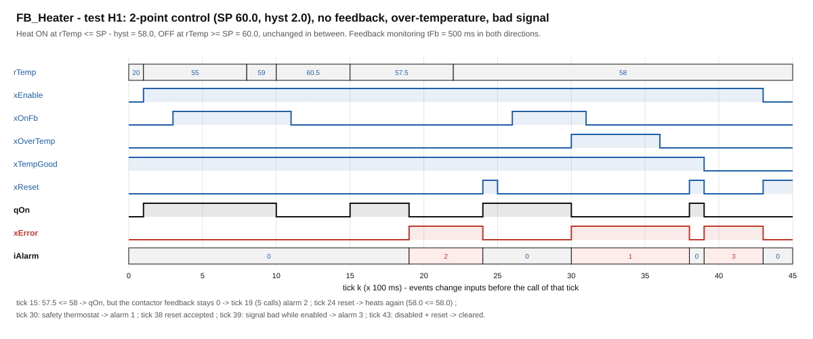

| Line | Explanation |
|---|---|
| `1 qOn=1` | enabled, 55.0 ≤ 58.0 → heat; the contactor closes 2 calls later (feedback at tick 3) – `nfb` = 1, 2, then 0: within 500 ms |
| (8) | 59.0: between 58 and 60 → no change (memory) |
| `10 qOn=0` | 60.5 ≥ 60.0 → off; the auxiliary contact opens at tick 11 → `nw` = 1, then 0 |
| `15 qOn=1` | 57.5 ≤ 58.0 → heat on, **but the feedback stays 0** (contactor coil broken / wire) |
| `19 qOn=0 xError=1 iAlarm=2` | `nfb` = 5 (ticks 15–19) → 500 ≥ 500 → **alarm 2 'no contactor feedback'** → heater off |
| `24 qOn=1 xError=0 iAlarm=0` | reset edge: no over-temp, signal good, no feedback → cleared; 58.0 ≤ 58.0 → heat again in the same call; feedback comes at 26 (`nfb` = 2) |
| `30 qOn=0 xError=1 iAlarm=1` | safety thermostat trips → **alarm 1** → off (the thermostat has already cut the power hard-wired; the feedback disappears at 31) |
| (36) | thermostat back – the error stays latched until a reset |
| `38 qOn=1 xError=0 iAlarm=0` | reset accepted → heat (58.0 ≤ 58.0) |
| `39 qOn=0 xError=1 iAlarm=3` | signal quality bad while enabled → **alarm 3** → off (`nfb` was only 2) |
| `43 xError=0 iAlarm=0` | heating disabled and reset: the condition `(xTempGood OR NOT xEnable)` is TRUE because heating is not enabled → cleared; `qOn` stays 0 (disabled) |

Line 43 shows a design detail: an analog fault can be reset when heating is **not** needed (the module can continue other work); it comes back at once if heating is
enabled while the signal is still bad.

Line 38 shows that after a reset the heater **heats again by itself** if enabled and cold. For a heater this is accepted (no motion hazard; the safety thermostat has its own
**manual** reset at the device, which is the protection against repeated overheating). If a project wants a deliberate restart, the module removes `xEnable` on the
alarm and sets it again only on an operator action.

### B6.6 Faceplate

Bath temperature and set point (trend with SP and SP − hyst lines), heater on / off, feedback, thermostat state, signal quality, alarm. Manual mode: heater on / off only if
the level is OK (the module interlock "level low → heater off", guide 68 C10, is checked in the module, the level switch also protects the heater hard-wired in many
designs).

### B6.7 Alarm table

| a | Text | Suggested class | Note |
|---|---|---|---|
| 1 | over-temperature (safety thermostat) | A | the thermostat has cut the power; find the cause (control failure, low level) before reset |
| 2 | no contactor feedback | B | coil / wire / contactor fault; the bath cools down |
| 3 | temperature signal bad | B (C if heating not needed now) | transmitter or wire fault – the control cannot work |
| 4 | feedback without command (contactor welded?) | A | the heater may heat uncontrolled; only the thermostat limits the temperature |

### B6.8 Commissioning test

1. Contactor: heater on / off from the faceplate; feedback follows within 100–200 ms.
2. Control: heat the bath; check the switching points 58.0 / 60.0 on the trend; overshoot depends on the heater power and the sensor position (a sensor far from the
   heater gives large overshoot – move it or reduce the hysteresis).
3. Thermostat: test with the thermostat test button or a heat gun → alarm 1, power cut **hard-wired** (measure!), manual reset at the thermostat.
4. Signal: disconnect the transmitter → BAD → alarm 3 with heating enabled.
5. Welded contactor: simulate by bridging the auxiliary contact input with the heater off → alarm 4 after 500 ms.

### B6.9 Typical mistakes and field faults

| Fault | Symptom | Cause / fix |
|---|---|---|
| level switch not interlocked | heater runs dry, element burns through | module interlock + hard-wired level protection |
| hysteresis 0.1 K | contactor switches every few seconds, contacts wear out | 1–3 K for a bath; use a solid-state relay for fast cycling |
| feedback contact of the wrong contactor | alarm 2 / 4 at random | wiring check in the IO test |
| thermostat set above the fluid's flash point / material limit | real hazard | thermostat setting is a safety parameter (risk assessment) |

## B7. FB_PushButton – illuminated push-button

### B7.1 Purpose and where used

Pattern PUSHBUTTON (guide 68 B6): a push-button with a lamp – operator release at a load station (M04 `Release`), pick-to-light at assembly stations (M13 `PickLight`),
the reset button of the safety controller (M18 `Reset` – **its reset function is in the F-program**; the standard FB drives only the lamp "reset required"). 3 instances in
the kit.

### B7.2 Interface

| Name | Dir | Type | Default | Meaning |
|---|---|---|---|---|
| `xPb` | in | BOOL | FALSE | push-button contact (NO) |
| `iLampMode` | in | INT | 0 | 0 off, 1 steady, 2 flashing 1 Hz |
| `qLamp` | out | BOOL | | lamp output |
| `xPressed` | out | BOOL | | button state (level) |
| `xClick` | out | BOOL | | rising edge of the button (one call) |

### B7.3 The rule

> blink = (c // 5) MOD 2 = 0 with c = number of previous calls (1 Hz at 100 ms) ; qLamp = iLampMode = 1 OR (iLampMode = 2 AND blink) ; xClick = edge(xPb) ; xPressed = xPb.

The blink pattern: calls 0–4 on, 5–9 off, 10–14 on … → period 10 calls = 1 s at 100 ms, 50 % duty. In a 10 ms task the divisor must be 50 instead of 5 for the same 1 Hz:
the library computes it as `nHalf := GC_BLINK_HALF_MS / GC_CYCLE_MS` (500 ms half period). IEC 60073 recommends flashing frequencies of about 1–2 Hz (normal flashing) and 2–4 Hz (fast
flashing for urgent attention), duty 1:1.

Because the blink counter is local to each instance, two lamps that were started at different times would blink out of phase. Where several lamps must blink together
(a row of pick-lights), the module passes a common blink bit – a library variant with `xBlinkIn` (MINOR) – or all instances are created at the same time (they count
from the first call of the PLC).

### B7.4 Listing

```iecst
(* source: tools/fmse/plc_lib/FB_PushButton.st - library 1.0.0, file header omitted *)
FUNCTION_BLOCK FB_PushButton
VAR_INPUT  (* signals *)
  xPb : BOOL;                               (* push-button contact (DI) *)
  iLampMode : INT;                          (* 0 off, 1 on, 2 flashing *)
END_VAR
VAR_OUTPUT  (* outputs *)
  qLamp : BOOL;                             (* lamp (DO) *)
  xPressed : BOOL;                          (* button pressed *)
  xClick : BOOL;                            (* rising edge, one call *)
END_VAR
VAR  (* internal *)
  nBlink : DINT;                            (* blink counter 0 .. 2*nHalf-1 *)
  nHalf : DINT;                             (* calls per half period *)
  xBlink : BOOL;                            (* 1 Hz blink, TRUE in the first half *)
  rtPb : R_TRIG;                            (* edge of xPb *)
END_VAR
nHalf := GC_BLINK_HALF_MS / GC_CYCLE_MS;     (* 5 calls at 100 ms = 1 Hz *)
xBlink := nBlink < nHalf;
nBlink := (nBlink + 1) MOD (2 * nHalf);
qLamp := (iLampMode = 1) OR ((iLampMode = 2) AND xBlink);
rtPb(CLK := xPb);
xClick := rtPb.Q;
xPressed := xPb;
END_FUNCTION_BLOCK
```

The counter `nBlink` runs 0 … 2 × nHalf − 1 (`MOD`) and `xBlink := nBlink < nHalf` is TRUE in the first half – exactly the rule's `(c // 5) MOD 2 = 0` with the unbounded call count `c`, because the pattern repeats every 2 × nHalf calls; the wrap prevents an overflow.

### B7.5 Unit test P1 – lamp modes and click

Events: 1 `iLampMode=2` · 4 `xPb=1` · 6 `xPb=0` · 12 `iLampMode=1` · 14 `iLampMode=0, xPb=1`.

```
TEST FB_PushButton | P1 lamp modes and click | 8 lines
    0 init qLamp=0 xPressed=0 xClick=0
    1 qLamp=1
    4 xPressed=1 xClick=1
    5 qLamp=0 xClick=0
    6 xPressed=0
    10 qLamp=1
    14 qLamp=0 xPressed=1 xClick=1
    15 xClick=0
```

| Line | Explanation |
|---|---|
| `0 init` | mode 0 → lamp off (blink is TRUE at c = 0 but the mode is 0) |
| `1 qLamp=1` | mode 2 (flashing), c = 1 → 1 DIV 5 = 0 → even → on |
| `4 xPressed=1 xClick=1` | button pressed → edge for one call |
| `5 qLamp=0 xClick=0` | c = 5 → 5 DIV 5 = 1 → odd → off (flashing phase); click ends |
| `6 xPressed=0` | released |
| `10 qLamp=1` | c = 10 → 2 → even → on |
| (12) | mode 1 (steady) – the lamp is already on, no change |
| `14 qLamp=0 xPressed=1 xClick=1` | mode 0 → off; pressed again → click |
| `15 xClick=0` | click lasts exactly one call |

### B7.6 Lamp meaning (convention of the library, after IEC 60073 / IEC 60204-1 10.2–10.3)

| Lamp mode | Meaning for the operator | Example |
|---|---|---|
| off | no action possible / needed | release button while the station is busy |
| flashing | **action requested** – press now | M04: "pallet ready, press release when the load is done" |
| steady | action accepted / function active | release accepted, rotation runs |

Colours of push-buttons follow IEC 60204-1 10.2.1 (e.g. white / grey / black for start / general, green for start where permitted, yellow for abnormal-condition
intervention, blue for reset is common practice). Pick-to-light usually uses green / white lamps.

### B7.7 Commissioning and mistakes

Commissioning: press each button, watch `xClick` in a trace (exactly one call), lamp in all three modes; check the contact type (NO). Mistakes: using `xPressed` instead of
`xClick` for a one-shot action (a held button repeats the action every scan); a reset button that is part of a safety function wired only to a standard input
(must be an F-input or evaluated by the F-program – guide 67 I6); a lamp blinking with 5 Hz in a 10 ms task because the divisor was not adapted (fixed by `nHalf`).

## B8. FB_SignalTower – stack light from PackML state and alarm class

### B8.1 Purpose and where used

Pattern SIGNAL_TOWER (guide 68 B6): a signal tower with red, yellow, green and a buzzer on DOs. One per module or zone (M03, M04, M14, M18 – 4 instances in the kit). The
FB translates the **PackML state** and the **alarm class** from the alarm manager (C3) into colours – the same logic in every module of the factory, so an operator reads
every machine the same way from 30 m. Section C4 explains the colour standard; this chapter gives the block.

### B8.2 Interface

| Name | Dir | Type | Default | Meaning |
|---|---|---|---|---|
| `iState` | in | INT | 2 | PackML state number (A0.4) |
| `iAlarmClass` | in | INT | 0 | 0 none, 1 A, 2 B, 3 C – from FB_AlarmMgr |
| `xHornAck` | in | BOOL | FALSE | horn acknowledge (HMI button or a push-button, edge inside) |
| `qRed`, `qYellow`, `qGreen`, `qBuzzer` | out | BOOL | | lamp and buzzer outputs |

### B8.3 The rule

> blink as FB_PushButton. qRed = class 1 OR state in {8 Aborting, 9 Aborted} ; qYellow = class in {2,3} OR state in {2 Stopped, 5 Suspended, 11 Held} ; qGreen = state in
> {3,6,12,14,16} OR (state in {4 Idle, 17 Complete} AND blink) ; horn: if class in {1,2} and class <> previous class: horn = TRUE ; if edge(xHornAck) or class = 0: horn = FALSE ;
> qBuzzer = horn.

| State group | Red | Yellow | Green |
|---|---|---|---|
| Aborting (8), Aborted (9) | **on** | (only if a B/C alarm) | – |
| Stopped (2), Suspended (5), Held (11) | – | **on** | – |
| Starting (3), Execute (6), Unholding (12), Unsuspending (14), Completing (16) | – | – | **on** |
| Idle (4), Complete (17) | – | – | **flashing** (ready, waiting for a command) |
| Clearing (1), Stopping (7), Holding (10), Suspending (13), Resetting (15) | – | – | – (only alarm colours) |

| Alarm class | Red | Yellow | Buzzer |
|---|---|---|---|
| 1 A | on | – | on when the class appears / changes to 1 |
| 2 B | – | on | on when the class appears / changes to 2 |
| 3 C | – | on | **no** |
| 0 | – | – | off |

### B8.4 Listing

```iecst
(* source: tools/fmse/plc_lib/FB_SignalTower.st - library 1.0.0, file header omitted *)
FUNCTION_BLOCK FB_SignalTower
VAR_INPUT  (* signals *)
  iState : INT := 2;                        (* PackML state number (2 = Stopped) *)
  iAlarmClass : INT;                        (* 0 none, 1 A, 2 B, 3 C (FB_AlarmMgr) *)
  xHornAck : BOOL;                          (* horn acknowledge, rising edge *)
END_VAR
VAR_OUTPUT  (* outputs *)
  qRed : BOOL;                              (* red lamp (DO) *)
  qYellow : BOOL;                           (* yellow lamp (DO) *)
  qGreen : BOOL;                            (* green lamp (DO) *)
  qBuzzer : BOOL;                           (* horn (DO) *)
END_VAR
VAR  (* internal *)
  nBlink : DINT;                            (* blink counter 0 .. 2*nHalf-1 *)
  nHalf : DINT;                             (* calls per half period *)
  xBlink : BOOL;                            (* 1 Hz blink, TRUE in the first half *)
  rtAck : R_TRIG;                           (* edge of xHornAck *)
  iPrevClass : INT;                         (* alarm class of the last call *)
  xHorn : BOOL;                             (* horn latch *)
END_VAR
nHalf := GC_BLINK_HALF_MS / GC_CYCLE_MS;     (* 5 calls at 100 ms = 1 Hz *)
xBlink := nBlink < nHalf;
nBlink := (nBlink + 1) MOD (2 * nHalf);
rtAck(CLK := xHornAck);
qRed := (iAlarmClass = E_AlarmClass.A) OR (iState = E_PackMLState.ABORTING) OR (iState = E_PackMLState.ABORTED);
qYellow := (iAlarmClass = E_AlarmClass.B) OR (iAlarmClass = E_AlarmClass.C) OR (iState = E_PackMLState.STOPPED)
           OR (iState = E_PackMLState.SUSPENDED) OR (iState = E_PackMLState.HELD);
CASE iState OF
  E_PackMLState.STARTING, E_PackMLState.EXECUTE, E_PackMLState.UNHOLDING, E_PackMLState.UNSUSPENDING,
  E_PackMLState.COMPLETING:
    qGreen := TRUE;
  E_PackMLState.IDLE, E_PackMLState.COMPLETE:
    qGreen := xBlink;                         (* flashing green = ready, waiting *)
ELSE
  qGreen := FALSE;
END_CASE
IF (iAlarmClass = E_AlarmClass.A OR iAlarmClass = E_AlarmClass.B) AND iAlarmClass <> iPrevClass THEN
  xHorn := TRUE;
END_IF
IF rtAck.Q OR iAlarmClass = E_AlarmClass.NONE THEN
  xHorn := FALSE;
END_IF
iPrevClass := iAlarmClass;
qBuzzer := xHorn;
END_FUNCTION_BLOCK
```

### B8.5 Unit test T1 – states and alarm classes

Events: 2 `iState=15` · 4 `iState=4` · 12 `iState=6` · 15 `iAlarmClass=2` · 16 `iState=10` · 17 `iState=11` · 19 `xHornAck=1` · 20 `xHornAck=0` · 22 `iAlarmClass=1` · 23
`iState=8` · 24 `iState=9` · 27 `iAlarmClass=0, iState=1` · 28 `iState=2`.

```
TEST FB_SignalTower | T1 states and alarm classes | 12 lines
    0 init qRed=0 qYellow=1 qGreen=0 qBuzzer=0
    2 qYellow=0
    4 qGreen=1
    5 qGreen=0
    10 qGreen=1
    15 qYellow=1 qBuzzer=1
    16 qGreen=0
    19 qBuzzer=0
    22 qRed=1 qBuzzer=1
    23 qYellow=0
    27 qRed=0 qBuzzer=0
    28 qYellow=1
```

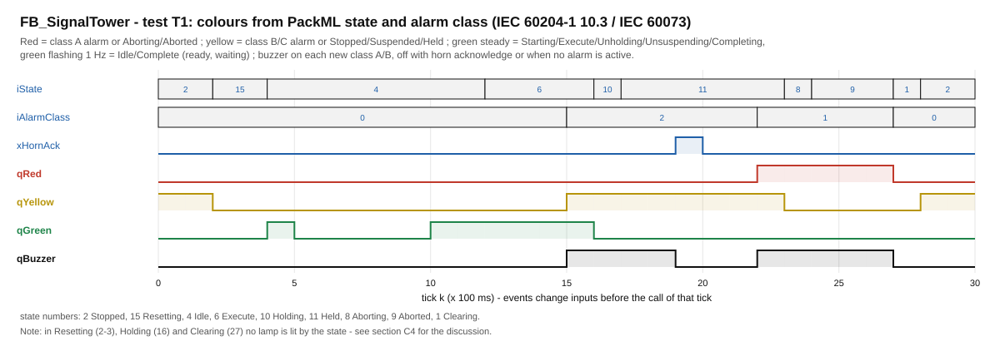

| Line | Explanation |
|---|---|
| `0 init … qYellow=1` | Stopped → yellow |
| `2 qYellow=0` | Resetting (15) → no state lamp (dark) |
| `4 qGreen=1` | Idle, c = 4 → 4 DIV 5 = 0 → blink on → green |
| `5 qGreen=0` | c = 5 → off (flashing) |
| `10 qGreen=1` | c = 10 → on |
| (12) | Execute → green steady (already on – no line) |
| `15 qYellow=1 qBuzzer=1` | class B alarm → yellow + horn (class changed 0 → 2) |
| `16 qGreen=0` | Holding (10) → green off |
| (17) | Held (11) → yellow (already on) |
| `19 qBuzzer=0` | horn acknowledged (edge) – yellow stays (the alarm is still active) |
| `22 qRed=1 qBuzzer=1` | class changes 2 → 1 → red + horn again (a **new**, more severe situation) |
| `23 qYellow=0` | Aborting (8): class 1 does not light yellow, state 8 is not in the yellow set → yellow off |
| (24) | Aborted (9) → red (already) |
| `27 qRed=0 qBuzzer=0` | no alarm (class 0) → horn off; Clearing (1) → dark |
| `28 qYellow=1` | Stopped → yellow |

### B8.6 Commissioning and mistakes

Commissioning: lamp test (all lamps on for 2 s on an HMI button or at power-on – checks the bulbs / LEDs), run the module through the states in the simulation or on the
machine, check each colour; horn volume adequate for the area (and not so loud that people disable it). Mistakes: green while the machine waits in Held ("it's running")
– wrong colour; horn without acknowledge (people tape it over); towers of different suppliers with a different colour order; one tower for two modules with
different states (use a priority: the most severe state wins, or separate towers).

## B9. FB_HandshakeHw – hard-wired 4-phase handshake (requester side)

### B9.1 Purpose and where used

Pattern HANDSHAKE_HW (guide 68): hard-wired signals between the module PLC and a partner that has its own controller – the AGV at the transfer station (M06 `Agv`),
a robot controller, a machine tool's loading interface, a leak tester. Four inputs from the partner (`Ready`, `Busy`, `Done`, `Fault`) and four outputs to the partner
(`Request`, `Ack`, `Enable`, `Reset`). The logic is the 4-phase handshake of item 6 (guide 66 H4) – the same phases as the data-block echo of D1, but on wires:

| Phase | Requester (this FB) | Partner | Meaning |
|---|---|---|---|
| 1 | Request ON (+ Enable) | – | "please do the job" (only if the partner is Ready) |
| 2 | – | Busy ON | "I have started" |
| 3 | (wait) | Busy OFF, Done ON | "finished" |
| 4 | Request OFF, Ack ON | – | "I have seen Done" |
| 5 | – | Done OFF | "I have seen Ack" |
| 6 | Ack OFF | – | back to rest; the job is complete (`xDoneOut` one call) |

Each phase waits for the **level** of the other side, so the handshake works with any scan times on both sides and survives a short communication interruption.

### B9.2 Interface

| Name | Dir | Type | Default | Meaning |
|---|---|---|---|---|
| `xReady`, `xBusy`, `xDone`, `xFault` | in | BOOL | FALSE | partner signals |
| `xStart` | in | BOOL | FALSE | job request from the module sequence (level) |
| `xReset` | in | BOOL | FALSE | fault reset (edge inside); also sent to the partner as `qReset` for one call |
| `tHs_ms` | cfg | DINT | 2000 | handshake time-out (partner must answer a phase within it) |
| `tJob_ms` | cfg | DINT | 10000 | job time-out (Busy → Done) |
| `qRequest`, `qEnable` | out | BOOL | | request and permission to the partner (steps 10, 20) |
| `qAck` | out | BOOL | | acknowledge (step 30) |
| `qReset` | out | BOOL | | fault reset pulse to the partner (one call) |
| `iStep` | out | INT | 0 | 0 rest, 10 request, 20 job running, 30 acknowledge |
| `xDoneOut` | out | BOOL | | job complete (one call) |
| `xError`, `iAlarm` | out | | | 1 partner did not start, 2 job time-out, 3 done not removed, 4 partner fault |

### B9.3 The rule

> rst = edge ; qReset = rst (one call, fault reset to the partner) ; xDoneOut = FALSE ; if xError: if rst and NOT xFault: clear error, step 0 ; elif xFault and step <> 0: error iAlarm 4
> 'partner fault' ; elif step 0: if xStart and xReady: 10, n = 0 ; elif 10: n += 1 ; if xBusy: 20, n = 0 elif n × 100 >= tHs_ms: error iAlarm 1 'partner did not start (busy missing)' ;
> elif 20: n += 1 ; if xDone: 30, n = 0 elif n × 100 >= tJob_ms: error iAlarm 2 'job time-out' ; elif 30: n += 1 ; if NOT xDone: 0, xDoneOut = TRUE elif n × 100 >= tHs_ms: error iAlarm 3
> 'done not removed'. Outputs: iStep ; qRequest = qEnable = step in {10,20} AND NOT xError ; qAck = step = 30 AND NOT xError.

Notes: an error keeps `iStep` (for diagnosis: "which phase failed?") but drops all outputs, so the partner sees the request disappear and aborts on its side. A partner fault
at rest (step 0) is not an alarm of this FB (the partner may be in maintenance) – it becomes an alarm only when a job is requested or running.

### B9.4 Listing

```iecst
(* source: tools/fmse/plc_lib/FB_HandshakeHw.st - library 1.0.0, file header omitted *)
FUNCTION_BLOCK FB_HandshakeHw
VAR_INPUT  (* signals *)
  xReady : BOOL;                            (* partner ready (DI) *)
  xBusy : BOOL;                             (* partner busy (DI) *)
  xDone : BOOL;                             (* partner done (DI) *)
  xFault : BOOL;                            (* partner fault (DI) *)
  xStart : BOOL;                            (* start a job (sequence) *)
  xReset : BOOL;                            (* fault reset, rising edge *)
END_VAR
VAR_INPUT  (* configuration (set once, defaults = example values) *)
  tHs_ms : DINT := 2000;                    (* handshake phase time-out [ms] *)
  tJob_ms : DINT := 10000;                  (* job time-out [ms] *)
END_VAR
VAR_OUTPUT  (* outputs *)
  qRequest : BOOL;                          (* request to the partner (DO) *)
  qAck : BOOL;                              (* acknowledge to the partner (DO) *)
  qEnable : BOOL;                           (* enable to the partner (DO) *)
  qReset : BOOL;                            (* fault reset to the partner, one call (DO) *)
  iStep : INT;                              (* 0 idle, 10 request, 20 busy, 30 done *)
  xDoneOut : BOOL;                          (* job finished, one call *)
  xError : BOOL;                            (* error latched (see alarms) *)
  iAlarm : INT;                             (* local alarm code (0 = none) *)
END_VAR
VAR  (* internal *)
  rtReset : R_TRIG;                         (* edge of xReset *)
  xRst : BOOL;                              (* reset pulse *)
  n : DINT;                                 (* calls in the step *)
END_VAR
rtReset(CLK := xReset);
xRst := rtReset.Q;
qReset := xRst;
xDoneOut := FALSE;
IF xError THEN
  IF xRst AND NOT xFault THEN
    xError := FALSE;
    iAlarm := 0;
    iStep := E_HsStep.IDLE;
  END_IF
ELSIF xFault AND iStep <> E_HsStep.IDLE THEN
  xError := TRUE;
  iAlarm := 4;                                (* partner fault *)
ELSE
  CASE iStep OF
    E_HsStep.IDLE:
      IF xStart AND xReady THEN
        iStep := E_HsStep.REQUEST;
        n := 0;
      END_IF
    E_HsStep.REQUEST:
      n := MIN(n + 1, GC_N_MAX);
      IF xBusy THEN
        iStep := E_HsStep.BUSY;
        n := 0;
      ELSIF n * GC_CYCLE_MS >= tHs_ms THEN
        xError := TRUE;
        iAlarm := 1;                          (* partner did not start *)
      END_IF
    E_HsStep.BUSY:
      n := MIN(n + 1, GC_N_MAX);
      IF xDone THEN
        iStep := E_HsStep.DONE;
        n := 0;
      ELSIF n * GC_CYCLE_MS >= tJob_ms THEN
        xError := TRUE;
        iAlarm := 2;                          (* job time-out *)
      END_IF
    E_HsStep.DONE:
      n := MIN(n + 1, GC_N_MAX);
      IF NOT xDone THEN
        iStep := E_HsStep.IDLE;
        xDoneOut := TRUE;
      ELSIF n * GC_CYCLE_MS >= tHs_ms THEN
        xError := TRUE;
        iAlarm := 3;                          (* done not removed *)
      END_IF
  END_CASE
END_IF
qRequest := (iStep = E_HsStep.REQUEST OR iStep = E_HsStep.BUSY) AND NOT xError;
qEnable := qRequest;
qAck := iStep = E_HsStep.DONE AND NOT xError;
END_FUNCTION_BLOCK
```

### B9.5 Unit test HS1 – normal job, then partner never busy, then partner fault

Events: 1 `xReady=1` · 2 `xStart=1` · 4 `xBusy=1, xReady=0` · 5 `xStart=0` · 12 `xDone=1, xBusy=0` · 15 `xDone=0, xReady=1` · 20 `xStart=1` · 21 `xStart=0` · 45 `xReset=1` · 46
`xReset=0` · 48 `xFault=1` · 50 `xStart=1` · 52 `xBusy=1` · 55 `xReset=1, xFault=0` · 56 `xReset=0`.

```
TEST FB_HandshakeHw | HS1 normal job then partner never busy | 15 lines
    0 init qRequest=0 qAck=0 qEnable=0 qReset=0 iStep=0 xDoneOut=0 xError=0 iAlarm=0
    2 qRequest=1 qEnable=1 iStep=10
    4 iStep=20
    12 qRequest=0 qAck=1 qEnable=0 iStep=30
    15 qAck=0 iStep=0 xDoneOut=1
    16 xDoneOut=0
    20 qRequest=1 qEnable=1 iStep=10
    40 qRequest=0 qEnable=0 xError=1 iAlarm=1
    45 qReset=1 iStep=0 xError=0 iAlarm=0
    46 qReset=0
    50 qRequest=1 qEnable=1 iStep=10
    51 qRequest=0 qEnable=0 xError=1 iAlarm=4
    55 qReset=1 iStep=0 xError=0 iAlarm=0
    56 qRequest=1 qEnable=1 qReset=0 iStep=10
    57 iStep=20
```

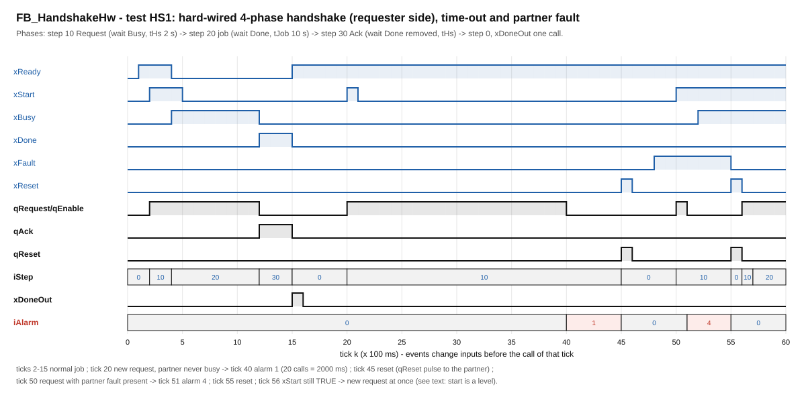

| Line | Explanation |
|---|---|
| `2 qRequest=1 qEnable=1 iStep=10` | partner ready (tick 1) and start → phase 1 |
| `4 iStep=20` | partner Busy (and not Ready) → phase 2 seen; the job runs |
| `12 qRequest=0 qAck=1 qEnable=0 iStep=30` | partner Done → request off, Ack on (phase 4) |
| `15 qAck=0 iStep=0 xDoneOut=1` | partner removed Done (phase 5) → Ack off, rest, `xDoneOut` for one call → the module sequence continues |
| `16 xDoneOut=0` | pulse ends |
| `20 qRequest=1 qEnable=1 iStep=10` | second job requested (start pulse 20–21 is enough – the FB stays in step 10) |
| `40 qRequest=0 qEnable=0 xError=1 iAlarm=1` | the partner never answers Busy: `n` = 20 at tick 40 → 2000 ms → **alarm 1**; outputs off, `iStep` stays 10 (diagnosis) |
| `45 qReset=1 iStep=0 xError=0 iAlarm=0` | reset edge, partner not faulted → cleared; `qReset` pulse to the partner |
| `46 qReset=0` | one call |
| (48) | partner fault at rest → **no** alarm (step 0) |
| `50 qRequest=1 qEnable=1 iStep=10` | start while ready (the fault input is not checked in step 0!) → request |
| `51 qRequest=0 qEnable=0 xError=1 iAlarm=4` | now `xFault AND step <> 0` → **alarm 4 'partner fault'** |
| `55 qReset=1 iStep=0 xError=0 iAlarm=0` | partner fault removed and reset in the same tick → cleared, reset pulse |
| `56 qRequest=1 qEnable=1 qReset=0 iStep=10` | `xStart` is **still TRUE** (since 50) and the partner is ready → a new request **at once** |
| `57 iStep=20` | partner `xBusy` has been TRUE since tick 52 (it started on the request of tick 50) → accepted as the answer immediately |

### B9.6 What lines 50–57 teach (design notes)

1. **Start is a level.** After the reset at 55 the request comes back by itself because the module still requests the job. This is intended for a sequence that waits in its
   step until the handshake is done; it is **not** intended after an alarm. Rule for the module (part B): on a handshake alarm the step chain goes to Held (class B) or Aborted
   (class A) and **removes `xStart`**; Unhold / Reset sets it again deliberately.
2. **A stale Busy is accepted.** The partner had reacted to the earlier request (tick 50) and was still Busy at 56. The FB does not check "Busy was FALSE before the request".
   A stricter partner check (step 10 entered only if `NOT xBusy AND NOT xDone`, i.e. the partner is at rest) is a good **project option** for partners that keep Busy after an
   aborted job – it would be a MINOR change with a configuration switch `bCheckRest` (default FALSE = 1.0.0 behaviour).
3. **Fault in step 0 is not checked.** A request can be sent to a faulted partner that is still "Ready" – one call later alarm 4 follows. Many partners drop Ready on a fault;
   if not, the module should include `NOT xFault` in its start condition.

### B9.7 Faceplate and alarms

Faceplate: the four partner inputs and four outputs as LEDs in phase order (Ready → Request → Busy → Done → Ack), the current step with its meaning, the time in the step,
the alarm. This "handshake LED row" is the fastest diagnostic tool at a transfer station – the commissioning engineer sees at once which side waits for which signal.

| a | Text | Suggested class | Typical cause |
|---|---|---|---|
| 1 | partner did not start (busy missing) | B | partner not in automatic, wire break, wrong signal |
| 2 | job time-out | B (A if the load is in a dangerous intermediate position) | partner stuck, job longer than `tJob_ms` |
| 3 | done not removed | B | partner does not see Ack (wire, partner logic) |
| 4 | partner fault | A when a load is in transfer, else B | partner's own fault |

### B9.8 Commissioning test

1. Signal check with the partner in manual: each of the 8 wires one by one (both directions), with both commissioning engineers on the phone.
2. Normal job slowly (partner in step mode) → watch each phase on the faceplate.
3. Time-out tests: disconnect Busy (alarm 1), stop the partner during the job (alarm 2), keep Done (alarm 3), partner fault during the job (alarm 4).
4. Power cycle of each side in each phase → both sides must come back to rest without moving (the outputs of a restarted PLC are FALSE → the partner sees the request
   disappear).
5. Set `tJob_ms` to about 1.5 × the longest real job time, `tHs_ms` to several partner cycle times (≥ 1 s).

### B9.9 Typical mistakes

| Mistake | Consequence |
|---|---|
| pulse handshake ("Start" for 100 ms) | partner misses the pulse when its scan is slow – job lost silently |
| partner Ready not checked | request to a partner in manual; alarm 1 after 2 s instead of "partner not ready" in the HMI |
| Enable used as the safety permission for the AGV transfer | **wrong** – the transfer permission between two machines with hazardous motion is a safety signal (COUPLING pattern, F-program); `qEnable` is only a process permission |
| no time-outs | the cell stops "silently" (guide 69 problem 4) |

## B10. FB_Feeder – supply breaker of an external machine

### B10.1 Purpose and where used

Pattern FEEDER_EXT (guide 68): the cell distribution feeds an external machine (machine tool M01, CMM M11, laser M12, nutrunner M13, tester M14, robot and welding power
source M15); an auxiliary contact of the feeder breaker signals "supply on". 5 instances in the kit. The FB tells the module (and the operator) "this machine has no power" –
the most basic and most overlooked diagnosis ("the CMM does not answer" – because its breaker tripped).

### B10.2 Interface and rule

| Name | Dir | Type | Default | Meaning |
|---|---|---|---|---|
| `xSupplyOn` | in | BOOL | TRUE | auxiliary contact of the feeder breaker (TRUE = on) |
| `tDelay_ms` | cfg | DINT | 200 | filter time before the alarm |
| `xOk` | out | BOOL | | supply on (unfiltered status) |
| `iAlarm` | out | INT | | 1 feeder breaker off (after `tDelay_ms`, not latched) |

> n = n+1 if NOT xSupplyOn else 0 ; xOk = xSupplyOn ; iAlarm = 1 'feeder breaker off' if n × 100 >= tDelay_ms (200) else 0 (not latched, class C unless the module needs the supply).

`xOk` is the immediate status (for interlocks: do not start a job on a machine without power); `iAlarm` is filtered (no alarm for a contact bounce) and **not latched** – it
disappears when the breaker is switched on again; the alarm manager's history keeps the event.

### B10.3 Listing

```iecst
(* source: tools/fmse/plc_lib/FB_Feeder.st - library 1.0.0, file header omitted *)
FUNCTION_BLOCK FB_Feeder
VAR_INPUT  (* signals *)
  xSupplyOn : BOOL := TRUE;                 (* breaker auxiliary contact (DI) *)
END_VAR
VAR_INPUT  (* configuration (set once, defaults = example values) *)
  tDelay_ms : DINT := 200;                  (* alarm delay [ms] *)
END_VAR
VAR_OUTPUT  (* outputs *)
  xOk : BOOL;                               (* supply on *)
  iAlarm : INT;                             (* local alarm code (0 = none) *)
END_VAR
VAR  (* internal *)
  n : DINT;                                 (* calls without supply *)
END_VAR
IF NOT xSupplyOn THEN
  n := MIN(n + 1, GC_N_MAX);
ELSE
  n := 0;
END_IF
xOk := xSupplyOn;
IF n * GC_CYCLE_MS >= tDelay_ms THEN
  iAlarm := 1;                                (* feeder breaker off *)
ELSE
  iAlarm := 0;
END_IF
END_FUNCTION_BLOCK
```

### B10.4 Unit test F1 – breaker trips and comes back

Events: 2 `xSupplyOn=0` · 6 `xSupplyOn=1`.

```
TEST FB_Feeder | F1 breaker trips and comes back | 4 lines
    0 init xOk=1 iAlarm=0
    2 xOk=0
    3 iAlarm=1
    6 xOk=1 iAlarm=0
```

Tick 2: supply off → `xOk = 0` at once, `n = 1` (100 < 200); tick 3: `n = 2` → 200 ≥ 200 → alarm 1; tick 6: supply back → `xOk = 1`, `n = 0`, alarm 0 (not latched).

### B10.5 Class, commissioning, mistakes

Class (D3): **C** while the machine is idle (warning "machine without power"); the module raises a **module** alarm of class B or A if a job needs the machine (e.g. M01:
"machine not ready at hand-over"). Commissioning: switch the breaker off / on, check the alarm and the text. Mistake: wiring the NC instead of the NO auxiliary contact (alarm
when the supply is on); using the "tripped" signal contact instead of the auxiliary contact (a breaker switched off by hand is not detected).

## B11. FB_Ups – 24 V DC UPS status

### B11.1 Purpose and where used

Pattern UPS_DC (guide 68 B8, guide 67): a 24 V DC UPS (buffer module with battery or supercapacitors) supplies the IPC of the cell controller (M19) and the network cabinet
(M22). Two status contacts: `UpsOk` (UPS healthy, battery OK) and `OnBattery` (mains lost, running from the battery). The FB raises a warning when the UPS runs on battery and
requests a **controlled shutdown** of the IPC when the battery time is used up – so that databases and file systems are closed cleanly instead of crashing.

### B11.2 Interface and rule

| Name | Dir | Type | Default | Meaning |
|---|---|---|---|---|
| `xUpsOk` | in | BOOL | TRUE | UPS healthy |
| `xOnBattery` | in | BOOL | FALSE | running on battery |
| `tBuffer_ms` | cfg | DINT | 5000 | time on battery before the shutdown request (example – real values are minutes) |
| `xShutdownReq` | out | BOOL | | request the controlled shutdown of the IPC |
| `iAlarm` | out | INT | | 1 UPS fault, 2 on battery |

> n = n+1 if xOnBattery else 0 ; xShutdownReq = n × 100 >= tBuffer_ms (5000) ; iAlarm = 1 'UPS fault' if NOT xUpsOk else 2 'on battery' if xOnBattery else 0.

Note the priority: a UPS fault (1) hides "on battery" (2) – the fault is more important because the buffering itself is not guaranteed any more.

### B11.3 Listing

```iecst
(* source: tools/fmse/plc_lib/FB_Ups.st - library 1.0.0, file header omitted *)
FUNCTION_BLOCK FB_Ups
VAR_INPUT  (* signals *)
  xUpsOk : BOOL := TRUE;                    (* UPS ready / no fault (DI) *)
  xOnBattery : BOOL;                        (* mains lost, on battery (DI) *)
END_VAR
VAR_INPUT  (* configuration (set once, defaults = example values) *)
  tBuffer_ms : DINT := 5000;                (* buffer time before shutdown [ms] *)
END_VAR
VAR_OUTPUT  (* outputs *)
  xShutdownReq : BOOL;                      (* request an orderly shutdown *)
  iAlarm : INT;                             (* local alarm code (0 = none) *)
END_VAR
VAR  (* internal *)
  n : DINT;                                 (* calls on battery *)
END_VAR
IF xOnBattery THEN
  n := MIN(n + 1, GC_N_MAX);
ELSE
  n := 0;
END_IF
xShutdownReq := n * GC_CYCLE_MS >= tBuffer_ms;
IF NOT xUpsOk THEN
  iAlarm := 1;                                (* UPS fault *)
ELSIF xOnBattery THEN
  iAlarm := 2;                                (* on battery *)
ELSE
  iAlarm := 0;
END_IF
END_FUNCTION_BLOCK
```

### B11.4 Unit test U1 – mains loss shorter and longer than the buffer time

Events: 2 `xOnBattery=1` · 20 `xOnBattery=0` · 25 `xOnBattery=1` · 80 `xUpsOk=0` · 88 `xOnBattery=0, xUpsOk=1`.

```
TEST FB_Ups | U1 mains loss shorter and longer than the buffer time | 7 lines
    0 init xShutdownReq=0 iAlarm=0
    2 iAlarm=2
    20 iAlarm=0
    25 iAlarm=2
    74 xShutdownReq=1
    80 iAlarm=1
    88 xShutdownReq=0 iAlarm=0
```

| Line | Explanation |
|---|---|
| `2 iAlarm=2` | mains lost → on battery → warning 2 |
| `20 iAlarm=0` | mains back after 18 calls = 1.8 s < 5 s → no shutdown, `n` reset |
| `25 iAlarm=2` | mains lost again, `n` restarts at 1 |
| `74 xShutdownReq=1` | `n` = 50 (ticks 25–74) → 5000 ≥ 5000 → **shutdown request** |
| `80 iAlarm=1` | UPS fault (battery exhausted / UPS fault contact) – priority over "on battery" |
| `88 xShutdownReq=0 iAlarm=0` | mains and UPS back → everything clear |

### B11.5 How the shutdown request is used

`xShutdownReq` goes to the IPC of the cell controller (over the data block of M19, or a hard-wired DI of the IPC's UPS software). The IPC closes the cell controller
application, flushes its database (the twin uses SQLite with WAL – a clean shutdown checkpoints the WAL file) and shuts down Windows / Linux **before** the battery is
empty. Set `tBuffer_ms` so that `t_buffer + t_shutdown ≤ 0.8 × battery autonomy` (example: autonomy 10 min, shutdown 2 min → `tBuffer_ms` ≤ 6 min). After a short mains
dip (line 20) nothing happens – the most frequent case.

Classes: 2 'on battery' **C**; 1 'UPS fault' **C** (but with a maintenance priority – the next mains loss will crash the IPC). Commissioning: pull the UPS input
breaker – check warning, shutdown after the configured time, IPC shuts down cleanly and restarts automatically when the mains returns (BIOS setting "power on after AC
loss"). Mistake: UPS status contacts not wired – the IPC crashes at the first power cut and the database is damaged.

## B12. FB_Safe2Ch – mirror of a 2-channel safety input – and its wrappers

### B12.1 Purpose and where used

FB_Safe2Ch is the **base block** for all 2-channel safety inputs in the standard program: e-stop (ESTOP), guard door (DOOR_2CH), enabling switch (ENABLE), light curtain
(LC) and the two signal pairs of a safety coupling (COUPLING). 14 instances in the kit through the wrappers (FB_Estop 6, FB_SafetyCoupling 3, FB_LightCurtain 2, FB_Door2Ch
2, FB_EnableSwitch 1).

> **This is a diagnostic MIRROR.** The safety function (stop, prevent restart, reset logic) is performed by the certified block in the F-program (guide 67 I, PLCopen Safety
> SF_EmergencyStop / SF_GuardMonitoring / SF_EnableSwitch / SF_ESPE). FB_Safe2Ch reads the **F-copies** of the two channels and reproduces the same logic for the HMI and
> PackML: is the function released, is a reset needed (lamp), is there a discrepancy (wiring fault)? Nothing in this FB can switch, bridge or reset a safety function.

### B12.2 Interface

| Name | Dir | Type | Default | Meaning |
|---|---|---|---|---|
| `xCh1`, `xCh2` | in | BOOL | FALSE | F-copies of the two channels (TRUE = safe / closed / released) |
| `xReset` | in | BOOL | FALSE | the reset push-button (level; edge inside) – the **same** button that the F-program evaluates |
| `tDisc_ms` | cfg | DINT | 500 | discrepancy time (= the setting of the F-block) |
| `xOk` | out | BOOL | | released: both channels closed, reset done, no discrepancy |
| `xResetReq` | out | BOOL | | both channels closed but a reset is needed (lamp "press reset") |
| `xDiscErr` | out | BOOL | | discrepancy latched |
| `iAlarm` | out | INT | | 1 discrepancy |

### B12.3 The rule

> latched starts TRUE (reset needed after power-on). Order: rst = edge ; nd = nd+1 if xCh1 <> xCh2 else 0 ; if nd × 100 >= tDisc_ms and NOT xDiscErr: xDiscErr = TRUE,
> iAlarm 1 'discrepancy', bothOpen = FALSE ; if xDiscErr and NOT xCh1 and NOT xCh2: bothOpen = TRUE ; if NOT (xCh1 AND xCh2): latched = TRUE ; if rst and xCh1 and xCh2:
> (if xDiscErr and bothOpen: xDiscErr = FALSE, iAlarm 0) ; if NOT xDiscErr: latched = FALSE ; outputs xOk = xCh1 AND xCh2 AND NOT latched AND NOT xDiscErr ; xResetReq =
> latched AND xCh1 AND xCh2 AND NOT xDiscErr. A discrepancy can only be reset after BOTH channels were open (cross-fault test, as safety PLCs do).

The three ideas of the rule:

1. **Reset required (manual reset).** Every opening of a channel sets `latched`; only a reset (rising edge) with both channels closed releases. This mirrors the
   "manual reset" of ISO 13849-1 5.2.2 / IEC 60204-1 9.2.5.4: closing a door or pulling out an e-stop must not restart anything by itself. After power-on `latched` is TRUE –
   a reset is required after every power-up, as the F-program does.
2. **Discrepancy.** Two channels of one device must switch together (within `tDisc_ms`). If one channel stays different longer, one contact is welded, a wire is broken or
   shorted to 24 V, or the device is mechanically misaligned. The discrepancy is latched.
3. **Cross-fault test before reset.** A discrepancy can only be reset after **both** channels were open at the same time. Reason: if channel 2 is stuck closed (welded),
   the operator could close channel 1 again and reset – and the system would run with one working channel. Requiring "both open" proves that the stuck channel can open again.

### B12.4 Listing FB_Safe2Ch

```iecst
(* source: tools/fmse/plc_lib/FB_Safe2Ch.st - library 1.0.0, file header omitted *)
FUNCTION_BLOCK FB_Safe2Ch
VAR_INPUT  (* signals *)
  xCh1 : BOOL;                              (* channel 1, TRUE = safe / closed *)
  xCh2 : BOOL;                              (* channel 2, TRUE = safe / closed *)
  xReset : BOOL;                            (* fault reset, rising edge *)
END_VAR
VAR_INPUT  (* configuration (set once, defaults = example values) *)
  tDisc_ms : DINT := 500;                   (* discrepancy time [ms] *)
END_VAR
VAR_OUTPUT  (* outputs *)
  xOk : BOOL;                               (* both channels closed and reset *)
  xResetReq : BOOL;                         (* closed, waiting for a reset (lamp) *)
  xDiscErr : BOOL;                          (* discrepancy latched *)
  iAlarm : INT;                             (* local alarm code (0 = none) *)
END_VAR
VAR  (* internal *)
  rtReset : R_TRIG;                         (* edge of xReset *)
  xRst : BOOL;                              (* reset pulse *)
  xLatched : BOOL := TRUE;                  (* reset needed (TRUE after power-on) *)
  nDisc : DINT;                             (* calls with xCh1 <> xCh2 *)
  xBothOpen : BOOL;                         (* both channels were open after the discrepancy *)
END_VAR
rtReset(CLK := xReset);
xRst := rtReset.Q;
IF xCh1 <> xCh2 THEN
  nDisc := MIN(nDisc + 1, GC_N_MAX);
ELSE
  nDisc := 0;
END_IF
IF (nDisc * GC_CYCLE_MS >= tDisc_ms) AND NOT xDiscErr THEN
  xDiscErr := TRUE;
  iAlarm := 1;                                (* discrepancy *)
  xBothOpen := FALSE;
END_IF
IF xDiscErr AND NOT xCh1 AND NOT xCh2 THEN
  xBothOpen := TRUE;
END_IF
IF NOT (xCh1 AND xCh2) THEN
  xLatched := TRUE;
END_IF
IF xRst AND xCh1 AND xCh2 THEN
  IF xDiscErr AND xBothOpen THEN
    xDiscErr := FALSE;
    iAlarm := 0;
  END_IF
  IF NOT xDiscErr THEN
    xLatched := FALSE;
  END_IF
END_IF
xOk := xCh1 AND xCh2 AND NOT xLatched AND NOT xDiscErr;
xResetReq := xLatched AND xCh1 AND xCh2 AND NOT xDiscErr;
END_FUNCTION_BLOCK
```

### B12.5 Unit test E1 – e-stop: power-on reset, press, reset, discrepancy

Events: 1 `xCh1=1, xCh2=1` · 3 `xReset=1` · 4 `xReset=0` · 8 `xCh1=0, xCh2=0` · 10 `xCh1=1, xCh2=1` · 12 `xReset=1` · 13 `xReset=0` · 20 `xCh2=0` · 28 `xCh2=1` · 30
`xReset=1` · 31 `xReset=0` · 33 `xCh1=0, xCh2=0` · 35 `xCh1=1, xCh2=1` · 37 `xReset=1` · 38 `xReset=0`.

```
TEST FB_Safe2Ch | E1 e-stop: power-on reset, press, reset, discrepancy | 9 lines
    0 init xOk=0 xResetReq=0 xDiscErr=0 iAlarm=0
    1 xResetReq=1
    3 xOk=1 xResetReq=0
    8 xOk=0
    10 xResetReq=1
    12 xOk=1 xResetReq=0
    20 xOk=0
    24 xDiscErr=1 iAlarm=1
    37 xOk=1 xDiscErr=0 iAlarm=0
```

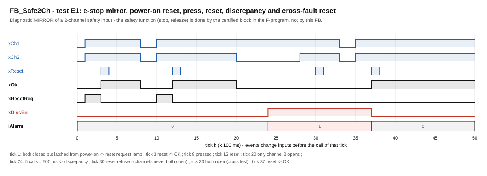

| Line | Explanation |
|---|---|
| `0 init` | power-on: channels still 0 (the F-program has not yet passed its copies), latched → not OK, no reset request (channels open) |
| `1 xResetReq=1` | both channels closed, but latched from power-on → **"press reset"** lamp |
| `3 xOk=1 xResetReq=0` | reset edge with both closed → released |
| `8 xOk=0` | e-stop pressed: both channels open → latched |
| `10 xResetReq=1` | e-stop pulled out: both closed → reset request (no automatic release!) |
| `12 xOk=1 xResetReq=0` | reset → released |
| `20 xOk=0` | only channel 2 opens (contact fault / misalignment) → not OK, latched, `nd` = 1 |
| `24 xDiscErr=1 iAlarm=1` | `nd` = 5 (ticks 20–24) → 500 ≥ 500 → **discrepancy** |
| (28) | channel 2 closes again – both closed, but discrepancy latched → no reset request (`xResetReq` requires `NOT xDiscErr`) |
| (30) | reset edge → **refused**: both channels were never open together since the discrepancy |
| (33–35) | e-stop pressed and released: both open (cross-fault test passed, `bothOpen` = TRUE), then both closed |
| `37 xOk=1 xDiscErr=0 iAlarm=0` | reset → discrepancy cleared **and** released in the same call |

Note at tick 35: both channels closed, discrepancy still latched → `xResetReq` stays 0 although a reset is now possible. The HMI text for alarm 1 therefore says what to do:
"discrepancy – actuate the device completely (both channels open), then reset".

### B12.6 The wrappers FB_Estop, FB_Door2Ch, FB_EnableSwitch, FB_LightCurtain

The wrappers give the generated code the field names of each pattern (guide 69 D10) and use FB_Safe2Ch inside. The output for "released" is called `xSafe` in all
wrappers (= `FB_Safe2Ch.xOk`; an input called `xOk` exists already in FB_Estop – IEC 61131-3 does not allow an input and an output with the same name).

```iecst
(* source: tools/fmse/plc_lib/FB_Estop.st - library 1.0.0, file header omitted *)
FUNCTION_BLOCK FB_Estop
VAR_INPUT  (* signals *)
  xOk : BOOL;                               (* e-stop channel 1 F-copy (TRUE = not pressed) *)
  xOk2 : BOOL;                              (* e-stop channel 2 F-copy (TRUE = not pressed) *)
  xReset : BOOL;                            (* fault reset, rising edge *)
END_VAR
VAR_INPUT  (* configuration (set once, defaults = example values) *)
  tDisc_ms : DINT := 500;                   (* discrepancy time [ms] *)
END_VAR
VAR_OUTPUT  (* outputs *)
  xSafe : BOOL;                             (* closed / free and reset (FB_Safe2Ch.xOk) *)
  xResetReq : BOOL;                         (* waiting for a reset *)
  xDiscErr : BOOL;                          (* discrepancy latched *)
  iAlarm : INT;                             (* local alarm code (0 = none) *)
END_VAR
VAR  (* internal *)
  fbCh : FB_Safe2Ch;                        (* 2-channel mirror *)
END_VAR
fbCh(xCh1 := xOk, xCh2 := xOk2, xReset := xReset, tDisc_ms := tDisc_ms);
xSafe := fbCh.xOk;
xResetReq := fbCh.xResetReq;
xDiscErr := fbCh.xDiscErr;
iAlarm := fbCh.iAlarm;
END_FUNCTION_BLOCK

(* source: tools/fmse/plc_lib/FB_Door2Ch.st - library 1.0.0, file header omitted *)
FUNCTION_BLOCK FB_Door2Ch
VAR_INPUT  (* signals *)
  xClosed : BOOL;                           (* door closed channel 1 F-copy *)
  xClosed2 : BOOL;                          (* door closed channel 2 F-copy *)
  xReset : BOOL;                            (* fault reset, rising edge *)
END_VAR
VAR_INPUT  (* configuration (set once, defaults = example values) *)
  tDisc_ms : DINT := 500;                   (* discrepancy time [ms] *)
END_VAR
VAR_OUTPUT  (* outputs *)
  xSafe : BOOL;                             (* closed / free and reset (FB_Safe2Ch.xOk) *)
  xResetReq : BOOL;                         (* waiting for a reset *)
  xDiscErr : BOOL;                          (* discrepancy latched *)
  iAlarm : INT;                             (* local alarm code (0 = none) *)
END_VAR
VAR  (* internal *)
  fbCh : FB_Safe2Ch;                        (* 2-channel mirror *)
END_VAR
fbCh(xCh1 := xClosed, xCh2 := xClosed2, xReset := xReset, tDisc_ms := tDisc_ms);
xSafe := fbCh.xOk;
xResetReq := fbCh.xResetReq;
xDiscErr := fbCh.xDiscErr;
iAlarm := fbCh.iAlarm;
END_FUNCTION_BLOCK

(* source: tools/fmse/plc_lib/FB_EnableSwitch.st - library 1.0.0, file header omitted *)
FUNCTION_BLOCK FB_EnableSwitch
VAR_INPUT  (* signals *)
  xOk : BOOL;                               (* enabling channel 1 F-copy (TRUE = enabled) *)
  xOk2 : BOOL;                              (* enabling channel 2 F-copy (TRUE = enabled) *)
  xReset : BOOL;                            (* fault reset, rising edge *)
END_VAR
VAR_INPUT  (* configuration (set once, defaults = example values) *)
  tDisc_ms : DINT := 500;                   (* discrepancy time [ms] *)
END_VAR
VAR_OUTPUT  (* outputs *)
  xSafe : BOOL;                             (* closed / free and reset (FB_Safe2Ch.xOk) *)
  xResetReq : BOOL;                         (* waiting for a reset *)
  xDiscErr : BOOL;                          (* discrepancy latched *)
  iAlarm : INT;                             (* local alarm code (0 = none) *)
END_VAR
VAR  (* internal *)
  fbCh : FB_Safe2Ch;                        (* 2-channel mirror *)
END_VAR
fbCh(xCh1 := xOk, xCh2 := xOk2, xReset := xReset, tDisc_ms := tDisc_ms);
xSafe := fbCh.xOk;
xResetReq := fbCh.xResetReq;
xDiscErr := fbCh.xDiscErr;
iAlarm := fbCh.iAlarm;
END_FUNCTION_BLOCK

(* source: tools/fmse/plc_lib/FB_LightCurtain.st - library 1.0.0, file header omitted *)
FUNCTION_BLOCK FB_LightCurtain
VAR_INPUT  (* signals *)
  xOssd1 : BOOL;                            (* OSSD 1 F-copy (TRUE = free) *)
  xOssd2 : BOOL;                            (* OSSD 2 F-copy (TRUE = free) *)
  xWarn : BOOL;                             (* warning / muting signal (DI) *)
  xReset : BOOL;                            (* fault reset, rising edge *)
END_VAR
VAR_INPUT  (* configuration (set once, defaults = example values) *)
  tDisc_ms : DINT := 500;                   (* discrepancy time [ms] *)
END_VAR
VAR_OUTPUT  (* outputs *)
  xSafe : BOOL;                             (* closed / free and reset (FB_Safe2Ch.xOk) *)
  xWarnOut : BOOL;                          (* warning signal passed through *)
  xResetReq : BOOL;                         (* waiting for a reset *)
  xDiscErr : BOOL;                          (* discrepancy latched *)
  iAlarm : INT;                             (* local alarm code (0 = none) *)
END_VAR
VAR  (* internal *)
  fbCh : FB_Safe2Ch;                        (* 2-channel mirror *)
END_VAR
fbCh(xCh1 := xOssd1, xCh2 := xOssd2, xReset := xReset, tDisc_ms := tDisc_ms);
xSafe := fbCh.xOk;
xWarnOut := xWarn;
xResetReq := fbCh.xResetReq;
xDiscErr := fbCh.xDiscErr;
iAlarm := fbCh.iAlarm;
END_FUNCTION_BLOCK
```

Notes:

- **Enabling switch and reset.** A 3-position enabling device (guide 67 H8) releases only in the middle position and needs no reset in most F-blocks (releasing it stops the
  motion; pressing it again allows motion again – that is its purpose). The F-program's SF_EnableSwitch has no manual reset; the mirror should therefore be called with
  `xReset := TRUE` permanently? **No** – the edge rule would then reset only once. The library convention: the module passes `xReset := xCh1 AND xCh2` (the release itself),
  which produces a rising edge at every release – a FB_Safe2Ch used with "automatic reset". Discrepancy and cross-fault test still work. This is a usage rule of the wrapper,
  documented in its header in 1.0.1.
- **Light curtain warning.** FB_LightCurtain passes `xWarn` through as `xWarnOut` and raises only alarm 1 (discrepancy). A contamination warning that must appear in the
  alarm list is a **module** alarm (class C) on the same instance number, raised from `xWarnOut`.
- **Light curtain with muting / blanking.** Muting (temporarily bridging the curtain while a pallet passes) is a safety function – it is done by the F-program (SF_MutingPar /
  SF_MutingSeq) or the curtain's own controller. The standard program may only **show** "muting active" (a mirror input) and request muting through a defined request.

### B12.7 FB_SafetyCoupling – two mirrors in one block

Pattern COUPLING (guide 67 I3, guide 68 B3.3): the hard-wired safety coupling between the cell and a machine or robot – e-stop in both directions and a "zone free" signal
pair. Inputs: `xEstopIn, xEstopIn2` (the partner's e-stop chain, F-copies) and `xZoneFree, xZoneFree2` (partner's zone free). Outputs to the partner (EstopOut, EnableOut) are
FDO – **not** in this block.

```iecst
(* source: tools/fmse/plc_lib/FB_SafetyCoupling.st - library 1.0.0, file header omitted *)
FUNCTION_BLOCK FB_SafetyCoupling
VAR_INPUT  (* signals *)
  xEstopIn : BOOL;                          (* e-stop in channel 1 F-copy *)
  xEstopIn2 : BOOL;                         (* e-stop in channel 2 F-copy *)
  xZoneFree : BOOL;                         (* zone free channel 1 F-copy *)
  xZoneFree2 : BOOL;                        (* zone free channel 2 F-copy *)
  xReset : BOOL;                            (* fault reset, rising edge *)
END_VAR
VAR_INPUT  (* configuration (set once, defaults = example values) *)
  tDisc_ms : DINT := 500;                   (* discrepancy time [ms] *)
END_VAR
VAR_OUTPUT  (* outputs *)
  xEstopOk : BOOL;                          (* e-stop chain closed and reset *)
  xZoneOk : BOOL;                           (* neighbour zone free and reset *)
  xResetReq : BOOL;                         (* one of the two waits for a reset *)
  xDiscErr : BOOL;                          (* discrepancy in one of the two *)
  iAlarm : INT;                             (* local alarm code (0 = none) *)
END_VAR
VAR  (* internal *)
  fbEstop : FB_Safe2Ch;                     (* e-stop in *)
  fbZone : FB_Safe2Ch;                      (* zone free *)
END_VAR
fbEstop(xCh1 := xEstopIn, xCh2 := xEstopIn2, xReset := xReset, tDisc_ms := tDisc_ms);
fbZone(xCh1 := xZoneFree, xCh2 := xZoneFree2, xReset := xReset, tDisc_ms := tDisc_ms);
xEstopOk := fbEstop.xOk;
xZoneOk := fbZone.xOk;
xResetReq := fbEstop.xResetReq OR fbZone.xResetReq;
xDiscErr := fbEstop.xDiscErr OR fbZone.xDiscErr;
IF fbEstop.xDiscErr THEN
  iAlarm := 1;                                (* e-stop coupling discrepancy *)
ELSIF fbZone.xDiscErr THEN
  iAlarm := 2;                                (* zone-free coupling discrepancy *)
ELSE
  iAlarm := 0;
END_IF
END_FUNCTION_BLOCK
```

The library gives the two pairs different local codes – 1 for the e-stop pair, 2 for the zone pair – so that they get different alarm numbers (D2). A "zone free" signal often changes in normal operation (the robot leaves the shared zone) – whether a reset is needed after every zone change is
decided by the coupling design: if not, the module passes `xReset := xZoneFree AND xZoneFree2` for the zone half (as for the enabling switch) – then a second `xReset` input per
half is needed, a MINOR extension.

### B12.8 HMI faceplate (all Safe2Ch mirrors)

```
 ┌─ POOL01 Estop  (FB_Estop, mirror) ───────────────┐
 │  channel 1 ●   channel 2 ●      state: RELEASED   │   RELEASED / PRESSED / RESET REQUIRED / DISCREPANCY
 │  discrepancy time 500 ms        last trip 08:14   │
 │  alarm: –                                         │
 │  (no buttons - reset only at the reset push-button outside the hazard zone)                 │
 └───────────────────────────────────────────────────┘
```

**No reset button on the HMI.** The reset of a safety function must be done at a place from which the hazard zone can be seen (ISO 13849-1, IEC 60204-1 9.2.5.4; guide 67
I6). An HMI "reset" button would let someone reset from the control room while a person is inside – the F-program's reset input is wired to the physical button only.

### B12.9 Alarm table

| Wrapper | a | Text | Suggested class |
|---|---|---|---|
| FB_Estop | 1 | e-stop discrepancy – actuate fully, then reset | A (the F-program has stopped anyway; the state must be Aborted) |
| FB_Door2Ch | 1 | door switch discrepancy | B (Held) – door mechanics / switch adjustment |
| FB_EnableSwitch | 1 | enabling switch discrepancy | B (only relevant in maintenance mode) |
| FB_LightCurtain | 1 | OSSD discrepancy (contamination warning = module alarm, C) | A |
| FB_SafetyCoupling | 1, 2 | e-stop pair discrepancy; zone pair discrepancy | A; A |

Not an alarm of the mirror: "e-stop pressed" – that is an **event / state** (the module goes to Aborted with the module alarm "safety stop" of class A, i = 0 a = 6 only if the
F-program reports a fault; a pressed e-stop is shown as the state "E-STOP PRESSED" with its location).

### B12.10 Commissioning test (with the safety engineer)

1. Each device: actuate, watch both channel F-copies and the mirror state on the HMI; check that the F-program stops the machine (that test belongs to the safety validation).
2. Discrepancy: open one channel only (disconnect one wire at the terminal **with the safety engineer**) → mirror and F-program both report the discrepancy after the same time.
3. Reset refused after a discrepancy until both channels were open.
4. Power cycle: reset required after power-on.
5. Align `tDisc_ms` with the F-block parameter; document both in the safety validation record.

### B12.11 Typical mistakes and field faults

| Fault | Symptom | Cause / fix |
|---|---|---|
| the standard program reads only channel 1 | HMI shows "closed" while channel 2 is open | always both channels (this FB) |
| mirror discrepancy time ≠ F-block time | the HMI reports a discrepancy that the F-program does not (or vice versa) | align the times |
| door switch actuator misaligned | sporadic discrepancy when the door is slammed | adjust the actuator; door damper |
| reset on the HMI | reset from outside the view of the hazard zone – **not allowed** | physical reset button only |
| e-stop "bridged for commissioning" in the F-program and forgotten | mirror shows released while the button is pressed | F-signature check, validation record (guide 67 G11) |

## B13. FB_Edm – external device monitoring mirror – and its wrappers

### B13.1 Purpose and where used

**EDM** (external device monitoring) checks that a contactor or a valve **follows** its safety output: when the F-output is off, the contactor's mirror contact (NC,
mechanically linked) must be closed; when the output is on, it must be open. If the contactor is welded, the mirror contact stays open after switch-off – the F-program detects
this and prevents a restart (guide 68 B1.5 CONT_PAIR_EDM, B3.4 ZONE_OUT, B3.2 SAFE_VALVE). FB_Edm is the **standard-program mirror** of that check, for the HMI and the alarm
list. 5 instances in the kit (FB_ZoneOut 4 in M18, FB_ContactorPair 1 in M03).

> **Diagnostic MIRROR.** The EDM function itself (prevent restart with a welded contactor) is in the F-program (SF_EDM). FB_Edm reads the F-copy of the F-output (`xCmd`) and
> the F-copy of the feedback (`xFb`) and reports what the operator must repair.

### B13.2 Interface

| Name | Dir | Type | Default | Meaning |
|---|---|---|---|---|
| `xCmd` | in | BOOL | FALSE | F-copy of the F-output (TRUE = output on) |
| `xFb` | in | BOOL | TRUE | F-copy of the feedback |
| `xReset` | in | BOOL | FALSE | reset (edge inside) |
| `tEdm_ms` | cfg | DINT | 300 | time the device may need to follow |
| `bInverted` | cfg | BOOL | TRUE | TRUE: feedback = NC mirror contact (TRUE when the contactor is OPEN); FALSE: position feedback (TRUE when the valve is open) |
| `xOn` | out | BOOL | | output on and the device has followed, no error |
| `xError`, `iAlarm` | out | | | 1 feedback does not follow (welded / not switching) |

### B13.3 The rule

> exp = NOT xCmd if bInverted else xCmd ; okfb = xFb = exp ; n = n+1 if NOT okfb else 0 ; if xError and edge(xReset) and okfb: clear ; if NOT xError and n × 100 >= tEdm_ms:
> xError, iAlarm 1 'feedback does not follow (welded / not switching)' ; xOn = xCmd AND okfb AND NOT xError.

| bInverted | xCmd | expected xFb | Typical device |
|---|---|---|---|
| TRUE | FALSE (off) | TRUE (NC mirror contact closed = contactor open) | zone contactors, contactor pair |
| TRUE | TRUE (on) | FALSE | |
| FALSE | FALSE | FALSE (valve closed) | safety valve with position switch |
| FALSE | TRUE | TRUE (valve open) | |

### B13.4 Listing FB_Edm

```iecst
(* source: tools/fmse/plc_lib/FB_Edm.st - library 1.0.0, file header omitted *)
FUNCTION_BLOCK FB_Edm
VAR_INPUT  (* signals *)
  xCmd : BOOL;                              (* F-copy of the F-output (read only) *)
  xFb : BOOL := TRUE;                       (* feedback (DI) *)
  xReset : BOOL;                            (* fault reset, rising edge *)
END_VAR
VAR_INPUT  (* configuration (set once, defaults = example values) *)
  tEdm_ms : DINT := 300;                    (* feedback time [ms] *)
  bInverted : BOOL := TRUE;                 (* TRUE = NC mirror contact *)
END_VAR
VAR_OUTPUT  (* outputs *)
  xOn : BOOL;                               (* output on and feedback ok *)
  xError : BOOL;                            (* error latched (see alarms) *)
  iAlarm : INT;                             (* local alarm code (0 = none) *)
END_VAR
VAR  (* internal *)
  rtReset : R_TRIG;                         (* edge of xReset *)
  xExp : BOOL;                              (* expected feedback *)
  xFbOk : BOOL;                             (* feedback = expected *)
  n : DINT;                                 (* calls with wrong feedback *)
END_VAR
rtReset(CLK := xReset);
IF bInverted THEN
  xExp := NOT xCmd;
ELSE
  xExp := xCmd;
END_IF
xFbOk := xFb = xExp;
IF NOT xFbOk THEN
  n := MIN(n + 1, GC_N_MAX);
ELSE
  n := 0;
END_IF
IF xError AND rtReset.Q AND xFbOk THEN
  xError := FALSE;
  iAlarm := 0;
END_IF
IF NOT xError AND n * GC_CYCLE_MS >= tEdm_ms THEN
  xError := TRUE;
  iAlarm := 1;                                (* feedback does not follow *)
END_IF
xOn := xCmd AND xFbOk AND NOT xError;
END_FUNCTION_BLOCK
```

### B13.5 Unit test Z1 – zone contactors follow, then one welds

Configuration: `bInverted = TRUE` (zone contactors with NC mirror contacts), default `xFb = TRUE`. Events: 2 `xCmd=1` · 3 `xFb=0` · 10 `xCmd=0` · 11 `xFb=1` · 15 `xCmd=1` · 16
`xFb=0` · 20 `xCmd=0` · 26 `xReset=1` · 27 `xReset=0, xFb=1` · 28 `xReset=1`.

```
TEST FB_Edm | Z1 zone contactors follow, then one welds | 7 lines
    0 init xOn=0 xError=0 iAlarm=0
    3 xOn=1
    10 xOn=0
    16 xOn=1
    20 xOn=0
    22 xError=1 iAlarm=1
    28 xError=0 iAlarm=0
```

| Line | Explanation |
|---|---|
| `0 init` | output off, mirror contact closed (TRUE) = expected → OK, `xOn` 0 |
| (2) | F-output on; the mirror contact is still closed → not OK, `n` = 1 |
| `3 xOn=1` | the contactor has pulled in, mirror contact open → OK → `xOn` |
| `10 xOn=0` | F-output off; mirror still open (`n` = 1) → `xOn` 0 at once (`xCmd` FALSE) |
| (11) | contactor dropped out, mirror closed → OK |
| `16 xOn=1` | second switch-on, followed after one call |
| `20 xOn=0` | F-output off – but the contact stays open (**welded**) |
| `22 xError=1 iAlarm=1` | `n` = 3 (ticks 20–22) → 300 ≥ 300 → **alarm 1 'feedback does not follow (welded / not switching)'** |
| (26) | reset edge while the feedback is still wrong → refused |
| (27) | contactor replaced / freed: mirror closed → OK, but no reset edge (reset input went 0) |
| `28 xError=0 iAlarm=0` | reset edge with correct feedback → cleared |

### B13.6 The wrappers FB_ZoneOut, FB_ContactorPair, FB_SafeValve

```iecst
(* source: tools/fmse/plc_lib/FB_ZoneOut.st - library 1.0.0, file header omitted *)
FUNCTION_BLOCK FB_ZoneOut
VAR_INPUT  (* signals *)
  xCmd : BOOL;                              (* F-copy of the F-output Release *)
  xFb : BOOL := TRUE;                       (* NC mirror contacts in series (DI), TRUE = open *)
  xReset : BOOL;                            (* fault reset, rising edge *)
END_VAR
VAR_INPUT  (* configuration (set once, defaults = example values) *)
  tEdm_ms : DINT := 300;                    (* feedback time [ms] *)
END_VAR
VAR_OUTPUT  (* outputs *)
  xOn : BOOL;                               (* output on and feedback ok *)
  xError : BOOL;                            (* error latched (see alarms) *)
  iAlarm : INT;                             (* local alarm code (0 = none) *)
END_VAR
VAR  (* internal *)
  fbEdm : FB_Edm;                           (* EDM *)
END_VAR
fbEdm(xCmd := xCmd, xFb := xFb, xReset := xReset, tEdm_ms := tEdm_ms, bInverted := TRUE);
xOn := fbEdm.xOn;
xError := fbEdm.xError;
iAlarm := fbEdm.iAlarm;
END_FUNCTION_BLOCK

(* source: tools/fmse/plc_lib/FB_ContactorPair.st - library 1.0.0, file header omitted *)
FUNCTION_BLOCK FB_ContactorPair
VAR_INPUT  (* signals *)
  xCmd : BOOL;                              (* F-copy of the F-output Enable *)
  xEDM : BOOL := TRUE;                      (* NC mirror contacts in series (DI), TRUE = open *)
  xReset : BOOL;                            (* fault reset, rising edge *)
END_VAR
VAR_INPUT  (* configuration (set once, defaults = example values) *)
  tEdm_ms : DINT := 300;                    (* feedback time [ms] *)
END_VAR
VAR_OUTPUT  (* outputs *)
  xOn : BOOL;                               (* output on and feedback ok *)
  xError : BOOL;                            (* error latched (see alarms) *)
  iAlarm : INT;                             (* local alarm code (0 = none) *)
END_VAR
VAR  (* internal *)
  fbEdm : FB_Edm;                           (* EDM *)
END_VAR
fbEdm(xCmd := xCmd, xFb := xEDM, xReset := xReset, tEdm_ms := tEdm_ms, bInverted := TRUE);
xOn := fbEdm.xOn;
xError := fbEdm.xError;
iAlarm := fbEdm.iAlarm;
END_FUNCTION_BLOCK

(* source: tools/fmse/plc_lib/FB_SafeValve.st - library 1.0.0, file header omitted *)
FUNCTION_BLOCK FB_SafeValve
VAR_INPUT  (* signals *)
  xCmdA : BOOL;                             (* F-copy of the F-output ValveA *)
  xCmdB : BOOL;                             (* F-copy of the F-output ValveB *)
  xFbA : BOOL;                              (* valve A open (DI) *)
  xFbB : BOOL;                              (* valve B open (DI) *)
  xReset : BOOL;                            (* fault reset, rising edge *)
END_VAR
VAR_INPUT  (* configuration (set once, defaults = example values) *)
  tEdm_ms : DINT := 300;                    (* feedback time [ms] *)
END_VAR
VAR_OUTPUT  (* outputs *)
  xOnA : BOOL;                              (* valve A open and feedback ok *)
  xOnB : BOOL;                              (* valve B open and feedback ok *)
  xError : BOOL;                            (* error latched (see alarms) *)
  iAlarm : INT;                             (* local alarm code (0 = none) *)
END_VAR
VAR  (* internal *)
  fbA : FB_Edm;                             (* EDM valve A *)
  fbB : FB_Edm;                             (* EDM valve B *)
END_VAR
fbA(xCmd := xCmdA, xFb := xFbA, xReset := xReset, tEdm_ms := tEdm_ms, bInverted := FALSE);
fbB(xCmd := xCmdB, xFb := xFbB, xReset := xReset, tEdm_ms := tEdm_ms, bInverted := FALSE);
xOnA := fbA.xOn;
xOnB := fbB.xOn;
xError := fbA.xError OR fbB.xError;
IF fbA.xError THEN
  iAlarm := 1;                                (* valve A feedback *)
ELSIF fbB.xError THEN
  iAlarm := 2;                                (* valve B feedback *)
ELSE
  iAlarm := 0;
END_IF
END_FUNCTION_BLOCK
```

Where does `xCmd` come from? The generated code of item 9 wires only the F-input copies (`DriveSup(xEDM := POOL01_DriveSup_EDM)`, `Zone1(xFb := SAFE01_Zone1_Fb)`); the F-output
symbol (`POOL01_DriveSup_Enable`, `SAFE01_Zone1_Release`) exists in the standard program as a **read-only** global (written by the F-program). The module passes it:
`Dev.DriveSup.xCmd := POOL01_DriveSup_Enable;` – reading an F-output copy is allowed, writing it is not (and the generator never generates a write).

### B13.7 Faceplate, alarms, commissioning, mistakes

Faceplate: F-output state, feedback state, "follows / does not follow", number of switching cycles (from the module – contactors have a rated electrical life, e.g. 1–2 million
operations under AC-3; the count supports preventive replacement).

| Wrapper | a | Text | Suggested class |
|---|---|---|---|
| FB_ZoneOut, FB_ContactorPair | 1 | contactor feedback does not follow (welded / not switching) | A – the F-program blocks the restart; replace the contactor |
| FB_SafeValve | 1, 2 | safety valve A / B does not follow | A |

Commissioning: switch the zone on / off several times; measure the follow time (typ. 20–50 ms for contactors, 30–100 ms for valves) – `tEdm_ms` = 300 ms leaves margin;
simulate a welded contactor by blocking the armature mechanically (only with the safety engineer, power off) or by bridging the feedback wire → the F-program blocks the
restart, the mirror shows alarm 1. Mistakes: feedback from a normal auxiliary contact instead of a **mirror contact** (IEC 60947-4-1 Annex F, mechanically linked) – a
welded main contact is then not detected; `bInverted` wrong (alarm at every switching).

## B14. FB_ModeSwitch – key switch for the unit mode

### B14.1 Purpose and where used

Pattern MODE_SWITCH (guide 68 B6, guide 67 H7): a key-operated mode selector with two contacts `Auto` and `Maint`, read by the F-program (mode selection is part of the safety
concept – in maintenance mode the F-program enables reduced speed / enabling device functions). The standard program reads the F-copies to request the **PackML unit mode**
(item 5): Auto → Production (1), Maint → Maintenance (2), neither → Manual (3). Used in M03 (pool) and M18 (cell safety controller) – 2 instances in the kit.

### B14.2 Interface and rule

| Name | Dir | Type | Default | Meaning |
|---|---|---|---|---|
| `xAuto`, `xMaint` | in | BOOL | FALSE | F-copies of the two key-switch contacts |
| `tDisc_ms` | cfg | DINT | 500 | both contacts may be on this long (switching over) |
| `iMode` | out | INT | 3 | requested mode: 1 Production, 2 Maintenance, 3 Manual |
| `xError`, `iAlarm` | out | | | 1 both contacts on longer than `tDisc_ms` |

> inputs xAuto, xMaint ; n = n+1 if xAuto AND xMaint else 0 ; iMode: Auto only → 1 Production, Maint only → 2 Maintenance, none → 3 Manual, both → unchanged ; xError = n × 100 >=
> tDisc_ms (500) ; iAlarm = 1 if xError else 0. iMode init 3.

`iMode` is a **request**. The PackML core accepts a mode change only in Stopped, Idle or Aborted (item 5, guide 65 C2); a key turned during Execute changes `iMode` but the unit
mode (word 1) stays until the module reaches such a state – the HMI shows "mode change pending". The F-program reacts to the key at once (that is its job).

### B14.3 Listing

```iecst
(* source: tools/fmse/plc_lib/FB_ModeSwitch.st - library 1.0.0, file header omitted *)
FUNCTION_BLOCK FB_ModeSwitch
VAR_INPUT  (* signals *)
  xAuto : BOOL;                             (* contact AUTO (DI) *)
  xMaint : BOOL;                            (* contact MAINT (DI) *)
END_VAR
VAR_INPUT  (* configuration (set once, defaults = example values) *)
  tDisc_ms : DINT := 500;                   (* discrepancy time [ms] *)
END_VAR
VAR_OUTPUT  (* outputs *)
  iMode : INT := 3;                         (* 1 Production, 2 Maintenance, 3 Manual *)
  xError : BOOL;                            (* error latched (see alarms) *)
  iAlarm : INT;                             (* local alarm code (0 = none) *)
END_VAR
VAR  (* internal *)
  n : DINT;                                 (* calls with both contacts on *)
END_VAR
IF xAuto AND xMaint THEN
  n := MIN(n + 1, GC_N_MAX);
ELSE
  n := 0;
END_IF
IF xAuto AND NOT xMaint THEN
  iMode := E_Mode.PRODUCTION;
ELSIF xMaint AND NOT xAuto THEN
  iMode := E_Mode.MAINTENANCE;
ELSIF NOT xAuto AND NOT xMaint THEN
  iMode := E_Mode.MANUAL;
END_IF                                        (* both on: mode unchanged *)
xError := n * GC_CYCLE_MS >= tDisc_ms;
IF xError THEN
  iAlarm := 1;
ELSE
  iAlarm := 0;
END_IF
END_FUNCTION_BLOCK
```

### B14.4 Unit test M1 – key switch positions

Events: 2 `xAuto=1` · 6 `xMaint=1` · 7 `xAuto=0` · 10 `xAuto=1` · 17 `xAuto=0, xMaint=0`.

```
TEST FB_ModeSwitch | M1 key switch positions | 5 lines
    0 init iMode=3 xError=0 iAlarm=0
    2 iMode=1
    7 iMode=2
    14 xError=1 iAlarm=1
    17 iMode=3 xError=0 iAlarm=0
```

| Line | Explanation |
|---|---|
| `0 init iMode=3` | no contact → Manual |
| `2 iMode=1` | Auto → Production |
| (6) | both contacts for one call (break-before-make missing / switching over) → mode unchanged, `n` = 1 |
| `7 iMode=2` | Maint only → Maintenance |
| `14 xError=1 iAlarm=1` | both contacts since tick 10 → `n` = 5 at tick 14 → 500 ≥ 500 → alarm 1 (contact welded, wiring fault); mode stays 2 |
| `17 iMode=3 xError=0 iAlarm=0` | both off → Manual, error clears (not latched) |

### B14.5 Notes, class, commissioning

Alarm 1 is **not latched** in the rule – the F-program has its own (latched) plausibility for the selector; the mirror reports the condition while it lasts. Suggested class:
**B** (a mode selector fault in Execute holds the module; the F-program typically forces the safest mode). Commissioning: turn the key through all positions, check `iMode`, the
pending mode change on the HMI, and that the module changes the unit mode only in Stopped / Idle / Aborted; check with the safety engineer that the F-program's reaction matches.
Mistake: using a mode selector without a key / without the F-program (IEC 60204-1 9.2.3: a mode selector must be lockable; the selection must not start motion by itself).

## B15. FB_TwoHand – two-hand control mirror (type IIIC)

### B15.1 Purpose and where used

Pattern TWOHAND (guide 68 B2): a two-hand control device type IIIC after ISO 13851 – two push-buttons, each with **two** contacts (NO + NC, or 2 NO), evaluated by the
F-program (SF_TwoHandControlTypeIII): the hazardous motion (press-fit at the assembly station M13) runs only while both hands press both buttons, the two buttons must be pressed
**within 0.5 s** (synchronous actuation), and after release both buttons must be released before a new cycle. 4 instances in the assembly-line case (E2), none in the kit.

> **Diagnostic MIRROR.** The two-hand safety function is in the F-program. FB_TwoHand only tells the operator (HMI) and the module what happened: "actuated" or "not simultaneous
> – release both".

### B15.2 Interface and rule

| Name | Dir | Type | Default | Meaning |
|---|---|---|---|---|
| `xLeft`, `xLeft2` | in | BOOL | FALSE | F-copies of the two contacts of the left button |
| `xRight`, `xRight2` | in | BOOL | FALSE | F-copies of the right button |
| `tSync_ms` | cfg | DINT | 500 | simultaneity time |
| `xActuated` | out | BOOL | | both buttons pressed simultaneously and held |
| `xError`, `iAlarm` | out | | | 1 not simultaneous – release both |

> L = xLeft AND xLeft2 ; R = xRight AND xRight2 ; if NOT L and NOT R: blocked = FALSE, n = 0, xError = FALSE, iAlarm 0, xActuated = FALSE ; elif L <> R: n += 1 ; if n × 100 > tSync_ms
> (500) and NOT xActuated: blocked = TRUE, xError = TRUE, iAlarm 1 'not simultaneous – release both' ; xActuated = FALSE ; else (both): xActuated = NOT blocked. Note the strict '>' :
> pressing the second hand in the 5th call after the first (500 ms) is still simultaneous.

Three situations: **none pressed** → everything reset (the only way to clear the block); **one pressed** → count; if the other hand does not come within `tSync_ms` →
blocked; **both pressed** → actuated unless blocked.

### B15.3 Listing

```iecst
(* source: tools/fmse/plc_lib/FB_TwoHand.st - library 1.0.0, file header omitted *)
FUNCTION_BLOCK FB_TwoHand
VAR_INPUT  (* signals *)
  xLeft : BOOL;                             (* left button NO (DI) *)
  xLeft2 : BOOL;                            (* left button NC (DI) *)
  xRight : BOOL;                            (* right button NO (DI) *)
  xRight2 : BOOL;                           (* right button NC (DI) *)
END_VAR
VAR_INPUT  (* configuration (set once, defaults = example values) *)
  tSync_ms : DINT := 500;                   (* simultaneity time [ms] *)
END_VAR
VAR_OUTPUT  (* outputs *)
  xActuated : BOOL;                         (* both hands, simultaneous *)
  xError : BOOL;                            (* error latched (see alarms) *)
  iAlarm : INT;                             (* local alarm code (0 = none) *)
END_VAR
VAR  (* internal *)
  xL : BOOL;                                (* left actuated *)
  xR : BOOL;                                (* right actuated *)
  n : DINT;                                 (* calls with one hand only *)
  xBlocked : BOOL;                          (* release both first *)
END_VAR
xL := xLeft AND xLeft2;
xR := xRight AND xRight2;
IF NOT xL AND NOT xR THEN
  xBlocked := FALSE;
  n := 0;
  xError := FALSE;
  iAlarm := 0;
  xActuated := FALSE;
ELSIF xL <> xR THEN
  n := MIN(n + 1, GC_N_MAX);
  IF (n * GC_CYCLE_MS > tSync_ms) AND NOT xActuated THEN
    xBlocked := TRUE;
    xError := TRUE;
    iAlarm := 1;                              (* not simultaneous *)
  END_IF
  xActuated := FALSE;
ELSE
  xActuated := NOT xBlocked;
END_IF
END_FUNCTION_BLOCK
```

### B15.4 Unit test W1 – simultaneous, too slow, release

Events: 2 left (both contacts) · 5 right · 9 all released · 12 left · 20 right · 24 left released · 25 right released · 26 right · 27 left.

```
TEST FB_TwoHand | W1 simultaneous, then too slow, then release | 6 lines
    0 init xActuated=0 xError=0 iAlarm=0
    5 xActuated=1
    9 xActuated=0
    17 xError=1 iAlarm=1
    25 xError=0 iAlarm=0
    27 xActuated=1
```

| Line | Explanation |
|---|---|
| (2–4) | left only: `n` = 1, 2, 3 |
| `5 xActuated=1` | right pressed 3 calls (300 ms) after left → both, not blocked → actuated |
| `9 xActuated=0` | both released → reset |
| (12–16) | left only: `n` = 1 … 5 (500 ms is **not** > 500) |
| `17 xError=1 iAlarm=1` | `n` = 6 → 600 > 500 → blocked, alarm 1 |
| (20) | right pressed (8 calls late) → both, but blocked → `xActuated` stays 0 |
| (24) | left released, right still pressed → one hand → still blocked |
| `25 xError=0 iAlarm=0` | both released → block and alarm cleared |
| `27 xActuated=1` | right at 26, left at 27 (1 call later) → actuated |

Boundary (computed with the same rule): left at tick 2, right at tick 7 (5 calls later, `n` = 5 at tick 6) → **actuated** at 7; right at tick 8 → `n` = 6 at tick 7 → **blocked** at 7.
In a 10 ms task the resolution is 10 ms, so "within 0.5 s" means "the second button at most 50 calls after the first".

### B15.5 Notes, class, commissioning

Note on `n` after an actuation: when one hand is released after a successful actuation, `n` continues counting from its old value; in the first such call `xActuated` is still TRUE,
so no block; from the next call on the "one hand" condition with `n × tick > tSync` blocks and alarm 1 appears **if the operator keeps the other hand pressed** for more than a
few calls – correct behaviour for type III (both must be released before the next cycle), and the HMI text "release both" tells the operator what to do. Class: **C** (an operator
handling hint, the F-program has already blocked the motion). Commissioning (with the safety engineer): simultaneous press → motion; 0.6 s offset → no motion and mirror alarm;
release one hand during the motion → stop; one button tied down → no motion (anti-tie-down); check the safety distance (ISO 13855, guide 67 F) for the stopping time of the
press-fit.

## B16. FB_Scanner – safety laser scanner: field-set selection and OSSD mirror

### B16.1 Purpose and where used

Pattern SCANNER (guide 68 B2): a safety laser scanner with two OSSDs (to F-inputs), a warning-field output (standard DI) and two field-set selection inputs driven by the standard
program (`FieldA`, `FieldB`). Used at the AGV transfer station M06: field set 1 while the AGV docks (the protective field excludes the AGV's own path), field set 2 for normal
protection (example). The scanner checks that **exactly one** field-set input is active (1-of-2 plausibility) and switches to the safe state on an invalid combination.

> **Partly a mirror.** The OSSD evaluation is safety: the F-program stops the hazardous motion when the OSSDs drop. The field-set **selection** by the standard program is acceptable
> only when the risk assessment allows it (both field sets protect; a wrong selection cannot create a hazard because the scanner checks the combination and the timing). Where
> a wrong field set could create a hazard, the selection must come from F-outputs (safety-rated field switching). This is a decision of the safety engineer (guide 67 F/G).

### B16.2 Interface and rule

| Name | Dir | Type | Default | Meaning |
|---|---|---|---|---|
| `xOssd1`, `xOssd2` | in | BOOL | FALSE | F-copies of the OSSDs (TRUE = protective field free) |
| `xWarn` | in | BOOL | FALSE | warning field output (DI); in the tests TRUE = warning field **interrupted** (see note) |
| `iField` | in | INT | 1 | requested field set (from the module): 1 or 2 |
| `qFieldA`, `qFieldB` | out | BOOL | | field-set selection outputs |
| `xFree` | out | BOOL | | protective field free (both OSSDs) |
| `xWarnOut` | out | BOOL | | warning field passed through |
| `iAlarm` | out | INT | | 2 invalid field set |

> qFieldA = iField = 1 ; qFieldB = iField = 2 (field-set switching by the standard program, the scanner checks the combination) ; xFree = xOssd1 AND xOssd2 ; xWarnOut = xWarn ; iAlarm =
> 0 if iField in {1,2} else 2 'invalid field set'.

### B16.3 Listing

```iecst
(* source: tools/fmse/plc_lib/FB_Scanner.st - library 1.0.0, file header omitted *)
FUNCTION_BLOCK FB_Scanner
VAR_INPUT  (* signals *)
  xOssd1 : BOOL;                            (* OSSD 1 F-copy (TRUE = free) *)
  xOssd2 : BOOL;                            (* OSSD 2 F-copy (TRUE = free) *)
  xWarn : BOOL;                             (* warning field interrupted (DI) *)
  iField : INT := 1;                        (* field set 1 = A, 2 = B *)
END_VAR
VAR_OUTPUT  (* outputs *)
  qFieldA : BOOL;                           (* field set A select (DO) *)
  qFieldB : BOOL;                           (* field set B select (DO) *)
  xFree : BOOL;                             (* protective field free *)
  xWarnOut : BOOL;                          (* warning field interrupted *)
  iAlarm : INT;                             (* local alarm code (0 = none) *)
END_VAR
qFieldA := iField = 1;
qFieldB := iField = 2;
xFree := xOssd1 AND xOssd2;
xWarnOut := xWarn;
IF iField = 1 OR iField = 2 THEN
  iAlarm := 0;
ELSE
  iAlarm := 2;                                (* invalid field set *)
END_IF
END_FUNCTION_BLOCK
```

### B16.4 Unit test SC1 – field switching and OSSD

Events: 1 `xOssd1=1, xOssd2=1` · 3 `iField=2` · 5 `xWarn=1` · 6 `xOssd1=0, xOssd2=0` · 8 `xOssd1=1, xOssd2=1, xWarn=0` · 10 `iField=0`.

```
TEST FB_Scanner | SC1 field switching and OSSD | 7 lines
    0 init qFieldA=1 qFieldB=0 xFree=0 xWarnOut=0 iAlarm=0
    1 xFree=1
    3 qFieldA=0 qFieldB=1
    5 xWarnOut=1
    6 xFree=0
    8 xFree=1 xWarnOut=0
    10 qFieldB=0 iAlarm=2
```

| Line | Explanation |
|---|---|
| `0 init` | field set 1 selected; OSSDs still off after power-on → not free |
| `1 xFree=1` | OSSDs on → protective field free |
| `3 qFieldA=0 qFieldB=1` | module selects field set 2 – both outputs change in the **same** call (no gap, no overlap – the scanner's switching time window is respected) |
| `5 xWarnOut=1` | a person approaches: warning field interrupted |
| `6 xFree=0` | protective field interrupted → OSSDs off (the F-program stops the motion) |
| `8 xFree=1 xWarnOut=0` | person gone |
| `10 qFieldB=0 iAlarm=2` | invalid request (0) → **both** selection outputs off (the scanner sees an invalid combination and goes to its safe state) and alarm 2 – a module programming error |

> **Note on the polarity of `xWarn`.** The generated IO description of M06 (`st_codegen.py --module M06`) calls the input "warning field free"; the test SC1 uses `xWarn = 1` while a
> person approaches (before the OSSDs drop), i.e. TRUE = warning field **interrupted**. The FB passes the signal through unchanged, so only the meaning on the HMI is affected. Fix
> one convention in the project (scanner configuration: the warning output can usually be configured "active when interrupted" or "active when free") and align the IO list text.

### B16.5 Class, commissioning, mistakes

Alarm 2: class **A** (an invalid field set makes the scanner switch off; the module logic is wrong). The OSSD drop itself is not an alarm of the mirror – it is a normal safety stop;
the module goes to Held (or Stopped) and shows "protective field interrupted". Warning field: information (class C or just a status), e.g. slow down the AGV transfer. Commissioning:
configure the fields with the scanner software (contours, resolution, response time; safety distance after ISO 13855), test each field set with a test body, test the switching
time window, document the configuration checksum in the validation record. Mistakes: field switching with a gap (both outputs off for one scan → the scanner trips) – one call
sets both outputs, as here; warning field used as a safety function (it is not safety-rated).

## B17. FB_DoorLock – guard locking: access request and status mirror

### B17.1 Purpose and where used

Pattern DOOR_LOCK (guide 67 H5, guide 68 B2): a guard door with an interlocking device **with guard locking** (solenoid lock, ISO 14119): two door-closed contacts, two locked
contacts (F-inputs), a lock command (F-output, written by the F-program) and an access request push-button (standard DI). Used at the pallet pool (M03 `Door`) and the welding cell
(M15 `Door`). The F-program unlocks only after **standstill** (all hazardous motions stopped, run-down times elapsed).

The FB does two things: (1) mirrors the door / lock state and checks the contact pairs; (2) turns the operator's access request into a request to the F-program (`xUnlockReq`) and
clears it when the door has been opened and closed again (one access cycle). The module uses the request to bring the process to a stop first (Hold / Stop – part B).

### B17.2 Interface and rule

| Name | Dir | Type | Default | Meaning |
|---|---|---|---|---|
| `xClosed`, `xClosed2` | in | BOOL | TRUE | F-copies, door closed |
| `xLocked`, `xLocked2` | in | BOOL | TRUE | F-copies, door locked |
| `xRequest` | in | BOOL | FALSE | access request push-button (edge inside) |
| `tDisc_ms` | cfg | DINT | 500 | discrepancy time of the pairs |
| `xClosedOk`, `xLockedOk` | out | BOOL | | both contacts of the pair |
| `xUnlockReq` | out | BOOL | | request to the F-program: unlock after standstill |
| `xError`, `iAlarm` | out | | | 1 door switch discrepancy, 2 lock switch discrepancy, 3 locked but not closed |

> C = xClosed AND xClosed2 ; L = xLocked AND xLocked2 ; nc/nl = discrepancy counters of the pairs ; if nc × 100 >= tDisc_ms (500): xError iAlarm 1 'door switch discrepancy' elif
> nl × 100 >= tDisc_ms: xError iAlarm 2 'lock switch discrepancy' ; if L and NOT C and NOT xError: xError iAlarm 3 'locked but not closed (tongue missing / manipulation)' ; if
> edge(xRequest) and C and L: xUnlockReq = TRUE (to the F-program: unlock after standstill) ; if NOT xClosed and NOT xClosed2: wasOpen = TRUE ; if xUnlockReq and wasOpen and C:
> xUnlockReq = FALSE, wasOpen = FALSE (door was opened and closed again → request done, the F-program locks again) ; xClosedOk = C ; xLockedOk = L. (Errors are latched – cleared only
> by a new power-on / module reset in part B.)

The access cycle:

```
 request (edge, door closed + locked) -> xUnlockReq = 1 -> module: Hold / Stop -> F-program: standstill -> unlock (L = 0)
 -> operator opens (C = 0, wasOpen) -> works -> closes (C = 1) -> xUnlockReq = 0 -> F-program locks (L = 1) -> reset at the reset button -> Unhold / Start
```

### B17.3 Listing

```iecst
(* source: tools/fmse/plc_lib/FB_DoorLock.st - library 1.0.0, file header omitted *)
FUNCTION_BLOCK FB_DoorLock
VAR_INPUT  (* signals *)
  xClosed : BOOL := TRUE;                   (* door closed, channel 1 (DI) *)
  xClosed2 : BOOL := TRUE;                  (* door closed, channel 2 (DI) *)
  xLocked : BOOL := TRUE;                   (* tongue locked, channel 1 (DI) *)
  xLocked2 : BOOL := TRUE;                  (* tongue locked, channel 2 (DI) *)
  xRequest : BOOL;                          (* access request button, rising edge *)
END_VAR
VAR_INPUT  (* configuration (set once, defaults = example values) *)
  tDisc_ms : DINT := 500;                   (* discrepancy time [ms] *)
END_VAR
VAR_OUTPUT  (* outputs *)
  xClosedOk : BOOL;                         (* door closed (both) *)
  xLockedOk : BOOL;                         (* locked (both) *)
  xUnlockReq : BOOL;                        (* unlock request to the F-program *)
  xError : BOOL;                            (* error latched (see alarms) *)
  iAlarm : INT;                             (* local alarm code (0 = none) *)
END_VAR
VAR  (* internal *)
  rtReq : R_TRIG;                           (* edge of xRequest *)
  xC : BOOL;                                (* closed (both) *)
  xL : BOOL;                                (* locked (both) *)
  nC : DINT;                                (* door pair discrepancy calls *)
  nL : DINT;                                (* lock pair discrepancy calls *)
  xWasOpen : BOOL;                          (* door was open during the request *)
END_VAR
rtReq(CLK := xRequest);
xC := xClosed AND xClosed2;
xL := xLocked AND xLocked2;
IF xClosed <> xClosed2 THEN
  nC := MIN(nC + 1, GC_N_MAX);
ELSE
  nC := 0;
END_IF
IF xLocked <> xLocked2 THEN
  nL := MIN(nL + 1, GC_N_MAX);
ELSE
  nL := 0;
END_IF
IF nC * GC_CYCLE_MS >= tDisc_ms THEN
  xError := TRUE;
  iAlarm := 1;                                (* door switch discrepancy *)
ELSIF nL * GC_CYCLE_MS >= tDisc_ms THEN
  xError := TRUE;
  iAlarm := 2;                                (* lock switch discrepancy *)
END_IF
IF xL AND NOT xC AND NOT xError THEN
  xError := TRUE;
  iAlarm := 3;                                (* locked but not closed *)
END_IF
IF rtReq.Q AND xC AND xL THEN
  xUnlockReq := TRUE;
END_IF
IF NOT xClosed AND NOT xClosed2 THEN
  xWasOpen := TRUE;
END_IF
IF xUnlockReq AND xWasOpen AND xC THEN
  xUnlockReq := FALSE;                        (* opened and closed again: request done *)
  xWasOpen := FALSE;
END_IF
xClosedOk := xC;
xLockedOk := xL;
END_FUNCTION_BLOCK
```

### B17.4 Unit test L1 – access request, open, close, channel fault

Events: 2 `xRequest=1` · 3 `xRequest=0` · 5 `xLocked=0, xLocked2=0` · 8 `xClosed=0, xClosed2=0` · 15 `xClosed=1, xClosed2=1` · 17 `xLocked=1, xLocked2=1` · 20 `xClosed=0`.

```
TEST FB_DoorLock | L1 access request, open, close | 8 lines
    0 init xClosedOk=1 xLockedOk=1 xUnlockReq=0 xError=0 iAlarm=0
    2 xUnlockReq=1
    5 xLockedOk=0
    8 xClosedOk=0
    15 xClosedOk=1 xUnlockReq=0
    17 xLockedOk=1
    20 xClosedOk=0 xError=1 iAlarm=3
    24 iAlarm=1
```

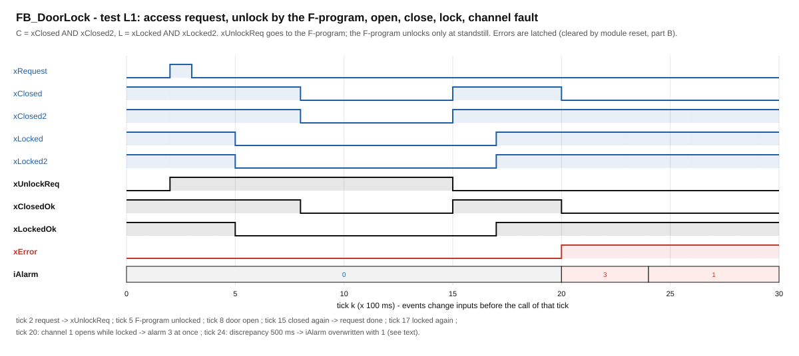

| Line | Explanation |
|---|---|
| `2 xUnlockReq=1` | access request (edge) with the door closed and locked → request to the F-program |
| `5 xLockedOk=0` | the F-program has reached standstill and unlocked |
| `8 xClosedOk=0` | the operator opens the door (both contacts) → `wasOpen` |
| `15 xClosedOk=1 xUnlockReq=0` | door closed again → access cycle complete → request cleared; the F-program locks again |
| `17 xLockedOk=1` | locked |
| `20 xClosedOk=0 xError=1 iAlarm=3` | only contact 1 of the door opens **while locked** – physically impossible with a working lock → **alarm 3 'locked but not closed'** immediately |
| `24 iAlarm=1` | the pair has differed for 5 calls (ticks 20–24) → the discrepancy check sets alarm 1 – it **overwrites** iAlarm 3 (the discrepancy check runs first and is not blocked by `xError`) |

### B17.5 Design notes on 1.0.0

1. **Alarm overwriting (line 24).** In this FB the discrepancy checks are evaluated even when an error is already latched, so a later discrepancy replaces the earlier code. The HMI
   shows the last cause, not the first. For diagnosis "first-out" (guide 69 F4) would be better; the reference behaviour is kept in 1.0.0, and the alarm manager (C3) still records
   both events if the module reports them as separate bits. A change to first-out would be a PATCH-or-MINOR decision (D1.2) because the behaviour for correct inputs is unchanged.
2. **No reset input.** The errors are latched and cleared only by a re-initialisation of the instance (module reset in part B). Part B gives the module a defined way to do this
   (re-initialise the device FB instance in Clearing when the cause is gone); a `xReset` input would be a MINOR extension.
3. **A request without opening stays.** If the operator requests access but does not open the door, `xUnlockReq` stays TRUE (the door stays unlocked). The module should cancel
   the access (re-lock) before it continues production: in part B the module resumes only after the door was locked again (`xLockedOk`) and the operator pressed reset – the F-program
   locks when the request disappears. A cancel input (`xCancel`) is a candidate for 1.1.0.

### B17.6 Faceplate, class, commissioning, mistakes

Faceplate: door closed / open, locked / unlocked, request pending ("waiting for standstill" – with the remaining run-down time if the F-program provides it), alarm. Classes: 1 and
2 **B** (contact adjustment), 3 **A** (possible manipulation or broken tongue – production must not continue). Commissioning (with the safety engineer): request in each state
(Execute, Held, Stopped) – unlock only after standstill; try to open while locked (must be impossible); remove the actuator tongue (alarm 3 when locked without door); lock monitoring
discrepancy. Mistakes: unlocking by the standard program "to save time" (forbidden – the F-program decides); the request button inside the hazard zone; a lock that unlocks on power
loss (spring-lock vs. power-to-lock – a risk-assessment decision, ISO 14119).

## B18. The alarm codes of all FBs in one table

The library alarm text table (English master texts; languages added per project). The **class** is a suggestion; the module's alarm table (part B) fixes it per instance.

| FB | a | Text | Suggested class | Latched |
|---|---|---|---|---|
| FB_Valve1 / FB_Valve2 | 1 | end position not reached | B (A if a half-way position is dangerous) | yes |
| | 2 | left the end position without command | A (load holding) / B | yes |
| | 3 | both end switches on | B | yes |
| FB_MotorDol | 1 | no run feedback after start | B | yes |
| | 2 | run feedback lost while running | A / B | yes |
| | 3 | motor protection tripped | A / B | yes |
| | 4 | run feedback without command (contactor welded?) | A | yes |
| FB_DriveSto | 1 | drive fault | A | yes |
| | 3 | ready lost while running | A | yes |
| FB_Heater | 1 | over-temperature (safety thermostat) | A | yes |
| | 2 | no contactor feedback | B | yes |
| | 3 | temperature signal bad | B / C | yes |
| | 4 | feedback without command (contactor welded?) | A | yes |
| FB_HandshakeHw | 1 | partner did not start (busy missing) | B | yes |
| | 2 | job time-out | B / A | yes |
| | 3 | done not removed | B | yes |
| | 4 | partner fault | A / B | yes |
| FB_Feeder | 1 | feeder breaker off | C (module alarm if needed) | no |
| FB_Ups | 1 | UPS fault | C | no |
| | 2 | on battery | C | no |
| FB_Safe2Ch and wrappers | 1 | discrepancy – actuate fully, then reset | A (e-stop) / B (door, enabling) | yes |
| FB_SafetyCoupling | 1, 2 | e-stop pair / zone pair discrepancy | A | yes |
| FB_Edm, FB_ZoneOut, FB_ContactorPair | 1 | feedback does not follow (welded / not switching) | A | yes |
| FB_SafeValve | 1, 2 | valve A / B does not follow | A | yes |
| FB_ModeSwitch | 1 | both mode contacts on | B | no |
| FB_TwoHand | 1 | not simultaneous – release both | C | until both released |
| FB_Scanner | 2 | invalid field set | A | no |
| FB_DoorLock | 1 | door switch discrepancy | B | yes (no reset input) |
| | 2 | lock switch discrepancy | B | yes |
| | 3 | locked but not closed (tongue missing / manipulation) | A | yes |
| FB_AnalogIn | 3 | signal quality bad / uncertain (1, 2 … process alarms raised by the module) | C | no |
| FB_Sensor, FB_PushButton, FB_SignalTower | – | no own alarms (module-defined alarms with the instance number) | – | – |
| FB_CmdIf | – | rejection → warning M × 1000 + 900 + command | C | no |

All texts and codes are those of the file headers of `tools/fmse/plc_lib/*.st` (and `fb_library.py LIBRARY`; `plc_lib_check.py` checks that both are equal).

## B19. Checklist – Part B

- [ ] Every device in the IO list has its library FB (generated instance); no hand-written device logic in the module.
- [ ] Configuration values set from measurements (movement times × 2, debounce from the trace, feedback times), documented in the parameter list.
- [ ] Valve A / B meaning documented per instance; A = home / safe side; FB_Valve1 re-enable rule (B2.10) applied in the module.
- [ ] Drive: STO → NOT READY (not FAULT); `xWarn` never > 100 ms in the module test; fault acknowledge as a pulse.
- [ ] Heater: thermostat hard-wired with manual reset; level interlock; feedback in both directions.
- [ ] Handshake: phase LEDs on the faceplate; the module removes `xStart` on a handshake alarm.
- [ ] Mirrors: read F-copies only; no reset button on the HMI; `tDisc_ms` = F-block discrepancy time; alarm texts tell what to do.
- [ ] Scanner field switching approved by the safety engineer; warning polarity fixed.
- [ ] Door lock: access request → module Hold / Stop → F-program unlock at standstill; production resumes only after lock + reset.
- [ ] Every FB's unit test passed on the target PLC (D3) with the reference log.

---

# Part C – The module standard blocks

Three blocks are the same in **every** module of the standard: the command interface `FB_CmdIf` with its function `F_CmdAllowed` (decision D1), the alarm manager
`FB_AlarmMgr` (decisions D2 and D3) and the signal-tower logic (FB_SignalTower of B8, fed by the alarm manager). The fourth module standard block, `FB_PackMLCore`,
comes in part B together with the module template.

## C1. FB_CmdIf – the command interface

### C1.1 Purpose

FB_CmdIf is the module side of decision D1 (A5). It watches the two words the cell controller writes (word 2 `CntrlCmd`, word 3 bit 0 `CmdChangeRequest`), evaluates a
command exactly once on the rising edge of the request, answers with the echo bits CmdAck / CmdRej (word 4 bits 8 / 9), hands an accepted command to the PackML core for **one
call** (`iCmdExec`) and removes the echo when the cell controller removes the request.

### C1.2 Interface

| Name | Dir | Type | Default | Meaning |
|---|---|---|---|---|
| `iCntrlCmd` | in | INT | 0 | data block word 2 (written by the CC) |
| `xCmdChangeRequest` | in | BOOL | FALSE | word 3 bit 0 (written by the CC) |
| `iState` | in | INT | 2 | current PackML state of the module (from the PackML core, previous scan) |
| `iMode` | in | INT | 1 | current unit mode (1 Production, 2 Maintenance, 3 Manual) |
| `xCmdAck` | out | BOOL | | echo: accepted → Status.Bits bit 8 |
| `xCmdRej` | out | BOOL | | echo: rejected → Status.Bits bit 9 |
| `iCmdExec` | out | INT | | command to execute, **one call** (0 = none) |
| `iLastCmd` | out | INT | | last evaluated command (for the warning number and the HMI) |
| `iRejectCount` | out | INT | | number of rejected commands (diagnosis) |

### C1.3 The rule

> decision D1. Inputs iCntrlCmd, xCmdChangeRequest (data block, written by the cell controller), iState, iMode (from the module). e = edge(xCmdChangeRequest) ; iCmdExec = 0 ; if e:
> iLastCmd = iCntrlCmd ; if allowed(cmd, state, mode) (item 5 tables: EDGES with the command label, Stop from every state except Stopped/Stopping/Aborting/Aborted/Clearing, Abort from
> every state except Aborting/Aborted, and the command in MODES[mode], mode 1 Production / 2 Maintenance / 3 Manual): xCmdAck = TRUE, iCmdExec = iCntrlCmd (one call – the PackML core
> executes it) else xCmdRej = TRUE, iRejectCount += 1 ; if NOT xCmdChangeRequest: xCmdAck = xCmdRej = FALSE.

**The warning number is set by the module, not by FB_CmdIf.** FB_CmdIf only provides `iLastCmd` and the rejection; the module program writes
`Admin.WarningNo = M × 1000 + 900 + iLastCmd` when `xCmdRej` rises (part B) – e.g. M02 with `iLastCmd = 2` → 2902. Keeping the module number out of the FB keeps FB_CmdIf
identical in all modules.

### C1.4 Listings FB_CmdIf and F_CmdAllowed

```iecst
(* source: tools/fmse/plc_lib/FB_CmdIf.st - library 1.0.0, file header omitted *)
FUNCTION_BLOCK FB_CmdIf
VAR_INPUT  (* signals *)
  iCntrlCmd : INT;                          (* data block word CntrlCmd (written by the CC) *)
  xCmdChangeRequest : BOOL;                 (* word 3 bit0 (written by the CC) *)
  iState : INT := 2;                        (* PackML state of the module *)
  iMode : INT := 1;                         (* mode of the module *)
END_VAR
VAR_OUTPUT  (* outputs *)
  xCmdAck : BOOL;                           (* echo: accepted (Status.Bits bit8) *)
  xCmdRej : BOOL;                           (* echo: rejected (Status.Bits bit9) *)
  iCmdExec : INT;                           (* command to execute, one call (0 = none) *)
  iLastCmd : INT;                           (* last evaluated command *)
  iRejectCount : INT;                       (* rejected commands *)
END_VAR
VAR  (* internal *)
  rtReq : R_TRIG;                           (* edge of xCmdChangeRequest *)
END_VAR
rtReq(CLK := xCmdChangeRequest);
iCmdExec := 0;
IF rtReq.Q THEN
  iLastCmd := iCntrlCmd;
  IF F_CmdAllowed(iCmd := iCntrlCmd, iState := iState, iMode := iMode) THEN
    xCmdAck := TRUE;
    iCmdExec := iCntrlCmd;
  ELSE
    xCmdRej := TRUE;
    iRejectCount := iRejectCount + 1;
  END_IF
END_IF
IF NOT xCmdChangeRequest THEN                 (* phase 4: the CC has cleared the request *)
  xCmdAck := FALSE;
  xCmdRej := FALSE;
END_IF
END_FUNCTION_BLOCK
```

```iecst
(* source: tools/fmse/plc_lib/F_CmdAllowed.st - library 1.0.0, file header omitted *)
FUNCTION F_CmdAllowed : BOOL
VAR_INPUT  (* signals *)
  iCmd : INT;                               (* command 1 Reset .. 9 Clear *)
  iState : INT;                             (* PackML state 1 .. 17 *)
  iMode : INT;                              (* 1 Production, 2 Maintenance, 3 Manual *)
END_VAR
VAR  (* internal *)
  xInMode : BOOL;                           (* command allowed in the mode *)
END_VAR
F_CmdAllowed := FALSE;
CASE iMode OF
  E_Mode.PRODUCTION:
    xInMode := iCmd >= E_PackMLCmd.RESET AND iCmd <= E_PackMLCmd.CLEAR;
  E_Mode.MAINTENANCE:
    xInMode := (iCmd >= E_PackMLCmd.RESET AND iCmd <= E_PackMLCmd.UNHOLD) OR iCmd = E_PackMLCmd.ABORT
               OR iCmd = E_PackMLCmd.CLEAR;
  E_Mode.MANUAL:
    xInMode := (iCmd >= E_PackMLCmd.RESET AND iCmd <= E_PackMLCmd.STOP) OR iCmd = E_PackMLCmd.ABORT
               OR iCmd = E_PackMLCmd.CLEAR;
ELSE
  xInMode := FALSE;
END_CASE
IF NOT xInMode OR iState < E_PackMLState.CLEARING OR iState > E_PackMLState.COMPLETE THEN
  RETURN;
END_IF
CASE iCmd OF
  E_PackMLCmd.RESET:
    F_CmdAllowed := iState = E_PackMLState.STOPPED OR iState = E_PackMLState.COMPLETE;
  E_PackMLCmd.START:
    F_CmdAllowed := iState = E_PackMLState.IDLE;
  E_PackMLCmd.STOP:
    CASE iState OF
      E_PackMLState.CLEARING, E_PackMLState.STOPPED, E_PackMLState.STOPPING..E_PackMLState.ABORTED:
        F_CmdAllowed := FALSE;
    ELSE
      F_CmdAllowed := TRUE;
    END_CASE
  E_PackMLCmd.HOLD, E_PackMLCmd.SUSPEND:
    F_CmdAllowed := iState = E_PackMLState.EXECUTE;
  E_PackMLCmd.UNHOLD:
    F_CmdAllowed := iState = E_PackMLState.HELD;
  E_PackMLCmd.UNSUSPEND:
    F_CmdAllowed := iState = E_PackMLState.SUSPENDED;
  E_PackMLCmd.ABORT:
    F_CmdAllowed := iState <> E_PackMLState.ABORTING AND iState <> E_PackMLState.ABORTED;
  E_PackMLCmd.CLEAR:
    F_CmdAllowed := iState = E_PackMLState.ABORTED;
END_CASE
END_FUNCTION
```

How F_CmdAllowed implements the item 5 tables:

1. **Mode filter first.** Production: commands 1–9; Maintenance: 1–5, 8, 9 (no Suspend 6 / Unsuspend 7); Manual: 1–3, 8, 9 (Reset, Start, Stop, Abort, Clear). A command not in the
   mode set is rejected regardless of the state. An undefined mode or state rejects everything (fail-safe).
2. **Edges of the state model.** Reset from Stopped or Complete; Start from Idle; Hold and Suspend from Execute; Unhold from Held; Unsuspend from Suspended; Clear from Aborted.
3. **Stop** from every state except Clearing, Stopped, Stopping, Aborting, Aborted (the range `STOPPING..ABORTED` = 7, 8, 9).
4. **Abort** from every state except Aborting and Aborted.

The function says only **whether** a command is allowed; the **target** state (Start → Starting, Stop → Stopping …) is the job of the PackML core (part B), which has the same
table. Both read the same `TYPES.st` numbers – `plc_lib_check.py` C6 checks that `TYPES.st` equals the item 5 tables.

### C1.5 The unit test C1

The test, its events, its 14-line log and a line-by-line explanation are in A5.5 (with the timing diagram `img/70a_d1_echo_timing.svg`). Summary of what it proves:

| Tick | Command | State, mode | Result | Proves |
|---|---|---|---|---|
| 2 | Start | Stopped, Production | rejected, count 1 | edge table (no Start from Stopped) |
| 6 | Reset | Stopped, Production | accepted, `iCmdExec` 1 for one call | edge Stopped –Reset→ Resetting; one-call execution |
| 14 | Start | Idle, Production | accepted | edge Idle –Start→ Starting |
| 20 | Hold | Execute, **Manual** | rejected, count 2 | mode filter (Hold not allowed in Manual) |
| 24 | Stop | Execute, Manual | accepted; echo cleared only at 27 | Stop special rule; echo independent of the CC poll time |

### C1.6 Using FB_CmdIf in the module

```iecst
(* in FB_<unit> (part B), step 4 of the scan order A2.4 *)
CmdIf(iCntrlCmd         := Rx.iCntrlCmd,                      (* snapshot of word 2 *)
      xCmdChangeRequest := Rx.wCmdBits.0,                     (* word 3 bit 0 *)
      iState            := PackML.iState,                     (* state of the previous scan *)
      iMode             := PackML.iMode);
rtRej(CLK := CmdIf.xCmdRej);
IF rtRej.Q THEN
    iWarnCmd := iModuleNo * 1000 + 900 + CmdIf.iLastCmd;      (* D1: warning number, e.g. 2902 *)
END_IF;
(* -> PackML core: PackML(iCmdExec := CmdIf.iCmdExec, ...) in the same scan *)
Tx.wStatusBits.8 := CmdIf.xCmdAck;                            (* word 4 bit 8 *)
Tx.wStatusBits.9 := CmdIf.xCmdRej;                            (* word 4 bit 9 *)
```

The rejection warning is a class C entry for the alarm manager (instance 900 range, C3) or written directly to word 7 when no other warning is active – part B fixes one way
for all modules (the rule of D2 makes it a warning number like any other).

## C2. The command acceptance matrix

### C2.1 The matrix for mode Production (reference output)

`fb_library.py --cmdmatrix` and `st_sim.py --test` print the commands that F_CmdAllowed accepts in every state (reference, unchanged):

```
CMD MATRIX (Production): rows state, accepted commands
    Clearing ['Abort']
    Stopped ['Reset', 'Abort']
    Starting ['Stop', 'Abort']
    Idle ['Start', 'Stop', 'Abort']
    Suspended ['Stop', 'Unsuspend', 'Abort']
    Execute ['Stop', 'Hold', 'Suspend', 'Abort']
    Stopping ['Abort']
    Aborting []
    Aborted ['Clear']
    Holding ['Stop', 'Abort']
    Held ['Stop', 'Unhold', 'Abort']
    Unholding ['Stop', 'Abort']
    Suspending ['Stop', 'Abort']
    Unsuspending ['Stop', 'Abort']
    Resetting ['Stop', 'Abort']
    Completing ['Stop', 'Abort']
    Complete ['Reset', 'Stop', 'Abort']
```

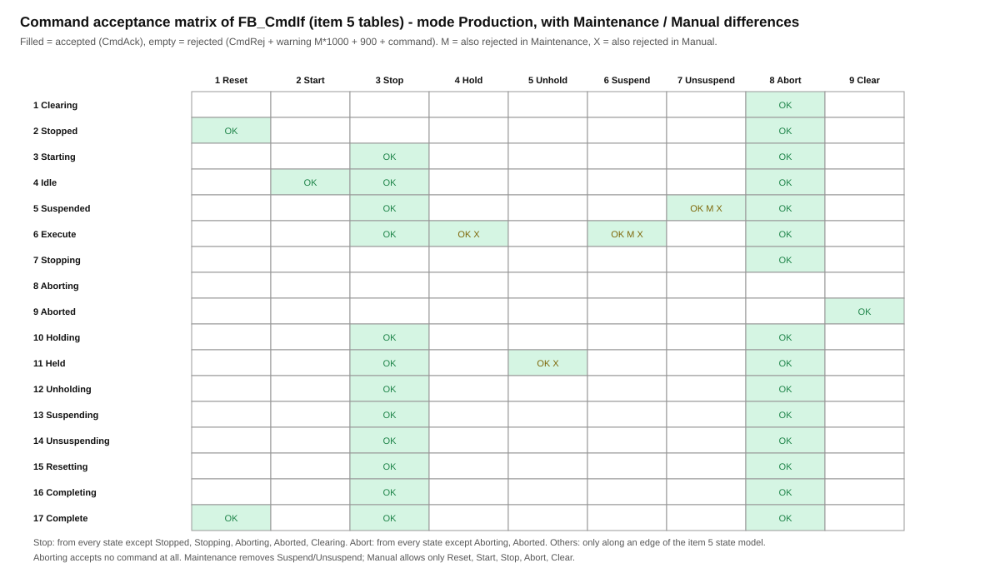

### C2.2 Maintenance and Manual (computed with the same function, `--cmdmatrix --mode 2 / 3`)

Only the rows that differ from Production:

| State | Production | Maintenance (mode 2) | Manual (mode 3) |
|---|---|---|---|
| Suspended | Stop, Unsuspend, Abort | Stop, Abort | Stop, Abort |
| Execute | Stop, Hold, Suspend, Abort | Stop, Hold, Abort | Stop, Abort |
| Held | Stop, Unhold, Abort | Stop, Unhold, Abort | Stop, Abort |

All other 14 rows are the same in all three modes. In numbers: Production accepts **35** (state, command) pairs, Maintenance **33**, Manual **31** (count the matrix).

### C2.3 How to read the matrix – six observations

1. **Abort is accepted almost everywhere** (15 of 17 states) – an Abort must always be possible; only during Aborting and in Aborted it is meaningless.
2. **Aborting accepts nothing**, not even Stop or Abort – the module finishes its fast stop and goes to Aborted on its own.
3. **Clearing accepts only Abort** – Stop is not allowed from Clearing (the rule of item 5); the module reaches Stopped by itself at the end of Clearing.
4. **Stop is accepted in all acting states** (Starting, Resetting, Completing, Holding, Unholding, Suspending, Unsuspending) – a controlled stop can interrupt any acting state.
5. **Reset in Complete** is the normal "next job" command (Complete –Reset→ Resetting → homing → Idle).
6. **Maintenance and Manual have dead ends:** in Maintenance a module that is in Suspended cannot be unsuspended (only Stop / Abort); in Manual a module in Held cannot be
   unheld. In practice a mode change happens only in Stopped, Idle or Aborted (item 5), so a module cannot be in Execute / Held / Suspended **and** change into these modes –
   the dead ends are reachable only if the mode rules are violated (like in test C1, which sets mode 3 in Execute on purpose to test the filter). The PackML core of part B
   enforces the mode-change rule, so the dead ends never occur in operation.

### C2.4 The matrix as a test

The matrix is the **interface test** between the cell controller and every module (software FAT, guide 69 G8.3): the CC sends all 9 commands in a defined state and compares
Ack / Rej with the matrix. With 17 states × 9 commands × 3 modes = 459 cases, an automated test is the only practical way; `st_sim.py` and `fb_library.py` compare F_CmdAllowed
with the Python `allowed()` for 935 command / state / mode cases (including invalid values 0 and 10 for command, state and mode).

## C3. FB_AlarmMgr – the alarm manager

### C3.1 Purpose

The alarm manager is the module side of decisions D2 and D3. It keeps the list of **active** alarms of the module in activation order, builds each alarm number with the formula
of D2, and computes the four values the rest of the module needs:

| Output | Goes to | Rule |
|---|---|---|
| `iAlarmNo` | data block word 6 `Admin.AlarmNo` | the active class A or B alarm with the best (class, activation order): A before B, earlier before later |
| `iWarningNo` | word 7 `Admin.WarningNo` | the earliest active class C alarm |
| `iAlarmClass` | FB_SignalTower `iAlarmClass` | 1 / 2 / 3 of the most severe active alarm, 0 none |
| `iReaction` | PackML core | 1 Abort (A), 2 Hold if Execute (B), 3 warning (C), 0 none |

### C3.2 Interface

| Name | Dir | Type | Default | Meaning |
|---|---|---|---|---|
| `iEvent` | in | INT | 0 | 0 none (only evaluate), 1 alarm on, 2 alarm off |
| `iInst` | in | INT | 0 | instance number i (0 = the module itself) |
| `iCode` | in | INT | 0 | local alarm code a (1 … 9) |
| `iClass` | in | INT | 0 | class 1 A, 2 B, 3 C (from the module's class table) |
| `iModule` | cfg | INT | 2 | module number M |
| `iAlarmNo`, `iWarningNo`, `iAlarmClass`, `iReaction` | out | INT | | see C3.1 |
| `iActive` | out | INT | | number of active alarms |
| `xOverflow` | out | BOOL | | the active list (32 entries) was full |

### C3.3 The rule

> decision D2 + D3. Each event (t, on/off, instance i, local alarm a): AlarmNo candidate = module_code × 1000 + 10 × i + a with the class from 'classes' for (FB type of instance i, a).
> Active list keeps the activation order. Admin.AlarmNo = the active class A or B alarm with the best (class, activation order) – A before B, earlier before later ; Admin.WarningNo =
> the earliest active class C ; AlarmClass for the signal tower = 1/2/3 of the most severe active (0 none) ; reaction = Abort (A), Hold if Execute (B), none (C). Log one line per event.

### C3.4 Listing

```iecst
(* source: tools/fmse/plc_lib/FB_AlarmMgr.st - library 1.0.0, file header omitted *)
FUNCTION_BLOCK FB_AlarmMgr
VAR_INPUT  (* signals *)
  iEvent : INT;                             (* 0 none, 1 alarm on, 2 alarm off *)
  iInst : INT;                              (* instance number i (0 = module level) *)
  iCode : INT;                              (* local alarm code a (1 .. 9) *)
  iClass : INT;                             (* class 1 A, 2 B, 3 C *)
END_VAR
VAR_INPUT  (* configuration (set once, defaults = example values) *)
  iModule : INT := 2;                       (* module number M (M02 -> 2) *)
END_VAR
VAR_OUTPUT  (* outputs *)
  iAlarmNo : INT;                           (* Admin.AlarmNo = M*1000 + 10*i + a *)
  iWarningNo : INT;                         (* Admin.WarningNo *)
  iAlarmClass : INT;                        (* 0 none, 1 A, 2 B, 3 C *)
  iReaction : INT;                          (* 0 none, 1 Abort, 2 Hold if Execute, 3 warning *)
  iActive : INT;                            (* number of active alarms *)
  xOverflow : BOOL;                         (* active list full *)
END_VAR
VAR CONSTANT  (* constants *)
  MAX_ACT : INT := 32;                      (* size of the active list *)
END_VAR
VAR  (* internal *)
  aiNo : ARRAY[1..MAX_ACT] OF INT;          (* active alarm numbers (0 = free) *)
  aiCls : ARRAY[1..MAX_ACT] OF INT;         (* class of each active alarm *)
  adiOrd : ARRAY[1..MAX_ACT] OF DINT;       (* activation order *)
  diOrder : DINT;                           (* activation counter *)
  iNo : INT;                                (* number of this event *)
  k : INT;                                  (* loop index *)
  iFound : INT;                             (* slot of iNo (0 = not active) *)
  iFree : INT;                              (* first free slot *)
  iBest : INT;                              (* slot of the best A/B alarm *)
  iBestW : INT;                             (* slot of the earliest warning *)
END_VAR
IF iEvent <> E_AlarmEvent.NONE THEN
  iNo := iModule * 1000 + 10 * iInst + iCode;
  iFound := 0;
  iFree := 0;
  FOR k := 1 TO MAX_ACT DO
    IF aiNo[k] = iNo AND iFound = 0 THEN
      iFound := k;
    END_IF
    IF aiNo[k] = 0 AND iFree = 0 THEN
      iFree := k;
    END_IF
  END_FOR
  IF iEvent = E_AlarmEvent.RAISE AND iFound = 0 THEN
    IF iFree > 0 THEN
      diOrder := diOrder + 1;
      aiNo[iFree] := iNo;
      aiCls[iFree] := iClass;
      adiOrd[iFree] := diOrder;
    ELSE
      xOverflow := TRUE;
    END_IF
  ELSIF iEvent = E_AlarmEvent.CLEAR AND iFound > 0 THEN
    aiNo[iFound] := 0;
    aiCls[iFound] := 0;
    adiOrd[iFound] := 0;
  END_IF
END_IF
(* evaluate: best class A/B alarm by (class, activation order), earliest class C warning *)
iBest := 0;
iBestW := 0;
iActive := 0;
FOR k := 1 TO MAX_ACT DO
  IF aiNo[k] <> 0 THEN
    iActive := iActive + 1;
    IF aiCls[k] = E_AlarmClass.A OR aiCls[k] = E_AlarmClass.B THEN
      IF iBest = 0 THEN
        iBest := k;
      ELSIF aiCls[k] < aiCls[iBest] OR (aiCls[k] = aiCls[iBest] AND adiOrd[k] < adiOrd[iBest]) THEN
        iBest := k;
      END_IF
    ELSIF aiCls[k] = E_AlarmClass.C THEN
      IF iBestW = 0 THEN
        iBestW := k;
      ELSIF adiOrd[k] < adiOrd[iBestW] THEN
        iBestW := k;
      END_IF
    END_IF
  END_IF
END_FOR
IF iBest > 0 THEN
  iAlarmNo := aiNo[iBest];
  iAlarmClass := aiCls[iBest];
ELSE
  iAlarmNo := 0;
  IF iBestW > 0 THEN
    iAlarmClass := E_AlarmClass.C;
  ELSE
    iAlarmClass := E_AlarmClass.NONE;
  END_IF
END_IF
IF iBestW > 0 THEN
  iWarningNo := aiNo[iBestW];
ELSE
  iWarningNo := 0;
END_IF
CASE iAlarmClass OF
  E_AlarmClass.A: iReaction := E_Reaction.ABORT;
  E_AlarmClass.B: iReaction := E_Reaction.HOLD;
  E_AlarmClass.C: iReaction := E_Reaction.WARNING;
ELSE
  iReaction := E_Reaction.NONE;
END_CASE
END_FUNCTION_BLOCK
```

Design notes:

- **One event per call.** The interface takes one event; the module calls the manager once per alarm change (with the edges of its alarm conditions, A7.5) and once per scan with
  `iEvent := 0` to evaluate. A scan with several changes calls it several times – the activation order is the call order (deterministic: the module calls in instance order).
- **The class comes from the module.** The same FB alarm can have different classes in different modules (APC rotation 1 = A, clamp 1 = B). The module passes the class from its
  generated class table (part B), e.g. for APC01 the table of the example below.
- **Fixed array of 32 entries.** No dynamic memory in a PLC. 32 simultaneously active alarms in one module are far beyond normal (a module with that many active alarms has a power
  or communication problem); `xOverflow` reports it, and the **first** 32 stay (the most important ones are usually the first).
- **A repeated "on" of an active number is ignored** (`iFound <> 0`) and an "off" of an inactive number too – the manager is robust against duplicate events.

### C3.5 The example – APC01 (M02) with five instances

Instances in the item 8 expansion order: 1 Rotate (FB_Valve2), 2 Clamp (FB_Valve1), 3 PalSideA (FB_Sensor), 4 PalSideB (FB_Sensor), 5 ClampPress (FB_AnalogIn); module-level
i = 0. Class table of the example (`alarm_manager.classes`):

| FB type | a | Class | | FB type | a | Class |
|---|---|---|---|---|---|---|
| FB_Valve2 | 1 | A | | FB_AnalogIn | 1 | B (pressure not reached in the clamp step) |
| FB_Valve2 | 2 | A | | FB_AnalogIn | 2 | A (pressure lost while machining) |
| FB_Valve2 | 3 | B | | FB_AnalogIn | 3 | C (signal quality bad / uncertain) |
| FB_Valve1 | 1 | B | | FB_Sensor | 1 | C |
| FB_Valve1 | 2 | A | | MODULE | 1 | B (not in home position, D4) |
| FB_Valve1 | 3 | B | | | | |

Events (tick, on / off, i, a): 10 on 5 3 · 20 on 2 1 · 25 on 1 1 · 30 off 2 1 · 32 off 1 1 · 40 on 5 1 · 45 on 5 2 · 50 off 5 2 · 55 off 5 1 · 60 off 5 3.

```
ALARM MANAGER
    10 on 2053 class C -> AlarmNo=0 WarningNo=2053 AlarmClass=3 reaction=none (warning)
    20 on 2021 class B -> AlarmNo=2021 WarningNo=2053 AlarmClass=2 reaction=Hold (if Execute)
    25 on 2011 class A -> AlarmNo=2011 WarningNo=2053 AlarmClass=1 reaction=Abort
    30 off 2021 class B -> AlarmNo=2011 WarningNo=2053 AlarmClass=1 reaction=Abort
    32 off 2011 class A -> AlarmNo=0 WarningNo=2053 AlarmClass=3 reaction=none (warning)
    40 on 2051 class B -> AlarmNo=2051 WarningNo=2053 AlarmClass=2 reaction=Hold (if Execute)
    45 on 2052 class A -> AlarmNo=2052 WarningNo=2053 AlarmClass=1 reaction=Abort
    50 off 2052 class A -> AlarmNo=2051 WarningNo=2053 AlarmClass=2 reaction=Hold (if Execute)
    55 off 2051 class B -> AlarmNo=0 WarningNo=2053 AlarmClass=3 reaction=none (warning)
    60 off 2053 class C -> AlarmNo=0 WarningNo=0 AlarmClass=0 reaction=none
```

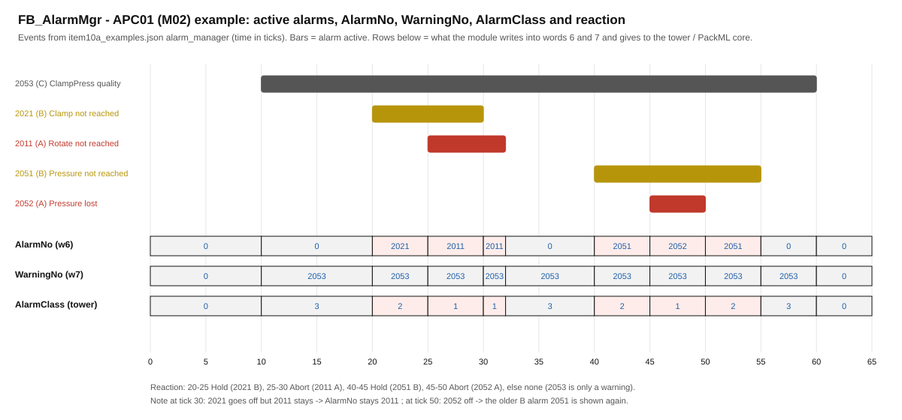

| Tick | Event | Number (M × 1000 + 10 × i + a) | Active list after the event (order) | AlarmNo | WarningNo | Class | Reaction | What happens in the module |
|---|---|---|---|---|---|---|---|---|
| 10 | on ClampPress quality | 2000 + 50 + 3 = **2053** (C) | 2053 | 0 | 2053 | 3 | none | warning only: yellow lamp, no horn, production continues |
| 20 | on Clamp not reached | 2000 + 20 + 1 = **2021** (B) | 2053, 2021 | 2021 | 2053 | 2 | Hold | in Execute → Holding → Held, yellow + horn |
| 25 | on Rotate not reached | 2000 + 10 + 1 = **2011** (A) | 2053, 2021, 2011 | **2011** (A beats the earlier B) | 2053 | 1 | Abort | → Aborting → Aborted, red + horn |
| 30 | off 2021 | – | 2053, 2011 | 2011 | 2053 | 1 | Abort | AlarmNo unchanged – the A alarm is still active |
| 32 | off 2011 | – | 2053 | 0 | 2053 | 3 | none | only the warning remains (the module stays Aborted until Clear) |
| 40 | on pressure not reached | 2000 + 50 + 1 = **2051** (B) | 2053, 2051 | 2051 | 2053 | 2 | Hold | (new job) Held in the clamp step |
| 45 | on pressure lost | 2000 + 50 + 2 = **2052** (A) | 2053, 2051, 2052 | 2052 | 2053 | 1 | Abort | the same instance 5 has three active alarms at the same time |
| 50 | off 2052 | – | 2053, 2051 | **2051** | 2053 | 2 | Hold | the older B alarm is shown again |
| 55 | off 2051 | – | 2053 | 0 | 2053 | 3 | none | |
| 60 | off 2053 | – | (empty) | 0 | 0 | 0 | none | tower: no alarm colour |

Two lessons: (1) **AlarmNo is not "the last alarm"** – it is the most severe, and among equally severe the oldest (the first-out of guide 69 F4 within a class); (2) one device
instance can carry several alarms at once (2051, 2052, 2053 all on instance 5) – that is why the alarm manager works with numbers, not with one `iAlarm` per instance.

### C3.6 The reaction and the PackML core

| `iReaction` | PackML core (part B) | Notes |
|---|---|---|
| 1 Abort | internal Abort from any state except Aborting / Aborted (no echo – it is not a CC command) | the job is lost; Clear needed |
| 2 Hold | internal Hold **only in Execute**; in other states nothing (the alarm is shown, Start is blocked by the start interlock) | after the cause is gone, the operator (or CC) sends Unhold |
| 3 warning | none | WarningNo in word 7, Status.Bits bit 4 Warning |
| 0 | none | |

The internal reaction is evaluated **every scan** (level), not only at the event: a class A alarm that is still active when the operator presses Clear keeps the module from
leaving Aborted for long – the PackML core of part B checks "no active class A" before the SC of Clearing.

### C3.7 Alarm history and the HMI

FB_AlarmMgr holds only the **active** list. The history (time stamps, acknowledge, return to normal, shelving – the ISA-18.2 state machine of guide 69 F2) is the job of the HMI /
SCADA alarm system (WinCC ProDiag, TwinCAT EventLogger, FactoryTalk A&E) or of the cell controller, which logs every change of words 6 and 7 with a time stamp. A module that must
report **all** active alarms to the cell controller uses OPC UA Alarms & Conditions or a module-part word array (part B, optional) – the data block words 6 and 7 carry the most
important one each, by design.

## C4. Signal tower colour logic after IEC 60204-1 and IEC 60073

### C4.1 The standards in short

**IEC 60073** (basic and safety principles for man-machine interface – coding principles) gives the meaning of colours for indicators; **IEC 60204-1** clause 10.3 applies it to
indicator lights and displays of machines:

| Colour | Meaning (IEC 60204-1 Table 4 / IEC 60073) | Action of the operator |
|---|---|---|
| **RED** | emergency – hazardous condition | immediate action to deal with the hazardous condition (e.g. switch off, be alert, stay away) |
| **YELLOW** | abnormal – abnormal condition, impending critical condition | monitoring and / or intervention (e.g. by re-establishing the intended function) |
| **BLUE** | mandatory – indication of a condition that requires action by the operator | mandatory action |
| **GREEN** | normal | optional |
| **WHITE** | neutral – other conditions, may be used whenever doubt exists about the application of red, yellow, green or blue | monitoring |

Flashing (IEC 60204-1 10.3.3) is used to attract attention, to request immediate action, to indicate a discrepancy between command and actual state, or to indicate a change in
progress. Typical rates: normal flashing about 1–2 Hz, faster for urgent attention (IEC 60073), duty about 1:1.

### C4.2 How the library maps PackML to colours

| Situation | Library colour | Reason |
|---|---|---|
| class A alarm, Aborting, Aborted | **red** | a fault stopped the machine – immediate action |
| class B / C alarm, Stopped, Suspended, Held | **yellow** | abnormal: the machine waits for an intervention or is not producing |
| Starting, Execute, Unholding, Unsuspending, Completing | **green** steady | normal production |
| Idle, Complete | **green flashing** | normal, ready, waiting for a command (a "change in progress / attention" indication in the sense of 10.3.3) |
| Clearing, Stopping, Holding, Suspending, Resetting without alarm | none | short acting states (seconds) – see C4.3 |
| new class A / B alarm | buzzer | acoustic signal for a condition that needs the operator; acknowledge silences it |

Blue (mandatory action) is not used by the library tower; many factories add a **blue** lamp for "operator action required" (e.g. load station: "load the pallet now"). That is a
MINOR extension (`qBlue`, driven by a module bit); the PushButton lamps (B7) often do the job locally.

### C4.3 Discussion: the dark acting states

In test T1 the tower is **dark** in Resetting (ticks 2–3), Holding (tick 16, while the class B alarm keeps yellow) and Clearing (tick 27). This follows the rule exactly: the five
acting states Clearing, Stopping, Holding, Suspending and Resetting are in none of the three state sets. Arguments:

- **For** the rule: these states last a few seconds; a short dark phase is acceptable and makes "something is changing" visible; the colour that follows (yellow for Stopped / Held /
  Suspended, flashing green for Idle) is the meaningful one.
- **Against**: a homing in Resetting can last long (D4: with a door open it waits with alarm 2001 – then yellow comes from the alarm class, so the operator still sees it); an
  operator 30 m away cannot distinguish "dark" from "tower defective" – which is why the lamp test at power-on (B8.6) is important.

A project that wants no dark phase can add the five states to the yellow set (MAJOR change of the colour behaviour – D1.2 – because every operator learns the tower). The library
keeps the rule of the reference for 1.0.0.

### C4.4 Horn behaviour

The buzzer sounds for every **new or more severe** class A / B situation (class changes into 1 or 2), not for class C warnings, and stops with the horn acknowledge or when no alarm is
active. ISA-18.2 calls this annunciation; an acknowledge silences the horn but does not acknowledge the alarm in the ISA-18.2 sense (that happens in the HMI alarm list). Any change
between A and B sounds the horn again: in test T1 the class changes 2 → 1 at tick 22 and the horn sounds although it had been acknowledged at tick 19; a change 1 → 2 (an A alarm
goes, a B alarm stays) would sound it as well. The rule treats every change between A and B as a new situation – simple and safe.

## C5. How the standard blocks sit in the module FB (bridge to part B)

A skeleton of the module FB with the part A blocks (complete module programs in part B):

```iecst
FUNCTION_BLOCK FB_APC01
(* module M02 APC - skeleton showing the part A standard blocks; FB_PackMLCore and the sequences: part B *)
VAR_INPUT
    Rx        : ST_DbRx;               (* words 2-3, 5, 12-15, 19 - snapshot copied by the Comm task *)
    xSafetyOk : BOOL;                  (* F-copy: F-program status OK *)
END_VAR
VAR_OUTPUT
    Tx        : ST_DbTx;               (* words 0-1, 4, 6-11, 16-18 *)
END_VAR
VAR
    Dev       : FB_APC01_Devices;      (* generated: Rotate, Clamp, PalSideA, PalSideB, ClampPress *)
    CmdIf     : FB_CmdIf;
    AlarmMgr  : FB_AlarmMgr := (iModule := 2);
    PackML    : FB_PackMLCore;         (* part B *)
    Tower     : FB_SignalTower;        (* if the module has its own tower *)
    rtRej     : R_TRIG;
END_VAR

(* 2 device layer: status of all devices (commands from the previous scan) *)
Dev();
(* 4 command interface - D1 *)
CmdIf(iCntrlCmd := Rx.iCntrlCmd, xCmdChangeRequest := Rx.wCmdBits.0, iState := PackML.iState, iMode := PackML.iMode);
(* 5 alarms - D2 / D3: events from the device iAlarm changes and the module conditions (generated part B), then evaluate *)
(*   ... AlarmMgr(iEvent := 1, iInst := 1, iCode := Dev.Rotate.iAlarm, iClass := 1); ... *)
AlarmMgr(iEvent := 0);
(* 6 PackML core with the command and the reaction - part B *)
(*   PackML(iCmdExec := CmdIf.iCmdExec, iReaction := AlarmMgr.iReaction, xResettingSC := xHomed, ...); *)
(* 7 sequences: Execute step chain, Resetting = homing (D4) -> Dev.Rotate.xCmdB, Dev.Clamp.xCmdB, xEnable ... - part B *)
(* 9 data block and tower *)
Tx.iStateCurrent := PackML.iState;
Tx.iAlarmNo      := AlarmMgr.iAlarmNo;
Tx.iWarningNo    := AlarmMgr.iWarningNo;
Tx.wStatusBits.8 := CmdIf.xCmdAck;
Tx.wStatusBits.9 := CmdIf.xCmdRej;
Tower(iState := PackML.iState, iAlarmClass := AlarmMgr.iAlarmClass);
END_FUNCTION_BLOCK
```

(The structures `ST_DbRx`, `ST_DbTx` and the bit access `.0` / `.8` are the platform-specific part of the interface – the soft PLC subset of `st_sim.py` has no STRUCT, so the
library itself contains none; part B defines the interface per platform.)

**Device alarm → event.** Each device FB has one `iAlarm` output; the module turns its changes into events: when `iAlarm` changes from 0 to a, raise (i, a); when it changes from a to
0 (or to another code b), clear (i, a) (and raise (i, b)). Part B generates this code from the instance list – a loop over an array of the device alarm outputs.

## C6. Checklist – Part C

- [ ] FB_CmdIf in every module, called in step 4 of the scan order with the state of the previous scan; echo bits 8 / 9 in word 4.
- [ ] WarningNo = M × 1000 + 900 + `iLastCmd` on a rejection (module program).
- [ ] Command acceptance matrix tested for all states and modes at the software FAT (C2.4).
- [ ] FB_AlarmMgr with the module number; class table generated per module; one event per alarm change + one evaluation per scan.
- [ ] AlarmNo / WarningNo / AlarmClass / iReaction wired to words 6 / 7, the tower and the PackML core.
- [ ] Tower colours per C4; lamp test; horn acknowledge; decision on the dark acting states documented.

---

# Part D – Library engineering

A library is not finished when the code compiles. It is a **product** with versions, a release process, tests, documentation and users (the projects). This part explains how
the FMS library is kept correct for 15 years.

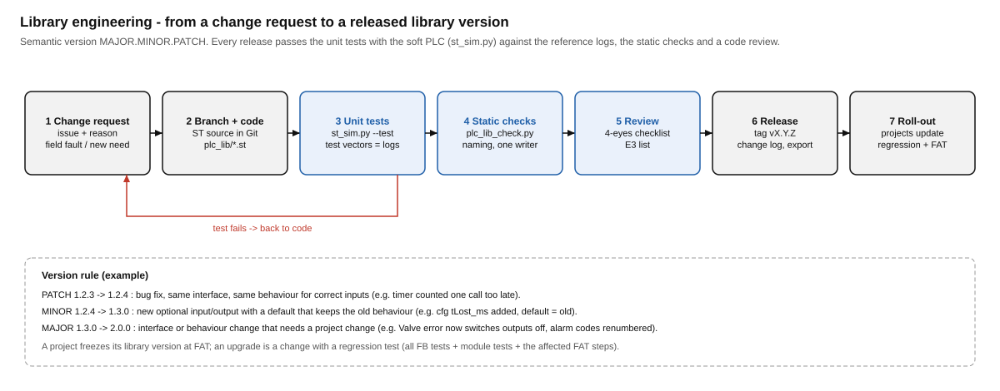

## D1. Versions and the change log

### D1.1 Semantic versions

The library uses **semantic versioning** `MAJOR.MINOR.PATCH` (semver.org), visible in every file header and in `GC_LIB_VERSION` (`16#0100` = 1.0.0, high byte major, low byte
minor; the patch is in the header text):

| Change | Version step | Rule | Example from this guide |
|---|---|---|---|
| bug fix, interface unchanged, correct inputs give the same results | PATCH 1.0.0 → 1.0.1 | projects can update without a change of their code; a regression test is still required | header text of FB_EnableSwitch completed (B12.6) |
| new optional input / output / configuration with a default that keeps the old behaviour | MINOR 1.0.1 → 1.1.0 | old projects compile and behave identically; new projects can use the feature | FB_Valve1 re-enable fix (B2.10), `bCheckRest` for FB_HandshakeHw (B9.6), `xCancel` for FB_DoorLock (B17.5), blue tower lamp (C4.2) |
| changed interface (renamed / removed input, changed type) **or** changed behaviour for correct inputs | MAJOR 1.1.0 → 2.0.0 | projects must be changed and re-tested; never update a running line without a planned change | dark acting states → yellow (C4.3); valve error switches the coils off; alarm codes renumbered |

The step from the guide 69 teaching blocks to the item 10 library (structured `Cmd / Sts` interface → flat inputs; `TIME` → `DINT` ms; valve alarm codes 1/2/3/4 → 1/2/3) is a
**MAJOR** step: 0.x → 1.0.0.

**Grey zone: is a bug fix that changes a log a PATCH?** Example: a timer counted one call too late. Correct inputs give a different output tick → strictly MAJOR. Practice: if the
old behaviour was **wrong against the written rule**, it is a PATCH (the rule did not change, the implementation was wrong); the change log says "behaviour corrected to the rule"
and the projects run their regression tests. If the **rule** changes, it is MAJOR.

### D1.2 The change log

One file `CHANGELOG.md` in the library, newest first, one entry per release:

```
## 1.1.0 - 2027-03-01
Added
- FB_Valve1: rising edge of xEnable while not at the target restarts the movement supervision (B2.10). Default behaviour
  for already-moving cylinders unchanged. Tests V1-V4 unchanged; new test V5 "re-enable at B".
- FB_HandshakeHw: cfg bCheckRest (default FALSE) - request only if the partner is at rest.
Changed
- (none)
Fixed
- FB_DoorLock header: alarm 1 text corrected ("door switch discrepancy").
Compatibility: MINOR - projects on 1.0.x can update; run the regression tests of D3.
```

The change log is written **in the same commit** as the change (guide 69 G7) and reviewed with it (D5).

### D1.3 What a project does with versions

1. At project start, choose the newest released version and **freeze** it in the project (the version number is in the project's library list and in the interface sheet).
2. During commissioning, a library bug found on site is reported to the library owner (issue), fixed in the library, released as a PATCH and taken into the project – **never** fixed
   locally in the project copy.
3. At FAT and SAT the library version is recorded in the test report (with the F-signature of the safety program and the checksum of the generated code, guide 69 G1).
4. After hand-over, a library update in a running plant is a **change** (guide 69 G9): risk assessment of the change, regression test, documented release.

## D2. The library release process

| Step | Who | What | Output |
|---|---|---|---|
| 1 Change request | anyone (project, maintenance, library owner) | issue with reason, affected FBs, proposed version step | ticket |
| 2 Branch + code | library developer | change in `plc_lib/*.st` **and** in the Python twin `fb_library.py` **and** in the JSON rule if the rule changes | branch |
| 3 Unit tests | developer, automatic | `st_sim.py --test` (all 19 + item 9 tests) and `fb_library.py --test all`; new test for the change | test log = reference |
| 4 Static checks | automatic | `plc_lib_check.py` C1–C6 (files, codegen names, header, no global / F writes, interfaces, TYPES, ASCII / LF / no TAB) | all PASS |
| 5 Review | second engineer | code review checklist D5; for mirrors also the functional-safety engineer (no safety function crept in) | signed review record |
| 6 Release | library owner | version number, change log, tag `v1.1.0` in Git, export for each platform (D8) | release package |
| 7 Roll-out | projects | update when planned; regression tests; FAT steps of the affected functions | project test report |

A test that fails sends the change back to step 2. A release is **never** made from a working copy without tests – "it is only a small change" is the classic start of field problem 9
of A1.

## D3. Testing with the soft PLC: unit tests, test vectors, regression

### D3.1 Test levels for a library

| Level | What is tested | Tool in the twin | On the real PLC |
|---|---|---|---|
| Unit test | one FB, events → change log | `st_sim.py --test`, `fb_library.py --test` | the same event list in a test task (TcUnit, CODESYS Test Manager, a TIA test OB with assertions) |
| Equivalence | ST source = Python twin on random inputs | `st_sim.py` cross-check: each ST FB = its Python class on 300 random ticks; F_CmdAllowed = `allowed()` on 935 cases | – |
| Integration | generated `FB_<unit>_Devices` of all 22 modules with the library | `plc_lib_check.py --modules` (C2: 243 input and 59 output names, generated code runs 3 cycles) | compile the generated project |
| Module test | module FB with PackML core and sequences against a plant model | part B (module unit tests) | simulation mode / virtual commissioning |
| System test | cell controller + modules + plant models | part C (virtual commissioning of the kit) | FAT |

### D3.2 Test vectors – the format of `fb_tests`

A test vector is the complete description of a unit test: FB, configuration, duration and events; the expected result is the change log.

```json
{ "fb": "FB_Valve1", "name": "V2 jam: B not reached -> alarm 1 -> reset -> retry ok", "K": 50, "cfg": {},
  "events": [[2, "xCmdB=1", "xPosA=0"], [30, "xReset=1"], [31, "xReset=0"], [36, "xPosB=1"]] }
```

Expected (reference):

```
TEST FB_Valve1 | V2 jam: B not reached -> alarm 1 -> reset -> retry ok | 5 lines
    0 init qSol=0 xAtA=1 xAtB=0 xBusy=0 xError=0 iAlarm=0
    2 qSol=1 xAtA=0 xBusy=1
    21 xBusy=0 xError=1 iAlarm=1
    30 xBusy=1 xError=0 iAlarm=0
    36 xAtB=1 xBusy=0
```

Rules for good test vectors (how the 19 tests of this guide were designed):

1. **One story per test**, with a name that says the story ("V2 jam … retry ok").
2. **Normal case first** (V1), then each fault (V2, V3), then the special behaviour (V4 bistable / disable).
3. **Every alarm code** of the FB is reached at least once (Valve: 1 in V2, 2 and 3 in V3; Heater: 2, 1, 3 in H1 – alarm 4 is covered by a project test).
4. **Every reset path**: refused (cause still present: V3 tick 25, D1 tick 17, E1 tick 30) and accepted.
5. **Boundaries** of times: exactly at the limit (S1: 300 ms reached at the 3rd call; TwoHand: 500 ms is still simultaneous).
6. **Inputs persistent, edges explicit:** a reset is "1" in one tick and "0" in the next.
7. **Short** (K ≤ 95 ticks) – a test that nobody can read by hand is not a good reference.

### D3.3 Running the tests

```
python tools/fmse/st_sim.py --test                 all tests on the .st source - compared with the reference line by line
python tools/fmse/st_sim.py --test V4              one test (or an FB name: --test FB_Valve2 ; or item10a / item9)
python tools/fmse/st_sim.py --run FB_Sensor --ticks 20 --set tOn_ms=300,tOff_ms=200 --events "2:xOn=1;3:xOn=0;4:xOn=1;10:xOn=0"
python tools/fmse/fb_library.py --test all         the same tests on the Python twin
```

On the real PLC the same vector becomes a small test program (example for TwinCAT / CODESYS, one call per task cycle of 100 ms):

```iecst
PROGRAM PRG_Test_V2
VAR
    k       : INT;
    uut     : FB_Valve1;              (* unit under test *)
    xPass   : BOOL := TRUE;
END_VAR
CASE k OF                             (* events before the call of the tick *)
    2:  uut.xCmdB := TRUE;  uut.xPosA := FALSE;
    30: uut.xReset := TRUE;
    31: uut.xReset := FALSE;
    36: uut.xPosB := TRUE;
END_CASE;
uut();
CASE k OF                             (* expected changes from the reference log *)
    21: xPass := xPass AND uut.xError AND (uut.iAlarm = 1) AND NOT uut.xBusy AND uut.qSol;
    30: xPass := xPass AND NOT uut.xError AND uut.xBusy;
    36: xPass := xPass AND uut.xAtB AND NOT uut.xBusy;
END_CASE;
IF k < 50 THEN k := k + 1; END_IF;
END_PROGRAM
```

(Before the test, set `GC_CYCLE_MS := 100` in the test project or run the test task at 100 ms – the test vectors are written for the test bench time base.)

### D3.4 Regression

**Regression testing** = re-running all existing tests after every change, to prove that nothing that worked before is broken. In the library: every commit runs `st_sim.py
--test`, `fb_library.py --test all` and `plc_lib_check.py`; a single differing line fails the commit. A test is **never** changed to make a new version pass unless the rule was
changed on purpose – then the reference is updated in the same commit, the change log says why, and the version step is MAJOR (or PATCH if the old reference was wrong against the
rule, D1.1).

## D4. Static checks

`plc_lib_check.py` runs six checks on the library and the generated code (reference output, item 10A section of `tools/fmse/README.md`):

```
check  result  checked  problems  what
C1     PASS         24         0  every codegen fb_type has its .st file
C2     PASS        302         0  codegen names = .st interfaces, 22 modules (243 inputs, 59 outputs), run 3 cycles
C3     PASS         30         0  header: purpose, rule, interface, version, alarm table, notes
C4     PASS        389         0  no FB writes a global / F-signal; generated code never writes an F-output
C5     PASS         46         0  interfaces = JSON fb_interfaces (17) and = fb_library classes (29)
C6     PASS         34         0  TYPES.st = item-5 tables, GC_CYCLE_MS 100; ASCII, LF, no TAB
RESULT: ALL CHECKS PASSED
```

| Check | Why it matters |
|---|---|
| C1 a file per FB type | the generator must never instantiate a type the library does not have |
| C2 names match | a renamed input in the library would break the generated code of all modules – found before compiling |
| C3 header | a block without purpose / version / alarm table cannot be maintained |
| C4 no global / F writes | the mirror principle and "one writer": a library FB writes only its own outputs; an F-output is never written by standard code |
| C5 interfaces = JSON = Python | the three representations (rule, ST, Python twin) cannot drift apart |
| C6 types and format | the state numbers equal item 5; files are portable (ASCII, LF, no TAB) |

Additional checks for a project (not part of the library check, example list): no variable written in two places of a module (A2.3); every device alarm has a class in the module
table; alarm numbers unique and in range (A6.9 D2-3/D2-4); no instance number above 89 (A6.4); no write to CC-owned data-block words (A5.9 D1-8).

## D5. Code review checklist

Use it for every library change (and for module code in part B). Category M = must, S = should.

| # | Cat. | Check |
|---|---|---|
| 1 | M | The change implements the written rule; the rule text (JSON) and the header are updated in the same change. |
| 2 | M | Status first, then logic, then outputs; outputs written in exactly one place. |
| 3 | M | No write to a global variable, an IO symbol or an F-signal inside a library FB. |
| 4 | M | Every timer / counter is evaluated every call (no counter inside a branch that is skipped), and saturates at `GC_N_MAX`. |
| 5 | M | Edges with R_TRIG / prev value; reset only on a rising edge and only when the cause is gone. |
| 6 | M | No automatic restart caused by the FB itself; level commands documented. |
| 7 | M | Error does not change the outputs unless the rule says so (and the reason is in the header). |
| 8 | M | Mirror blocks: no output can be used as a safety function; header says "diagnostic mirror". |
| 9 | M | All existing tests pass unchanged; a new test covers the change. |
| 10 | M | Version step correct (D1.1); change log entry. |
| 11 | S | Names follow A3; one condition per line with a name for complex conditions. |
| 12 | S | Configuration defaults are sensible example values and documented. |
| 13 | S | Inside the `st_sim.py` subset (no STRUCT, STRING, pointers, VAR_IN_OUT, OOP). |
| 14 | S | Platform notes (Siemens / CODESYS / Rockwell) still valid. |

## D6. Documentation of a library block

Each `.st` file starts with the same header (see any file in `tools/fmse/plc_lib/`): name and title, library + version, rule reference, codegen pattern, purpose, interface table
(direction, name, type, default, meaning), alarm table (code, text), timing note (counters, `GC_CYCLE_MS`), Siemens note, example-values notice. `plc_lib_check.py` C3 checks that
every header has these entries. Additional documentation **outside** the code:

| Document | Content | Where |
|---|---|---|
| this guide (Part B chapter per FB) | rule explained, test explained, faceplate, commissioning, mistakes | `docs/FMS system design/70_plc_library_A_standard_fbs.md` |
| library README | file list, conventions, timers, Siemens notes, test commands | `tools/fmse/plc_lib/README.md` |
| change log | history | `CHANGELOG.md` of the library (D1.2) |
| alarm text export | FB alarm texts in all languages | generated from the headers (part B) |
| faceplate specification | per FB type: fields, colours, buttons, roles | HMI standard of the project (B chapters) |

## D7. How the item 9 code generator uses the library

`st_codegen.py` (guide 69 G1) generates per module the IO globals and `FB_<unit>_Devices` with **one instance per pattern instance** and the call lines with the field inputs. The
library and the generator are tied together by three things:

1. **The type table** `codegen.fb_types` (pattern → FB type): 25 patterns with field IO → 24 FB types; C1 checks that each has a `.st` file.
2. **The parameter names**: the generator writes `x<Signal> := <symbol>` for DI / FDI, `i<Signal>` for AI and reads `<group>.q<Signal>` / `.w<Signal>` for DO / AO. The library FBs use
   exactly these names (`xPosA`, `qSolA`, `xEDM`, `xOssd1` …); C2 checks all 22 modules (243 input and 59 output names) and runs the generated code for 3 cycles with the library.
3. **What the generator does not wire**: commands (`xCmdB`, `xCmdRun`, `xEnable`, `xStart`), configuration (`tMove_ms` …), resets and the F-output copies (`xCmd` of FB_ZoneOut) –
   these are set by the module logic through the instance (`Dev.Rotate.xCmdB := …`) before the device FB is called. IEC 61131-3 keeps an unassigned input at its last value, so
   assigning `Dev.Rotate.xCmdB` once per scan in the module and calling `Dev()` is correct.

Changing a library interface therefore means changing the generator in the same release (and vice versa) – rule 3 of "Item 10A in a real project" in the tools README.

The instance order of the generated FB is also the **instance number i** of the alarm formula (D2) – the generator and the alarm text export use the same list, so the numbers
always match.

## D8. Porting the library to Siemens, CODESYS / Beckhoff and Rockwell

| Topic | CODESYS / TwinCAT (source style) | Siemens TIA Portal (SCL) | Rockwell Logix (AOI) |
|---|---|---|---|
| Import | `.st` files as POUs (or PLCopenXML) | create FBs from the source (external source file, SCL) | rewrite as Add-On Instructions (structured text routine) |
| Local names | as written | `#name` for locals / statics | AOI parameters and local tags |
| Two VAR_INPUT sections | allowed | merge into one `VAR_INPUT` (comments keep the grouping) | Input parameters (configuration: "Visible = false", default values) |
| Enumerations `E_X.A` | `{attribute 'qualified_only'}` | INT constants with the same values (no enums in SCL) | DINT constants / UDT |
| R_TRIG | standard FB | IEC multi-instance `R_TRIG` | `OSR` / `ONS` or a prev-value tag |
| Counter time base | `GC_CYCLE_MS` constant = task cycle | global constant in a DB, or TON (IEC_TIMER) | constant or TON (Logix TONR) |
| WORD literal | `16#80` | `W#16#80` | `16#0080` |
| `FUNCTION` return | by name | `#F_CmdAllowed := …` or `RETURN` | AOI with one output |
| Arrays in FB_AlarmMgr | as written | as written (Array[1..32] of Int) | arrays inside an AOI are limited – use a UDT array passed InOut, or implement the alarm manager in a program routine |
| Version | header + `GC_LIB_VERSION` | library type version (global library, "released" state) | AOI revision (major.minor) + signature |
| Protection | library file read-only / compiled library | know-how protection only if required; never for safety | source protection; AOI signature changes with every edit |

Practical rules: port the **whole** library at once and run the same 19 test vectors on the target (D3.3); keep the source of truth in the `.st` files (the port is generated or
maintained against them); record the port version (e.g. "FMS lib 1.0.0, TIA port 1.0.0-tia1").

## D9. Checklist – Part D

- [ ] Version number in every header and `GC_LIB_VERSION`; semantic version rules applied; change log per release.
- [ ] Release only after unit tests, equivalence tests, static checks C1–C6 and a signed review.
- [ ] Test vectors: one story per test, every alarm code, every reset path, boundaries.
- [ ] Projects freeze the library version; site fixes go back into the library as releases.
- [ ] Generator and library changed together; C2 passes for all 22 modules.
- [ ] Platform ports tested with the same vectors; port version recorded.

---

# Part E – Three use cases

The three reference cases of guides 61–69. For each: the composition, the device FB instances by type (generated with `st_codegen.py --module` for each module of the case, each
module instance counts), what is special for the library, and what the module programs of part B must add. The instance counts per module are those of guide 69 G5 (M01 3, M02 5,
M03 13, M04 9, M06 6, M07 12, M10 10, M11 3, M12 5, M13 10, M14 8, M15 12, M17 5, M18 9, M19 1, M22 1).

## E1. Machining FMS – the kit "FMS (3 HMCs + pool + AGV)"

### E1.1 Composition and instances

18 module instances: M01 × 3, M02 × 3, M03, M04 × 2, M06, M10, M11, M12, M17, M18, M19, M20, M22 →

```
M01 3 × 3 =  9    M02 3 × 5 = 15    M03 13    M04 2 × 9 = 18    M06 6    M10 10
M11 3    M12 5    M17 5    M18 9    M19 1    M20 0    M22 1
total = 95 device FB instances
```

| FB type | Instances | Where (examples) |
|---|---|---|
| FB_Sensor | 26 | pallet sensors, limit switches, levels, AGV station sensors |
| FB_AnalogIn | 9 | clamp pressure (APC, load stations), tank temperature, room temperature, air / coolant pressure |
| FB_Valve1 | 7 | clamps (APC × 3, load stations × 2, marking), washer door cylinder |
| FB_Estop | 6 | pool, load stations × 2, washer, safety controller × 2 |
| FB_MotorDol | 6 | washer pumps × 2 + conveyor, AGV transfer, marking exhaust, coolant pump |
| FB_Feeder | 5 | machine tools × 3, CMM, laser |
| FB_DriveSto | 5 | stacker travel, hoist, fork; load-station rotary tables × 2 |
| FB_SignalTower | 4 | pool, load stations × 2, safety controller |
| FB_ZoneOut | 4 | four safety zones (M18) |
| FB_SafetyCoupling | 3 | machine tools × 3 |
| FB_Valve2 | 3 | APC rotations × 3 |
| FB_PushButton | 3 | load-station release × 2, safety reset lamp |
| FB_ModeSwitch | 2 | pool, safety controller |
| FB_LightCurtain | 2 | load stations |
| FB_Door2Ch | 2 | washer, marking enclosure |
| FB_Ups | 2 | cell controller, network cabinet |
| FB_ContactorPair, FB_DoorLock, FB_EnableSwitch, FB_Scanner, FB_HandshakeHw, FB_Heater | 1 each | pool drive supply, pool door, pool enabling switch, AGV scanner, AGV handshake, washer heater |
| **Total** | **95** | **22 type names** |

The 22 type names need **17 code bodies** (the 7 wrappers FB_Estop, FB_SafetyCoupling, FB_LightCurtain, FB_Door2Ch, FB_EnableSwitch, FB_ZoneOut, FB_ContactorPair run on the 2 bases).

> **Note on guide 69 G5.** Guide 69 says "the 95 instances use 17 FB types". Counted from the generated code there are **22 type names**; the number 17 is correct for the **code bodies**
> (22 − 7 wrappers + 2 bases). Read the guide 69 sentence as "17 different FB implementations".

Mirror share: 6 + 4 + 3 + 2 + 2 + 1 + 1 = **19** of the 95 instances (20 %) are safety mirrors (Estop, ZoneOut, SafetyCoupling, LightCurtain, Door2Ch, ContactorPair, EnableSwitch), plus
the mirror parts of FB_DoorLock and FB_Scanner.

### E1.2 What is special

1. **Long cycles, Suspend more than Hold** (guide 69 H1.2): the alarm classes of M02 / M03 are mostly B and A; class B alarms of the pool must not block the machines – the machines
   have their own pallets and continue; only the logistics module goes to Held.
2. **Drives with STO** (5 FB_DriveSto): the restart protection after STO lives in the module (B4.6); the positioning of the stacker is done by the drives (motion profile in the drive
   or a motion controller with PLCopen Motion), FB_DriveSto handles enable / run / fault only. Homing (D4) of the stacker = drive reference run.
3. **Three APCs with two-class clamp pressure** (A7.5): 2051 B / 2052 A per APC – the coupling to the machine tool delivers "machine cutting" for the class A condition.
4. **Washer heater** (FB_Heater) with thermostat and level interlock.
5. **AGV handshake** (FB_HandshakeHw) + scanner field switching (FB_Scanner): the field set changes when the AGV docks; the handshake runs the transfer.
6. **Alarm numbers**: three identical APCs have identical numbers (2011 …) – the unit (APC01 / APC02 / APC03) distinguishes them; the cell controller shows "APC02 2011".

## E2. Assembly line – compressor heads

### E2.1 Composition and instances

Example composition (guide 69 H2.1): conveyor M07 (3 zones), 4 × assembly station M13, test station M14, marking M12, load station M04, utilities M17, safety controller M18, cell
controller M19:

```
M07 12    M13 4 × 10 = 40    M14 8    M12 5    M04 9    M17 5    M18 9    M19 1      total = 89 device FB instances
```

| FB type | Instances | | FB type | Instances |
|---|---|---|---|---|
| FB_Sensor | 29 | | FB_TwoHand | 4 |
| FB_Estop | 8 | | FB_AnalogIn | 4 |
| FB_Valve1 | 6 | | FB_ZoneOut | 4 |
| FB_Feeder | 6 | | FB_SignalTower | 3 |
| FB_PushButton | 6 | | FB_Door2Ch | 2 |
| FB_MotorDol | 5 | | FB_DriveSto | 1 |
| FB_LightCurtain | 5 | | FB_ModeSwitch | 1 |
| FB_Valve2 | 4 | | FB_Ups | 1 |

89 instances of **16 type names**.

> **Two compositions – read before comparing numbers.** This composition is the one of guide 69 H2.1 (with utilities M17). The item 8
> cases (guide 68 F2/F3) and the web page 10M use M20 SCADA + M22 network **instead of M17**: assembly = 12 + 40 + 8 + 5 + 9 + 9 + 1 + 0 + 1
> = **85** device FB instances, welding = 2 × 12 + 9 + 5 + 9 + 1 + 1 = **49** (instead of 89 / 53 here). Both are correct for their module list –
> always state the module list next to an instance count.

### E2.2 What is special

1. **Takt 60 s**: the debounce times of the many sensors (29) and the valve movement times decide the cycle; every 50 ms saved per step counts. Use the movement-time trend of B2.11.
2. **Two-hand controls and light curtains** at the manual stations (4 FB_TwoHand, 5 FB_LightCurtain): the mirrors guide the operator ("release both"); the press-fit (FB_Valve2) moves
   only with the F-program's release.
3. **Pick-to-light** (6 FB_PushButton): lamp flashing = "take this part", click = confirmation; several lamps in a row need a common blink (B7.3).
4. **Nutrunner and tester as partners**: FB_Feeder for the supply; the job interface is over the fieldbus (not in part A) or hard-wired with FB_HandshakeHw.
5. **Conveyor zones**: 3 FB_MotorDol + 6 FB_Sensor + 2 stoppers (FB_Valve1); class A for a zone motor trip with a carrier between zones, B for "carrier not arrived".

## E3. Robot welding cell – base frames

### E3.1 Composition and instances

Example (guide 69 H3.1): 2 × welding cell M15, load station M04, marking M12, utilities M17, safety controller M18, cell controller M19:

```
M15 2 × 12 = 24    M04 9    M12 5    M17 5    M18 9    M19 1      total = 53 device FB instances
```

| FB type | Instances | | FB type | Instances |
|---|---|---|---|---|
| FB_Sensor | 13 | | FB_SafetyCoupling | 2 |
| FB_Feeder | 5 | | FB_DoorLock | 2 |
| FB_Estop | 5 | | FB_Valve1 | 2 |
| FB_MotorDol | 4 | | FB_PushButton | 2 |
| FB_ZoneOut | 4 | | FB_SignalTower | 2 |
| FB_DriveSto | 3 | | FB_Door2Ch | 1 |
| FB_LightCurtain | 3 | | FB_ModeSwitch | 1 |
| FB_AnalogIn | 3 | | FB_Ups | 1 |

53 instances of **16 type names**.

### E3.2 What is special

1. **Robot and power source as partners**: FB_SafetyCoupling (e-stop both ways, zone free) per cell; the robot job runs over the fieldbus; feeders for robot and power source.
2. **Turntable** (FB_DriveSto): rotates only when the operator side is clear (light curtain mirror free, F-program release) and the robot is home (safe robot function) – the module
   sequence of part B checks the mirrors, the safety systems guarantee it.
3. **Door with guard locking** (FB_DoorLock) for maintenance access: request → Held → standstill → unlock; the robot's run-down and the turntable's stop time determine when the F-program
   unlocks.
4. **Fume extraction** (FB_MotorDol) with run-on after welding – a TOF in the module, the motor FB unchanged.
5. **Highest mirror share** of the three cases: 5 Estop + 4 ZoneOut + 3 LightCurtain + 2 SafetyCoupling + 1 Door2Ch = 15 of 53 instances (28 %) plus 2 DoorLock.

## E4. What the three cases teach

| Topic | Machining FMS (kit) | Assembly line | Welding cell |
|---|---|---|---|
| Device FB instances | 95 | 89 | 53 |
| Type names / code bodies | 22 / 17 | 16 / 14 | 16 / 13 |
| Most frequent FB | FB_Sensor 26 | FB_Sensor 29 | FB_Sensor 13 |
| Characteristic FBs | FB_DriveSto (stacker), FB_Valve2 (APC), FB_Heater, FB_HandshakeHw, FB_Scanner | FB_TwoHand, FB_LightCurtain, FB_PushButton (pick-to-light) | FB_SafetyCoupling, FB_DoorLock, FB_DriveSto (turntable) |
| Typical class A alarms | drive fault, clamp pressure lost while machining | press-fit force, zone motor trip | robot / turntable fault |
| Decision most visible | D4 homing (stacker, APC) | D3 classes (many B alarms, takt) | mirror principle (dense safety) |

The **same 18 code bodies** cover all three – one library, three very different FMS. This is the economic argument of A1 made concrete: a new FMS of the same family needs **no new
device FB**, only module programs (part B) and the cell controller (part C).

How the code bodies are counted: type names − wrappers + the bases they need. Kit: 22 − 7 (Estop, ZoneOut, SafetyCoupling, LightCurtain, Door2Ch, ContactorPair,
EnableSwitch) + 2 = **17**. Assembly line: 16 − 4 (Estop, LightCurtain, Door2Ch on FB_Safe2Ch; ZoneOut on FB_Edm) + 2 = **14**. Welding cell: 16 − 5 (Estop, LightCurtain,
SafetyCoupling, Door2Ch; ZoneOut) + 2 = **13**.

---

# Part F – Tools and reference

## F1. Offline Python tools (`tools/fmse/`)

All tools are Python 3 standard library only, run offline, read `tools/fmse/examples/item10a_examples.json` (and `item9_examples.json` for the item 9 FBs) and apply the rules exactly.
Detailed options: `tools/fmse/README.md`, section "Item 10A", and `tools/fmse/plc_lib/README.md`.

| Tool | What it does | Typical commands | Chapters |
|---|---|---|---|
| `st_sim.py` | **soft PLC**: an interpreter for the ST subset of the library; loads `plc_lib/*.st` and runs every `fb_test`, the alarm manager (`FB_AlarmMgr.st`), the command matrix (`F_CmdAllowed.st`) and the item 9 analog / limit / motor scenarios **from the ST source** | `--test` (all, compared with the reference line by line) · `--test V4` · `--test FB_Valve2` · `--test item10a` / `item9` · `--run FB_Sensor --ticks 20 --set tOn_ms=300,tOff_ms=200 --events "2:xOn=1;3:xOn=0"` · `--list` · `--features` | A9, B, C, D3 |
| `fb_library.py` | the 29 library FBs as Python classes (the "Python twin") + the shared test harness (events, change log, alarm manager, command matrix, item 9 plant model) | `--test all` · `--test V2` · `--list` · `--interface FB_Valve2` · `--alarms` · `--cmdmatrix` · `--cmdmatrix --mode 2` · `--item9` | B, C1–C3 |
| `plc_lib_check.py` | library rules C1–C6 (files, codegen names for all 22 modules + 3-cycle run, header, no global / F writes, interfaces = JSON = Python, TYPES = item 5, ASCII / LF / no TAB) | (no option = all checks) · `--modules` · `--modules --md check.md` | D4, D7 |
| `st_codegen.py` (item 9) | generated IO globals + `FB_<unit>_Devices`; the instance list = alarm instance numbers | `--module M02` · `--kit` · `--all` | A6, D7, E |

Example session (real output of the tools, shortened with "…"; identical to this guide):

```
> python tools/fmse/st_sim.py --test V2
TEST FB_Valve1 | V2 jam: B not reached -> alarm 1 -> reset -> retry ok | 5 lines
    0 init qSol=0 xAtA=1 xAtB=0 xBusy=0 xError=0 iAlarm=0
    2 qSol=1 xAtA=0 xBusy=1
    21 xBusy=0 xError=1 iAlarm=1
    30 xBusy=1 xError=0 iAlarm=0
    36 xAtB=1 xBusy=0

> python tools/fmse/fb_library.py --alarms
ALARM MANAGER
    10 on 2053 class C -> AlarmNo=0 WarningNo=2053 AlarmClass=3 reaction=none (warning)
    20 on 2021 class B -> AlarmNo=2021 WarningNo=2053 AlarmClass=2 reaction=Hold (if Execute)
    25 on 2011 class A -> AlarmNo=2011 WarningNo=2053 AlarmClass=1 reaction=Abort
…
> python tools/fmse/fb_library.py --cmdmatrix
CMD MATRIX (Production): rows state, accepted commands
    Clearing ['Abort']
    Stopped ['Reset', 'Abort']
…
> python tools/fmse/plc_lib_check.py
check  result  checked  problems  what
C1     PASS         24         0  every codegen fb_type has its .st file
…
RESULT: ALL CHECKS PASSED
```

Earlier tools used with item 10A: `packml_sim.py` (item 5 tables), `datablock_map.py`, `handshake_sim.py`, `modbus_codec.py` (item 6), `circuit_library.py` (item 8 instance lists),
`device_fb.py`, `module_sequence.py`, `alarm_isa182.py`, `st_codegen.py` (item 9).

## F2. The web tab item 10

Open `/?feitem=10#fmse` on the local server of the twin (offline). The tab uses the same JSON and rules; where it shows logs, they are identical to this guide.

| If you want to … | open the section for |
|---|---|
| read the four decisions with their options and rules | decisions D1–D4 (A5–A8) |
| see who writes which data-block word | data block ownership (A4) |
| browse the library: interface, rule, alarms of each FB | FB library (B) |
| run a unit test and see the change log | FB tests (B, D3) |
| step through the 4-phase command echo | command interface (A5, C1) |
| check which command is accepted in which state and mode | command matrix (C2) |
| replay the APC01 alarm manager example | alarm manager (C3) |

## F3. Standards and references

**Use the current editions.** The list gives the standards this guide refers to and what they are used for.

| Standard / document | Title (short) | Used for |
|---|---|---|
| IEC 61131-3 (ed. 3 2013, ed. 4 2025) | Programmable controllers – programming languages | ST, FB, POU, data types, standard FBs (R_TRIG, TON), namespaces (ed. 4) |
| IEC 61131-1 / -2 | general information / equipment requirements and tests | PLC terms, IO behaviour |
| PLCopen Coding Guidelines (v1.0, 2016) | coding rules for IEC 61131-3 | naming, one writer, code review (A3, D5) |
| PLCopen Safety (Part 1 concepts and function blocks, Part 2 user examples) | safety FB interfaces | SF_EmergencyStop, SF_GuardMonitoring, SF_GuardLocking, SF_EnableSwitch, SF_ESPE, SF_TwoHandControlTypeIII, SF_EDM, SF_ModeSelector – the functions mirrored in B12–B17 |
| PLCopen Motion Control | MC_Power, MC_Home, MC_MoveAbsolute | drive homing / positioning (B4, D4) |
| ISA-TR88.00.02 (PackML) / ISA-88 | machine and unit states, commands, modes | state and command numbers (A0.4), command matrix (C2), Held vs Aborted (D3) |
| ANSI/ISA-18.2 / IEC 62682 | management of alarm systems | alarm life cycle, priorities, first-out (A7.6, C3); EEMUA 191 for KPIs |
| IEC 60204-1 | safety of machinery – electrical equipment of machines | restart (9.2.5.4), modes (9.2.3), colours of indicators and push-buttons (10.2, 10.3, C4), stop categories |
| IEC 60073 | coding principles for indicators and actuators | colour and flashing meaning (B7.6, C4) |
| ISO 13849-1 / -2 | safety-related parts of control systems – design / validation | categories, PL, manual reset, validation of the F-program (B12, B13) |
| IEC 62061 | functional safety of safety-related control systems | SIL approach for the F-program |
| ISO 13850 | emergency stop function | e-stop (B12) |
| ISO 13851 | two-hand control devices | type IIIC, simultaneity 0.5 s (B15) |
| ISO 14119 | interlocking devices associated with guards | guard locking, door switches (B12, B17) |
| ISO 13855 | positioning of safeguards with respect to approach speeds | safety distance for light curtains, scanners, two-hand (B15, B16) |
| IEC 61496 | electro-sensitive protective equipment | light curtains, scanners (B12, B16) |
| IEC 60947-4-1 Annex F | mirror contacts | EDM feedback (B13) |
| NAMUR NE 43 | signal level for failure information of digital transmitters | analog quality (B5) |
| NAMUR NE 107 | self-monitoring and diagnosis of field devices | status categories (failure, out of spec., maintenance, function check) |
| PROFIdrive profile / CiA 402 | drive profiles | control word of FB_DriveSto (B4.3) |
| IEC 61800-5-2 | adjustable speed drives – functional safety | STO, SLS (B4) |
| Modbus Application Protocol v1.1b3, Modbus TCP | Modbus | FC16 atomic write, one writer (A4, A5) |
| IEC 62541 (OPC UA) | OPC UA | access levels, methods, Alarms & Conditions (A4.4, A5.7, C3.7) |
| VDI 2206 (2021) | development of mechatronic and cyber-physical systems | V-model, verification by simulation (D3, part C) |
| VDI/VDE 3693 | virtual commissioning | model types, process (part C) |
| Semantic Versioning 2.0.0 (semver.org) | version numbers | D1 |

## F4. Figures of this guide

| File | Content | Chapter |
|---|---|---|
| `img/70a_program_structure.svg` | module FB with command interface, PackML core, sequences, alarm manager, device layer, data block, HMI, F-program; scan order | A2 |
| `img/70a_d1_race.svg` | the race when both partners write word 3 | A4, A5.1 |
| `img/70a_d1_echo_timing.svg` | 4-phase command echo, test C1 (per tick from the rule) | A5.3, C1 |
| `img/70a_d2_alarm_number.svg` | alarm number formula with APC01 examples and decoding | A6 |
| `img/70a_d3_alarm_classes.svg` | classes A / B / C and the PackML reactions | A7 |
| `img/70a_d4_homing.svg` | homing chain in Resetting with the motion check | A8 |
| `img/70a_fb_library_map.svg` | the library: control blocks, monitoring blocks, safety mirrors, module blocks | B0 |
| `img/70a_mirror_principle.svg` | safety function in the F-program, the standard FB mirrors it | B0.2 |
| `img/70a_valve_timing.svg` | FB_Valve1 test V2 timing | B2.7 |
| `img/70a_valve2_timing.svg` | FB_Valve2 test V4 timing | B2.9 |
| `img/70a_drive_timing.svg` | FB_DriveSto test D1 timing | B4.5 |
| `img/70a_heater_timing.svg` | FB_Heater test H1 timing | B6.5 |
| `img/70a_tower_timing.svg` | FB_SignalTower test T1 timing | B8.5 |
| `img/70a_handshake_timing.svg` | FB_HandshakeHw test HS1 timing | B9.5 |
| `img/70a_safe2ch_timing.svg` | FB_Safe2Ch test E1 timing | B12.5 |
| `img/70a_doorlock_timing.svg` | FB_DoorLock test L1 timing | B17.4 |
| `img/70a_cmd_matrix.svg` | command acceptance matrix, Production with Maintenance / Manual marks | C2 |
| `img/70a_alarm_manager.svg` | APC01 alarm manager: active alarms, AlarmNo, WarningNo, AlarmClass | C3.5 |
| `img/70a_release_process.svg` | library release process and version rule | D |

## F5. How the numbers were checked

- Every log of this guide – the 19 FB unit-test logs, the alarm-manager log and the command matrix (Production) – was taken **unchanged** from the reference output of the project lead,
  produced from the JSON `_rules`. The released `st_sim.py --test` reproduces the same 203 lines from the `.st` source, and `fb_library.py` from the Python twin.
- Independently, a stdlib-Python scratch script written **only from the rule text** of `item10a_examples.json` re-implemented all 17 tested blocks, the alarm manager and `allowed()`; it
  reproduced the reference **line by line** (all 203 lines). The same script produced the per-tick values of the nine timing figures and the extra scenarios quoted in this guide
  (B2.10 Valve1 re-enable, B15.4 boundary, C2.2 Maintenance / Manual rows, the exercises of F8).
- The listings of Parts B and C are copied from `tools/fmse/plc_lib/*.st` (library 1.0.0) without the file headers; A5.6, A7.5, A8.5, C1.6, C5 and D3.3 are teaching sketches of module
  code (complete module programs in part B).
- The FB instance counts of Part E were generated with `st_codegen.py --module` for every module of each case (each module instance counts) – kit 95 (22 type names), assembly line 89
  (16), welding cell 53 (16).

Points where the reference or an earlier guide looks wrong or ambiguous (and how this guide reads it):

| # | Topic | Observation | Reading in this guide |
|---|---|---|---|
| 1 | Guide 69 G5 "95 instances use 17 FB types" | the generated code has 22 type names | 17 = code bodies (22 − 7 wrappers + 2 bases) (E1.1) |
| 2 | Job.PalletId words 14–15 | guide 66 "in/out", D1 "CC only" | CC only; the RFID-read ID goes into the module part (A4.2) |
| 3 | instance range i = 1…99 | collides with 900 + n (command rejections) for i ≥ 90 | library convention i = 1…89 (A6.4) |
| 4 | FB_Valve1 re-enable at B | false alarm 2 when re-enabled after springing back | module rule + proposed 1.1.0 fix (B2.10) |
| 5 | FB_DriveSto / FB_HandshakeHw level commands | restart after STO release or after a reset if the command level stays TRUE (guide 69 D9 sketched a new edge) | restart protection in the module / PackML core (B4.6, B9.6) |
| 6 | FB_DoorLock | a later discrepancy overwrites iAlarm 3 with 1; no reset input; a request without opening stays | kept for 1.0.0, design notes (B17.5) |
| 7 | FB_SignalTower | Clearing, Stopping, Holding, Suspending, Resetting light no state lamp | discussed (C4.3), kept |
| 8 | FB_Scanner `xWarn` polarity | IO list text "warning field free", test uses TRUE = interrupted | fix one convention per project (B16.4) |
| 9 | D3 text vs. APC class table | D3 lists "end position not reached at a step" as class B; the APC table gives the rotation alarm 1 class A | per-module decision (B2.12) |
| 10 | Maintenance / Manual dead ends | Suspended cannot be unsuspended in Maintenance, Held not unheld in Manual | unreachable if mode changes only in Stopped / Idle / Aborted (C2.3) |

## F6. Limits

- The library is **teaching code** for a deterministic test bench (100 ms tick). In a real PLC set `GC_CYCLE_MS` to the task cycle or use TON; check the analog scaling of your card,
  the timer resolution and the first-scan behaviour.
- The soft PLC computes REAL in 64 bit (the PLC in 32 bit) – the test values are chosen so that this does not change a comparison.
- The mirrors reproduce typical F-block behaviour (manual reset, discrepancy, cross-fault test) but are not certified and are **not** a safety function.
- The PackML core, the sequences, the homing chains and the module alarm tables are part B; the cell-controller side of D1 and the virtual commissioning are part C.
- Platform ports (TIA, Logix) need their own tests (D8).

## F7. Glossary

| Term | Meaning |
|---|---|
| **4-phase handshake / echo** | request → answer → remove request → remove answer; every phase waits for the other side's level (A5, B9) |
| **Alarm class** | A (Abort), B (Hold from Execute), C (warning) – the reaction of the module (D3) |
| **Alarm manager** | module block that keeps the active alarms and computes AlarmNo, WarningNo, class, reaction (C3) |
| **Code body** | one implementation of an FB; wrappers share the body of their base |
| **Cross-fault test** | requiring both channels open before a discrepancy can be reset (B12) |
| **Discrepancy** | the two channels of a 2-channel device differ longer than the discrepancy time |
| **EDM** | external device monitoring – the feedback of a contactor / valve must follow its safety output (B13) |
| **F-copy** | read-only copy of an F-input or F-output in the standard program |
| **F-program** | the safety program in the safety PLC (certified blocks, F-signature) |
| **First-out** | the first alarm of an event chain; here: within a class the oldest active alarm is shown |
| **Homing** | driving every device to its defined home position before Idle (D4) |
| **Instance number i** | position of a device FB in the item 8 expansion order of the module (D2) |
| **Library** | the set of released, tested FBs with a version (D) |
| **Mirror** | standard FB that reproduces a safety function's state for diagnosis, without switching anything (B0.2) |
| **One writer per word** | each data-block word (and each variable) has exactly one writer (A4) |
| **OSSD** | output signal switching device – the safety outputs of a light curtain / scanner |
| **Regression test** | re-running all tests after a change (D3.4) |
| **Semantic version** | MAJOR.MINOR.PATCH with defined compatibility rules (D1) |
| **Soft PLC** | here `st_sim.py`: an ST interpreter that runs the library on a PC |
| **STO** | safe torque off – the drive cannot produce torque; a normal safety stop (B4) |
| **Test vector** | FB + configuration + duration + events; the expected change log is the reference (D3.2) |
| **Wrapper** | thin FB that gives a base FB the field names of a pattern (FB_Estop on FB_Safe2Ch) |

## F8. Exercises with solutions

Try each exercise first, then check the solution. All values are examples; rules of `item10a_examples.json`.

**1 – Alarm number.** POOL01 (M03): the hoist drive (3rd FB instance) loses "ready" while running. AlarmNo? Solution: FB_DriveSto alarm 3 → 3 × 1000 + 10 × 3 + 3 = **3033**.

**2 – Decode.** The cell controller shows WASH01 alarm 10032. Module, instance, alarm? Solution: M = 10 (washer), r = 32 → i = 3 (Heater), a = 2 → **"Heater: no contactor feedback"**.

**3 – Rejection warning.** LS01 (M04) receives Unhold in Idle. Ack or Rej, which number? Solution: Unhold only from Held → **CmdRej**, WarningNo 4000 + 900 + 5 = **4905**.

**4 – Five digits.** Largest possible alarm number of the standard and why INT is enough? Solution: M22 with r = 999 → **22 999** < 32 767.

**5 – Instance range.** Why must a module not have a 90th device instance? Solution: i = 90, a = 2 → r = 902 = the warning "Start rejected" – a **collision** with the 900 + n range.

**6 – Alarm manager.** Events: 10 on 2011 (A), 12 on 2053 (C), 15 on 2022 (A), 20 off 2011. AlarmNo, WarningNo and reaction after 15 and after 20? Solution: after 15: AlarmNo **2011**
(earlier A), WarningNo 2053, class 1, Abort; after 20: AlarmNo **2022**, WarningNo 2053, Abort.

**7 – Classes.** Assign A / B / C: (a) coolant filter dirty, (b) stacker travel drive fault, (c) part not detected at the end of a load-station step, (d) UPS on battery, (e) clamp pressure
lost while the spindle cuts, (f) Start rejected. Solution: (a) **C**, (b) **A**, (c) **B**, (d) **C**, (e) **A**, (f) **C**.

**8 – Who writes?** Who writes word 7, word 14, word 4 bit 9, word 3 bit 0? Solution: word 7 **module** (WarningNo); word 14 **cell controller** (expected pallet ID); word 4 bit 9
**module** (CmdRej); word 3 bit 0 **cell controller** (CmdChangeRequest).

**9 – Status.Bits.** APC01 in Idle, pallet present, Production, CmdAck set (the call in which Start was accepted – state already Starting). Value of word 4? Solution: Busy 2 + Auto 32 +
PartPresent 64 + CmdAck 256 = **354**.

**10 – Echo.** The CC sets the request with Start, keeps it for 3 s, then clears it. How often is Start executed? Solution: **once** – only the rising edge is evaluated; CmdAck stays 3 s.

**11 – Time base.** FB_Valve1 with `tMove_ms = 2000` in a 10 ms task (`GC_CYCLE_MS = 10`). After how many calls alarm 1? Solution: n × 10 ≥ 2000 → **200 calls**.

**12 – Debounce.** FB_Sensor `tOn_ms = 300`, `tOff_ms = 200`; xOn = 1 at ticks 2–3, 0 at 4, 1 from 5 to 10, 0 from 11. When does xValue change? Solution: **1 at tick 7** (ticks 5, 6, 7 =
300 ms), **0 at tick 12** (ticks 11, 12 = 200 ms).

**13 – Valve lost position.** FB_Valve2 at A (command A, enabled); at tick 5 PosA goes off. Log? Solution:
```
    0 init qSolA=1 qSolB=0 xAtA=1 xAtB=0 xBusy=0 xError=0 iAlarm=0
    5 xAtA=0
    7 xError=1 iAlarm=2
```

**14 – Valve disabled.** Why does V3 end without an alarm although the command B is pending from tick 32 to 39? Solution: `xEnable = 0` → `n` does not count (movement time paused), the coil
stays off, the FB only shows **busy**.

**15 – Valve1 re-enable.** In B2.10, what must the module do so that no alarm 2 comes after re-enable? Solution: set **`xCmdB := FALSE`** when it disables the valve and command B again
after the enable – a new command starts a supervised movement (or use library 1.1.0 with the enable-edge fix).

**16 – Drive control word.** FB_DriveSto values of `wCtrl`: (a) RUNNING without STO, (b) READY without STO, (c) any state with STO, (d) the call in which a fault is reset (no STO).
Solution: (a) 1 + 2 = **3**, (b) **1**, (c) **0**, (d) 1 + 128 = **129**.

**17 – STO is not a fault.** Drive running, the door opens (STO). iState, xError, xWarn if the module still requests running? Solution: iState **0** (NOT READY), xError **0**, xWarn **1** –
the module must remove `xCmdRun` (B4.6).

**18 – Heater.** SP 80 °C, hysteresis 3 K. At which temperatures does the heater switch on / off? Solution: on at **≤ 77.0 °C**, off at **≥ 80.0 °C**, no change in between.

**19 – Heater feedback.** Heater on at tick 14, the contactor feedback never comes (`tFb_ms = 500`). When is alarm 2? Solution: nfb = 1 … 5 at ticks 14 … 18 → **tick 18**.

**20 – UPS.** Mains lost at tick 2, back at tick 51 (`tBuffer_ms = 5000`). Shutdown request? Solution: on battery ticks 2 … 50 = 49 calls = 4 900 ms < 5 000 → **no shutdown**; warning 2 from
tick 2 to 50.

**21 – Handshake job time-out.** Partner Busy at tick 3 (request at tick 1), Done never comes, `tJob_ms = 10 000`. When is alarm 2? Solution: step 20 from tick 3, n = 1 at tick 4 … n = 100 at
**tick 103** → alarm 2.

**22 – Handshake after reset.** In HS1, why does a new request start at tick 56 without a new start command? Solution: `xStart` is a **level** and still TRUE since tick 50; the module must remove
it on a handshake alarm (B9.6).

**23 – E-stop discrepancy.** Channel 1 opens alone for 400 ms, then closes. Discrepancy? Output state? Solution: nd = 4 → 400 < 500 → **no** discrepancy; but `xOk` = 0 (latched by the
opening) → a **reset** is needed.

**24 – Cross-fault test.** After a discrepancy, both channels are closed and the operator presses reset. Why is it refused? Solution: since the discrepancy, both channels have **never been open
together**; the stuck channel has not proven that it can open (B12.3).

**25 – EDM.** FB_Edm (inverted), F-output on at tick 2, the mirror contact stays closed (contactor did not pull in). Alarm when? Reset at tick 10 while the feedback is still wrong?
Solution: n = 1, 2, 3 at ticks 2–4 → alarm 1 at **tick 4**; reset at 10 **refused** (feedback wrong); it is accepted only with a correct feedback and a new reset edge.

**26 – Two-hand.** Left at tick 2. (a) Right at tick 7, (b) right at tick 8. Result? Solution: (a) n = 5 at tick 6 (500 ms, not > 500) → **actuated at 7**; (b) n = 6 at tick 7 → **blocked,
alarm 1 at 7**.

**27 – Mode switch.** Auto at tick 2, Maint added at 5, Auto removed at 9. Log? Solution: `2 iMode=1`, `9 iMode=2`; both contacts only ticks 5–8 = 4 calls (400 ms < 500) → **no alarm**.

**28 – Door lock.** The lock is open (L = 0) and the operator presses the request button. Is a request sent? Solution: **no** – the request edge is accepted only with the door closed
**and** locked (C AND L).

**29 – Tower.** (a) Held without alarm, (b) Execute with a class C alarm, (c) Idle without alarm, (d) Aborted with class A. Lamps and buzzer? Solution: (a) **yellow**; (b) **green + yellow**,
no buzzer; (c) **green flashing** 1 Hz; (d) **red**, buzzer until acknowledged.

**30 – Matrix.** How many (state, command) pairs does F_CmdAllowed accept in Production, Maintenance and Manual? Solution: **35, 33, 31** (C2.2).

**31 – Version step.** Classify: (a) a new optional input with a default that keeps the old behaviour, (b) the valve alarm codes are renumbered, (c) a timer counted one call too late
against the written rule. Solution: (a) **MINOR**, (b) **MAJOR**, (c) **PATCH** (implementation corrected to the unchanged rule; regression tests required).

**32 – Code review.** Find the problems:
```iecst
IF xStep20 THEN
    nMove := nMove + 1;                       (* 1 *)
END_IF;
APC01_Rotate_SolB := xStep20;                 (* 2 *)
Rotate(xPosA := APC01_Rotate_PosA, xPosB := APC01_Rotate_PosB, xCmdB := xStep20);
```
Solution: (1) the counter is evaluated only inside the branch and never reset or saturated (D5 #4); (2) the module writes the DO symbol directly **and** the generated code writes it from
`Rotate.qSolB` – **two writers** (D5 #2, A2.3); the module must write only `Rotate.xCmdB`.

**33 – Instances.** How many device FB instances has a line with M07 + 4 × M13 + M14 + M12 + M04 + M17 + M18 + M19, and how many type names? Solution: 12 + 40 + 8 + 5 + 9 + 5 + 9 + 1 =
**89** instances, **16** type names (E2).

**34 – Homing.** At Reset the APC rotation is half-way and the pool door is open. What does the module do, and what happens when the door is closed? Solution: it stays in **Resetting**
with alarm **2001** (not in home position, class B, yellow + horn); after closing (motion allowed) the homing chain drives the rotation to A and goes to **Idle** (D4, A8.5).

---

*Next: part B – `70_plc_library_B_modules.md` (FB_PackMLCore, the module template and the 22 module programs M01–M22 with sequences, homing chains and generated alarm tables);
then part C – `70_plc_library_C_cell_controller.md` (cell-controller side of D1, job dispatching, virtual commissioning of the kit).*
