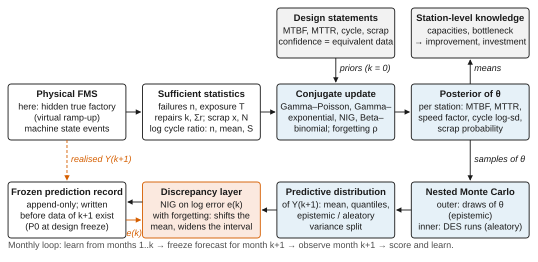
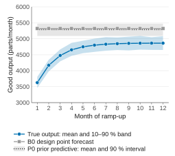
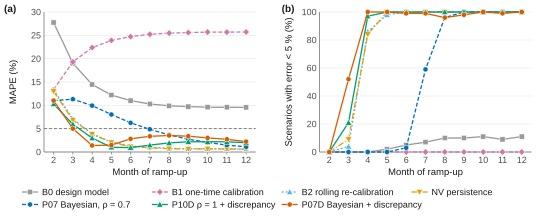
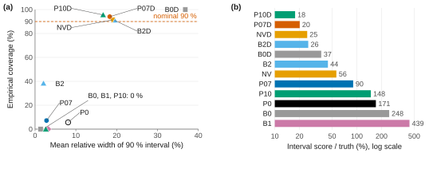
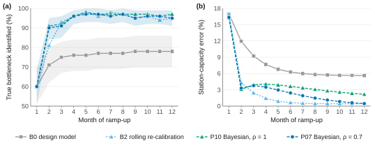
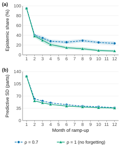
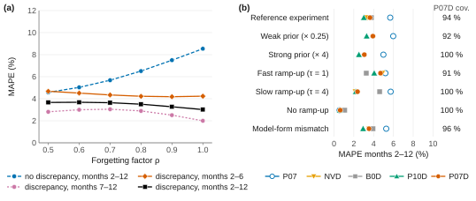

# Sequential conjugate Bayesian updating of a digital twin for the ramp-up of flexible manufacturing systems: design-stage priors, calibrated forecasts and a virtual ramp-up study

[Author 1 – PhD candidate] (a, \*), [Author 2 – supervisor] (a)

(a) [Affiliation – department, university, city, country]

(\*) Corresponding author: [e-mail address]

## Abstract

Design-stage simulation models of flexible manufacturing systems (FMS) are built from supplier statements and engineering estimates, and they are rarely updated or checked once the system starts production. We present an uncertainty-aware digital twin that converts design statements into conjugate prior distributions, updates them every month from machine events (Gamma–Poisson for failures, Gamma–exponential for repairs, Normal-Inverse-Gamma for log cycle-time ratios, Beta–binomial for scrap, all with a forgetting factor), propagates epistemic and aleatory uncertainty through a discrete-event model by nested Monte Carlo, and corrects the remaining structural lag with a learned output-level discrepancy term. Forecasts are frozen before the data they are scored against exist. The method is evaluated on a reference design of a piston-compressor FMS with 13 station types in a virtual ramp-up of 100 hidden true factories; no plant data exist yet, so all results are simulated. The design model over-predicted monthly output by 13.0 %. Parameter updating alone produced over-confident intervals (7 % coverage of nominal 90 % intervals). With the discrepancy term, the error over months 2–12 fell to 3.6 % (95 % CI 3.6–3.7 %), coverage reached 94 % and the interval score was second only to an ablation variant without forgetting. A naive persistence forecast was slightly more accurate in the mature months but gave no usable uncertainty and no station-level information, whereas the updated twin identified the true bottleneck in 95 % of factory-months against 76.5 % for the design model. A monthly forecast takes 1.4 s on an office PC; a field-validation protocol is provided.

**Keywords:** digital twin; flexible manufacturing system; production ramp-up; Bayesian updating; uncertainty quantification; discrete-event simulation

## Highlights

- Design statements become conjugate priors worth an equivalent amount of data
- Machine events update failure, repair, cycle-time and scrap posteriors monthly
- A learned discrepancy term lifts 90 % interval coverage from 7 % to 94 %
- In 100 simulated ramp-ups the output error falls from 13 % (design) to 3.6 %
- The updated twin finds the true bottleneck in 95 % of cases, the design in 76.5 %

## 1. Introduction

A flexible manufacturing system (FMS) is planned with a simulation model long before its machines are delivered. The inputs of that model — cycle times from supplier time studies, mean times between failures (MTBF) and to repair (MTTR) from vendor catalogues, scrap rates from comparable processes — are point statements made under ideal conditions [@bokrantz2017]. Two consequences follow. First, the design-stage forecast of output is biased in a predictable direction, because optimistic statements on many stations combine. Second, the forecast carries no honest statement of its own uncertainty, so the investment decision based on it cannot weigh the risk that the planned capacity is not reached. Both problems are most acute during ramp-up, the months between start of production and stable output, when failures are frequent, programs are still being optimised and operators are learning [@terwiesch2001; @surbier2014].

Digital twins promise to close the loop between the physical system and its model [@kritzinger2018; @tao2019; @liu2021]. In practice, however, most manufacturing twins reported in the literature are digital models with manual data exchange, input uncertainty is represented — if at all — by fixed distributions, and design-stage predictions are almost never compared with the commissioned system. A systematic review that accompanies this work (companion paper, in preparation) found that only 2 of 28 included studies updated simulation inputs automatically from plant data, none used Bayesian updating, none covered ramp-up with data, and only one compared a design-stage prediction with a newly commissioned system, reporting a 17 % initial cycle-time deviation that fell to 8.7 % after manual recalibration [@konstantinov2022]. Simulation research offers rigorous methods for input uncertainty [@barton2012; @corlu2020] and for calibration with model discrepancy [@kennedy2001], and recent manufacturing work refits input distributions to operating data [@schumacher2024]. What is missing is a method that starts from the design statements, follows a *new* system through ramp-up month by month, and is judged by forecasts that were fixed before the data existed.

The practical setting adds constraints. The work is motivated by manufacturers in an early stage of FMS adoption, who move from standalone CNC machines to a first integrated cell with limited budgets, limited data infrastructure and limited specialist staff. For them a twin must run on an ordinary, possibly offline, factory PC, must be explainable to maintenance and planning staff, and must work with the few signals that low-cost machine interfaces deliver (state changes, counters and cycle times). These constraints favour closed-form Bayesian updates over sampling-based inference, and they make it necessary to know how much each component of the method actually contributes.

This paper addresses the gap with an uncertainty-aware digital twin that combines four simple elements: (i) conjugate priors whose strength is stated as an equivalent amount of data, (ii) sequential conjugate updates with a forgetting factor computed from sufficient statistics of machine events, (iii) nested Monte Carlo propagation of epistemic and aleatory uncertainty through a discrete-event model, and (iv) a learned output-level discrepancy term in the spirit of Kennedy and O'Hagan [@kennedy2001]. Because no real ramp-up data of the case factory exist yet, the method is evaluated in a controlled simulation study in which the true parameters of 100 virtual factories are known to the experimenter but hidden from the twin. The study is reported following the aims–data–estimands–methods–performance structure recommended for simulation studies [@morris2019].

The contributions are:

1. A transparent prior-elicitation and updating scheme for the four input types of an FMS model (failures, repairs, cycle times, scrap) that maps design statements and machine events to closed-form posteriors, including a forgetting factor for the non-stationarity of ramp-up and a frozen-prediction protocol that makes every forecast auditable.
2. A two-layer predictor in which station-level parameters are learned by conjugate updating and the structural lag of a stationary model is learned by an output-level discrepancy term, with the design rule that the discrepancy learns only from data-based forecasts.
3. A virtual ramp-up experiment with 100 hidden true factories, seven predictors and baselines (including a rolling re-calibration and a naive persistence forecast added for this study), four ablations and six robustness conditions, evaluated with accuracy, bias, coverage, interval score, bottleneck identification and the epistemic share of predictive variance, with scenario-level bootstrap confidence intervals and paired tests.
4. Evidence on the computational cost of the method on an office PC and a protocol for its validation in the field.

Three research questions guide the study. RQ1: How large and how biased is the error of a frozen design-stage forecast, and does the prior predictive represent that error honestly? RQ2: How quickly and how accurately does sequential conjugate updating learn the monthly output and the station-level parameters, compared with point re-calibration and a data-only forecast? RQ3: Which components — parameter uncertainty, forgetting, discrepancy learning — are needed for calibrated forecast intervals? Two hypotheses from the underlying research plan are tested: H1, the updated twin brings the monthly output error below 5 % with at least 30 % fewer months of ramp-up data than the design model and a one-time calibration; and H2, its 90 % prediction intervals reach at least 85 % empirical coverage.

Section 2 positions the work. Section 3 presents the method, Section 4 the case and the experimental design, and Section 5 the results. Section 6 discusses implications, threats to validity and limitations, and Section 7 concludes with a field-validation protocol.

## 2. Related work

### 2.1 Digital twins along the life cycle of manufacturing systems

Kritzinger et al. [@kritzinger2018] distinguish digital models, digital shadows and digital twins by whether data flow manually or automatically between the physical and the virtual object, and they observed that applied work concentrated on the lower integration levels. Later reviews mapped enabling technologies and research issues [@negri2017; @tao2019; @lu2020; @fuller2020; @liu2021] and proposed taxonomies by life-cycle stage and model characteristics [@seipolt2025]; ISO 23247 provides a reference architecture with data-collection, core and user entities [@iso23247]. Most twins support operation — monitoring, maintenance, scheduling. Van Beek et al. [@vanbeek2022] argue that twins should connect design decisions with operational data across the life cycle, and van Ginkel et al. [@vanginkel2025] note that twin research on system design and ramp-up is scarce. FMS-specific twins have demonstrated simulation-based optimisation and control [@florescu2024; @ullah2024], but they use fixed inputs and do not follow a design forecast through ramp-up. The present work belongs to the design-to-operation category: the twin begins as a design model with explicit uncertainty and becomes a data-driven shadow during ramp-up.

### 2.2 Input uncertainty in simulation

When input distributions are estimated from finite data, their parameters are uncertain and this uncertainty propagates to the output. The simulation literature treats it with the delta method [@chenghol1997], with bootstrap resampling, often supported by metamodels, and with Bayesian methods that place distributions on the input parameters and sample them in an outer loop [@chick2001; @zouaoui2003]; Barton [@barton2012] and Corlu et al. [@corlu2020] review these approaches. Masciarelli and Matta [@masciarelli2022] applied metamodel-assisted bootstrapping to a laboratory line with few data and noted that Bayesian approaches become expensive when the posterior must be sampled for many simulation runs. This cost argument does not hold for conjugate models, for which the posterior is available in closed form [@gelman2013]. Input-uncertainty methods are usually formulated for a stationary system and a fixed data set; the sequential, non-stationary case of a ramp-up has received little attention.

### 2.3 Calibration, model discrepancy and data assimilation

Kennedy and O'Hagan [@kennedy2001] showed that calibrating a computer model without a discrepancy term forces the parameters to absorb structural model error, and they modelled observations as model output plus a systematic discrepancy plus noise. Engineering twins have adopted Bayesian state and parameter estimation at scale [@kapteyn2021], and uncertainty quantification has been identified as a central open issue of digital twins [@thelen2023]. In forecasting, discounting of past information is the standard device for tracking slowly changing parameters [@westharrison1997], and power priors formalise the down-weighting of historical data [@ibrahim2000]. These ideas have not been combined for production-system twins in ramp-up, where both the parameters change and the model form (stationary within a period) is known to be wrong.

### 2.4 Updating production-system models with operating data

Schumacher et al. [@schumacher2024] fit and refit processing-time and scrap distributions to data from a running system for simulation-based scheduling; Fu et al. [@fu2025] update operation-time distributions from PLC timers to trigger line reconfiguration; Monek and Fischer [@monek2023] extract simulation inputs from low-cost sensors and PLC data. These works update twins *in operation* with frequentist point fits and without a prior; none starts from design statements, quantifies how forecast uncertainty shrinks, or scores forecasts that were frozen in advance. Konstantinov et al. [@konstantinov2022] remain the rare case of a design-stage prediction compared with a commissioned system, and recalibration there was manual and one-off. Bokrantz et al. [@bokrantz2017] documented why design inputs are weak: vendors report means only, short stops are filtered, and data are outdated.

### 2.5 Production ramp-up

Ramp-up research describes low output, frequent disturbances and rapid learning [@terwiesch2001], identifies the lack of quantitative decision support as a main challenge [@surbier2014], and models improvement with learning curves since Wright [@wright1936]. The ramp-up phenomenon is the reason why a twin calibrated once, early, is misleading, and why a twin that weights all data equally lags behind. Neither ramp-up research nor twin research has so far quantified how fast a design-stage model can be corrected during ramp-up and how honest its uncertainty is meanwhile.

### 2.6 Positioning

Table 1 summarises the position of this paper. Its novelty is not any single statistical element — conjugate updating, forgetting and model discrepancy are all known — but their combination into a design-to-ramp-up twin of an FMS, the frozen-prediction protocol, and a controlled evaluation that separates the contribution of each component and compares the twin with simple data-driven alternatives, which twin studies rarely do.

**Table 1.** Position of this paper relative to closely related work.

| Work | Starts from design priors | Sequential updating | Non-stationarity (ramp-up) | Uncertainty propagated to output | Model discrepancy | Frozen forecasts scored |
|---|---|---|---|---|---|---|
| Input-uncertainty methods [@chick2001; @zouaoui2003; @masciarelli2022] | partly | no | no | yes | no | no |
| Bayesian calibration [@kennedy2001] | yes | no | no | yes | yes | no |
| Live fitting / automatic updating [@schumacher2024; @fu2025; @monek2023] | no | yes | no | no | no | no |
| Design vs. commissioned system [@konstantinov2022] | no | one-off, manual | no | no | no | yes |
| This paper | yes | yes (monthly) | forgetting factor | nested Monte Carlo | learned, output level | yes |

## 3. Method

Fig. 1 shows the information loop of the twin. Design statements define the priors; every month the machine events of the physical system are reduced to sufficient statistics, the station posteriors are updated, their uncertainty is propagated through the discrete-event model, a discrepancy layer corrects the forecast, and the corrected forecast is frozen before the month it refers to begins. The posterior station parameters are, in addition, the source of station-level knowledge for improvement and investment decisions. Sections 3.1–3.7 describe the elements in turn.

**Figure 1.** Information loop of the uncertainty-aware digital twin. Blue: Bayesian core (conjugate update, posterior, nested Monte Carlo, predictive distribution); orange: discrepancy layer, which receives the realised log error e(k) of each frozen forecast. In this study the physical FMS is replaced by a hidden true factory (Section 4.2).

### 3.1 Notation and system model

The FMS is modelled as a network of station types $m \in \mathcal{M}$, each with $c_m$ identical servers. Product variants $p \in \mathcal{P}$ with mix shares $\pi_p$ follow routings through the station types; $t^{d}_{pm}$ is the design cycle time (including non-overlapped handling) of variant $p$ at station $m$. Each server is at any time processing, idle, blocked or down, which are also the states reported by the machine interface. For each station the uncertain parameter vector is

$$\theta_m = (\lambda_m,\; \mu_m,\; \nu_m,\; \sigma^2_m,\; q_m), \tag{1}$$

with failure rate $\lambda_m = 1/\mathrm{MTBF}_m$ per processing hour, repair rate $\mu_m = 1/\mathrm{MTTR}_m$, mean $\nu_m$ and variance $\sigma^2_m$ of the log cycle-time ratio $y = \ln(t/t^{d}_{pm})$, and scrap probability $q_m$. Using the ratio rather than the cycle time itself turns all variants into one station-level *speed factor* $\exp(\nu_m + \sigma^2_m/2)$, so that a single model per station suffices for any product mix. Time is divided into periods $k = 1, 2, \dots$ (months of $H$ productive hours); $D_k$ denotes the machine events of period $k$ and $Y_k$ the good output. A stochastic discrete-event simulation (DES) $g$ maps parameters, configuration $x$ and random numbers $\omega$ to output,

$$Y_k = g(\theta, x, \omega), \tag{2}$$

so that two kinds of uncertainty must be distinguished: *aleatory* uncertainty from $\omega$ (the next failure is random even if MTBF is known) and *epistemic* uncertainty about $\theta$ (the MTBF of a new machine is not known before it has run). Only the second can be reduced by data.

### 3.2 Priors from design statements

Engineers state values and, at best, a confidence. The method therefore expresses the confidence in each design statement as the *equivalent amount of data* the statement is worth — operating hours, repairs, cycles or parts. Table 2 gives the resulting conjugate priors, chosen such that the prior mean (or mode, for cycle times) equals the design value. For a cycle-time statement "$t_0 \pm s$ covering about 90 % of cycles", $\sigma_0 = \ln(1+s)/1.645$ and, because the mode of a log-normal distribution is $\exp(\nu - \sigma^2)$, the prior location is $m_0 = \ln(t_0/t^{d}) + \sigma_0^2$. The equivalent-data interpretation makes the priors auditable ("the vendor MTBF counted as 300 h of operation; 310 real hours have now been added") and gives a single, interpretable sensitivity parameter.

**Table 2.** Conjugate models, priors from design statements and sufficient statistics from machine events.

| Quantity | Data model | Prior | Design statement and worth | Sufficient statistics of period $k$ |
|---|---|---|---|---|
| Failures | Poisson process, rate $\lambda$ per processing hour | $\mathrm{Gamma}(a_f, b_f)$ | MTBF$_0$ worth $T_0$ h: $b_f = T_0$, $a_f = 1 + T_0/\mathrm{MTBF}_0$ | failures $n$, processing time $T$ |
| Repairs | exponential, rate $\mu$ | $\mathrm{Gamma}(a_r, b_r)$ | MTTR$_0$ worth $r_0$ repairs: $a_r = 1 + r_0$, $b_r = r_0\,\mathrm{MTTR}_0$ | repairs $j$, total repair time $\sum r_i$ |
| Cycle time | $y = \ln(t/t^d) \sim \mathcal{N}(\nu, \sigma^2)$ | Normal-Inverse-Gamma $(m_0, \kappa_0, a_0, b_0)$ | mode $t_0 \pm s$ worth $n_0$ cycles: $\kappa_0 = n_0$, $a_0 = \max(2, n_0/2)$, $b_0 = \sigma_0^2(a_0 - 1)$ | count $n$, mean $\bar y$, sum of squares $S$ |
| Scrap | Bernoulli, probability $q$ | $\mathrm{Beta}(a_q, b_q)$ | $q_0$ worth $N_0$ parts: $a_q = q_0 N_0$, $b_q = (1-q_0) N_0$ | scrap $x$ among $N$ parts |

### 3.3 Conjugate updates with forgetting

Station parameters are assumed independent a priori. For each quantity a conjugate prior exists, so the posterior after period $k$ is in the same family and becomes the prior for period $k+1$. Before each update the current hyperparameters are discounted by a forgetting factor $\rho \in (0,1]$, which is the discount-factor idea of dynamic Bayesian forecasting [@westharrison1997] and corresponds to a power prior on past data [@ibrahim2000]. For failures and repairs,

$$a_f \leftarrow \rho\,a_f + n, \qquad b_f \leftarrow \rho\,b_f + T, \tag{3}$$

$$a_r \leftarrow \rho\,a_r + j, \qquad b_r \leftarrow \rho\,b_r + \textstyle\sum_{i=1}^{j} r_i, \tag{4}$$

with posterior means $\mathbb{E}[\mathrm{MTBF}] = b_f/(a_f - 1)$ and $\mathbb{E}[\mathrm{MTTR}] = b_r/(a_r - 1)$ for $a > 1$. For the log cycle-time ratio, let $(\kappa', m', a', b') = (\rho\kappa, m, \rho a, \rho b)$ be the discounted state; then

$$\kappa \leftarrow \kappa' + n, \quad m \leftarrow \frac{\kappa' m' + n\bar y}{\kappa' + n}, \quad a \leftarrow a' + \frac{n}{2}, \quad b \leftarrow b' + \frac{S}{2} + \frac{\kappa' n (\bar y - m')^2}{2(\kappa' + n)}. \tag{5}$$

The posterior predictive of $y$ is Student-$t$ with $2a$ degrees of freedom, location $m$ and scale $\sqrt{b(\kappa + 1)/(a\kappa)}$. For scrap,

$$a_q \leftarrow \rho\,a_q + x, \qquad b_q \leftarrow \rho\,b_q + N - x. \tag{6}$$

With $\rho = 1$ the standard updates result. Information that is $i$ periods old keeps weight $\rho^{i}$, so the effective memory is about $1/(1-\rho)$ periods — 3.3 months for $\rho = 0.7$ — and the weight of the design prior decays as $\rho^{k}$. The forgetting factor thus trades the speed of tracking a changing system against the amount of information retained. Each update costs a fixed number of arithmetic operations per station, independent of the number of events.

### 3.4 Sufficient statistics from machine events

All statistics in Eqs. (3)–(6) are counts, sums and sums of squares that a data gateway can accumulate in real time with constant memory: failures are transitions into the *down* state with a failure code, exposure $T$ is the processing time (failures are modelled as operation-dependent), repair durations are the lengths of *down* intervals, scrap and good counts come from counters, and the mean and sum of squared deviations of $y$ are accumulated with Welford's recursion [@welford1962],

$$n \leftarrow n + 1, \qquad \delta = y - \bar y, \qquad \bar y \leftarrow \bar y + \delta/n, \qquad S \leftarrow S + \delta\,(y - \bar y). \tag{7}$$

The signals required — a state word with time-stamped transitions, an alarm code, a cycle counter and good/scrap counters — are available from low-cost machine interfaces; the architecture that delivers them without losing short events under polling is the subject of a companion paper (in preparation) and is not part of this contribution.

### 3.5 Uncertainty propagation by nested Monte Carlo

The predictive distribution of the next period's output is obtained by nested sampling. In the outer loop, $\theta^{(i)}$, $i = 1, \dots, N_\theta$, is drawn from the current posterior of every station (MTBF and MTTR from inverse-gamma distributions, $\sigma^2$ from an inverse-gamma and $\nu \mid \sigma^2$ from a normal distribution, $q$ from a beta distribution); in the inner loop the DES is run $R$ times for one period with these parameters. The predictive mean and the $(1-\alpha)$ interval are

$$\hat Y_{k+1} = \frac{1}{N_\theta R}\sum_{i,r} Y^{(i,r)}, \qquad \mathrm{PI}_{1-\alpha} = \big[Q_{\alpha/2}(Y),\, Q_{1-\alpha/2}(Y)\big], \tag{8}$$

and, by the law of total variance, the predictive variance splits into an epistemic and an aleatory part,

$$\mathrm{Var}(Y) = \underbrace{\mathrm{Var}_\theta\big(\mathbb{E}[Y \mid \theta]\big)}_{\text{epistemic}} + \underbrace{\mathbb{E}_\theta\big[\mathrm{Var}(Y \mid \theta)\big]}_{\text{aleatory}}. \tag{9}$$

With $R \geq 2$ both terms are estimated from the between- and within-group variances of the nested sample; the between-group variance is corrected by subtracting the within-group variance divided by $R$. The prior predictive ($k = 0$) is the *frozen design forecast* P0: it states, before any machine has run, what output is expected and how uncertain this expectation is.

### 3.6 Learning the model discrepancy

A twin whose parameters are constant within the learning window systematically lags behind a system that improves between the data used for learning and the period being forecast; even perfectly estimated parameters of month $k$ under-predict month $k+1$. Following Kennedy and O'Hagan [@kennedy2001], this structural error is learned separately. Let $e_k = \ln(Y_k/\hat Y_k)$ be the realised log error of the forecast for period $k$. A Normal-Inverse-Gamma model with forgetting $\rho_\delta$ (Eq. (5) with $n = 1$, $S = 0$) learns its location $m_\delta$ and scale. The corrected forecast and interval are

$$\hat Y'_{k+1} = \hat Y_{k+1}\,e^{m_\delta}, \qquad \ln \mathrm{PI}' = \ln \hat Y'_{k+1} \pm t_{1-\alpha/2,\,2a_\delta}\sqrt{s_{MC}^2 + s_\delta^2}, \tag{10}$$

where $s_{MC} = \ln(Q_{0.95}/Q_{0.05})/(2 \cdot 1.645)$ is the log-scale spread implied by the Monte Carlo interval of Eq. (8) and $s_\delta = \sqrt{b_\delta(\kappa_\delta + 1)/(a_\delta \kappa_\delta)}$ the predictive scale of the discrepancy. The prior is $m_0 = 0$, $\kappa_0 = 1$, $a_0 = 2$ and a prior scale of 0.05; $\rho_\delta = 0.7$. One design rule is essential: the discrepancy learns only from errors of *data-based* forecasts, that is, from period 2 onwards. The period-1 forecast comes from the prior model, and its error says nothing about the lag of the updated twin; Section 5.4 quantifies what happens if this rule is ignored. The division of labour is deliberate: the station parameters explain *where* the system differs from its design, and the discrepancy absorbs *what the model structure cannot express*.

### 3.7 Frozen-prediction protocol and performance measures

At the design freeze and at the end of every period the twin writes an append-only prediction record: software version, all hyperparameters, random seed, forecast horizon, predictive mean and quantiles, and a time stamp. A forecast for period $k+1$ is stored before any data of period $k+1$ are read. In the experiment this is guaranteed by the program structure; in a factory the records are kept in the twin's database and tagged in version control, so that a reviewer can verify that no forecast was changed after the fact.

Forecasts are scored by the absolute percentage error $E_k = |\hat Y_k - Y_k|/Y_k$ and its mean (MAPE), the mean signed error (bias; positive means over-prediction), the empirical coverage of the 90 % interval, its mean relative width, and the interval score of Gneiting and Raftery [@gneiting2007],

$$\mathrm{IS}_\alpha = (u - l) + \frac{2}{\alpha}(l - Y)\,\mathbb{1}\{Y < l\} + \frac{2}{\alpha}(Y - u)\,\mathbb{1}\{Y > u\}, \tag{11}$$

which is a proper scoring rule for an interval $[l, u]$ and rewards calibration and sharpness together; it is reported relative to $Y$ with $\alpha = 0.1$. For sample-based predictors the continuous ranked probability score (CRPS) is also computed. Station-level knowledge is measured by the share of scenarios in which the station with the lowest static capacity under the current parameters — the true bottleneck — is identified correctly, and by the mean absolute percentage error of the 13 static station capacities $c_m A_m\, 3600 H (1 - q_m)/\bar t_m$, where $A_m = \mathrm{MTBF}_m/(\mathrm{MTBF}_m + \mathrm{MTTR}_m)$ and $\bar t_m$ is the mix-weighted mean cycle time.

## 4. Case and experimental design

### 4.1 Case: a piston-compressor FMS (reference design)

The case is the planned FMS of a manufacturer of V-type two-cylinder piston air compressors in three variants (VC10, VC20, VC30; mix 0.3/0.5/0.2). The core is a pallet-based crankcase cell with three horizontal machining centres (HMC) sharing 12 fixture pallets; cylinder and crankshaft lines, pump assembly, a robot station, two performance test benches, painting, final assembly and packing complete the system, which comprises 13 station types and 16 servers. All data are *reference design estimates* from the design model of the factory, not supplier-confirmed values and not plant measurements: for example, HMC cycle times of 270/345/450 s plus 15 s pallet change, MTBF 30 h and MTTR 20 min, and scrap 0.8 %. Under these values the static analysis identifies final assembly as the bottleneck [calculated]: it can process 5 678 parts per 330-hour month, of which a share $\prod_m(1-q_m) = 0.941$ is good, giving an upper bound of 5 340 good compressors per month. The process-level design of the crankcase cell as a closed queueing network and the staged investment in the system are the subject of companion papers (in preparation).

For the thousands of runs required, a reduced-order DES is used: a serial line of the 13 station types with $c_m$ parallel servers, buffers of four parts, blocking after service, unlimited raw material, log-normal cycle times around the design time of each variant multiplied by the station speed factor, operation-dependent exponential failures and repairs, and scrap detected at the end of the line (scrapped parts consume capacity). The model is computed by an exact departure-time recursion rather than an event list, which takes $O(NM)$ time for $N$ parts and $M$ stations. With design parameters it produces 5 320 good parts per month (mean of 10 replications, range 5 294–5 347) [simulated], 0.4 % below the static bound — as expected for a well-buffered line. The reduced model omits pallets, transport and dispatching; these affect absolute output but not the statistical question studied here. The frozen design forecast of the fully configured FMS, computed with the same priors, is reported in Section 5.1.

### 4.2 Virtual ramp-up with hidden true factories

Only an experiment can show whether a twin learns the *right* parameters, because in a real factory the true MTBF is never observed. For each scenario $s = 1, \dots, 100$ a true factory is generated. For every station, mature deviations from the design are drawn — MTBF factor $U(0.6, 1.1)$, MTTR factor $U(1.0, 1.5)$, cycle-time factor $U(0.98, 1.12)$, cycle log-standard deviation $U(0.04, 0.10)$ and scrap factor $U(1.0, 2.0)$ — reflecting the documented optimism of design inputs [@bokrantz2017]. A ramp-up trajectory $r(k) = e^{-(k-1)/\tau}$ with $\tau = 2$ months (1.5 for scrap) is imposed on top: in month $k$ the MTBF is multiplied by $1 - 0.5\,r(k)$, the MTTR by $1 + 0.5\,r(k)$, the cycle time by $1 + 0.08\,r(k)$ and the scrap rate by $1 + 2\,r(k)$, so that month 1 has half the mature MTBF, 1.5 times the MTTR, 8 % slower cycles and three times the scrap [assumption]. Each month of the true factory is simulated once; its machine events are passed to the predictors and its good output $Y_k$ is the quantity to be forecast. The truth generator draws from the same distribution families as the twin; a robustness condition with a different model form is included (Section 4.5).

### 4.3 Predictors and baselines

Table 3 lists the predictors. B0 and B1 represent conventional practice: a design study with point values, and a one-time recalibration after the first month as reported in [@konstantinov2022]. Two data-driven baselines were added for this paper to test whether the twin is needed at all for output forecasting: B2 re-estimates point values from the last month every month (rolling re-calibration), and NV forecasts next month's output by this month's output (persistence). The Bayesian predictors differ in the forgetting factor ($\rho = 1, 0.9, \dots, 0.5$), and every data-based predictor can be combined with the discrepancy layer of Section 3.6 (suffix D). The main configuration P07D ($\rho = 0.7$) was fixed in the underlying research plan before this study; all other configurations are reported as ablations.

**Table 3.** Predictors compared in the virtual ramp-up.

| Code | Predictor | Updated | Uncertainty represented |
|---|---|---|---|
| B0 | Design point values, stochastic DES (20 replications) | never | aleatory |
| B1 | Point estimates from month 1, then frozen | once | aleatory |
| B2 | Point estimates from the last month, re-estimated monthly (new) | monthly | aleatory |
| NV | Persistence: $\hat Y_{k+1} = Y_k$ (new) | monthly | none |
| P0 | Prior predictive with design priors, frozen | never | aleatory + epistemic |
| P10 … P05 | Sequential conjugate updating, $\rho = 1.0, 0.9, \dots, 0.5$ | monthly | aleatory + epistemic |
| B0D, B2D, NVD | Baseline + discrepancy layer | monthly | + discrepancy |
| P10D … P05D | Bayesian twin + discrepancy layer; **P07D** is the main configuration | monthly | aleatory + epistemic + discrepancy |
| P07D_m1 | P07D, discrepancy also learns from the month-1 error (ablation) | monthly | as P07D |
| P07D_r1 | P07D without forgetting in the discrepancy layer, $\rho_\delta = 1$ (ablation) | monthly | as P07D |

### 4.4 Settings, random streams and statistical analysis

Prior strengths in the main experiment are: failures worth 10 × MTBF$_0$ processing hours (about ten failures), repairs worth 5 repairs, cycle times worth 10 cycles with ± 10 % spread, and scrap worth 250 parts [assumption]. Each month has $H = 330$ h; Bayesian forecasts use $N_\theta = 40$ and $R = 1$, point predictors 20 replications. Month 1 has no data for any predictor; months 2–12 are evaluated, with sub-periods 2–6 (steep ramp-up) and 7–12 (near maturity). Every random source has its own seeded stream: the truth of a scenario, the Bayesian forecasts of a month (shared by all forgetting factors and prior strengths, i.e. common random numbers for paired comparisons) and each point predictor. Adding or removing a predictor therefore never changes the truth or the other forecasts. The reduced DES and the conjugate models are those of the underlying thesis code; a re-run of the original 30-scenario experiment with that code reproduced its published result file bit for bit.

Performance is first averaged over months within a scenario; 95 % confidence intervals are percentile bootstrap intervals over the 100 scenarios (2 000 resamples), and predictors are compared with P07D by two-sided Wilcoxon signed-rank tests on the paired scenario means with Holm adjustment. Time to accuracy is the first month from which the error stays below 5 % until month 12. Station-level metrics are computed before each month's data arrive.

### 4.5 Ablations, sensitivity and robustness conditions

Besides the forgetting-factor sweep and the ablations in Table 3, the experiment is repeated under six conditions with the same 100 truth parameter sets: prior strengths multiplied by 0.25 (weak) and 4 (strong); fast ($\tau = 1$, scrap 0.75) and slow ($\tau = 4$, scrap 3) ramp-up; no ramp-up (stationary truth); and a model-form mismatch in which the true times to failure are Weibull with shape 0.7 (decreasing hazard, typical of early failures) and repair times are log-normal with log-standard deviation 1.0, both with the same means as before, while the twin keeps its exponential assumptions. In addition, the variance decomposition of Eq. (9) is estimated for 30 scenarios with $N_\theta = 40$ and $R = 3$, and the computational cost and Monte Carlo error are measured on an office PC (AMD x86-64, Windows Server 2022, Python 3.12 standard library, single core).

## 5. Results

All numbers in this section are simulated with the reference design data unless marked otherwise.

### 5.1 The frozen design forecast (RQ1)

Averaged over the 100 true factories, good output rises from 3 628 parts in month 1 to 4 799 in month 6 and 4 863 in month 12 (Fig. 2). The design model B0 forecasts about 5 320 parts for every month: 47 % above month 1 and still about 9 % above the mature level. Over months 2–12 its bias is +13.0 % (95 % CI 12.3–13.7 %), and in 89 % of the scenarios its error never falls below 5 % within the year. This is the combined effect of moderately optimistic statements on 13 stations — no single deviation is extreme.

The prior predictive P0 has almost the same bias (+12.2 %) but a 90 % interval of 8.1 % relative width, against 1.4 % for the purely aleatory spread of B0. Its intervals contain the true output in only 5.6 % of the factory-months: the epistemic uncertainty encoded by the design priors is real but too small to cover the systematic optimism and the ramp-up deficit. With weak priors (strength × 0.25) the P0 interval widens to 15.8 % and its coverage rises to 38.5 %; with strong priors (× 4) coverage falls to 1.1 %. Honest design-stage confidence therefore matters most for the frozen forecast. For the fully configured FMS, P0 forecasts a mature output of 6 176 compressors per month (90 % interval 5 916–6 413), 2.3 % below the deterministic design value of 6 322, and 86 % of the prior-predictive samples lie below that value [simulated, reference design]. Uncertain parameters reduce expected output because losses at different stations combine non-linearly and the bottleneck can shift — the optimism of point-value design studies, quantified before any machine is installed.

**Figure 2.** True monthly good output of the 100 virtual ramp-ups (mean and 10–90 % band across scenarios) and the frozen design-stage forecasts: B0 (design point values) and P0 (prior predictive, mean and mean 90 % interval) [simulated].

### 5.2 Point accuracy during ramp-up (RQ2)

Table 4 and Fig. 3 summarise point accuracy. Four patterns stand out.

*One-time calibration is worse than none.* B1, calibrated on the worst month of the ramp-up, under-predicts by 23.4 % for the rest of the year; calibration at the wrong time freezes the transient into the model.

*Parameter updating converges, but lags.* P10 ($\rho = 1$) still errs by 5.2 % in month 12; P07 reaches 1.1 % in month 12 but its MAPE over months 2–6 is 9.3 % and its bias −5.7 %, because it learns from month $k$ to forecast a better month $k+1$. Smaller $\rho$ reduces this lag monotonically (P05: 4.6 % over months 2–12) at the price of noisier estimates (Section 5.6).

*The discrepancy layer removes the lag.* P07D has a MAPE of 3.6 % (95 % CI 3.6–3.7 %) over months 2–12 and 4.3 % over months 2–6, with a bias of only +0.5 %. Its median time to sustained accuracy below 5 % is 3.5 months (interquartile range 3–4), i.e. about 2.5 months of data, whereas B0 and B1 do not reach this level within 12 months in 89 % and 100 % of the scenarios. Measured in months of data, the 30 % reduction required by H1 is therefore exceeded by a wide margin, and H1 is supported in the simulated setting. Over months 2–6 P07D is significantly more accurate than every baseline (Table 5; e.g. by 1.0 percentage points against NVD and 1.2 against B2, Holm-adjusted $p < 10^{-16}$, better in all 100 scenarios).

*Simple data-driven forecasts are strong once data exist.* Over the whole year the persistence forecast NV (2.8 %) and the rolling re-calibration B2 (2.9 %) are slightly *more* accurate than P07D (3.6 %), because in the flattening part of the ramp-up last month is an excellent forecast of this month. Their advantage lies entirely in months 7–12 (0.7–0.8 % against 3.0 %), where the discrepancy layer of P07D slightly over-corrects (bias between +2.2 % and +3.5 % in months 6–12) after the ramp-up has flattened. In the steep phase (months 2–6) both are less accurate than P07D (5.4 % and 5.6 %). The twin's value for output forecasting is thus concentrated in the early months and, as the following sections show, in calibrated uncertainty and station-level knowledge, which the simple forecasts cannot provide.

**Table 4.** Accuracy and calibration over months 2–12 (100 scenarios; 95 % bootstrap CI in brackets) [simulated]. Width and interval score (IS) relative to the true output; time to accuracy = median first month from which the error stays below 5 % (13 = not within 12 months).

| Predictor | MAPE 2–12 (%) | MAPE 2–6 (%) | MAPE 7–12 (%) | Bias (%) | Coverage of 90 % PI (%) | Width (%) | IS (%) | Time to accuracy (month) |
|---|---|---|---|---|---|---|---|---|
| B0 | 13.0 [12.3, 13.7] | 16.9 | 9.8 | +13.0 | 0.0 | 1.4 | 248 | 13 |
| B1 | 23.4 [23.0, 23.7] | 20.7 | 25.6 | −23.4 | 0.0 | 3.2 | 439 | 13 |
| B2 | 2.9 [2.9, 3.0] | 5.6 | 0.8 | −2.7 | 38.3 [36.1, 40.5] | 2.1 | 44 | 4 |
| NV | 2.8 [2.8, 2.9] | 5.4 | 0.7 | −2.5 | – | 0 | 56 | 4 |
| P0 | 12.2 [11.6, 12.9] | 16.1 | 9.0 | +12.2 | 5.6 [2.5, 8.9] | 8.1 | 171 | 13 |
| P10 | 8.5 [8.4, 8.7] | 10.7 | 6.7 | −8.5 | 0.0 | 2.6 | 148 | 13 |
| P07 | 5.7 [5.6, 5.8] | 9.3 | 2.7 | −5.7 | 7.2 [5.9, 8.5] | 2.8 | 90 | 7 |
| B0D | 3.8 [3.7, 3.8] | 5.5 | 2.3 | −3.4 | 100.0 | 36.8 | 37 | 7 |
| B2D | 3.4 [3.3, 3.5] | 5.5 | 1.7 | +0.9 | 91.1 [90.9, 91.4] | 19.5 | 26 | 6 |
| NVD | 3.4 [3.3, 3.4] | 5.4 | 1.7 | +0.9 | 91.4 [91.0, 91.8] | 18.9 | 25 | 5 |
| P10D | 3.0 [3.0, 3.1] | 4.2 | 2.0 | −0.7 | 95.5 [94.6, 96.4] | 16.7 | 18 | 4 |
| **P07D** | **3.6 [3.6, 3.7]** | **4.3** | 3.0 | +0.5 | **94.1 [93.3, 94.9]** | 18.3 | 20 | 3.5 |

**Figure 3.** Point accuracy by month (100 scenarios) [simulated]: (a) mean absolute percentage error of the monthly output forecast; the dashed line marks 5 %. (b) Share of scenarios in which the error is below 5 %.

**Table 5.** Paired comparison with the main configuration P07D: difference in scenario-level MAPE (other minus P07D, percentage points; positive means P07D is better), 95 % bootstrap CI, Holm-adjusted Wilcoxon $p$-value and share of scenarios in which P07D is better [simulated].

| Compared with | Months 2–12: difference [CI] | $p_{\mathrm{Holm}}$ | P07D better | Months 2–6: difference [CI] | $p_{\mathrm{Holm}}$ | P07D better |
|---|---|---|---|---|---|---|
| B0 | +9.37 [8.70, 10.09] | < 10⁻¹⁶ | 100 % | +12.54 [11.85, 13.31] | < 10⁻¹⁶ | 100 % |
| B2 | −0.69 [−0.74, −0.65] | < 10⁻¹⁶ | 0 % | +1.21 [1.12, 1.30] | < 10⁻¹⁶ | 100 % |
| NV | −0.82 [−0.87, −0.78] | < 10⁻¹⁶ | 0 % | +1.01 [0.92, 1.10] | < 10⁻¹⁶ | 100 % |
| P07 (no discrepancy) | +2.04 [1.99, 2.10] | < 10⁻¹⁶ | 100 % | +4.97 [4.87, 5.07] | < 10⁻¹⁶ | 100 % |
| B0D | +0.15 [0.09, 0.20] | 7 × 10⁻⁵ | 66 % | +1.16 [1.04, 1.27] | < 10⁻¹⁶ | 100 % |
| NVD | −0.29 [−0.34, −0.22] | 4 × 10⁻¹² | 14 % | +1.02 [0.91, 1.14] | < 10⁻¹⁶ | 100 % |
| P10D (no forgetting) | −0.62 [−0.66, −0.59] | < 10⁻¹⁶ | 0 % | −0.12 [−0.18, −0.05] | 1 × 10⁻³ | 36 % |
| P07D_m1 (month-1 rule removed) | +2.88 [2.82, 2.94] | < 10⁻¹⁶ | 100 % | +7.68 [7.53, 7.84] | < 10⁻¹⁶ | 100 % |
| P07D_r1 ($\rho_\delta = 1$) | +0.81 [0.79, 0.83] | < 10⁻¹⁶ | 100 % | +0.16 [0.13, 0.19] | < 10⁻¹³ | 90 % |

### 5.3 Calibration of the forecast intervals (RQ3)

Fig. 4a plots coverage against width. Every predictor whose uncertainty comes only from the simulation model is badly over-confident: B0, B1 and P10 never cover the truth, P07 covers it in 7.2 % of the factory-months, and even the sample-based 50 % and 80 % intervals of P07 cover only 1.8 % and 5.2 %. Parameter uncertainty alone does not cover the structural error of forecasting a changing system with a stationary model, because the intervals are centred on a lagging estimate. In the stationary robustness condition, by contrast, the same P07 intervals cover 88.4 % of the months (P10: 84.3 %), which confirms that the over-confidence is caused by the non-stationarity, not by an error in the propagation itself.

With the discrepancy layer the marginal coverage of P07D is 94.1 % (95 % CI 93.3–94.9 %) at a mean width of 18.3 %; H2 (at least 85 % coverage) is therefore supported for the twin with discrepancy learning and rejected for the parametric twin alone. Coverage of 91–96 % is also reached by the other discrepancy-corrected predictors, but at different sharpness: B0D covers everything with intervals twice as wide (36.8 %), and NVD and B2D reach about 91 % with similar widths but more misses. The interval score, which penalises both width and misses, ranks P10D (17.7) and P07D (20.1) best, ahead of NVD (24.8), B2D (25.6) and B0D (36.8), and all predictors without discrepancy far behind (Fig. 4b).

The marginal coverage hides a conditional pattern that must be reported. In month 2, when the discrepancy layer has not yet seen a data-based error, P07D covers only 35 % of the scenarios; from month 3 to month 12 it covers 100 %. The intervals are thus too narrow at the very beginning and conservative afterwards — the heavy tails of the Student-$t$ quantile with few effective degrees of freedom, kept small by forgetting, dominate the width once the errors are small. The same pattern holds for all discrepancy-corrected predictors.

**Figure 4.** Uncertainty quality over months 2–12 (100 scenarios) [simulated]. (a) Empirical coverage of the nominal 90 % prediction interval against its mean relative width; NV has no interval. (b) Interval score relative to the true output (lower is better; log scale).

### 5.4 Ablations: forgetting, the discrepancy rule and discrepancy memory

Three ablations clarify which components matter (Table 5, Fig. 7a). *Removing the discrepancy layer* (P07) raises the MAPE by 2.0 percentage points and destroys calibration; it is the single most important component. *Ignoring the month-1 rule* (P07D_m1) is the most harmful design error: the large prior-model error of month 1 is learned as if it were the lag of the updated twin, the month-2 forecast is over-corrected (MAPE 28.7 % in month 2, against 11.0 % for P07D) and the mean width of the intervals nearly triples (49.9 %). *Removing forgetting from the discrepancy layer* (P07D_r1) leaves early accuracy almost unchanged but keeps the early, large corrections in memory, so that the error in months 7–12 rises to 4.4 % and 40 % of the scenarios never reach sustained accuracy below 5 %.

The forgetting factor of the *parameters* behaves differently with and without the discrepancy layer (Fig. 7a). Without it, stronger forgetting is always better for output accuracy (MAPE from 8.5 % at $\rho = 1$ to 4.6 % at $\rho = 0.5$), because it shortens the lag. With it, the lag is handled by the discrepancy term, and stronger forgetting mainly adds noise: P10D is the most accurate configuration over months 2–12 (3.0 % against 3.6 % for P07D, better in all 100 scenarios), with the best interval score (17.7) and a coverage of 95.5 %. In months 2–6 the configurations with $\rho$ between 0.8 and 1 are within 0.2 percentage points of each other. For output forecasting alone, the pre-registered main configuration is therefore not the best one; Section 5.5 shows why forgetting is nevertheless useful at station level.

### 5.5 Station-level knowledge: bottleneck and capacities (RQ2)

An output-level correction such as B0D or NVD knows a correction factor; the parametric twin knows every station's MTBF, MTTR, speed and scrap. Fig. 5 and Table 6 measure this knowledge. The true bottleneck at the beginning of the ramp-up is final assembly in 60 scenarios, grinding in 24 and pump assembly in 16; in month 12 it is final assembly in 78, pump assembly in 20 and grinding in 2. The design model, which always names final assembly, is therefore wrong in about a quarter of the factory-months (76.5 % correct over months 2–12, 95 % CI 68.5–84.0 %). After one month of data the Bayesian twin identifies the bottleneck in 90–91 % of the scenarios and over months 2–12 in 95.1 % (P07) and 95.9 % (P10). The rolling point re-calibration B2 is comparable in bottleneck identification (94.5 %) once it has data, but it starts lower in month 2 (81 %), because single-month point estimates of rarely failing stations are noisy.

The station-capacity error separates the forgetting factors. Without forgetting, P10 keeps an error of 2.2 % in month 12, because early-month data still weigh on the estimates; with $\rho = 0.7$ the error falls to 0.5 % (B0: 5.6 %). B2, which uses only the most recent month, tracks capacities most closely in months 3–11 but provides no uncertainty for them and no prior for the stations that have not failed yet. For decisions that need station-level parameters — which machine to duplicate, where to add buffer, which maintenance to prioritise — forgetting is thus valuable even though it slightly worsens the output forecast of the discrepancy-corrected twin. A practical configuration is to keep $\rho \approx 0.7$ for the station posteriors during ramp-up and to raise it towards 1 once the monthly output changes by less than about 1 %.

**Table 6.** Bottleneck identification (share of scenarios, 95 % CI) and mean station-capacity error, selected months (100 scenarios) [simulated].

| Month | B0 hit | B0 cap. error | B2 hit | B2 cap. error | P10 hit | P10 cap. error | P07 hit | P07 cap. error |
|---|---|---|---|---|---|---|---|---|
| 1 | 60 % [51, 69] | 17.0 % | 60 % | 17.0 % | 60 % | 16.4 % | 60 % | 16.4 % |
| 2 | 71 % [62, 80] | 11.9 % | 81 % | 4.3 % | 91 % | 3.1 % | 90 % [84, 95] | 3.3 % |
| 4 | 76 % [68, 84] | 7.7 % | 96 % | 1.4 % | 96 % | 4.1 % | 96 % [92, 99] | 3.5 % |
| 6 | 77 % [69, 85] | 6.3 % | 96 % | 0.6 % | 97 % | 3.6 % | 97 % [93, 100] | 2.4 % |
| 9 | 78 % [70, 86] | 5.7 % | 95 % | 0.5 % | 97 % | 2.8 % | 95 % [91, 99] | 1.1 % |
| 12 | 78 % [70, 86] | 5.6 % | 95 % | 0.5 % | 97 % | 2.2 % | 95 % [91, 99] | 0.5 % |
| 2–12 pooled | 76.5 % [68.5, 84.0] | – | 94.5 % [92.2, 96.5] | – | 95.9 % [93.3, 98.2] | – | 95.1 % [92.3, 97.5] | – |

**Figure 5.** Station-level knowledge during ramp-up (100 scenarios) [simulated]: (a) share of scenarios in which the true bottleneck is identified, with 95 % bootstrap bands for B0 and P07; (b) mean absolute percentage error of the 13 static station capacities.

### 5.6 Reduction of epistemic uncertainty

Before any data, 95.1 % of the predictive variance of monthly output is epistemic (30 scenarios; Fig. 6, Table 7). One month of data reduces the epistemic share to about 40 % and halves the predictive standard deviation (from 127 to 62 parts with $\rho = 0.7$). Without forgetting the epistemic share keeps falling, to 7.9 % in month 12; with $\rho = 0.7$ it settles between 23 % and 29 %, because an effective memory of about 3.3 months caps the information the twin retains. This plateau is the deliberate price of tracking a changing system, and it is visible in the slightly wider intervals and the noisier output forecasts of P07 compared with P10 in the mature months.

**Table 7.** Epistemic share of the predictive variance (Eq. (9)) and predictive standard deviation of monthly output, 30 scenarios, $N_\theta = 40$, $R = 3$ [simulated].

| Month | Epistemic share, $\rho = 0.7$ | Epistemic share, $\rho = 1$ | Predictive SD, $\rho = 0.7$ (parts) | Predictive SD, $\rho = 1$ (parts) |
|---|---|---|---|---|
| 1 (prior) | 95.1 % [94.3, 95.8] | 95.1 % [94.3, 95.8] | 127 | 127 |
| 2 | 40.3 % [37.0, 43.4] | 38.3 % [35.1, 41.6] | 62 | 56 |
| 4 | 27.9 % [24.3, 31.1] | 21.1 % [16.8, 25.1] | 51 | 46 |
| 6 | 25.8 % [22.0, 29.5] | 14.7 % [11.5, 17.9] | 45 | 41 |
| 8 | 29.1 % [25.4, 32.6] | 12.5 % [9.3, 16.1] | 41 | 39 |
| 12 | 23.5 % [19.6, 27.5] | 7.9 % [5.3, 10.6] | 37 | 36 |

**Figure 6.** Reduction of epistemic uncertainty (30 scenarios) [simulated]: (a) epistemic share of the predictive variance with 95 % bootstrap bands; (b) predictive standard deviation of monthly good output.

### 5.7 Sensitivity and robustness

Fig. 7b and Table 8 summarise the six robustness conditions. The ranking of P07D relative to the parametric twin without discrepancy (P07) is the same in every condition. Prior strength has little effect on the updated twin (P07D: 3.9 % with weak and 3.1 % with strong priors); strong priors slightly *help*, because they damp the influence of the extreme first months. Coverage of P07D stays between 91 % and 100 %. The fast ramp-up is the most difficult condition: most of the improvement happens between months 1 and 2, before the discrepancy layer has learned anything, so P07D reaches only 4.7 % and the simple design-plus-discrepancy predictor B0D is the most accurate (3.3 %). Under a slow ramp-up the persistence forecast with discrepancy (NVD, 2.2 %) and P10D (2.2 %) are slightly ahead of P07D (2.4 %). Without ramp-up all updated predictors are accurate (0.5–1.1 %), and the discrepancy layer then only widens the intervals (interval score 10.3 for P07D against 3.1 for P07) — the cost of robustness when the model is in fact correct. Under model-form mismatch (Weibull failures with decreasing hazard, log-normal repairs) the results hardly change (P07D 3.5 %, coverage 95.6 %), which indicates that the conjugate exponential models remain useful as long as the means are learned.

**Table 8.** Robustness: MAPE over months 2–12 (%) and coverage of the 90 % interval of P07D (%), 100 scenarios per condition [simulated].

| Condition | P07 | P10D | P07D | NVD | B0D | P07D coverage |
|---|---|---|---|---|---|---|
| Reference experiment | 5.7 | 3.0 | 3.6 | 3.4 | 3.8 | 94.1 |
| Weak prior (× 0.25) | 6.0 | 3.3 | 3.9 | – | – | 91.7 |
| Strong prior (× 4) | 5.0 | 2.5 | 3.1 | – | – | 99.9 |
| Fast ramp-up ($\tau = 1$) | 5.2 | 4.1 | 4.7 | 4.9 | 3.3 | 90.9 |
| Slow ramp-up ($\tau = 4$) | 5.7 | 2.2 | 2.4 | 2.2 | 4.6 | 100.0 |
| No ramp-up | 0.6 | 0.6 | 0.6 | 0.8 | 1.1 | 99.9 |
| Model-form mismatch | 5.3 | 2.9 | 3.5 | 3.6 | 3.9 | 95.6 |

**Figure 7.** (a) Effect of the forgetting factor of the station posteriors on output accuracy, without and with the discrepancy layer. (b) MAPE over months 2–12 under the robustness conditions; the right column gives the coverage of the P07D 90 % interval (100 scenarios per condition) [simulated].

### 5.8 Computational cost

Table 9 reports the cost [measured on the author's PC]. One reduced-order DES month (about 5 730 parts released through 13 stations) takes 0.035 s, and the conjugate update of all 13 stations with one month of statistics 0.5 ms. A monthly forecast with $N_\theta = 40$ takes 1.4 s on one core. Its Monte Carlo error was estimated by 30 independent repetitions of the same forecast: the relative standard deviation of the predictive mean is 0.13 % and that of the 5 % and 95 % quantiles about 0.3 %, small compared with the forecast errors in Table 4. The 90 % interval estimated from 40 samples is about 4 % narrower (2.83 % against 2.94 % relative width) than with 100–200 samples, a small-sample bias of the empirical quantiles that slightly favours over-confidence; $N_\theta = 100$ removes it at 3.3 s per forecast. The full experiment of this paper (seven conditions, 100 scenarios each) ran in about 1.7 h on 15 cores. A full-scale twin with pallets, transport and dispatching is slower per run, but monthly forecasts in the range of minutes remain negligible against the monthly decision rhythm.

**Table 9.** Computational cost and Monte Carlo error on an office PC (single core, Python 3.12 standard library) [measured / simulated].

| Item | Value |
|---|---|
| One DES month, 330 h (without / with event recording) | 0.035 s / 0.043 s |
| Conjugate update, 13 stations, one month | 0.49 ms |
| Hyperparameters stored per station | 10 |
| Monthly forecast, $N_\theta$ = 20 / 40 / 100 / 200 | 0.65 / 1.37 / 3.29 / 6.68 s |
| Relative SD of predictive mean, $N_\theta$ = 20 / 40 / 100 / 200 | 0.24 / 0.13 / 0.10 / 0.06 % |
| Relative SD of 5 % quantile, $N_\theta$ = 20 / 40 / 100 / 200 | 0.36 / 0.32 / 0.24 / 0.17 % |
| Mean relative width of 90 % interval, $N_\theta$ = 20 / 40 / 100 / 200 | 2.57 / 2.83 / 2.94 / 2.94 % |

## 6. Discussion

### 6.1 Implications for research

The experiments separate two sources of forecast error that are usually mixed in twin studies: wrong parameters and a wrong model form. Conjugate updating removes the first — station capacities converge to within about 0.5 % and the bottleneck is found in 95 % of the factory-months — but not the second. The finding that parameter uncertainty alone yields 7 % coverage of nominal 90 % intervals during ramp-up, while the same propagation is close to calibrated in a stationary system, is a caution for any twin that reports Monte Carlo intervals: an interval derived from posterior parameter uncertainty is only as honest as the assumption that the system does not change between learning and forecasting. A learned discrepancy term is a cheap and effective remedy, but its design matters: it must learn only from forecasts of the same model state, and it needs its own forgetting.

The comparison with simple data-driven forecasts is equally instructive. For output alone, persistence and rolling re-calibration were hard to beat once two or three months of data existed. Twin studies that report accuracy without such baselines risk attributing to the model what any forecast achieves. In this study the twin's advantages lie elsewhere: a forecast before any data exist (P0), better accuracy in the steep phase of ramp-up, the best interval score, and station-level knowledge that an output-level method does not have. These are the properties that design and investment decisions need.

### 6.2 Implications for practice

For an engineer planning a first FMS, three practical messages follow. First, a design-stage output forecast should be expected to be optimistic by roughly 10 % when many stations are planned with vendor values, and its uncertainty should be stated with modest confidence; in this study, weak priors made the frozen forecast's interval cover the truth seven times more often. Second, the twin should be updated continuously from the first month, never calibrated once on the first month. Third, the method needs only counts, sums and sums of squares of machine events, runs in seconds on an office PC and can be explained in terms of equivalent data ("the vendor's MTBF was worth 300 hours; we have added 310 real hours"), which suits manufacturers at an early stage of digitalisation. The updated station posteriors are the input for staged investment decisions; how the twin's learning is used to sequence such investments is treated in a companion paper (in preparation).

### 6.3 Threats to validity

*Internal validity.* The truth generator uses the same distribution families as the twin. The model-form condition (Weibull failures, log-normal repairs) mitigates but does not remove this threat, because cycle times, scrap and the serial structure are shared. Each month of the truth is simulated once, so $Y_k$ contains an aleatory noise of about 1 %, which bounds the achievable error from below and affects all predictors alike.

*Construct validity.* Monthly good output and the static bottleneck are only two of the performance measures that matter; lead time, work in process and the pallet-limited dynamics of the crankcase cell are not covered by the reduced model. The static bottleneck definition ignores blocking and starvation interactions.

*External validity.* The ramp-up shape and magnitudes, the mature deviations and the prior strengths are assumptions chosen to be plausible, not calibrated on a real ramp-up; different values change absolute numbers, as the robustness conditions show (P07D between 2.4 % and 4.7 % MAPE across ramp-up speeds). Months are simulated independently without carry-over of work in process, and the reduced-order model omits pallets, transport and dispatching. These limitations affect all predictors equally and therefore limit the transfer of absolute numbers rather than of the comparison.

*Conclusion validity.* With 100 scenarios most differences are highly significant, but statistical significance must not be confused with practical relevance: differences of a few tenths of a percentage point (for example P07D against B0D over months 2–12) are within the aleatory noise of a single month.

### 6.4 Limitations of the method

The most important limitation is that all factory data are reference design estimates and all results are simulated; no real ramp-up has yet been observed. The model form is stationary within a period, and the discrepancy layer corrects its lag only at output level; an explicit learning-curve model in the parameters, which is also conjugate on the log scale, would reduce the over-correction after the ramp-up flattens and would make the station-level forecasts forward-looking. The discrepancy intervals are marginally calibrated but conditionally miscalibrated — too narrow in month 2 and conservative afterwards — which suggests replacing the Student-$t$ construction by a distribution-free method such as split-conformal intervals on the log errors in future work. Station parameters are assumed independent a priori, which neglects common causes (for example the same maintenance team or the same casting supplier); hierarchical priors across stations could share strength between similar machines. Finally, the forgetting factor is fixed; an adaptive choice, for example by maximising the predictive likelihood of recent months, would remove a tuning parameter.

## 7. Conclusions and future work

This paper presented and evaluated an uncertainty-aware digital twin for the ramp-up of flexible manufacturing systems that starts from design statements, updates conjugate posteriors of failures, repairs, cycle times and scrap every month from machine events, propagates epistemic and aleatory uncertainty through a discrete-event model, and learns the remaining structural lag with an output-level discrepancy term, while every forecast is frozen before it is scored. In a virtual ramp-up of 100 hidden true factories based on the reference design of a piston-compressor FMS, the design model over-predicted output by 13 % and never corrected itself, one-time calibration on the first month was worse than none, and parameter updating alone converged but produced over-confident intervals. With the discrepancy layer, the twin reached a mean error of 3.6 % over months 2–12 and sustained accuracy below 5 % after a median of 3.5 months, covered 94 % of the outcomes with its 90 % intervals, and identified the true bottleneck in 95 % of the factory-months. An ablation without forgetting in the station posteriors was even more accurate for output (3.0 %), whereas forgetting was needed for close tracking of station capacities. Simple persistence forecasts were competitive for mature-phase output but offered neither calibrated uncertainty nor station-level knowledge. The method runs in about 1.4 s per monthly forecast on an office PC.

The decisive next step is validation in the field. The protocol is as follows. (1) Before the first machine is accepted, store the frozen forecast P0 with priors, model version and seed under version control, together with the prior-elicitation record of every design statement and its equivalent-data weight. (2) From the first production month, collect the sufficient statistics of Table 2 from the machine interfaces, check them monthly against shift records (failure counts and repair durations) and log every data gap. (3) At the end of each month, update the posteriors, issue and store the forecast for the next month before any of its data are read, and record realised output. (4) After twelve months, report the measures of Section 3.7 for P0, the frozen baselines B0 and B1, the data-driven baselines B2 and NV, and the updated twin, together with the posterior station parameters against the long-run plant values, and test H1 and H2 on the real data. (5) Re-run the virtual ramp-up with priors and ramp-up shape estimated from the real plant to check whether the simulated conclusions transfer. Further research will add explicit learning-curve models and hierarchical priors, replace the discrepancy intervals by conformal intervals, and extend the reduced model to the pallet-limited dynamics of the machining cell.

## Declarations

**Funding.** [To be completed by the authors: funding body and grant number, or "This research did not receive any specific grant from funding agencies in the public, commercial, or not-for-profit sectors."]

**CRediT authorship contribution statement.** [Author 1 – PhD candidate]: Conceptualization, Methodology, Software, Validation, Formal analysis, Investigation, Data curation, Writing – original draft, Visualization. [Author 2 – supervisor]: Conceptualization, Methodology, Writing – review and editing, Supervision. [To be confirmed by the authors.]

**Declaration of competing interest.** The authors declare that they have no known competing financial interests or personal relationships that could have appeared to influence the work reported in this paper. [To be confirmed.]

**Data and code availability.** All data in this paper are simulated or reference design estimates; no confidential plant data are used. The Python code (standard library only) that generates every number, table and figure — including the seeded experiment scripts, the analysis and the figure generator — and the resulting data files will be made openly available in a public repository [repository name, URL and DOI to be added before submission].

**Declaration of generative AI and AI-assisted technologies in the manuscript preparation process.** [Draft – the authors must adapt this statement to the journal's current policy and to the rules of their university.] During the preparation of this work the authors used [name of tool, e.g. an AI coding and writing assistant] in order to [draft and restructure text from the authors' doctoral thesis, write and run analysis and figure-generation scripts, and check consistency between text, tables and code outputs]. After using this tool, the authors reviewed and edited the content as needed, re-ran all computations, verified all references and take full responsibility for the content of the published article.

**Relation to the doctoral thesis and companion papers.** This article is based on parts of the first author's doctoral thesis [title, university, year – to be added], which is not formally published at the time of submission. The experiments with 100 scenarios, the additional baselines (B2, NV), the ablations, robustness conditions, statistical tests and cost measurements were carried out for this article. Related manuscripts in preparation by the same authors cover a systematic literature review, a low-cost Modbus TCP/HTTP data architecture, staged FMS investment, and the process-level design of the pallet FMS cell; they do not overlap in research question, method or results with the present article.

## References
