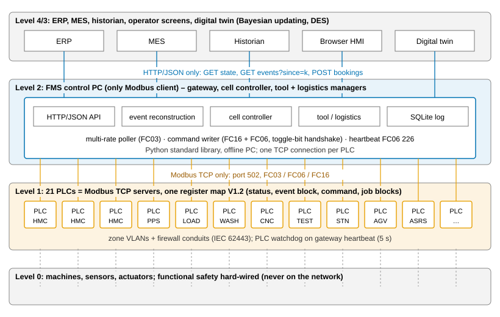
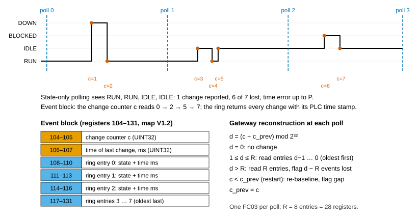
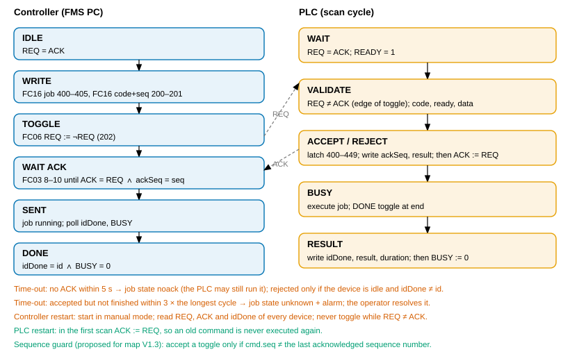
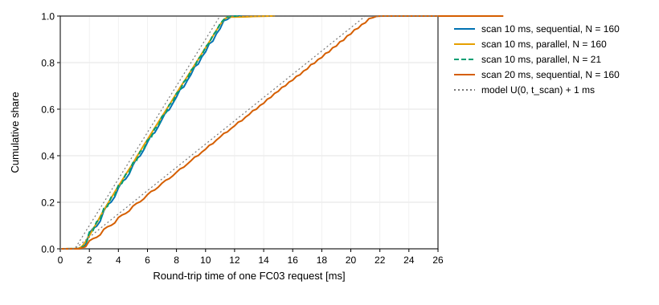
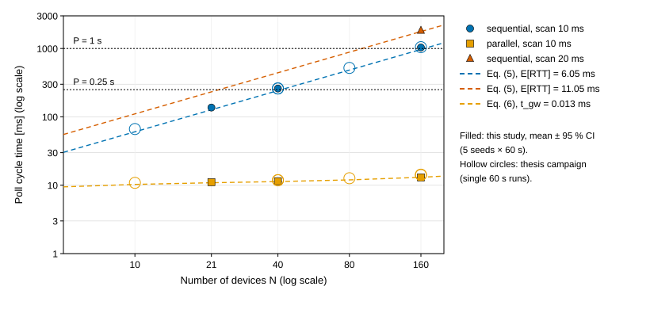
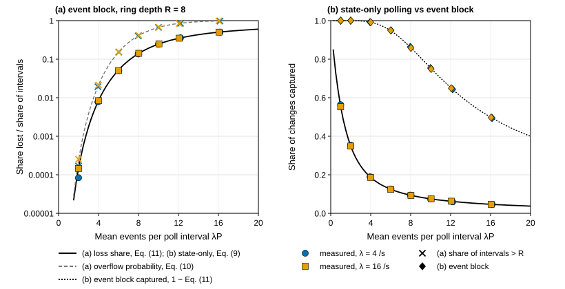
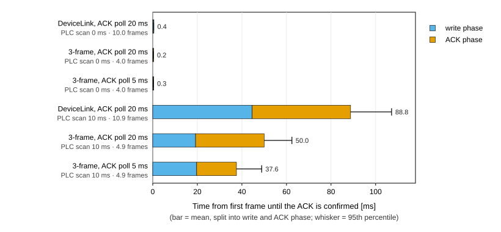

# Event-Preserving Polling: A Low-Cost Digital-Twin and FMS-Control Architecture Using Only Ethernet, Modbus TCP and HTTP

[Author 1 – PhD candidate] ^1,\*^ and [Author 2 – supervisor] ^1^

^1^ [Affiliation – department, university, city, postcode, country]

\* Correspondence: [e-mail of the corresponding author]

**Abstract:** Small manufacturers in emerging economies that introduce flexible manufacturing systems often may use only Ethernet, Modbus TCP and HTTP, whereas digital-twin research relies on OPC UA or MQTT. Polling, however, misses short states and blurs event times. This paper presents a digital-twin and supervisory-control architecture that uses only these technologies on one offline PC. Its core is an event-preserving register block (a change counter, a time stamp and an eight-entry ring kept by each PLC) that makes polling complete and every residual loss detectable. A closed-form model sizes bandwidth, poll-cycle time, gateway capacity, latency, event loss and time-stamp error; jobs are sent through a toggle-bit handshake whose failure analysis adds a sequence guard against stale frames. On a single-PC test bench with emulated PLCs (no industrial PLC measured yet), the event block recovered all 63,844 state changes in 40 runs with up to 160 devices, whereas state-only polling missed 9–45%; measured losses matched the Poisson model within 0.4 percentage points for 1–16 changes per poll interval; a parallel gateway polled 160 devices in 13 ms; a three-frame job command took 38–50 ms with a 10 ms PLC scan; and fault injection confirmed exactly-once execution.

**Keywords:** digital twin; Modbus TCP; polling; event loss; flexible manufacturing system; supervisory control; small and medium-sized enterprises; virtual commissioning; industrial communication; emerging economies

## 1. Introduction

A digital twin of a manufacturing system is only as good as the data stream that feeds it. Following the widely used
classification of Kritzinger et al. [1], a *digital shadow* receives data from the physical system
automatically, and a *digital twin* also sends information back. Reviews of the field treat this data link as a key
enabling technology [2–5], and the ISO 23247 framework [6] defines a dedicated
data-collection and device-control entity between the machines and the twin core. In most published architectures this entity is built with OPC UA [7], MQTT [8] or a
vendor-specific fieldbus, and many studies do not report the communication technology at all [9].

For small and medium-sized enterprises (SMEs) in emerging economies, which are now moving from standalone CNC machines
to flexible manufacturing systems (FMS), this default choice is often not available. The evidence base on digital twins
in such economies is still thin [10], SME case studies emphasise limited budgets, skills and heterogeneous
legacy equipment [11,12], and retrofit studies show that practitioners therefore build their own low-cost
data paths [13–16]. The case company of this study illustrates the constraint
precisely: an air-compressor manufacturer planning an FMS with 21 controllers (seven CNC machines, a pallet pool, a load
station, seven further stations, two test benches, two automated guided vehicles (AGVs) and two automated storage and
retrieval system (AS/RS) cranes) has decided that the only communication technologies on the shop floor are switched
Ethernet, Modbus TCP between the controllers and the supervisory PC, and HTTP/JSON for everything above it. The twin and
the control software must run on an offline industrial PC without cloud services or commercial IIoT platforms. The reasons
are pragmatic: Modbus TCP is an openly published protocol [17,18] that almost every low-cost
programmable logic controller (PLC) offers as a server,
the plant engineers can read and test it with simple tools, and no broker or certificate infrastructure has to be
operated and secured.

Modbus TCP is a request–response protocol: the client reads or writes 16-bit registers, and the server never reports a
change by itself. Two objections are usually raised against such polling architectures. First, polling wastes bandwidth.
Second, and more seriously, polling *samples* a state signal: a short stop or alarm that begins and ends between two
polls is never seen, a sequence A → B → A looks like no change, and the time of each change is known only to within one
poll period. For a monitoring screen this may be tolerable; for a twin that estimates failure rates, repair times and
availability from event logs it is not, because lost short events bias exactly these estimates. Data-quality problems of
this kind are a known reason why simulation models are hard to keep up to date [19]. A third objection concerns
control: Modbus has no message concept, so a supervisory controller that sends jobs by writing registers must itself
guarantee that a lost, repeated or late frame neither starts a job twice nor loses one.

This paper shows that these objections can be answered inside the constraint. Following a design-science approach
[20,21], it designs, models and evaluates an architecture for a low-cost FMS digital twin and supervisory
controller built only on Ethernet, Modbus TCP and HTTP. Its contributions are:

1. **An event-preserving register block.** A change counter, the time stamp of the last change and an eight-entry ring
   buffer, maintained by the PLC in about ten lines of code, turn sampled polling into complete, time-stamped event
   capture, and make every residual loss *detectable* instead of silent (Section 3).
2. **A closed-form sizing model** for frame size, bandwidth, round-trip time, sequential and parallel poll-cycle time,
   gateway capacity, detection latency, event loss, time-stamp error and command latency. Three results are new with
   respect to the thesis on which this paper builds: the share of events lost by the ring as a Poisson partial
   expectation, a closed form for the share of changes that state-only polling reports, and a command-latency formula
   for the job handshake (Section 4). A worked example sizes the
   21-device case factory.
3. **Supervisory control on the same interface.** A register map (V1.2) and a toggle-bit job handshake with a
   failure-case analysis for lost, duplicated, late and stale frames, time-outs and restarts. The analysis identifies one
   residual hazard – a stale toggle frame delivered after the next command – and a one-line sequence guard that removes
   it (Section 5).
4. **A laboratory evaluation with stated limits** on a single PC with emulated PLCs: a replicated measurement campaign
   with confidence intervals, a validation of the loss model over a wide range of event rates, an HTTP benchmark,
   handshake latency and fault-injection experiments on a virtual plant of 21 Modbus PLCs, and 61 automated acceptance
   checks (Section 6). No real industrial PLC has yet been measured; Section 7 gives the verification plan.

The paper is one of several articles derived from a doctoral project. A companion systematic review [9] maps the
literature; other companion articles address Bayesian updating of the twin during ramp-up, staged investment and pallet-cell
design and are not part of this paper.

## 2. Related Work

### 2.1. Industrial communication for manufacturing digital twins

Enterprise–control integration is usually organised in the levels of IEC 62264 [22]: field devices, control,
supervisory control, manufacturing operations and enterprise planning. For the link between the control level and a
twin, the literature strongly favours OPC UA [7], which combines an information model with secure
client–server and publish–subscribe communication, and MQTT [8], a lightweight publish–subscribe protocol that
needs a broker. Studies of virtual commissioning and engineering tool chains use OPC UA or vendor fieldbuses to connect
simulation and controllers [23–26], and container-based
platforms with MQTT and REST interfaces have been proposed for SMEs [27]. A recent review of digital twins in
manufacturing [28] lists connectivity as one of the dimensions along which twins differ, and surveys of security
[29] stress that every additional protocol stack enlarges the attack surface. In the companion systematic review of
28 studies on digital twins for FMS design and ramp-up [9], the communication technology was not stated in 12
studies; OPC UA was the most frequent (6), followed by TCP/IP (2) and Profinet (2); MQTT, REST/HTTP and others appeared
once; Modbus did not appear at all, although low-cost controllers widely support this openly specified protocol
[17,18].

### 2.2. Low-cost and retrofit data paths

Retrofit studies connect machines without replacing their controls: an edge platform for CNC machine tools
[13], depth cameras with object tracking [14], an inertial "smart workpiece" costing about USD 10 [15],
open-source frameworks for co-engineering and virtual commissioning in brownfield plants [16], and open-source
messaging and dashboards in an SME [11]. Ullah and Younas [12] built a prototype FMS with a twin-based
controller from low-cost hardware because no industrial FMS was accessible in their country, and Florescu [30]
reports an FMS twin used from design to operation. These works demonstrate feasibility. Performance limits – latency,
loss, capacity and cost – are rarely measured: van Ginkel et al. [11] report a PLC-to-twin delay of 0.98 ms
with a simulated PLC and 3.02 ms with a real one, which is the only link measurement among the 28 reviewed studies
[9].

### 2.3. Polling versus event-based acquisition

Publish–subscribe protocols deliver changes when they happen; polling delivers samples at the client's pace. The usual
argument for publish–subscribe is therefore completeness and bandwidth. Two points are less often discussed. First,
completeness can also be achieved with polling if the *server* keeps a short history of changes and the client reads it
– a pattern familiar from alarm and sequence-of-events buffers in process control, but, as far as the review in
[9] shows, not described or evaluated for low-cost manufacturing twins. Second, polling has properties that matter
in the target context: the client controls load and timing; a dead device is detected at the next request; there is no
broker to install, secure and maintain; and almost every low-cost PLC already supports it. What has been missing is a design
that makes polling complete, a model that tells an engineer how fast to poll and how deep the buffer must be, and
measurements that show where the model holds. The same gap exists for control: virtual commissioning studies use
standard protocols [23,25], but we found no analysis of how a job handshake over a register
protocol behaves under lost, duplicated and late frames.

### 2.4. Research gap and positioning

Three gaps follow from this review. (i) *Technology gap*: low-cost data paths for manufacturing twins are demonstrated,
but Modbus TCP – the protocol that the controllers of the target firms actually offer – is not evaluated, and the event
loss inherent in polling is not addressed [9]. (ii) *Quantification gap*: link performance is reported once, as a
single delay value [11]; capacity, loss and time-stamp quality are not modelled, so an engineer cannot size a
gateway or a buffer before buying hardware. Data-quality problems such as missing or mistimed events are, however, a
known cause of inaccurate simulation models [19]. (iii) *Control gap*: twins with a return channel use it for
virtual commissioning or training [9,23]; how a supervisory controller can send jobs reliably
over a register protocol that has no message concept has not been analysed. This paper addresses the three gaps with a
design that stays inside the technology constraint, a model that can be evaluated with a pocket calculator, and
experiments whose limits are stated. It deliberately does not claim that polling is generally preferable to
publish–subscribe; the comparison in Section 7.2 is restricted to the target context.

## 3. Architecture

### 3.1. Requirements and constraints

The architecture serves two consumers with different needs (Table 1). The twin needs a complete, time-stamped stream of
state changes, cycle completions, good and scrap counts and repair intervals; a delay of seconds is acceptable, a lost
event is not. The supervisory controller needs a reliable way to give jobs to machines and to learn when they end;
latency matters at the level of tens of milliseconds, and exactly-once execution is essential.

**Table 1.** Requirements for the data and control path (case factory) [design].

| Id | Requirement | Reason |
|---|---|---|
| R1 | Every state change, cycle and good/scrap count reaches the twin; completeness ≥ 99.9 % | twin updating is biased by lost events |
| R2 | State-change detection latency ≤ 1 s for monitoring | operator screens; the twin itself tolerates minutes |
| R3 | Event time stamps with error ≤ 1 s, preferably ≤ one PLC scan | repair durations and uptime |
| R4 | ≥ 21 devices per gateway, scalable to ≈ 75 (second plant) and tested to 160 | case factories |
| R5 | Only Ethernet, Modbus TCP (devices) and HTTP/JSON (MES, ERP, screens, twin) | company rule |
| R6 | One offline industrial PC, Python standard library only | maintainability, no cloud |
| R7 | PLCs need only a standard Modbus TCP server and one function block | low-cost PLCs of several vendors |
| R8 | Faults (device offline, slow, inconsistent) are flagged, never silently ignored | data quality |
| R9 | Each job is executed exactly once; lost or repeated frames must not create or lose jobs | supervisory control |
| R10 | Write access only to a command area; functional safety stays hard-wired | safety, IEC 62443 zoning |

### 3.2. Layers and design rules

Figure 1 shows the layers. Level 1 consists of the PLCs, each a Modbus TCP server with the same register map. Level 2
is a single PC that is the *only* Modbus client on the machine network; it runs the polling gateway, the event
reconstruction, the supervisory cell controller with tool and logistics management, and an HTTP server. Levels 3 and 4
(MES, ERP, historian, operator screens and the twin) never speak Modbus; they use the HTTP/JSON interface of the PC. The
architecture follows the functional entities of ISO 23247 [6]: the PLCs are observable manufacturing elements,
the level-2 PC is the data-collection and device-control entity, and the twin and the screens are core and user
entities.

**Figure 1.** Layers of the architecture. The FMS control PC is the only Modbus client; all higher systems use HTTP/JSON;
functional safety is hard-wired and never transmitted over the network.

Six design rules make the architecture work with low-cost components:

1. **One client.** One TCP connection per PLC, opened by the level-2 PC. Low-cost PLCs accept only a few simultaneous
   Modbus connections, and a single client is also the single place for plausibility checks.
2. **One map.** Every device carries the same register map, whatever its supplier; suppliers implement one function
   block.
3. **Pull for status, handshake for commands.** Status is polled; commands are written into a command area and
   confirmed with a toggle-bit handshake (Section 5).
4. **Multi-rate polling.** Register groups are read at the rate their content needs: status and handshake every 0.5 s,
   events every 0.5 s, counters and type-specific data every 1 s, energy every 10 s [design].
5. **Heartbeats both ways.** The PLC increments a heartbeat register; the PC writes a gateway heartbeat every second,
   and each PLC stops accepting new jobs if that value has not changed for 5 s.
6. **Events, not samples.** The twin receives reconstructed events with PLC time stamps (Section 3.4), never sampled
   states.

### 3.3. Register map V1.2

All devices expose 450 holding registers (Table 2). Version V1.2 extends an earlier factory map (V1.1) by the event
block, device-type status blocks and a job interface without moving any existing address, so a device built to V1.1
keeps working. All values are 16-bit registers read with function code 03 (FC03); 32-bit integers and IEEE-754 floats
occupy two registers, high word first; writes with FC06 or FC16 are accepted only in the command and job-parameter areas,
and any other write is answered with exception code 02.

**Table 2.** Register map V1.2 (all 21 devices) [design].

| Block | Registers | Content | Access |
|---|---|---|---|
| Header | 0–3 | map version (0x0102), device type, unit id, PLC heartbeat | read |
| Status | 4–7 | status word, mode, state code (OFF, IDLE, RUN, SET-UP, DOWN, BLOCKED, STARVED), alarm | read |
| Handshake | 8–11 | ACK, BUSY, DONE, REJECT and READY bits; acknowledged sequence number; result code; pieces done | read |
| Counters | 20–45 | good and scrap counters, last cycle time, order and part (ASCII) | read |
| Energy | 100–103 | power, energy counter | read |
| Event block | 104–131 | change counter, time of last change, ring of the last 8 changes (Table 3) | read |
| Command | 200–226 | command code, sequence number, request bit REQ; order data; gateway heartbeat (226) | write |
| Type status | 300–389 | per device type: tool life per pocket (CNC), pallet locations (pallet pool), node and battery (AGV), crane position (AS/RS), test results | read |
| Job result | 390–395 | id of the last finished job, result, duration | read |
| Job parameters | 400–449 | job id and parameters (pallet, NC program, variant, quantity; source and destination; tool offsets) | write |

### 3.4. The event-preserving register block

The PLC sees every state change in its scan, so the PLC should keep the history and the gateway should read it. The
event block (Table 3, Figure 2) has three parts. The *change counter* $c$ counts state changes since power-on. The
*last-change time* stores the PLC millisecond clock at the most recent change. The *ring* holds the last $R = 8$
changes, newest first, each as the new state code and its 32-bit time stamp. On every change the PLC function block
increments $c$, stores the time, shifts the ring by one entry and writes the new entry – all in the same scan, so a
Modbus read between scans sees either the old or the complete new block.

**Table 3.** Event block, registers 104–131 [design].

| Registers | Content | Type |
|---|---|---|
| 104–105 | change counter $c$: number of state changes since power-on | UINT32 |
| 106–107 | PLC time of the last change, ms | UINT32 |
| 108 + 3k | ring entry k (k = 0 newest … 7 oldest): new state code | UINT16 |
| 109 + 3k – 110 + 3k | ring entry k: PLC time of the change, ms | UINT32 |

**Figure 2.** Event-preserving polling. Top: a state signal with short stops between polls; state-only polling reports
one of seven changes. Bottom: the event block and the reconstruction rule of the gateway.

At each poll the gateway computes $d = (c - c_{prev}) \bmod 2^{32}$, the exact number of changes since the previous
poll. If $1 \le d \le R$, the newest $d$ ring entries are exactly these changes, with their states and PLC time stamps;
they are emitted oldest first. If $d > R$, the oldest $d - R$ changes are lost, but the gateway knows how many and flags
the interval, so no loss is silent (requirement R8). A counter that goes down marks a PLC restart; the gateway then
re-baselines and flags a gap. Twenty-eight registers per device are the entire cost; on the PLC side the block needs about
ten lines of structured text in addition to the standard interface. The block can be read in the same FC03 request as the
status registers if both are placed in one contiguous range (36 registers in the laboratory bench of Section 6).

On the HTTP side the same idea is applied once more: reconstructed events carry a monotonic sequence number, and a
client that was offline fetches everything it missed with `GET /api/events?since=k`. HTTP clients thus get the same
completeness guarantee from the PC as the PC gets from the PLCs.

## 4. Analytical Sizing Model

This section collects the formulas an engineer needs to size the architecture. Symbols: $N$ devices; $n$ registers per
request; $P$ target poll period; $T_c$ poll-cycle time; $P_{eff} = \max(P, T_c)$; $\lambda$ state-change rate per
device; $R$ ring depth; $t_{net}$ network round trip; $t_0$ fixed PLC processing time; $t_{scan}$ PLC scan time;
$t_{gw}$ gateway processing time per request. All numbers in this section are calculated with the script `sizing_model.py`
(Data Availability Statement).

### 4.1. Frames and bandwidth

An FC03 request is an application data unit of 12 bytes (7-byte MBAP header and 5-byte PDU); the response for $n$
registers has $9 + 2n$ bytes [17,18]. On Ethernet each TCP segment adds about 78 bytes (preamble and
inter-frame gap 20, Ethernet header and checksum 18, IPv4 20, TCP 20), and a separate TCP acknowledgement occupies a
minimum frame of 84 bytes on the wire. One poll therefore costs

$$b(n) = (12 + 78) + (9 + 2n + 78) + 84 = 261 + 2n \ \mathrm{bytes}, \tag{1}$$

and an FC06 write $b_w = 2(12 + 78) + 84 = 264$ bytes. For a device with poll plan $\{(n_j, f_j)\}$ (registers and
frequency of request $j$) the load is

$$\dot B = \sum_j f_j\, b(n_j). \tag{2}$$

### 4.2. Round-trip time and poll-cycle time

Many PLCs serve Modbus requests once per program scan. If a request arrives at a random point of the scan, the waiting
time is uniform on $[0, t_{scan}]$, and

$$\mathbb{E}[\mathrm{RTT}] \approx t_{net} + t_0 + t_{scan}/2, \qquad \mathrm{RTT}_{max} \approx t_{net} + t_0 + t_{scan}. \tag{3}$$

A **sequential** gateway issues one request after another. With $k_i$ requests per cycle to device $i$,

$$T_c^{seq} = \sum_{i=1}^{N} k_i\, \mathrm{RTT}_i, \qquad N_{max}^{seq} = \frac{1}{r\, \mathbb{E}[\mathrm{RTT}]}, \tag{4}$$

where $r = \sum_j f_j$ is the request rate per device, i.e. the sequential worker is fully loaded when
$N r \mathbb{E}[\mathrm{RTT}] = 1$. For a single request per poll ($k = 1$) Eq. (4) gives the cycle time

$$T_c^{seq} = N\, \mathbb{E}[\mathrm{RTT}]. \tag{5}$$

A **parallel** gateway sends one request to every device at once and waits for the slowest. With the uniform scan model
the expected maximum of $N$ independent waiting times is $t_{scan} N/(N+1)$, so

$$T_c^{par} \approx t_{net} + t_0 + t_{scan}\frac{N}{N+1} + N\, t_{gw}. \tag{6}$$

The parallel cycle is bounded by about one maximal PLC response plus the gateway's own work; its capacity is limited by
$t_{gw}$, not by the PLCs.

### 4.3. Detection latency

With the event block, an event is detected at the first poll after it occurs. For events that occur at random times
relative to the poll schedule,

$$\mathbb{E}[L] \approx P_{eff}/2 + \mathbb{E}[\mathrm{RTT}], \qquad L_{max} \approx P_{eff} + \mathrm{RTT}_{max}. \tag{7}$$

A strict latency bound $L^*$ therefore requires $P \le L^* - \mathrm{RTT}_{max}$, not $P \le L^*$.

### 4.4. Loss with state-only polling

*Unobserved segments.* A state segment of duration $d$ contains no poll with probability $\max(0, 1 - d/P)$. For
exponentially distributed durations with mean $1/\lambda$ and $\mu = \lambda P$, the share of unobserved segments is

$$u(\mu) = 1 - \frac{1 - e^{-\mu}}{\mu}. \tag{8}$$

*Reported changes.* State-only polling reports a change when two consecutive polls see different states. Assume that
changes form a Poisson process with rate $\lambda$ and that each change jumps uniformly to one of the other $M - 1$
states. After $k$ jumps the state differs from the initial one with probability $\frac{M-1}{M}\left(1 - \left(-\frac{1}{M-1}\right)^k\right)$
(the eigenvalue of the uniform-jump chain is $-1/(M-1)$). Averaging over the Poisson number of jumps in one interval,
$\sum_k e^{-\mu}\mu^k(-1/(M-1))^k/k! = e^{-\mu M/(M-1)}$, gives the expected number of reported changes per interval,
and dividing by the expected number of true changes $\mu$ gives the reported share

$$s(\mu) = \frac{M-1}{M}\cdot\frac{1 - e^{-M\mu/(M-1)}}{\mu}, \tag{9}$$

with $M = 4$ in the bench ($s \to 1$ for $\mu \to 0$). Eq. (9) counts A → B → A sequences correctly as lost and is
exact for Poisson changes; for processes with many very short states (renewal processes with high-variance durations)
the reported share is lower and is obtained by simulation (Section 6.3).

### 4.5. Loss with the event block

With the event block, changes are lost only if more than $R$ occur in one poll interval. With $N_\Delta \sim$
Poisson($\lambda P_{eff}$), the probability that an interval overflows is

$$p_{ovf} = \Pr\{N_\Delta > R\} = 1 - \sum_{k=0}^{R} e^{-\mu}\frac{\mu^k}{k!}, \qquad \mu = \lambda P_{eff}, \tag{10}$$

and the share of *events* lost – the quantity that biases a twin – is the Poisson partial expectation

$$\eta = \frac{\mathbb{E}[(N_\Delta - R)^+]}{\mu} = \frac{\mu - R + \sum_{k=0}^{R}(R-k)\,e^{-\mu}\mu^k/k!}{\mu}. \tag{11}$$

The ring depth for a design is the smallest $R$ with $p_{ovf}(\lambda T_{max}) \le \varepsilon$, where $T_{max}$ is the
longest expected gap between two reads, including a gateway restart:

$$R^* = \min\{R : \Pr\{N(\lambda T_{max}) > R\} \le \varepsilon\}. \tag{12}$$

### 4.6. Time-stamp error

State-only polling stamps a change with the poll time; the error is uniform on $[0, P_{eff}]$ with standard deviation
$P_{eff}/\sqrt{12}$. The event block uses the PLC time; its resolution error is uniform on $[0, t_{scan}]$ (standard
deviation $t_{scan}/\sqrt{12}$), plus the offset of the PLC clock. With a clock drift $\delta$ and a re-synchronisation
interval $T_{sync}$ the offset grows to at most

$$e_{clock} \approx \delta\, T_{sync}. \tag{13}$$

Durations (for example repair times) are differences of two PLC stamps and are exact to one scan regardless of the offset.

### 4.7. Command latency of the job handshake

A command of the supervisory controller (Section 5) consists of $k_w$ write frames, the last of which toggles the
request bit, followed by polling of the handshake registers every $p$ seconds until the acknowledgement is seen; the
successful poll round needs $k_a$ read frames. If $q$ is the probability that the acknowledgement is already visible at
the first poll and $\delta$ the overshoot of the controller's sleep, the expected command latency is approximately

$$\mathbb{E}[T_{cmd}] \approx (k_w + k_a)\,\mathbb{E}[\mathrm{RTT}] + (1 - q)\,(p + \delta + \mathbb{E}[\mathrm{RTT}]), \tag{14}$$

assuming that the acknowledgement appears within one poll interval (true when $p$ exceeds the PLC's reaction time of
about one scan). The write part $k_w \mathbb{E}[\mathrm{RTT}]$ is the reason to minimise the number of frames before the
toggle; the second part is the reason to poll the acknowledgement fast during the short handshake window.

### 4.8. Worked example: the 21-device case factory

Table 4 applies the model to the case factory. The poll plan reads the status group (12 registers) and the event block
(28) every 0.5 s, the counters (26) and the type-status and job-result group (96) every 1 s, energy (4) every 10 s, and
writes the gateway heartbeat every second.

**Table 4.** Sizing of the 21-device case factory [calculated, Eqs. (1)–(14); device timing values are assumptions to be
measured at factory acceptance].

| Quantity | Value |
|---|---|
| Requests per device and second, $r$ | 7.1 |
| Wire load per device, Eq. (2) | 2 260.9 B/s |
| Plant load, 21 devices | 47.5 kB/s = 0.38 Mbit/s (0.38 % of 100 Mbit/s) |
| $\mathbb{E}[\mathrm{RTT}]$, Eq. (3): PLC on LAN ($t_{net}$ 0.3, $t_0$ 1, $t_{scan}$ 10 ms) | 6.3 ms |
| $\mathbb{E}[\mathrm{RTT}]$: CNC with Modbus in the integrated PLC ($t_0$ 5, $t_{scan}$ 20 ms) / AGV over Wi-Fi ($t_{net}$ 10 ms) | 15.3 ms / 16.0 ms |
| Sequential capacity, Eq. (4), all devices 6.3 ms | 22.4 devices |
| Utilisation of one sequential worker, 21 devices: all 6.3 ms / with CNC and AGV classes | 94 % / 152 % (infeasible) |
| Detection latency at $P$ = 0.5 s, Eq. (7): mean / max | 256 ms / 511 ms |
| Ring overflow, HMC ($\lambda$ = 2 changes per 345 s cycle), $T$ = 60 s / 300 s, Eq. (10) | 1.5 × 10⁻¹⁰ / 8.5 × 10⁻⁵ |
| Ring depth for a busy station ($\lambda$ = 0.05 s⁻¹), $T_{max}$ = 60 s, $\varepsilon$ = 10⁻⁶, Eq. (12) | 14 |
| Time-stamp SD: state-only at $P$ = 0.5 s / event block at $t_{scan}$ = 10 ms | 144 ms / 2.9 ms |
| Clock offset after 1 h at 50 ppm drift, Eq. (13) | 0.18 s |
| Command latency, 3-frame handshake ($k_w$ = 3, $k_a$ = 1, $q$ = 0, $p$ = 20 ms, $\delta$ = 0.5 ms), Eq. (14) | 52 ms |

Three design decisions follow. Bandwidth is irrelevant (0.38 % of a 100 Mbit/s link). A single sequential worker is
not acceptable: it would be 94 % busy with ideal PLCs and overloaded once the slower CNC and Wi-Fi devices are taken into
account, so the gateway polls in parallel, with at least one worker per network zone. And a ring of eight entries covers
normal polling and a one-minute gateway restart for the machining centres, but not for a station with frequent short
stops; for such devices either the restart time is kept below about 20 s or the ring is enlarged (the map reserves space).

## 5. Supervisory Control on the Same Interface

### 5.1. Control hierarchy

The FMS control software `fmsctl` uses the architecture of Section 3 for control as well as for observation. The
level-2 PC decides *what* and *when* – which pallet goes to which machine, which NC program runs, whether the tools are
fit, which AGV moves which load; the PLCs decide *how* – motion, interlocks and the machining cycle. Functional safety
(emergency-stop chains, guard doors, light curtains, safe torque off) is hard-wired per machine and never transmitted;
a lost network therefore means "no new jobs", never a hazard. The controller comprises a cell controller (polling,
job completion, earliest-due-date dispatching of pallets, fixtures and load-station tasks), tool management (a tool-life
check before every machining job) and logistics (AS/RS warehouse management, an AGV fleet manager and kanban supply of
castings). All of them give jobs to PLCs through one mechanism, the job handshake.

### 5.2. The toggle-bit job handshake

Modbus can only write registers, and a job needs several of them. A naive "start bit" fails in three ways: the PLC may
read half-updated parameters; a repeated write after a time-out may start the job again; and a short pulse may be missed
by the PLC scan. The handshake of map V1.2 avoids all three (Figure 3):

1. The controller writes the job id and parameters (FC16 to 400–449).
2. It writes the command code and a new sequence number $seq$ (FC16 to 200–201).
3. It inverts the request bit REQ (FC06 to 202) – *last*, in its own frame.
4. The PLC reacts to REQ ≠ ACK in its next scan: it validates the command (known code, device ready, pallet really at
   the machine, plausible parameters), latches the parameters, writes $ackSeq := seq$ and a result code, and only then
   sets ACK := REQ. The controller accepts the answer only if ACK = REQ *and* $ackSeq = seq$.
5. At job end the PLC writes the job id, the result and the duration into 390–395 *before* it clears BUSY and toggles
   DONE; the controller closes the job when the finished-job id equals its job id and BUSY = 0.

**Figure 3.** Toggle-bit job handshake of map V1.2: controller and PLC state machines, time-out rules and restart rules.

### 5.3. Correctness argument

The handshake is built on three properties. (P1) *Ownership*: the controller is the only writer of REQ, the PLC the only
writer of ACK, and a new command exists exactly when REQ ≠ ACK. (P2) *Idempotence*: every controller write sets an
absolute value; writing the same parameters or the same REQ value again changes nothing, because the PLC reacts only to
a *change* of REQ relative to its own ACK. (P3) *Ordering*: data are written before REQ, and the PLC writes $ackSeq$ and
the result before ACK (and the job result before clearing BUSY), so a read between two scans sees either the complete old
or the complete new state.

Within one TCP connection, frames are delivered in order and without duplicates; the Modbus client of `fmsctl` uses a
0.5 s time-out and one retry over a new connection. Table 5 lists the failure cases. Lost requests or lost responses are
covered by the retry and by P2; late responses lead to a retry whose effect is again idempotent; a PLC that never answers
leads to the state *noack*, in which the job still blocks its device and pallet because the PLC may have taken it, and the
job is declared *rejected* only when the device is idle and its finished-job id differs. A job that was accepted but is
not reported within three times its longest cycle becomes *unknown* and raises an alarm, because the PLC may have
restarted and lost the result; the operator resolves it after looking at the machine. All effects of a finished job
(pallet content, work-order counts, tool use) are written in one database transaction, and after a controller restart
the controller starts in manual mode and reconciles its open jobs with REQ, ACK and the finished-job id of every device.

**Table 5.** Failure-case analysis of the handshake (F1–F8 = fault-injection case of Table 12, Section 6.6; A = covered by the
acceptance tests; R = argument only).

| # | Fault | Mechanism | Outcome | Evidence |
|---|---|---|---|---|
| 1 | parameter or code frame lost / its response lost | retry rewrites the same values (P2) | correct | F5, F6 |
| 2 | REQ frame lost | REQ unchanged, no job; retry toggles once | exactly once | F1 |
| 3 | response to REQ frame lost or late (PLC already accepted) | retry writes the *same* REQ value; no change for the PLC | exactly once | F2, F4 |
| 4 | REQ frame duplicated | second write equal to ACK | exactly once | F3 |
| 5 | REQ lost on both attempts | Modbus error → *noack*; device idle and job id not done → *rejected*, re-planned | no job lost, none doubled | F7 |
| 6 | PLC rejects (not ready, bad data, busy) | ACK = REQ, REJECT bit, result code | controller logs, re-plans with a new toggle | A |
| 7 | PLC in STOP / unreachable | no ACK within 5 s, heartbeat frozen | *noack*, device stale | A |
| 8 | controller crashes after REQ | PLC runs the job; controller finds it *sent* in its database and closes it by job id | correct | R, A |
| 9 | PLC power cycle during a job | first scan: ACK := REQ (no re-execution); result lost | time-out → *unknown* + alarm | A |
| 10 | gateway lost | PLC watchdog (5 s): READY := 0, running job finishes, result kept | no new jobs | A |
| 11 | stale REQ frame from an old connection delivered after the next command | toggle seen again; PLC re-runs the *current* job | **double execution** with toggle only; prevented by the sequence guard | F8 |

Case 11 is the one residual hazard. TCP guarantees order only within a connection. If a REQ frame is delayed in the
network (for example on the Wi-Fi link of an AGV), the client gives up and repeats it on a new connection, the job runs,
the next command toggles REQ back – and only then the old frame is delivered on the first connection, the PLC sees
REQ ≠ ACK again and starts the current job a second time. The event requires an unusual combination of delays, but it is
not excluded by the protocol. A one-line rule in the PLC removes it: *accept a toggle only if the sequence number differs
from the last acknowledged one* ($seq \ne ackSeq$). The stale frame then leaves REQ ≠ ACK without effect; the next
command of the controller detects the mismatch and first writes REQ back to ACK, as `fmsctl` already does for an
unanswered request. We propose this sequence guard for map V1.3 (Section 6.6 measures both variants).

### 5.4. Virtual commissioning and acceptance tests

All functions were developed against a virtual plant: 21 simulated PLCs, one per device, each a real Modbus TCP server
with the full map V1.2, the handshake and the event block, and with simple process models (machining times with spread
and failures, pallet moves, operator tasks, tool wear with sister tools, AGV travel and battery, crane cycles) that run
up to 1 000 times faster than real time. Switching to the real plant changes only the device table (IP addresses instead
of local ports). Table 6 summarises the automated acceptance tests; the same checks are intended for the factory
acceptance test of each supplier's PLC. PLC templates of the interface for two PLC families (structured text and SCL)
exist but have not yet been compiled on real hardware.

**Table 6.** Automated acceptance tests of the control software on the virtual plant [measured on the virtual plant;
re-run for this paper, 15 November 2026].

| Function | Checks | Examples of what is checked |
|---|---|---|
| Interface and virtual plant | 20 | 21 devices with correct map version; heartbeats; full pallet cycle; rejection of impossible moves and of a second job while busy; write protection and exception codes; parameters latched at acceptance; gateway watchdog |
| Cell controller | 15 | three work orders with one machine offline; earliest-due-date order; no job to the offline machine; fixture rule; restart from the database in manual mode; lost job result after a PLC restart → *unknown* + alarm → resolved |
| Tool management | 11 | without tool check a worn tap aborts a job; with the check the job is blocked, the setter mounts a measured tool, the tool-data command is confirmed by the PLC echo |
| Logistics | 15 | goods receipt and put-away; kanban supply with exact material balance; FIFO; AGV with low battery charges first; no two AGVs at one dock; crane fault handled |

## 6. Experimental Evaluation

### 6.1. Set-up, protocol and timing calibration

**Hardware and software.** All experiments ran on one PC: AMD Ryzen 7 9700X (8 cores, 16 logical processors), 64 GB
RAM, Windows Server 2022 Standard (10.0.20348), Python 3.12.10, standard library only. All traffic used the loopback
interface (127.0.0.1) and TCP ports 18500–18999. Other software was running on the PC during the campaign; the
system-wide CPU utilisation during each gateway run was recorded with the Windows `GetSystemTimes` counters and was
2.4–10.9 % in the Modbus campaigns.

**Emulated PLCs.** The machine process runs $N$ Modbus TCP servers, one thread per server and one per event generator.
Each server answers FC03 requests for its register block after a delay drawn from $U(0, t_{scan}) + 1$ ms
($t_{scan}$ = 10 or 20 ms), which emulates a PLC that serves Modbus at the end of its scan [assumption]; the register
snapshot is taken when the answer is sent. State changes follow one of two models: the *mix* model of the thesis bench
(30 % short pulses with duration $U(0.05, 0.5)$ s, 70 % states with exponential duration of mean 5 s; rate
$\lambda$ = 0.279 s⁻¹ per device) and a *Poisson* model (exponential durations with rate $\lambda$). Each change jumps
uniformly to one of the other three states and is logged with its true time (`time.perf_counter`, i.e. the Windows
QueryPerformanceCounter, which is system-wide, so the gateway and machine processes share one time base). Events are
scheduled on an absolute time grid, so sleep overshoot does not reduce the event rate. All random streams are seeded.

**Gateway.** A second process polls all devices with FC03 – sequentially or in parallel (`asyncio`, one connection per
device) – at a target period $P$, and reconstructs events in two ways: *state-only* (a change is reported when the state
code differs from the previous poll) and *event block* (Section 3.4). A recovered event counts as correct only if its
counter value, state code and PLC time stamp match the true log (identity check). Detection latency is the time from the
true change to the end of the poll that recovered it. Cycle time is the duration of one polling round; the achieved
rate is the number of polls per device divided by the observation time.

**Protocol.** E1 (timing calibration, Table 7); E2 (replication of the thesis campaign: 8 configurations × 5 seeds ×
60 s, mix model, ring $R$ = 8); E3 (loss-model validation: Poisson model with $\lambda$ = 4 and 16 s⁻¹, 50 devices,
parallel polling, $t_{scan}$ = 0, $\lambda P \in \{1, 2, 4, 6, 8, 10, 12, 16\}$, 60 s each); E4 (HTTP API: 3 request types ×
3 client counts × 5 repetitions × 10 s); E5 (handshake latency on the virtual plant, 300 commands per variant); E6 (fault
injection, 20 repetitions per case); E7 (acceptance tests). Every number below is labelled [measured] unless marked
otherwise; model values are [calculated] from Section 4 or [simulated] where stated.

**Timing calibration (E1).** Table 7 shows why the benches use `perf_counter` and thread-based sleeping. On this
platform `time.time()` has a nominal resolution of 15.625 ms; during our runs it advanced in 1 ms steps because another
process held the system timer at 1 ms, and the thesis campaign had observed steps of about 15.6 ms – a time stamp taken
with `time.time()` is therefore platform-state dependent and unusable for sub-millisecond intervals. `time.sleep()` never
woke early and overshot by 0.4–0.7 ms on average (maximum 1.5 ms). `asyncio.sleep(10 ms)` woke *early* in 7–8 % of the
calls (by up to 0.6 ms here; by up to one timer tick with the default 15.6 ms timer). An earlier version of the bench
emulated PLC delays with `asyncio.sleep`; with several pending requests the delays were partly skipped, and that
campaign was discarded. The final benches use `perf_counter` for every time stamp, `time.sleep` in threads with a 1 ms
timer resolution (`timeBeginPeriod(1)`), and re-check the deadline after every asyncio wake-up.

**Table 7.** Timing calibration of the measurement PC (E1) [measured; 300 calls per row].

| Function | Without timeBeginPeriod(1) | With timeBeginPeriod(1) |
|---|---|---|
| `time.time()` observed step (nominal resolution 15.625 ms) | 1.00 ms | 1.00 ms |
| `time.perf_counter()` observed step | 0.10 µs | 0.10 µs |
| `time.sleep(1 ms)`: mean / max [ms] | 1.71 / 2.50 | 1.64 / 2.50 |
| `time.sleep(10 ms)`: mean / max [ms] | 10.44 / 11.51 | 10.41 / 11.09 |
| `asyncio.sleep(10 ms)`: mean / min [ms]; share woken early | 10.35 / 9.38; 8.3 % | 10.36 / 9.96; 7.3 % |

### 6.2. Round-trip time and poll-cycle time

Figure 4 shows the RTT distributions of the replication campaign E2. With the emulated 10 ms scan the RTT was close to
uniform between about 1.3 and 11.5 ms (median 6.28–6.53 ms, 99th percentile 11.29–11.53 ms, mean 6.34–6.51 ms
across the 10 ms configurations), and with a 20 ms scan between about 1.5 and 21.5 ms (mean 11.44 ± 0.11 ms). The
measured mean lies about 0.3–0.5 ms above the emulation model $U(0, t_{scan}) + 1$ ms because `time.sleep` overshoots
(Table 7) and the gateway, server and Python interpreter add their own processing time; it did not depend on the
number of devices or on the gateway mode.

**Figure 4.** Empirical distribution of the FC03 round-trip time in campaign E2 (all requests of five seeds per
configuration) and the emulation model $U(0, t_{scan}) + 1$ ms [measured / calculated].

The cycle times (Table 8, Figure 5) confirm the capacity model. For the sequential gateway, Eq. (5) with the measured
mean RTT predicted every configuration within 0.1 %: for example 1 034.7 ms against 1 035.4 ± 8.5 ms for 160 devices
at a 10 ms scan, and 1 830.7 ms against 1 831.3 ± 18.0 ms at a 20 ms scan. The sequential gateway therefore cannot hold
$P$ = 1 s for 160 devices (achieved 0.962 ± 0.006 Hz, and 0.546 ± 0.006 Hz at a 20 ms scan) – exactly the limit of
Eq. (4). The parallel gateway polled 21, 40 and 160 devices in 11.1, 11.5 and 13.0 ms, i.e. in about one maximal PLC
response time, and held 4 Hz for 160 devices. Fitting Eq. (6) to these three points gives a gateway cost of
$t_{gw} \approx$ 0.013 ms per request; the value of 0.04 ms estimated in the thesis from sequential polling of
instantly answering servers is a conservative upper bound. The single-run results of the thesis campaign lie within the
confidence intervals of the replication (hollow symbols in Figure 5).

**Figure 5.** Poll-cycle time versus number of devices for sequential and parallel gateways: replication campaign E2
(mean ± 95 % CI over five seeds), thesis campaign (single runs) and Eqs. (5) and (6) [measured / calculated].

**Table 8.** Replication campaign E2: mix event model, ring $R$ = 8, 36-register FC03 polls, 5 seeds × 60 s per
configuration [measured; mean ± 95 % CI over seeds; model values in brackets: cycle time from Eq. (5) with the measured
mean RTT or Eq. (6) with $t_{gw}$ = 0.013 ms [calculated]; state-only share from a seeded Monte-Carlo simulation of
sampling at the achieved period [simulated]].

| N | Gateway | P [s] | t_scan [ms] | Cycle time [ms] (model) | Achieved rate [Hz] | RTT median / p99 [ms] | Changes | Event block: lost | State-only: reported [%] (model) | Latency mean / p95 / max [s] |
|---|---|---|---|---|---|---|---|---|---|---|
| 21 | sequential | 0.25 | 10 | 136.7 ± 0.7 (136.7) | 3.985 ± 0.001 | 6.53 / 11.53 | 1 872 | 0 | 90.2 ± 2.3 (90.5) | 0.128 / 0.240 / 0.292 |
| 21 | parallel | 0.25 | 10 | 11.1 ± 0.0 (10.9) | 3.986 ± 0.000 | 6.40 / 11.37 | 1 872 | 0 | 91.2 ± 1.9 (90.5) | 0.127 / 0.238 / 0.257 |
| 40 | sequential | 1.0 | 10 | 259.7 ± 2.2 (259.5) | 0.999 ± 0.000 | 6.50 / 11.52 | 3 325 | 0 | 63.5 ± 3.4 (64.5) | 0.507 / 0.954 / 1.033 |
| 40 | parallel | 1.0 | 10 | 11.5 ± 0.0 (11.3) | 0.999 ± 0.000 | 6.28 / 11.29 | 3 328 | 0 | 63.2 ± 2.7 (64.3) | 0.511 / 0.954 / 1.006 |
| 160 | sequential | 1.0 | 10 | 1 035.4 ± 8.5 (1 034.7) | 0.962 ± 0.006 | 6.47 / 11.52 | 13 356 | 0 | 63.5 ± 1.7 (63.8) | 0.521 / 0.990 / 1.137 |
| 160 | parallel | 1.0 | 10 | 13.0 ± 0.1 (13.1) | 0.999 ± 0.000 | 6.30 / 11.35 | 13 316 | 0 | 64.6 ± 1.8 (64.2) | 0.504 / 0.956 / 1.007 |
| 160 | parallel | 0.25 | 10 | 13.1 ± 0.1 (13.1) | 3.984 ± 0.001 | 6.34 / 11.35 | 13 504 | 0 | 90.5 ± 1.0 (90.7) | 0.125 / 0.239 / 0.259 |
| 160 | sequential | 1.0 | 20 | 1 831.3 ± 18.0 (1 830.7) | 0.546 ± 0.006 | 11.34 / 21.36 | 13 271 | 0 | 55.5 ± 1.5 (55.1) | 0.910 / 1.747 / 2.025 |

### 6.3. Completeness of event capture

Across the 40 runs of E2 the gateways observed 63 844 true state changes, and the event block recovered **every one
of them with the correct counter value, state code and PLC time stamp** – zero losses and zero mismatches in every run,
including the overloaded sequential configuration with an effective period of 1.83 s. With zero failures in
63 844 trials, the one-sided 95 % upper confidence bound on the per-event loss probability is
4.7 × 10⁻⁵ [calculated, exact binomial bound $1 - 0.05^{1/n}$]. This is consistent with Eq. (10): at the mix-model
rate $\lambda$ = 0.279 s⁻¹ the overflow probability of an 8-entry ring is 2.2 × 10⁻¹¹ for a 1 s interval and
4.2 × 10⁻⁹ for the 1.83 s interval of the overloaded case [calculated].

State-only polling of the same data reported only 63.2–64.6 % of the changes at $P$ = 1 s, 90.2–91.2 % at 0.25 s and
55.5 % in the overloaded case ($P_{eff}$ = 1.83 s); 9–45 % of the changes were missed. A seeded Monte-Carlo simulation of
state-only sampling of the mix model at the achieved effective period (no network, 10⁵ s of simulated time) predicted
these shares within 1.1 percentage points (values in brackets in Table 8). Detection latency of the event block followed
Eq. (7): the mean was 0.50–0.52 s at $P$ = 1 s (model 0.507–0.526 s) and 0.125–0.128 s at 0.25 s (model 0.132 s); the
maximum was 0.257–0.292 s at 0.25 s and 1.006–1.137 s at 1 s, so a strict 1 s latency bound requires
$P \le 1\,\mathrm{s} - \mathrm{RTT}_{max}$, as Section 4.3 states.

### 6.4. Validation of the loss model across event rates

Campaign E2 could not test the loss formulas, because an 8-entry ring never overflowed at the mix-model rate. Campaign
E3 therefore drove 50 emulated devices with Poisson state changes at $\lambda$ = 4 and 16 s⁻¹ and chose $P$ so that the
mean number of changes per poll interval $\lambda P$ ranged from 1 to 16 (Table 9, Figure 6). In total 475 230 changes
were generated. For every interval the change counter gave the exact number of changes $N_\Delta$; its empirical
dispersion index (variance/mean) was 0.95–1.04, as expected for Poisson counts, and the measured mean $\hat\mu$ was
within 1.5 % of the nominal $\lambda P$ in 15 of 16 runs (12.21 instead of 12 in one run).

Three results stand out. First, the reconstruction was exact: the number of events lost according to the identity check
equalled $\sum (N_\Delta - R)^+$ from the counter in every run (77 080 lost events in total, zero mismatches), i.e. the
gateway lost precisely the events that did not fit into the ring and *reported* every such loss. Second, the share of
lost events agreed with the Poisson partial expectation, Eq. (11), evaluated at $\hat\mu$, within 0.0033 in absolute
terms over the whole range – from 1 lost event in 11 915 at $\hat\mu$ = 2 to half of all events at $\hat\mu$ = 16 – and
the share of overflowing intervals agreed with Eq. (10) within 0.01. The same curves held for both event rates, so the
loss depends on $\lambda P$ only, as the model states. Third, the share of changes reported by state-only polling agreed
with the new closed form, Eq. (9), within 0.011 over the whole range; already at $\lambda P$ = 1, state-only polling
reported only 55–56 % of the changes, whereas the event block captured all of them.

For design this means that Eqs. (10)–(12) can be trusted to choose the ring depth: with $R$ = 8 the model loss is about
10⁻⁶ at $\lambda P$ = 1, 1.5 × 10⁻⁴ at 2 and 0.8 % at 4 [calculated], and every lost event is flagged.

**Table 9.** Validation of the loss model (E3): 50 devices, Poisson changes, ring $R$ = 8, parallel polling, 60 s per
run [measured; model values calculated with Eqs. (9)–(11) at the measured $\hat\mu$].

| λ [s⁻¹] | P [s] | μ̂ (dispersion) | Intervals | Changes | Lost: identity / counter | Loss share: measured / Eq. (11) | Overflow share: measured / Eq. (10) | State-only reported: measured / Eq. (9) |
|---|---|---|---|---|---|---|---|---|
| 4 | 0.25 | 1.00 (0.99) | 11 950 | 11 928 | 0 / 0 | 0 / 0.0000 | 0 / 0.0000 | 0.564 / 0.553 |
| 4 | 0.5 | 2.00 (0.97) | 5 950 | 11 915 | 1 / 1 | 0.0001 / 0.0001 | 0.0002 / 0.0002 | 0.354 / 0.349 |
| 4 | 1 | 3.94 (1.03) | 2 950 | 11 624 | 90 / 90 | 0.0077 / 0.0078 | 0.019 / 0.020 | 0.190 / 0.189 |
| 4 | 1.5 | 6.04 (0.97) | 1 950 | 11 773 | 592 / 592 | 0.050 / 0.054 | 0.152 / 0.157 | 0.127 / 0.124 |
| 4 | 2 | 7.97 (0.97) | 1 450 | 11 557 | 1 574 / 1 574 | 0.136 / 0.138 | 0.402 / 0.403 | 0.095 / 0.094 |
| 4 | 2.5 | 9.99 (0.98) | 1 150 | 11 491 | 2 826 / 2 826 | 0.246 / 0.246 | 0.670 / 0.666 | 0.074 / 0.075 |
| 4 | 3 | 12.21 (0.95) | 950 | 11 598 | 4 133 / 4 133 | 0.356 / 0.357 | 0.848 / 0.858 | 0.059 / 0.061 |
| 4 | 4 | 16.16 (0.96) | 700 | 11 312 | 5 720 / 5 720 | 0.506 / 0.506 | 0.976 / 0.980 | 0.047 / 0.046 |
| 16 | 0.0625 | 1.01 (1.00) | 47 400 | 47 743 | 0 / 0 | 0 / 0.0000 | 0 / 0.0000 | 0.554 / 0.550 |
| 16 | 0.125 | 2.01 (1.01) | 23 850 | 47 872 | 7 / 7 | 0.0001 / 0.0002 | 0.0003 / 0.0002 | 0.349 / 0.348 |
| 16 | 0.25 | 4.01 (0.99) | 11 950 | 47 923 | 401 / 401 | 0.0084 / 0.0085 | 0.021 / 0.022 | 0.186 / 0.186 |
| 16 | 0.375 | 6.02 (0.98) | 7 950 | 47 833 | 2 427 / 2 427 | 0.051 / 0.053 | 0.155 / 0.155 | 0.124 / 0.125 |
| 16 | 0.5 | 8.04 (1.00) | 5 950 | 47 826 | 6 779 / 6 779 | 0.142 / 0.142 | 0.416 / 0.413 | 0.093 / 0.093 |
| 16 | 0.625 | 10.05 (1.04) | 4 750 | 47 753 | 11 965 / 11 965 | 0.251 / 0.249 | 0.670 / 0.673 | 0.075 / 0.075 |
| 16 | 0.75 | 12.08 (0.99) | 3 950 | 47 698 | 16 750 / 16 750 | 0.351 / 0.351 | 0.850 / 0.850 | 0.063 / 0.062 |
| 16 | 1 | 16.06 (0.96) | 2 950 | 47 384 | 23 815 / 23 815 | 0.503 / 0.503 | 0.983 / 0.979 | 0.047 / 0.047 |

**Figure 6.** Validation of the loss model (E3). (a) Share of events lost by the event block (squares/circles) and share
of intervals with more than $R$ = 8 changes (crosses) versus the mean number of changes per poll interval, with
Eqs. (11) and (10). (b) Share of changes captured by state-only polling (squares/circles) with Eq. (9), and by the event
block (diamonds) with $1 - \eta$. Points for $\lambda$ = 4 and 16 s⁻¹ largely coincide [measured / calculated].

### 6.5. HTTP/JSON interface

The standard-library HTTP server (separate process, HTTP/1.1 keep-alive) served three request types: the full plant
snapshot of 160 devices (35.5 kB JSON), a page of up to 100 events after a given sequence number (6.3 kB), and an MES
booking (POST). Table 10 shows throughput and latency over five repetitions; the confidence intervals are narrow (at
most ±3 % of the mean for throughput). The snapshot was delivered about 4 100–4 500 times per second, and even with 16
concurrent clients the 99th-percentile latency stayed below 10 ms. Event catch-up pages and bookings were served
11 900–21 700 times per second. The client threads ran in the same Python process as the measurement, so these values
are lower bounds for the server. A factory has tens of HTTP clients (MES terminals, browser screens, the twin, the ERP
link), each refreshing at most about once per second, i.e. two to three orders of magnitude below the measured
capacity. The thesis values (single 10 s runs: 4 340 / 4 494 / 4 521 snapshot requests per second for 1 / 4 / 16 clients)
are reproduced within 5 %.

**Table 10.** HTTP/JSON API on the same PC (E4): 10 s per configuration, 5 repetitions [measured; mean ± 95 % CI over
repetitions].

| Request | Clients | Requests per second | Median latency [ms] | p99 latency [ms] |
|---|---|---|---|---|
| GET /api/state (160 devices, 35.5 kB) | 1 | 4 129 ± 61 | 0.23 ± 0.00 | 0.32 ± 0.04 |
| | 4 | 4 387 ± 34 | 0.91 ± 0.01 | 1.10 ± 0.04 |
| | 16 | 4 540 ± 67 | 2.99 ± 0.06 | 9.47 ± 0.13 |
| GET /api/events?since=k (100 events, 6.3 kB) | 1 | 11 876 ± 210 | 0.08 ± 0.00 | 0.14 ± 0.01 |
| | 4 | 14 659 ± 392 | 0.27 ± 0.01 | 0.56 ± 0.11 |
| | 16 | 15 510 ± 118 | 0.88 ± 0.01 | 2.75 ± 0.04 |
| POST /api/event (MES booking) | 1 | 16 694 ± 315 | 0.06 ± 0.00 | 0.10 ± 0.00 |
| | 4 | 21 709 ± 430 | 0.18 ± 0.00 | 0.35 ± 0.01 |
| | 16 | 21 119 ± 25 | 0.72 ± 0.00 | 1.63 ± 0.01 |

### 6.6. Supervisory control: handshake latency and fault injection

**Handshake latency (E5).** The fmsctl virtual plant (21 PLCs, ports 18700–18720, 1 000-fold time scaling of the
process models, which does not affect the handshake) received 300 job commands per variant for the washer station. Two
command sequences were compared: the sequence of the current `fmsctl` driver (`DeviceLink.command`), which reads the
request and status registers and the acknowledged sequence number before writing, uses two parameter frames, and polls
status, sequence number and result in separate reads; and the minimal 3-frame sequence of Section 5.2, in which the
controller keeps REQ and the sequence number in memory and reads registers 8–10 in one frame. Two PLC timing variants
were used: the virtual plant as is (requests served and the toggle handled immediately) and an emulated scan-synchronous
PLC (each reply delayed by $U(0, 10) + 1$ ms; the toggle handled one 10 ms scan after the write was applied),
implemented by wrapping the server and device classes without changing the fmsctl code. All times were taken with
`perf_counter`.

Table 11 and Figure 7 show the results. Without PLC delay, a complete command took 0.25–0.36 ms on the loopback
interface (single FC03 round trip 0.016 ms): the handshake logic itself costs nothing measurable. With the emulated 10 ms
scan (single FC03 round trip 6.39 ms), the `DeviceLink` sequence needed 7 frames before the toggle and 10.9 frames in
total and took 88.8 ± 1.3 ms (95th percentile 107 ms). The 3-frame sequence halved the write phase (19.2 ms against
44.6 ms) and took 50.0 ± 1.0 ms with a 20 ms acknowledgement poll and 37.6 ± 0.8 ms with a 5 ms poll. Eq. (14) with the
measured RTT, $\delta$ = 0.5 ms and $q$ = 0.1 (the probability that the first read is answered more than one scan after
the toggle) predicts 88.1, 49.8 and 36.3 ms – within 3.5 % of the measurements [calculated]. Compared with machining
cycles of several minutes, even the slowest variant is negligible; the recommendation for map V1.3 is nevertheless the
3-frame sequence with a fast acknowledgement poll, because it also reduces the number of frames exposed to faults.

**Table 11.** Job-handshake latency on the fmsctl virtual plant (E5): 300 commands per row [measured; mean ± 95 % CI;
frames = Modbus transactions per command, in brackets those before and including the REQ toggle].

| Sequence | PLC scan [ms] | ACK poll [ms] | Frames | Write phase [ms] | ACK phase [ms] | Total [ms] | Total median / p95 / max [ms] |
|---|---|---|---|---|---|---|---|
| DeviceLink (fmsctl) | 0 | 20 | 10.0 (7) | 0.30 ± 0.00 | 0.06 ± 0.00 | 0.36 ± 0.00 | 0.35 / 0.40 / 0.95 |
| 3-frame | 0 | 20 | 4.0 (3) | 0.23 ± 0.00 | 0.02 ± 0.00 | 0.25 ± 0.00 | 0.24 / 0.29 / 0.48 |
| 3-frame | 0 | 5 | 4.0 (3) | 0.24 ± 0.00 | 0.02 ± 0.00 | 0.26 ± 0.00 | 0.26 / 0.29 / 0.35 |
| DeviceLink (fmsctl) | 10 | 20 | 10.9 (7) | 44.64 ± 0.83 | 44.12 ± 0.93 | 88.76 ± 1.30 | 89.20 / 107.16 / 118.22 |
| 3-frame | 10 | 20 | 4.9 (3) | 19.21 ± 0.57 | 30.77 ± 0.85 | 49.98 ± 1.03 | 51.28 / 62.43 / 70.14 |
| 3-frame | 10 | 5 | 4.9 (3) | 19.71 ± 0.56 | 17.85 ± 0.46 | 37.55 ± 0.76 | 37.00 / 48.88 / 54.74 |

**Figure 7.** Job-handshake latency on the virtual plant, split into the write phase (until the REQ toggle is
acknowledged by the Modbus layer) and the acknowledgement phase; numbers are means in ms [measured].

**Fault injection (E6).** A Modbus-aware TCP proxy was placed between the `fmsctl` client (`DeviceLink`, 0.5 s
time-out, one retry over a new connection) and the virtual PLC of the washer. In each repetition the proxy disturbed
exactly one frame type of one command; an instrumented copy of the PLC model counted how many jobs it really started
(Table 12). In all single-fault cases (F1–F6, 120 commands) every command started exactly one job with the correct job
id, and the controller did not even report an error, because the retry over a new connection re-wrote the same
absolute values. When the REQ frame was lost on both attempts (F7), the command failed with a Modbus error, no job was
started, and the controller rule "device idle and finished-job id ≠ job id" correctly allowed the job to be re-sent;
all 20 re-sent jobs ran exactly once. The stale-frame case F8 confirmed the hazard of Section 5.3: with the toggle-only
logic of map V1.2, replaying the old REQ frame after the next command started the current job a second time in all 20
repetitions; with the sequence guard, all 20 stale toggles were ignored, no job ran twice, and the next command
succeeded after the controller's REQ reset.

**Table 12.** Fault injection on the handshake (E6) [measured on the virtual plant; 20 repetitions per case].

| Case | Injected fault (one per command) | Commands | Jobs started | Exactly once | Controller error | Outcome |
|---|---|---|---|---|---|---|
| F0 | none | 20 | 20 | 20 | 0 | correct |
| F1 | REQ request lost once | 20 | 20 | 20 | 0 | correct (retry) |
| F2 | REQ response lost once (PLC already accepted) | 20 | 20 | 20 | 0 | correct (idempotent retry) |
| F3 | REQ request duplicated | 20 | 20 | 20 | 0 | correct |
| F4 | REQ response late (0.8 s > 0.5 s time-out) | 20 | 20 | 20 | 0 | correct (idempotent retry) |
| F5 | response to code + sequence frame lost once | 20 | 20 | 20 | 0 | correct |
| F6 | response to parameter frame lost once | 20 | 20 | 20 | 0 | correct, parameters as sent |
| F7 | REQ request lost on both attempts | 20 | 0 (+20 after re-send) | 0 (+20) | 20 | no job lost or doubled; re-sent correctly |
| F8a | stale REQ frame replayed after the next command, toggle only (V1.2) | 40 | 60 | – | 0 | **20 double executions** |
| F8b | as F8a, with sequence guard | 40 | 40 | 40 | 0 | 20 stale toggles ignored; next command correct |

### 6.7. Acceptance tests

The four acceptance-test programs of the control software (Table 6) were re-run for this paper without modification,
with the virtual-plant and HTTP ports remapped to 18900–18999 by a small wrapper script; all 61 checks passed
(20 + 15 + 11 + 15). These tests exercise the complete control functions – dispatching, recovery after a controller
restart, the *unknown* state after a lost job result, tool checks and logistics – on the same register interface whose
timing and fault behaviour were measured above.

## 7. Discussion

### 7.1. What the results mean for the design of low-cost twins

The experiments support three practical statements. First, completeness is a property of the *register map*, not of
the polling rate. Polling faster reduces the share of missed changes but never removes it, whereas the event block
recovered every change whenever the ring was deep enough, and Eq. (11) predicted when it would not be. Second, the
gateway structure matters more than the protocol: a sequential gateway hits the limit of Eq. (4) at a few dozen devices
with realistic PLC scan times, while a parallel gateway polls 160 devices within about one PLC response time on the same
hardware. Third, the same three technologies are sufficient for supervisory control if the handshake is designed with
the failure cases in mind; the price is a few register writes per job and tens of milliseconds of latency, which is
negligible compared with machining cycles of minutes.

### 7.2. Comparison with OPC UA and MQTT

Table 13 compares the approach qualitatively with the two technologies that dominate the literature. The comparison is
not a ranking: OPC UA offers a standardised information model, built-in security and discovery, and MQTT offers
efficient one-to-many distribution; both are the better choice where the skills and the infrastructure exist. The
architecture of this paper is aimed at the opposite situation. It achieves completeness by moving a small buffer into the
PLC instead of moving the notification logic into a protocol stack, and it achieves interoperability by a single
register map instead of an information model. Its weaknesses are the ones of Modbus itself: no semantic model beyond the
map document, and no security in the base protocol.

**Table 13.** Qualitative comparison of acquisition approaches for a low-cost FMS twin [assessment by the authors].

| Aspect | Modbus TCP polling + event block + HTTP (this paper) | OPC UA client–server / PubSub | MQTT with broker |
|---|---|---|---|
| Support on low-cost PLCs | almost universal | growing, often licensed or on higher-end models | needs firmware support or an edge device |
| Completeness of events | by the ring buffer; residual loss detectable and predictable (Eqs. (10)–(11)) | subscriptions with queues; depends on queue configuration | depends on quality-of-service level and session settings |
| Time stamps | PLC time stamp per event | source time stamps in the model | only if put in the payload |
| Information model | one register map (document) | standardised, self-describing | none (topic and payload conventions) |
| Security | none in the base protocol; network segmentation required | built in (authentication, encryption) | TLS and authentication at the broker |
| Additional infrastructure | none | certificate management, server configuration | broker installation, operation and security |
| Load control | client controls timing and load | server and client parameters | publishers determine load |

### 7.3. Security

Modbus TCP has no authentication or encryption in its base form, so the architecture relies on network segmentation in
the sense of the zone-and-conduit model of IEC 62443 [31,32]: one VLAN per production zone, the control PC in a
server zone, a firewall that allows only the control PC to open TCP port 502 to the PLCs and only HTTP from the
enterprise zone to the PC, no internet access, and write protection in every PLC outside the command and job areas. The
one-client rule supports this policy, because a second Modbus client is both a configuration error and a security event.
Functional safety never depends on the network. These measures reduce, but do not remove, the risk of an attacker who
gains access to the control zone; a security assessment of the plant according to IEC 62443 remains a task for
commissioning. The Modbus Organization has specified a TLS-based secure variant with certificate-based authentication
and role-based authorisation on a separate TCP port [33]; it should be adopted for the conduit between the
control PC and the PLCs as soon as the selected PLCs support it [verify support on the selected PLC families].

### 7.4. Threats to validity

*Construct validity.* The PLCs were emulated: each response was delayed by a uniform waiting time on
$[0, t_{scan}]$ plus 1 ms, which models a server that answers once per scan. Real PLCs may serve Modbus asynchronously,
in a communication time slice or with a fixed delay; the RTT distribution is therefore an assumption that determines the
absolute cycle and latency values (but not the completeness results). The emulated PLCs write exact time stamps, so the
measured time-stamp error of the event block (zero) reflects the reconstruction, not the resolution of a real PLC clock.

*Internal validity.* All processes ran on one PC over the loopback interface, so $t_{net}$ was far smaller than on a
switched LAN (where 0.1–0.5 ms per round trip are typical, to be confirmed) and much smaller than on Wi-Fi. Gateway,
emulated PLCs and event generators shared the CPU and Python's global interpreter lock; other processes were running on
the same PC, and the system CPU utilisation was recorded for each run (Section 6.1). Two Windows timing effects
invalidated an earlier version of the bench and are reported so that others can avoid them: `time.time()` has a
nominal resolution of 15.6 ms on this platform (its observed step depends on the system timer state), and asyncio timers
can fire early (Section 6.1). The final
benches use `time.perf_counter()` for all time stamps, thread-based servers with `time.sleep()` and 1 ms timer resolution,
and an absolute event schedule.

*External validity.* The results hold for the stated device timing model and for a gateway written in standard Python.
A gateway on an industrial PC with real network interfaces will have different absolute numbers; the formulas of
Section 4 are designed to be re-evaluated with the measured $t_{net}$, $t_0$ and $t_{scan}$. The case factory is a single
design case in a company that has not yet commissioned its FMS.

*Reliability.* All event processes are seeded, every run is stored as a raw JSON record, and every number in the paper is
produced by a script; the replication campaign used five seeds per configuration and reports 95 % confidence intervals.

### 7.5. Verification plan with real controllers

Before the ramp-up of the case factory, the benches will be repeated with real controllers in place of emulated
ones: one PLC of each of the two planned families with the standard interface and the event block, connected through a
managed switch, the other devices emulated. Measured will be the RTT distribution (to replace the uniform scan model),
the time-stamp resolution of the event block, the clock offset after the hourly synchronisation, the additional scan-time
load of the Modbus server, the handshake latency with the real scan, and the behaviour of the PLC function block under
the fault cases of Table 5 (repeating the proxy-based fault injection against the real PLC). The same checks form part
of the factory acceptance test of every supplier PLC, so that each device is verified against the map before delivery.

## 8. Conclusions

A digital twin and a supervisory FMS controller can be built for an SME that allows only Ethernet, Modbus TCP and HTTP,
runs on one offline PC and uses the Python standard library. The key element is an event-preserving register block –
a change counter, a time stamp and an eight-entry ring – which turns polling from sampling into complete, time-stamped
event capture and makes every residual loss detectable. A closed-form model sizes the bandwidth, the cycle time, the
gateway capacity, the detection latency, the ring depth and the time-stamp error; a new closed form predicts how many
changes state-only polling misses. In laboratory experiments on one PC with emulated PLCs, the event block recovered all 63 844 state changes of a replicated campaign with up to 160 emulated devices (95 % upper bound on the loss probability 4.7 × 10⁻⁵), while state-only polling missed 9–45 % of them; over 1–16 changes per poll interval the measured losses followed the Poisson model within 0.4 percentage points, and every lost event was flagged; sequential cycle times followed the capacity model within 0.1 %, and parallel cycle times followed Eq. (6) within 0.2 ms with a fitted gateway cost of 0.013 ms per request; and the HTTP interface served the full plant snapshot more than 4 000 times per second. The same register
interface carries supervisory control: a toggle-bit handshake executed every job exactly once under lost, duplicated and
late frames, and a sequence guard removed the one residual hazard of stale frames. The architecture passed 61 automated
acceptance checks on a virtual plant of 21 Modbus PLCs.

The main limitation is that no real industrial PLC has yet been measured. The next steps are the verification with real
controllers of two PLC families (Section 7.5), the extension of the map to version 1.3 with the sequence guard and a
"PLC time now" register for clock-offset estimation, and the use of the event stream for Bayesian updating of the twin
during the ramp-up of the case factory.

## Author Contributions

Conceptualization, [Author 1] and [Author 2]; methodology, [Author 1]; software, [Author 1]; validation, [Author 1];
formal analysis, [Author 1]; investigation, [Author 1]; data curation, [Author 1]; writing – original draft preparation,
[Author 1]; writing – review and editing, [Author 1] and [Author 2]; visualization, [Author 1]; supervision,
[Author 2]; project administration, [Author 2]; funding acquisition, [Author 2 / not applicable]. All authors have read
and agreed to the published version of the manuscript. [Placeholder – adapt to the CRediT roles actually performed.]

## Funding

[This research received no external funding. / This research was funded by … grant number …] [Author to complete.]

## Institutional Review Board Statement

Not applicable.

## Informed Consent Statement

Not applicable.

## Data Availability Statement

All scripts (measurement benches, sizing model, figure generation) and all raw measurement records (one JSON record per
run) underlying the results are available in [repository name, DOI – to be created by the author, e.g. Zenodo] and in
the supplementary material. The FMS control software and the virtual plant used in Sections 5 and 6 are available from
the corresponding author on reasonable request [or: in the same repository – author to decide]. The design data of the
case company (register map values, device list) are examples and contain no confidential information [author to confirm].

## Acknowledgments

During the preparation of this manuscript, the authors used [name and version of the generative-AI tool] for
[drafting and language editing of the text, writing and reviewing analysis and plotting scripts, and checking the
consistency of numbers between scripts, data and text]. The authors have reviewed and edited the output and take full
responsibility for the content of this publication. [Draft statement – the author must adapt it to the actual use and to
the journal's current policy.] [Further acknowledgments – author to complete.]

## Conflicts of Interest

The authors declare no conflicts of interest. [Author to confirm, e.g. with respect to the case company.]

## Abbreviations

| Abbreviation | Meaning |
|---|---|
| ACK / REQ | acknowledge bit / request bit of the handshake |
| AGV | automated guided vehicle |
| AS/RS | automated storage and retrieval system |
| CI | confidence interval |
| FC03 / FC06 / FC16 | Modbus function codes: read holding registers / write single register / write multiple registers |
| FMS | flexible manufacturing system |
| MBAP | Modbus application protocol header |
| PLC | programmable logic controller |
| RTT | round-trip time |
| SME | small and medium-sized enterprise |

## References

1. Kritzinger, W.; Karner, M.; Traar, G.; Henjes, J.; Sihn, W. Digital Twin in manufacturing: A categorical literature review and classification. *IFAC-PapersOnLine* **2018**, *51*, 1016–1022. https://doi.org/10.1016/j.ifacol.2018.08.474
2. Tao, F.; Zhang, H.; Liu, A.; Nee, A.Y.C. Digital twin in industry: State-of-the-art. *IEEE Trans. Ind. Inform.* **2019**, *15*, 2405–2415. https://doi.org/10.1109/TII.2018.2873186
3. Lu, Y.; Liu, C.; Wang, K.I.-K.; Huang, H.; Xu, X. Digital twin-driven smart manufacturing: Connotation, reference model, applications and research issues. *Robot. Comput.-Integr. Manuf.* **2020**, *61*, 101837. https://doi.org/10.1016/j.rcim.2019.101837
4. Fuller, A.; Fan, Z.; Day, C.; Barlow, C. Digital twin: Enabling technologies, challenges and open research. *IEEE Access* **2020**, *8*, [pages – verify]. [verify]
5. Negri, E.; Fumagalli, L.; Macchi, M. A review of the roles of digital twin in CPS-based production systems. *Procedia Manuf.* **2017**, *11*, 939–948.
6. ISO 23247-1:2021; Automation Systems and Integration – Digital Twin Framework for Manufacturing – Part 1: Overview and General Principles. International Organization for Standardization: Geneva, Switzerland, 2021.
7. IEC 62541 (all parts); OPC Unified Architecture. International Electrotechnical Commission: Geneva, Switzerland. [verify edition]
8. ISO/IEC 20922:2016; Information Technology – Message Queuing Telemetry Transport (MQTT) v3.1.1. International Organization for Standardization: Geneva, Switzerland, 2016.
9. [Author 1]; [Author 2]. Digital twins for the design, ramp-up and stepwise introduction of flexible manufacturing systems under technology and data constraints: A systematic review. Manuscript in preparation / under review [companion article – update status before submission].
10. Cassius, O.A.; Abiji, E.; Diwa, D.O.; Egede, D.A. Digital twin technology adoption and sustainable manufacturing performance in emerging economies: A literature review. *Int. J. Soc. Sci. Manag. Res.* **2026**, *12*, 474–493.
11. van Ginkel, M.; Ghafoorpoor Yazdi, P.; Rupert, T.; Reijers, J.; Thiede, S. Digital twins to support smart manufacturing system design and ramp up. *Procedia CIRP* **2025**, [volume, pages – verify]. https://doi.org/10.1016/j.procir.2025.02.221
12. Ullah, A.; Younas, M. Development and application of digital twin control in flexible manufacturing systems. *J. Manuf. Mater. Process.* **2024**, *8*, 214. https://doi.org/10.3390/jmmp8050214
13. Tonejca, L.; Mayer, C.; Trautner, T.; Mauthner, G.; Bleicher, F. CNC machine tool focused edge computing in manufacturing. *Procedia CIRP* **2024**, *126*, 111–116.
14. Ward, R.; Soulatiantork, P.; Finneran, S.; et al. Real-time vision-based multiple object tracking of a production process: Industrial digital twin case study. *Proc. Inst. Mech. Eng. Part B J. Eng. Manuf.* **2021**. https://doi.org/10.1177/09544054211002464 [verify volume, pages, full author list]
15. Monek, G.D.; Fischer, S. DES and IIoT fusion approach towards real-time synchronization of physical and digital components in manufacturing processes. *Rep. Mech. Eng.* **2023**, *4*. https://doi.org/10.31181/rme040115092023m [verify pages]
16. Wintercorn, O.; Atta, K.; Jeppsson, P.; Paniagua, C.; van Deventer, J. Transforming brownfield factories: Unleashing the potential with co-engineering and virtual commissioning. In Proceedings of the IECON 2023 – 49th Annual Conference of the IEEE Industrial Electronics Society, 2023. https://doi.org/10.1109/IECON51785.2023.10311670
17. Modbus Organization. *MODBUS Application Protocol Specification V1.1b3*; Modbus Organization: Hopkinton, MA, USA, 26 April 2012. Available online: https://modbus.org/modbus-specifications [title and date checked by web search 2026-11-15; verify publisher city]
18. Modbus Organization (Modbus-IDA). *MODBUS Messaging on TCP/IP Implementation Guide V1.0b*; 24 October 2006. Available online: https://modbus.org/modbus-specifications [title and date checked by web search 2026-11-15]
19. Bokrantz, J.; Skoogh, A.; Lämkull, D.; et al. Data quality problems in discrete event simulation of manufacturing operations. *Simulation* **2017**. https://doi.org/10.1177/0037549717742954 [verify volume, pages, full author list]
20. Hevner, A.R.; March, S.T.; Park, J.; Ram, S. Design science in information systems research. *MIS Q.* **2004**, *28*, 75–105.
21. Peffers, K.; Tuunanen, T.; Rothenberger, M.A.; Chatterjee, S. A design science research methodology for information systems research. *J. Manag. Inf. Syst.* **2007**, *24*, 45–77.
22. IEC 62264-1:2013; Enterprise-Control System Integration – Part 1: Models and Terminology. International Electrotechnical Commission: Geneva, Switzerland, 2013.
23. Konstantinov, S.; Assad, F.; Ahmad, B.; et al. Virtual engineering and commissioning to support the lifecycle of a manufacturing assembly system. *Machines* **2022**, *10*, 939. https://doi.org/10.3390/machines10100939
24. Konstantinov, S.; de Oliveira Hansen, J.P.; Assad, F.; et al. An analysis of the available virtual engineering tools for building manufacturing systems digital twin. *Procedia CIRP* **2023**. https://doi.org/10.1016/j.procir.2023.02.096 [verify volume, pages]
25. Das, P. Enhancing EV manufacturing flexibility through digital twin-based virtual commissioning. *J. Electr. Syst.* **2024**. https://doi.org/10.52783/jes.9037 [verify volume, pages]
26. Hu, X.-H.; Liu, S.-T.; Zhang, J.-X.; et al. Development and system design of intelligent training platform for universities based on Internet of Things technology. *J. Comput.* **2024**. https://doi.org/10.53106/199115992024123506012 [verify volume, pages]
27. Ramteke, A.; Tarjule, P.; Rai, P.K.; et al. Digital twin orchestration system for industrial manufacturing. *Int. J. Sci. Res. Eng. Manag.* **2026**. https://doi.org/10.55041/ijsrem68224 [weak venue – consider removing]
28. Seipolt, A.; Buschermöhle, R.; Hasselbring, W. Digital twins in manufacturing: A systematic literature review with retrieval-augmented generation. *IEEE Access* **2025**. https://doi.org/10.1109/ACCESS.2025.3611269 [verify volume, pages]
29. Zemskov, A.D.; et al. Security and privacy of digital twins for advanced manufacturing: A survey. *arXiv* **2024**, arXiv:2412.13939. [verify full author list]
30. Florescu, A. Digital twin for flexible manufacturing systems and optimization through simulation: A case study. *Machines* **2024**, *12*, 785. https://doi.org/10.3390/machines12110785
31. IEC 62443 (all parts); Industrial Communication Networks – Network and System Security / Security for Industrial Automation and Control Systems. International Electrotechnical Commission: Geneva, Switzerland. [verify part numbers cited]
32. IEC 62443-3-2:2020; Security for Industrial Automation and Control Systems – Part 3-2: Security Risk Assessment for System Design. International Electrotechnical Commission: Geneva, Switzerland, 2020. [added for this paper; checked by web search 2026-11-15]
33. Modbus Organization. *MODBUS/TCP Security Protocol Specification*; document MB-TCP-Security-v36, 30 July 2021. Available online: https://www.modbus.org/docs/MB-TCP-Security-v36_2021-07-30.pdf [added for this paper; title and date checked by web search 2026-11-15]
