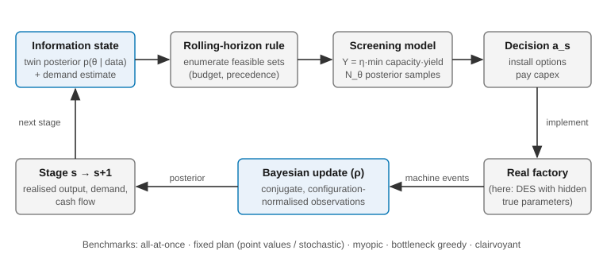
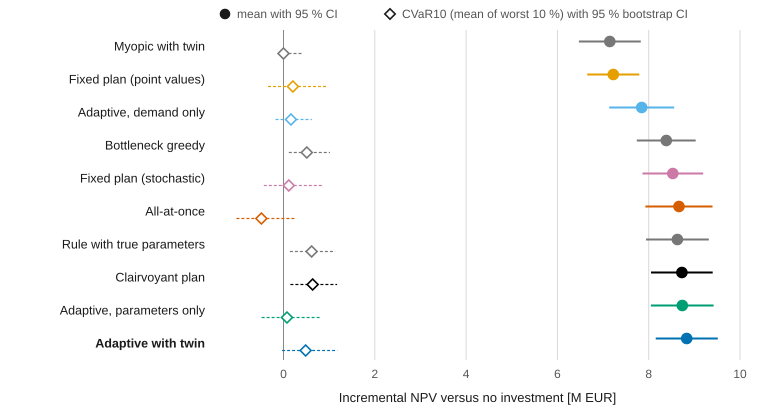
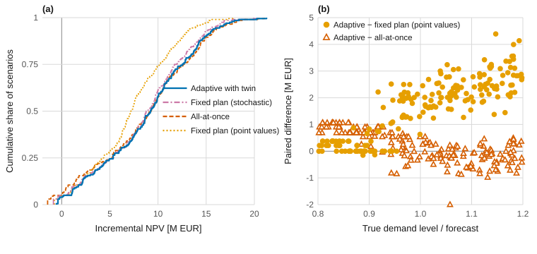
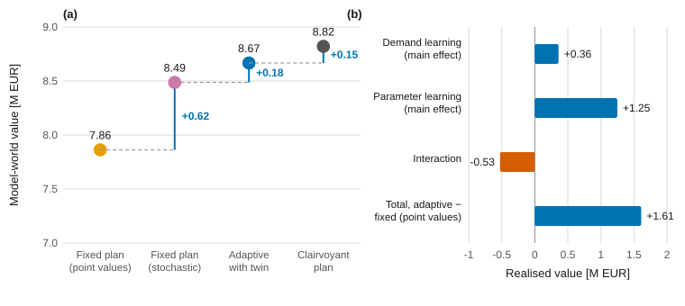
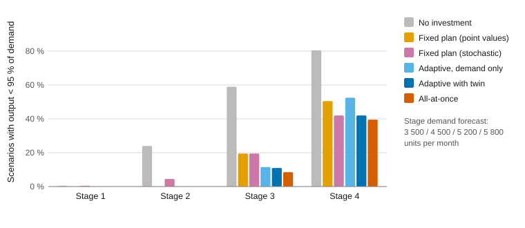
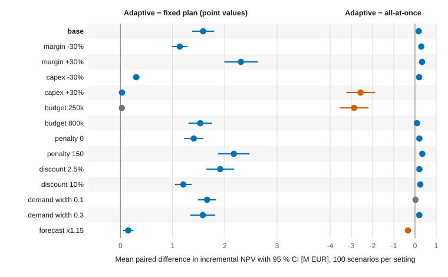
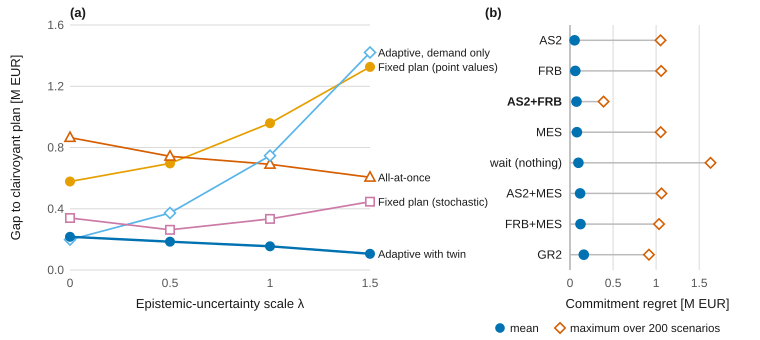

# Staged introduction of a flexible manufacturing system as a sequential capacity investment with a learning digital twin

[Author 1 – PhD candidate]^a,\*, [Author 2 – supervisor]^a

^a [Department, University, City, Country]

\* Corresponding author: [e-mail address]

Target journal: *Computers & Industrial Engineering* (Elsevier). Manuscript type: research article.

## Abstract

Firms that move from stand-alone CNC machines to a flexible manufacturing system (FMS) often invest in steps, but they must choose each step before they know how the new equipment will really perform. We model the staged introduction of an FMS as a sequential capacity-investment problem. Options, precedence, stage budgets, demand, unmet-demand penalties and discounting are explicit, and the objective is a mean–CVaR value. The epistemic uncertainty about machine performance is reduced during ramp-up by a Bayesian digital twin. The twin's posterior is the information state of a rolling-horizon rule, and the rule evaluates option sets with a screening model checked against discrete-event simulation (DES). We test the method on a reference design case, a V-type piston compressor FMS with six options. Costs are reference estimates and the ramp-up is simulated. Over 200 hidden "true factories", re-deciding with the twin gave a mean incremental NPV of 8.83 M EUR. This is 1.61 M EUR (95 % CI 1.45–1.77) more than a fixed plan based on design point values, 0.31 M EUR more than a fixed stochastic plan and 0.17 M EUR more than an all-at-once investment, with 42 % less capital. The adaptive policy closed 84 % of the gap between the fixed plan and a clairvoyant plan. Its advantage disappears when the stage budget cannot fund the first effective step.

**Keywords:** flexible manufacturing system; capacity expansion; staged investment; digital twin; Bayesian updating; conditional value-at-risk

## Highlights

- FMS introduction modelled as staged capacity investment under epistemic uncertainty
- A Bayesian digital twin supplies the information state of a rolling-horizon rule
- Re-deciding with the twin adds 1.6 M EUR over a fixed design-time plan (simulated)
- Twin closes 84 % of the gap to a clairvoyant plan with 42 % less capital
- Benefit vanishes if the stage budget cannot fund the first effective investment step

## 1. Introduction

An FMS is seldom bought as one finished system by a small or medium-sized manufacturer. In countries at an early stage of FMS adoption, the usual starting point is a workshop with stand-alone CNC machines that are loaded by hand, linked by manual transport and run without a cell controller. Pallet pools, additional machines, robots, a manufacturing execution system (MES) and automated guided vehicles (AGVs) are added over several years, as far as capital, skills and demand allow. Each step is a capacity investment. Its pay-off depends on which station limits output once the step is installed, and this depends on machine performance that nobody knows well before the equipment runs. Supplier data describe ideal conditions. New systems pass through a ramp-up with early failures, slow cycles and high scrap (Terwiesch and Bohn, 2001; Surbier et al., 2014), and design statements tend to be optimistic (Bokrantz et al., 2017).

Operations research has studied capacity expansion under uncertainty for a long time. It asks when to add how much capacity of which type (Luss, 1982; Van Mieghem, 2003). The tools are scenario-based and multi-stage stochastic programming (Eppen et al., 1989; Ahmed et al., 2003; Birge and Louveaux, 2011), real options (Trigeorgis, 1996; Dixit and Pindyck, 1994; de Neufville and Scholtes, 2011) and coherent risk measures such as the conditional value-at-risk (CVaR; Rockafellar and Uryasev, 2000, 2002). Flexible manufacturing capacity has been valued as a two-stage stochastic program (Fine and Freund, 1990) and as an option to switch production modes (Kulatilaka, 1988). In nearly all of this work the uncertainty that is resolved over time is exogenous, mostly demand or prices. The capacity effect of an investment is treated as known, or as a fixed distribution that does not change with the firm's own operations. When a firm moves to an FMS, however, the capacity effect is the main unknown. It is revealed step by step through the firm's own production data, and how fast it is revealed depends on what has already been installed.

Digital twins should be able to fill this gap. A twin that is synchronised with shop-floor data can, in principle, learn the true behaviour of the machines and inform later decisions (Kritzinger et al., 2018; Tao et al., 2019; van Beek et al., 2022). The literature shows that this rarely happens. A systematic review that accompanies this study ([Companion paper 1], under review) found that twins of production systems are mostly used at design stage and for virtual commissioning. Updating from plant data was rare (2 of 28 studies) and never Bayesian. No study used a twin to decide which machines join an FMS, in which order and when. Work that does update twins with data (Schumacher et al., 2024; Fu et al., 2025) or treats input uncertainty (Masciarelli and Matta, 2022) is concerned with operations or prediction, not with staged investment.

This paper connects the two strands. We ask: **how much is a learning digital twin worth for the staged introduction of an FMS, and under which conditions does re-deciding with it beat an all-at-once investment or a plan fixed at design time?** The working hypothesis, taken from the doctoral project that this paper is part of, is:

- **H4.** A staged introduction plan that is re-optimised after each Bayesian update of the twin gives a higher expected net present value (NPV) and a lower risk of under-capacity than an all-at-once investment or a staged plan fixed at design time.

The paper makes four contributions:

1. **Decision model.** We formulate the stepwise FMS introduction as a sequential capacity investment with discrete options, precedence, stage budgets, demand uncertainty, an unmet-demand penalty, discounting and a mean–CVaR objective. The information state is the posterior of a Bayesian digital twin, so the capacity effect of the options is itself learned (Section 3).
2. **Solution approach.** We give a rolling-horizon rule that enumerates feasible option sets against posterior samples with a screening throughput model. The screening model is validated against the DES at output level and, which is rarely done, at decision level (Section 4).
3. **Evidence with proper baselines.** We compare eleven policies on 200 seeded scenarios with paired tests. The baselines include a stochastic-programming fixed plan, a myopic policy, a practitioner bottleneck rule and a clairvoyant plan. A 2 × 2 factorial separates demand learning from parameter learning, and a value-of-information analysis bounds what any learning can achieve (Section 6).
4. **Boundary conditions.** Sensitivity analyses on economics, budgets, twin settings, risk aversion and the size of epistemic uncertainty show when the twin pays off, when it does not, and how robust the first-stage decision is (Sections 6–7).

The case is a reference design of a V-type piston compressor FMS. Its costs are reference estimates (placeholders until supplier quotations are available) and its ramp-up is simulated. We therefore present the work as a decision method demonstrated on a reference case, not as an ex-post evaluation of a real investment. The Bayesian learning model is the subject of a companion paper ([Companion paper 2], in preparation). Here it is used as a component and summarised in Section 3.4. Section 2 reviews related work, Sections 3–5 present the model, the solution approach and the case, Section 6 reports results, Section 7 draws managerial implications, Section 8 discusses limitations and Section 9 concludes.

## 2. Related work

### 2.1 Capacity expansion and stochastic programming

The classical capacity-expansion problem chooses the size, type and timing of capacity additions under economies of scale and uncertain demand (Luss, 1982). Van Mieghem (2003) reviews the later literature on investment and hedging and stresses that the value of flexible or multiple resources depends on how uncertainty is structured. Eppen et al. (1989) brought scenario-based mixed-integer programming with explicit risk measures into automotive capacity planning. Ahmed et al. (2003) solved multi-stage stochastic integer programs with fixed-charge costs on scenario trees. Birge and Louveaux (2011) give the standard framework of recourse, the expected value of perfect information (EVPI) and the value of the stochastic solution (VSS). Two features of this tradition matter here. First, the scenario tree is exogenous: tomorrow's demand does not depend on today's decision. Second, the capacity of a resource is a parameter, not a random variable that the firm learns about by operating the resource. In an FMS introduction both assumptions fail. The throughput gained from a second grinder depends on whether the grinder will be the bottleneck, and that is revealed only by operating the line. Problems of this kind, in which decisions influence what is learned, have endogenous (decision-dependent) uncertainty and are much harder to solve exactly. This is why we use a policy-based approximation (Powell, 2011) rather than a full scenario tree.

### 2.2 Real options and the value of flexibility

Real-options theory treats the right to defer, stage, expand or abandon an investment as an option with value (Dixit and Pindyck, 1994; Trigeorgis, 1996). For engineering systems, de Neufville and Scholtes (2011) argue for designing flexibility in and valuing it by simulation rather than closed-form option pricing. Kulatilaka (1988) valued an FMS as an option to switch between production modes. Fine and Freund (1990) derived optimal investment in product-flexible capacity from a two-stage stochastic program. These models agree that staging has value when uncertainty is resolved between stages. They take the resolution of uncertainty as given, however. Our setting adds a learning mechanism: the twin determines how much uncertainty is resolved between stages and about which station. Staging therefore creates value only together with a mechanism that turns shop-floor data into better capacity estimates.

### 2.3 Risk measures for investment decisions

Capital-constrained firms are risk-averse, and expected NPV alone is not enough to describe their preferences. The CVaR, the expected value in the worst α share of outcomes, is coherent and can be optimised by linear programming over scenarios (Rockafellar and Uryasev, 2000, 2002). Mean–CVaR objectives are therefore common in stochastic capacity planning. In our setting a subtlety arises. A risk measure evaluated on the *prior* distribution of an uncertain capacity effect may advise against investment that would be clearly worthwhile once the uncertainty is partly resolved. Section 6.5 shows this effect.

### 2.4 FMS investment and design models

FMS research has dealt mainly with design and planning for a given system (Stecke, 1983; Buzacott and Shanthikumar, 1993) and with the meaning and measurement of flexibility (Sethi and Sethi, 1990). Reconfigurable manufacturing systems make the evolution of capacity over time an explicit design goal (Koren et al., 1999). Simulation-based design is standard practice (Negahban and Smith, 2014; Law, 2015), and recent twin-based FMS studies optimise a given configuration (Florescu, 2024; Ullah and Younas, 2024). Studies in emerging economies analyse current-state systems with DES (Odedairo and Nwabuokei, 2018; Kamar et al., 2024; Purwaningsih et al., 2025) or propose phased digitalisation paths without a quantitative decision model (Tuhin et al., 2026). Bendato et al. (2015) used stochastic simulation for dynamic production redesign under new-market forecasts, but without learning about the equipment. As far as we know, no published model decides the *sequence* of FMS investments while learning the capacity effect.

### 2.5 Digital twins for decisions

Kritzinger et al. (2018) distinguish digital models, shadows and twins by the direction of data flow. Most published "twins" are still models with manual data exchange, and few close the loop to decisions ([Companion paper 1]). Studies that update twins with live data fit process parameters for operational optimisation (Schumacher et al., 2024) or reconfigure lines in reaction to disturbances (Fu et al., 2025). Masciarelli and Matta (2022) and the input-uncertainty literature (Chick, 2001; Zouaoui and Wilson, 2003; Barton, 2012) show how parameter uncertainty spreads into simulation output. Mahmoodi et al. (2025) design unreliable production systems with predictive models that learn over the life cycle. van Beek et al. (2022) describe twins as the link between design decisions and operational data, but do not quantify the value of the link for investment.

**Critical synthesis.** Capacity-expansion and real-options models offer the decision structure but assume known capacity effects or exogenous uncertainty. Twin research offers learning mechanisms but rarely links them to investment decisions, and almost never values the information they produce. This paper combines the two. It measures the value of the twin's learning as money in an investment decision, against baselines (stochastic fixed plan, clairvoyant plan) that separate the value of modelling uncertainty from the value of learning.

## 3. Problem formulation

### 3.1 Setting and notation

A firm at transition level L1 (stand-alone, connected CNC machines; manual loading, manual transport, no cell controller) can install options $o \in \mathcal{O}$ over stages $s = 1, \dots, S$ of $M$ months each. A terminal period of $S_T$ stages with the final configuration follows. Table 1 lists the notation.

**Table 1.** Notation.

| Symbol | Meaning |
|---|---|
| $s = 1..S$; $S_T$ | investment stages (half-years); terminal stages with fixed configuration |
| $\mathcal{O}$, $c_o$, $\mathrm{Pre}(o)$ | options, capital expenditure of option $o$, predecessor options |
| $x_{s,o} \in \{0,1\}$; $\boldsymbol{x}_s$ | option $o$ installed at the end of stage $s$; configuration |
| $\boldsymbol{a}_s$ | set of options added at stage $s$ |
| $K_s$ | investment budget of stage $s$ |
| $\boldsymbol{\theta}$ | machine parameters (MTBF, MTTR, cycle-time factor and spread, scrap rate per station) |
| $k$ | month since start of ramp-up |
| $Y_s(\boldsymbol{x}_s, \boldsymbol{\theta}, k)$ | monthly good output |
| $D_s$, $\bar D_s$ | monthly demand, design forecast |
| $m$, $\kappa$, $\varphi$, $r$ | contribution margin, unmet-demand penalty per unit, maintenance share of capex per stage, discount rate per stage |
| $\mathcal{I}_s$ | information state at stage $s$ (twin posterior, demand estimate) |
| $\beta$, $\alpha$ | risk-aversion weight, CVaR tail share |

### 3.2 Capacity, cash flow and NPV

The good output of a configuration is produced by a stochastic flow line of $J$ station types with $c_j$ parallel servers, finite buffers, operation-dependent failures and scrap at end-of-line test. In the evaluation it is simulated by the DES (Section 5.3). Options act on the station parameters through configuration operators (Table 4), for example $c_{\mathrm{GRIND}} = 1 + x_{\mathrm{GR2}}$. The cash flow of stage $s$ is

$$CF_s = M\big[m \min(Y_s, D_s) - \kappa \max(0, D_s - Y_s)\big] - \varphi \sum_{o} c_o x_{s,o} - \sum_{o} c_o \,(x_{s,o} - x_{s-1,o}), \tag{1}$$

with $\boldsymbol{x}_0 = \boldsymbol{0}$. Unmet demand costs the lost margin and, in addition, the penalty $\kappa$ (expediting, goodwill). The configuration is frozen after stage $S$, and the NPV over the investment and terminal stages is

$$\mathrm{NPV}(\boldsymbol{x}_{1..S}) = \sum_{s=1}^{S+S_T} \frac{CF_s}{(1+r)^{s}}, \qquad \boldsymbol{x}_s = \boldsymbol{x}_S \ \text{for}\ s > S. \tag{2}$$

Results are reported as incremental NPV, $\Delta\mathrm{NPV} = \mathrm{NPV}(\boldsymbol{x}) - \mathrm{NPV}(\boldsymbol{0})$, against not investing in the same scenario. This removes the large revenue base that all policies share.

### 3.3 Constraints

Installed options remain installed, predecessors must be present, and each stage has a budget:

$$x_{s-1,o} \le x_{s,o}, \tag{3}$$
$$x_{s,o} \le x_{s,o'} \quad \forall\, o' \in \mathrm{Pre}(o), \tag{4}$$
$$\sum_{o} c_o\,(x_{s,o} - x_{s-1,o}) \le K_s . \tag{5}$$

The all-at-once benchmark is exempt from Eq. (5) by definition. It assumes that the firm can finance the whole system at once, which is exactly the assumption that limited access to capital calls into question.

### 3.4 Information state: the Bayesian digital twin

The twin is the component developed in [Companion paper 2]. We summarise it here as far as the decision model needs it. Each station's parameters have conjugate priors built from design statements, each expressed as an "equivalent amount of data":

- failure rate $\lambda$: Gamma–Poisson, $\lambda \sim \mathrm{Ga}(a, b)$, update $a \leftarrow \rho a + n$, $b \leftarrow \rho b + T$ (failures $n$ in operating time $T$);
- repair rate: Gamma–exponential, $a \leftarrow \rho a + n_r$, $b \leftarrow \rho b + \sum r_i$;
- log cycle-time ratio $\ln(t/t^{\mathrm{design}})$: Normal–inverse-gamma with the standard closed-form update;
- scrap probability: Beta–binomial, $a \leftarrow \rho a + x$, $b \leftarrow \rho b + n - x$.

The forgetting factor $\rho \in (0,1]$ discounts older evidence, as in a power prior (Ibrahim and Chen, 2000), so that the posterior can follow the improving machines during ramp-up. The prior weight $w$ scales the equivalent data: in the base case the design MTBF is worth $10\,w$ failures, the design MTTR $5\,w$ repairs, the cycle time $10\,w$ cycles and the scrap rate $250\,w$ parts. In general form,

$$p_{s+1}(\boldsymbol{\theta}) \;\propto\; L(\mathcal{D}_s \mid \boldsymbol{\theta}, \boldsymbol{x}_s)\; p_s(\boldsymbol{\theta})^{\rho}, \tag{6}$$

where $\mathcal{D}_s$ are the machine events of stage $s$. The likelihood depends on the configuration. The twin must learn *machine* factors, not option effects, so the observations are normalised by the current configuration before the update: repair times are divided by the MTTR factor of the installed control level, scrap counts by the scrap factor, and cycle-time ratios refer to the current design times. Without this step, an option's effect would be counted twice once it is installed. In the companion study, sequential updating with $\rho = 0.7$ reduced the output prediction error during a simulated ramp-up to 1–3 % after half a year and identified the true bottleneck in 97–100 % of cases from month 4, against 73–77 % for the design model [simulated; Companion paper 2].

Demand is learned with a simple multiplicative estimate:

$$\hat f_s = \frac{1}{s-1}\sum_{t<s} \frac{D_t}{\bar D_t}, \qquad \hat D_t = \hat f_s \bar D_t \ (t \ge s), \tag{7}$$

with $\hat f_1 = 1$. The information state is $\mathcal{I}_s = \big(p_s(\boldsymbol{\theta}), \hat f_s\big)$.

### 3.5 Objective

A policy $\Pi = (\Pi_1, \dots, \Pi_S)$ maps information states to feasible additions, $\boldsymbol{a}_s = \Pi_s(\mathcal{I}_s)$. For a value distribution $V$, the lower-tail CVaR at level $\alpha$ is

$$\mathrm{CVaR}_\alpha(V) = \max_{\zeta \in \mathbb{R}} \Big\{ \zeta - \tfrac{1}{\alpha}\,\mathbb{E}\big[(\zeta - V)^+\big] \Big\}, \tag{8}$$

which equals the mean of the worst $\alpha$ share of outcomes for continuous distributions (Rockafellar and Uryasev, 2002). The firm solves

$$\max_{\Pi}\; (1-\beta)\,\mathbb{E}\big[\Delta\mathrm{NPV}(\Pi)\big] + \beta\, \mathrm{CVaR}_\alpha\big(\Delta\mathrm{NPV}(\Pi)\big), \qquad \beta \in [0, 1], \tag{9}$$

subject to Eqs. (3)–(5). Here $\alpha = 0.10$. Problem (9) is a multi-stage stochastic program with endogenous learning. Every evaluation of $Y_s$ requires simulation and the information state is a distribution, so exact solution is out of reach and we approximate the optimal policy.

## 4. Solution approach

### 4.1 Rolling-horizon rule

At each stage the rule enumerates all feasible additions $\mathcal{A}_s(\boldsymbol{x}_{s-1})$ that satisfy Eqs. (3)–(5); there are at most $2^{|\mathcal{O}|} = 64$. Each candidate is evaluated against $N_\theta$ samples $\boldsymbol{\theta}^{(i)} \sim p_s$ from the twin, assuming the configuration is kept until the end of the horizon:

$$V_s^{(i)}(\boldsymbol{a}) = \sum_{t=s}^{S+S_T} \frac{M\big[m \min(\hat Y_t^{(i)}, \hat D_t) - \kappa (\hat D_t - \hat Y_t^{(i)})^+\big] - \varphi\sum_o c_o x_o}{(1+r)^t}, \quad \hat Y_t^{(i)} = \hat Y(\boldsymbol{x}_{s-1} \cup \boldsymbol{a}; \boldsymbol{\theta}^{(i)}), \tag{10}$$

$$\boldsymbol{a}_s^* = \arg\max_{\boldsymbol{a} \in \mathcal{A}_s} \Big\{ (1-\beta)\,\overline{V_s(\boldsymbol{a})} + \beta\, \mathrm{CVaR}_\alpha\big(V_s(\boldsymbol{a})\big) - \frac{\sum_{o\in\boldsymbol{a}} c_o}{(1+r)^s} \Big\}, \tag{11}$$

where the bar denotes the sample mean and the CVaR is taken over the $N_\theta$ samples. The best set is installed (Figure 1), a stage of production is observed, the twin and the demand estimate are updated, and the rule is applied again. Assuming that the configuration stays fixed after each decision ignores the option to expand later. This is a conservative simplification shared by all rule-based policies. Sections 6.2 and 6.8 show that it biases the rule towards earlier investment. At stage 1 no data exist, so the rule uses the design point values. The risk term of Eq. (11) therefore acts only from stage 2 onwards, and it covers parameter uncertainty but not demand uncertainty (Section 8).

### 4.2 Screening model and its validation

Equation (11) needs about 700 throughput evaluations per decision on average [calculated]. With three replications of a simulated month per evaluation, a DES-based decision would take about 71 s of CPU time; a decision without budget pruning ($64 \times 60 \times 8 = 30\,720$ evaluations) would take about 0.9 h [calculated, timing script]. That is acceptable once on the shop floor, but not for the roughly 22 000 policy runs of this study. The rule therefore uses a screening model,

$$\hat Y = \eta(B)\, \min_{j} \Big( c_j A_j \frac{3600\, H}{\sum_v \pi_v t_{jv}} \Big) \prod_{j} (1 - q_j), \qquad A_j = \frac{\mathrm{MTBF}_j}{\mathrm{MTBF}_j + \mathrm{MTTR}_j}, \tag{12}$$

which is the bottleneck rate (product mix $\pi_v$, mean cycle times $t_{jv}$ including the speed factor, $H$ productive hours per month) times the line yield times a blocking efficiency $\eta$ for buffer size $B$. The value of $\eta$ is calibrated once against the DES: 0.9932 for buffers of two parts and 0.9963 for four [simulated]. One screening evaluation takes 12 µs, against 34 ms for one simulated month in the DES [measured].

The validation has two levels (Table 2). At *output level*, 300 random combinations of configuration, true factory and ramp-up month were each simulated with five DES replications. The screening model deviates by 1.28 % on average, with a positive bias of 1.25 % (it is optimistic), a 95th percentile of 3.7 % and one outlier of 13.6 %. Errors are larger in the first six months of ramp-up (2.45 %) than later (0.99 %), and larger with small buffers. At *decision level*, which matters more, 40 random decision states (true factory, stage, installed options, demand level) were solved twice: once with Eq. (12) and once with the DES (three replications per period, common random numbers). Both chose the same action in 33 of 40 states. The DES-evaluated regret of the screening choice averaged 0.09 M EUR, 2.1 % of the average value at stake (4.29 M EUR), with a median of zero. The Spearman rank correlation of the action values averaged 0.81. One state produced a large regret of 1.73 M EUR. There, in a factory with long repair times, the screening model chose the second grinder, whereas the DES preferred the MES with AGVs. Most likely the model undervalued shorter repairs and larger buffers, because blocking losses in such a factory far exceed the calibrated η.

**Table 2.** Validation of the screening model against the DES [simulated].

| Level | Measure | Value |
|---|---|---|
| Output (300 cases, 5 DES replications each) | mean absolute error / bias | 1.28 % / +1.25 % |
| | 95th percentile / maximum absolute error | 3.67 % / 13.6 % |
| | months 1–6 / months 7–27 | 2.45 % / 0.99 % |
| | buffers of 2 / buffers of 4 | 1.84 % / 0.76 % |
| | DES coefficient of variation (5 replications) | 0.72 % |
| Decision (40 states, all feasible actions) | same action chosen | 33 of 40 |
| | mean / median / maximum regret (DES-evaluated) | 0.09 / 0.00 / 1.73 M EUR |
| | regret as share of value at stake | 2.1 % |
| | mean Spearman rank correlation of action values | 0.81 |

The screening model affects only the *quality of decisions*, never the evaluation. The realised outcome of every policy is simulated with the DES and the hidden true parameters.

### 4.3 Policies compared

Table 3 lists the policies. Four of them form a 2 × 2 factorial (demand learning × parameter learning): STATIC, ADAPT_DEM, ADAPT_PAR and ADAPTIVE. Re-deciding with design values and the design forecast reproduces the STATIC plan exactly, so STATIC is the "no learning" cell.

**Table 3.** Policies.

| Policy | Information used | Re-decides | Remark |
|---|---|---|---|
| NONE | – | – | reference for incremental NPV |
| ALL | – | – | all six options at stage 1, budget ignored ("big bang") |
| STATIC | design point values, design forecast | no | plan fixed at design time (expected-value plan) |
| STATIC_SP | prior distribution of the twin, demand scenarios | no | best fixed plan over 60 prior samples (stochastic program without recourse) |
| MYOPIC | twin samples, learned demand | yes | values the current stage only |
| BN_GREEDY | twin posterior mean, learned demand | yes | practitioner rule: relieve the predicted bottleneck while next-stage demand exceeds capacity |
| ADAPT_DEM | design point values, learned demand | yes | demand learning only |
| ADAPT_PAR | twin samples, design forecast | yes | parameter learning only |
| **ADAPTIVE** | twin samples ($N_\theta = 60$, $\rho = 0.7$), learned demand | yes | proposed policy |
| PI_RULE | true parameters and demand | yes | same rule with perfect information |
| PI_PLAN | true parameters and realised demand | – | best of all 2 695 feasible staged plans (clairvoyant) |

PI_PLAN is chosen with the screening model. In the "model world", where plans are valued with Eq. (12) under the true parameters, it is an exact upper bound. In the realised DES evaluation it is not, because the screening model is slightly optimistic. Both views are reported.

### 4.4 Value of information and first-stage robustness

With $V(\pi)$ the model-world value of a complete plan $\pi$ under the true parameters and realised demand of a scenario, the gap of a policy to perfect information is

$$\mathrm{EVPI}(\Pi) = \mathbb{E}\Big[\max_{\pi \in \mathcal{P}} V(\pi)\Big] - \mathbb{E}\big[V(\pi^\Pi)\big], \tag{13}$$

where $\mathcal{P}$ is the set of feasible staged plans and $\pi^\Pi$ the plan implemented by $\Pi$. For the robustness of the first-stage decision, the *commitment regret* of a first-stage action $\boldsymbol{a}_1$ is

$$R(\boldsymbol{a}_1) = \max_{\pi \in \mathcal{P}} V(\pi) - \max_{\pi \in \mathcal{P}:\, \pi_1 = \boldsymbol{a}_1} V(\pi), \tag{14}$$

that is, the loss caused by the first step alone if all later steps were chosen with hindsight.

### 4.5 Statistical design

Every scenario is seeded. Policies share common random numbers for the true factory, the demand path and the DES streams of each stage, so differences between policies are paired. We report means with 95 % Student-t confidence intervals, $\mathrm{CVaR}_{10\%}$ with 95 % paired-bootstrap intervals (2 000 resamples), paired t-tests and Wilcoxon signed-rank tests with Holm correction over the nine comparisons with ADAPTIVE. The main experiment uses 200 scenarios. Its first 40 coincide with the doctoral thesis experiment and reproduce it exactly (240 of 240 policy results equal to 1 EUR), which verifies the implementation. The sensitivity experiments use 200 (twin settings, risk) or 100 scenarios (economics, epistemic scale). The whole campaign, about 22 000 policy runs, took about 70 min of wall time on 15 processes of a standard workstation using only the Python standard library.

**Figure 1.** Decision loop: the twin's posterior and the demand estimate form the information state; the rolling-horizon rule evaluates feasible option sets with the screening model; the chosen set is implemented; machine events of the next stage update the twin.

## 5. Case study

### 5.1 Reference design

The case is the planned FMS of a manufacturer of V-type piston compressors in three variants (mix 30/50/20 %). The reduced-order model has 13 station types in series: load station, three horizontal machining centres (HMCs) for the crankcase, washing, a vertical machining centre, honing, a lathe and a grinder for the crankshaft, pump assembly, a robot cell, two test benches, painting, final assembly and packing. Design cycle times, MTBF, MTTR and scrap rates come from the reference design (thesis Table 4.2) and are reference estimates. The firm starts at level L1. The HMCs are loaded by hand (120 s per part not hidden behind cutting, instead of 15 s with a pallet changer), buffers between areas hold two parts, and without a cell controller repairs take 30 % longer than designed. At design values this starting configuration produces 5 302 good compressors per month, with final assembly (5 676), pump assembly (5 961) and grinding (6 225) as the three most loaded stations within 10 % of each other [calculated, Eq. (12)]. Small deviations of the real machines from the design can therefore move the bottleneck. This is why learning matters.

### 5.2 Options and economics

**Table 4.** Investment options [effects from the reference design; capex are reference estimates (placeholders)].

| Option | Description | Configuration operator | Capex [EUR] | Requires |
|---|---|---|---|---|
| PAL | pallet pool and changers on the 3 HMCs | HMC handling 120 s → 15 s | 180 000 | – |
| GR2 | second crankshaft grinder | $c_{\mathrm{GRIND}}$: 1 → 2 | 350 000 | – |
| AS2 | second pump assembly station | $c_{\mathrm{ASSY}}$: 1 → 2 | 120 000 | – |
| FRB | robot-assisted final assembly | FINAL cycle time × 0.75 | 220 000 | – |
| MES | cell controller and MES | MTTR ÷ 1.3; scrap × 0.8 | 150 000 | – |
| AGV | AGV transport between areas | buffers 2 → 4 | 250 000 | MES |

**Table 5.** Economic and uncertainty parameters of the base case.

| Parameter | Value | Status |
|---|---|---|
| Stages $S$, stage length $M$, terminal stages $S_T$ | 4 half-years, 6 months, 4 half-years | design choice |
| Design demand $\bar D_s$ (stages 1–4, terminal) | 3 500 / 4 500 / 5 200 / 5 800 / 6 000 units per month | reference estimate |
| Contribution margin $m$; penalty $\kappa$ | 450 EUR; 50 EUR per unit | reference estimate |
| Discount rate $r$; maintenance $\varphi$ | 5 % and 3 % of installed capex per half-year | reference estimate |
| Stage budget $K_s$ | 400 000 EUR | reference estimate |
| Productive hours $H$ | 330 h per month | reference estimate |
| True demand level | $\bar D_s \cdot f$, $f \sim U(0.8, 1.2)$, ±5 % noise per stage | assumption |
| True mature MTBF / MTTR | design × $U(0.6, 1.1)$ / × $U(1.0, 1.5)$ per station | assumption |
| True cycle-time factor; log-sd | $U(0.98, 1.12)$; $U(0.04, 0.10)$ | assumption |
| True scrap | design × $U(1.0, 2.0)$ | assumption |
| Ramp-up multipliers, month $k$ | MTBF $1 - 0.5r(k)$, MTTR and cycle $1 + 0.5r(k)$ and $1 + 0.08r(k)$, scrap $1 + 2r_{1.5}(k)$; $r_\tau(k) = e^{-(k-1)/\tau}$, $\tau = 2$ | assumption |
| Twin | $\rho = 0.7$, $w = 1$, $N_\theta = 60$ | design choice |

With all options installed, the design output rises only to 6 356 units per month [calculated], below the upper range of stage-4 demand (up to 6 960). The option set therefore cannot cover the highest-demand scenarios. This structural limit matters for the under-capacity results.

### 5.3 Uncertainty model and evaluation

For each scenario a hidden "true factory" is drawn from the generator of Table 5. The generator encodes two documented patterns: design statements are optimistic on average, and new systems improve during ramp-up. The true demand level is hidden as well and revealed stage by stage. Each stage is represented by its middle month ($k = 6(s-1) + 3$), simulated with three DES replications of a 330-h month using the true month-specific parameters and scaled to six months. The terminal period uses month 27. Policies see only the machine events of the simulated months, in the format a Modbus/HTTP data path would deliver; the data path itself is outside this paper's scope. A scale parameter $\lambda$ multiplies the deviation of every true factor from its design value ($f \leftarrow 1 + \lambda (f - 1)$). In the base case $\lambda = 1$, and $\lambda = 0$ removes epistemic uncertainty except for the ramp-up itself.

## 6. Results

All numbers in this section are simulated, and money values rest on the reference estimates of Tables 4–5. The comparison between policies, not the absolute euro amounts, is the result.

### 6.1 Value and risk

**Table 6.** Incremental NPV against no investment, 200 scenarios, $\beta = 0$ [simulated; M EUR].

| Policy | Mean [95 % CI] | SD | CVaR$_{10\%}$ [95 % CI] | Min | P(loss) | Capital | P(short stage) |
|---|---|---|---|---|---|---|---|
| ALL | 8.66 [7.93, 9.40] | 5.27 | −0.48 [−1.03, 0.27] | −1.46 | 5.5 % | 1.27 | 39.5 % |
| STATIC | 7.22 [6.65, 7.79] | 4.09 | 0.21 [−0.34, 0.94] | −0.77 | 5.0 % | 0.69 | 50.5 % |
| STATIC_SP | 8.53 [7.86, 9.19] | 4.77 | 0.12 [−0.43, 0.87] | −0.86 | 5.0 % | 0.84 | 42.0 % |
| MYOPIC | 7.15 [6.47, 7.83] | 4.86 | 0.00 [0.00, 0.41] | 0.00 | 0.0 % | 0.47 | 56.5 % |
| BN_GREEDY | 8.38 [7.74, 9.03] | 4.62 | 0.51 [0.12, 1.02] | 0.00 | 0.0 % | 0.67 | 44.0 % |
| ADAPT_DEM | 7.85 [7.14, 8.56] | 5.10 | 0.16 [−0.17, 0.62] | −0.39 | 4.5 % | 0.62 | 52.5 % |
| ADAPT_PAR | 8.74 [8.05, 9.42] | 4.93 | 0.08 [−0.48, 0.83] | −0.92 | 5.0 % | 0.80 | 42.0 % |
| **ADAPTIVE** | **8.83** [8.15, 9.51] | 4.88 | 0.49 [−0.03, 1.18] | −0.55 | 4.0 % | 0.74 | 42.0 % |
| PI_RULE | 8.63 [7.94, 9.32] | 4.93 | 0.62 [0.14, 1.13] | 0.00 | 0.0 % | 0.64 | 43.0 % |
| PI_PLAN | 8.73 [8.05, 9.40] | 4.84 | 0.64 [0.15, 1.17] | 0.00 | 0.0 % | 0.64 | 42.0 % |

P(short stage): share of scenarios with at least one stage whose output is below 95 % of demand. Capital: undiscounted mean investment.

**Table 7.** Paired differences of ADAPTIVE against the other policies (200 scenarios, common random numbers) [simulated; M EUR]. p-values Holm-adjusted over nine comparisons.

| Comparison | Mean [95 % CI] | p (t) | p (Wilcoxon) | ADAPTIVE better | ΔCVaR$_{10\%}$ [95 % CI] |
|---|---|---|---|---|---|
| − ALL | +0.17 [+0.09, +0.25] | 1.0·10⁻⁴ | 1.7·10⁻⁴ | 113 / 200 | +0.97 [+0.88, +1.03] |
| − STATIC | **+1.61** [+1.45, +1.77] | 4·10⁻⁴⁹ | < 10⁻¹⁵ | 169 / 200 (29 ties) | +0.28 [+0.20, +0.34] |
| − STATIC_SP | +0.31 [+0.23, +0.38] | 2.5·10⁻¹² | < 10⁻¹⁵ | 131 / 200 | +0.37 [+0.28, +0.43] |
| − MYOPIC | +1.68 [+1.38, +1.99] | 2.8·10⁻²¹ | < 10⁻¹⁵ | 158 / 200 | +0.49 [−0.03, +0.94] |
| − BN_GREEDY | +0.45 [+0.32, +0.57] | 1.0·10⁻¹⁰ | 1.5·10⁻⁶ | 96 / 200 | −0.03 [−0.25, +0.29] |
| − ADAPT_DEM | +0.99 [+0.78, +1.19] | 1.3·10⁻¹⁶ | < 10⁻¹⁵ | 103 / 200 (71 ties) | +0.32 [+0.08, +0.73] |
| − ADAPT_PAR | +0.10 [+0.06, +0.14] | 3.6·10⁻⁶ | 1.2·10⁻⁷ | 66 / 200 (128 ties) | +0.41 [+0.32, +0.47] |
| − PI_RULE | +0.21 [+0.06, +0.35] | 4.9·10⁻³ | 0.18 | 83 / 200 (57 ties) | −0.13 [−0.31, +0.15] |
| − PI_PLAN | +0.11 [+0.04, +0.17] | 2.0·10⁻³ | 0.90 | 75 / 200 | −0.15 [−0.33, +0.12] |

Re-deciding with the twin gives the highest mean incremental NPV, 8.83 M EUR (Table 6, Figure 2). The value of re-deciding against the plan fixed at design time with point values is +1.61 M EUR (95 % CI 1.45–1.77), positive in 169 of 200 scenarios, equal in 29 and slightly negative (at most −0.15 M EUR) in 2. The all-at-once investment reaches almost the same mean (8.66 M EUR) but has a much worse downside. Its mean over the worst 10 % of scenarios is a loss of 0.48 M EUR against not investing, compared with a gain of 0.49 M EUR for the adaptive policy (ΔCVaR +0.97 M EUR, CI 0.88–1.03). The adaptive policy uses 0.74 M EUR of capital on average, 42 % less than ALL (1.27 M EUR). The first 40 scenarios reproduce the thesis result (+1.71 M EUR against STATIC); with 200 scenarios the estimate is +1.61 M EUR with a confidence interval of ±0.16 M EUR.

Three baselines put the result in perspective. First, a *stochastic* fixed plan that optimises against the prior distribution recovers much of the advantage over the point-value plan (8.53 M EUR). It does so by deferring the first investment to stage 2 and adding the MES in stage 4 (plan −|AS2+FRB|GR2|MES). The adaptive policy is still better by +0.31 M EUR (CI 0.23–0.38) and has a better CVaR (+0.37 M EUR). This is the value of learning *beyond* the value of modelling uncertainty, and it is the fairest single number for the twin's contribution. Second, the practitioner rule BN_GREEDY ("buy the option that relieves the twin's predicted bottleneck while demand exceeds capacity") does surprisingly well (8.38 M EUR, best minimum). It wins in about half the scenarios but loses on average by 0.45 M EUR, because it under-invests ahead of growing demand. Third, the myopic policy that values only the current stage under-invests badly (0.47 M EUR capital, 56.5 % of scenarios with a short stage) and is the worst learning policy. Learning without look-ahead is not enough.

**Figure 2.** Mean incremental NPV against no investment (filled circles, 95 % CI) and CVaR$_{10\%}$ (open diamonds, 95 % bootstrap CI) by policy; 200 scenarios [simulated].

Figure 3a shows the whole distribution. The adaptive curve lies to the right of the fixed point-value plan almost everywhere, and in the lower tail it is to the right of ALL. Figure 3b shows where the paired differences come from. Against the fixed plan, the advantage grows with the true demand level: when demand is high, the adaptive policy adds the MES and, where needed, the second grinder, which the fixed plan never buys. Against all-at-once, the adaptive policy gains in low-demand scenarios (+0.75 M EUR, CI 0.67–0.83, in the lowest third) because it does not install capacity that is never used. It loses in high-demand scenarios (−0.22 M EUR, CI −0.31 to −0.13, in the highest third) because it cannot build capacity as fast as ALL. In the middle third the two are equal (−0.01 M EUR, CI −0.12 to 0.10).

**Figure 3.** (a) Empirical distribution of incremental NPV for four policies. (b) Paired difference of ADAPTIVE against the fixed point-value plan and against all-at-once versus the true demand level of each scenario (one point per scenario; one value below −2 M EUR drawn at the axis limit) [simulated].

### 6.2 Where the value comes from

*Demand versus parameter learning.* The 2 × 2 factorial (Figure 4b) attributes a main effect of +1.25 M EUR to parameter learning and +0.36 M EUR to demand learning, with a negative interaction of −0.53 M EUR. The two kinds of learning partly substitute for each other: once the twin has revealed the station capacities, knowing demand adds only +0.10 M EUR (CI 0.06–0.14, ADAPTIVE − ADAPT_PAR), whereas knowing the station capacities adds +0.99 M EUR (CI 0.78–1.19) on top of demand learning (ADAPTIVE − ADAPT_DEM). Knowing *which* station will limit output is worth more than knowing *how much* will be demanded.

*Value of information.* In the model world (Eq. 13; Figure 4a), the clairvoyant plan is worth 8.82 M EUR. The gap to perfect information is 0.96 M EUR for the fixed point-value plan, 0.33 M EUR for the stochastic fixed plan and 0.15 M EUR for the adaptive policy. The twin thus closes 84 % of the gap between the fixed point-value plan and perfect information, and 54 % of the gap left by the stochastic fixed plan. Measured with the DES, ADAPTIVE even exceeds PI_PLAN by 0.11 M EUR on average (Table 7; median difference not significant, Wilcoxon p = 0.90). The reason is that the clairvoyant plan, chosen with an optimistic screening model, installs capacity "just in time" and is therefore occasionally short in reality. The rolling-horizon rule installs earlier and so carries a small capacity reserve.

**Figure 4.** (a) Model-world value (screening model under true parameters and realised demand; Eq. 13) of the fixed point-value plan, the stochastic fixed plan, the adaptive policy and the clairvoyant plan. (b) Factorial decomposition of the realised advantage of ADAPTIVE over STATIC into demand learning, parameter learning and interaction; 200 scenarios [simulated].

*Which options, and when.* The fixed point-value plan always installs AS2 and FRB in stage 1 and GR2 in stage 2, and never the MES. The adaptive policy also installs AS2 and FRB in stage 1 (the stage-1 information is the same). It then buys GR2 only where the twin finds the grinder binding (75.5 % of scenarios, mean stage 2.1) and the MES in 78.5 % (mean stage 2.7), because shorter repairs pay off when the true machines fail more often than designed. The most frequent final configurations are AS2+FRB+GR2+MES (110 scenarios), AS2+FRB+MES (33), AS2+FRB+GR2 (29) and AS2+FRB (14). No policy except ALL buys the pallet pool, and the AGVs are chosen in 7 % of scenarios. With manual loading the HMC cell still has a capacity of about 7 500 units per month, far above the line bottleneck, and buffers of two already lose less than 1 % to blocking. Neither option adds output in this model, and labour savings, which would favour them, are not valued (Section 8).

### 6.3 Under-capacity

Recording the shortfall per stage (Figure 5) corrects an assumption of the earlier thesis analysis. Shortfalls do not arise in stage 1: no staged policy is short there, because stage-1 demand (3 500 × f) lies below the starting capacity. They arise in stages 3 and 4, when demand approaches the structural limit of the option set. In stage 4, 39.5 % of the scenarios are short even with every option installed (ALL), 42.0 % under ADAPTIVE and under the clairvoyant plan, 50.5 % under the fixed point-value plan and 80.5 % without investment. In stage 3, ADAPTIVE (11.0 %) is close to ALL (8.5 %) and clearly better than both fixed plans (19.5 %). The remaining risk of under-capacity is therefore mostly a property of the option set (Table 4), not of the policy. Only a larger option, such as the second load station identified in the process-level analysis (Section 8), could reduce it.

**Figure 5.** Share of scenarios in which the realised output of a stage falls below 95 % of demand, by stage and policy; 200 scenarios [simulated].

### 6.4 Twin settings

The value of re-deciding is insensitive to the twin's settings (Table 8). With forgetting factors from 0.5 to 1.0, prior weights from 0.25 to 4 and 20 to 120 posterior samples, the advantage over the fixed plan stays between +1.60 and +1.62 M EUR, and $\mathrm{CVaR}_{10\%}$ between 0.47 and 0.52 M EUR. The decision needs only to know which station will be binding after the next step, and this ordinal information is learned within the first stage under every setting tried. Settings that matter for prediction accuracy in the companion study matter little for the investment decision.

**Table 8.** Sensitivity to the twin's settings and to risk aversion, 200 scenarios [simulated; M EUR].

| Setting | ADAPTIVE mean | ADAPTIVE − STATIC [95 % CI] | CVaR$_{10\%}$ ADAPTIVE | Capital ADAPTIVE | STATIC_SP mean |
|---|---|---|---|---|---|
| base ($\rho$ = 0.7, $w$ = 1, $N_\theta$ = 60, $\beta$ = 0) | 8.83 | +1.61 [+1.45, +1.77] | 0.49 | 0.74 | 8.53 |
| $\rho$ = 0.5 | 8.83 | +1.61 [+1.45, +1.76] | 0.48 | 0.74 | – |
| $\rho$ = 0.85 | 8.85 | +1.62 [+1.47, +1.78] | 0.49 | 0.74 | – |
| $\rho$ = 1.0 (no forgetting) | 8.85 | +1.62 [+1.47, +1.78] | 0.49 | 0.74 | – |
| $w$ = 0.25 (weak prior) | 8.82 | +1.60 [+1.44, +1.75] | 0.47 | 0.74 | – |
| $w$ = 4 (strong prior) | 8.83 | +1.61 [+1.45, +1.76] | 0.52 | 0.73 | – |
| $N_\theta$ = 20 | 8.82 | +1.60 [+1.44, +1.76] | 0.49 | 0.74 | – |
| $N_\theta$ = 120 | 8.84 | +1.61 [+1.46, +1.77] | 0.49 | 0.74 | – |
| $\beta$ = 0.5 | 8.83 | +1.61 [+1.45, +1.76] | 0.46 | 0.74 | 8.53 |
| $\beta$ = 1.0 (pure CVaR) | 8.82 | +1.60 [+1.44, +1.75] | 0.46 | 0.74 | 3.45 |

### 6.5 Risk aversion

Risk aversion leaves the adaptive policy almost unchanged. With $\beta = 1$ (the decision maximises the CVaR of the twin's samples) the mean is 8.82 M EUR, capital rises slightly to 0.74 M EUR and the final configurations are the same. The fixed stochastic plan behaves very differently. Optimised against the *prior* with $\beta = 1$, it postpones all investment to stage 4 (plan −|−|−|AS2+FRB), and its mean falls from 8.53 to 3.45 M EUR. Under the prior, every option has a wide value distribution because the binding station is unknown, so a risk-averse decision maker without a learning mechanism waits. With the twin, uncertainty about the binding station is largely resolved after one stage, and the same risk aversion no longer blocks investment. As a stress test outside the convex range of Eq. (9), weights of 2 and 5 on the mean–CVaR deviation lead the fixed stochastic plan to buy only the MES (1.54 M EUR) or nothing (0.00), while ADAPTIVE stays at 8.81–8.82 M EUR. Part of the robustness of ADAPTIVE comes from the fact that its first-stage decision uses point values and its risk term covers parameter samples only (Section 4.1). The result should therefore be read as "learning prevents risk-induced paralysis", not as "risk aversion does not matter".

### 6.6 Economic sensitivity and boundary conditions

**Table 9.** One-at-a-time economic sensitivity, 100 scenarios per setting [simulated; M EUR].

| Setting | ALL | STATIC | STATIC_SP | ADAPTIVE | PI_PLAN | ADAPTIVE − STATIC [95 % CI] | ADAPTIVE − ALL [95 % CI] | STATIC plan |
|---|---|---|---|---|---|---|---|---|
| base | 8.81 | 7.41 | 8.74 | 8.99 | 8.79 | +1.58 [+1.37, +1.80] | +0.18 [+0.07, +0.28] | AS2+FRB / GR2 / – / – |
| margin −30 % | 6.04 | 5.20 | 6.15 | 6.34 | 6.23 | +1.14 [+0.99, +1.28] | +0.30 [+0.21, +0.38] | same |
| margin +30 % | 11.59 | 9.61 | 11.32 | 11.92 | 11.59 | +2.31 [+1.99, +2.63] | +0.33 [+0.24, +0.43] | same |
| capex −30 % | 9.25 | 9.14 | 8.88 | 9.45 | 9.21 | +0.30 [+0.24, +0.37] | +0.20 [+0.14, +0.26] | AS2+FRB+MES / GR2 / – / – |
| capex +30 % | 8.38 | 5.78 | 5.67 | 5.81 | 5.75 | +0.03 [+0.00, +0.06] | −2.56 [−3.24, −1.89] | FRB / AS2+MES / – / – |
| budget 250 k | 8.81 | 5.92 | 5.82 | 5.94 | 5.86 | +0.03 [−0.00, +0.06] | −2.87 [−3.55, −2.19] | FRB / AS2 / MES / – |
| budget 800 k | 8.81 | 7.38 | 8.53 | 8.91 | 8.79 | +1.53 [+1.30, +1.75] | +0.09 [+0.00, +0.18] | GR2+AS2+FRB / – / – / – |
| penalty 0 | 7.79 | 6.59 | 7.78 | 7.99 | 7.83 | +1.40 [+1.22, +1.59] | +0.21 [+0.10, +0.31] | same as base |
| penalty 150 | 10.87 | 9.04 | 10.65 | 11.21 | 10.91 | +2.17 [+1.87, +2.47] | +0.34 [+0.25, +0.44] | same as base |
| discount 2.5 % | 10.22 | 8.52 | 10.05 | 10.43 | 10.14 | +1.91 [+1.65, +2.17] | +0.21 [+0.10, +0.32] | same as base |
| discount 10 % | 6.62 | 5.67 | 6.69 | 6.87 | 6.77 | +1.20 [+1.05, +1.36] | +0.25 [+0.16, +0.34] | same as base |
| demand width ±10 % | 9.65 | 8.02 | 9.50 | 9.67 | 9.57 | +1.66 [+1.49, +1.83] | +0.02 [−0.07, +0.11] | same as base |
| demand width ±30 % | 8.28 | 6.90 | 8.22 | 8.48 | 8.50 | +1.58 [+1.34, +1.82] | +0.20 [+0.08, +0.33] | same as base |
| forecast × 1.15 | 12.73 | 12.25 | 12.25 | 12.40 | 12.40 | +0.15 [+0.05, +0.25] | −0.33 [−0.46, −0.20] | AS2+FRB / GR2 / MES / – |

Two kinds of results stand out (Table 9, Figure 6). Over the plausible range of margin, penalty, discount rate and demand dispersion, re-deciding with the twin keeps an advantage of 1.1–2.3 M EUR over the fixed point-value plan and 0.02–0.34 M EUR over all-at-once. The advantage grows with the margin and the penalty, which raise the cost of having the wrong bottleneck relieved.

The advantage collapses at three boundaries. (i) When capex is 30 % higher or the stage budget is 250 000 EUR, the first effective step (AS2 + FRB, 442 000 or 340 000 EUR) no longer fits into the stage-1 budget. All staged policies then build capacity too slowly and lose 2.6–2.9 M EUR against an all-at-once investment, which is not budget-constrained. (ii) When capex is 30 % lower, the fixed plan already includes the MES, and re-deciding adds only 0.30 M EUR. (iii) When the demand forecast is 15 % higher, capacity is scarce in every scenario, the plan "buy everything useful early" is nearly always right, and ALL is better by 0.33 M EUR. The value of a learning twin is therefore highest in the region where it is most needed: moderate, uncertain demand and a budget that allows meaningful but not complete steps.

**Figure 6.** One-at-a-time sensitivity of the paired advantage of ADAPTIVE over the fixed point-value plan (left) and over all-at-once (right); circles show means, lines 95 % CIs; blue: significantly positive, orange: significantly negative, grey: not significant; 100 scenarios per setting [simulated].

### 6.7 Size of the epistemic uncertainty

Scaling the deviation of the true factories from the design (Figure 7a) shows the mechanism directly. Without epistemic uncertainty ($\lambda = 0$; only ramp-up and demand remain), parameter learning adds nothing: the gap to the clairvoyant plan is 0.22 M EUR for ADAPTIVE and 0.20 M EUR for demand-only learning. As $\lambda$ increases, the gap of the non-learning policies grows (fixed point-value plan 0.58 → 1.33 M EUR; demand-only 0.20 → 1.42 M EUR from $\lambda$ = 0 to 1.5), while the gap of ADAPTIVE shrinks (0.22 → 0.11 M EUR). The realised advantage over the fixed plan grows from +0.60 M EUR (CI 0.50–0.71) at $\lambda = 0$ to +2.31 M EUR (CI 2.09–2.54) at $\lambda = 1.5$. One discrepancy must be reported. At $\lambda = 1.5$ the model world ranks ADAPTIVE above ALL (9.71 vs. 9.21 M EUR), but the DES evaluation ranks ALL higher by 0.27 M EUR (CI 0.11–0.43). In strongly degraded factories the screening model's error grows (Table 2: larger in early months and with small buffers), and the decisions suffer accordingly.

**Figure 7.** (a) Gap to the clairvoyant plan (model-world EVPI, Eq. 13) versus the epistemic-uncertainty scale λ; λ = 1 is the base case; 100 scenarios per λ (200 at λ = 1). (b) Commitment regret of the eight best first-stage actions (Eq. 14): mean and maximum over 200 scenarios [simulated].

### 6.8 Robustness of the first-stage decision

Every policy that decides at stage 1 with design information chooses AS2 + FRB, the two options that relieve the two most loaded stations of the starting configuration. This stage-1 decision is stable under all one-at-a-time variations in Table 9 except those in which it is unaffordable (capex +30 %, budget 250 k) and the cheaper-capex case, where the MES joins it. Is it also robust against the true factory? Figure 7b gives the commitment regret (Eq. 14). With hindsight, *waiting* would be optimal in 79 % of scenarios, since perfect foresight allows capacity to be added just in time. Waiting, however, has the largest tail regret of the plausible actions (maximum 1.63 M EUR, 95th percentile 0.56 M EUR). AS2 + FRB has a slightly higher mean regret than AS2 alone (0.075 vs. 0.054 M EUR) but by far the lowest maximum regret (0.39 M EUR against 1.05 M EUR for AS2 alone and above 0.9 M EUR for every other action). In the language of robust decision making, AS2 + FRB is the *minimax-regret* first step. Its expected cost relative to perfect foresight is 75 000 EUR, small against the 8–9 M EUR at stake.

### 6.9 Evaluation of H4

- **Expected NPV:** ADAPTIVE is higher than ALL (+0.17 M EUR, CI 0.09–0.25), the fixed point-value plan (+1.61 M EUR) and the stochastic fixed plan (+0.31 M EUR), all significant after Holm correction. *Supported.*
- **Downside risk:** $\mathrm{CVaR}_{10\%}$ is higher than for ALL (+0.97 M EUR) and both fixed plans (+0.28 and +0.37 M EUR). *Supported.*
- **Risk of under-capacity:** lower than for the fixed point-value plan (42.0 % vs. 50.5 % of scenarios with a short stage) and equal to the stochastic fixed plan and the clairvoyant plan, but not lower than ALL (39.5 %). *Partly supported.* The remaining shortfall is mainly a limit of the option set.
- **Boundary conditions:** H4 fails when the per-stage budget cannot fund the first effective step or when demand is clearly above forecast.

## 7. Managerial implications for SMEs in emerging economies

**Stage the investment, but size the first step correctly.** The most important decision is not "staged or all-at-once" but whether the first-stage budget covers a step that relieves the binding stations. In the case, a budget of 400 000 EUR per half-year funds AS2 + FRB, and the staged adaptive approach then reaches the value of a 1.27 M EUR all-at-once investment with 42 % less capital and a far better downside. A budget of 250 000 EUR does not fund this step, and staging becomes expensive. Before negotiating credit lines, managers should compute the minimum effective first step with a screening model such as Eq. (12).

**Treat the first months of operation as an information investment.** About three quarters of the value of re-deciding comes from learning which station really limits output, not from learning demand. Collecting machine events (failures, repairs, cycle times, scrap) from the first stage onwards is therefore part of the investment. The data path does not need expensive middleware. The companion architecture work shows that Modbus TCP and plain HTTP are sufficient for the events used here ([Companion paper 3], in preparation).

**Use a stochastic plan if no twin is available, and do not let risk aversion freeze the project.** A fixed plan optimised against the prior distribution already avoids much of the loss of a point-value plan. Applied without learning, however, a risk-averse criterion recommends postponing almost everything. In capital-constrained firms, where risk aversion is legitimate, a learning twin removes much of the uncertainty that makes waiting look attractive.

**Simple rules are competitive but leave money on the table.** A bottleneck rule ("relieve the predicted bottleneck while demand exceeds capacity"), fed by the twin's posterior means, reaches 95 % of the adaptive value and has the best worst case. It is a reasonable first tool for firms without optimisation skills. The full rule adds 0.45 M EUR on average because it looks ahead to demand growth.

**Expect diminishing returns from fine-tuning the twin.** Forgetting factor, prior weight and number of samples had no material effect on the investment decision. Getting the data and the decision loop running matters more than calibrating the twin precisely.

**Do not trust absolute numbers before real quotations.** The euro amounts in this paper rest on reference estimates. The ranking of policies and the boundary conditions held across ±30 % variations of the economic parameters, but the decision for a specific firm must be recomputed with its own quotations, margins and budget. The open-source code makes this a matter of editing one table.

## 8. Limitations and future work

*Simulated ramp-up and reference costs.* The true factories come from an assumed generator, with uniform deviations and an exponential ramp-up shape, and the costs are placeholders. The ranking of policies proved robust over the ranges tested, but external validity requires the ramp-up protocol of the doctoral project to be carried out in the case factory and the costs to be replaced by quotations.

*Approximate policy.* The rolling-horizon rule assumes that the configuration stays fixed after each decision. It does not value the option to expand later and biases the rule towards early investment. The clairvoyant analysis shows that the remaining gap to perfect information is small (0.15 M EUR), but approximate dynamic programming (Powell, 2011) or a real-options formulation with decision-dependent scenario trees could value deferral explicitly. The stage-1 decision uses point values, and the risk term covers parameter but not demand uncertainty; a joint sample of parameters and demand would make the risk-aversion results more general.

*Screening model.* The screening model is optimistic by 1.25 % on average, and its errors grow early in ramp-up and in strongly degraded factories. In one of 40 validation states it ranked two options wrongly, at high cost. A hybrid rule that re-checks the two or three best screening candidates with the DES before committing would remove most of this risk at modest cost (about 1–2 min of CPU time per decision with 60 posterior samples [calculated]).

*Economic scope.* Options are valued only through additional output. Labour savings, energy, floor space, quality costs beyond scrap and the strategic value of flexibility are not included. This explains why the pallet pool and the AGVs are rarely chosen, and it is a reason not to read the results as a recommendation against them.

*Option set.* The option set is that of the reference design. A process-level analysis of the crankcase cell in the doctoral project found an option missing from Table 4: a second load station, which raises the capacity of the machining cell substantially at a fraction of the cost of a machine tool. Adding such process-level options, and the stage-4 capacity limit they would relax, is a natural extension. The design of the pallet cell itself is treated in [Companion paper 5].

*Single case and model fidelity.* One product family and one reduced-order DES were used. Correlated machine parameters (hierarchical priors), non-exponential failure laws and a second industrial case are left to future work.

## 9. Conclusions

We modelled the stepwise introduction of an FMS as a sequential capacity-investment problem in which the capacity effect of each option is uncertain and is learned during ramp-up by a Bayesian digital twin. A rolling-horizon rule that uses the twin's posterior as its information state, with a screening model validated against DES at output and decision level, was compared with ten other policies on a reference compressor FMS with simulated ramp-up and reference-estimate costs. Re-deciding with the twin gave the highest expected incremental NPV (8.83 M EUR), +1.61 M EUR over a plan fixed at design time with point values, +0.31 M EUR over a stochastic fixed plan and +0.17 M EUR over an all-at-once investment, together with a much better downside than all-at-once (CVaR$_{10\%}$ +0.97 M EUR) and 42 % less capital than all-at-once. Most of the value comes from learning which station will limit output. The twin closed 84 % of the gap between the fixed plan and perfect information, and its value increased with the size of the epistemic uncertainty. The advantage disappeared when the stage budget could not fund the first effective step or when demand was far above forecast. For capital-constrained manufacturers at the start of FMS adoption, the method gives a transparent and reproducible way to plan the next step and to re-plan as evidence accumulates, as soon as their own costs replace the reference estimates.

## Declarations

**Funding.** [To be completed by the authors: funding body and grant number, or "This research did not receive any specific grant from funding agencies in the public, commercial, or not-for-profit sectors."]

**CRediT authorship contribution statement.** [Author 1]: Conceptualization, Methodology, Software, Formal analysis, Investigation, Data curation, Visualization, Writing – original draft. [Author 2]: Conceptualization, Supervision, Writing – review & editing. [To be confirmed by the authors.]

**Declaration of competing interest.** The authors declare that they have no known competing financial interests or personal relationships that could have appeared to influence the work reported in this paper. [Authors to confirm.]

**Data and code availability.** All experiments are seeded and can be reproduced with the Python standard library. Code (`code/staged.py`, `run_experiments.py`, `screen_check.py`, `voi.py`, `analyse.py`, `make_figures.py`, `timing.py`) and result files (`data/*.csv`, `results.json`, `voi.json`, `screen_check.json`) will be deposited in a public repository [repository and DOI to be added before submission]. The model of the reference design and the Bayesian twin modules of the companion study are included.

**Relation to the doctoral thesis and companion papers.** This article is based on a chapter of the first author's doctoral thesis [thesis reference to be added], extended by new experiments (200 instead of 40 scenarios, four additional policies, value-of-information, decision-level validation of the screening model, sensitivity analyses on the twin, risk and epistemic uncertainty). The Bayesian learning model ([Companion paper 2]), the data architecture ([Companion paper 3]), the cell design ([Companion paper 5]) and the systematic review ([Companion paper 1]) are separate manuscripts with distinct research questions; they are cited where used.

**Declaration of generative AI and AI-assisted technologies in the manuscript preparation process.** [Draft for the authors to adapt to the actual use:] During the preparation of this work the authors used [name of tool, version] in order to [e.g. improve the language and structure of the text drafted by the authors and to assist in writing analysis scripts]. After using this tool, the authors reviewed and edited the content as needed and take full responsibility for the content of the published article. All numerical results were produced by the authors' code and verified by re-running it.

## References

Ahmed, S., King, A. J., & Parija, G. (2003). A multi-stage stochastic integer programming approach for capacity expansion under uncertainty. *Journal of Global Optimization, 26*(1), 3–24. https://doi.org/10.1023/A:1023062915106

Barton, R. R. (2012). Tutorial: Input uncertainty in output analysis. In *Proceedings of the 2012 Winter Simulation Conference*. IEEE. [verify]

Bendato, I., Cassettari, L., & Mosca, M. T. (2015). New markets forecast and dynamic production redesign through stochastic simulation. *International Journal of Simulation Modelling, 14*(3). https://doi.org/10.2507/ijsimm14(3)10.307

Birge, J. R., & Louveaux, F. (2011). *Introduction to stochastic programming* (2nd ed.). Springer. https://doi.org/10.1007/978-1-4614-0237-4

Bokrantz, J., Skoogh, A., Lämkull, D., et al. (2017). Data quality problems in discrete event simulation of manufacturing operations. *SIMULATION*. https://doi.org/10.1177/0037549717742954 [verify volume/pages]

Buzacott, J. A., & Shanthikumar, J. G. (1993). *Stochastic models of manufacturing systems*. Prentice Hall.

Chick, S. E. (2001). Input distribution selection for simulation experiments: Accounting for input uncertainty. *Operations Research, 49*(5), 744–758. [verify]

[Companion paper 1] [Authors] (2026). Digital twins for the design, ramp-up and stepwise introduction of flexible manufacturing systems under technology and data constraints: A systematic review. [Journal, status – to be updated].

[Companion paper 2] [Authors] (2026). [Sequential Bayesian updating of an FMS digital twin during ramp-up – title to be aligned]. [Status – to be updated].

[Companion paper 3] [Authors] (2026). [Low-cost Modbus TCP/HTTP data architecture for FMS digital twins – title to be aligned]. [Status – to be updated].

[Companion paper 5] [Authors] (2026). [Queueing-based design of the pallet cell – title to be aligned]. [Status – to be updated].

de Neufville, R., & Scholtes, S. (2011). *Flexibility in engineering design*. MIT Press. https://doi.org/10.7551/mitpress/8292.001.0001 [verify DOI]

Dixit, A. K., & Pindyck, R. S. (1994). *Investment under uncertainty*. Princeton University Press.

Eppen, G. D., Martin, R. K., & Schrage, L. (1989). A scenario approach to capacity planning. *Operations Research, 37*(4), 517–527. https://doi.org/10.1287/opre.37.4.517

Fine, C. H., & Freund, R. M. (1990). Optimal investment in product-flexible manufacturing capacity. *Management Science, 36*(4), 449–466. https://doi.org/10.1287/mnsc.36.4.449

Florescu, A. (2024). Digital twin for flexible manufacturing systems and optimization through simulation: A case study. *Machines, 12*(11), 785. https://doi.org/10.3390/machines12110785

Fu, B., Bi, M., Umeda, S., et al. (2025). Digital twin-based smart manufacturing: Dynamic line reconfiguration for disturbance handling. *IEEE Transactions on Automation Science and Engineering*. https://doi.org/10.1109/tase.2025.3563320 [verify volume/pages]

Ibrahim, J. G., & Chen, M.-H. (2000). Power prior distributions for regression models. *Statistical Science, 15*(1), 46–60. [verify]

Kamar, A. N. N., Cheng, J. K., Rahamaddulla, S. R., et al. (2024). Evaluating production process improvement strategies in a manufacturing SME: A case study. *Edelweiss Applied Science and Technology, 8*(6). https://doi.org/10.55214/25768484.v8i6.3366

Koren, Y., Heisel, U., Jovane, F., Moriwaki, T., Pritschow, G., Ulsoy, G., & Van Brussel, H. (1999). Reconfigurable manufacturing systems. *CIRP Annals, 48*(2), 527–540.

Kritzinger, W., Karner, M., Traar, G., Henjes, J., & Sihn, W. (2018). Digital twin in manufacturing: A categorical literature review and classification. *IFAC-PapersOnLine, 51*(11), 1016–1022. https://doi.org/10.1016/j.ifacol.2018.08.474

Kulatilaka, N. (1988). Valuing the flexibility of flexible manufacturing systems. *IEEE Transactions on Engineering Management, 35*(4), 250–257. https://doi.org/10.1109/17.7447

Law, A. M. (2015). *Simulation modeling and analysis* (5th ed.). McGraw-Hill.

Luss, H. (1982). Operations research and capacity expansion problems: A survey. *Operations Research, 30*(5), 907–947.

Mahmoodi, E., Fathi, M., Ng, A. H. C., et al. (2025). Predictive model-based multi-objective optimization with life-long meta-learning for designing unreliable production systems. *Computers & Operations Research*. https://doi.org/10.1016/j.cor.2025.107011 [verify volume]

Masciarelli, A., & Matta, A. (2022). Managing input parameter uncertainty in digital twins. *IFAC-PapersOnLine, 55*(2), 13–18.

Negahban, A., & Smith, J. S. (2014). Simulation for manufacturing system design and operation: Literature review and analysis. *Journal of Manufacturing Systems, 33*(2), 241–261.

Odedairo, B. O., & Nwabuokei, N. (2018). Framework for operational performance measurements in small and medium scale industries using discrete event simulation approach. *Engineering, Technology & Applied Science Research*. https://doi.org/10.48084/etasr.2106

Powell, W. B. (2011). *Approximate dynamic programming: Solving the curses of dimensionality* (2nd ed.). Wiley. https://doi.org/10.1002/9781118029176 [verify DOI]

Purwaningsih, R., Shintyastuti, A. R., Arvianto, A., et al. (2025). Evaluating the impact of autonomous material handling on the performance of production system: A simulation approach. *SINERGI*. https://doi.org/10.22441/sinergi.2025.2.004

Rockafellar, R. T., & Uryasev, S. (2000). Optimization of conditional value-at-risk. *Journal of Risk, 2*(3), 21–41. [verify]

Rockafellar, R. T., & Uryasev, S. (2002). Conditional value-at-risk for general loss distributions. *Journal of Banking & Finance, 26*(7), 1443–1471. [verify DOI]

Schumacher, C., Stilling, J., Kriege, J., & Buchholz, P. (2024). Live fitting of process data within digital twins of manufacturing to use simulation and optimisation. *Journal of Simulation, 18*(5), 813–834. https://doi.org/10.1080/17477778.2024.2376711

Sethi, A. K., & Sethi, S. P. (1990). Flexibility in manufacturing: A survey. *International Journal of Flexible Manufacturing Systems, 2*(4), 289–328.

Stecke, K. E. (1983). Formulation and solution of nonlinear integer production planning problems for flexible manufacturing systems. *Management Science, 29*(3), 273–288.

Surbier, L., Alpan, G., & Blanco, E. (2014). A comparative study on production ramp-up: State-of-the-art and new challenges. *Production Planning & Control, 25*(15), 1264–1286. [verify]

Tao, F., Zhang, H., Liu, A., & Nee, A. Y. C. (2019). Digital twin in industry: State-of-the-art. *IEEE Transactions on Industrial Informatics, 15*(4), 2405–2415.

Terwiesch, C., & Bohn, R. E. (2001). Learning and process improvement during production ramp-up. *International Journal of Production Economics, 70*(1), 1–19.

Trigeorgis, L. (1996). *Real options: Managerial flexibility and strategy in resource allocation*. MIT Press.

Tuhin, B., Shammy, S., Akter, L., et al. (2026). Digital twin-driven optimization of mechanical manufacturing systems using artificial intelligence. *The International Journal of Engineering Sciences*. https://doi.org/10.64440/ijes/engineeringx0025 [verify]

Ullah, A., & Younas, M. (2024). Development and application of digital twin control in flexible manufacturing systems. *Journal of Manufacturing and Materials Processing, 8*(5), 214. https://doi.org/10.3390/jmmp8050214

van Beek, A., Karkaria, V., & Chen, W. (2022). Digital twins for the designs of systems: A perspective. arXiv:2211.05040. [check for journal version]

Van Mieghem, J. A. (2003). Capacity management, investment, and hedging: Review and recent developments. *Manufacturing & Service Operations Management, 5*(4), 269–302.

Zouaoui, F., & Wilson, J. R. (2003). Accounting for parameter uncertainty in simulation input modeling. *IIE Transactions, 35*(9), 781–792. [verify]
