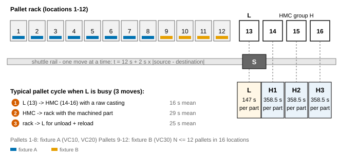
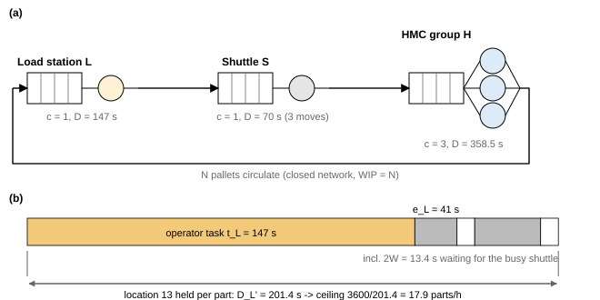
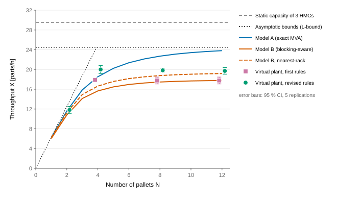
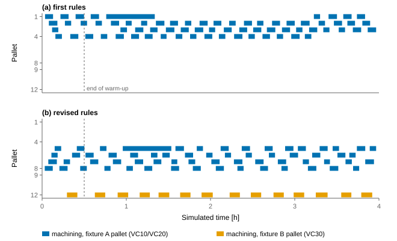
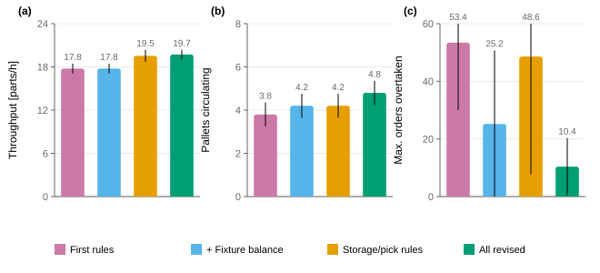
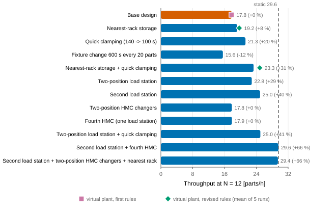
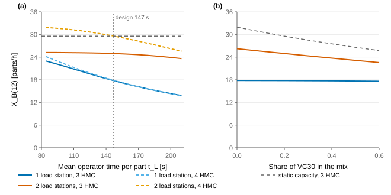

# Why pallet-based FMS cells deliver less than their machines: closed queueing models, dispatching rules and virtual commissioning of a three-machine crankcase cell

[Author 1 – PhD candidate]¹, [Author 2 – supervisor]¹

¹ [Department, University, City, Country]

Corresponding author: [Author 1 – e-mail] · ORCID: [Author 1 ORCID], [Author 2 ORCID]

## Abstract

Pallet-based flexible manufacturing system (FMS) cells are usually sized with a static capacity calculation of their machines. This paper shows, for a three-machine crankcase cell designed for a compressor factory, why such a calculation overestimates the output and how a design engineer can predict it. The cell is modelled as a closed queueing network of load station, shuttle and machining-centre group, solved by exact multi-server mean value analysis and corrected for the time during which single transfer locations are held by pallet exchanges (blocking-aware model). The models are validated against the real supervisory controller software running on a virtual plant of 21 simulated Modbus controllers, with five replications per configuration (61 runs). With design estimates as inputs, the static model predicts 29.6 parts/h, whereas one operator limits the cell to 24.5 parts/h and the blocking-aware model to 17.8–19.2 parts/h. The controller delivered 17.8 ± 0.7 parts/h with its first dispatching rules and 19.7 ± 0.7 parts/h with revised rules, within −5 % to +1 % of the composite estimate. The first rules froze the set of circulating pallets after start-up (pallet lock-in) and starved one fixture family in three of five replications; a fixture-balance rule removed the starvation, and nearest-rack storage with oldest-first picking raised the throughput by 11 %. A what-if analysis shows that a fourth machine adds nothing, whereas a second load station adds 40 %: load-station capacity should be bought before machine capacity.

**Keywords:** flexible manufacturing system; closed queueing network; mean value analysis; dispatching rules; virtual commissioning; pallet pool

## 1 Introduction

A flexible manufacturing system (FMS) in the narrow sense is a group of numerically controlled machine tools that share
a material-handling system and a pool of fixture pallets and that are coordinated by a supervisory computer
[1, 2]. For a machining company that has so far operated stand-alone CNC machines, the first
pallet-based cell is a large and nearly irreversible investment. Its business case is normally built on a static
capacity calculation: the number of machines, their availability and the mean machining time per part give a monthly
output, and the machines are bought to match the demand. Such a calculation sees only the machines. It does not see the
load station at which an operator unloads and clamps every part, the shuttle that moves every pallet several times, the
fact that the load station and each machine offer only one transfer location, or the limited number of pallets that
circulate in the cell. Nor does it see the dispatching rules of the cell controller, which decide which pallet is moved
next and which work order receives the next free fixture.

Classical FMS research produced the tools to analyse exactly these effects. Closed queueing networks describe a
pallet-limited cell in which the work in process can never exceed the number of pallets [3, 4], and mean value analysis (MVA) solves them with a few lines of arithmetic [5, 6].
Discrete-event simulation became the standard for detailed design because it represents blocking, failures and control
rules [7, 8]. Today, virtual commissioning allows the real control software to be tested against a
simulated plant before the hardware exists [9, 10]. In industrial practice, and particularly in
countries that are at the first stage of FMS adoption, these tools are rarely combined: the cell is sized with a
spreadsheet, the controller is bought as a closed package from the machine supplier, and the gap between the planned
and the real output is discovered during ramp-up, when it is expensive to correct [11, 12].

This paper addresses the following gap. Analytical FMS models are usually validated against a simulation model that was
written for the purpose, with idealised control logic, and studies of dispatching rules in FMS rarely ask how a rule
changes the effective number of circulating pallets, which is the input of the queueing model. Conversely, papers on
virtual commissioning focus on the logic and the interfaces of the control code and seldom use the virtual plant as a
quantitative reference for design models. What is missing is a design method that (i) estimates the capacity of a
pallet-based cell with models simple enough for a design engineer, (ii) checks the estimate against the *real*
supervisory controller running against a virtual plant, so that the effect of the dispatching rules is part of the
validation, and (iii) turns the results into investment rules. The paper develops and demonstrates such a method on a
three-machine crankcase cell designed for a compressor factory. All input data are design estimates and all
measurements are taken on a virtual plant; no real-cell data exist yet, and the paper states this wherever a number is
given.

The contributions are:

1. A process-level capacity analysis of a pallet-based FMS cell with a single-location load station: a derivation of the
   load-station bound from the unload-plus-load task per part, an exact load-dependent MVA of the closed network (model
   A), a blocking-aware approximation that adds the time during which the single locations are held by the shuttle
   exchange (model B), and a composite estimate that combines both.
2. A quantitative validation of these models against the real cell controller software running against 21 simulated
   Modbus PLCs (virtual commissioning), with a replicated experimental protocol (five seeds per configuration, warm-up
   removed, 95 % confidence intervals and an explicit validity criterion for time-compressed runs).
3. The identification of a dispatching-induced failure mode – pallet lock-in with starvation of a fixture family – and
   an ablation study of four rule sets (fixture balance, nearest-rack storage, oldest-first pick, longest-waiting
   machine) that shows which rule removes which symptom.
4. A what-if and sensitivity analysis that yields a simple investment rule for the case cell and for similar cells:
   increase the capacity of the load station before buying another machine.

Section 2 reviews the related literature, Section 3 describes the cell, Section 4 develops the models, Section 5
validates them by virtual commissioning, Section 6 studies the dispatching rules, Section 7 evaluates design
alternatives, Section 8 discusses generalisation and limitations, and Section 9 concludes.

## 2 Related work

### 2.1 FMS planning and design problems

Stecke [13] structured the decisions of an FMS into design, planning, scheduling and control problems and
formulated the planning problems – part-type selection, machine grouping, production ratios, resource allocation of
pallets and fixtures, and loading – as nonlinear integer programmes. Browne et al. [1] classified FMS by
structure and flexibility type, and Sethi and Sethi [2] showed that flexibility is a set of capabilities whose
value depends on the uncertainty a company faces. Reconfigurable manufacturing systems extended the idea to changing
the configuration itself [14]. In the cell studied here, machine grouping and loading are solved by design: the
three horizontal machining centres (HMCs) are identical and fully tooled, so any machine can process any variant. The
remaining design questions are the number of pallets and fixtures per family, the capacity of the load station and the
rules of the controller – exactly the questions that a static calculation does not answer.

### 2.2 Closed queueing networks and mean value analysis for FMS

Solberg's CAN-Q model [3] represented an FMS as a closed network in which a fixed number of pallets
circulates between the machine groups, the transport system and the load/unload station. Product-form theory gives
throughput and utilisation from the mean service demands only. Reiser and Lavenberg [5] published MVA, which
replaces the normalisation constant by a recursion over the population based on the arrival theorem, and Suri and
Hildebrant [6] applied MVA to FMS. Multi-server stations require load-dependent MVA or approximations such as
the one of Seidmann et al. [15], which replaces a c-server station by a single server with demand D/c and a
pure delay. Operational analysis [16] provides distribution-free bounds that identify the bottleneck from
D_k/c_k. Buzacott and Shanthikumar [4] give a comprehensive treatment of these models for manufacturing,
including blocking and limited buffers, for which exact product-form solutions no longer exist. The pallet-limited cell
behaves like a CONWIP system [17]: a new part enters only when a finished part leaves, and Little's law
[18] links the number of pallets, the throughput and the pallet cycle time.

### 2.3 Dispatching and deadlock

Dispatching rules are the industrial standard for real-time decisions in FMS because they are fast, transparent and
robust; no rule is best for all objectives [19]. Most studies evaluate rules by tardiness or flow time for
a given configuration. Less attention has been paid to how a rule changes the *structure* of the closed system – for
example which pallets and fixture families actually circulate – although this changes the input of the capacity model.
Deadlock is the second structural issue in pallet systems: Fanti and Zhou [20] review prevention, avoidance and
detection based on digraphs, automata and Petri nets. For a cell with a storage rack, a simple counting condition
(Section 8.3) is sufficient to exclude location deadlocks.

### 2.4 Simulation, digital twins and virtual commissioning of FMS

Simulation for manufacturing system design is well established [7, 8], and recent work integrates FMS
with digital twins, connected machine tools and scheduling [21–23], layout data models
[24] or automated material handling [25]. Kritzinger et al. [26] distinguish digital
models, shadows and twins by the direction of data flow. Virtual commissioning tests control software against a
simulated plant model before installation [9]; it has been used along the life cycle of assembly systems
[10] and for brownfield factories with open-source IIoT components [27]. In these works the
virtual plant serves mainly to debug logic and interfaces. Here it serves additionally as the quantitative reference
for the capacity models, because the measured throughput includes the effect of the real dispatching code, the job
handshake and the controller latency.

## 3 System description

### 3.1 Cell layout and resources

The case is the crankcase cell of a compressor factory designed in a doctoral project (Fig. 1). Three identical HMCs
machine the grey-iron crankcases of three compressor variants (VC10, VC20, VC30) complete in one clamping. A rail-guided
shuttle moves one pallet at a time between 16 numbered locations: rack locations 1–12, the load station (location 13)
and the transfer locations of the pallet changers of HMC-01 to HMC-03 (locations 14–16). Each pallet changer offers one
transfer location to the cell, so a finished pallet must be removed before the next raw pallet can be delivered. One
operator at the load station unloads machined parts and clamps raw castings. Twelve fixture pallets exist: pallets 1–8
carry fixture A (VC10 and VC20) and pallets 9–12 fixture B (VC30).

**Figure 1.** Layout of the crankcase cell: 12 rack locations, the load station (13), the transfer locations of three
HMCs (14–16), the shuttle and the typical three-move pallet cycle; fixture families are marked below the rack locations
[design estimate].

### 3.2 Task times and move-time rule

Table 1 lists the design data. The shuttle move time follows the placeholder rule

$$t_{move}(a,b) = 12\ \text{s} + 2\ \text{s}\cdot|a-b| \tag{1}$$

for a move from location a to location b. With a uniformly chosen rack location, the mean moves are 16 s from the load
station to an HMC, 29 s from an HMC to the rack and 25 s from the rack to the load station [calculated]. When the load
station is busy, a finished pallet goes HMC → rack → load station, so a part needs three moves; when it is free, two
moves suffice.

**Table 1.** Design data of the crankcase cell (all values are design estimates or examples of the design; Π = mix share).

| Quantity | VC10 | VC20 | VC30 | Mix-weighted / note |
|---|---|---|---|---|
| Mix share Π | 0.3 | 0.5 | 0.2 | design mix |
| HMC machining time [s] | 270 | 345 | 450 | 343.5 |
| HMC pallet change [s] | 15 | 15 | 15 | 15 |
| Fixture family (pallets) | A (1–8) | A (1–8) | B (9–12) | 8 A + 4 B pallets |
| Operator task [s] | load 90, unload 60, unload + load 140, each × U(0.8, 1.3) | | | 140 × 1.05 = 147 per part in steady state |
| Load-station time in the static design table [s] | 80 | 90 | 100 | 89 (clamping only) |
| HMC MTBF / MTTR | 30 h / 20 min | | | A = 0.989 |
| HMC scrap rate | 0.008 | | | |
| Productive hours per month | | | | 330 h (2 shifts × 7.5 h × 22 days) |

### 3.3 Control architecture

The cell is controlled by a supervisory cell controller written in Python with the standard library only. It is the
only Modbus TCP client of the cell; the pallet system, the load station and the three HMCs are Modbus TCP servers
[28] with a common register map and a toggle-bit job handshake, which is the subject of a companion manuscript
of the same doctoral project and is not repeated here. In terms of IEC 62264 [29] the controller works at level
2/3: it decides *which* pallet moves *where* and *which* NC program runs; the PLCs decide *how*. The controller runs a
cyclic loop (20 ms on the virtual plant) that polls the five devices, closes finished jobs in one database transaction
each, and, in automatic mode, dispatches new jobs by fixed priorities:

- (H) start an HMC whose transfer location holds a raw pallet;
- (L) give the operator the next task – unload and reload a machined pallet for the most urgent open work order whose
  fixture matches, unload only, or load an empty pallet;
- (S) move one pallet with the shuttle, in the order (a) empty a finished machine (to the load station if it is free,
  otherwise to the rack), (b) feed an idle machine with the most urgent raw pallet, (c) bring a pallet to the free load
  station, (d) clear the load station when its pallet waits.

Work orders are sequenced by earliest due date (EDD). The pallet locations are read from the pallet-system PLC, which is
the source of truth; the controller database stores only what a PLC cannot know (variant and work order on each pallet,
work orders, job history). The same code is used against the real PLCs; only the device table (IP addresses instead of
local ports) changes.

## 4 Models

### 4.1 Static capacity

The static design model computes the monthly good output of station type m with c_m identical stations as

$$A_m=\frac{MTBF_m}{MTBF_m+MTTR_m},\qquad C_m = c_m\,A_m\,\frac{3600\,H}{\bar t_m+h_m}\,(1-q_m) \tag{2}$$

with mean processing time t̄_m, change time h_m, scrap rate q_m and H productive hours. For the HMC group,
A = 30/(30 + 0.333) = 0.989 and C = 3 × 0.989 × 3600 × 330/358.5 × 0.992 = 9 754 parts per month, i.e.
**29.6 parts/h** [calculated]. With the 89 s of the design table, the same formula gives the load station
40.4 parts/h, so the static model declares the load station uncritical.

### 4.2 The load-station bound

In steady state every pallet that returns from an HMC carries one machined part and must leave the load station with a
new casting. Each part therefore causes exactly one combined unload-and-load task, not a load task only. With the
task-3 time of 140 s and a uniform operator factor U(0.8, 1.3) with mean 1.05, the service demand of the load station
per part is

$$D_L = E[t_{unload+load}] = 140 \times 1.05 = 147\ \text{s}, \qquad X \le \frac{3600\,c_L}{D_L} = 24.5\ \text{parts/h} \tag{3}$$

for c_L = 1 operator [calculated]. This bound holds for any number of pallets and any dispatching rule, and it is
already 17 % below the static machine capacity. The design-table value of 89 s underestimates D_L by a factor of 1.65
because it counts the clamping of a raw casting but not the unloading and cleaning of the machined part.

### 4.3 Model A: exact MVA of the closed network

The cell is modelled as a closed network with N customers (pallets) and three stations (Fig. 2a): the load station L
(c_L = 1, D_L = 147 s), the shuttle S (c_S = 1, D_S = 16 + 29 + 25 = 70 s for three moves) and the HMC group H
(c_H = 3, D_H = 343.5 + 15 = 358.5 s). Every pallet visits each station once per cycle. Under product-form assumptions
(first-come-first-served, exponential service, unlimited buffers, no blocking) the arrival theorem gives, for a
single-server station k and population n,

$$R_k(n)=D_k\,[1+Q_k(n-1)] \tag{4}$$

and, for a station with c_k identical servers, the exact load-dependent form

$$R_k(n)=\frac{D_k}{c_k}\Big[1+Q_k(n-1)+\sum_{j=0}^{c_k-2}(c_k-1-j)\,p_k(j\mid n-1)\Big] \tag{5}$$

where p_k(j | n) is the probability of j pallets at station k. Little's law over the whole cycle and per station closes
the recursion:

$$X(n)=\frac{n}{\sum_k R_k(n)},\qquad Q_k(n)=X(n)\,R_k(n),\qquad U_k(n)=\frac{X(n)\,D_k}{c_k} \tag{6}$$

$$p_k(j\mid n)=\frac{X(n)\,D_k}{\min(j,c_k)}\,p_k(j-1\mid n-1),\quad j=1,\dots,n;\qquad p_k(0\mid n)=1-\sum_{j\ge 1}p_k(j\mid n) \tag{7}$$

starting from Q_k(0) = 0 and p_k(0 | 0) = 1. The correction term in Eq. (5) removes the free servers that a
single-server formula would count as queue; for n ≤ c_k it yields R_k = D_k exactly. The operational bounds [16]

$$X(N)\le \min\Big(\frac{N}{D},\ \frac{1}{\max_k D_k/c_k}\Big),\qquad N^*=\frac{D}{\max_k D_k/c_k} \tag{8}$$

with D = Σ D_k = 575.5 s give the critical number of pallets N* = 575.5/147 = 3.9 [calculated]: below N* the cell is
pallet-starved, above it the load station limits.

### 4.4 Model B: blocking-aware approximation

Model A treats the shuttle moves as work of the shuttle only. In the cell, however, the load station and each pallet
changer are single locations. After the operator has finished, the pallet stays on location 13 until the shuttle has
taken it away, and the next task cannot start before the shuttle has brought the next pallet (Fig. 2b). The operator
waits during both moves and during the time the shuttle is busy with other moves. The same holds for an HMC, which
cannot start the next part before its finished pallet has been removed and a raw pallet delivered. Model B adds these
exchange times to the service demands of L and H and removes the shuttle as a separate station:

$$D_L'=D_L+e_L+2W,\qquad D_H'=D_H+e_H+2W \tag{9}$$

with e_L = 16 + 25 = 41 s (raw pallet out to an HMC, next machined pallet in from the rack) and e_H = 29 + 16 = 45 s
(finished pallet out to the rack, raw pallet in from the load station) [calculated]. The waiting time W of a move
request for the busy shuttle is approximated by the M/G/1 mean waiting time

$$W=\frac{\rho_S\,\bar m\,(1+c_v^2)}{2\,(1-\rho_S)},\qquad \rho_S=X\,D_S,\qquad \bar m=D_S/3 \tag{10}$$

with the coefficient of variation c_v ≈ 0.3 of the move times (14–42 s). Because W depends on X and X on D_L' and D_H',
the model is solved by a damped fixed-point iteration (start W = 0; solve the two-station MVA of Eqs. (4)–(7); update
W; stop when W changes by less than 10^−10 s). At N = 12 it converges to W = 6.7 s, D_L' = 201.4 s and
X = 17.8 parts/h [calculated].

Model B double-counts the move from the load station to an HMC, which belongs to both exchanges, and is therefore
pessimistic when few pallets circulate; its strength is the ceiling at large N. For design we use the composite estimate

$$X_{est}(N)=\min\big(X_A(N),\ X_B(N_{max})\big) \tag{11}$$

which follows model A while the cell is pallet-starved and the blocking-aware ceiling afterwards.

**Figure 2.** (a) Closed queueing network of the cell (model A). (b) Time for which the single location of the load
station is held per part in model B: operator task, exchange moves and shuttle waiting [calculated].

## 5 Validation by virtual commissioning

### 5.1 Controller, virtual plant and measurement protocol

The reference for the models is not a simulation model written for this paper but the cell controller described in
Section 3.3, running unchanged against a virtual plant. The virtual plant consists of 21 simulated PLCs, one per device
of the factory, each a real Modbus TCP server with the full register map and the job handshake. The five devices of the
cell behave as follows: an HMC job lasts the variant's machining time multiplied by a lognormal factor (σ = 0.04),
with operation-dependent failures (MTBF 30 h, exponential repair with mean 20 min) and scrap (0.8 %); a shuttle move
lasts t_move of Eq. (1) and changes the location table of the pallet system; an operator task lasts 90 s (load),
60 s (unload) or 140 s (unload and load), each multiplied by U(0.8, 1.3). The plant runs 20 times faster than real time
(×20); the controller loop of 20 ms therefore corresponds to 0.4 s of plant time. The virtual HMC does not model the
15 s pallet change separately; the change is part of the shuttle transfer. The tool-management function of the
controller was switched off and all tool lives were kept at 100 %, so that tooling does not interfere with the
capacity study.

Each replication starts with all pallets empty in the rack, releases 400 single-part work orders in a sequence with the
exact mix (blocks of ten orders – three VC10, five VC20, two VC30 – shuffled inside each block with the replication's
seed) and EDD due dates in release order, and runs for 4 simulated hours. The first 0.5 h are discarded as warm-up; a
pallet cycle lasts 10–15 min, so the cell is in its steady circulation pattern after about three cycles. All key
performance indicators are computed from the job table of the controller database over the remaining 3.5 h window:
throughput X (completed HMC jobs per hour), busy shares of the HMCs, the operator and the shuttle (job durations
including handshake latency), the number of different pallets that carried a part, the variant mix, moves per part,
nominal move times by type, the gap between two operator tasks, and an EDD-discipline measure, *max. orders overtaken*:
the largest number of later-due work orders that were started before a given order (orders not started by the end of
the run count as started at infinity). Five replications with seeds 101–105 were run per configuration; the tables give
means and 95 % confidence half-widths with Student's t (4 degrees of freedom).

**Validity criterion.** Time compression is only acceptable if the controller and the Modbus communication keep up with
the plant. A first batch of runs on a heavily loaded host with the production Modbus time-out of 0.3 s produced false
OFFLINE detections – the controller then polls a device only every 5 s wall-clock, i.e. every 100 s of plant time – and
throughputs 30–40 % too low. These runs were discarded (they are kept in the data package for transparency). All
reported runs use a Modbus client time-out of 2 s in the test harness and are accepted only if no OFFLINE event
occurred; all 60 reported ×20 runs satisfy this. A further replication at ×10 checks the remaining effect of time
compression (Section 5.3).

*Use of generative AI.* [Draft – author to adapt to what was actually done.] A large-language-model assistant (Claude, Anthropic) was used to draft analysis and plotting scripts and parts of the manuscript text from the authors' own thesis material, models and control software. The authors specified the experiments, ran all code, checked every number against the data files, verified every reference, and take full responsibility for the content.

### 5.2 Model results

Table 2 summarises the analytical results for the design data. Model A rises from 6.3 parts/h with one pallet to
23.8 parts/h with twelve and approaches the load-station bound of 24.5 parts/h; the Seidmann approximation is 1–6 %
lower for small N and converges for large N. Already at N = 4 the load station is 76 % utilised in model A while each
HMC is only 62 % utilised. Model B saturates at 17.8 parts/h, because the load-station location is held for
D_L' = 201.4 s per part; with the nearest-rack storage rule (pallets in locations 10–12, e_L = 32 s) the ceiling rises to
19.2 parts/h [calculated]. Relative to the static capacity of 29.6 parts/h, the blocking-aware ceiling is 40 % lower.

**Table 2.** Analytical results for the design data: model A (exact MVA), Seidmann approximation, model B (base and
nearest-rack storage) and the composite estimate of Eq. (11); U = utilisation, Q_L = mean number of pallets at the load
station, cycle = N/X [calculated].

| N | X_A [1/h] | X_Seidmann [1/h] | U_L (A) | U_H (A) | Q_L (A) | X_B [1/h] | W [s] | X_B nearest rack [1/h] | X_est [1/h] | Cycle (A) [min] |
|---|---|---|---|---|---|---|---|---|---|---|
| 1 | 6.26 | 6.26 | 0.26 | 0.21 | 0.26 | 6.02 | 1.7 | 6.24 | 6.26 | 9.6 |
| 2 | 11.58 | 11.14 | 0.47 | 0.38 | 0.59 | 10.78 | 3.4 | 11.28 | 11.58 | 10.4 |
| 3 | 15.87 | 14.80 | 0.65 | 0.53 | 1.03 | 14.14 | 4.8 | 14.94 | 15.87 | 11.3 |
| 4 | 18.53 | 17.45 | 0.76 | 0.62 | 1.54 | 15.66 | 5.6 | 16.64 | 17.78 | 13.0 |
| 6 | 21.36 | 20.69 | 0.87 | 0.71 | 2.70 | 16.97 | 6.3 | 18.15 | 17.78 | 16.9 |
| 8 | 22.70 | 22.32 | 0.93 | 0.75 | 4.03 | 17.46 | 6.5 | 18.76 | 17.78 | 21.1 |
| 12 | 23.82 | 23.69 | 0.97 | 0.79 | 7.07 | 17.78 | 6.7 | 19.18 | 17.78 | 30.2 |

### 5.3 Measurements and comparison with the models

Fig. 3 and Table 3 compare the models with the virtual plant. With the revised dispatching rules of Section 6
(fixture balance, nearest-rack storage, oldest-first pick, longest-waiting machine) the controller delivered
11.8 ± 0.7 parts/h with two pallets and 19.7–20.0 parts/h with four to twelve pallets [measured on the virtual plant].
The throughput does not increase beyond four pallets: the cell reaches its ceiling at N ≈ N* = 3.9, as the bound
analysis predicts. With twelve pallets placed, only 4.8 ± 0.6 different pallets carried parts in the measurement
window; the remaining pallets stayed empty in the rack because the load station never needed them. Little's law gives
a pallet cycle of 4.8/19.7 h = 14.6 min.

**Table 3.** Throughput measured on the virtual plant (mean ± 95 % CI of five replications, ×20, 3.5 h windows) and
model predictions; error = (model − measured)/measured. Revised rules except where stated [measured on the virtual
plant; calculated].

| Rules, N placed | X measured [1/h] | Pallets used | U_L | U_H | Model A (N placed) | Model B, nearest rack | Composite, nearest rack | Model B, measured inputs |
|---|---|---|---|---|---|---|---|---|
| revised, 2 | 11.83 ± 0.69 | 2.0 | 0.48 | 0.41 | 11.58 (−2 %) | 11.28 (−5 %) | 11.98 (+1 %) | – |
| revised, 4 | 20.00 ± 0.79 | 4.0 | 0.80 | 0.65 | 18.53 (−7 %) | 16.64 (−17 %) | 19.04 (−5 %) | 19.47 (−3 %) |
| revised, 8 | 19.83 ± 0.32 | 5.2 | 0.81 | 0.66 | 22.70 (+14 %) | 18.76 (−5 %) | 19.18 (−3 %) | 19.29 (−3 %) |
| revised, 12 | 19.71 ± 0.66 | 4.8 | 0.79 | 0.64 | 23.82 (+21 %) | 19.18 (−3 %) | 19.18 (−3 %) | 18.95 (−4 %) |
| first, 4 | 17.89 ± 0.32 | 4.0 | 0.72 | 0.53 | 18.53 (+4 %) | base: 15.66 (−12 %) | base: 17.78 (−1 %) | 16.47 (−8 %) |
| first, 12 | 17.77 ± 0.68 | 3.8 | 0.72 | 0.55 | 23.82 (+34 %) | base: 17.78 (0 %) | base: 17.78 (0 %) | 16.42 (−8 %) |
| revised, 12, ×10 (1 run) | 19.43 | 5.0 | 0.79 | 0.65 | – | – | – | 18.44 (−5 %) |

Four observations follow. First, the static capacity overestimates the cell by a factor of 29.6/19.7 = 1.50 with the
revised rules and 29.6/17.8 = 1.67 with the first rules, and model A at the number of pallets *placed* overestimates
it by 14–34 % for N ≥ 8. Second, the composite estimate is within −5 % to +1 % of the measurements with the revised
rules, provided that the exchange times correspond to the storage rule that the controller actually uses (nearest
rack). Third, the load-station location is saturated whenever N ≥ 4: the measured operator task (146 s) plus the
measured gap between two tasks (37 s with the revised rules, 56 s with the first rules) gives 3600/(146 + 37) = 19.7
and 3600/(146 + 56) = 17.8 parts/h, exactly the measured values; the operator is busy only 79 % (72 %) of the time
although the station is the bottleneck, because the location waits for the shuttle in the remaining time. Fourth,
model B with the measured operator, machining and move times is conservative by 3–8 %: the measured gap (37 s) is
only 3 s longer than the measured exchange moves (34 s), whereas Eq. (10) adds 2W ≈ 13 s. The shuttle priorities –
a finished machine is emptied directly to a free load station, and the load station is served before the rack is
cleared – keep the waiting of the critical exchange well below the M/G/1 value. The exact agreement of the base model
B with the first rules (17.78 vs 17.77) is therefore partly a compensation of two errors: the first rules store pallets
in the farthest rack locations (measured exchange 50 s instead of 41 s), and Eq. (10) overestimates the waiting.

The time-compression check supports the ×20 protocol: with seed 101, the run at ×10 gave the same throughput as the
run at ×20 (19.43 parts/h, 68 vs 68 parts), with a 3 s longer mean operator task (controller and handshake latency)
[measured on the virtual plant]. On the real plant, where one loop of 0.25–0.5 s corresponds to 0.25–0.5 s, this
latency is negligible.

**Figure 3.** Throughput versus the number of pallets: static capacity, asymptotic bounds, model A, model B (base and
nearest-rack exchange times) and measurements of the real controller on the virtual plant with the first and the
revised dispatching rules (mean and 95 % CI of five replications; markers offset horizontally for readability)
[calculated; measured on the virtual plant].

## 6 Dispatching-rule study

### 6.1 Pallet lock-in and fixture-family starvation

The first version of the controller used the same priority structure as the present one but simpler choices inside
each priority: a finished pallet was stored in the free rack location with the lowest number (the farthest from the
load station), the machined pallet with the lowest location number was brought to the load station first, and an idle
machine was fed in the fixed order HMC-01, HMC-02, HMC-03. It had no fixture-balance rule. In the first measurements this
controller circulated only three or four of the twelve pallets, and in some runs no VC30 crankcase was machined at all,
although 20 % of the work orders were VC30 orders with early due dates [measured on the virtual plant].

The mechanism is a property of the rules, not of the plant. At start-up all pallets are empty, and rule (c) brings
empty pallets for the most urgent orders until the first machined pallet returns, after about one HMC cycle plus three
moves. From then on rule (c) always prefers a machined pallet over an empty one, and the load-station rule reloads it at
once (unload + load) with the most urgent order *of the same fixture family*. Because the load station is the
bottleneck, a machined pallet is practically always waiting in the rack, so empty pallets are never fetched again: the
set of circulating pallets, and with it the set of fixture families, is frozen by the first few minutes of operation.
Its size is about the number of pallets that the load station can prepare during one pallet cycle,
D/D_L' ≈ 575/200 ≈ 3, plus the pallet that is being prepared, i.e. three to four – the measured number. If no fixture-B pallet happens to be in this set, VC30
orders starve indefinitely while their due dates pass – an EDD violation across fixture families that raises no alarm.
Fig. 4a shows such a run: pallets 1–4 (fixture A) carry all parts for four hours; the four fixture-B pallets are never
used.

**Figure 4.** Machining intervals per pallet in one replication (seed 101, N = 12, design mix): (a) first rules –
pallets 1–4 of fixture A circulate and VC30 is never machined; (b) revised rules – a fixture-B pallet joins the
circulation and the parts are spread over more pallets [measured on the virtual plant].

### 6.2 Revised rules

Four rule changes were made, each addressing one symptom (Table 4).

**Table 4.** Rule sets of the ablation study (switches of the experiment harness; the rest of the controller is
identical).

| Rule set | Fixture balance | Rack storage | Pick at load station | Feeding of idle HMCs |
|---|---|---|---|---|
| first | no | lowest free location (farthest) | lowest location number | fixed order 01, 02, 03 |
| + fixture balance (fb) | yes | lowest free location | lowest location number | fixed order |
| storage/pick rules (nro) | no | nearest free location to the load station | oldest machined pallet first | longest-waiting machine |
| revised (all) | yes | nearest free location | oldest machined pallet first | longest-waiting machine |

*Fixture balance.* Let w* be the most urgent open work order and F its fixture family. If no pallet of family F is in
circulation (carrying a part, or standing at the load station or a machine) and an empty F pallet waits in the rack,
then (i) the load station only unloads pallets of other families instead of reloading them, (ii) shuttle rule (c)
brings the empty F pallet to the load station first, and (iii) rule (d) clears the load station of an empty pallet of
another family. The rule acts only in the starving state, so it costs nothing when every family circulates. *Nearest-rack
storage* shortens the exchange moves of the bottleneck station; *oldest-first pick* gives every machined pallet a
bounded waiting time in the rack; *longest-waiting machine* balances the machine load.

### 6.3 Ablation results

Table 5 and Fig. 5 give the results of the four rule sets with twelve pallets, five replications each, for the design
mix and for a fixture-B-heavy mix (0.2/0.4/0.4).

**Table 5.** Ablation of the dispatching rules, N = 12 (mean ± 95 % CI of five replications; target VC30 share 0.20
for the design mix and 0.40 for the B-heavy mix) [measured on the virtual plant].

| Mix | Rule set | X [1/h] | Pallets used | VC30 share | Max. orders overtaken | Mean nominal move [s] | Load-station gap [s] | U_H (HMC-01/02/03) |
|---|---|---|---|---|---|---|---|---|
| design | first | 17.77 ± 0.68 | 3.8 ± 0.6 | 0.11 ± 0.27 | 53.4 ± 23.4 | 29.7 | 56.2 | 0.76 / 0.72 / 0.16 |
| design | fb | 17.77 ± 0.68 | 4.2 ± 0.6 | 0.22 ± 0.22 | 25.2 ± 25.6 | 29.8 | 55.9 | 0.58 (mean) |
| design | nro | 19.54 ± 0.82 | 4.2 ± 0.6 | 0.13 ± 0.24 | 48.6 ± 40.9 | 20.0 | 38.8 | 0.61 (mean) |
| design | revised | 19.71 ± 0.66 | 4.8 ± 0.6 | 0.25 ± 0.13 | 10.4 ± 9.9 | 18.7 | 36.8 | 0.64 / 0.64 / 0.64 |
| B-heavy | first | 18.06 ± 0.73 | 4.2 ± 0.6 | 0.43 ± 0.35 | 32.8 ± 17.5 | 29.3 | 53.6 | 0.64 (mean) |
| B-heavy | revised | 19.77 ± 0.46 | 5.4 ± 1.9 | 0.44 ± 0.17 | 17.8 ± 15.2 | 17.6 | 35.0 | 0.70 (mean) |

The ablation separates the effects cleanly. *Throughput* is changed only by the storage and pick rules: nro and the
revised set raise X by 10–11 % (17.8 → 19.5–19.7 parts/h), because the mean nominal move falls from 29.7 s to 19–20 s
and the load-station gap from 56 s to 37–39 s. Fixture balance alone leaves the throughput unchanged – in two of five
seeds it never triggered and the run was identical to the first rules – but it removes the starvation: with the first
rules, three of the five design-mix replications machined no VC30 at all (VC30 share 0.11 ± 0.27, up to 69 later orders
started before a waiting VC30 order), whereas the revised rules machined VC30 in every replication and reduced the
largest overtaking to 10 ± 10 orders. Without fixture balance, the storage/pick rules alone do not prevent lock-in
(nro: VC30 share 0.13, overtaking 49). The variance across seeds is itself a finding: with the first rules the product
mix of a shift depends on the random order of the first few minutes, which is unacceptable for an assembly line that
needs matched sets of parts. With the fixture-B-heavy mix the lock-in is less severe on average (the first pallets
loaded more often include a B pallet) but still erratic (VC30 share 0.43 ± 0.35), and the revised rules again raise the
throughput by 9 % and halve the overtaking. The longest-waiting-machine rule balanced the HMCs at 64 % each, compared
with 76/72/16 % under the fixed order, which does not change the output of a load-station-limited cell but lowers the
busy share of the most used machine from 76 % to 64 % and spreads spindle hours, tool wear and maintenance evenly.

**Figure 5.** Ablation of the dispatching rules at N = 12, design mix: (a) throughput, (b) number of pallets that
carried parts, (c) largest number of later-due orders started before a waiting order (EDD discipline); mean and 95 % CI
of five replications [measured on the virtual plant].

## 7 Design alternatives

### 7.1 What-if analysis

Because the measurements confirm the composite model within a few per cent once the controller's storage rule is
represented, model B was used to evaluate design alternatives (Table 6, Fig. 6). Each case changes only the parameters
named; N = 12, design mix.

**Table 6.** Design alternatives evaluated with model B at N = 4, 8 and 12 pallets; month = X(12) × 330 h; bound = load-
station or machine bound of Eq. (8) [calculated; one case also measured on the virtual plant].

| Case | X(4) | X(8) | X(12) [1/h] | Change | Parts/month | U_L' | U_H' | Bound [1/h] |
|---|---|---|---|---|---|---|---|---|
| Base design | 15.7 | 17.5 | 17.8 | – | 5 866 | 0.99 | 0.69 | 24.5 |
| Nearest-rack storage | 16.6 | 18.8 | 19.2 | +8 % | 6 330 | 0.99 | 0.71 | 24.5 |
| Quick clamping (unload + load 140 → 100 s) | 17.9 | 20.5 | 21.3 | +20 % | 7 019 | 0.97 | 0.83 | 30.1 |
| Fixture change of 600 s every 20 parts | 14.2 | 15.4 | 15.6 | −12 % | 5 145 | 1.00 | 0.60 | 20.2 |
| Nearest-rack storage + quick clamping | 19.2 | 22.6 | 23.3 | +31 % | 7 693 | 0.95 | 0.87 | 30.1 |
| Two-position load station | 18.7 | 21.8 | 22.8 | +29 % | 7 540 | 0.93 | 0.90 | 24.5 |
| Second load station (second operator) | 20.6 | 24.2 | 25.0 | +40 % | 8 234 | 0.73 | 0.99 | 30.1 |
| Two-position HMC changers | 16.3 | 17.7 | 17.8 | 0 % | 5 888 | 1.00 | 0.59 | 24.5 |
| Fourth HMC, one load station | 16.2 | 17.8 | 17.9 | 0 % | 5 892 | 1.00 | 0.52 | 24.5 |
| Two-position load station + quick clamping | 21.4 | 24.4 | 25.0 | +41 % | 8 252 | 0.73 | 0.99 | 30.1 |
| Second load station + fourth HMC | 21.8 | 28.1 | 29.6 | +66 % | 9 760 | 0.91 | 0.90 | 40.2 |
| Second load station + two-position HMC changers + nearest rack | 23.5 | 28.3 | 29.4 | +66 % | 9 712 | 0.79 | 0.98 | 30.1 |

One alternative could be checked on the virtual plant without changing the plant model: quick clamping was emulated by
scaling the simulated operator times by 100/140. With the revised rules the controller then delivered 24.9 ± 1.3 parts/h
(operator task 104 s, HMCs 81 % busy, 6.6 pallets circulating) [measured on the virtual plant], against 23.3 parts/h
predicted by model B with nearest-rack storage and quick clamping (−6 %). The direction and the size of the gain
(+26 % measured, +21 % predicted relative to the respective base) agree; model B is again conservative.

**Figure 6.** Design alternatives evaluated with model B at N = 12 (change relative to the base design in brackets)
and the corresponding measurements of the real controller on the virtual plant; the dashed line is the static
capacity of three HMCs [calculated; measured on the virtual plant].

### 7.2 Investment rule

Three conclusions follow for the case factory. (i) A fourth HMC is worthless while one operator serves one
single-location load station: it raises the model output from 17.8 to 17.9 parts/h. The same holds for two-position
pallet changers at the HMCs, which hide an exchange that is not on the critical path. (ii) Every measure that raises the
effective capacity of the load station pays immediately: quick-clamping fixtures (+20 %), a two-position load station
on which the operator works while the shuttle exchanges the other position (+29 %), or a second load station (+40 %).
These measures cost a fraction of a machining centre. (iii) The static capacity of the three machines (29.6 parts/h) is
reached only when the load-station capacity is roughly doubled *and* the machine exchange is hidden or a fourth machine
is added. In short: **in a pallet-based cell with a manned load station, buy load-station capacity before machine
capacity, and check D_L'/c_L against D_H'/c_H before every machine purchase.** For the case factory this changes the
staging of the investment: a second load station or a two-position station with quick-clamping fixtures belongs to the
first investment stage, whereas a fourth HMC is only useful after it.

### 7.3 Sensitivity to operator time and product mix

Fig. 7a shows the model-B throughput at N = 12 as a function of the mean operator time per part. With one load
station the cell output falls from 23.0 to 13.8 parts/h when the operator time rises from 84 to 210 s, and a fourth HMC
adds at most 1.2 parts/h, even with very fast clamping. With two load stations the cell becomes machine-limited:
the output is almost insensitive to the operator time (25.2–23.6 parts/h), and a fourth HMC then raises it to
26–32 parts/h. The operator time is therefore the most important uncertain input of the design; it should be measured
on a fixture prototype before the cell is ordered. Fig. 7b varies the share of VC30, the variant with the longest
machining time. With one load station the output hardly changes (17.8 → 17.6 parts/h for 0 → 60 % VC30), because the
machines are not the bottleneck; with two load stations, and in the static model, the output falls by 14–19 %. A
load-station-limited cell is thus robust to the product mix in its throughput – but not in its mix fidelity, which
depends on the dispatching rules (Section 6) and on the number of pallets per fixture family: the four fixture-B pallets
cap the VC30 work in process at four.

**Figure 7.** Sensitivity of the model-B throughput at N = 12: (a) to the mean operator time per part for one or two
load stations and three or four HMCs; (b) to the share of VC30 in the mix (VC10:VC20 kept at 3:5), with the static
capacity of three HMCs for comparison [calculated].

## 8 Discussion

### 8.1 Why the static model fails, and what transfers to other cells

The gap between the static capacity of the machines and the output of the cell has three causes, which can be
separated with the models of Section 4 and the measurements of Sections 5 and 6. The first is a *parametric* error: the
design table counts the clamping of a casting at the load station but not the unloading of the machined part, so the
load-station demand is underestimated by a factor of 1.65 (Eq. 3). The second is a *structural* error: the static model
has no mechanism for the single transfer locations, which are held during the shuttle exchange and turn 147 s of
operator work into about 180–200 s of station occupation per part (Eq. 9). The third is a *control* effect: the
dispatching rules decide how many pallets circulate, how long the exchange moves are and whether every fixture family
is served (Section 6). The first error can be corrected by better data and will be learned quickly from the first
weeks of production; the second and third need a model with the right structure and the real control logic, which is
the argument for combining a closed-network model with virtual commissioning.

The method transfers to any pallet-based cell in which all parts pass a common load/unload station and a common
transport device, which is the typical structure of machining FMS. The required inputs are few: the operator times per
task type, the move-time matrix of the pallet system, the machining times per variant, the mix and the number of
pallets per fixture family. The design rules that follow are general: (i) compute the load-station demand per part as
unload plus load, never load only; (ii) compare D_k/c_k of all stations, including the load station and the shuttle,
before buying machines (Eq. 8); (iii) add the exchange time of single-location stations (Eq. 9) and use the composite
estimate (Eq. 11) for the curve X(N); (iv) choose the number of pallets per family from N* and the cost of a fixture,
not from the rack size; and (v) verify on a virtual plant that the controller really circulates the intended pallets
(Little's law: N_used = X·W).

### 8.2 Implications for FMS projects in emerging economies

For a company that introduces its first FMS, the most expensive mistakes are made before the controller exists: the
number of machines, the load-station concept and the fixture budget are fixed in the purchase contract. The analysis
shows that, in a typical three-machine cell, the decisive bottleneck may be a manned load station costing a small
fraction of a machine tool, and that the controller supplied with the cell can lose a further 10 % of output and starve
a product family without any alarm. Both findings argue for two practices that need neither commercial simulation
software nor a large engineering department: a short MVA calculation during the tender, with the supplier's real
operator and move times, and a factory acceptance test of the cell controller against a virtual plant with replicated,
time-compressed runs and explicit acceptance criteria (throughput, pallets circulating, mix fidelity, EDD discipline).
All tools of this paper run on an offline office PC with the Python standard library, which matters in factories with
restricted internet access and small IT budgets.

### 8.3 Deadlock condition

With R rack locations and N pallets, every pallet outside the rack can always be moved to a free rack location if
N ≤ R: if k ≥ 1 pallets are outside the rack, at most N − k ≤ R − 1 pallets are in the rack, so at least one rack
location is free. Because the rack can always absorb one more pallet, no circular wait over locations can form, and
all shuttle rules of Section 3.3 always find a destination; the cell with N = R = 12 is structurally free of location
deadlocks, which is consistent with the absence of any stall in the 61 replications. With N > R a circular wait becomes
possible (for example all rack locations and the load station holding raw pallets while the three HMCs finish), and a
deadlock-avoidance check in the sense of [20] would be required. Logical deadlocks of the software (a job
result lost after a PLC restart) are a separate issue that the controller handles with job time-outs and operator
resolution; they did not occur in the reported runs.

### 8.4 Limitations

The study has clear limitations. (1) All inputs are design estimates of a planned factory, and all measurements are
taken on a virtual plant whose process models are themselves simple: operator times are uniform, move times follow a
linear placeholder rule, and the pallet change of the HMC is not modelled separately. The virtual plant therefore
validates the *models against the control logic*, not against reality; the real validation will follow the ramp-up of
the cell, for which the controller database already records every job. (2) Time compression at ×20 adds controller
latency; the ×10 check (one seed) showed no difference in throughput, but a full replication at lower compression
was not affordable on the shared host (Section 5.3). (3) Five
replications of 3.5 h give confidence half-widths of about ±1 part/h; small differences between rule sets (below about
0.8 parts/h) are not resolved. (4) Model B is an engineering approximation: it double-counts the shared move, uses an
open-system waiting formula in a closed system and ignores the priorities of the shuttle rules; it was conservative by
3–8 % against the measurements when the measured inputs were used. (5) Failures were included only as rare events (MTBF 30 h,
about 0.4 failures per 4 h run in the whole cell), so the results describe the cell in normal operation; long breakdowns and
tool changes would lower all values. (6) The rule study covers one cell; the lock-in mechanism is general, but its size
depends on the ratio of load-station to machine capacity and on the number of fixture families.

## 9 Conclusions

The static capacity of the machines is a poor guide to the output of a pallet-based FMS cell with a manned
single-location load station. For the three-machine crankcase cell studied here, all inputs being design estimates,
the following conclusions hold.

1. The load-station demand per part is unload plus load (147 s), not the clamping time of the design table (89 s);
   this alone lowers the bound of the cell from 29.6 to 24.5 parts/h, for any number of pallets and any rule.
2. The single transfer locations add the exchange moves and the shuttle waiting to the bottleneck. A blocking-aware
   MVA (model B) captures this with a two-station fixed-point calculation; combined with exact multi-server MVA for
   small pallet numbers (composite estimate), it predicted the throughput of the real controller on the virtual plant
   within −5 % to +1 % once the controller's storage rule was represented. Model B with measured inputs is
   conservative by 3–8 %, mainly because Eq. (10) overestimates the shuttle waiting under priority rules.
3. Dispatching rules change the structure of the closed system. Rules that prefer machined pallets at a saturated load
   station freeze the set of circulating pallets after start-up and can starve a fixture family indefinitely. A
   fixture-balance rule that acts only in the starving state removes this failure mode at no cost in throughput, and
   nearest-rack storage with oldest-first picking raises the throughput by 11 % (17.8 → 19.7 parts/h, measured on the
   virtual plant). Mix fidelity and EDD discipline should therefore be acceptance criteria of a cell controller, next
   to throughput.
4. About four pallets reach the ceiling of the case cell; more pallets add lead time and fixture cost, not output. A
   fourth machine adds nothing while one load station serves the cell, whereas a second load station (+40 %), a
   two-position load station (+29 %) or quick-clamping fixtures (+20 %, confirmed on the virtual plant with +26 %) raise
   the output at a fraction of the cost: buy load-station capacity before machine capacity.
5. Virtual commissioning with the real controller is a practical reference for design models, provided that runs are
   replicated, warm-up is removed and the validity of time-compressed runs is checked explicitly.

Future work will replace the design estimates by data from the factory acceptance tests and the ramp-up of the cell –
operator times per task with the real fixtures, the move-time matrix of the pallet system and failure data – and will
compare the frozen predictions of this paper with the real output. Extensions of the model to two-position stations
with explicit buffers and to several load stations with shared operators are planned.

## References

1. Browne J, Dubois D, Rathmill K, Sethi SP, Stecke KE (1984) Classification of flexible manufacturing systems. FMS Mag 2(2):114–117 [verify]
2. Sethi AK, Sethi SP (1990) Flexibility in manufacturing: a survey. Int J Flex Manuf Syst 2(4):289–328
3. Solberg JJ (1977) A mathematical model of computerized manufacturing systems. In: Proceedings of the 4th International Conference on Production Research, Tokyo [verify]
4. Buzacott JA, Shanthikumar JG (1993) Stochastic models of manufacturing systems. Prentice Hall, Englewood Cliffs
5. Reiser M, Lavenberg SS (1980) Mean-value analysis of closed multichain queuing networks. J ACM 27(2):313–322. https://doi.org/10.1145/322186.322195
6. Suri R, Hildebrant RR (1984) Modelling flexible manufacturing systems using mean-value analysis. J Manuf Syst 3(1):27–38 [verify]
7. Negahban A, Smith JS (2014) Simulation for manufacturing system design and operation: literature review and analysis. J Manuf Syst 33(2):241–261
8. Law AM (2015) Simulation modeling and analysis, 5th edn. McGraw-Hill, New York
9. Lee CG, Park SC (2014) Survey on the virtual commissioning of manufacturing systems. J Comput Des Eng 1(3):213–222. https://doi.org/10.7315/JCDE.2014.021
10. Konstantinov S, Assad F, Ahmad B et al (2022) Virtual engineering and commissioning to support the lifecycle of a manufacturing assembly system. Machines 10(10):939. https://doi.org/10.3390/machines10100939
11. Cassius OA, Abiji E, Diwa DO, Egede DA (2026) Digital twin technology adoption and sustainable manufacturing performance in emerging economies: a literature review. Int J Soc Sci Manag Res 12(10):474–493
12. van Ginkel M, Ghafoorpoor Yazdi P, Rupert T, Reijers J, Thiede S (2025) Digital twins to support smart manufacturing system design and ramp up. Procedia CIRP. https://doi.org/10.1016/j.procir.2025.02.221 [verify volume/pages]
13. Stecke KE (1983) Formulation and solution of nonlinear integer production planning problems for flexible manufacturing systems. Manag Sci 29(3):273–288
14. Koren Y, Heisel U, Jovane F, Moriwaki T, Pritschow G, Ulsoy G, Van Brussel H (1999) Reconfigurable manufacturing systems. CIRP Ann 48(2):527–540
15. Seidmann A, Schweitzer PJ, Shalev-Oren S (1987) Computerized closed queueing network models of flexible manufacturing systems: a comparative evaluation. Large Scale Syst 12(4):91–107 [verify]
16. Denning PJ, Buzen JP (1978) The operational analysis of queueing network models. ACM Comput Surv 10(3):225–261. https://doi.org/10.1145/356733.356735
17. Spearman ML, Woodruff DL, Hopp WJ (1990) CONWIP: a pull alternative to kanban. Int J Prod Res 28(5):879–894. https://doi.org/10.1080/00207549008942761
18. Little JDC (1961) A proof for the queuing formula L = λW. Oper Res 9(3):383–387
19. Blackstone JH, Phillips DT, Hogg GL (1982) A state-of-the-art survey of dispatching rules for manufacturing job shop operations. Int J Prod Res 20(1):27–45. https://doi.org/10.1080/00207548208947745
20. Fanti MP, Zhou MC (2004) Deadlock control methods in automated manufacturing systems. IEEE Trans Syst Man Cybern A 34(1):5–22. https://doi.org/10.1109/TSMCA.2003.820590
21. Florescu A (2024) Digital twin for flexible manufacturing systems and optimization through simulation: a case study. Machines 12(11):785. https://doi.org/10.3390/machines12110785
22. Ullah A, Younas M (2024) Development and application of digital twin control in flexible manufacturing systems. J Manuf Mater Process 8(5):214. https://doi.org/10.3390/jmmp8050214
23. Kampa A, Kalinowski K, Stawowiak M et al (2026) Digital twin methodology for flexible manufacturing system design: integration of VSM, discrete-event simulation and production scheduling for gear wheel production. Appl Sci 16(15):7521. https://doi.org/10.3390/app16157521 [verify volume/issue]
24. Molnár Z, Tamás P, Illés B (2021) Building a reusable data model to support systematic layout planning with discrete event simulation of flexible manufacturing systems. Hung J Ind Chem. https://doi.org/10.33927/hjic-2021-29 [verify volume/pages]
25. Purwaningsih R, Shintyastuti AR, Arvianto A et al (2025) Evaluating the impact of autonomous material handling on the performance of production system: a simulation approach. SINERGI. https://doi.org/10.22441/sinergi.2025.2.004 [verify volume/pages]
26. Kritzinger W, Karner M, Traar G, Henjes J, Sihn W (2018) Digital twin in manufacturing: a categorical literature review and classification. IFAC-PapersOnLine 51(11):1016–1022. https://doi.org/10.1016/j.ifacol.2018.08.474
27. Wintercorn O, Atta K, Jeppsson P, Paniagua C, van Deventer J (2023) Transforming brownfield factories: unleashing the potential with co-engineering and virtual commissioning. In: IECON 2023 – 49th Annual Conference of the IEEE Industrial Electronics Society. https://doi.org/10.1109/IECON51785.2023.10311670
28. Modbus Organization (2012) MODBUS application protocol specification V1.1b3. Modbus Organization, Hopkinton [verify]
29. IEC 62264-1 (2013) Enterprise-control system integration – Part 1: Models and terminology. International Electrotechnical Commission, Geneva

## Statements and Declarations

**Funding.** [Author to complete: name of the funding organisation in full and grant number – or: "The authors did not
receive support from any organization for the submitted work."]

**Competing interests.** The authors have no relevant financial or non-financial interests to disclose. [Author to
confirm; disclose any relation to the case company, its machine suppliers or system integrators.]

**Author contributions (CRediT).** [Author 1 – PhD candidate]: conceptualization, methodology, software, investigation,
formal analysis, data curation, visualization, writing – original draft. [Author 2 – supervisor]: conceptualization,
supervision, validation, writing – review and editing. [Authors to confirm or correct.] All authors read and approved
the final manuscript.

**Data availability.** The design data, the raw job tables of all 61 virtual-plant replications, the per-run indicators
(runs.csv) and the aggregated results (summary.json) are available [in the repository … with DOI … – author to
deposit before submission; until then: from the corresponding author on reasonable request]. No data from real
production are used.

**Code availability.** The analytical models (mva_models.py), the experiment harness (run_vp.py, rules.py, batch.py),
the analysis (analyse.py) and the figure scripts are written in Python 3.12 with the standard library only and will be
deposited together with the data. The cell controller and the virtual plant are part of the doctoral project's control
software and are available from the corresponding author for research purposes [author to decide on licence].

**Ethics approval and consent.** Not applicable (no human participants, no animals, no personal data).

**Use of generative AI.** [Draft – author to adapt.] During the preparation of this work the authors used a large-language-model assistant (Claude, Anthropic) to draft scripts and text (see Section 5.1). After using this tool, the authors reviewed and edited the content as needed and take full responsibility for the content of the publication. No generative-AI tool was used to create or alter images; all figures are produced by the authors' plotting script from the data.
