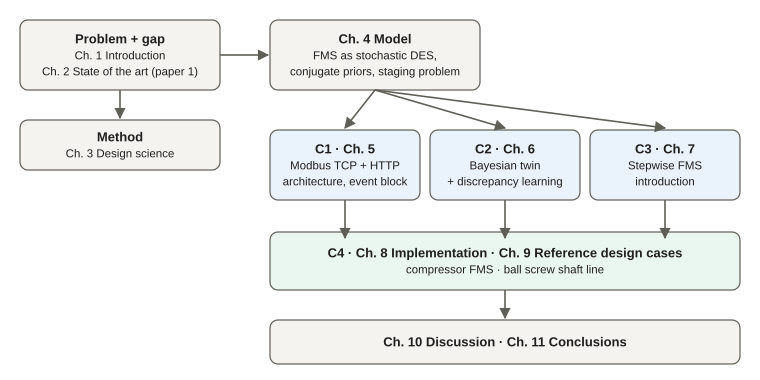

# Chapter 1 – Introduction

> Draft v1.0 – 2026-11-14.

## 1.1 Industrial background

In many emerging industries, manufacturing companies operate standalone CNC machine tools: each machine is loaded by
hand, orders are planned on paper or in spreadsheets, and little data leaves the machine. Competitive pressure — shorter
delivery times, more product variants, rising labour costs and quality requirements of export customers — pushes these
companies towards flexible manufacturing systems (FMS), in which machining centres, automated material handling and a
central control system produce a family of parts in varying mix with little changeover effort.

The step from standalone machines to an FMS is large and largely irreversible. The company must decide, at design time,
which machines to buy, how many pallets and how much buffer capacity to provide, which transport system to install and
how to control the system. At that time the decisive parameters are uncertain: supplier cycle times are measured under
ideal conditions, failure and repair behaviour of new machines is unknown, scrap rates of new processes have yet to be
learned, and demand may develop differently than forecast. The consequences of wrong assumptions become visible only during
commissioning and ramp-up, when the system produces less than planned and corrections are expensive.

The case behind this thesis is the planned factory of a manufacturer of V-type two-cylinder piston air compressors
(VC10, VC20, VC30), whose crankcases, cylinders and crankshafts are to be machined in a pallet-based FMS with three
horizontal machining centres, followed by assembly, performance testing, painting and final assembly. A second
production line for ball screws and profiled linear guides is planned. The company's technology base defines a further
constraint shared by many firms in its environment: the only communication technologies available are Ethernet,
Modbus TCP and HTTP; computers on the shop floor run offline; commercial IIoT platforms, OPC UA servers and cloud services
are not available.

## 1.2 Problem statement

Digital twins — virtual representations of a production system that are connected to it by data — promise to close the
loop between design assumptions and reality. The literature, however, offers little for the situation described
(Chapter 2): most published "digital twins" are simulation models with manual data exchange; their input uncertainty is
usually fixed at design time; updating with real data is rare and almost never Bayesian; predictions are seldom compared
with the real system after start-up and never followed through ramp-up; the communication technologies assumed are those
the target companies cannot use; and methods for staged FMS investment treat the capacity effect of an investment as
known, although it is precisely what is uncertain in a new system.

The problem addressed by this thesis is therefore:

> *How can a company that moves from standalone CNC machines to an FMS, with low-cost technology and uncertain design
> data, use a digital twin to predict its new system honestly, learn the system's true behaviour quickly during
> commissioning and ramp-up, and decide the steps of the introduction with less risk?*

## 1.3 Research objective and questions

The objective is to develop and evaluate an **uncertainty-aware, low-cost digital twin method for the stepwise
introduction of FMS**. Three research questions structure the work:

- **RQ1** – What architecture enables a reliable FMS digital twin using only Modbus TCP and HTTP on offline computers,
  and what are its measurable limits?
- **RQ2** – How can uncertain FMS design parameters be represented and updated with commissioning and ramp-up data, and
  how much does this improve prediction accuracy and the honesty of predicted uncertainty compared with a deterministic
  design model or a one-time calibration?
- **RQ3** – How can the updated twin support the stepwise decisions of FMS introduction — which machines and automation
  to add, and when?

## 1.4 Hypotheses

- **H1** – With a polling-based gateway, at least 40 machines can be monitored with state-change detection latency ≤ 1 s
  and event loss ≤ 0.1 %.
- **H2** – With sequential Bayesian updating, the monthly prediction error of good output falls below 5 % with at least
  30 % less ramp-up data than with the deterministic design model or a one-time calibration.
- **H3** – The 90 % prediction intervals of the updated twin achieve at least 85 % empirical coverage.
- **H4** – A staged introduction plan re-optimised after each Bayesian update gives a higher expected net present value
  and a lower risk of under-capacity than an all-at-once investment or a staged plan fixed at design time.

The thresholds are proposals derived from practical requirements (Table 5.1; Section 4.8); they are tested, not assumed.

## 1.5 Contributions

| | Contribution | Chapter |
|---|---|---|
| **C1** | A Modbus-TCP-and-HTTP-only reference architecture for FMS digital twins with six design rules, an **event-preserving register block** (change counter, time stamp, 8-entry ring buffer in every PLC) that removes the event loss inherent in polling, closed-form sizing formulas, and a laboratory measurement campaign | 5 |
| **C2** | An uncertainty-aware twin method: design statements translated into conjugate priors with an interpretable confidence; sequential Bayesian updating of failure, repair, cycle-time and scrap parameters with forgetting for ramp-up; nested Monte Carlo prediction; **model-discrepancy learning**; and a **frozen-prediction protocol** for honest validation | 4, 6 |
| **C3** | A decision method for the **stepwise introduction of an FMS** that re-decides investment options every stage with the updated twin, and an experimental quantification of the value of learning the uncertain capacity effect | 7 |
| **C4** | Application to two reference design cases — a compressor FMS and a ball screw shaft line — including a frozen design prediction for the real ramp-up and a validation protocol; a dependency-free implementation that runs offline, including an interactive browser version of all calculations | 8, 9 |

A systematic literature review (paper 1) underpins the research gap (Chapter 2).

## 1.6 Scope and limitations

The thesis addresses discrete manufacturing systems in the transition from standalone CNC machines to an integrated FMS.
It covers the system level — throughput, bottlenecks, investment — not process physics such as cutting forces, thermal
behaviour of machine tools or metallurgy. Demand uncertainty is represented by scenarios, not learned in detail. Safety
functions remain hard-wired and outside the data architecture. The methods are evaluated analytically, in a laboratory
bench and in controlled computational experiments; the field validation in the case factory is fully specified and its
design prediction frozen, but its results depend on the factory's start of production (Section 9.6). Case data are
design data of the planned factories and reference estimates where company data were not available; all values are
labelled accordingly.

## 1.7 Publications

- Paper 1 – *Digital twins for the design, ramp-up and stepwise introduction of flexible manufacturing systems under
  technology and data constraints: a systematic review* (manuscript complete; basis of Chapter 2).
- Paper 2 (planned) – low-cost Modbus/HTTP twin architecture with event block and laboratory evaluation (Chapter 5).
- Paper 3 (planned) – sequential Bayesian updating with model discrepancy for ramp-up prediction (Chapters 4, 6).
- Paper 4 (planned) – stepwise FMS introduction under learning, with the two cases (Chapters 7, 9).

## 1.8 Structure of the thesis

Chapter 2 reviews the state of the art and derives the research gap from a systematic review. Chapter 3 describes the
design-science methodology and the three-layer evaluation. Chapter 4 formalises the FMS model, the uncertain parameters,
the conjugate Bayesian models, the prediction measures and the staging decision problem. Chapter 5 designs and measures
the Modbus/HTTP architecture (RQ1, H1). Chapter 6 implements and tests the Bayesian twin in a virtual ramp-up (RQ2, H2,
H3). Chapter 7 develops and tests the stepwise introduction method (RQ3, H4). Chapter 8 describes the implementation,
Chapter 9 applies the method to the two reference cases and specifies the field validation, Chapter 10 discusses the
results and Chapter 11 concludes (Figure 1.1).

**Figure 1.1** Structure of the thesis and the four contributions.
