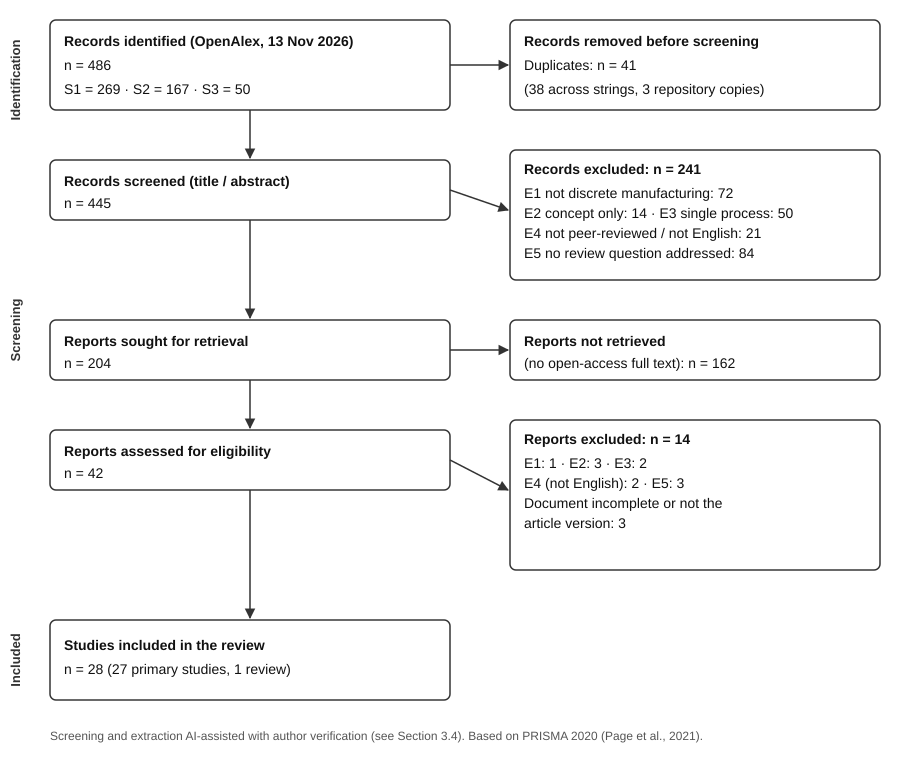

# Chapter 2 – State of the Art and Research Gap

> Draft v1.0 – 2026-11-14. Sections 2.1–2.8 review the foundations on which the thesis builds; Section 2.9 summarises
> the systematic literature review (paper 1, `research/paper1_slr/paper1_draft.md`), and Section 2.10 derives the
> research gap. References marked [verify] must be checked against the library database before submission.

## 2.1 Overview

The thesis connects six bodies of knowledge that are usually treated separately: flexible manufacturing systems
(Section 2.2), digital twins (2.3), simulation for production system design (2.4), uncertainty of simulation inputs and
its reduction by data (2.5), production ramp-up (2.6), industrial communication with low-cost technology (2.7), and
manufacturing modernisation in small and medium-sized enterprises (SMEs) and emerging economies together with staged
capacity investment (2.8). Each section ends with what the thesis takes from it and what is missing. Section 2.9 reports
the systematic review that examined where these bodies of knowledge meet; Section 2.10 states the gap.

## 2.2 Flexible manufacturing systems

### 2.2.1 Definition and classification
A flexible manufacturing system is a group of numerically controlled machine tools connected by an automated material
handling system and controlled by a central computer, able to process a family of parts in varying mix and quantity with
little changeover effort. Browne et al. (1984) classified FMS by their flexibility types — machine, process, product,
routing, volume, expansion, operation and production flexibility — and by their structure, from flexible machining cells
with a single machine and a pallet changer to flexible transfer lines. Sethi and Sethi (1990) surveyed the many
definitions of manufacturing flexibility and showed that flexibility is not one property but a set of capabilities whose
value depends on the uncertainty a company faces. Reconfigurable manufacturing systems (Koren et al., 1999) extended the
idea from flexibility within a fixed configuration to the ability to change the configuration itself — adding or
removing machines and capabilities as demand changes, which is the logic of the stepwise introduction studied here.

### 2.2.2 Design and planning models
Classical FMS research produced analytical models for design and planning: closed queueing networks for capacity and
work-in-process with a limited number of pallets, and mathematical programming for part-type selection, machine
grouping, loading and tool allocation (Stecke, 1983; Buzacott and Shanthikumar, 1993). These models give insight and
fast answers, but they rest on exponential or deterministic times and steady state. Discrete-event simulation (Section
2.4) became the standard tool for detailed design because it represents blocking, failures, dispatching rules and
transport realistically.

### 2.2.3 FMS in practice and in the target context
Industrial experience with FMS has been mixed: high investment, complex control and long ramp-up have repeatedly led to
systems that did not reach their planned output or flexibility. Recent work integrates FMS with Industry 4.0
technologies — robots, connected machine tools, MES and digital twins (Florescu, 2024; Ullah and Younas, 2024; Kampa et
al., 2026). For companies that operate standalone CNC machines, the move to an FMS is a large and largely irreversible
step, which is why the thesis treats it as a sequence of smaller decisions under uncertainty (Chapter 7).

*Taken from 2.2:* the FMS concept, its flexibility types and the reconfiguration logic. *Missing:* methods that support
the *transition* from standalone CNC machines to an FMS and quantify, during that transition, how far the design
assumptions hold.

## 2.3 Digital twins in manufacturing

### 2.3.1 Origin and definitions
The digital twin concept is usually traced to product life-cycle management, where Grieves described a virtual
representation of a physical product linked to it by data over its life cycle (Grieves and Vickers, 2017). In
manufacturing, the term has been used for very different artefacts, from 3D models to simulation models with live data.
Kritzinger et al. (2018) proposed the most widely used classification by data flow: a *digital model* exchanges data with
the physical object only manually, a *digital shadow* receives data automatically from the physical object, and a
*digital twin* exchanges data automatically in both directions. Their review found that most publications were concept
papers and that applied case studies concentrated on the lower integration levels. Later reviews mapped applications,
enabling technologies and research issues (Negri et al., 2017; Tao et al., 2019; Lu et al., 2020; Fuller et al., 2020)
and, most recently, a taxonomy along life-cycle stage, hierarchy level, model characteristics, digital-thread
connectivity and deployment (Seipolt et al., 2025).

### 2.3.2 Reference architecture
ISO 23247 (2021) defines a framework for digital twins in manufacturing with four functional entities: observable
manufacturing elements, a data collection and device control entity, a digital twin core entity and user entities. The
architecture of Chapters 5 and 8 is aligned with it: PLCs and machines are the observable elements, the Modbus/HTTP
gateway is the data collection entity, the Bayesian twin and the DES form the core, and MES, ERP and the browser
interface are the user entities.

### 2.3.3 Digital twins along the system life cycle
Most manufacturing digital twins support operation — monitoring, maintenance, scheduling. Fewer address the design
phase, where a twin is in fact a simulation model of a system that does not yet exist, and fewer still connect design and
operation. Van Beek et al. (2022) argue that the digital twin concept should integrate design decisions and operational
data across the life cycle and data from several design instances. Van Ginkel et al. (2025) report that research on
digital twins in system design and ramp-up is lacking and explore their implementation in SMEs qualitatively.

*Taken from 2.3:* the data-flow classification used to classify studies and to position the thesis artefact (a digital
shadow that becomes a twin through the staging decisions), and the ISO 23247 architecture. *Missing:* twins that carry
design-stage predictions *through* commissioning and ramp-up and quantify how good those predictions were.

## 2.4 Simulation for production system design

Discrete-event simulation is the established method to evaluate production system designs before they are built (Law,
2015). Reviews of simulation in manufacturing system design (Jahangirian et al., 2010; Negahban and Smith, 2014) show its
use for layout, capacity, buffer sizing, material handling and control rules. The quality of the result depends on the
input data: Bokrantz et al. (2017) analysed six industrial simulation cases in automotive companies and found that
machine vendors provide failure data only as means, that short stops are filtered out of monitoring data, and that
faulty or outdated data hinder input modelling. Design-stage simulation is therefore typically run with point estimates
or fixed distributions chosen by engineering judgement; its predictions are rarely compared with the real system after
start-up. Among the reviewed studies (Section 2.9), Konstantinov et al. (2022) are an exception: they compared
design-stage simulated cycle times of an assembly station with the commissioned station and found 17 % deviation before
and 8.7 % after manual recalibration.

*Taken from 2.4:* DES as the evaluation model (Chapters 4, 6, 7), the input-data problem as motivation. *Missing:* a
systematic way to update design-stage simulation inputs with commissioning and ramp-up data and to measure the effect.

## 2.5 Input uncertainty, calibration and data assimilation

### 2.5.1 Input uncertainty in simulation output analysis
When the input distributions of a simulation are estimated from finite data, their parameters are uncertain, and this
*input uncertainty* propagates to the output. The simulation literature distinguishes three families of methods to
quantify it (Barton, 2012): the delta method, which separates the variance contributions of stochastic and parameter
uncertainty using a Taylor approximation (Cheng and Holland, 1997); bootstrap resampling of the input data, often with
metamodels to save simulation effort; and Bayesian methods, which place distributions on the parameters and sample from
their posterior (Chick, 2001; Zouaoui and Wilson, 2003). Masciarelli and Matta (2022) applied metamodel-assisted
bootstrapping to a lab-scale manufacturing line with few data and noted that Bayesian approaches are computationally
demanding when the posterior must be sampled for many simulation runs.

### 2.5.2 Calibration with model discrepancy
Kennedy and O'Hagan (2001) formulated Bayesian calibration of computer models with an explicit model-discrepancy term:
observations equal the model output at the true parameters plus a systematic discrepancy plus noise. Without the
discrepancy term, calibration forces the parameters to absorb structural model error. Chapter 6 adopts this idea in a
simple sequential form and shows experimentally that, during ramp-up, parameter uncertainty alone yields over-confident
predictions.

### 2.5.3 Updating twins with live data
Recent manufacturing work updates simulation inputs from operating data: Schumacher et al. (2024) fit and re-fit
probability distributions of processing times and scrap rates to data from a real production system ("live fitting") as
input for simulation-based scheduling; Fu et al. (2025) update operation-time distributions from PLC timer data and
trigger line reconfiguration; Monek and Fischer (2023) extract DES input parameters automatically from a low-cost
inertial sensor and PLC data. These works update twins *in operation*; none starts from design-stage priors and follows a
new system through ramp-up.

*Taken from 2.5:* the Bayesian view of input uncertainty, conjugate models for cheap exact updates (Gelman et al., 2013
[verify edition]), the separation of epistemic and aleatory uncertainty, model discrepancy. *Missing:* sequential Bayesian
updating of production system models from design priors through commissioning and ramp-up, with evaluated prediction
quality.

## 2.6 Production ramp-up

Ramp-up — the period from the start of production to the planned output — is characterised by low output, high scrap,
frequent disturbances and rapid learning. Terwiesch and Bohn (2001) modelled ramp-up as a trade-off between producing
and learning, and showed that deliberate experimentation can shorten it. Surbier et al. (2014) reviewed the ramp-up
literature and identified the lack of quantitative decision support for the ramp-up phase as a main challenge. Learning
curves, dating back to Wright (1936), describe how unit time falls with cumulative output and underlie the explicit
learning-curve option of Section 4.6.5. In the systematic review (2.9), no study collected and used data during the
ramp-up of a new system with a digital twin.

*Taken from 2.6:* the ramp-up phenomenon (shape of the virtual ramp-up, Table 6.1; forgetting factor). *Missing:*
twin-based prediction and decision support during ramp-up.

## 2.7 Industrial communication for digital twins

### 2.7.1 Standards
Industrial communication is organised in levels from field devices to enterprise systems (IEC 62264). For digital twins
the literature favours OPC UA (IEC 62541), which provides an information model and secure client-server and
publish-subscribe communication, MQTT (ISO/IEC 20922) as a lightweight publish-subscribe protocol, and MTConnect for
machine tools [verify standard number]. Modbus TCP — a simple request-response protocol over TCP/IP with 16-bit
registers (Modbus Organization, 2006, 2012) — is supported by almost every PLC, including low-cost controllers, but is
rarely considered in digital twin research.

### 2.7.2 Low-cost and retrofit approaches
Retrofit studies connect legacy machines without replacing their controls: edge devices with containerised modules
(Tonejca et al., 2024), cameras with object tracking (Ward et al., 2021), inexpensive inertial sensors (Monek and
Fischer, 2023), open-source IoT frameworks for co-engineering in brownfield factories (Wintercorn et al., 2023), and
open-source messaging and dashboards in an SME (van Ginkel et al., 2025, who measured a PLC-to-twin delay of 0.98–3.02 ms).
These works show feasibility; performance limits — latency, data loss, capacity, cost — are rarely measured.

*Taken from 2.7:* the levels, the request-response nature of Modbus, retrofit patterns. *Missing:* a Modbus-TCP-and-HTTP
-only twin architecture with measured limits and a solution for the event loss inherent in polling (Chapter 5).

## 2.8 SMEs, emerging economies and staged capacity investment

### 2.8.1 Digital transformation in SMEs and emerging economies
Reviews report that SMEs face specific barriers to digital twins and Industry 4.0 — limited capital, skills and data,
and the difficulty of integrating heterogeneous equipment — and propose staged adoption paths (systematic review of the
digital and green transition of European manufacturing SMEs, 2025 [complete authors]). A 2026 review of digital twin
adoption in emerging economies notes that most of the evidence comes from developed countries (Cassius et al., 2026,
weak venue). Studies located in emerging economies analyse current-state systems with DES — an aluminium casting SME in
Malaysia (Kamar et al., 2024), a bottled-water SME in Nigeria (Odedairo and Nwabuokie, 2018), packaging lines moving to
AGVs in Indonesia (Purwaningsih et al., 2025) — or use synthetic data (Parameswari et al., 2026); Ullah and Younas (2024)
built a prototype FMS because no industrial FMS was accessible in their country; Tuhin et al. (2026) propose a phased
digitalisation path for a machining cell in Bangladesh.

### 2.8.2 Capacity expansion and staged investment
Capacity expansion under uncertainty is a classical operations research problem (Luss, 1982; Van Mieghem, 2003): when to
add how much capacity of which type, given uncertain demand and economies of scale. Real-options theory values the
flexibility to defer, stage or abandon investments (Trigeorgis, 1996); conditional value-at-risk provides a coherent risk
measure for such decisions (Rockafellar and Uryasev, 2000). These models usually treat the *demand* as uncertain and the
*capacity effect* of an investment as known. In the transition to an FMS, the capacity effect itself is uncertain,
because the real performance of new machines and processes is unknown until they run — the uncertainty that the
Bayesian twin reduces.

*Taken from 2.8:* the context, staged investment logic, CVaR. *Missing:* staged FMS investment decisions that learn the
uncertain capacity effect from shop-floor data.

## 2.9 Systematic literature review

### 2.9.1 Method
A systematic review following PRISMA 2020 (Page et al., 2021) examined where the topics of Sections 2.2–2.8 meet. Four
review questions were asked: SQ1 architectures and communication, especially low-cost technology; SQ2 representation
and updating of input uncertainty; SQ3 use in design, commissioning and ramp-up and validation of predictions; SQ4 SMEs,
emerging economies and the transition from standalone CNC to FMS. OpenAlex was searched on 13 November 2026 with three
strings combining a digital twin / simulation block, a manufacturing system block and a topic block (uncertainty;
life-cycle phase; context). Of 486 records, 445 remained after duplicate removal; title/abstract screening excluded 241;
204 reports were eligible for full-text assessment, of which the 42 available in open access were assessed and **28
studies included**. Screening and data extraction were assisted by a large language model under a written protocol and
verified by the author (Chapter 3). Figure 2.1 shows the selection; the full method and the extraction table are in paper 1.

**Figure 2.1** PRISMA 2020 flow diagram of the systematic review.

### 2.9.2 Results

**Table 2.1** Main findings of the review (n = 28).
| Dimension | Finding |
|---|---|
| Integration level | digital model 18, digital shadow 6, digital twin 3 (one only claimed), review 1 |
| Communication (SQ1) | not stated 12; OPC UA 6; TCP/IP 2; Profinet 2; MQTT, Beckhoff ADS, REST/HTTP, CoAP, RS485 once each; **Modbus 0** |
| Uncertainty (SQ2) | explicit in 12 (fixed distributions 9, empirical 1, scenarios 2); deterministic 5; not stated 11 |
| Updating with real data (SQ2) | automatic in **2** (Fu et al., 2025; Monek and Fischer, 2023); manual in 3; **Bayesian 0** |
| Life-cycle phase (SQ3) | design 18, commissioning 8, operation 14; **ramp-up with data 0** |
| Validation against reality (SQ3) | 5; design-stage prediction vs commissioned system: **1** (Konstantinov et al., 2022) |
| Context (SQ4) | SME 7, large 3, both 1, laboratory 8, not stated 9; emerging economies 7; **CNC → FMS transition with data 0** |
| Quality | mean score 3.7 of 6 |

The concept matrix of paper 1 (Table 5 there) codes seven features per study. No study combines automatic updating with
the commissioning or ramp-up phase; no study combines automatic updating, ramp-up and validation against reality; no study
combines low-cost technology with an emerging-economy case and real validation. A recent review of CAD–DES integration
(Chikwata et al., 2026) independently reports that model accuracy over the system life cycle is hardly measured.

### 2.9.3 Limitations of the review
One database was searched and only open-access full texts (42 of 204) were assessed; the gap statements therefore mean
"not found in the open-access literature" and should be re-checked against subscription journals. Screening and
extraction were AI-assisted with author verification. These limitations are reported in full in paper 1, Section 5.5.

## 2.10 Research gap

From Sections 2.2–2.9 five gaps follow, each addressed by a part of the thesis:

| Gap | Statement | Addressed in |
|---|---|---|
| G1 | Design-stage predictions of production system models are almost never validated against the commissioned system and never followed through ramp-up. | Ch. 4 (frozen-prediction protocol), Ch. 6, Ch. 9.6 |
| G2 | Input parameters are not updated sequentially from design priors with commissioning and ramp-up data; Bayesian updating with plant data is absent. | Ch. 4, Ch. 6 (C2) |
| G3 | Low-cost data paths are demonstrated qualitatively; Modbus TCP is not evaluated; polling-induced event loss is not addressed. | Ch. 5 (C1) |
| G4 | No method supports the staged transition from standalone CNC to FMS with learning of the uncertain capacity effect. | Ch. 7 (C3) |
| G5 | Evidence from emerging economies stops at current-state models or synthetic data. | Ch. 9 (C4) |

The research questions of Chapter 1 follow directly: RQ1 addresses G3, RQ2 addresses G1 and G2, RQ3 addresses G4; the
cases of Chapter 9 address G5.

## 2.11 Summary
FMS research provides the system concept and the reconfiguration logic; digital twin research provides definitions and a
reference architecture but concentrates on operation and on lower integration levels; simulation research provides the
evaluation model and the methods for input uncertainty, but design-stage models are rarely updated or validated;
calibration research provides the discrepancy concept; ramp-up research describes the phase but lacks twin-based decision
support; communication research favours technologies that the target companies cannot use and does not address polling
losses; and capacity-investment research treats capacity effects as known. The systematic review of 28 studies confirmed
that no published work combines these elements. Chapters 4–9 close the five resulting gaps.

---
**References cited in this chapter** (full list in the bibliography): Barton (2012) Tutorial: input uncertainty in output
analysis, Proc. Winter Simulation Conference; Bokrantz et al. (2017) SIMULATION; Browne, Dubois, Rathmill, Sethi, Stecke
(1984) Classification of flexible manufacturing systems, The FMS Magazine 2(2); Buzacott, Shanthikumar (1993) Stochastic
Models of Manufacturing Systems, Prentice Hall; Cassius et al. (2026); Cheng, Holland (1997) J. Statistical Computation and
Simulation 57; Chick (2001) Operations Research 49(5); Chikwata et al. (2026); Florescu (2024); Fu et al. (2025); Fuller et
al. (2020); Gelman et al. (2013) Bayesian Data Analysis [verify edition]; Grieves, Vickers (2017) in Transdisciplinary
Perspectives on Complex Systems, Springer; IEC 62264; IEC 62541; ISO 23247; ISO/IEC 20922; Jahangirian et al. (2010)
European J. Operational Research 203(1); Kamar et al. (2024); Kampa et al. (2026); Kennedy, O'Hagan (2001); Konstantinov et
al. (2022); Koren et al. (1999) Reconfigurable manufacturing systems, CIRP Annals 48(2); Kritzinger et al. (2018); Law (2015)
Simulation Modeling and Analysis, 5th ed.; Lu et al. (2020); Luss (1982) Operations Research 30(5); Masciarelli, Matta
(2022); Modbus Organization (2006, 2012) [verify]; Monek, Fischer (2023); Negahban, Smith (2014) J. Manufacturing Systems
33(2); Negri, Fumagalli, Macchi (2017) Procedia Manufacturing 11; Odedairo, Nwabuokie (2018); Page et al. (2021);
Parameswari et al. (2026); Purwaningsih et al. (2025); Rockafellar, Uryasev (2000); Schumacher et al. (2024); Seipolt et al.
(2025); Sethi, Sethi (1990) Int. J. Flexible Manufacturing Systems 2(4); Stecke (1983) Management Science 29(3); Surbier,
Alpan, Blanco (2014) Production Planning & Control 25(15); Tao et al. (2019); Terwiesch, Bohn (2001) Int. J. Production
Economics 70(1); Tonejca et al. (2024); Trigeorgis (1996); Tuhin et al. (2026); Ullah, Younas (2024); van Beek et al. (2022);
van Ginkel et al. (2025); Van Mieghem (2003) Manufacturing & Service Operations Management 5(4); Ward et al. (2021);
Wintercorn et al. (2023); Wright (1936) J. Aeronautical Sciences 3(4); Zouaoui, Wilson (2003) IIE Transactions 35(9).
