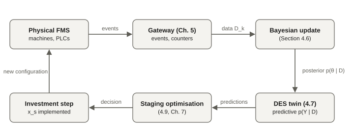
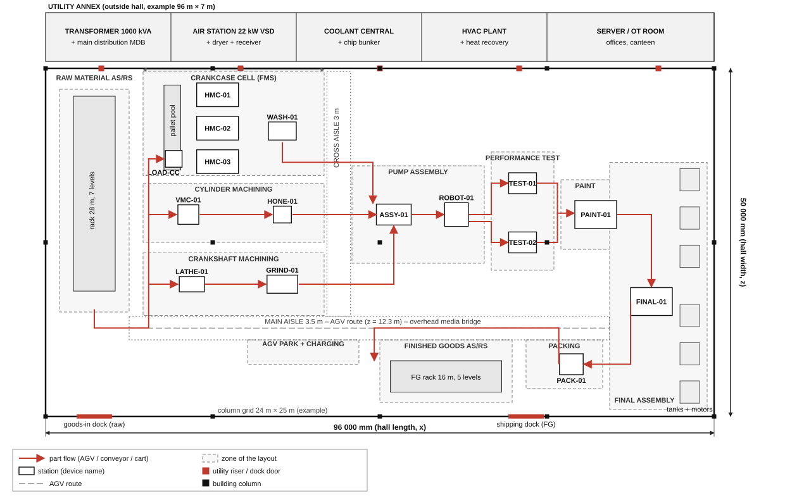
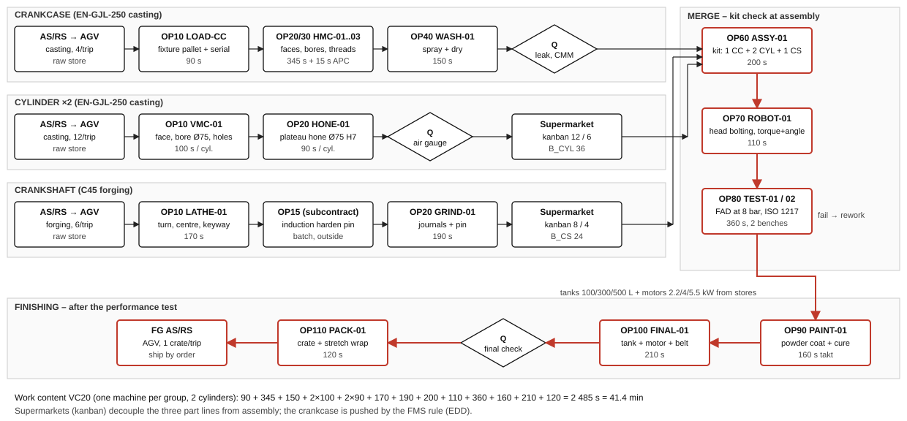
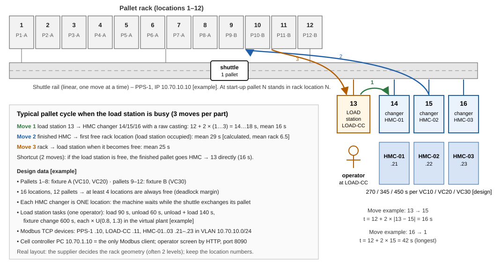
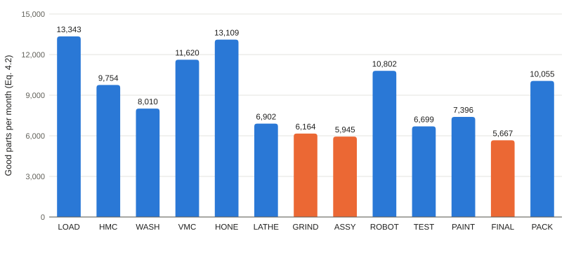

# Chapter 4 – System Model and Problem Formulation

> Draft v1.0 – 2026-11-13. All worked numbers in this chapter are produced by `thesis/code/bayes.py`
> (`chapter4_examples()` and the capacity table); re-running the code reproduces them. Labels: **[design estimate]** =
> value from the FMS design / supplier statement (to be replaced by the final design data of the case company);
> **[assumption]** = modelling choice; **[simulated]** = generated by a model, not measured.

## 4.1 Purpose and overview

Chapters 2 and 3 established the research gap and the research design. This chapter provides the formal basis for the
contributions of the thesis. It defines (i) the flexible manufacturing system (FMS) as a stochastic discrete-event
system, (ii) the performance measures used throughout the thesis, (iii) the uncertain input parameters and how they
are represented by probability distributions, (iv) the conjugate Bayesian models with which these distributions are
updated from shop-floor data during commissioning and ramp-up, (v) the measures with which the quality of twin
predictions is judged, including the frozen-prediction protocol, and (vi) the stepwise introduction of the FMS as a
decision problem under uncertainty.

The chapter answers the modelling part of the three research questions: Section 4.6 is the mathematical core of RQ2,
Section 4.8 defines how predictions are validated, and Section 4.9 formulates the decision problem of RQ3. The
communication architecture (RQ1) is treated in Chapter 5; it determines which observations are available to the models
defined here (Table 4.1).

Figure 4.1 shows the overall logic. The physical FMS produces events (state changes, cycle completions, quality
results). The gateway of Chapter 5 turns them into observations. The Bayesian models of Section 4.6 turn observations
into posterior distributions of the parameter vector θ. The discrete-event simulation (DES) propagates these
distributions into predictive distributions of performance. The staging optimisation of Chapter 7 uses these
predictions to decide the next investment step.

**Figure 4.1** Information loop of the uncertainty-aware twin.

## 4.2 Notation

| Symbol | Meaning | Unit |
|---|---|---|
| $\mathcal{M}$ | set of station types (machine groups), $m \in \mathcal{M}$ | – |
| $c_m$ | number of identical servers (machines) of type $m$ | – |
| $\mathcal{P}$ | set of product variants, $p \in \mathcal{P}$, with mix share $\pi_p$, $\sum_p \pi_p = 1$ | – |
| $R_p$ | routing of variant $p$: ordered list of station types | – |
| $t_{pm}$ | processing (cycle) time of variant $p$ on station type $m$ | s |
| $h_m$ | handling time per part (pallet change, load/unload not parallel to cutting) | s |
| $\lambda_m$ | failure rate of a machine of type $m$; $\mathrm{MTBF}_m = 1/\lambda_m$ | 1/h |
| $\mu_m$ | repair rate; $\mathrm{MTTR}_m = 1/\mu_m$ | 1/h |
| $q_{pm}$ | scrap probability per part | – |
| $B_j$ | capacity of buffer $j$; $N_{pal}$ number of pallets; $N_{AGV}$ number of AGVs | parts / – |
| $\boldsymbol{\theta}$ | vector of all uncertain parameters $(\lambda, \mu, t, q, \dots)$ | – |
| $\boldsymbol{x}$ | configuration / investment decision vector | – |
| $H$ | productive hours per period (month) | h |
| $D_k$ | observations collected in period $k$ | – |
| $Y_k$ | performance in period $k$ (e.g. good output) | parts |
| $\hat{Y}_k$ | twin prediction of $Y_k$ | parts |

## 4.3 The FMS as a stochastic discrete-event system

### 4.3.1 Structure
The FMS is modelled as an open network of station types connected by buffers and a transport system. Each station type
$m$ has $c_m$ identical servers. A part of variant $p$ visits the station types in the order $R_p$. Pallets circulate in
a closed loop within the machining cell, which limits the work-in-process (WIP) of the cell to $N_{pal}$. Transport
between areas is performed by AGVs or conveyors. Release of work orders to the cell and the choice of the next part at
each machine follow dispatching rules (for example earliest due date, EDD), which are part of $\boldsymbol{x}$.

Each server is at any time in one of the states *processing*, *idle (starved)*, *blocked*, *down* (failure or repair),
or *setup*. These states are exactly the states transmitted by the machine interface of Chapter 5 (status word), so
that model and data use the same vocabulary — a deliberate design choice that makes the Bayesian updates of Section 4.6
directly computable from machine data.

### 4.3.2 The case configuration
The compressor FMS (case 1, Chapter 9) produces three variants of V-type two-cylinder piston air compressors
(VC10, VC20, VC30) with mix shares 0.3 / 0.5 / 0.2 [design estimate]. Table 4.2 lists the 13 station types of the
current design with cycle times per variant, handling time, reliability and scrap parameters [design estimate]. The
crankcase cell is a pallet-based FMS with three horizontal machining centres (HMC) with pallet changers; the
remaining areas (cylinder and crankshaft machining, assembly, test, paint, final assembly, packing) are connected by
AGVs and buffers.

**Table 4.2** Station types of the compressor FMS – design estimates (source: FMS design model, version of 2026-11-13).
| Type $m$ | $c_m$ | $t$ VC10 / VC20 / VC30 [s] | $\bar t_m$ [s] | $h_m$ [s] | MTBF [h] | MTTR [min] | $q_m$ |
|---|---|---|---|---|---|---|---|
| LOAD | 1 | 80 / 90 / 100 | 89.0 | 0 | 200 | 5 | 0 |
| HMC | 3 | 270 / 345 / 450 | 343.5 | 15 | 30 | 20 | 0.008 |
| WASH | 1 | 130 / 150 / 170 | 148.0 | 0 | 80 | 10 | 0 |
| VMC | 1 | 85 / 100 / 125 | 100.5 | 0 | 35 | 15 | 0.010 |
| HONE | 1 | 75 / 90 / 110 | 89.5 | 0 | 45 | 12 | 0.008 |
| LATHE | 1 | 140 / 170 / 210 | 169.0 | 0 | 30 | 15 | 0.010 |
| GRIND | 1 | 160 / 190 / 230 | 189.0 | 0 | 40 | 18 | 0.012 |
| ASSY | 1 | 170 / 200 / 240 | 199.0 | 0 | 120 | 8 | 0.003 |
| ROBOT | 1 | 95 / 110 / 130 | 109.5 | 0 | 70 | 10 | 0.002 |
| TEST | 2 | 300 / 360 / 420 | 354.0 | 0 | 90 | 10 | 0 |
| PAINT | 1 | 130 / 160 / 200 | 159.0 | 0 | 60 | 15 | 0.006 |
| FINAL | 1 | 180 / 210 / 250 | 209.0 | 0 | 120 | 8 | 0.002 |
| PACK | 1 | 100 / 120 / 140 | 118.0 | 0 | 80 | 6 | 0 |

The mix-weighted mean cycle time is $\bar t_m = \sum_{p} \pi_p\, t_{pm}$; for the HMC,
$\bar t_{HMC} = 0.3 \cdot 270 + 0.5 \cdot 345 + 0.2 \cdot 450 = 343.5$ s.

### 4.3.3 Layout, material flow and the crankcase FMS cell
Figure 4.2 shows the planned hall (96 m × 50 m) of the case factory. Raw castings and forgings arrive at the goods-in
dock and are stored in a raw-material automated storage and retrieval system (AS/RS: 28 bays × 7 levels × 2 sides =
392 unit-load locations, one stacker crane). Two automated guided vehicles (AGVs) run along the main aisle and connect
the AS/RS input/output point with the load station of the crankcase cell, the assembly area and, at the end of the
line, the finished-goods AS/RS at the shipping dock. The three part lines (crankcase, cylinder, crankshaft) are
machined in parallel areas on the left; pump assembly, the robot station for the cylinder heads, two performance test
benches, paint, final assembly and packing follow from left to right. A utility annex outside the north wall holds the
transformer, the compressed-air station, the central coolant system and the server / OT room in which the control PC
of Chapter 8 is installed.

**Figure 4.2** Planned layout of the compressor factory: areas, stations (device names), part flow and AGV route
[design example; positions from the factory configuration, not to scale for construction].

Figure 4.3 gives the routing of each part family with operation numbers and VC20 cycle times. The crankcase (grey cast
iron EN-GJL-250) is the only part that is machined in a pallet-based flexible cell: it is clamped on a fixture pallet at
the load station (OP10), machined complete on one of the three HMCs (OP20/30: faces, cylinder bores, bearing bores,
threads; 345 s plus 15 s pallet change for VC20), washed (OP40) and checked for leaks before it meets the cylinders and
the crankshaft at the kit check of pump assembly (OP60). The cylinder and crankshaft lines are dedicated flow lines that
deliver into kanban supermarkets; this decouples them from assembly so that the crankcase cell, which follows the
work-order sequence (earliest due date), is the only part line that needs real-time scheduling. The VC20 work content
of one compressor is 2 485 s (41.4 min) over 13 operations [design estimate].

**Figure 4.3** Part routings of the compressor FMS with operation numbers, stations and VC20 cycle times; diamonds are
inspections [design estimate].

The crankcase cell (Figure 4.4) is the flexible core of the factory and the part of the system that the term FMS
refers to in the narrow sense (Section 2.2.1): three identical HMCs, each with a two-position pallet changer that offers
one transfer location to the cell, share a common pool of 12 fixture pallets. A rail-guided shuttle moves one pallet at a
time between 16 numbered locations: rack locations 1 – 12, the load station (location 13) and the changers of HMC-01 to
HMC-03 (locations 14 – 16). Eight pallets carry fixture type A (VC10 and VC20 crankcases, same clamping concept) and
four carry fixture type B (VC30). One operator at the load station unloads machined crankcases and clamps raw
castings; the load station therefore serves every part twice, which makes it a candidate bottleneck even though its
static capacity in Table 4.3 (89 s per load) looks ample. With a move time of 12 s + 2 s per location distance
[example], a typical part needs three shuttle moves when the load station is busy (load station → HMC, HMC → rack,
rack → load station), or two when it is free. Each HMC holds a tool magazine of 18 tools with sister tools for the
fast-wearing taps and drills; tool life is managed by the CNC and supervised by the tool management of Section 8.9.
Every device of the cell — the pallet system with its shuttle, the load station and the three HMCs — is a Modbus TCP
server with the standard interface of Chapter 5, so that the same signals serve the real-time control (Chapter 8) and
the Bayesian updating of the twin (Section 4.6).

**Figure 4.4** The crankcase FMS cell: 12 fixture pallets, 16 numbered locations, shuttle moves of a typical pallet
cycle and design data [design example].

The cell is a closed system with respect to pallets: its work-in-process can never exceed $N_{pal} = 12$, and the
relation between the number of pallets and the throughput is non-linear (Section 9.2.5). The static model of
Section 4.4.1 treats the cell as one station type with $c_{HMC} = 3$; the process-level analysis of Section 9.2.5
quantifies what this simplification misses.

## 4.4 Performance measures

### 4.4.1 Static capacity and bottleneck
Before any simulation, the static capacity of each station type gives a first, optimistic estimate. With steady-state
availability

$$A_m = \frac{\mathrm{MTBF}_m}{\mathrm{MTBF}_m + \mathrm{MTTR}_m} \tag{4.1}$$

the number of good parts a station type can deliver in $H$ productive hours is

$$C_m = c_m \, A_m \, \frac{3600\,H}{\bar t_m + h_m}\,(1 - q_m). \tag{4.2}$$

The static bottleneck is $m^* = \arg\min_m C_m$ and the static system capacity is $C^* = C_{m^*}$ (assuming one part of each
station type per compressor). With $H = 330$ h per month (two shifts of 7.5 productive hours, 22 days) [assumption],
Table 4.3 results.

**Table 4.3** Static monthly capacity, Eq. (4.2) [calculated from design estimates].
| Type | $A_m$ | $C_m$ [parts/month] | | Type | $A_m$ | $C_m$ [parts/month] |
|---|---|---|---|---|---|---|
| LOAD | 0.9996 | 13 343 | | GRIND | 0.9926 | 6 164 |
| HMC | 0.9890 | 9 754 | | ASSY | 0.9989 | 5 945 |
| WASH | 0.9979 | 8 010 | | ROBOT | 0.9976 | 10 802 |
| VMC | 0.9929 | 11 620 | | TEST | 0.9982 | 6 699 |
| HONE | 0.9956 | 13 109 | | PAINT | 0.9959 | 7 396 |
| LATHE | 0.9917 | 6 902 | | FINAL | 0.9989 | 5 667 |
| | | | | PACK | 0.9988 | 10 055 |

Example (HMC): $A = 30 / (30 + 0.333) = 0.9890$;
$C = 3 \cdot 0.9890 \cdot 3600 \cdot 330 / (343.5 + 15) \cdot (1 - 0.008) = 9\,754$ parts per month.

**Figure 4.5** Static monthly capacity per station type; the three most loaded stations are highlighted [calculated].

The static bottleneck is FINAL (5 667 parts/month), followed closely by ASSY (5 945) and GRIND (6 164). Three
observations motivate the rest of this chapter. First, the margin between the three most loaded stations is small
(about 9 %), so a moderate error in a design-stage cycle time can move the bottleneck. Second, Eq. (4.2) ignores blocking,
starvation, pallet and transport limits, and the variability of failures; the DES of Section 4.7 captures these effects
and typically yields a lower throughput. Third, every quantity in Eq. (4.2) is uncertain at design time — which is the
subject of Section 4.5.

### 4.4.2 Dynamic measures
The DES delivers, for each period $k$: good output $Y_k$; throughput rate $TH$; overall equipment effectiveness
per machine,

$$\mathrm{OEE} = A \cdot P \cdot Q, \tag{4.3}$$

with $A$ = run time / planned time, $P$ = (ideal cycle time × parts) / run time, $Q$ = good parts / parts; mean lead
time $W$; and mean work-in-process $L$, linked by Little's law $L = TH \cdot W$, which is used as a consistency check of
both model and data.

## 4.5 Uncertain parameters

### 4.5.1 Which parameters are uncertain
At design time the following inputs are uncertain: cycle times $t_{pm}$ (supplier time studies, often for ideal
conditions); failure rates $\lambda_m$ and repair rates $\mu_m$ (vendors usually state only a mean, if anything — a
problem documented by Bokrantz et al. (2017)); scrap rates $q_{pm}$; and, during ramp-up, the learning behaviour of
operators and processes. Demand is also uncertain but is treated as an external scenario variable in Chapter 7.

### 4.5.2 Aleatory and epistemic uncertainty
Two kinds of uncertainty must be separated. **Aleatory** uncertainty is the natural variability of the process: even
with perfectly known parameters, the time to the next failure is random. **Epistemic** uncertainty is lack of
knowledge about the parameters themselves: the true MTBF of a new HMC is not known before it has run. A deterministic
design model ignores both; a classical stochastic DES with fixed distributions captures only aleatory uncertainty.
The approach of this thesis represents both: aleatory uncertainty through the sampling distributions in the DES, and
epistemic uncertainty through probability distributions on $\boldsymbol{\theta}$. Only epistemic uncertainty can be
reduced by data, and its reduction over commissioning and ramp-up is precisely what Section 4.6 models and Chapter 6
measures.

### 4.5.3 From design statements to prior distributions
Engineers and suppliers do not state probability distributions; they state a value and, at best, a confidence. The
method therefore translates design statements into prior distributions with one interpretable confidence parameter:
the **equivalent amount of data** the statement is worth (equivalent operating hours, repairs, cycles or parts). A
supplier MTBF from a large installed base may be worth several thousand operating hours; an estimate for a newly
designed station may be worth only a few hundred. This "equivalent sample" interpretation makes the prior transparent
and allows a sensitivity analysis on the confidence (Chapter 6). Table 4.4 summarises the four models.

**Table 4.4** Conjugate models for the uncertain inputs.
| Quantity | Data model | Prior | Design statement → prior | Observations from machine interface |
|---|---|---|---|---|
| Failures | Poisson process, rate $\lambda$ | Gamma$(a, b)$ | MTBF$_0$, worth $T_0$ h: $b = T_0$, $a = 1 + T_0/\mathrm{MTBF}_0$ | number of failures $n$ in uptime $T$ |
| Repairs | Exponential, rate $\mu$ | Gamma$(a, b)$ | MTTR$_0$, worth $r_0$ repairs: $a = 1 + r_0$, $b = r_0\,\mathrm{MTTR}_0$ | repair durations $r_1..r_k$ |
| Cycle time | $\ln t \sim \mathcal{N}(m, \sigma^2)$ | Normal-Inverse-Gamma $(m_0, \kappa_0, a_0, b_0)$ | mode $t_0$, ±spread $s$ (90 %), worth $n_0$ cycles | cycle times $t_1..t_n$ |
| Scrap | Bernoulli, probability $q$ | Beta$(a, b)$ | $q_0$, worth $N_0$ parts: $a = q_0 N_0$, $b = (1-q_0) N_0$ | scrap $x$ out of $n$ parts |

## 4.6 Conjugate Bayesian updating

Bayes' theorem gives the posterior of the parameters after observing data $D$:

$$p(\boldsymbol{\theta} \mid D) = \frac{p(D \mid \boldsymbol{\theta})\, p(\boldsymbol{\theta})}{\int p(D \mid \boldsymbol{\theta}')\, p(\boldsymbol{\theta}')\, d\boldsymbol{\theta}'} \propto p(D \mid \boldsymbol{\theta})\, p(\boldsymbol{\theta}). \tag{4.4}$$

For general models the integral requires numerical methods (Markov chain Monte Carlo, particle filters), which are
computationally heavy and difficult to run and verify on an offline factory PC. For the four quantities of Table 4.4,
**conjugate** priors exist: the posterior belongs to the same family as the prior, and the update reduces to adding
sufficient statistics to the hyperparameters. This makes each update exact, a few arithmetic operations long,
explainable to maintenance and planning staff ("the prior was worth 300 hours; we have added 310 real hours"), and
sequential — the posterior after period $k$ is the prior for period $k+1$. The parameters of different machines and
quantities are assumed a priori independent; the effect of this assumption is discussed in Section 4.10.

### 4.6.1 Failure rate – Gamma–Poisson model
If failures of a machine occur as a Poisson process with rate $\lambda$ during uptime, the likelihood of observing $n$
failures in uptime $T$ is $p(n \mid \lambda) \propto \lambda^n e^{-\lambda T}$. With prior
$\lambda \sim \mathrm{Gamma}(a, b)$, density $\propto \lambda^{a-1} e^{-b\lambda}$, the posterior is

$$\lambda \mid n, T \sim \mathrm{Gamma}(a + n,\; b + T). \tag{4.5}$$

Because MTBF $= 1/\lambda$ follows an inverse-gamma distribution, its posterior mean is

$$\mathbb{E}[\mathrm{MTBF} \mid D] = \frac{b + T}{a + n - 1}, \qquad a + n > 1. \tag{4.6}$$

The prior parameters follow from the design statement (Table 4.4): $b = T_0$ and $a = 1 + T_0/\mathrm{MTBF}_0$, which makes
the prior mean of MTBF equal to MTBF$_0$ exactly.

**Example 4.1 (HMC failures).** Design statement: MTBF$_0$ = 30 h, judged to be worth $T_0$ = 300 h of data
[design estimate]. Prior: $a = 1 + 300/30 = 11$, $b = 300$; mean MTBF 30.0 h, 90 % credible interval 17.7–48.6 h.
In the first commissioning month the machine records $n$ = 14 failures in $T$ = 310 h of uptime [simulated observation].
Posterior: Gamma(25, 610); mean MTBF $= 610/24 = 25.4$ h, interval 18.1–35.1 h. After a second month with 24 failures in
640 h: Gamma(49, 1250); mean 26.0 h, interval 20.5–32.8 h. The width of the interval falls from 30.9 h (prior) to
17.1 h after one month and 12.4 h after two — the epistemic uncertainty is visibly reduced, while the estimate moves
from the optimistic design value towards what the data show.

The posterior predictive number of failures in a future uptime $\tau$ is negative binomial,
$N_\tau \sim \mathrm{NB}\big(a+n,\; \tfrac{b+T}{b+T+\tau}\big)$, which is used to plan maintenance capacity.

### 4.6.2 Repair time – Gamma–exponential model
Repair durations $r_i$ are modelled as exponential with rate $\mu$. With prior $\mu \sim \mathrm{Gamma}(a, b)$ the posterior
after $k$ repairs is

$$\mu \mid r_{1..k} \sim \mathrm{Gamma}\Big(a + k,\; b + \sum_{i=1}^{k} r_i\Big), \qquad \mathbb{E}[\mathrm{MTTR} \mid D] = \frac{b + \sum r_i}{a + k - 1}. \tag{4.7}$$

**Example 4.2 (HMC repairs).** Design statement: MTTR$_0$ = 20 min, worth 5 repairs [design estimate]: $a = 6$,
$b = 5 \cdot 20 = 100$ min (1.667 h); mean 20.0 min, 90 % interval 9.5–38.2 min. Fourteen repairs are observed with a
mean of 30.1 min [simulated observation]. Posterior: $a = 20$, $b = 521$ min (8.683 h); mean MTTR $= 521/19 = 27.4$ min,
interval 18.7–39.3 min. Repairs on a new machine take longer than planned — typical for the first months, when spare
parts and diagnostic routines are not yet established.

If repair times are clearly not exponential (for example log-normal with a long tail), the cycle-time model of
Section 4.6.3 is applied to $\ln r$ instead; the choice is made with a goodness-of-fit test on the commissioning data.

### 4.6.3 Cycle time – Normal-Inverse-Gamma model on the log scale
Cycle times are positive and right-skewed; their logarithm is approximately normal. With $y = \ln t \sim \mathcal{N}(m, \sigma^2)$
and the Normal-Inverse-Gamma prior

$$\sigma^2 \sim \mathrm{Inv\text{-}Gamma}(a_0, b_0), \qquad m \mid \sigma^2 \sim \mathcal{N}(m_0, \sigma^2/\kappa_0), \tag{4.8}$$

the posterior after $n$ observations with mean $\bar y$ and sum of squared deviations $S = \sum (y_i - \bar y)^2$ is again
Normal-Inverse-Gamma with

$$\kappa_n = \kappa_0 + n,\quad m_n = \frac{\kappa_0 m_0 + n \bar y}{\kappa_n},\quad a_n = a_0 + \frac{n}{2},\quad b_n = b_0 + \frac{S}{2} + \frac{\kappa_0\, n\, (\bar y - m_0)^2}{2 \kappa_n}. \tag{4.9}$$

The posterior predictive of $\ln t$ is a Student-$t$ distribution with $2a_n$ degrees of freedom, location $m_n$ and scale
$\sqrt{b_n (\kappa_n + 1)/(a_n \kappa_n)}$; the mean cycle time is $\mathbb{E}[t] = \exp(m + \sigma^2/2)$.

*Prior from the design statement.* A supplier states the most likely cycle time $t_0$ and a tolerance $\pm s$ that covers
about 90 % of cycles. Then $\sigma_0 = \ln(1+s)/1.645$; because the mode of a log-normal distribution is $\exp(m - \sigma^2)$,
$m_0 = \ln t_0 + \sigma_0^2$; $\kappa_0 = n_0$ (worth in cycles), $a_0 = \max(2, n_0/2)$ and $b_0 = \sigma_0^2 (a_0 - 1)$ so that
$\mathbb{E}[\sigma^2] = \sigma_0^2$.

**Example 4.3 (HMC cycle time, VC20).** Supplier statement: $t_0$ = 345 s ± 10 %, worth $n_0$ = 10 cycles
[design estimate]. Prior: $\sigma_0 = \ln 1.10 / 1.645 = 0.0579$, $m_0 = 5.8469$, $\kappa_0 = 10$, $a_0 = 5$, $b_0 = 0.0134$; mean cycle
time 346.7 s, 90 % interval of the mean 336.6–357.3 s. Forty cycles are measured during commissioning with a mean of
371.0 s [simulated observation; the "true" mean of the generator is 372 s]. Posterior: $\kappa = 50$, $m = 5.9014$,
$a = 25$, $b = 0.0845$; mean 366.2 s, interval 361.1–371.3 s. With 40 real cycles against a prior worth 10, the estimate
moves 80 % of the way from the design value to the observed mean, as Eq. (4.9) prescribes ($\kappa_0/\kappa_n = 0.2$).
A 7 % longer HMC cycle time reduces the HMC capacity of Table 4.3 from 9 754 to about 9 140 parts per month — still not
the bottleneck, but the same shift at GRIND or ASSY would change the system capacity directly.

### 4.6.4 Scrap rate – Beta–binomial model
With $x$ scrap parts among $n$ and prior $q \sim \mathrm{Beta}(a, b)$:

$$q \mid x, n \sim \mathrm{Beta}(a + x,\; b + n - x), \qquad \mathbb{E}[q \mid D] = \frac{a + x}{a + b + n}. \tag{4.10}$$

**Example 4.4 (HMC scrap).** Design: $q_0$ = 0.8 %, worth 250 parts: Beta(2, 248), 90 % interval 0.14–1.90 %.
Observed in commissioning: 9 scrap parts out of 400 [simulated observation]. Posterior Beta(11, 639): mean 1.69 %,
interval 0.96–2.62 %. The data more than double the expected scrap — typical of first-article and setup scrap in the
early weeks.

### 4.6.5 Non-stationarity during ramp-up: forgetting factor
The models above assume that the parameters are constant. During ramp-up they are not: failure rates fall as early
faults are removed (the "infant mortality" part of the bathtub curve), cycle times fall as programs are optimised, and
scrap falls as operators learn. Two mechanisms are provided.

*Exponential forgetting (power prior).* Before each update the current hyperparameters are discounted with a factor
$\rho \in (0, 1]$:

$$a \leftarrow \rho\, a + n, \qquad b \leftarrow \rho\, b + T \quad \text{(analogous for the other models)}. \tag{4.11}$$

Information that is $j$ periods old keeps weight $\rho^{j}$; the effective memory is about $1/(1-\rho)$ periods. With
$\rho = 1$ the standard update results.

**Example 4.5.** HMC prior as in Example 4.1. Month 1: 18 failures in 300 h (early faults); month 2: 6 failures in 300 h
[simulated]. Without forgetting ($\rho = 1$): Gamma(35, 900), mean MTBF 26.5 h. With $\rho = 0.7$: Gamma(24.0, 657),
mean 28.6 h. The true month-2 behaviour (50 h between failures) is approached faster with forgetting, at the price of
wider intervals. The choice of $\rho$ is a trade-off between tracking and stability that Chapter 6 investigates
experimentally.

*Explicit learning curve.* Where a trend is expected, it can be modelled directly, for example
$t(n) = t_\infty\,(1 + \alpha\, e^{-n/\tau})$ for the cycle time after $n$ parts. The parameters $t_\infty, \alpha, \tau$ are then
estimated on the log scale by Bayesian linear regression (also conjugate). This is used for the ramp-up curve of the
whole line in Chapter 9.

### 4.6.6 From events to sufficient statistics
Table 4.5 shows how the observations required by Eqs. (4.5)–(4.11) are computed from the machine interface of Chapter 5.
All of them are simple counts, sums and sums of squares, which the gateway can accumulate in real time with constant
memory.

**Table 4.5** Sufficient statistics and their source.
| Statistic | Computation | Source signal (Chapter 5) |
|---|---|---|
| $T$ uptime | time in states *processing*, *idle*, *blocked* | status word, timestamped transitions |
| $n$ failures | transitions into *down* with failure code | status word + alarm code |
| $r_i$ repair durations | duration of *down* intervals | status word |
| $n$, $\bar y$, $S$ for cycle times | cycle-complete events; $y = \ln t$ accumulated by Welford's algorithm | cycle counter + timestamp / cycle-time register |
| $x$, $n$ scrap | good / scrap counters | 32-bit counters |

## 4.7 Uncertainty propagation through the discrete-event twin

### 4.7.1 Nested Monte Carlo
The posterior distribution of performance is obtained by nested sampling:

1. Draw $\boldsymbol{\theta}^{(i)} \sim p(\boldsymbol{\theta} \mid D_{1..k})$, $i = 1..N_\theta$ (outer loop, epistemic).
2. For each $\boldsymbol{\theta}^{(i)}$ run the DES for the prediction horizon with $R$ replications (inner loop, aleatory),
   using common random numbers across configurations.
3. Collect $Y^{(i,r)}$; the empirical distribution approximates the posterior predictive $p(Y \mid D_{1..k})$.

The predictive mean and the $(1-\alpha)$ prediction interval are

$$\hat Y = \frac{1}{N_\theta R} \sum_{i,r} Y^{(i,r)}, \qquad \mathrm{PI}_{1-\alpha} = \big[\, Q_{\alpha/2}(Y),\; Q_{1-\alpha/2}(Y) \,\big]. \tag{4.12}$$

By the law of total variance, the predictive variance splits into an epistemic and an aleatory part,

$$\mathrm{Var}(Y) = \underbrace{\mathrm{Var}_{\theta}\big(\mathbb{E}[Y \mid \theta]\big)}_{\text{epistemic}} + \underbrace{\mathbb{E}_{\theta}\big[\mathrm{Var}(Y \mid \theta)\big]}_{\text{aleatory}}, \tag{4.13}$$

which is estimated from the between- and within-group variance of the nested sample. Eq. (4.13) is used in Chapter 6 to
show how the epistemic share decreases as data arrive.

### 4.7.2 Computational budget
With $N_\theta$ outer and $R$ inner samples, the cost is $N_\theta R$ DES runs. The Monte Carlo standard error of $\hat Y$ is
approximately $\sqrt{\mathrm{Var}(Y)/(N_\theta R)}$ when $R$ is small relative to $N_\theta$; Chapter 6 shows that
$N_\theta = 200$, $R = 1$ – 2 gives a standard error below 0.5 % of monthly output for the case model, which runs in
minutes on a standard PC.

## 4.8 Prediction quality and the frozen-prediction protocol

### 4.8.1 Measures
For each period $k$ with observed output $Y_k$ and prediction $\hat Y_k$:

$$E_k = \frac{|\hat Y_k - Y_k|}{Y_k}, \qquad \mathrm{MAPE} = \frac{1}{K}\sum_{k=1}^{K} E_k, \tag{4.14}$$

the **coverage** of the $(1-\alpha)$ prediction intervals, $\mathrm{COV} = \frac{1}{K}\sum_k \mathbb{1}\{Y_k \in \mathrm{PI}_k\}$, which should be
close to $1-\alpha$ (calibration), and the mean relative **interval width**, which should be as small as possible
(sharpness). Calibration and sharpness are judged together: a very wide interval is always "right" but useless.
Optionally the continuous ranked probability score (CRPS) combines both in one number.

### 4.8.2 Frozen predictions and baselines
To make the comparison with reality fair, predictions must be fixed before the data they are compared with exist. The
protocol is:

- **P0 – design freeze.** At the end of the design phase the complete twin (model, parameters, priors, software version)
  is stored with a date and a version tag, together with its predictions $\hat Y_k^{(0)}$ and intervals for every month
  $k$ of the planned ramp-up. P0 is never changed.
- **B0 – deterministic baseline.** The same model with point values (prior means), as a conventional design study would
  use.
- **B1 – one-time calibration.** The model recalibrated once with the data of the first commissioning month and then
  frozen — the practice reported by Konstantinov et al. (2022).
- **Pk – sequentially updated twin.** After each period $k$ the posterior is updated and new predictions for periods
  $k+1, \dots$ are issued and stored before the data of those periods arrive.

Hypothesis H2 of Chapter 1 is tested by comparing $E_k$ of Pk with B0 and B1; H3 by the coverage of Pk.

## 4.9 The stepwise introduction of the FMS as a decision problem

### 4.9.1 Stages and options
A company moving from standalone CNC machines to an FMS rarely invests in everything at once. Let the introduction
take place over stages $s = 1, \dots, S$ (for example half-years). At each stage a set of options $\mathcal{O}$ is available,
for example: an additional HMC; a pallet pool of a given size; an automatic tool-management system; AGVs; an AS/RS;
a robot cell; the cell controller and MES connection (levels L0–L4 of Section 2.x). The decision $x_{s,o} \in \{0, 1\}$
indicates that option $o$ is implemented at stage $s$; once implemented an option remains ($x_{s,o} \le x_{s+1,o}$).
Precedence relations hold (for example AGVs require the cell controller), written as $x_{s,o} \le x_{s,o'}$ for
$o' \in \mathrm{Pre}(o)$.

### 4.9.2 Capacity and economics
Given the configuration $\boldsymbol{x}_s$ and parameters $\boldsymbol{\theta}$, the DES delivers the good output
$Y_s(\boldsymbol{x}_s, \boldsymbol{\theta})$. With demand $D_s$, sales are $\min(Y_s, D_s)$. The net cash flow of stage $s$ is

$$CF_s = m\,\min(Y_s, D_s) - c^{op}(\boldsymbol{x}_s) - \sum_{o} c_o\,(x_{s,o} - x_{s-1,o}) - \kappa\,\max(0, D_s - Y_s), \tag{4.15}$$

with contribution margin per unit $m$, operating cost $c^{op}$, investment cost $c_o$ of option $o$, and penalty $\kappa$ for
unmet demand (lost margin and goodwill). The net present value with discount rate $r$ is
$\mathrm{NPV} = \sum_s CF_s / (1 + r)^{s}$.

### 4.9.3 Objective and policy
Because $\boldsymbol{\theta}$ is uncertain and becomes better known as the system runs, the problem is a multi-stage
decision problem under learning. The decision at stage $s$ may depend on the information $\mathcal{I}_s$ available then
(the posterior of Section 4.6). A **policy** $\Pi$ maps information to decisions, $\boldsymbol{x}_s = \Pi_s(\mathcal{I}_s)$. The
objective is

$$\max_{\Pi}\; \mathbb{E}\big[\mathrm{NPV}(\Pi)\big] - \beta\, \mathrm{CVaR}_{\gamma}\big(-\mathrm{NPV}(\Pi)\big) \tag{4.16}$$

subject to budget limits $\sum_o c_o (x_{s,o} - x_{s-1,o}) \le K_s$, monotonicity and precedence. $\mathrm{CVaR}_\gamma$ is the
conditional value-at-risk (mean of the worst $1-\gamma$ share of outcomes) and $\beta \ge 0$ expresses risk aversion; a
company in an emerging economy with limited access to capital is typically risk-averse.

Eq. (4.16) is intractable in exact form: the outcome of each configuration requires simulation, and the information
state is a distribution. Chapter 7 therefore solves it by a rolling-horizon approximation: at each stage, the current
posterior is used to evaluate candidate plans by simulation (sample average approximation), the best first-stage
decision is implemented, data are collected, the posterior is updated, and the plan is re-optimised. Three reference
policies are compared: **all-at-once** (full FMS at stage 1), **static staged** (a staged plan fixed at design time with
B0 parameters) and **adaptive staged** (re-optimised after each Bayesian update) — hypothesis H4.

## 4.10 Assumptions and limitations of the model
1. **Independence of parameters.** Priors of different machines and quantities are independent. Machines of the same
   type and supplier are in reality correlated; a hierarchical prior (shared hyperparameters per machine type) would
   transfer information between them. This extension is discussed in Chapter 6.
2. **Exponential failure and repair laws.** Constant hazard during uptime is a standard assumption for complex,
   repairable machines but not for wear-out failures. The forgetting factor and the goodness-of-fit check of Section
   4.6.2 mitigate this; Weibull models without conjugate priors are left to future work.
3. **Static capacity model.** Eq. (4.2) is used only for screening; all decisions use the DES.
4. **One part per station type per product.** True for the case routing; for products with several identical parts
   (e.g. two cylinders) $C_m$ is divided by the number of parts.
5. **Demand as scenario input.** Demand uncertainty is represented by scenarios in Chapter 7, not learned.

## 4.11 Summary
This chapter formalised the FMS as a stochastic DES, defined the performance measures, and showed that the static
bottleneck of the case design lies within a 9 % margin among three stations — so that design-stage errors can move it.
It separated aleatory from epistemic uncertainty and translated design statements into priors with an interpretable
confidence (equivalent amount of data). For failures, repairs, cycle times and scrap, conjugate models give exact,
sequential and explainable updates (Eqs. 4.5–4.11), with a forgetting factor for ramp-up. Nested Monte Carlo propagates
the posterior into predictive distributions of performance (Eqs. 4.12–4.13), whose quality is judged by error, coverage
and width under a frozen-prediction protocol with two baselines (Section 4.8). Finally, the stepwise introduction of the
FMS was formulated as a risk-aware multi-stage decision problem under learning (Eq. 4.16). Chapter 5 defines how the
observations required by these models are obtained with low-cost technology, Chapter 6 implements and tests the
updating, and Chapter 7 solves the decision problem.

---
**References cited in this chapter** (full list in the thesis bibliography): Bokrantz et al. (2017); Konstantinov et al.
(2022); Kritzinger et al. (2018); Gelman et al. (2013) *Bayesian Data Analysis*, 3rd ed., CRC Press (conjugate models,
Eqs. 4.5–4.10) [verify edition]; Ibrahim & Chen (2000) "Power prior distributions for regression models", *Statistical
Science* 15(1) (forgetting / power prior, Eq. 4.11) [verify]; Little (1961) "A proof for the queuing formula L = λW",
*Operations Research* 9(3); Rockafellar & Uryasev (2000) "Optimization of conditional value-at-risk", *Journal of Risk*
2(3) (Eq. 4.16) [verify]; Welford (1962) "Note on a method for calculating corrected sums of squares and products",
*Technometrics* 4(3).
