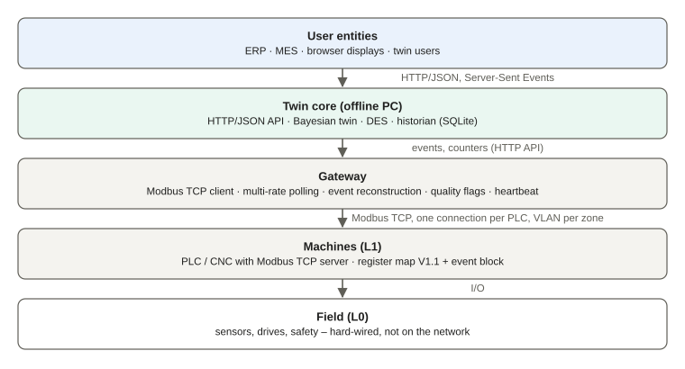
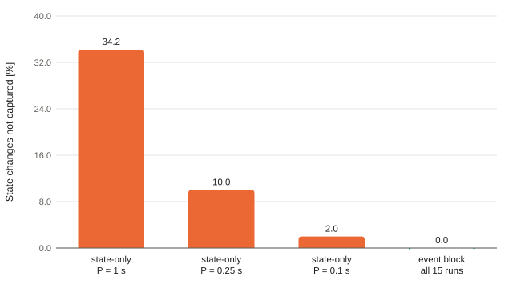
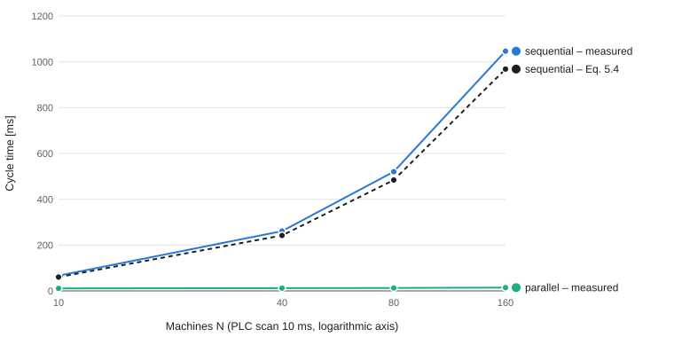

# Chapter 5 – Low-Cost Digital Twin Architecture with Modbus TCP and HTTP

> Draft v1.0 – 2026-11-13. Code: `thesis/code/commbench.py` (Modbus bench), `thesis/code/httpbench.py` (HTTP bench);
> data: `thesis/data/comm_runs.jsonl`, `comm_rtt.json`, `http_bench.json`. Labels: **[calculated]** from formulas,
> **[measured]** on the laboratory bench (one office PC, loopback network, emulated PLC response times – see 5.7.1),
> **[assumption]**, **[design]** from the factory communication design (guides 43 and 47 of the project).

## 5.1 Purpose and design constraint

The Bayesian twin of Chapters 4 and 6 needs, for every machine, a stream of state changes, cycle completions, good and
scrap counts and repair durations (Table 4.5). This chapter designs and evaluates the architecture that delivers these
observations under the constraint that defines the case company and many firms in emerging industries: **the only
communication technologies available are Ethernet, Modbus TCP and HTTP**, the twin runs on an **offline PC** without
cloud services, and the budget excludes commercial IIoT platforms. OPC UA, MQTT brokers, time-sensitive networking and
5G — the technologies that dominate the literature (Chapter 2; 6 of 28 reviewed studies used OPC UA, none Modbus) — are
not available.

The chapter answers RQ1: *what architecture enables a reliable FMS digital twin with only Modbus TCP and HTTP, and what
are its limits?* Its contributions are (i) a reference architecture with explicit design rules (5.3), (ii) an
**event-preserving register block** that removes the fundamental weakness of polling — lost short events — at almost
no cost (5.4), (iii) closed-form sizing formulas for polling period, capacity, bandwidth, latency, event loss and
time-stamp error (5.5), and (iv) a laboratory measurement campaign that tests the formulas and hypothesis H1 (5.7):

- **H1**: with a polling-based gateway, at least 40 machines can be monitored with state-change detection latency
  ≤ 1 s and event loss ≤ 0.1 %.

## 5.2 Requirements

**Table 5.1** Requirements for the twin's data path.
| Id | Requirement | Source |
|---|---|---|
| R1 | Every state change, cycle, good/scrap part and repair must reach the twin (completeness ≥ 99.9 %) | Bayesian updates (Table 4.5) are biased by lost events |
| R2 | State-change detection latency ≤ 1 s for monitoring; ≤ 1 h is sufficient for model updating | operator displays; monthly update rhythm (Ch. 6) |
| R3 | Event time stamps with error ≤ 1 s (≤ PLC scan time preferred) | repair durations, uptime $T$ in Eq. (4.5) |
| R4 | ≥ 40 machines per gateway, scalable to the ≈ 75 machines of the second case | case factories |
| R5 | Only Ethernet, Modbus TCP (machines) and HTTP/JSON (MES, ERP, browser, twin) | company rule [design] |
| R6 | Runs on one offline industrial PC, standard software only (Python standard library) | offline rule; maintainability |
| R7 | Machine PLCs need only a standard Modbus TCP server and a simple function block | low-cost PLCs (Delta AS, Siemens S7-1200) |
| R8 | Faults (machine offline, slow, wrong data) are detected and flagged, never silently ignored | data quality |
| R9 | No write access from the twin to machine control except a defined command area; safety stays hard-wired | safety, IEC 62443 zoning |
| R10 | Same interface for all machines regardless of supplier | integration effort in a weak supplier market |

## 5.3 Reference architecture

### 5.3.1 Layers
The architecture has five layers, aligned with the ISA-95 / IEC 62264 levels used in the factory design:

**Figure 5.1** Layers of the low-cost twin architecture.

### 5.3.2 Design rules
1. **One client.** The gateway is the only Modbus client on the machine network. MES, ERP, browser and twin never talk
   Modbus; they use the gateway's HTTP API. This keeps the number of TCP connections per PLC at one (low-cost PLCs
   often accept only 4–8 Modbus connections) and creates a single place for data quality checks.
2. **One map.** Every machine carries the same register map (V1.1 of the factory design: 227 holding registers,
   addresses 0–226) regardless of supplier — the supplier implements one function block ("FB standard interface").
3. **Pull for status, handshake for commands.** Status is polled; orders from the MES are written into a command area
   (registers 200–225) with a toggle-bit handshake, so that a lost or repeated write can be detected.
4. **Multi-rate polling.** Registers are grouped by required freshness: FAST (0–11, state, alarm, handshake; 500 ms),
   COUNTERS (20–99; 1 s), ENERGY (100–103; 10 s) [design], plus the EVENT block of Section 5.4.
5. **Heartbeats both ways.** The PLC increments a heartbeat register; the gateway writes register 226 every second and
   every PLC watches it (gateway lost after 5 s). The gateway flags a machine *stale* if its heartbeat has not changed
   for 3 polls.
6. **Events, not samples, for the twin.** The twin is fed reconstructed events with PLC time stamps (Section 5.4), not
   sampled states.

### 5.3.3 Comparison with publish–subscribe architectures
Polling is often regarded as inferior to publish–subscribe (MQTT, OPC UA PubSub): it wastes bandwidth on unchanged
values and misses short events. Section 5.5 shows that the bandwidth argument is irrelevant at factory scale (below 3 %
of a 100 Mbit/s link for 160 machines), and Section 5.4 removes the event argument by moving event buffering into the
PLC. Polling also has advantages that matter in the target context: every low-cost PLC supports a Modbus server; the
client controls load and timing; a dead device is detected immediately by a timeout; and no broker has to be installed,
secured and maintained.

## 5.4 The event-preserving register block

### 5.4.1 The problem of polling
A gateway that reads the state register every $P$ seconds observes a *sample* of the state signal. A state that lasts
less than $P$ — a short stop, a brief blocking, a quick alarm — may fall between two polls and disappear; a sequence
A → B → A within one interval appears as "no change"; and the time of every change is known only to within $P$. For a
monitoring display this is tolerable. For the Bayesian updating it is not: lost short stops bias failure counts $n$
downwards and uptime $T$ upwards in Eq. (4.5), and sampled time stamps distort repair durations in Eq. (4.7).

### 5.4.2 Design
The remedy is to let the PLC — which sees every change in its scan — keep the history, and let the gateway read it.
The event block adds 28 registers to the map (proposed addresses 104–131, version V1.2):

**Table 5.2** Event block (EVENT group).
| Offset | Content | Type |
|---|---|---|
| 0–1 | change counter: number of state changes since power-on | UINT32 |
| 2–3 | time of last change, ms (PLC clock) | UINT32 |
| 4–27 | ring buffer, 8 entries × (new state, time ms high word, time ms low word), newest first | 8 × (UINT16 + UINT32) |

On every state change the PLC function block increments the counter, writes the time stamp and inserts the entry into
the ring — about ten lines of structured text or ladder in addition to the standard interface. The gateway compares the
counter with the value of the previous poll: the difference $\Delta$ is the exact number of changes since then, and the
newest $\min(\Delta, 8)$ ring entries give their states and PLC time stamps. If $\Delta > 8$, the gateway knows exactly how
many events were lost and flags the interval; nothing is lost silently (requirement R8).

In the laboratory bench (5.7) the block is placed at registers 0–35 together with the core status registers, so that one
FC03 request of 36 registers reads everything needed for state monitoring; in the factory map V1.2 it is read together
with the FAST group (two requests, or one if the block is relocated to registers 12–19 + 104–131 in a later map version).

## 5.5 Sizing calculations

### 5.5.1 Frame sizes and bandwidth
A Modbus TCP read request (function code 03) is an application data unit of 12 bytes (7-byte MBAP header + 5-byte PDU);
the response for $n$ registers is $9 + 2n$ bytes. On Ethernet each TCP segment adds about 78 bytes (preamble and
inter-frame gap 20, Ethernet header and checksum 18, IPv4 20, TCP 20), and a separate acknowledgement frame occupies at
least 84 bytes on the wire. The traffic of one poll is therefore

$$b(n) = (12 + 78) + (9 + 2n + 78) + 84 = 261 + 2n \ \text{bytes}. \tag{5.1}$$

For the 36-register block, $b = 333$ bytes [calculated]. With the full multi-rate scheme (FAST 12 registers at 2 Hz,
EVENT 28 at 2 Hz, COUNTERS 80 at 1 Hz, ENERGY 4 at 0.1 Hz) one machine generates

$$\dot B = 2\,b(12) + 2\,b(28) + b(80) + 0.1\,b(4) = 1\,652 \ \text{bytes/s}, \tag{5.2}$$

i.e. 0.53 Mbit/s for 40 machines and 2.1 Mbit/s for 160 machines — 0.5 % and 2.1 % of a 100 Mbit/s link
[calculated]. Bandwidth is not a constraint; latency and PLC response time are.

### 5.5.2 Poll cycle and gateway capacity
The round-trip time of one request is $\mathrm{RTT} = t_{net} + t_{PLC}$. Many PLCs serve Modbus requests at the end of the
program scan, so with scan time $t_{scan}$ the waiting time is roughly uniform on $[0, t_{scan}]$ plus a fixed processing
time $t_0$:

$$\mathbb{E}[\mathrm{RTT}] \approx t_{net} + t_0 + t_{scan}/2. \tag{5.3}$$

A **sequential** gateway (one request after another) needs a cycle time $T_c = \sum_{i=1}^{N} k_i\,\mathrm{RTT}_i$ for $N$
machines with $k_i$ requests each. To keep the target period $P$, the number of machines is limited to

$$N_{max}^{seq} = \frac{P}{k\,\mathbb{E}[\mathrm{RTT}]}. \tag{5.4}$$

With $t_{net} = 0.05$ ms (switched LAN), $t_0 = 1$ ms and $t_{scan} = 10$ ms [assumption], $\mathbb{E}[\mathrm{RTT}] = 6.05$ ms and
$N_{max}^{seq} = 165$ machines for one request per second, but only 41 machines for two requests every 500 ms; with
$t_{scan} = 20$ ms these numbers halve (90 and 23) [calculated]. A **parallel** gateway (one concurrent request per
machine) has $T_c \approx \max_i \mathrm{RTT}_i + N\,t_{gw}$, where $t_{gw}$ is the gateway's own processing time per
request; its capacity is limited by $t_{gw}$, not by the PLCs.

### 5.5.3 Detection latency
With the event block, an event is detected at the first poll after it occurred. With effective period
$P_{eff} = \max(P, T_c)$ the latency $L$ is approximately uniform:

$$\mathbb{E}[L] \approx P_{eff}/2 + \mathbb{E}[\mathrm{RTT}], \qquad L_{max} \approx P_{eff} + \mathrm{RTT}_{max}. \tag{5.5}$$

### 5.5.4 Event loss
*State-only polling.* A state segment of duration $d$ is unobserved with probability $\max(0,\, 1 - d/P_{eff})$. With the
event mix of the bench (30 % short pulses of 0.05–0.5 s, 70 % states with exponential duration, mean 5 s
[assumption]) the expected share of segments that are never seen is 28 % at $P = 1$ s, 7 % at 0.25 s and 1.5 % at 0.1 s
[calculated]. Changes A → B → A within one interval are lost in addition, so the reported share of changes is lower still.

*Event block.* Events are lost only if more than 8 occur between two polls. With event rate $\lambda$ per machine the
number of events in one interval is approximately Poisson($\lambda P_{eff}$), so

$$P_{loss} \approx \Pr\{N(\lambda P_{eff}) > 8\}. \tag{5.6}$$

For the bench's rate $\lambda = 0.28$ s$^{-1}$: $2 \times 10^{-11}$ at $P_{eff} = 1$ s, $2 \times 10^{-3}$ at 10 s, and 0.99 at 60 s
[calculated]. The ring depth $R$ is chosen so that $\Pr\{N(\lambda P_{eff}) > R\}$ is negligible for the slowest expected
poll (including a gateway restart); $R = 8$ covers about 10 s of an unusually busy machine.

### 5.5.5 Time-stamp error
State-only polling stamps a change with the poll time; the error is uniform on $[0, P_{eff}]$ with standard deviation
$P_{eff}/\sqrt{12}$ (0.29 s at $P = 1$ s). The event block uses the PLC time stamp; its error is the PLC scan time plus
the offset of the PLC clock. Because low-cost PLC real-time clocks drift, the gateway writes the reference time to every
PLC once per hour (FC16 to two registers of the command area) and measures the offset from the PLC's echo; the residual
offset is to be measured on the real PLCs during commissioning (Section 5.8).

## 5.6 HTTP side: the twin's API
All non-Modbus clients use the HTTP/JSON API of the gateway/twin server (Python `http.server`, threaded):
`GET /api/state` (snapshot of all machines), `GET /api/machine/{id}`, `GET /api/events?since=<id>` (reconstructed
events for the historian, MES and twin), `POST /api/mes/booking` (orders, confirmations), `GET /api/twin/prediction`
(current prediction records of Chapter 6). Events carry a monotonic sequence number so that a client that was offline
can fetch everything it missed (`since=`), which gives HTTP the same completeness guarantee as the event block gives
Modbus. The historian appends events to SQLite; nothing is overwritten.

## 5.7 Laboratory measurement campaign

### 5.7.1 Set-up
The bench (`commbench.py`) runs two processes on one office PC (Windows Server 2022, 16 logical cores, Python 3.12,
standard library only):

- **Machine process.** $N$ simulated machines, each a Modbus TCP server on its own port with the 36-register block
  (status, change counter, time stamps, counters, heartbeat, 8-entry ring). Each machine changes state at random times:
  30 % short pulses (0.05–0.5 s), 70 % normal states (exponential, mean 5 s). The **true time of every change** is logged.
  To emulate a PLC, each response is delayed by $U(0, t_{scan}) + 1$ ms with $t_{scan}$ = 10 ms (also 20 ms and 0 ms)
  [assumption: emulation of scan-synchronous Modbus servers].
- **Gateway process.** Polls all machines with FC03 (36 registers), sequentially or in parallel (asyncio), at a target
  period $P$; reconstructs events by state comparison (S) and by the event block (R).

Both processes read the same high-resolution clock (`time.perf_counter`, QueryPerformanceCounter, system-wide), so
latencies and losses are computed exactly against the logged truth. Only events between each machine's first
(baseline) and last poll are counted.

*Two pitfalls found and corrected during the campaign* — reported because they invalidate naive measurements on the
same platform: (1) `time.time()` on Windows advances in steps of about 15.6 ms, which made sub-millisecond timings
read as zero; (2) asyncio timers on Windows may fire up to one clock tick early, so emulated PLC delays implemented with
`asyncio.sleep` were silently skipped when several requests were pending. The final bench uses `perf_counter` for all
time stamps and thread-based servers with `time.sleep` at 1 ms timer resolution; a first campaign with the faulty
version was discarded.

*Limits of the set-up.* The network is the loopback interface, so $t_{net}$ is smaller than on a switched LAN (typically
0.1–0.5 ms per round trip; to be confirmed in 5.8); the PLC behaviour is emulated, not measured. The bench therefore
measures the *architecture and gateway* — capacity, latency, loss, reconstruction — under a stated PLC timing model.

### 5.7.2 Results

**Table 5.3** Measurement results, 60 s per run, 36-register FC03 polls [measured; PLC timing emulated].
| $N$ | Polling | $P$ [s] | $t_{scan}$ [ms] | Cycle mean / p95 [ms] | Achieved rate [Hz] | RTT median / p99 [ms] | Events | State-only: changes reported | Event block: loss | Latency mean / p95 / max [s] |
|---|---|---|---|---|---|---|---|---|---|---|
| 10 | sequential | 1.0 | 10 | 66.4 / 84.5 | 1.00 | 6.97 / 11.50 | 148 | 70.3 % | 0.00 % | 0.54 / 0.96 / 1.02 |
| 10 | parallel | 1.0 | 10 | 10.8 / 12.0 | 1.00 | 6.57 / 11.57 | 148 | 70.9 % | 0.00 % | 0.54 / 0.94 / 1.01 |
| 40 | sequential | 1.0 | 10 | 260.8 / 303.7 | 1.00 | 6.51 / 11.58 | 650 | 67.7 % | 0.00 % | 0.52 / 0.96 / 1.03 |
| 40 | parallel | 1.0 | 10 | 11.9 / 12.3 | 1.00 | 6.56 / 11.70 | 650 | 65.1 % | 0.00 % | 0.52 / 0.95 / 1.01 |
| 80 | sequential | 1.0 | 10 | 520.1 / 567.3 | 1.00 | 6.49 / 11.58 | 1280 | 68.6 % | 0.00 % | 0.51 / 0.97 / 1.08 |
| 80 | parallel | 1.0 | 10 | 12.7 / 13.0 | 1.00 | 6.69 / 11.82 | 1280 | 66.8 % | 0.00 % | 0.51 / 0.95 / 1.01 |
| 160 | sequential | 1.0 | 10 | 1046.3 / 1110.4 | 0.96 | 6.52 / 11.50 | 2651 | 63.2 % | 0.00 % | 0.53 / 1.00 / 1.12 |
| 160 | parallel | 1.0 | 10 | 14.3 / 14.8 | 1.00 | 7.16 / 12.46 | 2614 | 64.8 % | 0.00 % | 0.51 / 0.95 / 1.01 |
| 40 | parallel | 0.25 | 10 | 11.8 / 12.2 | 4.00 | 6.49 / 11.67 | 652 | 90.8 % | 0.00 % | 0.14 / 0.25 / 0.26 |
| 160 | parallel | 0.25 | 10 | 14.1 / 14.7 | 4.00 | 7.15 / 12.53 | 2625 | 89.5 % | 0.00 % | 0.13 / 0.25 / 0.26 |
| 40 | sequential | 0.25 | 10 | 259.6 / 290.1 | 3.85 | 6.12 / 11.53 | 650 | 88.8 % | 0.00 % | 0.14 / 0.26 / 0.30 |
| 160 | sequential | 1.0 | 20 | 1846.2 / 1965.5 | 0.54 | 11.52 / 21.29 | 2631 | 55.8 % | 0.00 % | 0.94 / 1.77 / 2.04 |
| 160 | parallel | 1.0 | 20 | 23.9 / 24.6 | 1.00 | 12.17 / 22.20 | 2615 | 64.8 % | 0.00 % | 0.52 / 0.96 / 1.02 |
| 160 | sequential | 0.25 | 0 | 6.7 / 7.3 | 4.00 | 0.04 / 0.09 | 2618 | 90.9 % | 0.00 % | 0.12 / 0.24 / 0.25 |
| 160 | parallel | 0.1 | 0 | 3.5 / 4.3 | 10.00 | 1.76 / 4.75 | 2613 | 98.0 % | 0.00 % | 0.05 / 0.10 / 0.11 |

Across all 15 runs the gateway observed **23,825 true state changes, and the event block recovered every one of
them**: the loss was 0.00 % in every run, including 160 machines polled only every 1.85 s. Its time stamps were
identical to the logged truth, because the emulated PLC writes exact time stamps; real PLCs add their scan-time
resolution (Section 5.8). State-only polling of the same data reported only 63–71 % of the changes at $P$ = 1 s,
89–91 % at 0.25 s and 98 % at 0.1 s.

**Figure 5.2** Share of state changes not captured: state-only polling at three periods versus the event block [measured].

**Figure 5.3** Poll cycle time versus number of machines: sequential (measured and Eq. 5.4) and parallel gateway, PLC scan 10 ms [measured / calculated].

**Comparison with the formulas of Section 5.5.**
- *Sequential capacity (Eq. 5.4).* The measured RTT (median 6.5 ms; the mean is slightly higher because sleeps
  overshoot by about 0.5 ms) gives cycle times of 261 ms for 40 machines and 1 046 ms for 160 machines, against 242 ms
  and 968 ms predicted with $\mathbb{E}[\mathrm{RTT}] = 6.05$ ms. With 160 machines the sequential gateway can no longer
  hold $P$ = 1 s (achieved 0.96 Hz), and with $t_{scan}$ = 20 ms it falls to 0.54 Hz (cycle 1 846 ms; predicted
  1 768 ms) — exactly the limit of Eq. (5.4).
- *Parallel polling.* The parallel gateway polls 160 machines in 14 ms (24 ms with $t_{scan}$ = 20 ms), i.e. in about
  one maximal PLC response time. It holds 4 Hz for 160 machines and 10 Hz with instantly answering devices (3.5 ms
  cycle). The gateway's own cost is about 0.04 ms per request on this PC: 6.7 ms for 160 sequential requests to devices
  that answer instantly. The raw loopback RTT is 0.014 ms and does not depend on the number of registers between 1 and
  125 (`comm_rtt.json`).
- *Latency (Eq. 5.5).* Mean latencies of 0.51–0.54 s at $P$ = 1 s and 0.13–0.14 s at 0.25 s match
  $P_{eff}/2 + \mathrm{RTT}$. The maximum equals $P_{eff} + \mathrm{RTT}_{max}$: 1.01–1.12 s at $P$ = 1 s, and 2.04 s for
  the overloaded sequential case.
- *State-only loss (Section 5.5.4).* The formula predicts that 28 %, 7 % and 1.5 % of state segments are unobserved
  at 1, 0.25 and 0.1 s. The measured shares of unreported changes (29–37 %, 9–11 %, 2 %) are slightly higher, as
  expected, because A → B → A sequences within one interval are lost in addition.

### 5.7.3 HTTP API
**Table 5.4** HTTP/JSON API on the same PC, 10 s per configuration, keep-alive connections [measured].
| Request | Clients | Requests/s | Median latency [ms] | p99 latency [ms] |
|---|---|---|---|---|
| GET /api/state (160 machines, 35.5 kB JSON) | 1 | 4,340 | 0.22 | 0.31 |
|  | 4 | 4,494 | 0.88 | 1.19 |
|  | 16 | 4,521 | 2.99 | 9.27 |
| POST /api/event (MES booking) | 1 | 17,648 | 0.05 | 0.09 |
|  | 4 | 22,219 | 0.18 | 0.32 |
|  | 16 | 22,015 | 0.69 | 1.57 |

The standard-library server delivers the complete plant snapshot about 4 500 times per second. With 16 simultaneous
clients, the 99th-percentile latency stays below 10 ms. A factory has tens of HTTP clients (MES terminals, browser
displays, the twin, ERP), each refreshing at most once per second — two to three orders of magnitude below the
measured capacity. The HTTP side is therefore not a bottleneck either.

### 5.7.4 Evaluation of H1
H1 requires at least 40 machines with detection latency ≤ 1 s and event loss ≤ 0.1 %.

- **Loss:** 0.00 % in all runs with the event block, for up to 160 machines — far below 0.1 %. State-only polling
  fails the loss criterion in every configuration (2–37 % unreported changes). It is therefore the event block, not
  the polling rate, that makes a polling architecture complete.
- **Latency:** with $P$ = 0.25 s, the maximum latency is 0.26 s (parallel, 40 and 160 machines) and 0.30 s
  (sequential, 40 machines). With $P$ = 1 s, the mean (0.52 s) and the 95th percentile (0.95–1.00 s) meet the
  criterion, but the maximum exceeds it by the round-trip time (1.01–1.12 s), as Eq. (5.5) predicts. The design rule
  for a strict 1 s bound is therefore $P \le 1\,\mathrm{s} - \mathrm{RTT}_{max}$.
- **Scale:** a sequential gateway meets the criteria for 40 machines with $P \le 0.98$ s at $t_{scan}$ = 10 ms (cycle
  261 ms), but not for 160 machines at $t_{scan}$ = 20 ms. A parallel gateway meets them for 160 machines at both scan
  times.

**H1 is supported** under the stated PLC timing model, with two design rules as conditions: use the event block, and
either poll in parallel or size the sequential gateway with Eq. (5.4). The result must be confirmed with real PLCs and
a switched network (Section 5.8).

## 5.8 Planned verification on real PLCs
Before the case factory's ramp-up, the bench is repeated with real controllers in place of the emulated machines: one
Delta AS332T-A and one Siemens S7-1200 with the standard interface and event block (guide 47), connected through a
managed switch, plus the remaining machines emulated. Measured are the real RTT distribution, the PLC-side event
time-stamp resolution, the clock offset after the hourly time synchronisation, and the CPU load the Modbus server adds to
the PLC scan. Results will be added to this section; the formulas of Section 5.5 are then re-evaluated with the
measured $t_{scan}$ and $t_0$.

## 5.9 Summary
This chapter designed a digital twin data path for a factory whose only communication technologies are Ethernet,
Modbus TCP and HTTP, running on one offline PC with the Python standard library. Six design rules define the
architecture: one client, one map, pull for status and handshake for commands, multi-rate polling, heartbeats both
ways, and events instead of samples. Its key element is an event-preserving register block in every PLC — a change
counter, a last-change time stamp and an 8-entry ring buffer — which turns sampled polling into complete,
time-stamped event capture.

Closed-form formulas size the bandwidth (2.1 Mbit/s for 160 machines), the sequential capacity
($N_{max} = P / (k\,\mathbb{E}[\mathrm{RTT}])$), the latency, the event loss and the time-stamp error. A laboratory
campaign of 15 runs with up to 160 machines confirmed the formulas within about 8 % and showed:

- zero event loss with the event block, against 2–37 % unreported changes with state-only polling;
- maximum latencies of 0.26–0.30 s at a 0.25 s polling period;
- parallel polling of 160 machines in 14–24 ms;
- an HTTP API that serves the full plant snapshot about 4 500 times per second.

H1 is supported under the PLC timing model; verification with real Delta and Siemens PLCs is planned. With the
observations of Table 4.5 now available completely and with PLC time stamps, the Bayesian updating of Chapter 6 rests
on a data path that a company without OPC UA, MQTT or cloud services can build and maintain itself.

---
**References cited in this chapter**: IEC 62264-1 (2013) Enterprise-control system integration; IEC 62443 (series)
Industrial communication networks – security; Modbus Organization (2012) *MODBUS Application Protocol Specification
V1.1b3* and (2006) *MODBUS Messaging on TCP/IP Implementation Guide V1.0b* [verify years]; Kritzinger et al. (2018).
