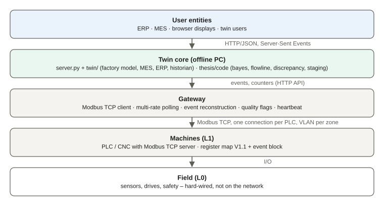
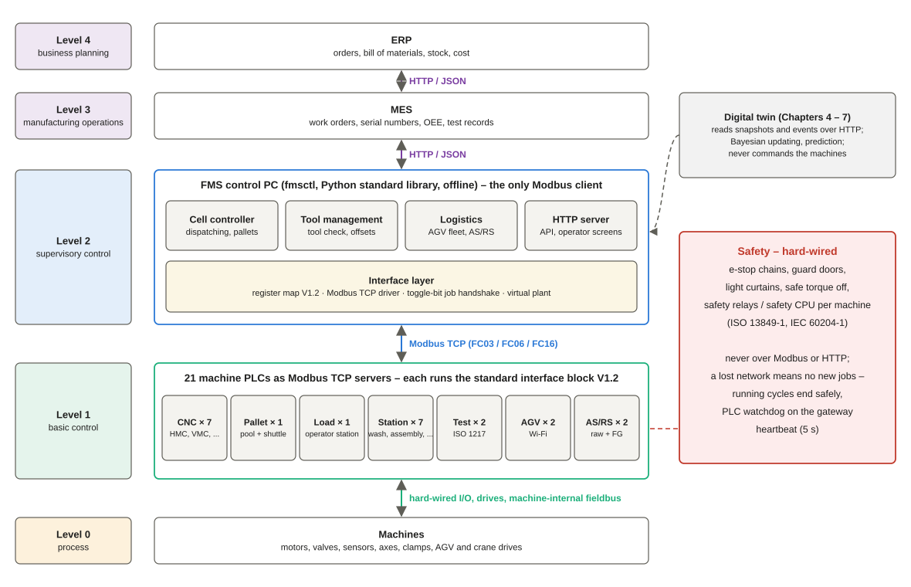
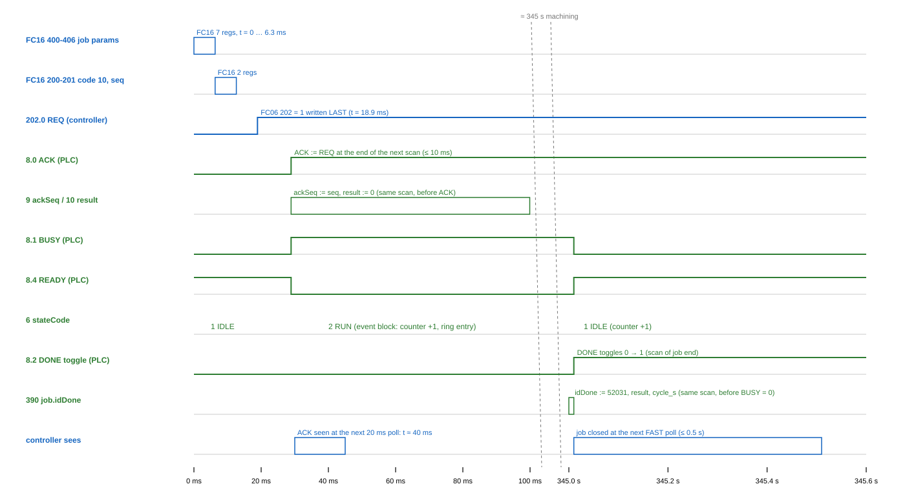
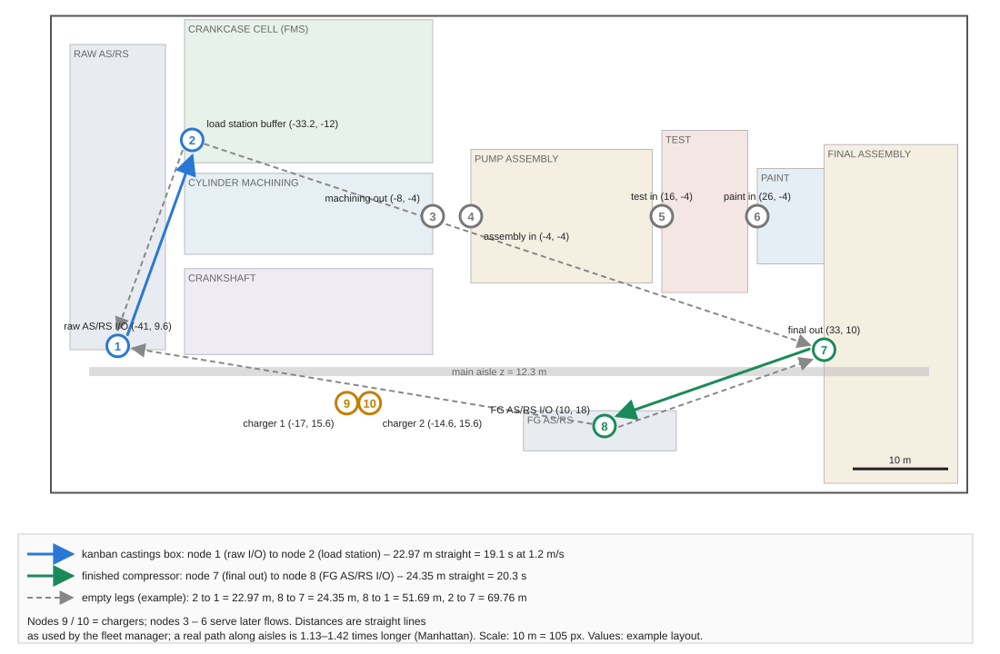

# Chapter 8 – Implementation

> Draft v1.0 – 2026-11-13. Describes the software that implements the method of Chapters 4–7: the factory digital twin
> developed in this project (`server.py`, `twin/`, `web/`), the thesis modules (`thesis/code/`) and the browser
> implementation of the thesis calculations (tab "Doctoral research", `web/phd*.js`). Figures in this chapter are
> **[measured]** on the development PC unless stated otherwise.

## 8.1 Purpose and requirements

The method must be usable by the company that it is designed for. Chapter 5 fixed the communication constraint
(Ethernet, Modbus TCP, HTTP only); this chapter adds the software constraints that follow from the same context:

| Id | Requirement | Consequence for the implementation |
|---|---|---|
| S1 | Runs on one offline industrial PC; no internet, no cloud services | no package installation from the internet; no CDN; all libraries vendored |
| S2 | Maintainable by the company's own engineers | one language per side (Python on the server, JavaScript in the browser), standard library only, readable code |
| S3 | Reproducible results for the thesis and for audits | seeded random numbers, append-only prediction records, version tags, every number re-computable by one command |
| S4 | Same formulas everywhere | one reference implementation (Python), ports checked number by number |
| S5 | Response times compatible with daily use | monthly update + prediction in seconds; planning decisions in minutes |

## 8.2 Software architecture

The implementation follows the layers of Chapter 5 and the functional view of ISO 23247 (observable manufacturing
elements → data collection and device control → digital twin core → user entities):

**Figure 8.1** Software layers of the implementation.

The project contains about 101 600 lines of code and documentation scripts (Python and JavaScript); the twin core
`twin/` has 13 165 lines of Python, the thesis modules 1 980 lines, and the browser implementation of the thesis
calculations 576 lines. No third-party Python package is used; the only third-party browser library is Three.js for
3D views, served from the local `web/vendor/` folder.

## 8.3 The factory twin

The factory twin is an event-driven simulation of the complete compressor factory (16 stations, buffers, pallet pools,
AGVs, two AS/RS) running in real time or accelerated, with MES and ERP functions, a SCADA view and an HTTP API of about
30 endpoints (`/api/state`, `/api/stream` for Server-Sent Events, `/api/fms`, `/api/mes`, `/api/erp`, `/api/ingest`
for real machine data, and the endpoints of the ball screw factory under `/api/bsf/...`). Its configuration — products,
mix, routings, cycle times, reliability and scrap per station, layout — is one JSON file (`config/factory.json`), which
is also the source of the design estimates of Table 4.2.

**Verification of the engine.** `tools/verify_engine.py` compares the twin with eleven hand calculations (single machine,
serial line, parallel machines, assembly of two components, breakdowns with MTBF/MTTR, scrap, test-bench rejects, the
three-variant compressor factory with perfect machines, change-overs with alternating and batched variants, and two
machines with 80 % availability and a large buffer). All eleven cases pass; deviations are below 1 % except the
test-bench reject share (1.34 % against 1.15 %), a small-number statistical effect within the tolerance of the test; the
run is repeatable with a fixed seed [measured, 2026-11-13].

## 8.4 Thesis modules

### 8.4.1 Bayesian updating (`bayes.py`)
Four classes implement the conjugate models of Table 4.4 with the design-statement constructors of Section 4.5.3, the
update with forgetting (Eq. 4.11), posterior means and Monte Carlo intervals. The point estimate of a mean MTBF, MTTR or
variance falls back from $b/(a-1)$ to $b/a$ when strong forgetting with few events drives the shape below 1 — a case
found during the experiments of Chapter 6. `chapter4_examples()` re-computes every worked number of Chapter 4.

### 8.4.2 Reduced-order DES (`flowline.py`)
The departure-time recursion of Eq. (6.2) computes one month of production (about 5 700 parts × 13 stations) in
0.034 s in Python; it records the observations of Table 4.5 for the twin. It is verified against the static upper bound
of Eq. (4.2) (0.4 % below the bound for the design line, Section 6.4.1) and used in Chapters 6, 7 and 9.

### 8.4.3 Prediction, discrepancy and staging
`rampup_experiment.py` implements Algorithms 6.2–6.3; `discrepancy.py` the model-discrepancy learning of Eq. (6.1);
`staging.py` the decision model of Chapter 7 with the screening model of Eq. (7.3), whose blocking efficiency is
calibrated against the DES at start-up and validated on 40 random cases (1.19 % mean deviation).

### 8.4.4 Measurement benches
`commbench.py` and `httpbench.py` implement the laboratory benches of Chapter 5. Their development exposed two
platform pitfalls (coarse `time.time()` and early asyncio timers on Windows), which are documented in Section 5.7.1 and in
`thesis/README.md` because they would silently invalidate measurements made by others on the same platform.

## 8.5 Browser implementation of the thesis calculations

All calculation systems of the thesis are also available interactively in the twin's browser interface (tab "Doctoral
research"), so that planners can use them without Python:

| Item | Function | Port of |
|---|---|---|
| 1 | thesis map, hypotheses, status | – |
| 2 | capacity / bottleneck table; Bayesian updater for MTBF, MTTR, cycle time, scrap | `bayes.py` |
| 3 | results of the virtual ramp-up; live lab running a hidden true factory month by month | `flowline.py`, `rampup_experiment.py`, `discrepancy.py` |
| 4 | Modbus TCP + HTTP sizing calculator; measured campaign | Chapter 5 formulas |
| 5 | staging results; investment-plan calculator with the thesis decision rule | `staging.py` |

`web/phd_calc.js` is a dependency-free port with a seeded random-number generator (Mulberry32, Marsaglia–Tsang gamma
sampling); `web/phd_data.js` contains the stored thesis results and is generated by `thesis/code/export_web.py`, never
edited by hand.

**Cross-verification Python ↔ JavaScript** (headless Chrome, 2026-11-13): Example 4.1 MTBF 26.04 h, Example 4.2 MTTR
27.42 min, Example 4.4 scrap 1.69 %, all 13 static capacities, Eq. (5.1) 333 bytes, Eq. (5.4) 165 machines, Eq. (5.6)
$2.2 \times 10^{-11}$ and the staging rule's plan (AS2 + FRB, then GR2) are identical in both implementations; the browser DES
simulates one month in about 7 ms [measured].

## 8.6 Data management and reproducibility

- **Prediction records.** Every prediction is stored with date, model version, parameter state and seed before the
  predicted period starts (Section 6.2). The frozen design prediction of the case factory is `thesis/data/case1_P0.json`.
- **Raw results are never edited.** Experiments write CSV/JSON to `thesis/data/`; analysis scripts read them; chapter
  tables and the browser data are generated from them.
- **Seeds.** All experiments use explicit seeds; common random numbers are used where policies are compared (Chapter 7).
- **One command per result.** `thesis/README.md` lists, for every table and figure, the command that reproduces it.
- **Labels.** Every number in the thesis carries one of the labels design estimate / assumption / reference estimate /
  calculated / simulated / measured / cited.

## 8.7 Performance

**Table 8.1** Run times on the development PC (Windows Server 2022, 16 logical cores, Python 3.12) [measured].
| Task | Time |
|---|---|
| Bayesian update of all 13 stations (Algorithm 6.2) | < 1 ms |
| One simulated month, Python reduced-order DES | 0.034 s |
| One simulated month, browser DES | ≈ 7 ms |
| Monthly prediction with 40 parameter samples (Algorithm 6.3) | < 2 s |
| Staging decision at one stage (≤ 64 option sets × 60 samples, screening model) | seconds |
| Virtual ramp-up experiment, 30 scenarios × 12 months × 5 predictors | ≈ 2 min on 15 cores |
| Staging experiment, 40 scenarios × 6 policies | ≈ 1 min on 15 cores |
| HTTP snapshot of 160 machines | ≈ 4 500 requests/s |

These times are negligible against the monthly update rhythm and the half-yearly investment rhythm of the method.

## 8.8 Deployment in the case factory
1. **Hardware:** one industrial PC (8 cores, 16 GB RAM, SSD) in the IT/OT room, UPS-backed; a second PC as cold spare
   with a nightly copy of the historian and the prediction records.
2. **Software:** Python 3.10+ (no packages), the project folder, a scheduled task that starts the server and the
   gateway at boot; browsers on MES terminals and offices open the twin by its local address.
3. **Network:** gateway as the only Modbus client in the machine VLANs; HTTP API in the office VLAN; no route to the
   internet (Chapter 5).
4. **Operation:** the gateway accumulates the statistics of Table 4.5 continuously; at the end of every month the twin
   updates, stores its prediction for the next month and shows predicted vs actual; every half-year the staging
   calculator is re-run with the updated twin and the current quotations.

## 8.9 The FMS control system

The twin of Sections 8.3 – 8.5 observes and predicts; it never commands a machine. A flexible manufacturing system,
however, only exists when a supervisory controller decides in real time which pallet goes to which machine, which NC
program runs, which tool is fit for the next job and which AGV carries which load. In the target context such
controllers are usually bought as closed packages from the machine supplier, which ties the factory to one vendor and
to protocols it cannot maintain itself [observation in the case context]; complex control is also one of the reasons why
FMS projects have missed their planned output (Section 2.2.3). To show that the low-cost architecture of Chapter 5 is
sufficient not only for observation but also for control, the FMS control software `fmsctl` was developed as part of
this work. It uses the same three technologies as the twin — Ethernet, Modbus TCP and HTTP — and the Python standard
library only, and it runs offline on the control PC of the case factory.

### 8.9.1 Control hierarchy and responsibilities
Figure 8.2 places the control system in the ISA-95 / IEC 62264 hierarchy. Level 1 consists of the 21 machine PLCs of
the case factory (7 CNC machines, the pallet system, the load station, 7 other stations, 2 test benches, 2 AGVs and 2
AS/RS cranes), each a Modbus TCP server. Level 2 is the FMS control PC, the only Modbus client in the machine network.
Its four functions are the cell controller, tool management, logistics (AGV fleet and AS/RS warehouse management) and
an HTTP server for operator screens and for the MES and ERP at levels 3 and 4. The division of work follows one rule:
level 2 decides *what* and *when* (which pallet, which machine, which program, which tool, which transport); level 1
decides *how* (motion, interlocks, the machining cycle). Functional safety is never transmitted over the network: e-stop
chains, guard doors, light curtains and safe torque off are hard-wired per machine. A lost network therefore means "no
new jobs", never a hazard; every PLC stops accepting jobs when the gateway heartbeat (register 226) has not changed for
5 s. The twin reads the same data over HTTP and remains a separate, read-only system.

**Figure 8.2** Control hierarchy of the compressor FMS: the FMS control PC as the only Modbus client, the 21 machine PLCs
as servers, the twin as a read-only observer and safety outside the network.

### 8.9.2 Machine interface and job handshake
All 21 PLCs expose one register map (version V1.2, Table 8.2). It extends the standard machine interface of Chapter 5
(status word, counters, energy, event block, command block) by a device-type status block and a block of job
parameters, without changing any existing address, so that a device built to the earlier version keeps working. All
values are 16-bit holding registers read with function code 03; 32-bit integers and REAL values use two registers in
big-endian word order; the controller may write only to the command and job blocks, and every other write is refused
by the PLC.

**Table 8.2** Register map V1.2 of the machine interface (all 21 devices) [design].
| Block | Registers | Content | Access |
|---|---|---|---|
| Header | 0 – 3 | map version, device type, unit id, PLC heartbeat | read |
| Status | 4 – 7 | status word, mode, state code (OFF, IDLE, RUN, SET-UP, DOWN, BLOCKED, STARVED), alarm code | read |
| Handshake | 8 – 11 | ACK / BUSY / DONE / REJECT / READY bits, acknowledged sequence number, result code, pieces done | read |
| Counters | 20 – 45 | good and scrap counters, last cycle time, current order and part (text) | read |
| Energy | 100 – 103 | power, energy counter | read |
| Event block | 104 – 131 | state-change counter, time of the last change, ring of the last 8 state changes with PLC time (Section 5.4) | read |
| Command | 200 – 226 | command code, sequence number, request bit; order data; gateway heartbeat 226 | write |
| Type status | 300 – 389 | per device type: tool life per pocket (CNC), pallet locations and states (pallet system), node and battery (AGV), crane position (AS/RS), test results (test bench) | read |
| Job result | 390 – 395 | id of the last finished job, result (OK, NOK, aborted), job duration | read |
| Job parameters | 400 – 449 | job id and the parameters of the command (pallet, NC program, variant, quantity; source and destination; tool offsets) | write |

A job is given to a PLC with a toggle-bit handshake (Figure 8.3). The controller first writes the job parameters
(one FC16 frame), then the command code and a new sequence number (one FC16 frame), and finally inverts the request bit
REQ (FC06). The PLC answers in its next scan: it validates the command (known code, device ready, pallet really at the
machine, parameters plausible), writes the sequence number and a result code, and sets its ACK bit equal to REQ. Because
the PLC reacts to a *change* of REQ and the controller checks the acknowledged sequence number, a lost or repeated frame
can neither start a job twice nor leave a job unnoticed. When the job ends, the PLC writes the job id, the result and
the job duration into registers 390 – 395 *before* it clears BUSY and toggles DONE, so that the controller always finds
a consistent result. With the design values of Chapter 5 (mean round-trip time 6.3 ms, PLC scan 10 ms, controller poll
of the acknowledgement every 20 ms) the controller sees the acknowledgement about 40 ms after it starts writing.

**Figure 8.3** Toggle-bit job handshake between the FMS controller and an HMC (command 10, run job), timing diagram
with design values; the time axis is broken between 0.1 s and 345 s.

The handshake is the place where a real controller differs most from a simulation: time-outs, restarts and late answers
must not corrupt the production record. The controller therefore distinguishes five job states. A job that the PLC has
accepted is *sent*; it becomes *done* when the PLC reports it. A command without acknowledgement within 5 s becomes
*noack* — the PLC may still take it — and is set to *rejected* only when the device is idle and has not taken it. An
accepted job that is not reported within its time-out (for example 3 × the longest machining cycle) becomes *unknown*
and raises an alarm, because the PLC may have restarted and lost its result; the operator decides after looking at the
machine. All effects of a finished job (pallet content, work-order counters, tool use) are written in one database
transaction, and after a power failure the controller always starts in manual mode.

### 8.9.3 Cell controller
The cell controller runs a cyclic loop (50 ms on the virtual plant; 0.25 – 0.5 s on real PLCs) of three steps: poll the
five cell devices, close finished jobs, and — in automatic mode — dispatch. The pallet locations are read from the
pallet system's PLC, which is the source of truth; the database keeps only what a PLC cannot know (which variant and
which work order are on a pallet, the work orders, the job history). Dispatching follows fixed priorities:
(1) start an HMC whose changer holds a raw pallet and whose tool check passes; (2) give the operator the next load-station
task (unload, load or unload + load) for the most urgent open work order whose fixture type matches the pallet;
(3) move one pallet with the shuttle — first empty a finished machine, then feed the idle machine that has waited
longest with the most urgent raw pallet, then bring a pallet to the load station (the oldest machined pallet, or an
empty pallet of the fixture type the next order needs), and finally clear the load station. Work orders are ordered by
earliest due date (EDD) or first-in-first-out. Scrapped parts are replaced automatically, because a work order stays
open while the number of good parts started is below the order quantity. A fixture-balance rule prevents the
"lock-in" of the first fixture type: if the most urgent order needs a fixture type of which no pallet is in
circulation, the load station only unloads the other type and the shuttle brings a pallet of the needed type.

### 8.9.4 Tool management
The CNC counts tool uses and publishes the remaining life of each of its 30 pockets in 0.1 % units (registers
310 – 339). Before every machining job the tool manager checks, for every tool type $k$ of the NC program, whether the
remaining life of its sister group covers the job plus a reserve:

$$\sum_{j \in G_k} L_j \;\ge\; \frac{1000\, u_k\, Q}{T_k} + L_{res} \tag{8.1}$$

with $L_j$ the remaining life of pocket $j$ in group $G_k$ [0.1 %], $u_k$ the uses of tool $k$ per part (for example
16 threads M8 per crankcase), $Q$ the parts in the job, $T_k$ the nominal life in uses (1 500 for the M8 tap) and
$L_{res} = 20$ (2 %) [design]. For the tap, one part consumes $1000 \cdot 16 / 1500 = 10.7$ units (1.07 %). If the check
fails, the job is not started, a change request goes to the tool setter, and the shuttle sends raw pallets only to
machines whose tools are fit. When the setter mounts a tool measured on the presetter, command 14 writes the new life
and the length and radius offsets into the CNC; the tool is booked into the magazine only after the CNC has echoed the
written values (registers 340 – 345). Section 9.2.6 shows that the fixed 2 % reserve covers planning errors but not
the spread of real tool life.

### 8.9.5 Logistics: AS/RS warehouse management and AGV fleet
The warehouse management function owns the location tables of both AS/RS (392 locations in the raw store, 280 in the
finished-goods store). Put-away chooses the free location nearest to the input/output point; retrieval is
first-in-first-out by receipt time; at the input/output point a retrieval for production is always served before a
put-away. Castings reach the cell by kanban: when the castings of a variant at the load station plus those on the way
fall to the reorder point (two castings) and open work orders still need that variant, the oldest box (6 VC10, 4 VC20
or 3 VC30 castings) is retrieved, and an AGV carries it from the AS/RS (node 1) to the load station (node 2, Figure 8.4).
Finished compressors travel from final assembly (node 7) to the finished-goods AS/RS (node 8). The fleet manager assigns
each transport to the nearest idle AGV, penalising a weak battery, reserves pick-up and drop nodes so that two AGVs are
never sent to the same dock, and sends an AGV below 25 % battery to a free charger (nodes 9 and 10). Crane and AGV jobs
are chained: a transport waits until its crane retrieval is done, a store waits until the AGV has dropped the load. A
crane fault with the load still on the fork sets the handling unit to "fault" and stops the stock record from being
changed until the operator confirms the real situation.

**Figure 8.4** AGV node map of the case factory with the two automated flows: castings from the raw AS/RS to the load
station and finished compressors to the finished-goods AS/RS [design example; coordinates in metres].

### 8.9.6 Virtual commissioning and acceptance tests
All functions were developed and tested against a virtual plant: 21 simulated PLCs, one per device, each a real Modbus
TCP server with the full register map, the handshake and the event block, and with simple process models (machining
times from Table 4.2 with spread and failures, pallet moves, operator tasks, CNC tool wear with sister groups, AGV travel
and battery, crane cycles), running up to 200 times faster than real time. Switching to the real factory changes only
the device table (IP addresses instead of local ports); the controller code is identical. Table 8.3 lists the automated
acceptance tests. They are also the basis of the factory acceptance test with the machine suppliers' real PLCs: the
same checks are repeated against each supplier PLC before delivery. PLC templates of the interface for Siemens S7-1200 /
S7-1500 (SCL) and Delta AS (structured text) were written; they have not yet been compiled on real hardware.

**Table 8.3** Acceptance tests of the FMS control system on the virtual plant (all passed, 2026-11-14) [measured on the virtual plant].
| Function | Checks | Examples of what is checked |
|---|---|---|
| Interface and virtual plant | 20 | 21 devices with correct map version; heartbeat; full pallet cycle; rejected impossible moves and second job while busy; write protection; Modbus exception codes; job parameters latched at acceptance; gateway watchdog (frozen heartbeat → READY off) |
| Cell controller | 15 | 12 crankcases in three work orders with one HMC switched off; EDD order; no job to the offline machine; fixture rule; restart from the database in manual mode; lost job result after a PLC restart → *unknown* + alarm → resolved; invalid work order refused |
| Tool management | 11 | without tool check a worn tap aborts a job (scrap); with tool check the job is blocked, the setter mounts a measured tool, command 14 is confirmed by the echo, zero aborts |
| Logistics | 15 | goods receipt and put-away; kanban supply of castings with exact material balance; FIFO; AGV with low battery charges first; no two AGVs at one dock; finished goods stored and shipped FIFO; retrieval before put-away; crane fault handled |

## 8.10 Summary
The method is implemented as a dependency-free Python and JavaScript system that runs on one offline PC: a verified
factory twin (11 of 11 hand calculations passed), thesis modules that implement the Bayesian updating, the fast DES,
discrepancy learning and the staging decisions, two measurement benches, and a browser implementation whose results
match the Python reference number by number. On the same architecture, a real FMS control system (cell controller, tool management, AGV and
AS/RS control) was built and passed 61 automated acceptance checks on a virtual plant of 21 Modbus PLCs, which shows
that Modbus TCP and HTTP are sufficient not only to observe but also to control the FMS. All results are reproducible by one command each; monthly updates and
predictions take seconds. Chapter 9 applies this implementation to the two reference cases.
