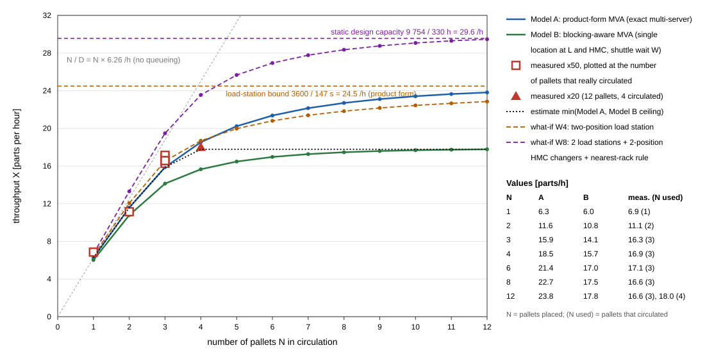
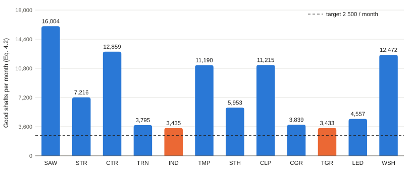
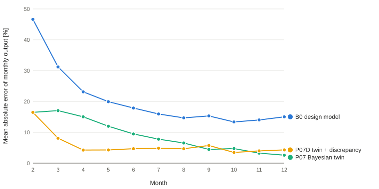

# Chapter 9 – Industrial Application: Reference Design Cases

> Draft v1.0 – 2026-11-13. Code: `thesis/code/case_study.py`; data: `thesis/data/case_study.json`,
> `thesis/data/case1_P0.json` (frozen design prediction). **Nature of the cases:** both cases are *reference design
> cases*. Their structure, routings, cycle times and machine counts come from the factory designs developed in this
> project (the FMS design phase); reliability values of case 2 and all money values are **[reference estimate]** —
> engineering estimates, not supplier quotations or measured data. No real production data exist yet. Section 9.6 defines
> how the real ramp-up of the case factory will validate the results.

## 9.1 Purpose and data provenance

Chapters 4–8 developed and tested the method in controlled experiments. This chapter applies it to the two production
systems that motivate the thesis — the compressor FMS and the ball screw shaft line — in the way a company would use it
at the end of the design phase: freeze the design prediction, decide the first investment steps, size the data path,
and prepare the validation. It also tests whether the method **transfers** to a second, structurally different line.

**Table 9.1** Data provenance of the cases.
| Data | Case 1 – compressor FMS | Case 2 – ball screw shaft line | Label |
|---|---|---|---|
| Products, routing, cycle times | design model `config/factory.json` (Table 4.2) | factory design `web/bsfmfg_data.js`, route BS, variant G (12 operations) | design estimate |
| Machine counts | design model (16 stations) | design rule of the ball screw design: ⌈load / (available time × OEE 0.75)⌉ | design estimate |
| MTBF, MTTR, scrap | design model | scrap from the design; MTBF / MTTR per machine class (Table 9.7) | design / reference estimate |
| Costs, margin, demand | Table 7.1, Section 7.2.3 | – | reference estimate |
| Production data | none yet (Section 9.6) | none yet | – |

## 9.2 Case 1 – compressor FMS

### 9.2.1 System
Three variants of V-type two-cylinder piston air compressors (VC10, VC20, VC30; mix 0.3 / 0.5 / 0.2) are produced on 13
station types with 16 machines (Table 4.2): a crankcase FMS cell with three HMCs and pallet changers, cylinder and
crankshaft machining, pump assembly, robot station, two performance test benches, paint, final assembly and packing.
Productive time is 330 hours per month.

### 9.2.2 Frozen design prediction P0
At the end of the design phase the twin's prediction for the fully implemented FMS (all options of Table 7.1) is frozen
(Section 4.8.2). The record `thesis/data/case1_P0.json` (created 2026-11-13) states:

**Table 9.2** Frozen design prediction P0 of the mature monthly good output [simulated, reference design].
| Prediction | Value [compressors / month] |
|---|---|
| Deterministic design model B0 (point values, 20 replications) | 6 322 |
| P0 – prior predictive with design priors, mean (400 samples) | 6 176 |
| P0 – 90 % prediction interval | 5 916 – 6 413 |
| P0 – median | 6 184 |

The prior predictive is 2.3 % below the deterministic design value: when the parameters are uncertain, losses at the
stations combine non-linearly (the bottleneck can move to any of several stations), so the expected output is lower than
the output at the expected parameters — the optimism of point-value design studies, quantified. The interval
(± 4 %) expresses only the uncertainty encoded in the priors; Chapter 6 showed that real ramp-ups are likely to fall
below it in the first months (month 1 ≈ 68 % of the design output in the virtual ramp-up), which is exactly what the
sequential updating is designed to correct.

### 9.2.3 First investment steps and their robustness
The staging decision of Chapter 7, made at design time with the reference values, recommends **AS2 + FRB in stage 1
and GR2 in stage 2** (incremental NPV 6.57 M EUR versus no investment with the screening model). Table 9.3 varies one
reference estimate at a time.

**Table 9.3** One-at-a-time sensitivity of the design-time staging decision [calculated, reference estimates].
| Variation | Plan (stage 1 / 2 / 3 / 4) | ΔNPV [M EUR] |
|---|---|---|
| base case | AS2 + FRB / GR2 / – / – | 6.57 |
| margin −30 % (315 EUR) | AS2 + FRB / GR2 / – / – | 4.59 |
| margin +30 % (585 EUR) | AS2 + FRB / GR2 / – / – | 8.55 |
| capex −30 % | AS2 + FRB + MES / GR2 / – / – | 6.68 |
| capex +30 % | FRB / AS2 + MES / – / – | 5.76 |
| demand × 0.8 | – / – / – / – | 0.00 |
| demand × 1.2 | AS2 + FRB / GR2 / MES / – | 13.38 |
| discount 2.5 % / half-year | AS2 + FRB / GR2 / – / – | 7.69 |
| discount 10 % / half-year | AS2 + FRB / GR2 / – / – | 4.85 |
| budget 250 000 EUR / stage | FRB / AS2 / MES / – | 5.93 |
| budget 800 000 EUR / stage | GR2 + AS2 + FRB / – / – / – | 6.55 |
| penalty 0 EUR / unit | AS2 + FRB / GR2 / – / – | 5.84 |
| penalty 150 EUR / unit | AS2 + FRB / GR2 / – / – | 8.04 |

Three conclusions hold under all variations except low demand: **robot-assisted final assembly (FRB) and the second
assembly station (AS2) are always the first steps** — they relieve the two most loaded stations of the design; the
**second grinder** is the next step whenever the budget allows; the **MES** enters when capex is cheaper, demand higher or
the budget tighter. With demand 20 % below the forecast, no option pays within the horizon — the existing capacity is
sufficient, and the decision should wait for demand data. Margin, discount rate and penalty change the value but not the
decision. The design-time plan is therefore a sound *starting* decision; Chapter 7 showed that re-deciding stages 2–4
with the updated twin adds a further 1.7 M EUR on average over keeping this plan fixed.

### 9.2.4 Data path
The case has 21 Modbus devices (Section 8.9.1): the 16 stations of Table 4.2, the pallet system of the crankcase cell,
2 AGVs and 2 AS/RS cranes. With the 36-register FAST + EVENT read every 0.25 s and a PLC scan of 10 ms [assumption],
the formulas of Chapter 5 give 0.22 Mbit/s of traffic, a sequential cycle of 127 ms (limit 41 devices at this period)
and a parallel cycle of 12 ms; maximum detection latency ≈ 0.26 s. Both gateway types meet H1's criteria here; the
parallel gateway is recommended because it keeps the same software for case 2. The control system of Section 8.9 uses
the same network and adds the command traffic of about one job per device and minute, which is negligible against the
polling load.

### 9.2.5 Process-level analysis of the crankcase cell
The static model (Section 4.4.1) gives the crankcase cell a capacity of 9 754 parts per month, or 29.6 parts per hour,
because it sees only the three HMCs. The FMS of Figure 4.4 contains two further shared resources that every part uses —
the load station with one operator and the shuttle — and a fixed number of pallets. The cell is therefore a closed
queueing network: $N$ pallets circulate between the load station (one server, mean service 147 s per part for unload and
load together, including the operator's variability [design example]), the shuttle (one server, about 70 s per part for
three moves [calculated from the move-time rule]) and the HMC group (three servers, $343.5 + 15 = 358.5$ s per part).
Mean value analysis (MVA) gives the throughput $X(N)$ exactly for the product-form network (model A); model B adds the
time during which the load station and the HMC changers stay blocked while the shuttle exchanges a pallet. Figure 9.1
compares both models with measurements of the real cell controller on the virtual plant.

**Figure 9.1** Throughput of the crankcase cell versus the number of pallets: mean value analysis (model A product form,
model B with blocking), what-if cases and measurements of the cell controller on the virtual plant before the
dispatching fixes of Section 8.9.3 [calculated; simulated].

Three results matter for the design. First, no number of pallets can lift the cell above $3600 / 147 = 24.5$ parts per
hour: the single operator at the load station, not the HMCs, bounds the cell. Second, the blocking-aware model B
saturates at 17.8 parts per hour with 12 pallets, i.e. 5 867 parts per month — only 3.5 % above the static factory
bottleneck (FINAL, 5 667 per month, Table 4.3). In practice the crankcase cell is therefore a co-bottleneck of the
whole factory, which the static model, with its 9 754 parts per month, does not reveal. Third, the measurements on the
virtual plant (16.6 – 18.0 parts per hour with 12 pallets) agree with the lower of the two models within −9 % to
+4 %, so the closed-network model is a usable design tool for the cell. The measurements also exposed two weaknesses
of the first dispatching rules — only 3 – 4 of the 12 pallets circulated, and VC30 orders starved behind fixture type A
— which led to the fixture-balance and nearest-rack rules of Section 8.9.3. After these fixes the same measurement (12 pallets, design mix, 3.5 simulated hours at 20 × real time) gives **20.0 parts per hour** (70 parts, all three variants), the three HMCs equally busy (65 / 65 / 62 %), the load station busy 80 % and the shuttle 30 % [simulated]. Four pallets were enough to reach this value — as model A predicts, pallets beyond about four add little while one operator serves the cell; the value lies between model B with the nearest-rack rule (19.3) and model A (23.8).

Table 9.4 evaluates design changes of the cell with model B at 12 pallets.

**Table 9.4** What-if analysis of the crankcase cell, 12 pallets, design mix [calculated, mean value analysis model B].
| Case | Parts / h | Parts / month (330 h) |
|---|---|---|
| Base design (one load station, single-location HMC changers) | 17.8 | 5 866 |
| Pallets stored in the rack locations nearest to the load station | 19.3 | 6 371 |
| Unload + load time reduced from 140 s to 100 s (quick-clamping fixtures) | 21.3 | 7 019 |
| Two-position load station | 22.9 | 7 540 |
| Second load station | 25.0 | 8 234 |
| Two-position changers at the HMCs only | 17.8 | 5 888 |
| Second load station + two-position HMC changers + nearest-rack rule | 29.5 | 9 727 |
| Fourth HMC with one load station | 17.9 | – |
| Fourth HMC with two load stations | 29.6 | – |

The table turns the abstract statement "the static model is optimistic" into an investment rule for the case factory:
a fourth HMC is worthless without a second load station, whereas a second load station (or a two-position station with
quick-clamping fixtures) raises the cell by 28 – 40 % at a fraction of the cost of a machine tool. The combination of a
second load station, two-position HMC changers and the nearest-rack rule reaches the static capacity of the three HMCs.
For the staging decision of Chapter 7 this means that "second load station" belongs in the option set of stage 1 of a
real project; it was not in Table 7.1 because the static model could not see its value.

### 9.2.6 Material handling and tool management
The same design-stage analysis was carried out for the logistics and the tools of the cell; Table 9.5 summarises it.

**Table 9.5** Design-stage results for material handling and tool management of case 1 [calculated; simulated].
| Quantity | Result | Consequence |
|---|---|---|
| Stacker-crane cycle (FEM 9.851 reference points, raw AS/RS) | single command 34.8 s (103 jobs / h); dual command 57.8 s for two jobs (125 jobs / h) | the planning value of 50 s is a margin of 1.44; crane load at 15 parts / h ≈ 10 % |
| Transport demand at 15 crankcases / h | 3.6 castings boxes + 15 finished compressors = 18.6 trips / h | 0.9 – 1.7 AGVs depending on path length and availability → 2 AGVs |
| One AGV only (simulation, 40 h) | 186 min of castings stock-out | charging stops all transport; the second AGV is needed for availability, not for capacity |
| Kanban lead time crane + AGV | nominal 128 s; 95 % quantile 154 – 184 s | reorder point of 2 castings (480 s of demand) is sufficient |
| Put-away before retrieval at the AS/RS I/O point (first rule) | 27.8 min stock-out per 40 h during goods receipts | retrieval priority (Section 8.9.5) instead of a reorder point of 7 |
| Tool-life spread (lognormal, σ = 0.12) with life set to the median and 2 % reserve | 43 % of tools reach the end of their real life before the counter | the reserve of Eq. (8.1) covers planning errors only |
| Life setting for a failure risk of 10 % / 1 % / 0.1 % | 14.3 % / 24.4 % / 31.0 % below the median (M8 tap: 1 286 / 1 135 / 1 035 threads) | risk-based life values in the CNC |

The last two rows connect the tool management to the method of the thesis. A count-based CNC cannot see the real wear
of a tool; it can only stop it at a set count. If the count equals the median life, almost half of the tools fail
earlier. The right setting depends on the spread of the real tool life, which is uncertain at design time — exactly
the situation of Chapter 4. The conjugate models of Section 4.6 apply unchanged: breakages of the M8 tap are a Poisson
process with a Gamma prior (for example Gamma(1.5, 10 000 threads)); after 3 breakages in 30 000 threads the posterior
is Gamma(4.5, 40 000), with an expected interval of $40\,000 / 3.5 = 11\,429$ threads between breakages; the wear life
follows the Normal-Inverse-Gamma model on the log scale. Tool life is therefore a second, independent field in which the
sequential Bayesian updating of the twin produces directly usable settings, and the control system of Section 8.9
already records the data it needs (uses per pocket, change requests, aborted jobs).

## 9.3 Case 2 – ball screw shaft line

### 9.3.1 System
The ball screw factory designed in this project produces 120 ground C5 ball screws BS-3210 per day (2 shifts × 7.5 h,
250 days; 2 500 shafts per month). Route BS, variant G (thread ground from the solid) has 12 operations on 12 machine
types (Table 9.6). Its structure differs from case 1: one product, long batch-dependent operations, a heat-treatment step
running three shifts, and a dominant precision-grinding operation (42 min per piece).

**Table 9.6** Route BS, variant G, with design machine counts and reference reliability [design / reference estimate].
| Machine type | Operation(s) | min / piece (incl. set-up share) | Machines needed (OEE 0.75) | Machines | MTBF [h] | MTTR [min] | Scrap |
|---|---|---|---|---|---|---|---|
| MS-SAW band saw | 10 | 1.17 | 0.21 | 1 | 150 | 20 | 0.2 % |
| BS-STR straightening (soft) | 20 | 2.58 | 0.46 | 1 | 120 | 20 | 0.3 % |
| BS-CTR facing + centring | 30 | 1.45 | 0.26 | 1 | 90 | 25 | 0.1 % |
| BS-TRN CNC lathe | 40 | 9.75 | 1.73 | 2 | 60 | 30 | 0.5 % |
| BS-IND induction hardening | 50 | 5.33 | 0.95 | 1 | 50 | 40 | 1.0 % |
| HT-TMP tempering furnace (3 shifts) | 60 | 2.50 | 0.30 | 1 | 300 | 60 | 0.2 % |
| BS-STH straightening (hard) | 70 | 6.17 | 1.10 | 2 | 80 | 30 | 1.5 % |
| BS-CLP centre-hole grinding | 80 | 1.67 | 0.30 | 1 | 120 | 15 | 0.1 % |
| BS-CGR cylindrical grinding | 90 | 9.62 | 1.71 | 2 | 60 | 35 | 0.5 % |
| BS-TGR thread grinding | 100 | 42.25 | 7.51 | 8 | 40 | 45 | 1.5 % |
| QC-LED lead measurement | 120 | 12.25 | 2.18 | 3 | 200 | 30 | 0.5 % |
| AS-WSH washing | 130 | 1.50 | 0.27 | 1 | 150 | 20 | 0 % |

### 9.3.2 Capacity and bottleneck
The static capacities (Eq. 4.2) reveal **two almost equal bottlenecks**: thread grinding (3 433 good shafts per month)
and induction hardening (3 435), followed by turning (3 795) and cylindrical grinding (3 839) [calculated]. The
reduced-order DES (Figure 9.3) of the designed line yields 3 055 good shafts per month — 11 % below the static bottleneck, because two
nearly equal bottlenecks interfere through blocking and starvation, and 22 % above the target of 2 500, because the
design sized the machines with an assumed OEE of 0.75 while the reference reliability values imply higher machine
availability. Two consequences follow. First, the design has a capacity reserve of about one fifth — or the machine
count could be reduced if the reliability values are confirmed. Second, with two bottlenecks within 0.1 %, the design
model cannot know which of them will limit the real line: that depends on parameters that only operation reveals.

**Figure 9.3** Static capacity of the ball screw shaft line per machine type; the two tied bottlenecks are highlighted [calculated].

### 9.3.3 Transfer test of the Bayesian twin
The virtual ramp-up of Chapter 6 was repeated on the ball screw line with 20 hidden true factories (same deviation and
ramp-up generator, 30 parameter samples per prediction).

**Table 9.7** Transfer test on the ball screw line, 20 scenarios [simulated].
| Month | True output | Error B0 design | Error P07 twin | Error P07D twin + discrepancy | P07D coverage 90 % | Bottleneck: twin | Bottleneck: design |
|---|---|---|---|---|---|---|---|
| 1 | 1 649 | 86.5 % | 83.2 % | 83.2 % | 0 % | 65 % | 65 % |
| 2 | 2 091 | 46.6 % | 16.5 % | 16.5 % | 35 % | 85 % | 60 % |
| 3 | 2 339 | 31.2 % | 17.0 % | 8.1 % | 95 % | 85 % | 60 % |
| 4 | 2 487 | 23.1 % | 15.0 % | 4.2 % | 100 % | 85 % | 55 % |
| 6 | 2 597 | 17.9 % | 9.5 % | 4.7 % | 100 % | 80 % | 50 % |
| 8 | 2 667 | 14.7 % | 6.5 % | 4.7 % | 100 % | 90 % | 50 % |
| 10 | 2 700 | 13.4 % | 4.7 % | 3.5 % | 100 % | 95 % | 50 % |
| 12 | 2 661 | 15.0 % | 2.6 % | 4.3 % | 100 % | 100 % | 50 % |

**Figure 9.4** Transfer test on the ball screw line: mean absolute error of the monthly output prediction, 20 scenarios [simulated].

The pattern of Chapter 6 transfers to the second line: the design model never falls below 13 % error; the twin with
discrepancy learning is below 5 % from month 4 (except month 9, 5.7 %) with 100 % coverage of its 90 % intervals from
month 4; the parametric twin alone converges to 2.6 % by month 12. The bottleneck result is even clearer than in case 1:
because the two bottlenecks are nearly tied, the design model is right in only 50–65 % of the factories, the twin in
80–100 %. Errors in month 1 are larger than in case 1 (83–87 %): the long thread-grinding operation and the low design
MTBF of 40 h make this line more sensitive to the halved MTBF and longer repairs of the first ramp-up month.

### 9.3.4 Data path for the whole ball screw and guide factory
The complete ball screw + guide factory has 73 machines. At a 0.25 s period a sequential gateway would need 442 ms per
cycle — beyond the period (limit 41 devices); a parallel gateway needs about 14 ms. At a 1 s period a sequential gateway
suffices (442 ms cycle, maximum latency ≈ 1.01 s). Traffic is 0.78 Mbit/s at 0.25 s [calculated]. The measured campaign of
Chapter 5 (80 and 160 machines, parallel polling, zero event loss) covers this size.

## 9.4 Efficiency of the method – synthesis

**Table 9.8** What the method delivers, compared with the conventional design approach [simulated / calculated].
| Aspect | Conventional (design study, fixed) | Method of this thesis | Source |
|---|---|---|---|
| Output prediction error after half a year | 8–18 % (case 1: 10.0 %, case 2: 17.9 % in month 6) | 2.9–4.7 % (P07D, month 6) | Tables 6.2, 9.5 |
| Honest uncertainty (coverage of 90 % intervals) | 0 % | 94 % (case 1), 100 % from month 4 (case 2) | Tables 6.3, 9.5 |
| True bottleneck identified | 73–77 % (case 1), 50–65 % (case 2) | 97–100 % (case 1, from month 4), 80–100 % (case 2) | Tables 6.5, 9.5 |
| Value of staged investment (ΔNPV per EUR of capital) | 11.0 (static plan), 7.1 (all at once) | 13.1 (adaptive) | Table 7.2 |
| Event completeness of the data path | 63–98 % (state polling) | 100 % (event block) | Table 5.3 |
| Network load, 73–160 machines | – | 0.8–2.1 Mbit/s | Eq. 5.2 |
| Computing effort per monthly update | – | < 2 s on one PC | Table 8.1 |

## 9.5 What changes when real data arrive
The reference values enter the method in three places only — priors (Table 4.4 worths and design values), the case
economics (Table 7.1) and the PLC timing (Chapter 5) — and each is designed to be replaced: priors are overwritten by data
within a few months (Chapter 6), the staging decision is re-taken every half-year with the current quotations
(Chapter 7), and the gateway formulas are re-evaluated with the measured scan times (Section 5.8). The conclusions that
depend least on the reference values are those that compare policies on the same data (Tables 6.3, 7.3, 9.5); the
numbers that depend most on them are the absolute euro values and the frozen P0 interval.

## 9.6 Ramp-up validation protocol (to be executed in the case factory)

**Objective.** Test hypotheses H2 and H3 with real data: does the sequentially updated twin predict the real monthly
output better than the frozen design prediction P0 and a one-time calibration, and are its intervals calibrated?

**Protocol.**
1. *Before start of production:* P0 (Table 9.2) is frozen — done (`case1_P0.json`, 2026-11-13); replace by P0 v2 when the
   final design data replace Table 4.2, and freeze again before the first part.
2. *Data:* event block and counters of every machine via the gateway (Chapter 5); monthly statistics per station
   (Table 4.5); actual good output per month from the MES; documented changes (new programs, tooling, staff).
3. *Monthly cycle (months 1–12):* update the twin ($\rho$ = 0.7), store predictions B0, B1 (after month 1), P07, P07D for
   month $k+1$ with interval, before month $k+1$ starts; after month $k+1$ record actual output and errors.
4. *Measures:* $E_k$, MAPE, coverage, interval width (Section 4.8.1); bottleneck named by the twin vs bottleneck
   observed (highest utilisation / longest queue in the MES).
5. *Acceptance:* H2 accepted if P07D reaches $E_k$ < 5 % at least 30 % earlier (in months) than B0 and B1; H3 accepted if
   coverage of P07D ≥ 85 % over months 2–12.
6. *Reporting:* results added to this section; deviations from the protocol documented.

**Timeline.** FMS design until about March 2027; installation and commissioning in 2027–2028; months 1–12 of ramp-up
provide the validation data, which can be completed within the doctoral period if production starts by mid-2028.

## 9.7 Threats to validity
- **Construct validity:** monthly good output and the named bottleneck are the measures; they are directly relevant to
  planning but do not cover quality or delivery performance. Mitigation: Table 9.8 adds capital efficiency and data
  completeness.
- **Internal validity:** the ramp-up generator and the predictors use the same model family; the industrial
  validation (9.6) removes this. Common random numbers and paired comparisons limit noise in policy comparisons.
- **External validity:** two lines from one company context; the second case was chosen to be structurally different
  (single product, long precision operation, heat treatment) and confirmed the main findings.
- **Reliability:** every result is reproducible by one command with fixed seeds (`thesis/README.md`).
- **Data provenance:** reference estimates are clearly labelled; absolute values must not be used for real investment
  decisions before quotations and measurements replace them.

## 9.8 Summary
Applied to the compressor FMS, the method froze a design prediction of 6 176 compressors per month (90 %: 5 916–6 413),
2.3 % below the deterministic design value, and recommended robot-assisted final assembly and a second assembly station
as first investment steps — a recommendation robust to all one-at-a-time variations except low demand. Applied to the
structurally different ball screw shaft line, it revealed two nearly tied bottlenecks (thread grinding and induction
hardening) that the design model could not separate, and the Bayesian twin again reduced the prediction error below 5 %
from month 4 and identified the true bottleneck in 80–100 % of the hidden factories against 50–65 % for the design. A
complete validation protocol for the real ramp-up is in place, with the design prediction already frozen.
