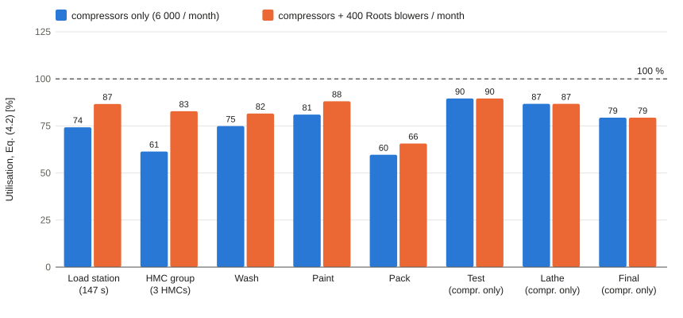
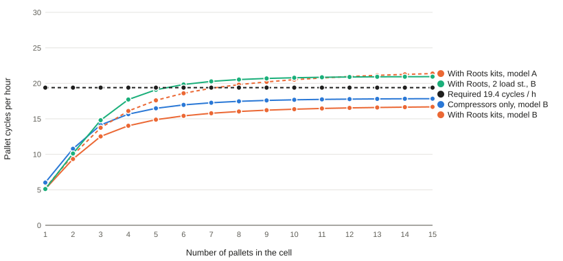
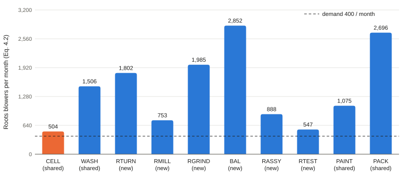
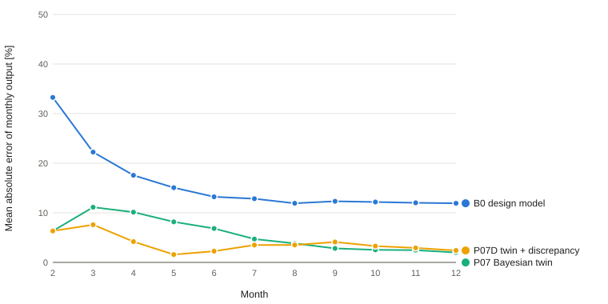

# Chapter 9 – Industrial Application: Reference Design Cases

> Draft v1.0 – 2026-11-13. Code: `thesis/code/case_study.py`; data: `thesis/data/case_study.json`,
> `thesis/data/case1_P0.json` (frozen design prediction); case 3: `thesis/code/case3_roots.py`, data `thesis/data/case3_*.json|csv`. **Nature of the cases:** all three cases are *reference design
> cases*. Their structure, routings, cycle times and machine counts come from the factory designs developed in this
> project (the FMS design phase); reliability values of case 2, all values of the Roots blower extension (case 3, Section 9.4) and all money values are **[reference estimate]** —
> engineering estimates, not supplier quotations or measured data. No real production data exist yet. Section 9.7 defines
> how the real ramp-up of the case factory will validate the results.

## 9.1 Purpose and data provenance

Chapters 4–8 developed and tested the method in controlled experiments. This chapter applies it to the three production
systems that motivate the thesis — the compressor FMS, the ball screw shaft line and the planned Roots blower extension
of the compressor FMS — in the way a company would use it
at the end of the design phase: freeze the design prediction, decide the first investment steps, size the data path,
and prepare the validation. It also tests whether the method **transfers** to a second, structurally different line and to a new product family
that shares the flexible cell of the first one.

**Table 9.1** Data provenance of the cases.
| Data | Case 1 – compressor FMS | Case 2 – ball screw shaft line | Case 3 – Roots blower extension | Label |
|---|---|---|---|---|
| Products, routing, cycle times | design model `config/factory.json` (Table 4.2) | factory design `web/bsfmfg_data.js`, route BS, variant G (12 operations) | reference family and routing of this thesis (Tables 9.8, 9.9) | design / reference estimate |
| Machine counts | design model (16 stations) | design rule of the ball screw design: ⌈load / (available time × OEE 0.75)⌉ | same design rule; shared stations of case 1 | design / reference estimate |
| MTBF, MTTR, scrap | design model | scrap from the design; MTBF / MTTR per machine class (Table 9.6) | classes of Table 4.2, adapted (Table 9.9) | design / reference estimate |
| Costs, margin, demand | Table 7.1, Section 7.2.3 | – | Section 9.4.1, Table 9.14 | reference estimate |
| Production data | none yet (Section 9.7) | none yet | none yet | – |

## 9.2 Case 1 – compressor FMS

### 9.2.1 System
Three variants of V-type two-cylinder piston air compressors (VC10, VC20, VC30; mix 0.3 / 0.5 / 0.2) are produced on 13
station types with 16 machines (Table 4.2): a crankcase FMS cell with three HMCs and pallet changers, cylinder and
crankshaft machining, pump assembly, robot station, two performance test benches, paint, final assembly and packing.
Productive time is 330 hours per month.

### 9.2.2 Frozen design prediction P0
At the end of the design phase the twin's prediction for the fully implemented FMS (all options of Table 7.1) is frozen
(Section 4.8.2). The record `thesis/data/case1_P0.json` (created 2026-11-13) states:

**Table 9.2** Frozen design prediction P0 of the mature monthly good output [simulated, reference design].
| Prediction | Value [compressors / month] |
|---|---|
| Deterministic design model B0 (point values, 20 replications) | 6 322 |
| P0 – prior predictive with design priors, mean (400 samples) | 6 176 |
| P0 – 90 % prediction interval | 5 916 – 6 413 |
| P0 – median | 6 184 |

The prior predictive is 2.3 % below the deterministic design value: when the parameters are uncertain, losses at the
stations combine non-linearly (the bottleneck can move to any of several stations), so the expected output is lower than
the output at the expected parameters — the optimism of point-value design studies, quantified. The interval
(± 4 %) expresses only the uncertainty encoded in the priors; Chapter 6 showed that real ramp-ups are likely to fall
below it in the first months (month 1 ≈ 68 % of the design output in the virtual ramp-up), which is exactly what the
sequential updating is designed to correct.

### 9.2.3 First investment steps and their robustness
The staging decision of Chapter 7, made at design time with the reference values, recommends **AS2 + FRB in stage 1
and GR2 in stage 2** (incremental NPV 6.57 M EUR versus no investment with the screening model). Table 9.3 varies one
reference estimate at a time.

**Table 9.3** One-at-a-time sensitivity of the design-time staging decision [calculated, reference estimates].
| Variation | Plan (stage 1 / 2 / 3 / 4) | ΔNPV [M EUR] |
|---|---|---|
| base case | AS2 + FRB / GR2 / – / – | 6.57 |
| margin −30 % (315 EUR) | AS2 + FRB / GR2 / – / – | 4.59 |
| margin +30 % (585 EUR) | AS2 + FRB / GR2 / – / – | 8.55 |
| capex −30 % | AS2 + FRB + MES / GR2 / – / – | 6.68 |
| capex +30 % | FRB / AS2 + MES / – / – | 5.76 |
| demand × 0.8 | – / – / – / – | 0.00 |
| demand × 1.2 | AS2 + FRB / GR2 / MES / – | 13.38 |
| discount 2.5 % / half-year | AS2 + FRB / GR2 / – / – | 7.69 |
| discount 10 % / half-year | AS2 + FRB / GR2 / – / – | 4.85 |
| budget 250 000 EUR / stage | FRB / AS2 / MES / – | 5.93 |
| budget 800 000 EUR / stage | GR2 + AS2 + FRB / – / – / – | 6.55 |
| penalty 0 EUR / unit | AS2 + FRB / GR2 / – / – | 5.84 |
| penalty 150 EUR / unit | AS2 + FRB / GR2 / – / – | 8.04 |

Three conclusions hold under all variations except low demand: **robot-assisted final assembly (FRB) and the second
assembly station (AS2) are always the first steps** — they relieve the two most loaded stations of the design; the
**second grinder** is the next step whenever the budget allows; the **MES** enters when capex is cheaper, demand higher or
the budget tighter. With demand 20 % below the forecast, no option pays within the horizon — the existing capacity is
sufficient, and the decision should wait for demand data. Margin, discount rate and penalty change the value but not the
decision. The design-time plan is therefore a sound *starting* decision; Chapter 7 showed that re-deciding stages 2–4
with the updated twin adds a further 1.7 M EUR on average over keeping this plan fixed.

### 9.2.4 Data path
The case has 21 Modbus devices (Section 8.9.1): the 16 stations of Table 4.2, the pallet system of the crankcase cell,
2 AGVs and 2 AS/RS cranes. With the 36-register FAST + EVENT read every 0.25 s and a PLC scan of 10 ms [assumption],
the formulas of Chapter 5 give 0.22 Mbit/s of traffic, a sequential cycle of 127 ms (limit 41 devices at this period)
and a parallel cycle of 12 ms; maximum detection latency ≈ 0.26 s. Both gateway types meet H1's criteria here; the
parallel gateway is recommended because it keeps the same software for case 2. The control system of Section 8.9 uses
the same network and adds the command traffic of about one job per device and minute, which is negligible against the
polling load.

### 9.2.5 Process-level analysis of the crankcase cell
The static model (Section 4.4.1) gives the crankcase cell a capacity of 9 754 parts per month, or 29.6 parts per hour,
because it sees only the three HMCs. The FMS of Figure 4.4 contains two further shared resources that every part uses —
the load station with one operator and the shuttle — and a fixed number of pallets. The cell is therefore a closed
queueing network: $N$ pallets circulate between the load station (one server, mean service 147 s per part for unload and
load together, including the operator's variability [design example]), the shuttle (one server, about 70 s per part for
three moves [calculated from the move-time rule]) and the HMC group (three servers, $343.5 + 15 = 358.5$ s per part).
Mean value analysis (MVA) gives the throughput $X(N)$ exactly for the product-form network (model A); model B adds the
time during which the load station and the HMC changers stay blocked while the shuttle exchanges a pallet. Figure 9.1
compares both models with measurements of the real cell controller on the virtual plant.

**Figure 9.1** Throughput of the crankcase cell versus the number of pallets: mean value analysis (model A product form,
model B with blocking), what-if cases and measurements of the cell controller on the virtual plant before the
dispatching fixes of Section 8.9.3 [calculated; simulated].

Three results matter for the design. First, no number of pallets can lift the cell above $3600 / 147 = 24.5$ parts per
hour: the single operator at the load station, not the HMCs, bounds the cell. Second, the blocking-aware model B
saturates at 17.8 parts per hour with 12 pallets, i.e. 5 867 parts per month — only 3.5 % above the static factory
bottleneck (FINAL, 5 667 per month, Table 4.3). In practice the crankcase cell is therefore a co-bottleneck of the
whole factory, which the static model, with its 9 754 parts per month, does not reveal. Third, the measurements on the
virtual plant (16.6 – 18.0 parts per hour with 12 pallets) agree with the lower of the two models within −9 % to
+4 %, so the closed-network model is a usable design tool for the cell. The measurements also exposed two weaknesses
of the first dispatching rules — only 3 – 4 of the 12 pallets circulated, and VC30 orders starved behind fixture type A
— which led to the fixture-balance and nearest-rack rules of Section 8.9.3. After these fixes the same measurement (12 pallets, design mix, 3.5 simulated hours at 20 × real time) gives **20.0 parts per hour** (70 parts, all three variants), the three HMCs equally busy (65 / 65 / 62 %), the load station busy 80 % and the shuttle 30 % [simulated]. Four pallets were enough to reach this value — as model A predicts, pallets beyond about four add little while one operator serves the cell; the value lies between model B with the nearest-rack rule (19.3) and model A (23.8).

Table 9.4 evaluates design changes of the cell with model B at 12 pallets.

**Table 9.4** What-if analysis of the crankcase cell, 12 pallets, design mix [calculated, mean value analysis model B].
| Case | Parts / h | Parts / month (330 h) |
|---|---|---|
| Base design (one load station, single-location HMC changers) | 17.8 | 5 866 |
| Pallets stored in the rack locations nearest to the load station | 19.3 | 6 371 |
| Unload + load time reduced from 140 s to 100 s (quick-clamping fixtures) | 21.3 | 7 019 |
| Two-position load station | 22.9 | 7 540 |
| Second load station | 25.0 | 8 234 |
| Two-position changers at the HMCs only | 17.8 | 5 888 |
| Second load station + two-position HMC changers + nearest-rack rule | 29.5 | 9 727 |
| Fourth HMC with one load station | 17.9 | – |
| Fourth HMC with two load stations | 29.6 | – |

The table turns the abstract statement "the static model is optimistic" into an investment rule for the case factory:
a fourth HMC is worthless without a second load station, whereas a second load station (or a two-position station with
quick-clamping fixtures) raises the cell by 28 – 40 % at a fraction of the cost of a machine tool. The combination of a
second load station, two-position HMC changers and the nearest-rack rule reaches the static capacity of the three HMCs.
For the staging decision of Chapter 7 this means that "second load station" belongs in the option set of stage 1 of a
real project; it was not in Table 7.1 because the static model could not see its value.

### 9.2.6 Material handling and tool management
The same design-stage analysis was carried out for the logistics and the tools of the cell; Table 9.5 summarises it.

**Table 9.5** Design-stage results for material handling and tool management of case 1 [calculated; simulated].
| Quantity | Result | Consequence |
|---|---|---|
| Stacker-crane cycle (FEM 9.851 reference points, raw AS/RS) | single command 34.8 s (103 jobs / h); dual command 57.8 s for two jobs (125 jobs / h) | the planning value of 50 s is a margin of 1.44; crane load at 15 parts / h ≈ 10 % |
| Transport demand at 15 crankcases / h | 3.6 castings boxes + 15 finished compressors = 18.6 trips / h | 0.9 – 1.7 AGVs depending on path length and availability → 2 AGVs |
| One AGV only (simulation, 40 h) | 186 min of castings stock-out | charging stops all transport; the second AGV is needed for availability, not for capacity |
| Kanban lead time crane + AGV | nominal 128 s; 95 % quantile 154 – 184 s | reorder point of 2 castings (480 s of demand) is sufficient |
| Put-away before retrieval at the AS/RS I/O point (first rule) | 27.8 min stock-out per 40 h during goods receipts | retrieval priority (Section 8.9.5) instead of a reorder point of 7 |
| Tool-life spread (lognormal, σ = 0.12) with life set to the median and 2 % reserve | 43 % of tools reach the end of their real life before the counter | the reserve of Eq. (8.1) covers planning errors only |
| Life setting for a failure risk of 10 % / 1 % / 0.1 % | 14.3 % / 24.4 % / 31.0 % below the median (M8 tap: 1 286 / 1 135 / 1 035 threads) | risk-based life values in the CNC |

The last two rows connect the tool management to the method of the thesis. A count-based CNC cannot see the real wear
of a tool; it can only stop it at a set count. If the count equals the median life, almost half of the tools fail
earlier. The right setting depends on the spread of the real tool life, which is uncertain at design time — exactly
the situation of Chapter 4. The conjugate models of Section 4.6 apply unchanged: breakages of the M8 tap are a Poisson
process with a Gamma prior (for example Gamma(1.5, 10 000 threads)); after 3 breakages in 30 000 threads the posterior
is Gamma(4.5, 40 000), with an expected interval of $40\,000 / 3.5 = 11\,429$ threads between breakages; the wear life
follows the Normal-Inverse-Gamma model on the log scale. Tool life is therefore a second, independent field in which the
sequential Bayesian updating of the twin produces directly usable settings, and the control system of Section 8.9
already records the data it needs (uses per pocket, change requests, aborted jobs).

## 9.3 Case 2 – ball screw shaft line

### 9.3.1 System
The ball screw factory designed in this project produces 120 ground C5 ball screws BS-3210 per day (2 shifts × 7.5 h,
250 days; 2 500 shafts per month). Route BS, variant G (thread ground from the solid) has 12 operations on 12 machine
types (Table 9.6). Its structure differs from case 1: one product, long batch-dependent operations, a heat-treatment step
running three shifts, and a dominant precision-grinding operation (42 min per piece).

**Table 9.6** Route BS, variant G, with design machine counts and reference reliability [design / reference estimate].
| Machine type | Operation(s) | min / piece (incl. set-up share) | Machines needed (OEE 0.75) | Machines | MTBF [h] | MTTR [min] | Scrap |
|---|---|---|---|---|---|---|---|
| MS-SAW band saw | 10 | 1.17 | 0.21 | 1 | 150 | 20 | 0.2 % |
| BS-STR straightening (soft) | 20 | 2.58 | 0.46 | 1 | 120 | 20 | 0.3 % |
| BS-CTR facing + centring | 30 | 1.45 | 0.26 | 1 | 90 | 25 | 0.1 % |
| BS-TRN CNC lathe | 40 | 9.75 | 1.73 | 2 | 60 | 30 | 0.5 % |
| BS-IND induction hardening | 50 | 5.33 | 0.95 | 1 | 50 | 40 | 1.0 % |
| HT-TMP tempering furnace (3 shifts) | 60 | 2.50 | 0.30 | 1 | 300 | 60 | 0.2 % |
| BS-STH straightening (hard) | 70 | 6.17 | 1.10 | 2 | 80 | 30 | 1.5 % |
| BS-CLP centre-hole grinding | 80 | 1.67 | 0.30 | 1 | 120 | 15 | 0.1 % |
| BS-CGR cylindrical grinding | 90 | 9.62 | 1.71 | 2 | 60 | 35 | 0.5 % |
| BS-TGR thread grinding | 100 | 42.25 | 7.51 | 8 | 40 | 45 | 1.5 % |
| QC-LED lead measurement | 120 | 12.25 | 2.18 | 3 | 200 | 30 | 0.5 % |
| AS-WSH washing | 130 | 1.50 | 0.27 | 1 | 150 | 20 | 0 % |

### 9.3.2 Capacity and bottleneck
The static capacities (Eq. 4.2, Figure 9.2) reveal **two almost equal bottlenecks**: thread grinding (3 433 good shafts per month)
and induction hardening (3 435), followed by turning (3 795) and cylindrical grinding (3 839) [calculated]. The
reduced-order DES of the designed line yields 3 055 good shafts per month — 11 % below the static bottleneck, because two
nearly equal bottlenecks interfere through blocking and starvation, and 22 % above the target of 2 500, because the
design sized the machines with an assumed OEE of 0.75 while the reference reliability values imply higher machine
availability. Two consequences follow. First, the design has a capacity reserve of about one fifth — or the machine
count could be reduced if the reliability values are confirmed. Second, with two bottlenecks within 0.1 %, the design
model cannot know which of them will limit the real line: that depends on parameters that only operation reveals.

**Figure 9.2** Static capacity of the ball screw shaft line per machine type; the two tied bottlenecks are highlighted [calculated].

### 9.3.3 Transfer test of the Bayesian twin
The virtual ramp-up of Chapter 6 was repeated on the ball screw line with 20 hidden true factories (same deviation and
ramp-up generator, 30 parameter samples per prediction).

**Table 9.7** Transfer test on the ball screw line, 20 scenarios [simulated].
| Month | True output | Error B0 design | Error P07 twin | Error P07D twin + discrepancy | P07D coverage 90 % | Bottleneck: twin | Bottleneck: design |
|---|---|---|---|---|---|---|---|
| 1 | 1 649 | 86.5 % | 83.2 % | 83.2 % | 0 % | 65 % | 65 % |
| 2 | 2 091 | 46.6 % | 16.5 % | 16.5 % | 35 % | 85 % | 60 % |
| 3 | 2 339 | 31.2 % | 17.0 % | 8.1 % | 95 % | 85 % | 60 % |
| 4 | 2 487 | 23.1 % | 15.0 % | 4.2 % | 100 % | 85 % | 55 % |
| 6 | 2 597 | 17.9 % | 9.5 % | 4.7 % | 100 % | 80 % | 50 % |
| 8 | 2 667 | 14.7 % | 6.5 % | 4.7 % | 100 % | 90 % | 50 % |
| 10 | 2 700 | 13.4 % | 4.7 % | 3.5 % | 100 % | 95 % | 50 % |
| 12 | 2 661 | 15.0 % | 2.6 % | 4.3 % | 100 % | 100 % | 50 % |

**Figure 9.3** Transfer test on the ball screw line: mean absolute error of the monthly output prediction, 20 scenarios [simulated].

The pattern of Chapter 6 transfers to the second line: the design model never falls below 13 % error; the twin with
discrepancy learning is below 5 % from month 4 (except month 9, 5.7 %) with 100 % coverage of its 90 % intervals from
month 4; the parametric twin alone converges to 2.6 % by month 12. The bottleneck result is even clearer than in case 1:
because the two bottlenecks are nearly tied, the design model is right in only 50–65 % of the factories, the twin in
80–100 %. Errors in month 1 are larger than in case 1 (83–87 %): the long thread-grinding operation and the low design
MTBF of 40 h make this line more sensitive to the halved MTBF and longer repairs of the first ramp-up month.

### 9.3.4 Data path for the whole ball screw and guide factory
The complete ball screw + guide factory has 73 machines. At a 0.25 s period a sequential gateway would need 442 ms per
cycle — beyond the period (limit 41 devices); a parallel gateway needs about 14 ms. At a 1 s period a sequential gateway
suffices (442 ms cycle, maximum latency ≈ 1.01 s). Traffic is 0.78 Mbit/s at 0.25 s [calculated]. The measured campaign of
Chapter 5 (80 and 160 machines, parallel polling, zero event loss) covers this size.

## 9.4 Case 3 – Roots blower extension of the FMS

The company plans to use the compressor FMS of case 1 also for a second product family: rotary lobe (Roots) blowers.
Case 3 asks whether the method transfers to a *product-family extension* — a new family that has its own new stations
but shares the flexible core of the existing factory with the first family. This situation differs from both earlier
cases: case 1 designs one factory for one family, case 2 a separate line; in case 3 the two families compete for the
same pallet cell, washer, paint line and packing station, so the capacity of one depends on the load of the other.
**Nature of the case:** there are no Roots blower designs, quotations or production data yet. Every product, demand,
routing, cycle-time, reliability and money value of this section is a **[reference estimate]** — an engineering
estimate of the design phase, chosen to be consistent with the compressor design (`config/factory.json`, Table 4.2) —
and is labelled as such, like the reliability values of case 2. Code: `thesis/code/case3_roots.py` (seeded, about 10 s);
data: `thesis/data/case3_roots.json`, `case3_P0.json`, `case3_rampup.csv`.

### 9.4.1 System and product family
**Product.** A Roots blower is a dry-running rotary positive-displacement machine: two rotors with three lobes each
(tri-lobe; lower pressure pulsation and noise than two-lobe rotors) turn in opposite directions inside a housing and
carry the air from the inlet to the outlet without internal compression; the pressure builds up against the system
when the trapped volume opens to the outlet. The rotors never touch each other or the housing: they are kept in phase by
a pair of timing gears and run with small clearances, so that no oil enters the air. The proposed family has three sizes
for aeration, pneumatic conveying and vacuum duties (Table 9.8). They share one rotor cross-section (rotor centre
distance and lobe profile) and differ in rotor length, which is the usual way of building a blower series with few
cutting tools and fixtures.

**Table 9.8** Reference Roots blower family of case 3 [reference estimate].
| Property | RB-50 | RB-100 | RB-150 | Basis of the estimate |
|---|---|---|---|---|
| Nominal suction flow [m³/h] | 50 | 100 | 150 | type number = nominal flow in m³/h |
| Maximum pressure difference [mbar] | 500 | 500 | 500 | usual limit of single-stage Roots blowers without cooling |
| Rotors | 2 × tri-lobe | 2 × tri-lobe | 2 × tri-lobe | common cross-section, rotor length ∝ flow |
| Rotor length [mm] | 75 | 150 | 225 | $Q \approx \eta_v\, V_{rev}\, n$ at the same speed |
| Drive motor [kW] | 1.5 | 2.2 | 4.0 | $P \approx Q_{th}\,\Delta p / \eta_m$ (below) plus starting margin |
| Housing, grey cast iron EN-GJL-250 [kg] | 18 | 26 | 36 | similar to the VC crankcases; fits the 3 HMCs and their pallets |
| Price, bare-shaft blower [EUR] | 1 100 | 1 500 | 2 000 | between VC10 and VC30 (Table 4.2 economics) |
| Mix share | 0.35 | 0.45 | 0.20 | small sizes dominate, as for the compressors |

*Justification of the sizes [calculated from the reference values].* With an assumed volumetric efficiency
$\eta_v = 0.85$ at 500 mbar (slip back through the clearances), RB-100 needs a theoretical flow $Q_{th} = 100/0.85 =
118$ m³/h, i.e. $V_{rev} = 118 / (2\,900 \cdot 60) = 0.68$ litres per revolution at 2 900 min⁻¹. Because a Roots blower
compresses at constant volume, the shaft power is about $P = Q_{th}\,\Delta p / \eta_m = (118/3600)\cdot 50\,000 / 0.9
= 1.8$ kW for RB-100 (0.9 kW for RB-50, 2.7 kW for RB-150), which leads to the motor sizes of Table 9.8. The family
therefore lies in the same power class as the compressors (2.2 – 5.5 kW) — a deliberate choice: the housings and end
covers are of the same size and material as the crankcases, so the existing cell can machine them, and motors, paint and
packaging come from the same suppliers.

**Demand and economics [reference estimate].** At maturity 400 blowers per month (4 800 per year) are planned, reached
in four half-year stages (150, 250, 330, 400 per month) — about 7 % of the compressor volume, a typical size for a niche
family entering a market in which the company is unknown. The contribution margin is 550 EUR per blower (higher than the
450 EUR of a compressor, Section 7.2.3, because blowers are sold mainly to industrial customers). The compressor
programme is the mature design demand of 6 000 per month (Section 7.2.3) in the fully implemented FMS of case 1 (all
options of Table 7.1, the configuration of P0 in Table 9.2).

**Parts and make-or-buy.** One blower consists of: one housing and two end covers (EN-GJL-250 castings, bought in raw
and machined in the existing cell); two rotors (ductile-iron castings, e.g. EN-GJS-600-3, with integral shaft ends,
machined in a new rotor cell); one pair of timing gears (bought in finished and matched; in-house gear cutting and
grinding would need a gear grinding machine for only 400 gear pairs per month and is not proposed in the first stage);
four rolling bearings (a fixed bearing at the gear end that sets the axial rotor position, floating bearings at the
drive end), shaft seals, a gear cover with oil and fasteners (all bought in).

**Routing.** Table 9.9 lists the station types of the extension with their cycle times per blower. The housing and both
end covers of one blower are machined as a **kit**: they are clamped together on one tombstone fixture of a new **fixture
type C** (housing on one face, the two covers on the other), so that one pallet cycle at the load station and one HMC
cycle deliver all machined cast parts of one blower and their machining stays matched (bearing bores of the covers and
rotor bores of the housing are located by the same dowel-hole pattern). The HMC program contains the critical features:
both rotor bores (bore diameter and parallelism to each other, IT6–IT7 class), both end faces square to the bores, inlet
and outlet flanges, feet, dowel holes and about 40 tapped holes; covers: bearing and seal bores and faces. The rotors are
turned (journals and lobe tip diameter), profile-milled on a 5-axis or indexing machining centre (both rotors of a set,
the most demanding new operation), ground at the bearing and gear seats and dynamically balanced (balance quality for
example G 2.5 — check ISO 21940-11 [check the standard]). In **assembly** the fitter mounts the bearings, sets the end
clearances (shims at the fixed bearing), mounts the timing gears and sets the **rotor-to-rotor clearance** by turning
one gear hub relative to its shaft until the clearance measured with feeler gauges at several angular positions is
uniform; rotor-to-housing tip clearances result from the machining and are checked. Typical clearances of small blowers
are 0.10–0.20 mm between the rotors, 0.10–0.15 mm at the tips and 0.08–0.15 mm at the end faces [reference estimate].
Every blower then runs on a **run-test bench**: run-in at the rated pressure difference until the discharge temperature is
stable, measurement of flow and shaft power at two or three points, vibration and noise checks. For the performance
measurement the acceptance-test principles of ISO 1217 for displacement compressors are applicable in kind (an earlier
edition stated its use for full-load acceptance tests of lobe blowers; whether the current edition covers Roots blowers,
and which annex, must be checked [check the standard]); noise statements are outside ISO 1217 and follow the
compressor noise test code ISO 2151, vibration limits a machine-vibration standard such as the ISO 20816 series [check
the standards].

**Table 9.9** Station types of the Roots extension: cycle times per blower and reference reliability; "shared" marks
the stations of case 1; $C_m$ = capacity for blowers alone [reference estimate; capacity calculated with Eq. 4.2].
| Station type | Operation | $c$ | $t$ RB-50 / 100 / 150 [s] | $\bar t$ [s] | MTBF [h] | MTTR [min] | $q$ [%] | $C_m$ [per month] |
|---|---|---|---|---|---|---|---|---|
| LOADC (shared) | unload + load one kit pallet (hoist), × 1.05 | 1 | 336 / 368 / 420 | 367 | 200 | 5 | 0 | 3 236 |
| HMCC (shared) | housing + 2 covers, incl. pallet change | 3 | 1 515 / 1 915 / 2 365 | 1 865 | 30 | 20 | 1.0 | 1 871 |
| WASH (shared) | washing of the kit | 1 | 170 / 200 / 240 | 198 | 80 | 10 | 0 | 6 003 |
| RTURN | turning, 2 rotors | 1 | 530 / 660 / 830 | 649 | 30 | 15 | 0.8 | 1 802 |
| RMILL | rotor profile milling, 2 rotors | 1 | 1 250 / 1 560 / 1 950 | 1 530 | 25 | 25 | 1.5 | 753 |
| RGRIND | grinding of bearing and gear seats | 1 | 480 / 600 / 750 | 588 | 40 | 18 | 1.0 | 1 985 |
| BAL | dynamic balancing, 2 rotors | 1 | 360 / 420 / 500 | 415 | 100 | 10 | 0.2 | 2 852 |
| RASSY | assembly, clearance and timing setting | 2 | 2 300 / 2 700 / 3 200 | 2 660 | 120 | 10 | 0.5 | 888 |
| RTEST | run test incl. mounting | 1 | 1 980 / 2 160 / 2 400 | 2 145 | 90 | 15 | 1.0 | 547 |
| PAINT (shared) | painting of the blower | 1 | 180 / 210 / 250 | 208 | 60 | 15 | 0.6 | 5 667 |
| PACK (shared) | packing | 1 | 150 / 180 / 220 | 178 | 80 | 6 | 0 | 6 685 |

The machine counts follow the design rule of case 2, $c = \lceil \text{load} / (\text{available time} \times 0.75) \rceil$,
for 400 blowers per month: the assembly needs 1.19 stations and therefore two, the run test 0.96, rotor milling 0.69
and the kit on the HMCs 0.84 HMC-equivalents; all other new stations need less than 0.3 [calculated]. Reliability and scrap follow the classes of Table 4.2
(an HMC is an HMC), with three deliberate differences: rotor profile milling, a new process for the company, has the
lowest MTBF and the highest scrap (1.5 %); the housing has a higher scrap than the crankcase (1.0 % against 0.8 %,
porosity found in the long rotor bores); and the run test rejects 1 % of the blowers (contact or noise; rework is
counted as scrap in the model, which is conservative).

**What is shared and what is new.** *Shared with case 1:* the crankcase cell (load station, operator, shuttle, pallet
rack and the three HMCs; Roots tools occupy the 12 free magazine pockets 19–30 reserved for this purpose), the washer,
the paint line, packing, the AGVs and both AS/RS, the test area's infrastructure (power, compressed air, data
acquisition, MES test records) and the control system of Section 8.9. *New:* fixture type C pallets, the rotor cell
(lathe, profile milling machine, grinder, balancing machine), two assembly stations with clearance gauges and a gear
setting device, and one run-test bench. The existing compressor test benches are not used: they measure at 8 bar, and
with 90 % static load (Table 9.10) they have no time to spare.

### 9.4.2 Shared FMS cell and capacity
**Roots extension alone.** With Eq. (4.2) the static bottleneck of the extension is the run-test bench (547 blowers per
month, 73 % loaded at 400), followed by rotor profile milling (753) and assembly (888) [calculated, Table 9.9]. Every
dedicated station has a reserve of at least 37 %, as intended by the design rule.

**Both families together.** Table 9.10 shows the load of the shared stations at the mature programme of 6 000
compressors and 400 blowers per month, computed with Eq. (4.2) from the cycle times of Table 4.2 (full FMS of case 1) and
Table 9.9. For the load station the unload + load time per pallet cycle of Section 9.2.5 is used (147 s per crankcase,
367 s per kit); the 89 s of Table 4.2 count only the load task and would hide the load station's real work.

**Table 9.10** Static load of the shared and of the most loaded compressor stations at 6 000 compressors and 400 blowers
per month; compressor capacity left [calculated, Eq. 4.2].
| Station type | Utilisation, compressors only | Utilisation, with Roots | Compressor capacity alone [per month] | Compressor capacity with 400 blowers [per month] |
|---|---|---|---|---|
| Load station (147 s / 367 s per pallet cycle) | 74.3 % | 86.6 % | 8 078 | 7 080 |
| HMC group (3 HMCs) | 61.4 % | 82.8 % | 9 769 | 7 681 |
| Wash | 74.9 % | 81.6 % | 8 010 | 7 477 |
| Paint | 81.0 % | 88.1 % | 7 405 | 6 882 |
| Pack | 59.7 % | 65.7 % | 10 055 | 9 454 |
| Test (compressors only) | 89.6 % | 89.6 % | 6 699 | 6 699 |
| Lathe (compressors only) | 86.8 % | 86.8 % | 6 916 | 6 916 |
| Final assembly with robot (compressors only) | 79.4 % | 79.4 % | 7 558 | 7 558 |

**Figure 9.4** Static utilisation of the shared stations and of the most loaded compressor stations without and with 400
Roots blowers per month [calculated, reference estimates].

Seen statically, the extension fits (Figure 9.4). The Roots kits add 21 percentage points of load to the HMC group —
one kit needs as much HMC time as 5.2 crankcases — and 12 points to the load station, but no shared station exceeds
89 %. The factory bottleneck stays the compressor test (6 699 per month); paint moves from third to second place, only
2.7 % above it, and the cell (7 080 at the load station, 7 681 at the HMCs) keeps a reserve of 6 – 15 % over the
compressor bottleneck. A static design study would therefore conclude that the Roots extension needs new rotor, assembly
and test equipment but no change of the existing FMS. The next section shows that this conclusion is wrong for the cell.

### 9.4.3 Process-level analysis of the shared cell
The cell is analysed as the closed queueing network of Section 9.2.5 — load station $L$ (one operator), shuttle $S$ and
HMC group $H$ (three servers) — now with three **fixture chains**: chain A (fixture type A, VC10 and VC20 crankcases),
chain B (fixture type B, VC30) and chain C (fixture type C, Roots kits). A pallet keeps its fixture, so each chain is a
closed loop with its own number of pallets $N_f$, and the three chains share the stations (Buzacott and Shanthikumar,
1993). The mean demands per pallet cycle are $D_L$ = 147 / 147 / 367 s, $D_H$ = 331.9 / 465 / 1 865 s and $D_S$ = 70 s
(three moves) for chains A / B / C [calculated from Tables 4.2 and 9.9]. For a population vector
$\boldsymbol n = (n_A, n_B, n_C)$ the multi-chain mean value analysis computes, chain by chain,

$$R_{f,k}(\boldsymbol n) = D_{f,k}\,\bigl[1 + Q_k(\boldsymbol n - \boldsymbol e_f)\bigr], \qquad X_f(\boldsymbol n) = \frac{n_f}{\sum_k R_{f,k}(\boldsymbol n)}, \qquad Q_k(\boldsymbol n) = \sum_f X_f(\boldsymbol n)\, R_{f,k}(\boldsymbol n) \tag{9.1}$$

for every queueing station $k$, where $\boldsymbol e_f$ removes one pallet of chain $f$ (arrival theorem); the HMC group
is entered as a queue with demand $D/3$ plus a pure delay $2D/3$ (the usual approximation of a multi-server station in
multi-chain MVA). As in model B of Section 9.2.5, the load station and the HMC changers stay blocked during the shuttle
exchanges $e_L$, $e_H$ and the shuttle wait $W$:

$$D'_{L,f} = t_{L,f} + e_L + 2W, \qquad D'_{H,f} = D_{H,f} + e_H + 2W, \qquad W = \frac{\rho_S\, \bar m\,(1 + c_v^2)}{2\,(1 - \rho_S)}, \quad \rho_S = D_S \sum_f X_f, \tag{9.2}$$

solved as a fixed point. Because the chains have different service times at the same stations, the network is not of
product form and Eq. (9.1) is an approximation; for the compressor cell alone (8 A + 4 B pallets) it gives 17.72 pallet
cycles per hour against 17.78 of the exact single-chain model B of Section 9.2.5 (−0.3 %), and the single-chain models
of the script reproduce Section 9.2.5 exactly (model A 23.82, model B 17.78, load-station bound 24.49 parts per hour)
[calculated]. The programme requires $d$ = 14.55 / 3.64 / 1.21 pallet cycles per hour for chains A / B / C (6 000
compressors in the mix 0.8 / 0.2, 400 blowers, 330 h). The measure of the cell is the **programme fraction**

$$\phi = \min_f \frac{X_f(N_A, N_B, N_C)}{d_f}, \tag{9.3}$$

the share of the whole programme the cell can deliver; for each case the allocation of the 12 pallets to the three
fixture types is chosen by enumeration.

**Figure 9.5** Throughput of the shared cell versus the number of pallets, single-chain models with the combined mix of
pallet cycles (6.2 % Roots kits): compressors only (model B), with Roots kits (models A and B) and with Roots kits and a
second load station (model B); dashed black: cycles required for 6 000 compressors and 400 blowers per month
[calculated, mean value analysis].

Figure 9.5 gives the picture with one aggregated chain. The kits are only 6.2 % of the pallet cycles but 14 % of the
load-station time and 26 % of the HMC time; the mean load-station time per cycle rises from 147 to 160.7 s and the
load-station bound falls from 24.5 to 22.4 cycles per hour. With blocking (model B) the cell saturates at 16.5 cycles
per hour with 12 pallets — 15 % below the 19.4 cycles per hour the programme requires — whereas a second load station
lifts it to 20.9 [calculated]. Table 9.11 gives the three-chain results.

**Table 9.11** Shared cell with three fixture chains, 12 pallets unless stated: best allocation, programme fraction and
compressor output when the 400 blowers are served first [calculated, multi-chain mean value analysis with blocking,
Eqs. 9.1–9.3; months of 330 h without failures and scrap, which reduce the values by about 2 %].
| Case | Pallets A / B / C | Programme fraction $\phi$ | Compressors / month (blowers first) | Roots kits / month possible |
|---|---|---|---|---|
| Compressors only (case 1 cell, reference) | 9 / 3 / – | 0.936 | 5 617 | – |
| Compressors + Roots, one load station (design) | 7 / 2 / 3 | 0.783 | 4 701 | 515 |
| + pallets stored nearest to the load station | 7 / 2 / 3 | 0.838 | 5 027 | 522 |
| + quick-clamping kit fixture (350 s → 250 s per kit) | 7 / 2 / 3 | 0.799 | 4 792 | 573 |
| + two-position load station | 7 / 2 / 3 | 0.916 | 5 498 | 507 |
| + second load station | 7 / 2 / 3 | 0.945 | 5 672 | 507 |
| + second load station, 15 pallets (rack extended) | 9 / 3 / 3 | 1.008 | ≥ 6 000 (6 521) | 403 |
| + second load station + two-position HMC changers + nearest rack | 7 / 2 / 3 | 1.073 | ≥ 6 000 (6 435) | 534 |
| + fourth HMC, one load station | 7 / 2 / 3 | 0.801 | 4 693 | 568 |
| + fourth HMC + second load station | 7 / 3 / 2 | 1.193 | ≥ 6 000 (7 526) | 464 |

Four results follow. First, **the shared cell, not the test bench or the rotor cell, becomes the bottleneck of the
factory.** With one load station the cell delivers only 78 % of the combined programme; if the 400 blowers are served
first, the compressor output falls to 4 701 per month — 916 compressors (16 %) less than the same cell achieves without
Roots work, and 30 % below the static factory capacity of 6 699 in Table 9.10. The static model, which saw a reserve of
6 – 15 %, misses this completely: the kits occupy the operator for 367 s and the shuttle-exchange blocking is paid per
pallet cycle, whatever the cycle carries. Second, **three fixture-C pallets are enough** for the Roots programme: chain C
needs 1.21 kits per hour, and three pallets give 1.2 – 1.7 (more C pallets only take work from the compressor chains).
Splitting the pallets into fixture families costs capacity by itself — the single-chain estimate of the same case gives
$\phi$ = 0.85, the three-chain model 0.78 — because a family cannot use the free pallets of another. Third, **the
investment rule of case 1 becomes stronger**: a fourth HMC is again worthless without a second load station
($\phi$ 0.783 → 0.801), whereas a second load station gives 0.945 and, with three extra rack places (15 pallets) or
with two-position HMC changers and the nearest-rack rule, the full programme (φ ≥ 1). Quick-clamping fixtures for the
heavy kit alone help little (0.799), because the compressor pallet cycles dominate the operator's time. Fourth, the
result depends on reference estimates that only operation will reveal — the kit's load-station and HMC times and the
real compressor mix — which is the argument for the Bayesian twin and the staged decision below.

### 9.4.4 Frozen design prediction P0
For the DES the Roots extension is represented, like case 1, as a reduced-order flow line with one blower per job
(Table 9.9 in routing order; the housing and the rotor branches are placed in series, as the part lines of case 1). Two
couplings with the compressor family are modelled explicitly: (i) the shared cell becomes one **flow-equivalent station**
CELL with three servers whose rate equals the Roots throughput of the three-chain model of Table 9.11 in the design case
(1.559 kits per hour with 7 / 2 / 3 pallets, saturated compressor chains), with the HMC's reliability and the housing's
scrap; (ii) the other shared stations (wash, paint, pack) offer the blowers only the capacity left by the compressor
programme, i.e. their cycle times are divided by $1 - u_C$ with $u_C$ from Table 9.10 [assumption of the reduced-order
model]. The static capacities of the resulting line are shown in Figure 9.6: CELL 504 blowers per month, run test 547,
rotor milling 753, assembly 888 [calculated].

**Figure 9.6** Static capacity of the Roots line per station type with the shared cell as flow-equivalent station and
the shared stations at the capacity left by 6 000 compressors per month [calculated, reference estimates].

The frozen prediction P0 uses the design priors of Table 4.4 with the same worths as case 1 (failures 10 × MTBF hours,
repairs 5, cycles 10 with ± 10 %, scrap 250 parts) and is stored in `thesis/data/case3_P0.json` (created 2026-11-15).

**Table 9.12** Frozen design prediction P0 of the mature monthly good output of the Roots line [simulated, reference
design].
| Prediction | Value [blowers / month] |
|---|---|
| Static bottleneck, Eq. (4.2): shared cell (flow-equivalent) | 504 |
| Deterministic design model B0 (point values, 20 replications) | 464 |
| P0 – prior predictive with design priors, mean (400 samples) | 459 |
| P0 – 90 % prediction interval | 436 – 482 |
| P0 – median | 459 |
| Share of P0 samples ≥ demand of 400 | 100 % |

The DES gives 8 % less than the static bottleneck, because the cell and the run test (504 and 547) lie close together
and interfere through blocking; the prior predictive is 1.1 % below the deterministic value — less than in case 1
(2.3 %), because one station dominates and the bottleneck can move to fewer places. All P0 samples exceed the demand of
400: the extension as designed can supply its own family — but, as Section 9.4.3 showed, only at the expense of about
900 compressors per month. P0 for the Roots line is therefore conditional on the cell allocation; it is frozen together
with the allocation (7 / 2 / 3 pallets, blowers first) and must be frozen again if the first investment step of Section
9.4.6 changes the cell.

### 9.4.5 Transfer test of the Bayesian twin
The virtual ramp-up of Chapter 6 was repeated on the Roots line with 20 hidden true factories (the same deviation and
ramp-up generator as in Section 9.3.3, own random seeds, 30 parameter samples per prediction, forgetting
$\rho$ = 0.7, discrepancy learning as in Section 6.3.4). The data file `case3_rampup.csv` holds all 240 scenario-months.

**Table 9.13** Transfer test on the Roots line, 20 scenarios [simulated].
| Month | True output | Error B0 design | Error P07 twin | Error P07D twin + discrepancy | P07D coverage 90 % | Bottleneck: twin | Bottleneck: design |
|---|---|---|---|---|---|---|---|
| 1 | 300 | 54.6 % | 53.4 % | 53.4 % | 0 % | 100 % | 100 % |
| 2 | 348 | 33.3 % | 6.3 % | 6.3 % | 100 % | 100 % | 100 % |
| 3 | 379 | 22.2 % | 11.1 % | 7.6 % | 85 % | 95 % | 95 % |
| 4 | 394 | 17.6 % | 10.1 % | 4.2 % | 100 % | 95 % | 95 % |
| 6 | 410 | 13.2 % | 6.8 % | 2.3 % | 100 % | 100 % | 95 % |
| 8 | 414 | 11.9 % | 3.8 % | 3.5 % | 100 % | 100 % | 95 % |
| 10 | 413 | 12.2 % | 2.5 % | 3.3 % | 100 % | 100 % | 95 % |
| 12 | 414 | 11.9 % | 2.0 % | 2.4 % | 100 % | 100 % | 95 % |

**Figure 9.7** Transfer test on the Roots line: mean absolute error of the monthly output prediction, months 2–12,
20 scenarios [simulated].

The pattern of Chapter 6 and case 2 transfers to the third line (Table 9.13, Figure 9.7). The design model stays at
about 12 % error from month 8 — the hidden factories are on average 11 % below the design value at maturity (414
against 464) — while the twin with discrepancy learning falls below 5 % from month 4 and stays there (1.6 – 4.2 % in
months 4 – 12), with 85 – 100 % coverage of its 90 % intervals from month 2. The parametric twin alone converges more
slowly (below 5 % from month 7, 2.0 % in month 12). The bottleneck question has a different answer than in case 2: the
shared cell is the true bottleneck in 19 of the 20 factories (once the run test), and the design model already names it
in 95 %. When one station clearly dominates, the twin's contribution is the output forecast, not the bottleneck
identification — the method distinguishes the two situations, which is itself a useful property: the twin's bottleneck
statement is a confirmation here, a correction in case 2. Month-1 errors (53 – 55 %) lie between case 1 and case 2.

### 9.4.6 First investment step
Four options are screened for the first stage of the extension [reference estimates of capex]: a **second load
station** of the shared cell with its operator position (LS2, 90 000 EUR), the **nearest-rack storage rule** in the cell
controller with the rack changes it needs (NR, 15 000 EUR), a **second run-test bench** (RT2, 160 000 EUR) and a
**second rotor profile milling machine** (RM2, 420 000 EUR). The decision uses the rolling-horizon rule of Chapter 7
(Eq. 7.3; four half-year stages, budget 400 000 EUR per stage, discount rate 5 % per half-year, maintenance 3 % of the
capex per half-year, four half-years of terminal value) with a **simplified screening model**: the full staging code of
Chapter 7 is built for the single compressor line and does not contain the shared cell, so the screening combines (i)
the three-chain cell model of Section 9.4.3 for both families (best pallet allocation per option set, blowers served
first, compressors capped by the rest of the factory at the P0 mean of 6 176, Table 9.2), and (ii) the static capacity of
the dedicated Roots stations multiplied by the blocking efficiency of the DES (0.915). The screening is deterministic
with design values; its robustness is checked with 40 samples of the design priors (lognormal ± 10 % on the kit's cell
times and the dedicated cycle times).

**Table 9.14** Screening of the first investment step of the Roots extension at the mature programme [calculated,
reference estimates; failures and scrap of the cell included].
| Option set | Capex [EUR] | Compressors / month | Blowers / month | Δ contribution / month [kEUR] |
|---|---|---|---|---|
| none (one load station, 7 / 2 / 3 pallets) | 0 | 4 612 | 400 | 0 |
| NR – nearest-rack rule | 15 000 | 4 932 | 400 | +160 |
| LS2 – second load station | 90 000 | 5 565 | 400 | +476 |
| RT2 – second run-test bench | 160 000 | 4 612 | 400 | 0 |
| RM2 – second rotor milling machine | 420 000 | 4 612 | 400 | 0 |
| LS2 + NR | 105 000 | 5 769 | 400 | +578 |

The rule chooses **LS2 + NR in stage 1 and nothing in stages 2–4**; the incremental NPV against no investment is
23.0 M EUR over the eight half-years [calculated]. The order of magnitude is explained by the compressors: the value of
the second load station is the compressor output it gives back (about 950 per month), not additional blowers, and its
payback is less than one month. With LS2 + NR the factory makes 5 769 compressors and 400 blowers per month, more
compressors than the case-1 cell alone could make with one load station (5 511 with failures and scrap). The two
options that a static study of the extension would buy — a second test bench and a second rotor milling machine, for
the two most loaded new stations — have no value at the planned demand, because the shared cell, not the extension,
limits the factory. The decision is robust: in all one-at-a-time variations (Roots demand × 0.8, compressor demand
5 000, rotor milling time + 40 %, budget 150 000 EUR per stage) the first step contains LS2, and in 40 of 40 prior samples
the first step is LS2 (39 times with NR). RT2 enters stage 1 only if the Roots demand is 50 % higher (600 per month, more
than one bench can test) or the run test takes 30 % longer than estimated; with the higher demand it is chosen in 11 of
40 prior samples. The run-test time is therefore the reference estimate whose real value most affects the next decision,
and the twin will measure it from the first month.

For the investment plan of the company this result has a clear form: *the second load station (or a two-position load
station with the nearest-rack rule) is the entry ticket of the Roots extension and belongs to the same investment as
the rotor cell; a second test bench is the next step when the Roots demand passes about 500 per month.* It confirms the
statement of Section 9.2.5 for a second, independent reason: case 1 needs the second load station to reach its own
programme, case 3 needs it to share the cell.

### 9.4.7 Data path and control integration
The extension adds seven Modbus TCP devices (lathe, rotor milling machine, grinder, balancing machine, two assembly
stations, run-test bench); the shared stations are already connected. With 28 devices, the 36-register FAST + EVENT
read every 0.25 s and the assumptions of Section 9.2.4, the formulas of Chapter 5 give 0.30 Mbit/s of traffic, a
sequential cycle of 169 ms (still below the limit of 41 devices at this period) and a parallel cycle of 12 ms; the
maximum detection latency remains ≈ 0.26 s [calculated]. The assembly stations and the run-test bench are manual or
semi-automatic stations: their PLCs (or a small I/O controller) expose the standard status word, counters and events,
and the measured values that belong to a blower — the set clearances and the test results (flow, power, temperatures,
vibration, noise) — are sent per serial number to the MES over HTTP, not through the cyclic Modbus block, because they
arrive once per blower and the twin needs only the pass / fail event and the cycle time. In the control system of
Section 8.9 the extension changes data, not software: fixture type C is added to the pallet table and to the fixture
balance rule, the kit is a new variant with its NC program and its tools in the reserved pockets 19–30 (the number of
additional tool types must be checked against the 12 free pockets before the HMCs are ordered, Section 8.9), and the work
orders of both families are dispatched by the same earliest-due-date rule. Two additions follow from the analysis:
the cell controller should respect a target number of circulating fixture-C pallets (three, Table 9.11) so that kits do
not crowd out the crankcases, and it should report the load-station time per pallet cycle and fixture type, which is the
observation the twin needs to learn the most uncertain parameter of this case.

## 9.5 Efficiency of the method – synthesis

**Table 9.15** What the method delivers, compared with the conventional design approach [simulated / calculated].
| Aspect | Conventional (design study, fixed) | Method of this thesis | Source |
|---|---|---|---|
| Output prediction error after half a year | 8–18 % (case 1: 10.0 %, case 2: 17.9 %, case 3: 13.2 % in month 6) | 2.3–4.7 % (P07D, month 6) | Tables 6.2, 9.7, 9.13 |
| Honest uncertainty (coverage of 90 % intervals) | 0 % | 94 % (case 1), 100 % from month 4 (case 2), 85–100 % from month 2 (case 3) | Tables 6.3, 9.7, 9.13 |
| True bottleneck identified | 73–77 % (case 1), 50–65 % (case 2), 95 % (case 3, one dominant bottleneck) | 97–100 % (case 1, from month 4), 80–100 % (case 2), 95–100 % (case 3) | Tables 6.5, 9.7, 9.13 |
| Capacity of a shared flexible cell (case 3) | static: 6 – 15 % reserve, factory bottleneck unchanged | process level: cell becomes the bottleneck, 16 % fewer compressors; 3 fixture-C pallets suffice | Tables 9.10, 9.11 |
| First investment step of an extension (case 3) | test bench and rotor machine for the most loaded new stations (no value) | second load station + nearest-rack rule (robust in 40 of 40 prior samples) | Table 9.14 |
| Value of staged investment (ΔNPV per EUR of capital) | 11.0 (static plan), 7.1 (all at once) | 13.1 (adaptive) | Table 7.2 |
| Event completeness of the data path | 63–98 % (state polling) | 100 % (event block) | Table 5.3 |
| Network load, 73–160 machines | – | 0.8–2.1 Mbit/s | Eq. 5.2 |
| Computing effort per monthly update | – | < 2 s on one PC | Table 8.1 |

## 9.6 What changes when real data arrive
The reference values enter the method in three places only — priors (Table 4.4 worths and design values), the case
economics (Table 7.1) and the PLC timing (Chapter 5) — and each is designed to be replaced: priors are overwritten by data
within a few months (Chapter 6), the staging decision is re-taken every half-year with the current quotations
(Chapter 7), and the gateway formulas are re-evaluated with the measured scan times (Section 5.8). The conclusions that
depend least on the reference values are those that compare policies on the same data (Tables 6.3, 7.3, 9.7, 9.13); the
numbers that depend most on them are the absolute euro values and the frozen P0 interval. Case 3 adds one place in which
reference values matter more than elsewhere: the Roots family itself is an estimate, and the most influential values —
the kit's load-station and HMC times, the run-test time and the real compressor mix — decide whether the shared cell or
the extension limits the factory. They are exactly the quantities the cell controller and the run-test bench record from
the first kit onwards (Section 9.4.7); the screening of Section 9.4.6 is to be repeated with the first quotations for
the rotor cell and the measured kit times.

## 9.7 Ramp-up validation protocol (to be executed in the case factory)

**Objective.** Test hypotheses H2 and H3 with real data: does the sequentially updated twin predict the real monthly
output better than the frozen design prediction P0 and a one-time calibration, and are its intervals calibrated?

**Protocol.**
1. *Before start of production:* P0 (Table 9.2) is frozen — done (`case1_P0.json`, 2026-11-13); replace by P0 v2 when the
   final design data replace Table 4.2, and freeze again before the first part.
2. *Data:* event block and counters of every machine via the gateway (Chapter 5); monthly statistics per station
   (Table 4.5); actual good output per month from the MES; documented changes (new programs, tooling, staff).
3. *Monthly cycle (months 1–12):* update the twin ($\rho$ = 0.7), store predictions B0, B1 (after month 1), P07, P07D for
   month $k+1$ with interval, before month $k+1$ starts; after month $k+1$ record actual output and errors.
4. *Measures:* $E_k$, MAPE, coverage, interval width (Section 4.8.1); bottleneck named by the twin vs bottleneck
   observed (highest utilisation / longest queue in the MES).
5. *Acceptance:* H2 accepted if P07D reaches $E_k$ < 5 % at least 30 % earlier (in months) than B0 and B1; H3 accepted if
   coverage of P07D ≥ 85 % over months 2–12.
6. *Reporting:* results added to this section; deviations from the protocol documented.
7. *Case 3:* the same protocol applies to the Roots extension when it starts: P0 of the Roots line is frozen
   (`case3_P0.json`, Table 9.12) together with its cell allocation and must be frozen again after the first investment
   step; in addition the compressor output of the shared cell is compared with the three-chain prediction of Table 9.11.

**Timeline.** FMS design until about March 2027; installation and commissioning in 2027–2028; months 1–12 of ramp-up
provide the validation data, which can be completed within the doctoral period if production starts by mid-2028.

## 9.8 Threats to validity
- **Construct validity:** monthly good output and the named bottleneck are the measures; they are directly relevant to
  planning but do not cover quality or delivery performance. Mitigation: Table 9.15 adds capital efficiency and data
  completeness.
- **Internal validity:** the ramp-up generator and the predictors use the same model family; the industrial
  validation (9.7) removes this. Common random numbers and paired comparisons limit noise in policy comparisons.
- **External validity:** three cases from one company context; the second case was chosen to be structurally different
  (single product, long precision operation, heat treatment), the third to test a product-family extension that shares
  the flexible cell; both confirmed the main findings. Case 3 is not independent of case 1 (same cell, same compressor
  data) and rests entirely on reference estimates, because no Roots blower design exists yet; its value is the
  *structure* of the result (shared cell becomes the bottleneck, second load station first), not the numbers.
- **Model validity of case 3:** the three-chain cell model is an approximate MVA of a non-product-form network
  (−0.3 % against the exact single-chain model for the compressor cell), and the Roots DES represents the shared cell by
  a flow-equivalent station and the other shared stations by their remaining capacity; the cell controller on the
  virtual plant (Section 8.9) can check both before the real extension, as it did for case 1 (Figure 9.1).
- **Reliability:** every result is reproducible by one command with fixed seeds (`thesis/README.md`).
- **Data provenance:** reference estimates are clearly labelled; absolute values must not be used for real investment
  decisions before quotations and measurements replace them.

## 9.9 Summary
Applied to the compressor FMS, the method froze a design prediction of 6 176 compressors per month (90 %: 5 916–6 413),
2.3 % below the deterministic design value, and recommended robot-assisted final assembly and a second assembly station
as first investment steps — a recommendation robust to all one-at-a-time variations except low demand. Applied to the
structurally different ball screw shaft line, it revealed two nearly tied bottlenecks (thread grinding and induction
hardening) that the design model could not separate, and the Bayesian twin again reduced the prediction error below 5 %
from month 4 and identified the true bottleneck in 80–100 % of the hidden factories against 50–65 % for the design.
Applied to the planned Roots blower extension, which shares the crankcase cell with the compressors, the method showed
what a static study misses: the extension fits every shared station statically (at most 89 % load), but at process
level the shared cell becomes the factory bottleneck and would lose 16 % of its compressor output; three fixture-C
pallets suffice for the 400 blowers per month, the frozen design prediction is 459 blowers per month (90 %: 436–482),
the Bayesian twin again fell below 5 % error from month 4 with 85–100 % coverage, and the first investment step is a
second load station with the nearest-rack rule, not the test bench or rotor machine a static study would buy. A
complete validation protocol for the real ramp-up is in place, with the design prediction already frozen.
