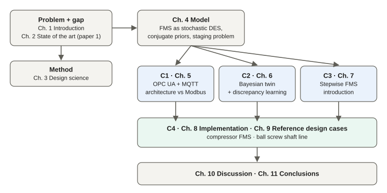

# Chapter 1 – Introduction

> Draft v2.0 (edition 2, standard-based communication) – 2026-11-15.

## 1.1 Industrial background

In many emerging industries, manufacturing companies operate standalone CNC machine tools: each machine is loaded by
hand, orders are planned on paper or in spreadsheets, and little data leaves the machine. Competitive pressure — shorter
delivery times, more product variants, rising labour costs and quality requirements of export customers — pushes these
companies towards flexible manufacturing systems (FMS), in which machining centres, automated material handling and a
central control system produce a family of parts in varying mix with little changeover effort.

The step from standalone machines to an FMS is large and largely irreversible. The company must decide, at design time,
which machines to buy, how many pallets and how much buffer capacity to provide, which transport system to install and
how to control the system. At that time the decisive parameters are uncertain: supplier cycle times are measured under
ideal conditions, failure and repair behaviour of new machines is unknown, scrap rates of new processes have yet to be
learned, and demand may develop differently than forecast. The consequences of wrong assumptions become visible only during
commissioning and ramp-up, when the system produces less than planned and corrections are expensive.

The case behind this thesis is the planned factory of a manufacturer of V-type two-cylinder piston air compressors
(VC10, VC20, VC30), whose crankcases, cylinders and crankshafts are to be machined in a pallet-based FMS with three
horizontal machining centres, followed by assembly, performance testing, painting and final assembly. A second
production line for ball screws and profiled linear guides is planned, and the company intends to extend the compressor
FMS later to a family of Roots blowers whose housings are machined in the same pallet cell. The FMS connects 21 machine devices — machining
centres, assembly and test stations, a pallet system, AGVs and AS/RS cranes — from several suppliers.

**Interoperability as a design decision.** An FMS is only as good as the data that flow between its machines, its
control system and its digital twin. When every supplier delivers its own data interface, the integrator must map each
machine signal by hand — register by register, address by address — and must repeat the work for every new machine. Open
industrial communication standards remove much of this effort: OPC UA (IEC 62541) offers a self-describing address space,
standard information models for machines published as companion specifications — in particular *OPC UA for Machinery*
(OPC 40001-1) and *OPC UA for Machine Tools* (OPC 40501-1) — subscriptions, events, callable methods and certificate-based
security; MQTT (ISO/IEC 20922) with the Sparkplug B specification (ISO/IEC 20237) offers lightweight publish–subscribe
messaging around one central broker, which allows all plant data to be organised in a single *unified namespace*; and
VDA 5050 defines a vendor-independent interface between AGVs and their master control. Modern CNC controllers and many
PLCs now offer OPC UA servers, and open-source implementations of all these standards run on an ordinary industrial PC.

The case company has therefore decided to build its FMS on open standards rather than on a minimal Modbus TCP and HTTP
interface. The decision keeps two constraints that are typical of its environment: the shop-floor computers run
**offline**, without cloud services or commercial IIoT platforms, and the staff who will maintain the system are
mechanical and electrical engineers rather than software specialists. The first edition of this thesis treated the
minimal case (Ethernet, Modbus TCP and HTTP only); this edition keeps that architecture as the measured baseline.

## 1.2 Problem statement

Digital twins — virtual representations of a production system that are connected to it by data — promise to close the
loop between design assumptions and reality. The literature, however, offers little for the situation described
(Chapter 2): most published "digital twins" are simulation models with manual data exchange; their input uncertainty is
usually fixed at design time; updating with real data is rare and almost never Bayesian; predictions are seldom compared
with the real system after start-up and never followed through ramp-up; standard communication technologies such as OPC
UA and MQTT are proposed for twins, but their completeness, latency, resource use and configuration effort are rarely
measured for a whole factory of the size and budget of a small company, and they are hardly ever compared with the
simplest alternative; and methods for staged FMS investment treat the capacity effect of an investment as known, although
it is precisely what is uncertain in a new system.

The problem addressed by this thesis is therefore:

> *How can a company that moves from standalone CNC machines to an FMS, with affordable, standard-based technology and
> uncertain design data, use a digital twin to predict its new system honestly, learn the system's true behaviour quickly
> during commissioning and ramp-up, and decide the steps of the introduction with less risk?*

## 1.3 Research objective and questions

The objective is to develop and evaluate an **uncertainty-aware digital twin method with interoperable, standard-based
communication for the stepwise introduction of FMS**. Three research questions structure the work:

- **RQ1** – Which communication architecture built on open industrial standards (OPC UA, MQTT/Sparkplug B) can provide
  an FMS digital twin and the supervisory FMS control with complete, timely and semantically described machine data at a
  cost and skill level suitable for an SME in an emerging economy, and how does it compare with a minimal Modbus TCP/HTTP
  architecture?
- **RQ2** – How can uncertain FMS design parameters be represented and updated with commissioning and ramp-up data, and
  how much does this improve prediction accuracy and the honesty of predicted uncertainty compared with a deterministic
  design model or a one-time calibration?
- **RQ3** – How can the updated twin support the stepwise decisions of FMS introduction — which machines and automation
  to add, and when?

## 1.4 Hypotheses

- **H1** – An OPC UA + MQTT architecture delivers 100 % of machine state changes to the twin with end-to-end latency
  below 1 s for the 21-device case factory on one industrial PC, and removes per-machine register mapping through a
  standard information model, at the price of higher resource use and configuration effort than Modbus TCP/HTTP.
- **H2** – With sequential Bayesian updating, the monthly prediction error of good output falls below 5 % with at least
  30 % less ramp-up data than with the deterministic design model or a one-time calibration.
- **H3** – The 90 % prediction intervals of the updated twin achieve at least 85 % empirical coverage.
- **H4** – A staged introduction plan re-optimised after each Bayesian update gives a higher expected net present value
  and a lower risk of under-capacity than an all-at-once investment or a staged plan fixed at design time.

The thresholds are proposals derived from practical requirements (Chapter 5; Section 4.8); they are tested, not assumed.
H1 contains a claim (completeness and latency), a benefit (no per-machine register mapping) and an expected price
(resources and configuration effort); all three parts are measured against the Modbus TCP/HTTP baseline in Chapter 5.

## 1.5 Contributions

| | Contribution | Chapter |
|---|---|---|
| **C1** | An **interoperable, standard-based reference architecture** for FMS digital twins and supervisory control that runs offline on one industrial PC — OPC UA servers with information models following OPC 40001-1 / OPC 40501-1, subscriptions, events and methods; an MQTT broker with Sparkplug B as unified namespace; VDA 5050 for the AGVs; certificate-based security — with a **mapping of the twin's observations to standard information-model nodes**, analytical sizing, and a **measured comparison with a minimal Modbus TCP/HTTP architecture** (completeness, latency, resource use, configuration effort) | 5 |
| **C2** | An uncertainty-aware twin method: design statements translated into conjugate priors with an interpretable confidence; sequential Bayesian updating of failure, repair, cycle-time and scrap parameters with forgetting for ramp-up; nested Monte Carlo prediction; **model-discrepancy learning**; and a **frozen-prediction protocol** for honest validation | 4, 6 |
| **C3** | A decision method for the **stepwise introduction of an FMS** that re-decides investment options every stage with the updated twin, and an experimental quantification of the value of learning the uncertain capacity effect | 7 |
| **C4** | Application to three reference design cases — a compressor FMS, a ball screw shaft line and a Roots blower extension that shares the FMS cell — including a process-level analysis of the shared cell, a frozen design prediction for the real ramp-up, a validation protocol and the data path of both factories; an implementation that runs offline, including an interactive browser version of all calculations | 8, 9 |

A systematic literature review (paper 1) underpins the research gap (Chapter 2).

## 1.6 Scope and limitations

The thesis addresses discrete manufacturing systems in the transition from standalone CNC machines to an integrated FMS.
It covers the system level — throughput, bottlenecks, investment — not process physics such as cutting forces, thermal
behaviour of machine tools or metallurgy. On the communication side it covers the supervisory and twin level (ISA-95
levels 2–3): machine states, counters, cycle times, jobs, alarms and AGV orders. Hard real-time motion control,
deterministic networking (TSN) and cloud platforms are outside the scope and are discussed only as background. Demand
uncertainty is represented by scenarios, not learned in detail. Safety functions remain hard-wired and outside the data
architecture. The methods are evaluated analytically, in a laboratory bench and in controlled computational experiments;
the field validation in the case factory is fully specified and its design prediction frozen, but its results depend on
the factory's start of production (Section 9.7). Case data are design data of the planned factories and reference
estimates where company data were not available; all values are labelled accordingly.

## 1.7 Publications

- Paper 1 – *Digital twins for the design, ramp-up and stepwise introduction of flexible manufacturing systems under
  technology and data constraints: a systematic review* (manuscript complete; basis of Chapter 2).
- Paper 2 (planned) – interoperable OPC UA / MQTT twin architecture for an SME FMS with a measured comparison against a
  Modbus TCP/HTTP baseline (Chapter 5).
- Paper 3 (planned) – sequential Bayesian updating with model discrepancy for ramp-up prediction (Chapters 4, 6).
- Paper 4 (planned) – stepwise FMS introduction under learning, with the three cases (Chapters 7, 9).

## 1.8 Structure of the thesis

Chapter 2 reviews the state of the art — including industrial communication standards for digital twins — and derives
the research gap from a systematic review. Chapter 3 describes the design-science methodology and the three-layer
evaluation. Chapter 4 formalises the FMS model, the uncertain parameters, the conjugate Bayesian models, the prediction
measures and the staging decision problem. Chapter 5 designs the OPC UA / MQTT architecture and measures it against the
Modbus TCP/HTTP baseline (RQ1, H1). Chapter 6 implements and tests the Bayesian twin in a virtual ramp-up (RQ2, H2, H3).
Chapter 7 develops and tests the stepwise introduction method (RQ3, H4). Chapter 8 describes the implementation,
including the FMS control system, Chapter 9 applies the method to the three reference cases and specifies the field
validation, Chapter 10 discusses the results and Chapter 11 concludes (Figure 1.1).

**Figure 1.1** Structure of the thesis and the four contributions.
