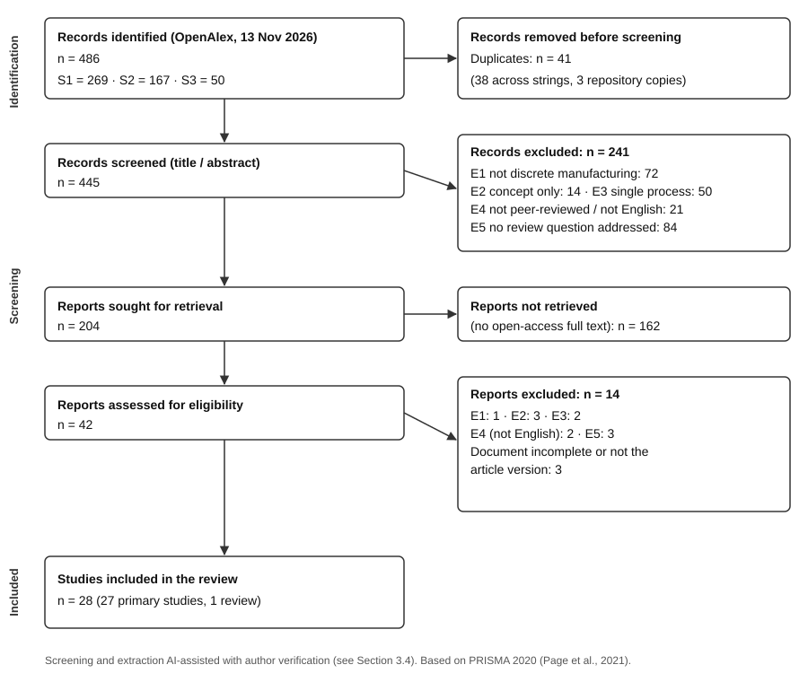

# Chapter 2 – State of the Art and Research Gap

> Draft v2.0 (edition 2) – 2026-11-15. Sections 2.1–2.8 review the foundations on which the thesis builds; Section 2.9 summarises
> the systematic literature review (paper 1, `research/paper1_slr/paper1_draft.md`), and Section 2.10 derives the
> research gap. References marked [verify] must be checked against the library database before submission.

## 2.1 Overview

The thesis connects six bodies of knowledge that are usually treated separately: flexible manufacturing systems
(Section 2.2), digital twins (2.3), simulation for production system design (2.4), uncertainty of simulation inputs and
its reduction by data (2.5), production ramp-up (2.6), industrial communication standards for digital twins — OPC UA, MQTT/Sparkplug B and the minimal Modbus alternative (2.7), and
manufacturing modernisation in small and medium-sized enterprises (SMEs) and emerging economies together with staged
capacity investment (2.8). Each section ends with what the thesis takes from it and what is missing. Section 2.9 reports
the systematic review that examined where these bodies of knowledge meet; Section 2.10 states the gap.

## 2.2 Flexible manufacturing systems

### 2.2.1 Definition and classification
A flexible manufacturing system is a group of numerically controlled machine tools connected by an automated material
handling system and controlled by a central computer, able to process a family of parts in varying mix and quantity with
little changeover effort. Browne et al. (1984) classified FMS by their flexibility types — machine, process, product,
routing, volume, expansion, operation and production flexibility — and by their structure, from flexible machining cells
with a single machine and a pallet changer to flexible transfer lines. Sethi and Sethi (1990) surveyed the many
definitions of manufacturing flexibility and showed that flexibility is not one property but a set of capabilities whose
value depends on the uncertainty a company faces. Reconfigurable manufacturing systems (Koren et al., 1999) extended the
idea from flexibility within a fixed configuration to the ability to change the configuration itself — adding or
removing machines and capabilities as demand changes, which is the logic of the stepwise introduction studied here.

### 2.2.2 Design and planning models
Classical FMS research produced analytical models for design and planning: closed queueing networks for capacity and
work-in-process with a limited number of pallets, and mathematical programming for part-type selection, machine
grouping, loading and tool allocation (Stecke, 1983; Buzacott and Shanthikumar, 1993). These models give insight and
fast answers, but they rest on exponential or deterministic times and steady state. Discrete-event simulation (Section
2.4) became the standard tool for detailed design because it represents blocking, failures, dispatching rules and
transport realistically.

### 2.2.3 FMS in practice and in the target context
Industrial experience with FMS has been mixed: high investment, complex control and long ramp-up have repeatedly led to
systems that did not reach their planned output or flexibility. Recent work integrates FMS with Industry 4.0
technologies — robots, connected machine tools, MES and digital twins (Florescu, 2024; Ullah and Younas, 2024; Kampa et
al., 2026). For companies that operate standalone CNC machines, the move to an FMS is a large and largely irreversible
step, which is why the thesis treats it as a sequence of smaller decisions under uncertainty (Chapter 7).

*Taken from 2.2:* the FMS concept, its flexibility types and the reconfiguration logic. *Missing:* methods that support
the *transition* from standalone CNC machines to an FMS and quantify, during that transition, how far the design
assumptions hold.

## 2.3 Digital twins in manufacturing

### 2.3.1 Origin and definitions
The digital twin concept is usually traced to product life-cycle management, where Grieves described a virtual
representation of a physical product linked to it by data over its life cycle (Grieves and Vickers, 2017). In
manufacturing, the term has been used for very different artefacts, from 3D models to simulation models with live data.
Kritzinger et al. (2018) proposed the most widely used classification by data flow: a *digital model* exchanges data with
the physical object only manually, a *digital shadow* receives data automatically from the physical object, and a
*digital twin* exchanges data automatically in both directions. Their review found that most publications were concept
papers and that applied case studies concentrated on the lower integration levels. Later reviews mapped applications,
enabling technologies and research issues (Negri et al., 2017; Tao et al., 2019; Lu et al., 2020; Fuller et al., 2020)
and, most recently, a taxonomy along life-cycle stage, hierarchy level, model characteristics, digital-thread
connectivity and deployment (Seipolt et al., 2025).

### 2.3.2 Reference architecture
ISO 23247 (2021) defines a framework for digital twins in manufacturing with four functional entities: observable
manufacturing elements, a data collection and device control entity, a digital twin core entity and user entities. The
architecture of Chapters 5 and 8 is aligned with it: PLCs and machines with their OPC UA servers are the observable
elements, the OPC UA clients, edge nodes and the MQTT broker with the unified namespace form the data collection and
device control entity, the Bayesian twin and the DES form the core, and MES, ERP and the browser
interface are the user entities.

### 2.3.3 Digital twins along the system life cycle
Most manufacturing digital twins support operation — monitoring, maintenance, scheduling. Fewer address the design
phase, where a twin is in fact a simulation model of a system that does not yet exist, and fewer still connect design and
operation. Van Beek et al. (2022) argue that the digital twin concept should integrate design decisions and operational
data across the life cycle and data from several design instances. Van Ginkel et al. (2025) report that research on
digital twins in system design and ramp-up is lacking and explore their implementation in SMEs qualitatively.

*Taken from 2.3:* the data-flow classification used to classify studies and to position the thesis artefact (a digital
shadow that becomes a twin through the staging decisions), and the ISO 23247 architecture. *Missing:* twins that carry
design-stage predictions *through* commissioning and ramp-up and quantify how good those predictions were.

## 2.4 Simulation for production system design

Discrete-event simulation is the established method to evaluate production system designs before they are built (Law,
2015). Reviews of simulation in manufacturing system design (Jahangirian et al., 2010; Negahban and Smith, 2014) show its
use for layout, capacity, buffer sizing, material handling and control rules. The quality of the result depends on the
input data: Bokrantz et al. (2017) analysed six industrial simulation cases in automotive companies and found that
machine vendors provide failure data only as means, that short stops are filtered out of monitoring data, and that
faulty or outdated data hinder input modelling. Design-stage simulation is therefore typically run with point estimates
or fixed distributions chosen by engineering judgement; its predictions are rarely compared with the real system after
start-up. Among the reviewed studies (Section 2.9), Konstantinov et al. (2022) are an exception: they compared
design-stage simulated cycle times of an assembly station with the commissioned station and found 17 % deviation before
and 8.7 % after manual recalibration.

*Taken from 2.4:* DES as the evaluation model (Chapters 4, 6, 7), the input-data problem as motivation. *Missing:* a
systematic way to update design-stage simulation inputs with commissioning and ramp-up data and to measure the effect.

## 2.5 Input uncertainty, calibration and data assimilation

### 2.5.1 Input uncertainty in simulation output analysis
When the input distributions of a simulation are estimated from finite data, their parameters are uncertain, and this
*input uncertainty* propagates to the output. The simulation literature distinguishes three families of methods to
quantify it (Barton, 2012): the delta method, which separates the variance contributions of stochastic and parameter
uncertainty using a Taylor approximation (Cheng and Holland, 1997); bootstrap resampling of the input data, often with
metamodels to save simulation effort; and Bayesian methods, which place distributions on the parameters and sample from
their posterior (Chick, 2001; Zouaoui and Wilson, 2003). Masciarelli and Matta (2022) applied metamodel-assisted
bootstrapping to a lab-scale manufacturing line with few data and noted that Bayesian approaches are computationally
demanding when the posterior must be sampled for many simulation runs.

### 2.5.2 Calibration with model discrepancy
Kennedy and O'Hagan (2001) formulated Bayesian calibration of computer models with an explicit model-discrepancy term:
observations equal the model output at the true parameters plus a systematic discrepancy plus noise. Without the
discrepancy term, calibration forces the parameters to absorb structural model error. Chapter 6 adopts this idea in a
simple sequential form and shows experimentally that, during ramp-up, parameter uncertainty alone yields over-confident
predictions.

### 2.5.3 Updating twins with live data
Recent manufacturing work updates simulation inputs from operating data: Schumacher et al. (2024) fit and re-fit
probability distributions of processing times and scrap rates to data from a real production system ("live fitting") as
input for simulation-based scheduling; Fu et al. (2025) update operation-time distributions from PLC timer data and
trigger line reconfiguration; Monek and Fischer (2023) extract DES input parameters automatically from a low-cost
inertial sensor and PLC data. These works update twins *in operation*; none starts from design-stage priors and follows a
new system through ramp-up.

*Taken from 2.5:* the Bayesian view of input uncertainty, conjugate models for cheap exact updates (Gelman et al., 2013
[verify edition]), the separation of epistemic and aleatory uncertainty, model discrepancy. *Missing:* sequential Bayesian
updating of production system models from design priors through commissioning and ramp-up, with evaluated prediction
quality.

## 2.6 Production ramp-up

Ramp-up — the period from the start of production to the planned output — is characterised by low output, high scrap,
frequent disturbances and rapid learning. Terwiesch and Bohn (2001) modelled ramp-up as a trade-off between producing
and learning, and showed that deliberate experimentation can shorten it. Surbier et al. (2014) reviewed the ramp-up
literature and identified the lack of quantitative decision support for the ramp-up phase as a main challenge. Learning
curves, dating back to Wright (1936), describe how unit time falls with cumulative output and underlie the explicit
learning-curve option of Section 4.6.5. In the systematic review (2.9), no study collected and used data during the
ramp-up of a new system with a digital twin.

*Taken from 2.6:* the ramp-up phenomenon (shape of the virtual ramp-up, Table 6.1; forgetting factor). *Missing:*
twin-based prediction and decision support during ramp-up.

## 2.7 Industrial communication for digital twins

A digital twin is only as good as the data that reach it. This section reviews the communication technologies that can
connect FMS machines with a twin and a supervisory control system: the reference levels (2.7.1), OPC UA (2.7.2–2.7.5),
MQTT and Sparkplug B with the unified namespace (2.7.6–2.7.7), comparisons between them (2.7.8), deterministic networking
(2.7.9), the Asset Administration Shell (2.7.10), the VDA 5050 interface for AGVs (2.7.11), retrofit of legacy machines
(2.7.12) and the minimal Modbus TCP/HTTP alternative (2.7.13). Section 2.7.14 states what is missing.

### 2.7.1 Levels and requirements
Industrial communication is organised in levels from field devices to enterprise systems (IEC 62264): sensors and
actuators (levels 0–1), control (level 2), manufacturing operations such as MES (level 3) and business planning (level
4). A digital twin of an FMS and the supervisory FMS control both live at levels 2–3. They need machine states, counters,
cycle times, alarms, job progress and transport orders — data with time constants of a fraction of a second to minutes,
not the microsecond cycles of motion control. Wollschlaeger et al. (2017) describe how industrial communication is moving
from many fieldbuses towards Ethernet-based, service-oriented and IoT-oriented technologies in which *semantics* — the
meaning of data, not only their transport — becomes the main integration problem. Jacoby and Usländer (2020) reviewed the
standards landscape for digital twins and the IoT and concluded that no single standard covers all aspects; OPC UA,
MQTT-based messaging and the Asset Administration Shell are among the building blocks most often combined.

### 2.7.2 OPC UA: architecture and address space
OPC Unified Architecture (OPC UA, IEC 62541) is the successor of the Windows-based "classic" OPC specifications. It is
platform-independent and service-oriented: a *server* exposes data and functions, and *clients* use standard services to
browse, read, write, subscribe and call them (Mahnke et al., 2009). The usual transport is the binary protocol over TCP
(`opc.tcp`, port 4840); HTTPS and WebSocket mappings also exist. Client and server first establish a *secure channel*
and then a *session*.

The core of OPC UA is its **address space**: a graph of *nodes* connected by typed *references*. Eight node classes
exist — Object, Variable, Method, ObjectType, VariableType, ReferenceType, DataType and View. A machine is an Object; its
state, counters and parameters are Variables with a data type, engineering unit and time stamps; its functions (start a
job, acknowledge an alarm) are Methods; and its structure is defined by ObjectTypes, so that every machine of the same
type looks the same to a client. Because the address space can be browsed, a client can *discover* what a server offers
instead of relying on an address list delivered on paper. Type definitions are exchanged as NodeSet XML files, which
allows tools to generate servers and clients from the model (Schleipen et al., 2016). Open-source stacks — for example
open62541 in C (Palm et al., 2015) and implementations in Python, Java and .NET — have lowered the entry cost; Hannelius
et al. (2008) had already described a stepwise roadmap for adopting OPC UA alongside existing systems.

### 2.7.3 Information modelling and companion specifications
The value of OPC UA for interoperability lies in **standard information models**. Companion specifications, written
jointly by the OPC Foundation and industry associations, define ObjectTypes for a class of equipment. For the machine
building sector, the VDMA and the OPC Foundation published *OPC UA for Machinery – Part 1: Basic Building Blocks*
(OPC 40001-1; first release 2020, later releases add building blocks), which standardises how a machine identifies
itself (manufacturer, model, serial number, year of construction), its state (MachineryItemState: *NotAvailable*,
*OutOfService*, *Executing*, *NotExecuting*), its operation mode (for example *Processing*, *Maintenance*, *Setup*) and
operation and lifetime counters. *OPC UA for Machine Tools – Part 1: Machine Monitoring and Job Management* (OPC 40501-1;
first release 2020, release 1.02 in 2024), promoted under the name umati, builds on it for CNC machine tools: monitoring
of the machine, its channels, spindles and stack light; production plans, jobs and programs with part counters; tool
lists; and notifications (messages and prognoses). Liu et al. (2019) developed an OPC UA information model for CNC machine
tools and a converter from MTConnect, the open machine-tool data standard of the MTConnect Institute (ANSI/MTC1.4-2018
[verify]), and showed how one platform can serve several applications. Martins et al. (2023) integrated CNC machines of
different brands in the moulds industry through one OPC UA layer and identified the diversity of proprietary interfaces
as the obstacle that a standard approach removes. Schroeder et al. (2016) used AutomationML to model twin data and a
separate method for data exchange — an early example of separating *semantics* from *transport*.

### 2.7.4 Subscriptions, events and methods
OPC UA offers two ways to receive changing data. A client may *read* values periodically, which has the same sampling
weakness as Modbus polling (Section 2.7.13). The intended way is a **subscription**: the client creates *monitored
items* on the server, each with a *sampling interval* (how often the server checks the value), a *queue size* and an
optional *deadband* filter; the server collects changes and sends them in notification messages once per *publishing
interval*. Only changes are transmitted (report by exception), and keep-alive messages show that a silent connection is
still alive. **Events** — for example alarms and conditions (IEC 62541-9) or state transitions of programs (IEC
62541-10) — are not sampled but generated by the server when they occur, each with its own time stamp, and are queued for
the client. **Methods** let a client call a function on the server with typed input and output arguments, which is how a
supervisory control can start a job or confirm a pallet transfer without the toggle-bit handshakes of register-based
interfaces. One consequence is rarely stated in the twin literature but is important for this thesis: a monitored
*variable* reports the value it finds at each sampling instant, so changes shorter than the sampling interval can still
be missed; only events, or server-side sampling at the rate of the underlying PLC data with a sufficient queue, deliver
*every* state change.

### 2.7.5 OPC UA PubSub, security and performance
**PubSub.** Part 14 of the specification (OPC Foundation, 2018) adds publish–subscribe communication: publishers send
*NetworkMessages* containing *DataSetMessages* without client sessions, either brokerless over UDP multicast with the
binary UADP encoding, or through a broker such as MQTT with JSON or UADP encoding (Eckhardt et al., 2018). The brokerless
UADP variant combined with Time-Sensitive Networking aims at controller-to-controller and field-level communication
(Section 2.7.9); the JSON-over-MQTT variant connects OPC UA semantics with IT-style messaging.

**Security.** OPC UA security is built in rather than added: every application has an X.509 *application instance
certificate*; client and server authenticate each other through trust lists; messages are signed, or signed and
encrypted (security modes *None*, *Sign*, *SignAndEncrypt*), according to a *security policy* such as Basic256Sha256;
users authenticate anonymously, with user name and password or with a certificate; and a Global Discovery Server (IEC
62541-12) can distribute and renew certificates for a whole plant. Security is therefore a matter of configuration — and
configuration is often wrong. Dahlmanns et al. (2020) scanned the IPv4 address space for reachable OPC UA servers and
found problematic configurations — missing access control, disabled security functions or deprecated cryptographic
primitives — on 92 % of them, and several hundred devices sharing the same certificate. For an offline factory the
attack surface is smaller, but the lesson applies: certificate management (a small public-key infrastructure) is part of
the engineering effort. Security of industrial networks as a whole is addressed by the IEC 62443 series.

**Performance.** Cavalieri and Chiacchio (2013) analysed the performance of OPC UA client–server communication. Burger
et al. (2019) measured client–server and PubSub communication on resource-constrained devices and built a regression
model of CPU use for hardware sizing; they found the server CPU to be the main bottleneck, a PubSub throughput of up to
40 000 signals per second even on a Raspberry Pi Zero, and a severe overhead of session management when more than about
20 clients access one server. The last result matters for an FMS: if the twin, the cell controller, the MES, the
historian and operator screens each open their own session to every machine, the machine servers — often small embedded
servers in CNC controllers — become the bottleneck. An aggregating layer is therefore needed.

### 2.7.6 MQTT
MQTT (ISO/IEC 20922 for version 3.1.1; OASIS MQTT 5.0) is a lightweight publish–subscribe protocol over TCP. Clients
*publish* messages to hierarchical *topics* (for example `plant/area/cell/machine/state`) on a central **broker**, and
other clients *subscribe* to topics or topic patterns; publishers and subscribers do not know each other. Three quality
of service (QoS) levels define delivery: at most once (0), at least once (1) and exactly once (2). *Retained* messages
give a new subscriber the last value at once, and a *last will* message announces that a client has disconnected
unexpectedly. Mishra and Kertesz (2020) surveyed MQTT in machine-to-machine and IoT systems, including broker
implementations, QoS behaviour and security. Open-source brokers such as Mosquitto (Light, 2017) run on small computers.
MQTT itself provides no data semantics and no security beyond TLS and broker authentication and authorisation; Dinculeană
and Cheng (2019) described vulnerabilities and limitations of the protocol that must be compensated in a deployment.

### 2.7.7 Sparkplug B and the unified namespace
Because MQTT leaves topics and payloads free, every project invents its own conventions. **Sparkplug** (Eclipse
Foundation, version 3.0; published as ISO/IEC 20237:2023) closes this gap for industrial use: it fixes a topic structure
`spBv1.0/<group>/<message type>/<edge node>/<device>`, a binary Protocol Buffers payload of named, typed and time-stamped
*metrics*, and a state model. An edge node announces itself and its devices with *birth* certificates (NBIRTH, DBIRTH)
that list all metrics with names, data types and optional aliases; afterwards it sends only changed values (NDATA,
DDATA) by exception, using the short aliases; a *death* certificate (NDEATH, registered as MQTT last will) marks it as
offline; sequence numbers let the consuming host application detect lost messages and request a new birth (*rebirth*);
and commands flow back as NCMD / DCMD. Sparkplug thus gives MQTT the session state and self-description that SCADA
systems require.

The **unified namespace** (UNS) is an architectural pattern built on such a broker: all current plant data are
published once, in one hierarchy that follows the plant structure (often the ISA-95 levels enterprise / site / area /
line / cell / machine), and every consumer — twin, MES, control, dashboards — subscribes to what it needs instead of
connecting point-to-point to each machine. The pattern is widely promoted in practice, but the peer-reviewed evidence is
thin: Pintilie et al. (2025) redesigned a PLC-based control architecture with MQTT, Sparkplug B and a UNS in an
industrial case and reported improved flexibility, scalability and reduced latency. Most other sources are practitioner
material.

### 2.7.8 OPC UA versus MQTT
The two technologies are often presented as competitors but answer different questions: OPC UA standardises *what* a
machine is and how it is accessed (information model, services, security); MQTT standardises *how* messages are
distributed (broker, topics, QoS). Measured comparisons are few and depend strongly on implementations and set-up.
Silveira Rocha et al. (2018) compared the data exchange performance of OPC UA and MQTT in a laboratory set-up; Profanter
et al. (2019) compared features, wire overhead and round-trip times of open-source OPC UA, ROS, DDS and MQTT
implementations in idle, high-CPU and high-network-load states and for 500 nodes on one host; Jaloudi (2019) compared
communication protocols for an industrial IoT environment. These studies measure single links or small numbers of nodes,
and none measures the *completeness* of state-change delivery, which is what a twin that counts failures and cycle times
needs. Practice increasingly combines both: OPC UA servers in the machines with standard models, and an MQTT/Sparkplug
broker (or OPC UA PubSub over MQTT) as the distribution layer of the plant.

### 2.7.9 Time-Sensitive Networking
Time-Sensitive Networking (TSN) is a set of IEEE 802.1 standards that adds time synchronisation, scheduled traffic and
bandwidth reservation to standard Ethernet, so that deterministic control traffic and best-effort IT traffic can share
one network (Finn, 2018). OPC UA PubSub with UADP over TSN is proposed as a vendor-independent alternative to fieldbuses
down to the field level (Bruckner et al., 2019; Pfrommer et al., 2018). For the supervisory and twin level studied here,
sub-second rather than sub-millisecond timing is sufficient, and TSN hardware is not yet common in low-cost controllers;
TSN is therefore background, not part of the architecture of this thesis.

### 2.7.10 Asset Administration Shell
The Asset Administration Shell (AAS) of the German Plattform Industrie 4.0, now standardised in the IEC 63278 series
[verify part title and year], is a standard digital representation of an asset — a machine, a component, a product — made
of *submodels* such as nameplate, technical data, documentation or operational data. It addresses the life cycle and the
exchange of asset information between companies rather than real-time communication; an AAS can reference OPC UA servers
for live data. Tantik and Anderl (2017) proposed an integrated data model and structure for the AAS, Ye and Hong (2019)
implemented AAS-based Industry 4.0 components, and Cavalieri and Salafia (2020) represented PLCs with an AAS based on IEC
61131-3. For an SME in the first stage of FMS adoption the AAS is a useful target for machine documentation and purchase
specifications, but not a prerequisite for the twin.

### 2.7.11 VDA 5050 for automated guided vehicles
AGV fleets have traditionally been controlled by the vendor's own master control, so that vehicles of different makers
cannot be mixed. VDA 5050, published by the German automotive association VDA together with VDMA (version 2.0, 2022;
version 2.1, 2024), defines a vendor-independent interface between a master control and AGVs over MQTT with JSON
messages: the master control sends *orders* as graphs of nodes and edges with actions; the vehicle reports its *state*
(position, battery, errors, order progress) and its *connection*; and *instant actions* allow immediate commands. Franke
et al. (2023) identified requirements for further standardised interfaces in the AGV context — between the AGV, the
master control and the surrounding periphery — that VDA 5050 does not yet cover. For an FMS, VDA 5050 places the AGVs on
the same MQTT broker as the machine data.

### 2.7.12 Retrofit of legacy machines
Many SMEs operate CNC machines whose controllers have no OPC UA server. Retrofit connects them without replacing their
controls. Lins and Oliveira (2020) described the retrofitting of legacy equipment towards cyber-physical production
systems, and Alqoud et al. (2022) systematically reviewed the digital retrofitting of legacy manufacturing systems.
Typical solutions are **edge gateways** that read the legacy interface — a PLC over Modbus or a vendor protocol, digital
I/O, current sensors — and expose an OPC UA server with a standard model or publish to MQTT: edge devices with
containerised modules for machine tools (Tonejca et al., 2024), cameras with object tracking (Ward et al., 2021),
inexpensive inertial sensors (Monek and Fischer, 2023), open-source IoT frameworks for co-engineering in brownfield
factories (Wintercorn et al., 2023), and open-source messaging and dashboards in an SME (van Ginkel et al., 2025, who
measured a PLC-to-twin delay of 0.98–3.02 ms). These works show feasibility; performance limits — completeness, latency,
capacity, cost and the effort of configuration — are rarely measured.

### 2.7.13 The minimal alternative: Modbus TCP and HTTP
Modbus TCP — a simple request–response protocol over TCP/IP with 16-bit registers (Modbus Organization, 2006, 2012) — is
supported by almost every PLC, including low-cost controllers, needs no certificates and can be understood in an
afternoon. It has no data semantics (every register must be mapped by hand and documented), no subscriptions (data are
obtained by polling, which misses changes between polls), no events and no built-in security; secure variants have been
proposed (Fovino et al., 2009) but are not common. Combined with an HTTP/JSON interface for higher-level systems, it forms
the minimal architecture of the first edition of this thesis, which closed the polling gap with an event-preserving
register block in every PLC. In this edition it is the **baseline** against which the standard-based architecture is
measured. In the systematic review (Section 2.9), no study used Modbus.

### 2.7.14 Synthesis and gap

**Table 2.1** Communication technologies for an FMS digital twin at levels 2–3 [cited; qualitative].
| Property | Modbus TCP + HTTP | OPC UA client–server | OPC UA PubSub | MQTT + Sparkplug B | VDA 5050 |
|---|---|---|---|---|---|
| Data semantics | none (register map by hand) | standard information models (OPC 40001-1, 40501-1) | as OPC UA (data-set metadata) | metric names and types in birth certificates | fixed JSON schema for AGVs |
| Change delivery | polling | subscriptions (sampled); events (complete) | cyclic or on change | report by exception; sequence numbers | state messages |
| Commands | register writes + handshake | methods, writes | – | NCMD / DCMD | orders, instant actions |
| Security | none built in | certificates, signing, encryption, user roles | message security | TLS, broker access control | TLS, broker access control |
| Coupling | point-to-point | point-to-point sessions | decoupled | decoupled via broker (UNS) | via broker |
| Entry effort | very low | medium–high (models, certificates) | high | medium | medium |

Taken together, the literature offers mature standards and many feasibility demonstrations, but four things are missing
for the target context: (i) an architecture that combines OPC UA information models, MQTT/Sparkplug B, VDA 5050 and
certificate-based security for a *whole FMS* on one offline PC and maps the observations a Bayesian twin needs onto
standard nodes; (ii) measurements of the *completeness* of state-change delivery — not only latency — at factory scale;
(iii) a quantified comparison with the simplest alternative (Modbus TCP/HTTP) that includes resource use and
configuration effort, the costs that matter for an SME; and (iv) guidance on *when* the standard-based architecture is
worth its price for an SME in an emerging economy.

*Taken from 2.7:* the levels, the OPC UA address space, companion specifications, subscriptions, events and methods,
Sparkplug B and the unified namespace, VDA 5050, certificate-based security, retrofit patterns and the Modbus baseline.
*Missing:* a measured, standard-based twin architecture for an SME FMS compared with the minimal alternative (Chapter 5).

## 2.8 SMEs, emerging economies and staged capacity investment

### 2.8.1 Digital transformation in SMEs and emerging economies
Reviews report that SMEs face specific barriers to digital twins and Industry 4.0 — limited capital, skills and data,
and the difficulty of integrating heterogeneous equipment — and propose staged adoption paths (systematic review of the
digital and green transition of European manufacturing SMEs, 2025 [complete authors]). A 2026 review of digital twin
adoption in emerging economies notes that most of the evidence comes from developed countries (Cassius et al., 2026,
weak venue). Studies located in emerging economies analyse current-state systems with DES — an aluminium casting SME in
Malaysia (Kamar et al., 2024), a bottled-water SME in Nigeria (Odedairo and Nwabuokie, 2018), packaging lines moving to
AGVs in Indonesia (Purwaningsih et al., 2025) — or use synthetic data (Parameswari et al., 2026); Ullah and Younas (2024)
built a prototype FMS because no industrial FMS was accessible in their country; Tuhin et al. (2026) propose a phased
digitalisation path for a machining cell in Bangladesh.

### 2.8.2 Capacity expansion and staged investment
Capacity expansion under uncertainty is a classical operations research problem (Luss, 1982; Van Mieghem, 2003): when to
add how much capacity of which type, given uncertain demand and economies of scale. Real-options theory values the
flexibility to defer, stage or abandon investments (Trigeorgis, 1996); conditional value-at-risk provides a coherent risk
measure for such decisions (Rockafellar and Uryasev, 2000). These models usually treat the *demand* as uncertain and the
*capacity effect* of an investment as known. In the transition to an FMS, the capacity effect itself is uncertain,
because the real performance of new machines and processes is unknown until they run — the uncertainty that the
Bayesian twin reduces.

*Taken from 2.8:* the context, staged investment logic, CVaR. *Missing:* staged FMS investment decisions that learn the
uncertain capacity effect from shop-floor data.

## 2.9 Systematic literature review

### 2.9.1 Method
A systematic review following PRISMA 2020 (Page et al., 2021) examined where the topics of Sections 2.2–2.8 meet. Four
review questions were asked: SQ1 architectures and communication, especially low-cost technology; SQ2 representation
and updating of input uncertainty; SQ3 use in design, commissioning and ramp-up and validation of predictions; SQ4 SMEs,
emerging economies and the transition from standalone CNC to FMS. OpenAlex was searched on 13 November 2026 with three
strings combining a digital twin / simulation block, a manufacturing system block and a topic block (uncertainty;
life-cycle phase; context). Of 486 records, 445 remained after duplicate removal; title/abstract screening excluded 241;
204 reports were eligible for full-text assessment, of which the 42 available in open access were assessed and **28
studies included**. Screening and data extraction were assisted by a large language model under a written protocol and
verified by the author (Chapter 3). Figure 2.1 shows the selection; the full method and the extraction table are in paper 1.

**Figure 2.1** PRISMA 2020 flow diagram of the systematic review.

### 2.9.2 Results

**Table 2.2** Main findings of the review (n = 28).
| Dimension | Finding |
|---|---|
| Integration level | digital model 18, digital shadow 6, digital twin 3 (one only claimed), review 1 |
| Communication (SQ1) | not stated 12; OPC UA 6; TCP/IP 2; Profinet 2; MQTT, Beckhoff ADS, REST/HTTP, CoAP, RS485 once each; **Modbus 0** |
| Uncertainty (SQ2) | explicit in 12 (fixed distributions 9, empirical 1, scenarios 2); deterministic 5; not stated 11 |
| Updating with real data (SQ2) | automatic in **2** (Fu et al., 2025; Monek and Fischer, 2023); manual in 3; **Bayesian 0** |
| Life-cycle phase (SQ3) | design 18, commissioning 8, operation 14; **ramp-up with data 0** |
| Validation against reality (SQ3) | 5; design-stage prediction vs commissioned system: **1** (Konstantinov et al., 2022) |
| Context (SQ4) | SME 7, large 3, both 1, laboratory 8, not stated 9; emerging economies 7; **CNC → FMS transition with data 0** |
| Quality | mean score 3.7 of 6 |

The concept matrix of paper 1 (Table 5 there) codes seven features per study. No study combines automatic updating with
the commissioning or ramp-up phase; no study combines automatic updating, ramp-up and validation against reality; no study
combines low-cost technology with an emerging-economy case and real validation. A recent review of CAD–DES integration
(Chikwata et al., 2026) independently reports that model accuracy over the system life cycle is hardly measured.

### 2.9.3 Limitations of the review
One database was searched and only open-access full texts (42 of 204) were assessed; the gap statements therefore mean
"not found in the open-access literature" and should be re-checked against subscription journals. Screening and
extraction were AI-assisted with author verification. These limitations are reported in full in paper 1, Section 5.5.

## 2.10 Research gap

From Sections 2.2–2.9 five gaps follow, each addressed by a part of the thesis:

| Gap | Statement | Addressed in |
|---|---|---|
| G1 | Design-stage predictions of production system models are almost never validated against the commissioned system and never followed through ramp-up. | Ch. 4 (frozen-prediction protocol), Ch. 6, Ch. 9.7 |
| G2 | Input parameters are not updated sequentially from design priors with commissioning and ramp-up data; Bayesian updating with plant data is absent. | Ch. 4, Ch. 6 (C2) |
| G3 | Standard-based data paths (OPC UA, MQTT/Sparkplug B) for twins are demonstrated on single links or qualitatively; completeness of state-change delivery, resource use and configuration effort at factory scale are not measured, and no comparison with the minimal Modbus TCP/HTTP alternative exists for SMEs in emerging economies. | Ch. 5 (C1) |
| G4 | No method supports the staged transition from standalone CNC to FMS with learning of the uncertain capacity effect. | Ch. 7 (C3) |
| G5 | Evidence from emerging economies stops at current-state models or synthetic data. | Ch. 9 (C4) |

The research questions of Chapter 1 follow directly: RQ1 addresses G3, RQ2 addresses G1 and G2, RQ3 addresses G4; the
cases of Chapter 9 address G5.

## 2.11 Summary
FMS research provides the system concept and the reconfiguration logic; digital twin research provides definitions and a
reference architecture but concentrates on operation and on lower integration levels; simulation research provides the
evaluation model and the methods for input uncertainty, but design-stage models are rarely updated or validated;
calibration research provides the discrepancy concept; ramp-up research describes the phase but lacks twin-based decision
support; communication research provides mature standards — OPC UA information models, MQTT/Sparkplug B, VDA 5050 — but measures
them on single links and does not compare them, at factory scale and with SME costs, with the minimal alternative; and capacity-investment research treats capacity effects as known. The systematic review of 28 studies confirmed
that no published work combines these elements. Chapters 4–9 close the five resulting gaps.

---
**References cited in this chapter** (full list in the bibliography): Barton (2012) Tutorial: input uncertainty in output
analysis, Proc. Winter Simulation Conference; Bokrantz et al. (2017) SIMULATION; Browne, Dubois, Rathmill, Sethi, Stecke
(1984) Classification of flexible manufacturing systems, The FMS Magazine 2(2); Buzacott, Shanthikumar (1993) Stochastic
Models of Manufacturing Systems, Prentice Hall; Cassius et al. (2026); Cheng, Holland (1997) J. Statistical Computation and
Simulation 57; Chick (2001) Operations Research 49(5); Chikwata et al. (2026); Florescu (2024); Fu et al. (2025); Fuller et
al. (2020); Gelman et al. (2013) Bayesian Data Analysis [verify edition]; Grieves, Vickers (2017) in Transdisciplinary
Perspectives on Complex Systems, Springer; IEC 62264; IEC 62541; ISO 23247; ISO/IEC 20922; Jahangirian et al. (2010)
European J. Operational Research 203(1); Kamar et al. (2024); Kampa et al. (2026); Kennedy, O'Hagan (2001); Konstantinov et
al. (2022); Koren et al. (1999) Reconfigurable manufacturing systems, CIRP Annals 48(2); Kritzinger et al. (2018); Law (2015)
Simulation Modeling and Analysis, 5th ed.; Lu et al. (2020); Luss (1982) Operations Research 30(5); Masciarelli, Matta
(2022); Modbus Organization (2006, 2012) [verify]; for Section 2.7 also: Alqoud et al. (2022); Bruckner et al. (2019);
Burger et al. (2019); Cavalieri, Chiacchio (2013); Cavalieri, Salafia (2020); Dahlmanns et al. (2020); Dinculeană, Cheng
(2019); Eckhardt et al. (2018); Eclipse Foundation (2023) / ISO/IEC 20237; Finn (2018); Fovino et al. (2009); Franke et al.
(2023); Hannelius et al. (2008); IEC 62443; IEC 63278; Jacoby, Usländer (2020); Jaloudi (2019); Light (2017); Lins,
Oliveira (2020); Liu et al. (2019); Mahnke et al. (2009); Martins et al. (2023); Mishra, Kertesz (2020); MTConnect Institute
(2018); OASIS (2019); OPC Foundation (OPC 10000-14; OPC 40001-1; OPC 40501-1); Palm et al. (2015); Pfrommer et al. (2018);
Pintilie et al. (2025); Profanter et al. (2019); Schleipen et al. (2016); Schroeder et al. (2016); Silveira Rocha et al.
(2018); Tantik, Anderl (2017); VDA (2022, 2024); Wollschlaeger et al. (2017); Ye, Hong (2019); Monek, Fischer (2023); Negahban, Smith (2014) J. Manufacturing Systems
33(2); Negri, Fumagalli, Macchi (2017) Procedia Manufacturing 11; Odedairo, Nwabuokie (2018); Page et al. (2021);
Parameswari et al. (2026); Purwaningsih et al. (2025); Rockafellar, Uryasev (2000); Schumacher et al. (2024); Seipolt et al.
(2025); Sethi, Sethi (1990) Int. J. Flexible Manufacturing Systems 2(4); Stecke (1983) Management Science 29(3); Surbier,
Alpan, Blanco (2014) Production Planning & Control 25(15); Tao et al. (2019); Terwiesch, Bohn (2001) Int. J. Production
Economics 70(1); Tonejca et al. (2024); Trigeorgis (1996); Tuhin et al. (2026); Ullah, Younas (2024); van Beek et al. (2022);
van Ginkel et al. (2025); Van Mieghem (2003) Manufacturing & Service Operations Management 5(4); Ward et al. (2021);
Wintercorn et al. (2023); Wright (1936) J. Aeronautical Sciences 3(4); Zouaoui, Wilson (2003) IIE Transactions 35(9).
