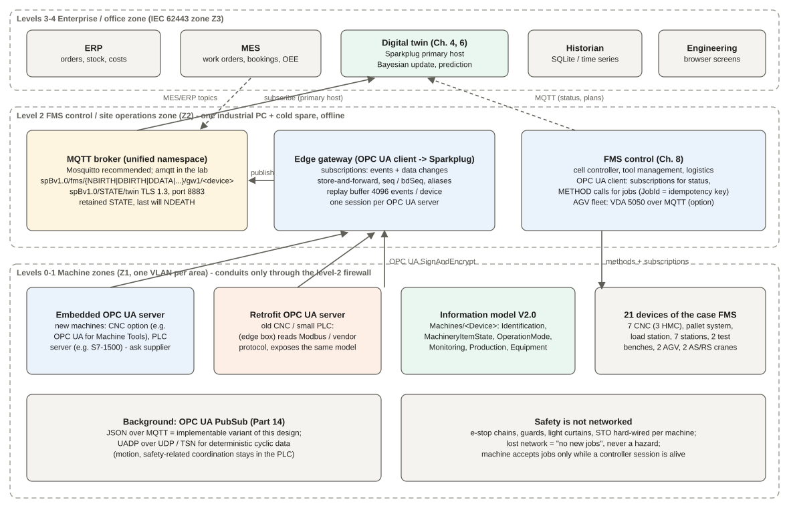
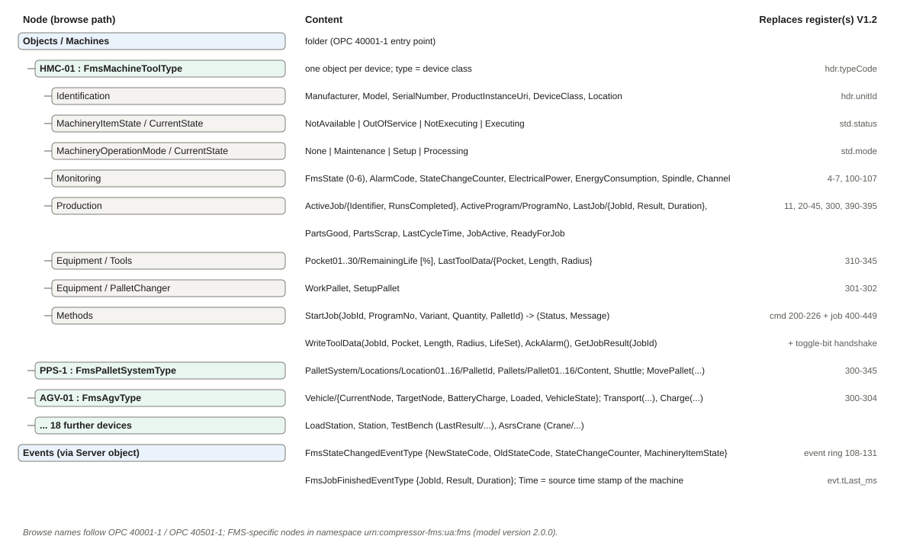
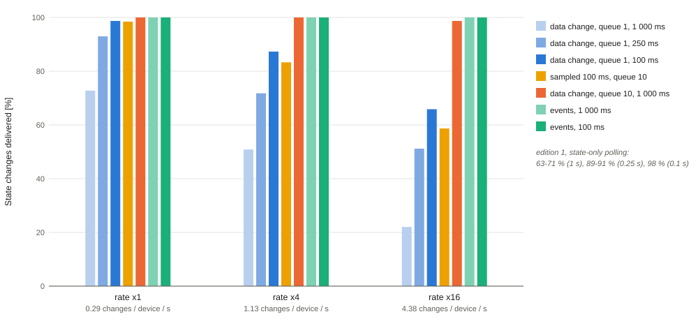
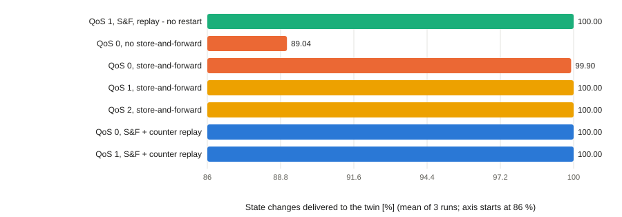
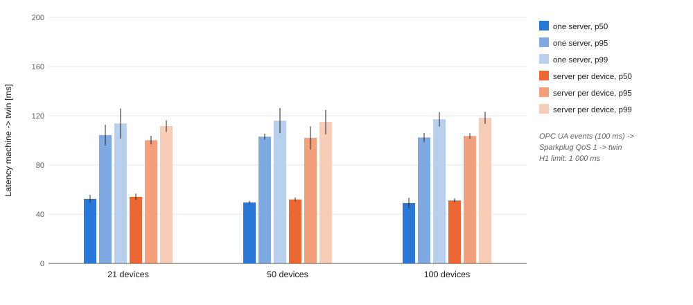
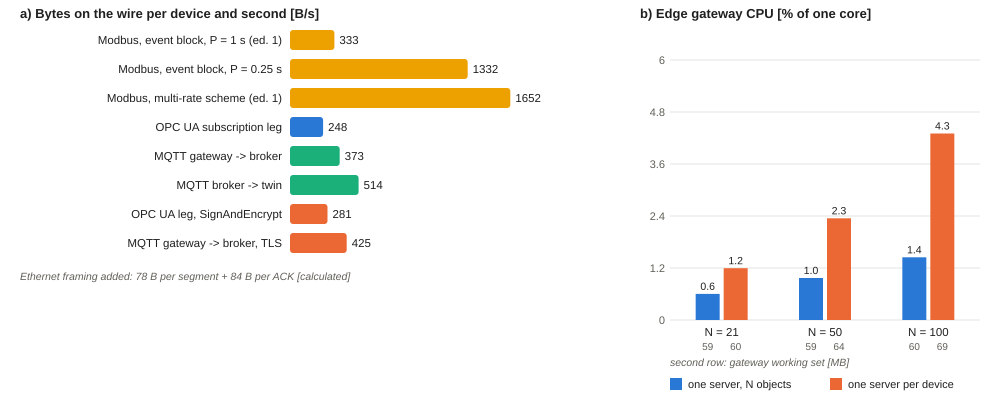

# Chapter 5 – Interoperable Digital-Twin Architecture with OPC UA and MQTT

> Draft v2.0 (second edition) – 2026-11-15. Generated from `code/modern/ch05_template.md` by
> `code/modern/fill_ch05.py` (all measured numbers and result tables come from `thesis_modern/data/modern/results.json`).
> Code: `thesis_modern/code/modern/` (run with `thesis_modern\.venv\Scripts\python.exe`); raw data:
> `thesis_modern/data/modern/raw/`. Labels: **[calculated]** from formulas, **[measured]** on the laboratory bench (one
> PC, loopback network, Python protocol stacks – see 5.8.1), **[assumption]**, **[design]** from the factory
> communication design, **[cited]** from the literature or a specification.

## 5.1 Purpose and research question

The Bayesian twin of Chapters 4 and 6 needs, for every machine, a stream of state changes, cycle completions, good and
scrap counts and repair durations (Table 4.5); the FMS control of Chapter 8 needs the same machine data in real time
and a safe way to give jobs to the machines. In the first edition of this work, the case factory was restricted to
Ethernet, Modbus TCP and HTTP, and Chapter 5 showed how a polling gateway with an event-preserving register block can
deliver complete data under that restriction. That design works, but every machine needs a supplier-specific function
block that fills a fixed register map, every consumer needs to know register addresses and scaling, and every new
consumer adds polling load. The second edition removes the restriction: the factory now uses the open industrial
standards that dominate the literature and the machine market — OPC UA (IEC 62541) with companion information models
for machinery and machine tools, MQTT with the Sparkplug B specification for plant-wide distribution, and transport
security with certificates — while it stays **offline**, without cloud services or commercial IIoT platforms.

This chapter answers research question RQ1:

> **RQ1** – Which communication architecture built on open industrial standards (OPC UA, MQTT/Sparkplug B) can provide
> an FMS digital twin and the supervisory FMS control with complete, timely and semantically described machine data at
> a cost and skill level suitable for an SME in an emerging economy, and how does it compare with a minimal Modbus
> TCP/HTTP architecture?

and tests hypothesis H1:

> **H1** – An OPC UA + MQTT architecture delivers 100 % of machine state changes to the twin with end-to-end latency
> below 1 s for the 21-device case factory on one industrial PC, and removes per-machine register mapping through a
> standard information model, at the price of higher resource use and configuration effort than Modbus TCP/HTTP.

Its contributions are (i) a reference architecture with explicit design rules for an offline SME factory (5.3); (ii) an
information model that maps the complete register map V1.2 of the first edition onto OPC UA for Machinery / Machine
Tools concepts, with job commands as methods (5.4); (iii) a precise account of the delivery semantics of OPC UA
subscriptions, events, MQTT QoS and Sparkplug state management, including an end-to-end completeness rule (5.5);
(iv) a security architecture with an offline PKI (5.6); (v) a sizing model with closed-form loss and latency equations
(5.7); and (vi) a laboratory campaign of 60 seeded runs that tests the equations and H1 and compares the results
with the Modbus measurements of the first edition (5.8, 5.9).

## 5.2 Requirements

**Table 5.1** Requirements for the twin's and the controller's data path (second edition).
| Id | Requirement | Source |
|---|---|---|
| R1 | Every state change, cycle, good/scrap part and repair reaches the twin (completeness 100 %; loss must at least be detected and repaired) | Bayesian updates (Table 4.5) are biased by lost events |
| R2 | End-to-end latency machine → twin < 1 s for monitoring and control; ≤ 1 h is sufficient for model updating | operator displays, dispatching; monthly update rhythm (Ch. 6) |
| R3 | Every value and event carries the machine's source time stamp (error ≤ PLC scan time) | repair durations, uptime $T$ in Eq. (4.5) |
| R4 | 21 devices of the case FMS on one industrial PC, scalable to 50–100 devices (second case, later expansions) | case factories |
| R5 | Open standards only: OPC UA (IEC 62541) with companion specifications, MQTT 3.1.1/5.0 with Sparkplug B; HTTP for browsers | company rule, second edition [design] |
| R6 | Runs offline on one industrial PC; open-source software, installed from a local repository | offline rule; no licence budget |
| R7 | Semantics travel with the data: browse names, data types, units, device class — no register lists in consumers | integration effort, weak supplier market |
| R8 | Faults (machine offline, broker restart, lost message, stale data) are detected and repaired or flagged, never silently ignored | data quality |
| R9 | Write access to machines only through defined job methods, authenticated and encrypted; safety stays hard-wired | IEC 62443 zoning, functional safety |
| R10 | Same interface for all machines regardless of supplier; old machines can be integrated by retrofit | brownfield parts of the case factory |

R5–R7 are the changes against the first edition; R1 is stricter (100 % instead of 99.9 %), because Section 5.5 shows
that, unlike polling, a subscription-based design can guarantee completeness by construction.

## 5.3 Reference architecture

### 5.3.1 Levels and zones
The architecture keeps the ISA-95 / IEC 62264 levels of the factory design and maps them onto IEC 62443 security zones
(Figure 5.1). **Level 1 (zone Z1)** contains the 21 machine controllers. Each exposes an OPC UA server with the
information model of Section 5.4 — embedded in the CNC or PLC, or as a retrofit server next to an old controller.
**Level 2 (zone Z2)** is one industrial PC with a cold spare. It hosts the MQTT broker (the *unified namespace*), the
edge gateway that subscribes to the machines and publishes Sparkplug B messages, the FMS control of Chapter 8, and the
historian. **Levels 3–4 (zone Z3)** contain MES, ERP, the twin user interface and engineering. Conduits exist only
between neighbouring zones and only for the listed protocols; nothing is routed to the internet.

**Figure 5.1** Reference architecture of the second edition: OPC UA servers in the machines (embedded or retrofit), edge
gateway and FMS control as OPC UA clients, MQTT broker as unified namespace with Sparkplug B, the twin as primary host;
IEC 62443 zones Z1–Z3; PubSub/TSN as background; safety outside the network.

### 5.3.2 Two standards, two roles
OPC UA and MQTT are often presented as competitors; in this architecture they have different roles. **OPC UA is the
machine interface.** It is a client–server protocol with a typed address space, browse names, engineering units,
subscriptions with server-side queues, events, methods, and an integrated security model with application
certificates [cited: IEC 62541; Mahnke et al., 2009]. The companion specifications OPC 40001-1 (OPC UA for Machinery)
and OPC 40501-1 (OPC UA for Machine Tools) standardise what a machine object contains: identification, the machinery
item state and operation mode, monitoring data, production jobs and tools [cited]. A machine server is a *device*
interface: it serves one or a few clients well, and its connection count and CPU are limited [cited: Burger et al.,
2019; Mühlbauer et al., 2020].

**MQTT is the plant-wide distribution layer.** It is a publish–subscribe protocol with a broker that decouples
producers from consumers [cited: OASIS 2014, 2019]. MQTT itself defines no payload and no state semantics; Sparkplug B
(Eclipse Sparkplug 3.0, ISO/IEC 20237) adds a topic namespace `spBv1.0/<group>/<message type>/<edge node>/<device>`,
a protobuf payload with typed metrics and aliases, birth and death certificates, sequence numbers and primary-host
awareness [cited]. Sparkplug thereby turns the broker into a *unified namespace*: one place where every consumer finds
the current state and every change of every machine, without connecting to any machine. The twin, the historian, MES
dashboards and future applications subscribe there; the machines see exactly one OPC UA client per function (gateway,
FMS control), regardless of how many consumers exist.

### 5.3.3 Machine side: embedded server or retrofit server
New CNCs and PLCs increasingly offer OPC UA servers, often as a paid option, and some support the machine-tool companion
specification directly; others offer a free-form server in which the integrator models the namespace (for example the
integrated server of current PLC families, which can expose user-defined variables and methods) [cited: Martins et
al., 2023; supplier documentation – to be checked per machine with each supplier]. Old CNCs and small PLCs without OPC
UA receive a **retrofit server**: a small edge computer that reads the controller through its native protocol (Modbus
TCP, a vendor protocol or digital I/O) and exposes the same information model. The retrofit server is exactly the
structure of the virtual plant used in Chapter 8 (`vplant_ua.py`, control mode), where the first edition's register
images are mirrored into OPC UA nodes; the event-preserving register block of the first edition remains the best way to
bring complete event histories out of a polled controller into the retrofit server. For the consumers there is no
difference between an embedded and a retrofit machine.

### 5.3.4 Edge gateway: one server with N objects or one server per device
Two topologies are possible and both were measured (Section 5.8.5). With **one server per device** (the normal case
when every machine has its own embedded server) the gateway holds one secure session per machine, 21 in the case
factory. With **one server with N device objects** (a retrofit box that serves several old machines, or an aggregating
server) the gateway holds one session with N objects. The information model is identical; the topology changes the
number of sessions, secure channels and certificates, and the resource use of the servers. The gateway is the only
component that must scale with N; it uses one asyncio event loop and one subscription per server for state events
plus one for data changes.

### 5.3.5 OPC UA PubSub and TSN (background)
OPC UA Part 14 (PubSub) lets a server publish data sets without client sessions, either as UADP binary messages over
UDP — the basis of OPC UA over TSN for deterministic cyclic communication between controllers — or as JSON messages
over a broker such as MQTT [cited: OPC 10000-14; Pfrommer et al., 2018; Bruckner et al., 2019; Eckhardt et al., 2018].
The architecture of this chapter is compatible with PubSub in two ways. A machine whose server supports PubSub with
JSON over MQTT can publish to the broker directly; the gateway then only adds the Sparkplug state management (or the
twin reads the PubSub topics). UADP over TSN addresses a different problem — microsecond-to-millisecond cyclic exchange
between controllers, motion and safety-related coordination — that does not occur between an FMS supervisory level and
its machines, whose decisions run at seconds. TSN switches are therefore not required in the case factory; the design
leaves room for them in machine-internal networks. The implementable variant chosen here is client–server
subscriptions at the machine and Sparkplug B over MQTT for distribution, because both are available today in
open-source stacks and in common machine options, and because Sparkplug defines the state management (birth, death,
sequence, primary host) that plain PubSub JSON over MQTT leaves to the application.

### 5.3.6 Design rules
1. **Machines speak OPC UA, the plant speaks MQTT.** Only the edge gateway and the FMS control are OPC UA clients of
   the machines; all other consumers read the unified namespace.
2. **One model, all machines.** Every device implements the information model V2.0 (Section 5.4), structured after
   OPC 40001-1 / OPC 40501-1; FMS-specific nodes are in one namespace with a version number.
3. **Subscribe, never poll.** Status arrives by data-change subscriptions (exception-based, queue size ≥ 2 for
   counters and states) and by **events** with a queue for every state change.
4. **Commands are methods.** Jobs are OPC UA method calls with a JobId as idempotency key; there are no command
   registers and no toggle bits.
5. **Every change is counted.** Every device publishes a StateChangeCounter with every state event; consumers detect
   any gap and request a replay (Section 5.5.5).
6. **State is managed explicitly.** Sparkplug birth/death certificates, sequence numbers and the primary-host STATE
   tell every consumer whether its picture is complete and current.
7. **Secure by default.** OPC UA only with SignAndEncrypt and trust lists, MQTT only over TLS with access control;
   offline certificate authority (Section 5.6).
8. **Safety is never networked** (unchanged from the first edition).

## 5.4 Information model

### 5.4.1 Structure and companion specifications
The information model (namespace `urn:compressor-fms:ua:fms`, model version 2.0.0) places one object per device under
`Objects/Machines`, the entry point defined by OPC 40001-1, and types it with an object type per device class
(FmsMachineToolType, FmsPalletSystemType, FmsLoadStationType, FmsStationType, FmsTestBenchType, FmsAgvType,
FmsAsrsCraneType). Below the device object the building blocks of the companion specifications are used with their
browse names (Figure 5.2): **Identification** (Manufacturer, Model, SerialNumber, ProductInstanceUri, DeviceClass,
Location, YearOfConstruction), **MachineryItemState** with the states NotAvailable, OutOfService, NotExecuting and
Executing, **MachineryOperationMode** with None, Maintenance, Setup and Processing (OPC 40001-1), and **Monitoring**,
**Production** (ActiveProgram, ActiveJob, LastJob) and **Equipment/Tools** as in OPC 40501-1 [cited]. Device-type
folders hold what the companion specifications do not cover for this FMS: PalletSystem (16 locations, 16 pallets,
shuttle), LoadStation, TestBench (last ISO 1217 result), Vehicle (AGV) and Crane (AS/RS).

Two FMS extensions are deliberate. The machinery item state has only four values, but the Bayesian twin must
distinguish blocked, starved and set-up from idle (Chapter 4); the model therefore publishes both the standard state
and **Monitoring/FmsState** with the seven state codes of the first edition (OFF, IDLE, RUN, SETUP, DOWN, BLOCKED,
STARVED). And every device publishes **Monitoring/StateChangeCounter**, the first edition's event counter, because it
is the basis of the end-to-end completeness rule of Section 5.5.5.

**Figure 5.2** Information model V2.0: browse paths of a machining centre and of other device types, methods, event
types, and the register-map V1.2 blocks each part replaces.

*Simplification in the laboratory.* The NodeSet2 files of the companion specifications (Opc.Ua.Di, Opc.Ua.Machinery,
Opc.Ua.MachineTool) were not available on the offline development PC. The laboratory model therefore uses the
companion specifications' browse names and structure in the FMS namespace, with object types without instance
declarations. With the NodeSet files installed, the same builder instantiates the standard types (`import_xml` in the
OPC UA stack); the mapping table and all consumers stay unchanged because they address nodes by browse path. Whether a
supplier's machine-tool server implements every node used here (for example the tool list or production jobs) must be
checked per machine; missing nodes are added by the FMS extension or by a retrofit server.

### 5.4.2 Mapping from register map V1.2
The register map V1.2 of the first edition (`fmsctl/spec/regmap.py`: common blocks, event block, command block, seven
device-type blocks, job blocks) is the complete contract between the FMS control and the machines. The mapping table
(`infomodel.mapping`, exported to `data/modern/mapping_v12_to_ua.json`) assigns every register field to one of three
targets: a **variable** of the information model (with type and unit conversion), an **argument of a method**, or an
OPC UA **mechanism that replaces it**. Table 5.2 shows the principal rows; Table 5.3 the counts.

**Table 5.2** Mapping of register map V1.2 to the OPC UA information model (principal rows) [design].
| Register(s) V1.2 | Field | OPC UA target | Kind |
|---|---|---|---|
| 0 hdr.mapVersion | map version 0x0102 | Machines/FmsModelVersion "2.0.0" + namespace version | replaced |
| 1 hdr.typeCode | device type 1–7 | HasTypeDefinition (FmsMachineToolType …), Identification/DeviceClass | replaced |
| 3 hdr.heartbeat; 226 cmd.gwHeartbeat | heartbeats both ways | session keep-alive and session timeout; ServerStatus/CurrentTime | replaced |
| 4 std.status | status bit word | MachineryItemState/CurrentState + Monitoring/FmsState | replaced |
| 5 std.mode | 0 manual … 3 maintenance | MachineryOperationMode/CurrentState + Monitoring/OperationModeCode | variable |
| 6 std.stateCode | OFF … STARVED | Monitoring/FmsState (UInt16) | variable |
| 7 std.alarm | alarm code | Monitoring/AlarmCode | variable |
| 8–10 hs.status, hs.ackSeq, hs.result | handshake | method call result (Status, Message); Production/JobActive, ReadyForJob | replaced |
| 11 hs.lotDone | pieces done | Production/ActiveJob/RunsCompleted | variable |
| 20–25 std.good, std.scrap, std.lastCycle_s | counters, cycle | Production/PartsGood, PartsScrap, LastCycleTime (Double, s) | variable |
| 26–45 std.order, std.part | ASCII20 | Production/ActiveJob/Identifier, PartIdentifier (String) | variable |
| 100–103 std.power_kW, std.energy_kWh | REAL | Monitoring/ElectricalPower, EnergyConsumption (Float) | variable |
| 104–105 evt.counter | change counter | Monitoring/StateChangeCounter (UInt32) | variable |
| 106–131 evt.tLast_ms, evt.ring0–7 | time stamp, 8-entry ring | SourceTimestamp of every value; FmsStateChangedEventType events with queue | replaced |
| 200–225 cmd.code, cmd.seq, cmd.ctl, order data | command block, toggle bit | choice of method, JobId argument, the call itself | replaced |
| 300–306 cnc.* | program, pallets, spindle | Production/ActiveProgram/ProgramNo, Equipment/PalletChanger/*, Monitoring/Spindle/*, Monitoring/Channel/FeedOverride | variable |
| 310–339 cnc.toolLife01–30 | 0.1 % units | Equipment/Tools/Pocket01–30/RemainingLife (Float, %; × 0.1) | variable |
| 300–345 pal.slot, pal.state, shuttle | pallet system | PalletSystem/Locations/LocationNN/PalletId, Pallets/PalletNN/Content, Shuttle/{Position, Busy} | variable |
| 300–304 agv.*; 300–303 asrs.* | AGV, crane | Vehicle/{CurrentNode, TargetNode, BatteryCharge, Loaded, VehicleState}; Crane/{Bay, Level, LoadOnFork, IOReady} | variable |
| 390–395 job.idDone, job.result, job.cycle_s | last job | Production/LastJob/{JobId, Result, Duration} + FmsJobFinishedEventType | variable |
| 400–449 job.*, move.*, task.*, tr.*, loc.*, tool.* | job parameters | arguments of StartJob, MovePallet, OperatorTask, StartTest, Transport, Charge, Store, Retrieve, WriteToolData | method argument |

**Table 5.3** Mapping counts per device type (register fields of V1.2) [calculated from the mapping table].
| Device type | Registers used | Variables | Method arguments | Replaced by OPC UA mechanism | Unmapped |
|---|---|---|---|---|---|
| CNC (7 machines) | 151 | 54 | 8 | 28 | 0 |
| pallet system | 135 | 49 | 3 | 27 | 0 |
| load station | 105 | 19 | 3 | 27 | 0 |
| station (7) | 110 | 16 | 3 | 26 | 0 |
| test bench (2) | 121 | 23 | 2 | 26 | 0 |
| AGV (2) | 106 | 20 | 3 | 27 | 0 |
| AS/RS crane (2) | 105 | 19 | 3 | 27 | 0 |
| **sum over the 7 types** | **833** | **200** | **25** | **188** | **0** |

Every field is accounted for — summed over the seven device types, 200 field definitions became variables, 25 became
method arguments and 188 were replaced by an OPC UA mechanism; none is unmapped. Almost half of the register map
existed only to emulate, on a flat register table, what OPC UA provides natively: identification, time stamps, an event
history, a heartbeat, a command handshake and a type code. This is the quantitative content of the claim in H1 that
the information model "removes per-machine register mapping": a consumer finds `Machines/HMC-01/Equipment/Tools/
Pocket11/RemainingLife` in percent by browsing, instead of knowing that register 320 of a device with type code 1 holds
the life of pocket 11 in 0.1 % units. The mapping work does not disappear — it moves to the machine supplier (who
implements the model in the CNC or PLC) or to the retrofit server — but it is done once per machine type against a
published model instead of once per consumer against a private register list.

### 5.4.3 Events and methods
Two event types derive from BaseEventType: **FmsStateChangedEventType** (NewStateCode, OldStateCode,
StateChangeCounter, MachineryItemState) and **FmsJobFinishedEventType** (JobId, Result, Duration). Their Time field is
the machine's source time stamp. Events are emitted through the Server object with the device as SourceNode, so that
one event monitored item serves all devices of a server; a client can filter by type and source. The job methods (one
per command code of map V1.2) take the JobId as first argument and return (Status, Message) with the status codes of
the first edition (0 OK, 1 unknown command, 2 not ready, 3 bad data, 4 busy). `GetJobResult(JobId)` returns whether a
job is finished (with result and duration), running, rejected or unknown to the machine, which the controller needs
after a restart (Chapter 8).

### 5.4.4 Namespace and versioning
The FMS namespace URI is fixed; its version follows semantic versioning: additions of optional nodes increase the
minor version, renaming or removal the major version. Consumers address nodes by browse path below `Machines/<Device>`
and check `FmsModelVersion` at connection time; the gateway publishes the version in every DBIRTH. Device identities
are stable `ProductInstanceUri`s (`urn:compressor-fms:device:<id>`), independent of IP addresses, which remain
configuration of the endpoint list.

## 5.5 Event and data delivery semantics

Completeness and timeliness depend on precise semantics that are easy to misconfigure. This section states them for
each element of the data path; Section 5.7 turns them into equations and Section 5.8 measures them.

### 5.5.1 OPC UA data-change subscriptions
A client creates a **subscription** with a *publishing interval* $P$ and adds **monitored items**, each with a
*sampling interval* $S$, a *queue size* $q$ and a *discard policy* [cited: IEC 62541-4]. The server samples the
variable every $S$ (or, for exception-based servers, on every write — $S = 0$), puts every changed value into the
item's queue and sends the queue contents in a Publish response once per publishing interval (or a keep-alive if
nothing changed for MaxKeepAliveCount intervals). If more than $q$ changes occur within one publishing interval, the
queue overflows: with *discard oldest* only the newest $q$ values survive; the overflow is flagged in the status code.
Two consequences matter for the twin. With the common default $q = 1$, a data-change subscription is a sampled view
with period $P$ — formally the same as the state-only polling of the first edition, with the same losses (Section
5.7.2). And a sampling server ($S > 0$) loses every state shorter than about $S$, whatever the queue size. The
laboratory server (asyncua) is exception-based, honours the queue size and always discards the oldest value; a
sampling server was emulated by a variable refreshed every 100 ms.

### 5.5.2 OPC UA events
An event monitored item delivers **every** event that matches its filter; events are queued per monitored item,
not overwritten, so several state changes within one publishing interval all arrive, each with its own Time and
fields. The queue size of an event item (asyncua: unlimited if 0; industrial servers: typically hundreds to thousands
[assumption — check with the supplier]) only limits how long a client may be disconnected or slow. This is the OPC UA
equivalent of the first edition's event ring, without its eight-entry limit; the StateChangeCounter in every event
lets the client verify that nothing was lost even across a reconnect.

### 5.5.3 Sparkplug B state management
The edge gateway is one Sparkplug **edge node** (`gw1`) with one Sparkplug **device** per machine. After every
connection it publishes an NBIRTH (with the birth/death sequence number bdSeq and the Node Control/Rebirth metric) and
one DBIRTH per device with every metric's name, alias, data type and current value; then only DDATA messages with
aliases. The MQTT last will is an NDEATH with the same bdSeq, so that consumers learn of a lost gateway from the
broker. All messages of the edge node carry one sequence number 0–255; a consumer that sees a gap knows that it missed
a message and requests a rebirth through an NCMD. The twin is the **primary host application**: it publishes
`spBv1.0/STATE/twin` as retained message with `online: true` (last will `online: false`), and the gateway publishes
only while the primary host is online [cited: Eclipse Sparkplug 3.0]. Together, these rules let every consumer know
whether its picture of a device is complete and current.

### 5.5.4 MQTT quality of service and store-and-forward
MQTT QoS 0 sends a message at most once; QoS 1 repeats it until the broker acknowledges (at least once, duplicates
possible); QoS 2 adds a two-phase release (exactly once) [cited: OASIS 2014]. These guarantees hold **per hop**
(publisher → broker, broker → subscriber) and only within one session; a broker that restarts without persistence loses
queued messages, sessions and retained messages. The gateway therefore implements **store-and-forward**: it keeps
every message until the broker acknowledges it (QoS 1/2), re-sends unacknowledged messages after a reconnect, and
stores everything that arrives while the broker or the primary host is offline, flagged `is_historical` when
forwarded.

### 5.5.5 End-to-end completeness rule
Even QoS 2 with store-and-forward is not end-to-end complete: a message that the broker has acknowledged but not yet
delivered to the twin is lost when the broker restarts without persistence (Section 5.8.4 measures exactly this case).
The architecture therefore closes the loop at the application level, in the same way as the first edition's event
counter did for polling:

- every state event carries the device's **StateChangeCounter** $k$;
- the twin keeps, per device, the highest counter received $k_{last}$; a DDATA with $k > k_{last} + 1$, or a DBIRTH
  announcing a published counter $k > k_{last}$, proves that the changes $k_{last}+1, \dots$ are missing;
- the twin then requests them with an NCMD `Node Control/Replay = "<device>:<from>:<to>"`, and the gateway re-sends them
  from a **replay buffer** of the last 4 096 state events per device, flagged historical;
- the DBIRTH carries the last counter the gateway has actually *published*, so messages still waiting in the gateway's
  store do not trigger replays.

The replay request is an application extension of Sparkplug (a custom Node Control metric); a production broker with
persistent sessions (for example Mosquitto with persistence enabled and `clean_session = false` for the twin) removes
most cases in which it is needed, but not the case of a lost broker disk or a twin restart, so the rule is kept as the
guarantee. With it, a state change is lost only if more than $R$ changes of one device occur during one outage, where
$R$ is the replay buffer depth (Eq. 5.6).

## 5.6 Security architecture

**Zones and conduits.** Following IEC 62443-3-3, the machines form zone Z1 (one VLAN per area), the level-2 PC zone Z2,
and the office applications zone Z3 [cited]. Conduit C1 (Z2 → Z1) allows only OPC UA (TCP 4840) initiated from Z2, with
SignAndEncrypt; conduit C2 (Z3 ↔ Z2) allows MQTT over TLS (8883) and HTTPS for browsers. Machines never initiate
connections to other zones; nothing is routed to the internet. The target security level for the zones is SL 2
(protection against intentional violation with simple means) [design], which matches the threat in an offline
factory: an infected service laptop, a misconfigured device or an unauthorised user on the plant network.

**OPC UA.** Every server and client has an application instance certificate (RSA 2048, SHA-256, SubjectAltName URI =
ApplicationUri). The machine servers offer only the endpoint Basic256Sha256 / SignAndEncrypt — no unsecured endpoint —
and accept only clients whose certificate is in their **trust list** (the gateway and the FMS control PC). The clients
pin the machine certificates. User authorisation uses roles [design]: *Observer* (read, subscribe — gateway, twin),
*Operator* (AckAlarm), *ToolSetter* (WriteToolData), *Controller* (all job methods — only the FMS control PC's
application certificate), *Engineer* (configuration); servers that support role permissions (IEC 62541-3 / -18)
enforce them per node, others at least separate read-only from method access. The laboratory implementation enforces
trust lists and SignAndEncrypt (tests F1–F3 in Chapter 8); roles are designed but not enforced in the virtual plant.

**MQTT.** The broker accepts only TLS connections with a server certificate issued by the factory CA; clients
authenticate with user name and password or client certificates, and an access control list restricts topics: the
gateway may publish `spBv1.0/fms/+/gw1/#`, the twin may publish only `spBv1.0/STATE/twin` and NCMD, AGV topics are
separated [design]. Sparkplug payloads are not signed; integrity and confidentiality come from TLS, authorisation from
the ACL.

**Offline PKI.** A small factory certificate authority (a normally switched-off notebook, keys on encrypted storage)
issues the OPC UA application certificates (or signs those generated by the devices), the broker certificate and client
certificates, with validity of 1–3 years and a revocation list distributed with the trust lists; renewal is a planned
annual maintenance task. The laboratory PKI is generated by `certs.py` with the `cryptography` package, entirely
offline. The literature shows why these rules must be enforced rather than assumed: Internet-wide scans found many OPC
UA servers with no or deprecated security [cited: Dahlmanns et al., 2020], vendor implementations have had
certificate-validation flaws [cited: Erba et al., 2022], and MQTT deployments are frequently left without
authentication [cited: Dinculeană and Cheng, 2019]. The measured cost of security is reported in Section 5.8.7.

## 5.7 Sizing model

### 5.7.1 Message rates
Let device $i$ change its state with rate $\lambda_i$ and let its other monitored variables $j$ change with rates
$r_{ij}$ (power every second, counters at cycle ends). An exception-based server produces

$$N_{not} = \sum_i \Big(\lambda_i + \sum_j r_{ij}\Big) \tag{5.1}$$

notifications per second; they travel in at most $\sum_s 1/P_s$ Publish responses per second over all subscriptions
$s$. The gateway publishes one DDATA per state event and, per device, at most one DDATA per data-change publishing
interval $P_{dc}$:

$$M = \sum_i \lambda_i + \sum_i \min\Big(\frac{1}{P_{dc}},\, \sum_j r_{ij}\Big) \ \ \text{messages/s.} \tag{5.2}$$

The broker receives $M$ messages per second and sends $M \cdot n_{sub}$ to $n_{sub}$ subscribers, each with a PUBACK at
QoS 1.

### 5.7.2 Completeness of data-change subscriptions
Let $D$ be the time to the next state change after a change, with distribution function $F_D$. A change that occurs
at a uniformly distributed position within a publishing window of length $P$ is overwritten in a queue of size 1 if
the next change follows before the window ends. The expected share of changes **not** delivered is therefore

$$p_{lost}(q{=}1) = \frac{1}{P}\int_0^P F_D(x)\,dx. \tag{5.3}$$

For a queue of size $q$, a window with $N_P$ changes delivers $\min(N_P, q)$, so

$$p_{lost}(q) = \frac{\mathbb{E}[(N_P - q)^+]}{\mathbb{E}[N_P]}, \tag{5.4}$$

and for a sampling server with sampling interval $S$, Eq. (5.3) applies with $S$ in place of $P$ (before the queue).
With the event mix of the first-edition bench (30 % short pulses $U(0.05, 0.5)$ s, 70 % states $\text{Exp}(5\ \text{s})$),
Eq. (5.3) gives $p_{lost} = 0.3 \cdot 0.725 + 0.7 \cdot 0.094 = 28.3\,\%$ at $P = 1$ s and 7.0 % at $P = 0.25$ s
[calculated] — the same values as the first edition's formula for state-only polling, because a queue of size 1 *is* a
sampled view. Events (and data changes with a sufficient queue) remove this loss by construction.

### 5.7.3 Queue and buffer sizing
An event queue or a replay buffer of depth $R$ loses changes only if more than $R$ changes of one device fall into the
time $T$ during which the consumer cannot take them (one publishing interval, or an outage of the broker or the twin).
With changes approximately Poisson with rate $\lambda_i$,

$$p_{loss} \approx \Pr\{N(\lambda_i T) > R\}, \tag{5.5}$$

the same form as the first edition's ring-buffer equation, and the design rule is

$$R \;\ge\; \lambda_{max}\, T_{out,max} + z\sqrt{\lambda_{max}\, T_{out,max}}, \tag{5.6}$$

with $z \approx 4$ for a loss probability below $10^{-4}$. For the bench rate $\lambda = 0.29$ s$^{-1}$ and an outage of
one hour, $R \ge 1\,044 + 4\sqrt{1\,044} = 1\,173$ [calculated]; the 4 096 events of the gateway's replay buffer cover
about 3.5 h of an unusually busy machine and days of a real one. The store-and-forward buffer needs
$B_{sf} = M\, \bar{s}\, T_{out}$ bytes; for the 21-device case ($M \approx 32$ s$^{-1}$, $\bar s \approx 80$ B) one hour
of broker outage needs about 9 MB [calculated].

### 5.7.4 Bytes on the wire
A Sparkplug DDATA for one state change (three metrics: FmsState, StateChangeCounter, MachineryItemState) has a protobuf
payload of 70 bytes; with the topic `spBv1.0/fms/DDATA/gw1/HMC-01` (28 bytes) and the MQTT header it is a PUBLISH of

$$s_{pub} = 2 + 2 + |topic| + 2 + s_{payload} = 104 \ \text{bytes}, \tag{5.7}$$

against 375 bytes for the same content in JSON [calculated with `sparkplug.py`]. A one-metric DDATA (power) is 62
bytes. On Ethernet each segment adds 78 bytes and an acknowledgement frame about 84 bytes (first edition, Eq. 5.1).
The wire traffic of one message type is therefore

$$\dot B = \sum_{\text{messages}} f_m\,(s_m + 78 + 84) \tag{5.8}$$

when every message travels in its own segment and is acknowledged separately (an upper bound; with Nagle's algorithm
disabled, as in this design, it is close to reality at the low rates of an FMS). For the 21-device bench load
($\lambda = 0.29$ s$^{-1}$ per device, power every second, a PUBACK of 4 bytes per QoS-1 message) one device causes
on the gateway–broker leg about $0.29\,(104 + 162) + 1.0\,(62 + 162) + 1.29\,(4 + 162) = 515$ bytes/s [calculated] —
less than one third of the 1 652 bytes/s of the first edition's multi-rate Modbus scheme (first edition, Eq. 5.2),
because only changes are sent. Section 5.8.6 measures the actual values for all legs.

### 5.7.5 Latency budget
The latency from a state change in the machine to its arrival in the twin is

$$L = t_{s} + t_{q} + t_{UA} + t_{gw} + t_{MQTT} + t_{twin}, \tag{5.9}$$

with $t_s$ the sampling delay (0 for events and exception-based servers, up to $S$ for sampled variables), $t_q$ the
wait for the next Publish response (uniform on $[0, P]$), $t_{UA}$ the OPC UA transfer and decoding, $t_{gw}$ the
gateway's encoding and queueing, $t_{MQTT}$ the two broker hops and $t_{twin}$ the decoding. Hence

$$\mathbb{E}[L] \approx \frac{S}{2} + \frac{P}{2} + c, \qquad L_{max} \approx S + P + c_{max}, \tag{5.10}$$

where $c$ collects the processing and network terms. The design rule for H1 is $S + P + c_{max} < 1$ s; with events
($S = 0$) and $P = 100$ ms, the publishing interval dominates and $c$ is of the order of milliseconds on a LAN.

### 5.7.6 Worked example: the 21-device case factory
**Table 5.4** Sizing of the 21-device case with the bench load and with the expected production load.
| Quantity | Equation | Bench load (stress) | Expected production load |
|---|---|---|---|
| State changes per device $\lambda_i$ | – | 0.29 s$^{-1}$ [measured mix of the bench] | ≈ 0.02 s$^{-1}$ (≈ 2 changes per 2-min cycle + stops) [assumption] |
| Other variable changes per device | – | power 1 s$^{-1}$, energy 0.1 s$^{-1}$, counters 0.14 s$^{-1}$ | same |
| OPC UA notifications, 21 devices | (5.1) | ≈ 32 s$^{-1}$ | ≈ 26 s$^{-1}$ |
| Sparkplug messages $M$ ($P_{dc}$ = 0.5 s) | (5.2) | ≈ 32 s$^{-1}$ | ≈ 26 s$^{-1}$ |
| Broker load, 2 subscribers (twin, historian) | – | ≈ 32 in, 64 out s$^{-1}$ | ≈ 26 in, 52 out s$^{-1}$ |
| Gateway → broker traffic | (5.8) | ≈ 11 kB/s (0.09 Mbit/s) | ≈ 8 kB/s |
| Loss, data change $q = 1$, $P = 1$ s | (5.3) | 28.3 % | ≈ 1 % |
| Loss, events / replay buffer 4 096 | (5.5) | 0 (Pr < $10^{-300}$ for a 1-h outage) | 0 |
| Expected / maximal latency, events $P$ = 100 ms | (5.10) | ≈ 55 ms / ≈ 110 ms + $c_{max}$ | same |
| Store-and-forward buffer, 1 h outage | 5.7.3 | ≈ 9 MB | ≈ 8 MB |

The table shows the reversal against the first edition: there, the load was set by polling (independent of how often
anything changes) and completeness had to be added; here, the load follows the changes, completeness follows from the
semantics, and the binding constraints are the configuration (queue sizes, publishing intervals) and the behaviour of
the software stacks — which is what the laboratory measures.

## 5.8 Laboratory measurement campaign

### 5.8.1 Set-up
The campaign (`campaign.py`) runs every component as a separate process on one PC (Windows Server 2022, AMD Ryzen 7
9700X, 8 cores / 16 threads, 64 GB RAM, Python 3.12.10; asyncua 1.1.5, paho-mqtt 2.1.0, amqtt 0.11.0, all installed
offline):

- **Plant** (`vplant_ua.py gen`). $N$ devices with the complete information model (21 devices; 50 and 100 by
  replication of the device list), either one server with $N$ objects or one server per device. Each device changes
  state at random times with the first-edition mix — 30 % short pulses $U(0.05, 0.5)$ s, 70 % states $\text{Exp}(5$ s$)$,
  all durations divided by a *rate factor* of 1, 4 or 16 — and logs the **true time** of every change. It writes
  FmsState and StateChangeCounter with the true time as SourceTimestamp, emits an FmsStateChangedEvent, updates
  MachineryItemState, writes ElectricalPower every second, EnergyConsumption every 10 s and PartsGood/LastCycleTime at
  the end of every RUN state, and refreshes a variable FmsStateSampled only every 100 ms (sampling server).
- **Gateway** (`gateway.py`). OPC UA client; either measurement subscriptions only (Section 5.8.3) or the full edge
  node: event subscription ($P$ = 100 ms, unlimited queue), data-change subscription for 7 variables per device
  ($P$ = 500 ms, $q$ = 10), Sparkplug publishing with store-and-forward.
- **Broker** (`broker.py`, amqtt) with an optional scheduled restart; **twin** (`twin_sub.py`), the primary host.
- **Relay** (`proxy.py`) for the bytes runs only: a TCP relay that counts payload bytes and segments per direction.

All processes read the same clock (`perf_counter`, QueryPerformanceCounter). The plant encodes the true time of every
change as source time stamp (BASE + perf seconds), so every receiver can identify the exact change it received and its
latency without clock error. Only changes within the 60-s measurement window are counted; each configuration ran with
seeds 1, 2 and 3; means are given with 95 % t intervals over the seeds, pooled completeness with the Wilson interval.

*Pitfalls.* In addition to the two Windows pitfalls of the first edition (coarse `time.time()`, early asyncio timers),
two new ones were found and corrected before the final campaign: (1) `time.process_time()` reported 0.0 s of CPU for the
gateway during a 15-s run in which it processed hundreds of messages, because Windows charges CPU time at clock-tick
interrupts and timer-driven work that starts right after a tick is never charged; CPU time is therefore measured with
the processor cycle counter (`QueryProcessCycleTime`, calibrated at 3.79 GHz); (2) an edge node that polled its
outbox every 5 ms used about 1 % of a core doing nothing — the final gateway waits on a condition variable. Three
defects of the first software version were also found by the trial runs and acceptance tests and fixed before the
final runs: the edge node kept publishing while the primary host was offline; job methods accepted calls with missing
arguments; and QoS 1 with store-and-forward lost one broker-acknowledged message across a broker restart, which led to
the counter-gap replay of Section 5.5.5.

*Limits.* Loopback network, one PC, Python stacks for server, client and broker. Real controllers have slower OPC UA
servers and real networks add 0.1–0.5 ms per round trip; amqtt is slower than the recommended production broker
Mosquitto (written in C [cited: Light, 2017]), which could not be installed offline here, so all broker-related results
are conservative. The plant emulates server behaviour; it does not reproduce the sampling engine of a particular CNC or
PLC (Section 5.11).

### 5.8.2 Measured runs
**Table 5.5** Runs of the campaign (3 seeds each, 60 s measurement window) [measured].
| Block | Question | Configurations | Runs |
|---|---|---|---|
| complete | (i) completeness of OPC UA subscriptions vs event rate | 21 devices, rate × 1 / 4 / 16, 7 parallel subscriptions | 9 |
| mqtt | (i) MQTT QoS, store-and-forward, replay, broker restart | 21 devices, 7 delivery configurations | 21 |
| scale | (ii, iv) latency and resources vs N and topology | N = 21 / 50 / 100, one server or server per device | 18 |
| bytes | (iii) bytes on the wire | 21 devices, plain and secured, through counting relays | 6 |
| secure | (v) security overhead | 21 devices, plain vs SignAndEncrypt + TLS | 6 |
| cmd | (vi) command latency | OPC UA call (plain, secured) vs Modbus handshake, 3 × 100 commands each | 1 bench |

### 5.8.3 Completeness of OPC UA subscriptions
Seven subscriptions ran in parallel on the same 21-device plant, so that all see exactly the same true changes.
**Table 5.6** State changes delivered by OPC UA subscription type and event rate, mean ± 95 % CI over 3 runs, model
(Eqs. 5.3–5.4) in brackets; latency at rate × 1 [measured / calculated].
| Subscription | delivered [%], rate × 1 | rate × 4 | rate × 16 | latency p50 / p95 / max [ms], × 1 |
|---|---|---|---|---|
| data change, $q$ = 1, $P$ = 1 000 ms | 72.76 ± 1.20 (71.7) | 50.86 ± 2.42 (50.3) | 22.01 ± 1.56 (21.4) | 399 / 930 / 1011 |
| data change, $q$ = 1, $P$ = 250 ms | 92.96 ± 1.97 (93.0) | 71.77 ± 4.25 (71.7) | 51.18 ± 2.99 (50.3) | 110 / 232 / 278 |
| data change, $q$ = 1, $P$ = 100 ms | 98.70 ± 1.43 (98.5) | 87.29 ± 2.19 (87.0) | 65.85 ± 2.67 (65.2) | 50 / 103 / 122 |
| data change, $q$ = 10, $P$ = 1 000 ms | 100.00 ± 0.00 (100.0) | 100.00 ± 0.00 (100.0) | 98.70 ± 0.82 (98.4) | 475 / 943 / 1001 |
| sampled ($S$ = 100 ms), $q$ = 10, $P$ = 1 000 ms | 98.44 ± 1.51 (98.5) | 83.31 ± 2.86 (87.0) | 58.67 ± 2.41 (65.2) | 580 / 1033 / 1105 |
| events, $P$ = 1 000 ms | 100.00 ± 0.00 (100) | 100.00 ± 0.00 (100) | 100.00 ± 0.00 (100) | 479 / 944 / 1004 |
| events, $P$ = 100 ms | 100.00 ± 0.00 (100) | 100.00 ± 0.00 (100) | 100.00 ± 0.00 (100) | 43 / 96 / 124 |
| true state changes per run (mean) | 360 | 1422 | 5523 |  |
| changes per device and second | 0.29 | 1.13 | 4.38 |  |

**Figure 5.3** Share of state changes delivered per OPC UA subscription type at three event rates (21 devices) [measured].

The results separate the configurations sharply. **Data changes with queue size 1 lose changes exactly as state-only
polling did in the first edition**: 72.8 % delivered at $P$ = 1 s, 93.0 % at 0.25 s and 98.7 % at
0.1 s (first edition: 63–71 %, 89–91 %, 98 %), and the loss grows with the event rate to 22.0 % delivered at
rate × 16. Eq. (5.3) predicts these values within 1.1 percentage points in all nine cells. A queue of 10 delivers
everything up to rate × 4 and 98.7 % at rate × 16, where more than ten changes per second sometimes occur (Eq.
5.4: 98.4 %). The **sampled variable** loses the short pulses below the 100-ms sampling interval even with a queue
(98.4 % at rate × 1, 58.7 % at × 16; model 98.5 % and 65.2 %; the larger deviation at high rates is
attributed to jitter of the emulated sampling loop, which writes 21 values per tick [hypothesis, not isolated]).
**Events delivered 100 % of 21 914 changes in all nine runs**, at both publishing intervals and up to
4.4 changes per device and second — the OPC UA mechanism that corresponds to the first edition's event block,
without its ring-depth limit. The latency follows Eq. (5.10): with events at $P$ = 100 ms the median was 43
ms and the maximum 124 ms; at $P$ = 1 s the median was 479 ms and the maximum 1004 ms,
i.e. above 1 s by the processing time — the same design rule as in the first edition: $P \le 1$ s $- c_{max}$.

### 5.8.4 MQTT quality of service, store-and-forward and broker restart
The full path OPC UA events → gateway → Sparkplug → broker → twin ran with a broker restart 30 s into the window
(broker stopped, restarted 5 s later with empty memory — the worst case for a non-persistent broker), for each QoS
level with and without store-and-forward and with and without the counter-gap replay of Section 5.5.5.

**Table 5.7** State changes reaching the twin across a broker restart (21 devices, 3 runs each, pooled) [measured].
| Configuration | Broker | Delivered / true | Pooled [%] (Wilson 95 % lower) | Worst run [%] | Duplicates | Historical | Replay requests | Latency p50 / p95 / max [ms] |
|---|---|---|---|---|---|---|---|---|
| QoS 1, S&F, replay | no restart | 1079 / 1079 | 100.00 (≥ 99.65) | 100.00 | 0 | 0 | 0 | 52 / 105 / 133 |
| QoS 0, no store-and-forward | restart | 961 / 1079 | 89.06 (≥ 87.06) | 87.19 | 0 | 0 | 0 | 50 / 103 / 118 |
| QoS 0, store-and-forward | restart | 1078 / 1079 | 99.91 (≥ 99.48) | 99.71 | 0 | 117 | 0 | 58 / 2598 / 5759 |
| QoS 1, store-and-forward | restart | 1079 / 1079 | 100.00 (≥ 99.65) | 100.00 | 0 | 118 | 0 | 56 / 2656 / 5838 |
| QoS 2, store-and-forward | restart | 1079 / 1079 | 100.00 (≥ 99.65) | 100.00 | 0 | 118 | 0 | 55 / 2678 / 5849 |
| QoS 0, S&F + counter replay | restart | 1079 / 1079 | 100.00 (≥ 99.65) | 100.00 | 0 | 118 | 1 | 57 / 2656 / 5832 |
| QoS 1, S&F + counter replay | restart | 1079 / 1079 | 100.00 (≥ 99.65) | 100.00 | 0 | 118 | 1 | 56 / 2670 / 5838 |

**Figure 5.4** State changes reaching the twin across a 5-s broker restart for different delivery configurations
[measured].

Without a restart, the full path delivered all 1079 changes with a median latency of 52 ms and a maximum of 133 ms. The restart separates the configurations. **QoS 0 without store-and-forward lost 118 of 1079 changes (10.9 %, worst run 12.8 %)** — every change that occurred while the broker was down or while the gateway and the twin reconnected. Store-and-forward reduced the loss to 1 change at QoS 0: a message written to the socket in the moment the broker shut down, which QoS 0 never repeats. QoS 1 and QoS 2 with store-and-forward delivered all changes in these runs, and the 39–40 changes per run that occurred during the outage arrived after the reconnect, flagged historical. The counter-gap replay found and repaired the single QoS-0 loss (1 replay request, 1079 of 1079 delivered). At QoS 1 it issued one request in three runs, but the QoS-1 runs without replay show that store-and-forward alone already delivered every change in these runs. That QoS 1 alone is *not* a guarantee was shown by the acceptance test of Chapter 8 (test E4 in its first version): with a 2-s restart during a burst of 400 messages at 100 per second, one message that the broker had already acknowledged was lost with the broker's memory; with the replay rule the same test delivers 400 of 400. The changes delivered late during the outage dominate the latency tail of the restart runs: the 95th percentile rises to 2.7 s and the maximum to 5.8 s — the broker downtime plus the reconnection of gateway and twin (about 0.3–1 s with the reconnect delays used). Completeness is therefore guaranteed by design; latency during an outage is not, and cannot be: the 1-s criterion applies to normal operation, while an outage must be detected (Sparkplug STATE and NDEATH) and repaired (historical data, replay).

### 5.8.5 End-to-end latency and scaling
**Table 5.8** End-to-end latency machine → twin (OPC UA events, $P$ = 100 ms → Sparkplug QoS 1 → twin), completeness and
resources for 21, 50 and 100 devices and both server topologies; mean ± 95 % CI over 3 runs [measured].
| Topology | N | Delivered / true | E2E p50 [ms] | p95 [ms] | p99 [ms] | max [ms] | Gateway CPU [% core] | Gateway MB | Broker CPU [%] | Plant MB |
|---|---|---|---|---|---|---|---|---|---|---|
| one server | 21 | 1079 / 1079 | 52 ± 3 | 104 ± 9 | 114 ± 12 | 127 | 0.6 ± 0.1 | 59 | 0.5 | 106 |
| one server | 50 | 2614 / 2614 | 49 ± 1 | 103 ± 2 | 116 ± 10 | 124 | 1.0 ± 0.1 | 59 | 1.2 | 124 |
| one server | 100 | 5054 / 5054 | 49 ± 4 | 102 ± 4 | 117 ± 6 | 135 | 1.4 ± 0.0 | 60 | 2.1 | 152 |
| server per device | 21 | 1079 / 1079 | 54 ± 3 | 100 ± 3 | 112 ± 5 | 127 | 1.2 ± 0.2 | 60 | 0.7 | 914 |
| server per device | 50 | 2614 / 2614 | 52 ± 2 | 102 ± 9 | 115 ± 10 | 139 | 2.3 ± 0.3 | 64 | 1.5 | 2 103 |
| server per device | 100 | 5054 / 5054 | 51 ± 2 | 104 ± 2 | 118 ± 5 | 135 | 4.3 ± 0.3 | 69 | 2.7 | 4 151 |

**Figure 5.5** End-to-end latency (median, 95th and 99th percentile) versus number of devices for one server with N
device objects and one server per device [measured].

All 17 494 state changes of the 18 scaling runs reached the twin (100 % in every run), and no single change took longer than 139 ms. For the case factory (21 devices, one server per device as with embedded servers) the median end-to-end latency was 54 ms, the 99th percentile 112 ms and the maximum 127 ms. The OPC UA leg alone already has a median of 54 ms — essentially the wait for the next Publish response of the event subscription ($P/2$ = 50 ms, Eq. 5.10); the gateway, the two broker hops and the twin add less than a millisecond at the median. With 100 devices the median was 51 ms (server per device) and 49 ms (one server) and the 99th percentile 118 ms and 117 ms: in this range the latency does not grow with the number of devices, because the load (about 1.3 Sparkplug messages per device and second) is far below the capacity of the stacks. Eq. (5.2) predicted about 32 messages per second for 21 devices [calculated]; 28 were measured, because changes of one device often fall into the same 500-ms window, so the min() term of Eq. (5.2) is an upper bound. The gateway used 1.2 % of one core for 21 devices and 4.3 % for 100 devices with one session per device (1.4 % with one session), with a working set of 60–69 MB. The resource that grows fastest is on the server side: the Python plant needed 4.1 GB and 94 s to start 100 separate servers (about 42 MB per asyncua server, mostly the standard address space) against 152 MB and 1.5 s for one server with 100 objects. In the factory each embedded server runs on its own controller, so this cost does not fall on the industrial PC — but it is the reason why a retrofit box should host several old machines in one server rather than one server each.

### 5.8.6 Bytes on the wire, CPU and memory
**Table 5.9** Traffic per device and second on the three legs (21 devices, bench load) and the first-edition Modbus
reference [measured payload; wire bytes calculated with Eq. (5.8); Modbus: first-edition Eqs. 5.1–5.2].
| Leg | TCP payload [B/s] | Segments [1/s] | Wire, Eq. (5.8) [B/s] | Payload, secured [B/s] | Wire, secured [B/s] |
|---|---|---|---|---|---|
| OPC UA subscription leg (gateway ↔ server, both directions) | 139 ± 6 | 0.67 | 248 ± 12 | 171 ± 8 | 281 ± 13 |
| MQTT gateway ↔ broker | 103 ± 2 | 1.66 | 373 ± 3 | 161 ± 3 | 425 ± 23 |
| MQTT broker ↔ twin | 103 ± 2 | 2.54 | 514 ± 10 | 161 ± 3 | 570 ± 11 |
| Modbus, event block 36 registers, $P$ = 1 s (first edition) | – | – | 333 [calc.] | – | – |
| Modbus, event block, $P$ = 0.25 s | – | – | 1332 [calc.] | – | – |
| Modbus, multi-rate scheme FAST/EVENT/COUNTERS/ENERGY | – | – | 1652 [calc.] | – | – |

**Figure 5.6** (a) Bytes on the wire per device and second, OPC UA and MQTT legs versus the first-edition Modbus
schemes; (b) CPU of the edge gateway (share of one core) and its working set for 21–100 devices [measured / calculated].

At the bench load (0.29 state changes per device and second, power every second) one device caused 139 B/s of TCP payload on the OPC UA leg and 103 B/s on the gateway–broker leg; with Ethernet framing (Eq. 5.8) about 248 and 373 B/s. Eq. (5.8) predicted about 515 B/s for the gateway–broker leg [calculated], within 28 %. The first edition's Modbus design needs 333 B/s per device for the event block at $P$ = 1 s, 1332 B/s at 0.25 s and 1652 B/s for the full multi-rate scheme — independent of how often anything changes. For the 21 devices both OPC UA and MQTT legs together use 0.10 Mbit/s, 0.10 % of a 100-Mbit/s link; bandwidth is not a design criterion for either architecture. Security adds 23 % payload on the OPC UA leg (signatures, padding, sequence headers) and 56 % on the MQTT leg (TLS records).

### 5.8.7 Security overhead
**Table 5.10** OPC UA SignAndEncrypt (Basic256Sha256) and MQTT over TLS 1.3 versus unsecured, 21 devices, full path,
mean ± 95 % CI over 3 runs [measured].
| Quantity | Unsecured | SignAndEncrypt + TLS |
|---|---|---|
| Delivered / true state changes | 1079 / 1079 | 1079 / 1079 |
| OPC UA leg latency p50 [ms] | 51.2 ± 7.2 | 51.3 ± 16.8 |
| End-to-end latency p50 [ms] | 51.8 ± 7.1 | 51.9 ± 16.8 |
| End-to-end latency p99 [ms] | 111.6 ± 7.8 | 109.3 ± 8.9 |
| End-to-end latency max [ms] | 120 | 119 |
| Gateway CPU [% of one core] | 0.59 ± 0.09 | 0.68 ± 0.02 |
| Plant (OPC UA server) CPU [% of one core] | 0.49 ± 0.05 | 0.52 ± 0.03 |
| Broker CPU [% of one core] | 0.57 ± 0.04 | 0.65 ± 0.03 |
| Gateway working set [MB] | 59 ± 0 | 63 ± 0 |
| OPC UA connect (secure channel + session) [ms] | 3.5 | 35.6 |

SignAndEncrypt and TLS changed the latency by less than the run-to-run variation: median end-to-end 51.8 ms unsecured versus 51.9 ms secured, 99th percentile 111.6 versus 109.3 ms, because the publishing interval dominates the latency. CPU rose from 0.59 to 0.68 % of one core in the gateway and from 0.49 to 0.52 % in the server process; the secure-channel and session set-up took 36 ms instead of 3 ms (RSA operations; once per connection). On the factory's industrial PC these costs are negligible; on a small controller the RSA operations of the session set-up and the symmetric encryption of every message are the part to check (Section 5.11). Security is therefore not a performance question in this architecture but an organisational one — certificates, trust lists and their renewal (Section 5.6).

### 5.8.8 Command latency: method call versus toggle-bit handshake
The command bench (`cmdbench.py`) gave 3 × 100 jobs to the washer station of two plants that run the same fmsctl
process models: the OPC UA virtual plant (method `StartJob`) and the first edition's Modbus virtual plant
(`DeviceLink.command`, toggle-bit handshake). Only the command is timed, from the call until the accepted/rejected
answer; one counting run of 50 commands per variant through the byte-counting relay gave the traffic per command.

**Table 5.11** Job command latency and traffic, loopback, no emulated PLC scan time [measured].
| Command path | Mean ± CI [ms] | p50 [ms] | p95 [ms] | p99 [ms] | max [ms] | Request/response pairs | TCP payload [B/command] | Segments / command |
|---|---|---|---|---|---|---|---|---|
| Modbus TCP toggle-bit handshake (first edition, fmsctl) | 0.32 ± 0.02 | 0.31 | 0.37 | 0.46 | 0.5 | 11 | 294 | 22.0 |
| OPC UA method call, no security | 0.35 ± 0.02 | 0.33 | 0.47 | 0.58 | 0.7 | 1 | 273 | 2.8 |
| OPC UA method call, Basic256Sha256 SignAndEncrypt | 0.41 ± 0.04 | 0.39 | 0.55 | 0.63 | 0.7 | 1 | 403 | 2.8 |

The toggle-bit handshake issued 11 Modbus request/response pairs per job command (2 reads to check the previous handshake, 3 FC16 writes for job id, parameters and serial number, a read of the acknowledged sequence, the FC16 command write, the FC06 request bit and 3 reads to confirm acknowledgement, sequence and result) and took 0.31 ms (median) on loopback; the OPC UA method call is one request/response and took 0.33 ms without and 0.39 ms with SignAndEncrypt. Python's per-message cost of the OPC UA stack is higher than that of the minimal Modbus implementation, so on loopback the handshake is faster — but on a real network and a real PLC each Modbus transaction costs one round trip plus up to one scan time (first edition: 6.3 ms mean with a 10-ms scan), so the handshake needs about 11 × 6.3 ≈ 69 ms against one round trip plus one scan for the method call [calculated]. The traffic per command was 294 B of TCP payload in 22 segments for the handshake and 273 B in 3 segments for the call (403 B secured). The idempotent retry — the same call with the same JobId — took 0.27 ms and was recognised as duplicate in 30 of 30 cases; all 300 job commands were accepted. At about one job per device and minute, command latency is irrelevant for the FMS throughput in both designs; what matters is that a lost reply can never start a job twice, which the JobId guarantees with one message instead of the handshake's eleven.

### 5.8.9 Comparison with the first edition
**Table 5.12** Modbus TCP/HTTP architecture (first edition, §5.7) versus OPC UA + MQTT architecture (this chapter), same
PC, same event mix [measured unless marked].
| Criterion | Modbus TCP/HTTP (edition 1) | OPC UA + MQTT (edition 2) |
|---|---|---|
| State changes delivered, normal operation | 100 % with event block (0 of 23 825 lost); 63–98 % state-only | 100 % with events (21 914 of 21 914); 72.8–98.7 % with data change $q$ = 1 |
| … across a broker / gateway restart | gateway restart: ring of 8 events per device | 100 % with QoS 1–2 + store-and-forward (+ replay); 89.1 % with QoS 0 alone |
| Latency, 21 devices (median / max) | 0.14 / 0.26 s at $P$ = 0.25 s; 0.52 / 1.02 s at $P$ = 1 s | 0.054 / 0.127 s (events $P$ = 0.1 s, to the twin via MQTT) |
| Scaling tested | 160 machines, parallel poll 14 ms | 100 devices, max 139 ms |
| Bytes per device and second | 1332 (event block, 0.25 s) – 1652 (multi-rate) [calc.] | 248 (OPC UA leg) + 373 (MQTT leg) [meas. + calc.] |
| Gateway CPU / memory, 21 devices | not measured (stdlib, ≈ 0.04 ms per request) | 1.2 % of a core / 60 MB; broker 30 MB |
| Job command | 11 transactions, 0.31 ms loopback, ≈ 69 ms with PLC [calc.] | 1 call, 0.33 ms (0.39 ms secured) |
| Semantics | register addresses, scaling and types in every consumer | browse names, types, units, device class in the model |
| Security | none in the protocol (zoning only) | SignAndEncrypt, trust lists, TLS, roles [design] |
| Software | Python standard library only | 3 open-source packages (+ dependencies), offline wheels |
| Machine requirement | Modbus TCP server + function block | OPC UA server with model, methods, events (option) or retrofit server |

## 5.9 Evaluation of H1

H1 states that an OPC UA + MQTT architecture delivers 100 % of machine state changes to the twin with end-to-end latency
below 1 s for the 21-device case factory on one industrial PC, and removes per-machine register mapping through a
standard information model, at the price of higher resource use and configuration effort than Modbus TCP/HTTP. The
four parts are evaluated separately.

- **Completeness (100 %).** With OPC UA events and Sparkplug B over QoS 1 with store-and-forward, every state change reached the twin in every run: 21 914 of 21 914 in the OPC UA completeness runs up to 4.4 changes per device and second, all changes in the 18 scaling runs with up to 100 devices, and all 1079 changes in the three QoS-1 restart runs. The condition is the configuration, not the protocols: data-change subscriptions with queue size 1 delivered only 72.8 % at $P$ = 1 s, a sampled variable lost the short states, and QoS 0 without store-and-forward lost 10.9 % across a broker restart. QoS 1 alone is not an end-to-end guarantee across a non-persistent broker restart (acceptance test, Chapter 8); the counter-gap replay of Section 5.5.5 closes this gap. **Supported** under the design rules events + queue, QoS ≥ 1, store-and-forward and replay.
- **Latency (< 1 s, 21 devices, one PC).** In normal operation the maximum end-to-end latency for 21 devices was 127 ms (one server per device; 99th percentile 112 ms), and no change in any scaling run took longer than 139 ms. During a 5-s broker outage the stored changes arrived up to 5.8 s late — an outage is detected and repaired, but cannot be hidden. **Supported** for normal operation; the publishing interval must satisfy $S + P + c_{max} < 1$ s (Eq. 5.10).
- **Removal of per-machine register mapping.** Every field of register map V1.2 is mapped onto the information model (Table 5.3); consumers address `Machines/<Device>/...` by browse name with types and units, the unchanged FMS control ran on it through one generic adapter (Chapter 8), and the twin reads named Sparkplug metrics. The mapping work moves to the machine supplier or the retrofit server and is done once per machine type against a published model. **Supported**, with the qualification that the companion-specification NodeSets were emulated (Section 5.4.1) and real CNC servers may cover only part of the model.
- **Price: resources and configuration effort.** The gateway needed 1.2 % of one core and 60 MB, the broker 30 MB, and each Python OPC UA server about 42 MB — much more memory than the first edition's standard-library gateway, but a small fraction of one industrial PC. The configuration effort is clearly higher: information model, 708 monitored items, certificates and trust lists, broker ACLs, three external packages and new skills (Section 5.10). Bytes on the wire were lower than for Modbus polling with comparable latency (event block at 0.25 s, multi-rate scheme) but higher than for the slowest Modbus scheme (event block at 1 s; Table 5.9). **Supported** for memory, CPU and configuration effort; bandwidth is negligible for both.

**H1 is supported** under the stated conditions — events with queues, QoS ≥ 1 with store-and-forward and counter-gap replay, publishing interval ≤ 1 s minus processing time — for the laboratory with Python stacks on one PC and loopback network. Because the Python broker and servers are slower than Mosquitto and industrial C stacks, the latency and resource results are conservative for the gateway and broker, but the behaviour of real machine servers (sampling, event support, queue sizes, method support) is not covered and must be verified (Section 5.11).

## 5.10 Cost and skills for an SME

**Licences.** All software of the architecture is open source: the OPC UA stack (asyncua, LGPL-3.0; open62541 or the
OPC Foundation .NET stack are alternatives), the MQTT client (paho, EPL-2.0/EDL-1.0), the production broker Mosquitto
(EPL-2.0/EDL-1.0) and the laboratory broker amqtt (MIT). There are no runtime licences and no cloud subscriptions. The
industrial PC is the same as in the first edition (Section 8.8).

**Machine options.** The real cost moves to the machines. An OPC UA server is a standard feature of current
higher-end PLC families (for example the integrated server of the Siemens S7-1500 series) and an option — often paid —
for CNC controls of the major makers (for example Siemens SINUMERIK, FANUC and HEIDENHAIN offer OPC UA options, some
with the machine-tool companion specification) [general market knowledge; the availability, scope (methods, events,
custom namespaces) and price **must be checked with each supplier** for the specific control and software version].
Small PLCs and old CNCs need a retrofit server (an edge computer of a few hundred euros plus integration work
[assumption]). The purchase specification therefore asks every machine supplier for: an OPC UA server with
SignAndEncrypt and trust-list management; the information model of Section 5.4 or the companion-specification model
plus the FMS extensions; the job methods with JobId idempotency; events with source time stamps and an event queue of
at least 1 000 entries; and participation in the acceptance tests of Chapter 8.

**Skills.** The first edition needed Modbus and HTTP knowledge, which is widespread; this architecture needs OPC UA
information modelling, certificate management, MQTT broker administration and asynchronous programming. These are
the main hidden costs for an SME in an emerging economy. Three measures keep them manageable: one published model and
one mapping table for all machines (the knowledge is written down once); open-source tools that run offline and can be
studied; and the automated acceptance tests, which encode the expected behaviour so that engineers do not need to know
every detail of the specifications to verify a machine.

**Configuration effort** (measured on this implementation). The first edition's interface needed one register map
(450 registers) and a function block per machine; this one needs the information model (Table 5.3; 708 monitored items
for the 21 devices), 2 certificates per OPC UA connection plus trust lists, a broker certificate, ACLs, and 17 Python
modules (4 151 lines including tests, benches and figure/table scripts) against 706 lines for the first edition's Modbus
benches and device link (`commbench.py`, `httpbench.py`, `fmsctl/core/modbus.py`, `device.py`). The effort is front-loaded: once the model and the PKI exist, adding a machine means adding an endpoint and a
certificate — no consumer changes, which is where the Modbus design required work.

## 5.11 Planned verification on real controllers
Before the case factory's ramp-up, the campaign is repeated with real controllers: one PLC with an integrated OPC UA
server (S7-1500 class) implementing the FMS model with methods and events, one CNC with its supplier's OPC UA option,
one retrofit server for an old machine, Mosquitto with persistence as broker, and a managed switch with the zone
VLANs; the remaining devices stay emulated. Measured are: the server's minimum sampling and publishing intervals and its
event queue size; whether short states are reported (events versus sampled data changes); the number of sessions and
monitored items the server accepts; method call latency including the PLC scan; the CPU load the OPC UA server adds to
the controller; SignAndEncrypt session set-up time on the controller; and the end-to-end latency over the real network.
The equations of Section 5.7 are then re-evaluated with the measured parameters, and the sizing calculator of the
twin's browser tab is updated.

## 5.12 Summary
This chapter designed an interoperable data path for the FMS digital twin and its supervisory control with open
industrial standards on one offline PC. OPC UA is the machine interface — an information model V2.0 structured after
OPC 40001-1 and OPC 40501-1 replaces register map V1.2 completely (200 field definitions became variables, 25 method
arguments, 188 were replaced by native OPC UA mechanisms), jobs are idempotent method calls, state changes are events
with source time stamps and counters. MQTT with Sparkplug B is the plant-wide unified namespace with birth/death
certificates, sequence numbers, primary-host awareness and store-and-forward; a counter-gap replay closes the last
end-to-end gap. Security follows IEC 62443 zoning with SignAndEncrypt, trust lists, TLS and an offline PKI.

A sizing model gives the message rates, the completeness of each subscription type (Eqs. 5.3–5.5), buffer sizes,
traffic and the latency budget; the laboratory campaign confirmed the completeness equations within about one
percentage point and showed:

- 100 % of state changes delivered with OPC UA events (21 914 of 21 914, up to 4.4 changes per device and second), against 72.8 % for data changes with queue size 1 at 1 s — the polling loss of the first edition reappears whenever a subscription is configured like a poll;
- 100 % across a 5-s broker restart with QoS 1–2 and store-and-forward, 89.1 % with QoS 0 alone; a counter-gap replay repairs the remaining end-to-end gap of non-persistent brokers;
- median end-to-end latency machine → OPC UA → MQTT → twin of 54 ms and maximum 127 ms for 21 devices, below 139 ms for up to 100 devices in both server topologies;
- 373 B/s per device on the MQTT leg against 1332–1652 B/s for Modbus polling; gateway 1.2 % of a core, security overhead within the run-to-run variation;
- one OPC UA method call instead of 11 Modbus transactions per job command, idempotent through the JobId.

H1 is supported under the stated design rules and laboratory conditions. The architecture costs more configuration, skills and machine options than the first edition's
Modbus design and uses more memory and CPU, but it carries semantics, security and completeness by construction, and
its load follows the changes instead of the polling rate. Verification with real controllers and Mosquitto is
planned (Section 5.11).

---
**References cited in this chapter**: IEC 62541 (series); OPC 10000-14; OPC 40001-1; OPC 40501-1; Eclipse Foundation
(2023) Sparkplug 3.0 / ISO/IEC 20237; OASIS (2014) MQTT 3.1.1 / ISO/IEC 20922; OASIS (2019) MQTT 5.0; IEC 62443-3-3;
IEC 62264-1; Mahnke et al. (2009); Burger et al. (2019); Mühlbauer et al. (2020); Martins et al. (2023); Pfrommer et al.
(2018); Bruckner et al. (2019); Eckhardt et al. (2018); Profanter et al. (2019); Silveira Rocha et al. (2018); Light
(2017); Dahlmanns et al. (2020); Erba et al. (2022); Dinculeană and Cheng (2019).
