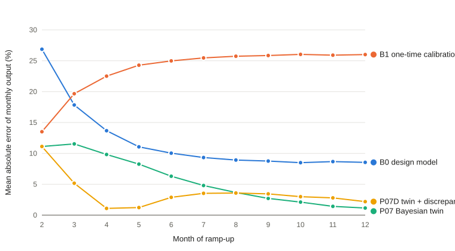
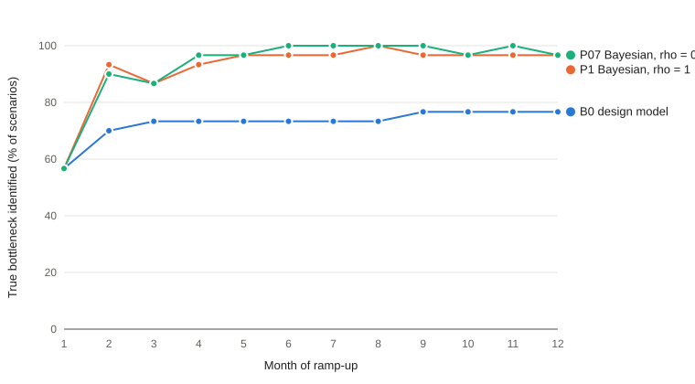

# Chapter 6 – Uncertainty-Aware Digital Twin with Sequential Bayesian Updating

> Draft v2.0 (edition 2) – 2026-11-15. Code: `thesis_modern/code/` (`bayes.py`, `flowline.py`, `rampup_experiment.py`, `discrepancy.py`,
> `bottleneck_experiment.py`, `variance_experiment.py`, `analyse_rampup.py`, `plot_ch6.py`). Data: `thesis_modern/data/`.
> All results in this chapter are **[simulated]**: they come from computational experiments with a virtual ramp-up whose
> "true" parameters are known to the experimenter but hidden from the twin. They prove properties of the *method*; the
> validation against the real ramp-up of the case factory follows in Section 9.7.

## 6.1 Purpose

Chapter 4 defined the conjugate models with which the uncertain inputs of the FMS twin are updated, the propagation of
their uncertainty through the discrete-event model, and the measures and protocol with which predictions are judged.
This chapter turns these definitions into algorithms (Section 6.3), describes a controlled experiment to test them
(Section 6.4), reports the results (Section 6.5) and evaluates hypotheses H2 and H3 (Section 6.6):

- **H2**: with sequential Bayesian updating, the monthly prediction error of good output falls below 5 % with at least
  30 % less ramp-up data than with the deterministic design model (B0) or a one-time calibration (B1).
- **H3**: the 90 % prediction intervals of the updated twin achieve at least 85 % empirical coverage.

A controlled experiment is necessary because the real ramp-up of the case factory lies in the future and, more
fundamentally, because only in an experiment is the truth known: in a real factory the "true" MTBF of a machine is never
observed, only estimated. The experiment therefore answers the question *does the method learn the right thing, how
fast, and how honest is its uncertainty?* — which no single industrial case can answer.

## 6.2 The frozen-prediction protocol in practice

The protocol of Section 4.8.2 is implemented as follows. At each decision point (design freeze P0, and the end of each
month $k$ for Pk) the twin writes a *prediction record*: model version (software commit), parameter state (all
hyperparameters of Table 4.4 for every station), random seed, prediction horizon, predicted mean, 5 % and 95 % quantiles,
and the time stamp. Records are append-only; a prediction for month $k+1$ is stored before any data of month $k+1$ are
read. In the experiment this is guaranteed by the program structure (Algorithm 6.3: the prediction for month $k+1$ is
computed from beliefs updated with months $1..k$ only and is written to the result file before month $k+1$ is
simulated). In the case factory the same records are stored in the twin's database and tagged in the version-control
system, so that an examiner can verify that no prediction was changed after the fact.

## 6.3 Algorithms

### 6.3.1 From machine events to sufficient statistics
Each station keeps an accumulator per month: failure count $n$, exposure $T$ (processing hours, since failures are
modelled as operation-dependent, Section 6.4.1), list or running sum of repair durations, the running mean and sum of
squared deviations of log cycle-time ratios $y = \ln(t / t^{design}_p)$, and good and scrap counters. The cycle-time
ratio normalises the different variants to one station-level *speed factor*, so that one Normal-Inverse-Gamma model per
station suffices regardless of the product mix. Mean and sum of squares are accumulated with Welford's algorithm, which
is numerically stable and needs constant memory:

```
Algorithm 6.1  Welford accumulator for log cycle-time ratios
  n ← 0; mean ← 0; S ← 0
  on cycle complete (time t, variant p):
      y ← ln(t / t_design[p]); n ← n + 1
      d ← y − mean; mean ← mean + d / n; S ← S + d · (y − mean)
  end of period: return (n, mean, S)
```

### 6.3.2 Sequential update
```
Algorithm 6.2  Sequential Bayesian update of one station (end of period k)
  input: hyperparameters (a_f, b_f), (a_r, b_r), (m, κ, a_c, b_c), (a_q, b_q); statistics of period k; forgetting ρ
  failures:  a_f ← ρ a_f + n_fail ;  b_f ← ρ b_f + T                                  (Eq. 4.5, 4.11)
  repairs:   a_r ← ρ a_r + k_rep ;   b_r ← ρ b_r + Σ r_i                              (Eq. 4.7)
  cycles:    κ0, a0, b0 ← ρκ, ρa_c, ρb_c ; apply Eq. 4.9 with (n, ȳ, S) → (m, κ, a_c, b_c)
  scrap:     a_q ← ρ a_q + x ;       b_q ← ρ b_q + (parts − x)                         (Eq. 4.10)
  store prediction record (Section 6.2)
```
The update costs a fixed number of arithmetic operations per station, independent of how many events occurred. For
the 13 station types of the case it takes well under a millisecond.

### 6.3.3 Predictive simulation
```
Algorithm 6.3  Prediction of the good output of the next period
  for i = 1 .. N_θ:
      for each station: draw MTBF ~ Inv-Gamma(a_f, b_f), MTTR ~ Inv-Gamma(a_r, b_r),
                        σ² ~ Inv-Gamma(a_c, b_c), m ~ N(m, σ²/κ), speed = exp(m + σ²/2), q ~ Beta(a_q, b_q)
      run the DES for one period with these parameters (R replications) → Y_i
  return mean(Y), Q_0.05(Y), Q_0.95(Y)                                                  (Eq. 4.12)
```

### 6.3.4 Model-discrepancy learning
The parametric twin assumes that its model structure is correct and that the parameters are constant within the
learning window. During ramp-up neither holds exactly: the system improves *between* the data used for learning and the
period being predicted, so even perfectly estimated parameters of month $k$ under-predict month $k+1$. Following the
idea of model discrepancy in Bayesian calibration of computer models (Kennedy and O'Hagan, 2001), a discrepancy term is
learned on top of the twin. Let $e_k = \ln(Y_k / \hat Y_k)$ be the realised log error of the twin's prediction for
month $k$. A Normal-Inverse-Gamma model with forgetting (the same algebra as Eq. 4.9 with $n = 1$) learns its mean
$\delta$ and variance. The corrected prediction and interval are

$$\hat Y'_{k+1} = \hat Y_{k+1}\, e^{m_\delta}, \qquad \ln \mathrm{PI} = \ln \hat Y'_{k+1} \pm t_{0.95,\,2a_\delta}\sqrt{s_{MC}^2 + s_\delta^2}, \tag{6.1}$$

where $s_{MC}$ is the log-scale standard deviation implied by the Monte Carlo interval of Algorithm 6.3 and
$s_\delta = \sqrt{b_\delta(\kappa_\delta + 1)/(a_\delta \kappa_\delta)}$ the predictive scale of the discrepancy. Prior:
$m_0 = 0$, $\kappa_0 = 1$, $a_0 = 2$, $s_0 = 0.05$; forgetting $\rho = 0.7$. **The discrepancy is learned only from errors of
data-based predictions** (from month 2): the month-1 forecast stems from the prior model and its error says nothing about
the discrepancy of the updated twin. An earlier variant that also used the month-1 error over-corrected the month-2
forecast by 28 % on average; this design rule is therefore part of the method.

### 6.3.5 Computational cost
One prediction (Algorithm 6.3) with $N_\theta = 40$ and $R = 1$ requires 40 runs of the reduced-order model; one run of a
330-hour month (about 5 700 parts through 13 stations) takes 0.034 s on a standard office PC (single core,
Python 3.12, standard library only) [measured]. A monthly prediction therefore takes under 2 s; the full experiment of
Section 6.4 (30 scenarios × 12 months × 5 predictors, about 30 000 simulated months) ran in about two minutes on 15 cores.
The full twin of Chapter 8 is slower per run, but monthly predictions remain in the range of minutes, which is
negligible compared with the monthly decision rhythm.

## 6.4 Experimental design

### 6.4.1 Reduced-order discrete-event model
For thousands of runs a reduced-order model of the compressor FMS is used: a serial line of the 13 station types of
Table 4.2 with $c_m$ parallel servers, buffers of $B = 4$ parts in front of each station [assumption], blocking after
service, infinite raw-material supply, and end-of-line detection of scrap (scrapped parts consume capacity but are not
good output — realistic for compressors, whose defects are found mostly at the performance test). Cycle times are
log-normal around the design time of each variant times the station speed factor; failures are operation-dependent
(time to failure counts processing time only) with exponential times to failure and repair.

The model is computed by an exact departure-time recursion instead of an event list. For part $i$, station $j$ and
server $k = i \bmod c_j$ (cyclic assignment, order preserving):

$$s_{j,i} = \max(d_{j-1,i},\; f_{j,k}), \qquad d_{j,i} = \max\big(s_{j,i} + w_{j,i},\; s_{j+1,\,i - B_{j+1} - c_{j+1}}\big), \qquad f_{j,k} \leftarrow d_{j,i}, \tag{6.2}$$

where $s$ is the start, $d$ the departure, $f$ the time at which the server becomes free, and $w$ the processing time
plus any repair times that fall into it. The second term of $d_{j,i}$ is the blocking condition: part $i$ can leave
station $j$ only when the downstream station has room, i.e. when the part $B_{j+1} + c_{j+1}$ positions ahead has
started at station $j+1$. Because that part has a smaller index, Eq. (6.2) can be computed part by part in $O(N M)$ time.

*Verification.* With design parameters the model produces 5 320 good parts per 330-hour month (mean of 10
replications, range 5 294–5 347) [simulated]. The static analysis of Table 4.3 gives an upper bound: the bottleneck FINAL
can process $5\,667 / 0.998 = 5\,678$ parts, of which a share $\prod_m (1 - q_m) = 0.941$ is good, i.e. at most
5 341 good parts. The simulated output lies 0.4 % below this bound, as expected for a well-buffered line with small
blocking and starvation losses. Observation counts behave as designed: for example, the three HMCs record 17 failures in
570 processing hours in one simulated month, consistent with the design MTBF of 30 h.

The reduced-order model omits the pallet loop, AGV transport and dispatching of the full twin. These do not affect the
*statistical* question of this chapter — whether the updating learns the parameters — but they affect absolute output
levels; Chapter 9 uses the full twin.

### 6.4.2 Virtual ramp-up: the hidden true factory
For each scenario $s = 1..30$ a true factory is generated by drawing, for every station, mature deviation factors from
the design and imposing a ramp-up trajectory (Table 6.1). The factors reflect two well-documented patterns: design
statements tend to be optimistic (vendors supply ideal-condition values and means only; Bokrantz et al., 2017), and new
systems show early failures, slower cycles, longer repairs and more scrap that decline as faults are removed and
people learn (the ramp-up phenomenon). The ramp-up shape $r(k) = e^{-(k-1)/\tau}$ with $\tau = 2$ months (1.5 for
scrap) is an [assumption]; Section 6.7 discusses its influence.

**Table 6.1** Generator of the true factory (per station; $U$ = uniform distribution) [assumption].
| Parameter | Mature value | Ramp-up multiplier in month $k$ | Month 1 | Month 6 |
|---|---|---|---|---|
| MTBF | design × $U(0.6, 1.1)$ | $1 - 0.5\,r(k)$ | 0.50 | 0.96 |
| MTTR | design × $U(1.0, 1.5)$ | $1 + 0.5\,r(k)$ | 1.50 | 1.04 |
| Cycle-time factor | $U(0.98, 1.12)$ | $1 + 0.08\,r(k)$ | 1.08 | 1.01 |
| Cycle-time log-sd | $U(0.04, 0.10)$ | – | – | – |
| Scrap | design × $U(1.0, 2.0)$ | $1 + 2\,r_{1.5}(k)$ | 3.00 | 1.07 |

Each month of the true factory is simulated once with its month-specific parameters; its observations (Table 4.5) are
passed to the predictors and its good output $Y_k$ is the truth to be predicted.

### 6.4.3 Predictors
| Code | Predictor | Updated? | Uncertainty |
|---|---|---|---|
| B0 | Design model with point values (prior means), stochastic DES, 20 replications | never | aleatory only |
| B1 | Point estimates from month-1 data (MLE), then frozen | once | aleatory only |
| P0 | Bayesian prior predictive (design priors), frozen | never | aleatory + epistemic |
| P1 | Sequential Bayesian updating, $\rho = 1$ | monthly | aleatory + epistemic |
| P07 | Sequential Bayesian updating, $\rho = 0.7$ | monthly | aleatory + epistemic |
| B0D | B0 + discrepancy learning (Section 6.3.4) — output-level correction only | monthly | discrepancy |
| P07D | P07 + discrepancy learning | monthly | aleatory + epistemic + discrepancy |

Prior confidence (Section 4.5.3) in the main experiment: failures worth 10 × MTBF hours (≈ 10 failures), repairs worth
5 repairs, cycle times worth 10 cycles (mode = design, ± 10 %), scrap worth 250 parts. Section 6.5.6 varies these by
factors 0.25 and 4.

### 6.4.4 Measures and settings
Measures are those of Section 4.8.1: absolute percentage error $E_k$, its mean over scenarios (MAPE), empirical coverage
of the 90 % interval, mean relative interval width, and mean signed error (bias; positive = over-prediction). Months
2–12 are evaluated (month 1 has no data for any method). Settings: 30 scenarios, 12 months of 330 h, $N_\theta = 40$,
$R = 1$ for Bayesian predictors, 20 replications for point predictors; all random streams are seeded, so every number is
reproducible with `python rampup_experiment.py 30 1.0`.

## 6.5 Results

### 6.5.1 The simulated ramp-up
Averaged over the 30 true factories, good output rises from 3 638 parts in month 1 to 4 842 in month 6 and 4 909 in month
12 [simulated] (Table 6.2). The design model B0 predicts 5 323 parts for every month: 46 % above month 1 and still 8.4 %
above the mature level — the combined effect of optimistic design values on 13 stations.

**Table 6.2** Mean true output and mean absolute percentage error (%) per month, 30 scenarios [simulated].
| Month | True output | B0 | B1 | P0 | P1 | P07 | B0D | P07D |
|---|---|---|---|---|---|---|---|---|
| 1 | 3 638 | 46.5 | 46.5 | 45.6 | 45.6 | 45.6 | 46.5 | 45.6 |
| 2 | 4 199 | 26.9 | 13.5 | 26.1 | 10.4 | 11.1 | 1.8 | 11.1 |
| 3 | 4 521 | 17.8 | 19.7 | 17.1 | 11.9 | 11.5 | 6.4 | 5.2 |
| 4 | 4 688 | 13.7 | 22.5 | 12.9 | 11.4 | 9.8 | 7.3 | 1.1 |
| 5 | 4 797 | 11.1 | 24.3 | 10.4 | 10.8 | 8.3 | 6.9 | 1.2 |
| 6 | 4 842 | 10.0 | 25.0 | 9.3 | 9.5 | 6.3 | 5.5 | 2.9 |
| 7 | 4 873 | 9.3 | 25.5 | 8.6 | 8.6 | 4.8 | 4.4 | 3.5 |
| 8 | 4 891 | 8.9 | 25.7 | 8.2 | 7.8 | 3.7 | 3.4 | 3.6 |
| 9 | 4 899 | 8.8 | 25.9 | 8.1 | 7.0 | 2.7 | 2.5 | 3.4 |
| 10 | 4 910 | 8.5 | 26.0 | 7.8 | 6.4 | 2.1 | 2.0 | 3.0 |
| 11 | 4 903 | 8.7 | 25.9 | 8.0 | 5.6 | 1.4 | 1.2 | 2.8 |
| 12 | 4 909 | 8.5 | 26.0 | 7.8 | 5.2 | 1.2 | 1.0 | 2.2 |


**Figure 6.3** Mean absolute error of the monthly output prediction for four predictors (30 scenarios) [simulated].

### 6.5.2 Point accuracy
Three patterns stand out (Table 6.2, Figure 6.3, Table 6.3).

*The design model never learns.* B0 and its Bayesian counterpart P0 keep an error of about 8 % even when the factory has
matured. The design-stage forecast is not only uncertain but biased, and no amount of operation corrects a model that is
not updated.

*One-time calibration is worse than no calibration.* B1, calibrated on the data of month 1 — the worst month of the
ramp-up — under-predicts by about 26 % for the rest of the year. Calibrating once, at the wrong time, freezes the
transient state into the model. This is the practice of manual recalibration after commissioning (Konstantinov et al.,
2022) taken to its logical end, and it shows why calibration must be *continuous* during ramp-up.

*Sequential updating converges; forgetting accelerates it.* P1 ($\rho = 1$) weights all months equally, including the
early ones, and still errs by 5.2 % in month 12. P07 ($\rho = 0.7$) discounts old data and reaches 4.8 % in month 7 and
1.2 % in month 12. Its remaining error is a systematic lag: it learns from month $k$ to predict a better month $k+1$
(bias −9.4 % in months 2–6). The discrepancy term removes this lag: P07D has an error of 5.2 % in month 3 and 1.1 % in
month 4 — the best of all predictors in months 3–6 — at the price of a small over-correction (+2 % to +3.5 %) once the
ramp-up flattens.

**Table 6.3** Summary over months 2–12 and two sub-periods, 30 scenarios [simulated].
| Predictor | MAPE 2–12 | MAPE 2–6 | MAPE 7–12 | Bias 2–12 | Coverage of 90 % PI | Mean PI width |
|---|---|---|---|---|---|---|
| B0 | 12.0 % | 15.9 % | 8.8 % | +12.0 % | 0.0 % | 1.3 % |
| B1 | 23.6 % | 21.0 % | 25.8 % | −23.6 % | 0.0 % | 3.4 % |
| P0 | 11.3 % | 15.2 % | 8.1 % | +11.3 % | 5.8 % | 8.0 % |
| P1 | 8.6 % | 10.8 % | 6.8 % | −8.6 % | 0.0 % | 2.6 % |
| P07 | 5.7 % | 9.4 % | 2.6 % | −5.7 % | 8.5 % | 2.8 % |
| B0D | 3.9 % | 5.6 % | 2.4 % | −3.6 % | 100.0 % | 36.8 % |
| **P07D** | **3.6 %** | **4.3 %** | 3.1 % | +0.5 % | **94.2 %** | 18.4 % |

**Table 6.4** Share of scenarios with $E_k < 5\,\%$ [simulated].
| Month | 3 | 4 | 5 | 6 | 7 | 8 | 9 | 10–12 |
|---|---|---|---|---|---|---|---|---|
| B0 | 0 % | 0 % | 3 % | 7 % | 10 % | 10 % | 10 % | 13 % |
| B1 | 0 % | 0 % | 0 % | 0 % | 0 % | 0 % | 0 % | 0 % |
| P07 | 0 % | 0 % | 0 % | 3 % | 70 % | 97 % | 100 % | 100 % |
| B0D | 20 % | 0 % | 0 % | 27 % | 83 % | 100 % | 100 % | 100 % |
| P07D | 50 % | 100 % | 100 % | 100 % | 93 % | 97 % | 97 % | 100 % |

### 6.5.3 Calibration of the uncertainty
The coverage column of Table 6.3 is the most sobering result. All predictors whose uncertainty comes only from the
model — B0, B1, P0, P1, P07 — are badly over-confident: their 90 % intervals contain the truth in at most 8.5 % of the
months. For B0 and B1 this is expected (only aleatory spread, 1–3 % wide). For P1 and P07 it shows that parameter
uncertainty alone does not cover the *structural* error of predicting a changing system with a stationary model: the
intervals are centred on a lagging estimate. The prior-predictive P0 is wider (8 %) but centred on the biased design.

Adding the learned discrepancy fixes calibration: P07D reaches 94.2 % coverage (87.3 % in months 2–6, 100 % in months
7–12) with a mean width of 18.4 %. B0D also covers (100 %) but with intervals twice as wide (36.8 %) — honest but of
little use for decisions. P07D thus gives the best combination of calibration and sharpness.

### 6.5.4 Station-level knowledge: bottleneck and capacities
Output-level correction (B0D) predicts the total output almost as well as P07D, so one might ask whether the parametric
twin is needed at all. The answer lies in what each approach *knows*. B0D knows a correction factor; the parametric twin
knows every station's MTBF, MTTR, speed and scrap. Table 6.5 and Figure 6.5 measure this knowledge: in each month the
true bottleneck (lowest true capacity by Eq. 4.2) is compared with the bottleneck implied by the design values and by the
posterior means, and the mean absolute error of the 13 station capacities is computed.

**Table 6.5** Bottleneck identification and station-capacity error, 30 scenarios [simulated].
| Month | B0 hit | B0 capacity error | P1 hit | P1 capacity error | P07 hit | P07 capacity error |
|---|---|---|---|---|---|---|
| 1 | 57 % | 16.8 % | 57 % | 16.2 % | 57 % | 16.2 % |
| 2 | 70 % | 11.8 % | 93 % | 3.1 % | 90 % | 3.3 % |
| 4 | 73 % | 7.5 % | 93 % | 4.0 % | 97 % | 3.5 % |
| 6 | 73 % | 6.1 % | 97 % | 3.6 % | 100 % | 2.4 % |
| 8 | 73 % | 5.7 % | 100 % | 3.0 % | 100 % | 1.5 % |
| 10 | 77 % | 5.5 % | 97 % | 2.5 % | 97 % | 0.8 % |
| 12 | 77 % | 5.5 % | 97 % | 2.1 % | 97 % | 0.5 % |


**Figure 6.5** Share of scenarios in which the true bottleneck is identified [simulated].

The design model names the wrong bottleneck in about a quarter of the factories for the whole year: in 7 of 30
scenarios the true mature bottleneck is ASSY or GRIND, not the designed FINAL (end of year: FINAL 23, ASSY 6,
GRIND 1). The Bayesian twin identifies it correctly in 90–97 % of the factories after a single month of data and in
97–100 % from month 4, and its station-capacity error falls to 0.5–2 %. This is the knowledge that investment and
improvement decisions need — which machine to duplicate, where to add a buffer, which maintenance to prioritise — and
it is the input for the staging optimisation of Chapter 7. An output-level correction cannot provide it.

### 6.5.5 Reduction of epistemic uncertainty
Eq. (4.13) splits the predictive variance into its epistemic and aleatory parts. Table 6.6 shows the decomposition for
P07 in 10 scenarios with $N_\theta = 40$ outer and $R = 3$ inner samples.

**Table 6.6** Variance decomposition of the predicted monthly output (P07, 10 scenarios) [simulated].
| Month | Epistemic share of variance | Predictive standard deviation |
|---|---|---|
| 1 (prior) | 95.2 % | 122 parts |
| 2 | 43.9 % | 60 parts |
| 4 | 25.5 % | 48 parts |
| 8 | 25.7 % | 38 parts |
| 12 | 27.5 % | 38 parts |

Before any data, 95 % of the predictive variance is lack of knowledge. One month of data halves the predictive
standard deviation and reduces the epistemic share to 44 %. With forgetting ($\rho = 0.7$) the share stabilises at about
26 % rather than tending to zero: the effective memory of $1/(1-\rho) \approx 3.3$ months caps the information the twin
retains. This is the deliberate price of tracking a changing system; after ramp-up, $\rho$ can be raised towards 1 so
that the epistemic share continues to fall (Section 6.7).

### 6.5.6 Sensitivity to the prior confidence
How much does the result depend on the confidence assigned to the design statements? Table 6.7 repeats the experiment
with all prior weights multiplied by 0.25 (weak design knowledge) and 4 (strong).

**Table 6.7** Sensitivity to the prior weight, months 2–12, 30 scenarios [simulated].
| Prior weight | P0 MAPE | P0 coverage | P07 MAPE | P07D MAPE | P07D coverage | P07D width |
|---|---|---|---|---|---|---|
| × 0.25 | 9.9 % | 49.1 % | 6.1 % | 4.0 % | 91.2 % | 19.9 % |
| × 1 (main) | 11.3 % | 5.8 % | 5.7 % | 3.6 % | 94.2 % | 18.4 % |
| × 4 | 11.3 % | 1.8 % | 5.1 % | 3.1 % | 99.7 % | 16.2 % |

The ranking of the methods is unchanged, and the accuracy of P07D varies only between 3.1 % and 4.0 %: the method is
robust to the confidence parameter. Two effects are visible. A weak prior widens the frozen design prediction P0 so that
it covers the truth more often (49 %), which shows that honest design-stage confidence matters for the frozen forecast.
A strong prior slightly *improves* P07 and P07D: it damps the influence of the extreme first months, which otherwise
pull the estimates below the later level. Optimistic design values with strong confidence are thus less harmful than
might be feared — as long as the twin is updated.

## 6.6 Evaluation of the hypotheses

**H2 (faster convergence).** The deterministic design model B0 and the one-time calibration B1 never reach an error
below 5 % in the majority of scenarios (B0: at most 13 %; B1: 0 %). The updated twin P07 does so from month 7 (70 %) and
in all scenarios from month 9; P07D in all scenarios from month 4 (Table 6.4). Measured in months of ramp-up data, the
updated twin reaches the 5 % level with at least 30 % less data than the baselines, which do not reach it within
12 months at all. **H2 is supported** in the simulated setting. Against the output-level correction B0D, P07D is faster
in months 3–6 and comparable afterwards.

**H3 (calibrated uncertainty).** The parametric twin alone (P07) is not calibrated (8.5 % coverage). With learned model
discrepancy (P07D) coverage is 94.2 % in the main experiment and 91–100 % across prior weights. **H3 is supported for the
twin with discrepancy learning and rejected for the parametric twin alone** — a refinement of the original hypothesis
that is itself a result: parameter uncertainty is not enough to make a twin's uncertainty honest during ramp-up.

## 6.7 Discussion and limitations

*Why the discrepancy term matters.* The experiments separate two sources of error that are usually mixed: wrong
parameters and a wrong (here: stationary) model. Bayesian updating removes the first — station capacities converge to
within 1 % — but not the second. Learning the discrepancy at output level and the parameters at station level is a
division of labour: the parameters explain *where* the system differs from the design, the discrepancy term absorbs
*what the model structure cannot express*. An explicit ramp-up (learning-curve) model in the parameters, as outlined in
Section 4.6.5, is the natural next refinement and would reduce the over-correction after month 7.

*Choice of the forgetting factor.* $\rho = 0.7$ trades tracking speed for retained information (Section 6.5.5). A practical
rule follows from the results: use $\rho \approx 0.7$ during ramp-up while the output is still rising, and increase it
towards 1 once the monthly output changes by less than about 1 % — the point at which the remaining epistemic
uncertainty should be allowed to shrink.

*Validity of the experiment.* (i) The truth generator uses the same model family as the twin (log-normal times,
exponential failures and repairs); real systems deviate from these laws, which the discrepancy term partly absorbs but
which the industrial validation (Section 9.7) must examine. (ii) The ramp-up shape and magnitudes of Table 6.1 are
assumptions; they were chosen to be plausible, not calibrated on a real ramp-up, and different shapes will change
absolute numbers. (iii) Months are simulated independently (no WIP carried over), and the reduced-order model omits
pallets, AGVs and dispatching. (iv) Each scenario's truth is simulated once per month, so $Y_k$ contains aleatory noise of
about 1 %, which bounds the achievable error from below. None of these limitations favours one predictor over another,
because all predictors face the same data; they limit the transfer of absolute numbers, not of the comparison.

## 6.8 Summary
This chapter implemented the uncertainty-aware twin as four simple algorithms — Welford accumulation, conjugate update
with forgetting, nested Monte Carlo prediction and model-discrepancy learning — all executable with the Python standard
library on an offline PC in seconds. A virtual ramp-up with 30 hidden true factories showed that (1) a design model
never corrects its 8 % optimism, (2) one-time calibration on the first month is worse than none (−26 %), (3) sequential
updating with forgetting reduces the error to 1–3 % after half a year, (4) learned model discrepancy brings the error
below 5 % from month 4 in all scenarios and makes the uncertainty honest (94 % coverage of 90 % intervals), (5) the
parametric twin identifies the true bottleneck in 97–100 % of cases from month 4, against 73–77 % for the design model,
and (6) the result is robust to the confidence placed in the design statements. H2 is supported; H3 is supported for the
twin with discrepancy learning. Chapter 5 now shows how the observations used here are delivered by OPC UA subscriptions and
events and the MQTT unified namespace, and Chapter 7 uses the station-level knowledge for the staging decisions.

---
**References cited in this chapter**: Bokrantz et al. (2017); Kennedy, M.C. and O'Hagan, A. (2001) "Bayesian calibration of
computer models", *Journal of the Royal Statistical Society: Series B* 63(3), 425–464 [verify pages]; Konstantinov et al.
(2022); Welford (1962).
