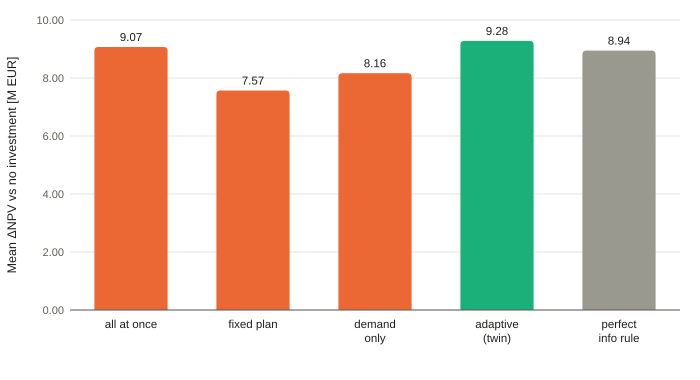
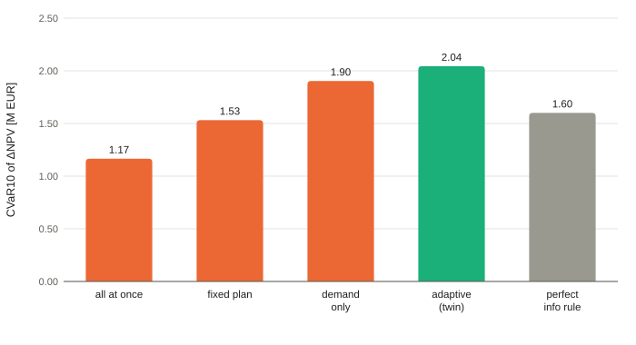

# Chapter 7 – Optimisation of the Stepwise FMS Introduction

> Draft v2.0 (edition 2) – 2026-11-15. Code: `thesis_modern/code/staging.py`, `analyse_staging.py`; data: `thesis_modern/data/staging_b0.0.csv`,
> `staging_b0.5.csv`. All results are **[simulated]** (40 hidden true factories with uncertain demand). All money values
> are **[assumption]** placeholders until the case company's quotations are available; the comparison between policies,
> not the absolute euro amounts, is the result of this chapter.

## 7.1 Purpose

Chapters 4–6 built a twin that learns the true behaviour of the machines from shop-floor data and knows, after a few
months, which station really limits output. This chapter asks what that knowledge is worth for the decision that
defines the target context: **how should a company that operates standalone CNC machines introduce an FMS — all at once,
following a fixed staged plan, or step by step, re-deciding every half-year with the updated twin?** It answers RQ3 and
tests hypothesis H4:

- **H4**: a staged introduction plan that is re-optimised after each Bayesian update gives a higher expected net present
  value and a lower risk of under-capacity than an all-at-once investment or a staged plan fixed at design time.

The chapter formulates the decision model (7.2), the rolling-horizon decision rule and the screening model it uses
(7.3), the experiment (7.4), the results (7.5), the evaluation of H4 (7.6) and a discussion (7.7).

## 7.2 Decision model

### 7.2.1 Starting point
The company starts at transition level L1: the machines of Table 4.2 exist and are connected through their OPC UA
servers and the unified namespace (Chapter 5),
but the crankcase machining centres are loaded and unloaded by hand (120 s per part not hidden behind cutting instead of
15 s with a pallet changer), transport between areas is manual with small racks (buffers of 2 parts), and faults are
answered without a cell controller or MES, so repairs take 30 % longer than in the designed FMS [assumption].

### 7.2.2 Options
Six investment options lead from this starting point towards the integrated FMS (levels L2–L4). Table 7.1 lists them
with their effect in the model and their investment cost.

**Table 7.1** Investment options [assumption: effects from the FMS design, costs as placeholders].
| Option | Description | Effect in the model | Capex [EUR] | Requires |
|---|---|---|---|---|
| PAL | pallet pool + pallet changers on the 3 HMCs | HMC handling 120 s → 15 s | 180 000 | – |
| GR2 | second crankshaft grinder | GRIND $c$ = 1 → 2 | 350 000 | – |
| AS2 | second pump assembly station | ASSY $c$ = 1 → 2 | 120 000 | – |
| FRB | robot-assisted final assembly | FINAL cycle time × 0.75 | 220 000 | – |
| MES | cell controller + MES | MTTR ÷ 1.3; scrap × 0.8 | 150 000 | – |
| AGV | AGV transport between areas | buffers 2 → 4 | 250 000 | MES |

The total of all options is 1.27 million EUR. Maintenance costs 3 % of the installed capex per half-year.

### 7.2.3 Stages, demand and economics
The introduction runs over $S = 4$ half-year stages followed by a terminal period of four half-years with the final
configuration. The design demand forecast is 3 500, 4 500, 5 200 and 5 800 compressors per month in stages 1–4 and
6 000 afterwards [assumption]; the true demand level differs from the forecast by a factor drawn from $U(0.8, 1.2)$, with
±5 % noise per stage. With contribution margin $m$ = 450 EUR per compressor, a penalty $\kappa$ = 50 EUR per unit of unmet
demand (expediting, goodwill), discount rate $r$ = 5 % per half-year and budget $K_s$ = 400 000 EUR per stage for staged
policies [assumption], the net present value follows Eq. (4.15) of Chapter 4:

$$\mathrm{NPV} = \sum_{s=1}^{S+4} \frac{6\,\big[m \min(Y_s, D_s) - \kappa \max(0, D_s - Y_s)\big] - c^{op}(\boldsymbol{x}_s)}{(1+r)^s} - \sum_{s=1}^{S} \frac{\sum_o c_o (x_{s,o} - x_{s-1,o})}{(1+r)^s}, \tag{7.1}$$

where $Y_s$ is the monthly good output in stage $s$ and $x_{s,o} = 1$ if option $o$ is installed. Results are reported
as the incremental NPV relative to not investing at all (policy NONE), which removes the large common revenue base.

### 7.2.4 Uncertainty
The true machine parameters of each scenario are drawn exactly as in the virtual ramp-up of Chapter 6 (Table 6.1:
deviations from the design and ramp-up behaviour over the months since start). They are hidden from all policies except
the perfect-information reference. The demand level is hidden as well and revealed stage by stage.

## 7.3 Decision rule and screening model

### 7.3.1 Rolling-horizon rule
The exact problem (4.16) is a multi-stage stochastic program with learning; with six options and four stages the
number of plans is large and every evaluation requires simulation. All policies therefore use the same rolling-horizon
rule. At stage $s$, with information $\mathcal{I}_s$ (parameter samples $\boldsymbol{\theta}^{(i)}$, demand forecast
$\hat D$):

$$\boldsymbol{a}_s^* = \arg\max_{\boldsymbol{a} \in \mathcal{A}_s} \Big\{ \frac{1}{N}\sum_{i=1}^{N} V_s\big(\boldsymbol{x}_{s-1} \cup \boldsymbol{a};\, \boldsymbol{\theta}^{(i)}, \hat D\big) - \beta\,\Delta\mathrm{CVaR} - \frac{\sum_{o \in \boldsymbol{a}} c_o}{(1+r)^s} \Big\}, \tag{7.2}$$

where $\mathcal{A}_s$ is the set of option subsets that respect the budget and the precedence (AGV requires MES),
$V_s$ is the discounted value of stages $s..S$ plus terminal value if the configuration is kept fixed afterwards, and
$\Delta\mathrm{CVaR}$ the gap between the mean and the mean of the worst 10 % of samples (risk aversion $\beta$). All
$\le 2^6 = 64$ subsets are enumerated. Keeping the configuration fixed after the decision ignores the value of later
flexibility — a conservative simplification that applies equally to all policies.

### 7.3.2 Policies
| Policy | Parameter information $\boldsymbol{\theta}^{(i)}$ | Demand forecast | Re-decides |
|---|---|---|---|
| NONE | – (no investment) | – | – |
| ALL | – (all options at stage 1, budget ignored) | – | – |
| STATIC | design point values | design forecast | plan fixed at design time |
| ADAPT_DEM | design point values | updated with observed demand | every stage |
| ADAPTIVE | 60 samples from the Bayesian twin (Chapter 6, $\rho$ = 0.7), updated after every stage | updated | every stage |
| PI_RULE | true parameters | true demand | every stage |

ADAPT_DEM isolates the value of demand learning; the difference between ADAPTIVE and ADAPT_DEM is the value of the
twin's parameter learning. PI_RULE applies the same rule with perfect information; because the rule is a heuristic, it is
a reference, not a strict upper bound.

The twin learns *machine* factors, not configuration effects: observed repair times are divided by the MTTR factor of
the current configuration (1.3 without MES) and scrap counts by the scrap factor (0.8 with MES) before the update, and
cycle-time ratios are taken relative to the current configuration's design times. Without this normalisation an option's
effect would be counted twice once it is installed.

### 7.3.3 Screening model
Equation (7.2) needs $64 \times 60 \times 8$ throughput evaluations per decision. The DES of Chapter 6 is too slow for
this, so the rule uses a screening model:

$$\hat Y = \eta(B)\, \min_m \Big( c_m A_m \frac{3600\,H}{\sum_p \pi_p t_{pm}} \Big) \prod_m (1 - q_m), \tag{7.3}$$

i.e. the raw bottleneck rate times the yield over all stations times a blocking efficiency $\eta$ that depends on the
buffer size. $\eta$ is calibrated once against the DES: 0.9932 for buffers of 2 and 0.9963 for buffers of 4 [simulated].
On 40 random combinations of configuration, true factory and ramp-up month, the screening model deviates from the DES by
1.19 % on average (bias +1.16 %, maximum 6.50 %) [simulated]. The realised outcome of every decision is always
simulated with the DES and the true parameters (three months per stage, common random numbers across policies), so
screening errors affect only the quality of decisions, not the evaluation.

## 7.4 Experiment
Forty scenarios (true factory + demand level) were generated. For each, the six policies were simulated over four
stages and the terminal period. Two risk settings were run: $\beta = 0$ (risk-neutral) and $\beta = 0.5$. Reported per
policy: mean incremental NPV versus NONE, its standard deviation, $\mathrm{CVaR}_{10\%}$ (mean of the worst 4 of 40
scenarios), the minimum, mean capital invested, mean number of stages with output below 95 % of demand, share of
scenarios with at least one such stage, and the regret relative to PI_RULE. Reproduce with
`python staging.py 40 0.0` and `python analyse_staging.py ../data/staging_b0.0.csv` (about 1 minute on 15 cores).

## 7.5 Results

### 7.5.1 Value and risk

**Table 7.2** Incremental NPV versus no investment, 40 scenarios, $\beta = 0$ [simulated; money values are assumptions].
| Policy | Mean ΔNPV [M EUR] | SD | CVaR$_{10\%}$ | Minimum | Capital [M EUR] | Short stages | Scenarios with a short stage | Regret vs PI_RULE |
|---|---|---|---|---|---|---|---|---|
| ALL | 9.07 | 4.16 | 1.17 | −0.87 | 1.27 | 0.50 | 40.0 % | −0.12 |
| STATIC | 7.57 | 3.18 | 1.53 | −0.17 | 0.69 | 0.72 | 52.5 % | 1.37 |
| ADAPT_DEM | 8.16 | 3.91 | 1.90 | 0.20 | 0.62 | 0.72 | 57.5 % | 0.78 |
| **ADAPTIVE** | **9.28** | 3.81 | **2.04** | **0.20** | 0.71 | 0.57 | 42.5 % | −0.34 |
| PI_RULE | 8.94 | 4.05 | 1.60 | 0.00 | 0.64 | 0.60 | 42.5 % | 0.00 |

**Table 7.3** Paired differences of ADAPTIVE against the other policies (same scenario, common random numbers).
| Comparison | Mean difference [M EUR] | Standard error | ADAPTIVE better in |
|---|---|---|---|
| ADAPTIVE − ALL | +0.21 | 0.085 | 27 of 40 |
| ADAPTIVE − STATIC | +1.71 | 0.168 | 34 of 40 |
| ADAPTIVE − ADAPT_DEM | +1.12 | 0.224 | 24 of 40 |

The adaptive policy has the highest mean value and the best downside: its worst 10 % of scenarios still gain 2.04 M EUR
on average, against 1.17 M EUR for the all-at-once investment, which in its worst scenario loses 0.87 M EUR compared with
not investing. It reaches this with 0.71 M EUR of capital on average — 44 % less than ALL (Figures 7.1 and 7.2).

**Figure 7.1** Mean incremental NPV versus no investment by policy, 40 scenarios [simulated].

**Figure 7.2** Mean of the worst 10 % of scenarios (CVaR) by policy [simulated].

### 7.5.2 Where the value comes from
Two decompositions explain the result.

*Fixed plan versus adaptive plan.* The fixed plan, optimised at design time with the design values, always installs
AS2, FRB and GR2 (Table 7.4). It invests in the second grinder in every scenario, although in many true factories the
grinder is not the binding constraint, and never buys the MES, whose shorter repair times pay off when the true machines
fail more often than designed. The adaptive policy installs AS2 and FRB in all 40 scenarios, but GR2 only where the
twin observes the grinder to be critical (27 of 40), and the MES in 32 of 40 scenarios; PAL never and AGV twice.

*Demand learning versus parameter learning.* Updating only the demand forecast (ADAPT_DEM) recovers 0.59 M EUR of the
1.71 M EUR advantage over the fixed plan; the remaining **1.12 M EUR (65 %) is the value of the twin's parameter
learning**. Knowing *which* station limits output is worth more than knowing *how much* will be demanded.

**Table 7.4** Most frequent final configurations (40 scenarios).
| Policy | 1st | 2nd | 3rd |
|---|---|---|---|
| ALL | all six options (40) | – | – |
| STATIC | AS2 + FRB + GR2 (40) | – | – |
| ADAPT_DEM | AS2 + FRB + GR2 + MES (15) | AS2 + FRB (14) | AS2 + FRB + GR2 (7) |
| ADAPTIVE | AS2 + FRB + GR2 + MES (20) | AS2 + FRB + MES (10) | AS2 + FRB + GR2 (6) |
| PI_RULE | AS2 + FRB + GR2 + MES (15) | AS2 + FRB + MES (9) | AS2 + FRB (6) |

Two options are almost never chosen by any staged policy: the pallet pool (PAL) and the AGV system. In this case the
HMC cell is not the bottleneck even with manual loading (static capacity about 7 500 parts per month against 5 667 at
FINAL), so hiding the load time adds no output; and buffers of 2 already lose less than 1 % to blocking ($\eta$ = 0.9932),
so larger buffers add little. Both options would become valuable with a different product mix, higher demand or
labour-cost savings, which the model does not value (Section 7.7).

**Replication.** The extended replication of companion paper 4 (200 scenarios instead of 40, 11 policies, paired
tests with Holm correction) confirms the value of re-deciding: ADAPTIVE − STATIC = **+1.61 M EUR** (95 % confidence
interval 1.45 – 1.77; better in 169 of 200 scenarios) [simulated]; the 40-scenario value of +1.71 M EUR lies inside
this interval. Against a fixed plan that is itself optimised over the prior uncertainty, the advantage of learning is
smaller (+0.31 M EUR, interval 0.23 – 0.38) — the fairest measure of what the twin's updating adds.

### 7.5.3 Under-capacity
All-at-once has the lowest share of scenarios with at least one stage below 95 % of demand (40.0 %), closely followed by
ADAPTIVE and PI_RULE (42.5 %); the fixed plan (52.5 %) and the demand-only policy (57.5 %) are clearly worse. The
shortfall was afterwards recorded per stage in an extended replication (companion paper 4: 200 scenarios, same model
and seeds scheme). It occurs in **stages 3 and 4, not in stage 1** as first assumed: in high-demand scenarios the
demand of the later stages exceeds what the option set can deliver at all (6 356 units per month with every option
installed), so no policy can avoid it. Under-capacity is therefore a limit of the option set, not of the staging rule;
a second load station (Section 9.2.5) is the obvious missing option.

### 7.5.4 Risk aversion
With $\beta = 0.5$ the results are practically unchanged (ADAPTIVE: mean 9.28 M EUR, CVaR 2.00 M EUR; 21 instead of 20
scenarios end with AS2 + FRB + GR2 + MES). The reason is visible in Table 7.2: the investment amounts are small relative to
the margin at stake, so the downside of a decision is driven by the true factory and the demand, not by the option set.
Risk aversion would matter for larger, less divisible investments or tighter capital — a case for the sensitivity
analysis of Chapter 9 with the company's real quotations.

## 7.6 Evaluation of hypothesis H4
- **Expected NPV:** ADAPTIVE is higher than STATIC (+1.71 M EUR, 34 of 40 scenarios, about 10 standard errors) and higher
  than ALL (+0.21 M EUR, 27 of 40, about 2.5 standard errors). **Supported.**
- **Risk:** the downside is clearly better (CVaR$_{10\%}$ 2.04 against 1.17 M EUR for ALL and 1.53 for STATIC; no
  scenario worse than not investing). The risk of under-capacity is lower than with STATIC (42.5 % vs 52.5 %) but **not lower
  than with ALL** (42.5 % vs 40.0 %).
- **Capital:** ADAPTIVE needs 44 % less capital than ALL for a higher expected value.

**H4 is supported for expected value and downside risk, and partly for under-capacity** (better than the fixed plan,
equal to the all-at-once investment). For a company with limited access to capital — the defining condition of the
target context — the combination of higher value, better downside and much lower capital is the relevant result.

## 7.7 Discussion and limitations
*What the twin contributes.* The staging experiment converts the station-level knowledge of Chapter 6 into money: about
two thirds of the advantage of adaptive over fixed planning comes from parameter learning. The design study cannot know
that, in a given real factory, the final assembly and the repair response matter more than the second grinder; the
twin learns it within one or two stages.

*Limits of the decision rule.* The rule keeps the configuration fixed after each decision (no explicit value of future
flexibility) and uses a screening model with 1.2 % mean error; PI_RULE shows that the rule is not optimal even with
perfect information (ADAPTIVE scores 0.34 M EUR more, partly through chance in the realised months). Approximate dynamic
programming or a real-options formulation could value flexibility explicitly.

*Limits of the economic model.* Options are valued only through additional output. Labour savings (PAL, AGV), quality
costs beyond scrap, energy and floor space are not included, which explains why PAL and AGV are rarely chosen and is the
main reason why absolute numbers must not be used for the investment decision before the company's own cost data are
entered (Chapter 9). Costs and effects in Table 7.1 are placeholders.

*Limits of the simulation.* As in Chapter 6: assumed ramp-up shape, reduced-order DES, independent months; one
representative month per stage (three replications) stands for six.

## 7.8 Summary
The stepwise introduction of the FMS was modelled as six options over four half-year stages with hidden true machine
parameters and uncertain demand. A rolling-horizon rule with a screening model (1.2 % mean deviation from the DES) was
applied with different information. Over 40 scenarios, re-deciding every half-year with the Bayesian twin gave the
highest expected incremental NPV (9.28 M EUR against 9.07 for all-at-once and 7.57 for a fixed plan), the best downside
(CVaR 2.04 against 1.17 M EUR) and needed 44 % less capital than all-at-once; 65 % of its advantage over the fixed plan is
the value of parameter learning. The risk of under-capacity equals that of the all-at-once investment. H4 is supported for
value and downside risk and partly for under-capacity. With the money values replaced by the company's quotations,
the same model becomes the investment-planning tool of the case factory (Chapter 9).

---
**References cited in this chapter**: Rockafellar & Uryasev (2000); Powell, W.B. (2011) *Approximate Dynamic Programming*,
2nd ed., Wiley [verify]; Trigeorgis, L. (1996) *Real Options*, MIT Press [verify].
