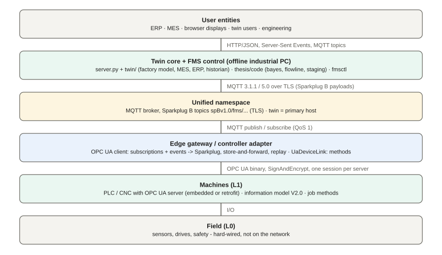
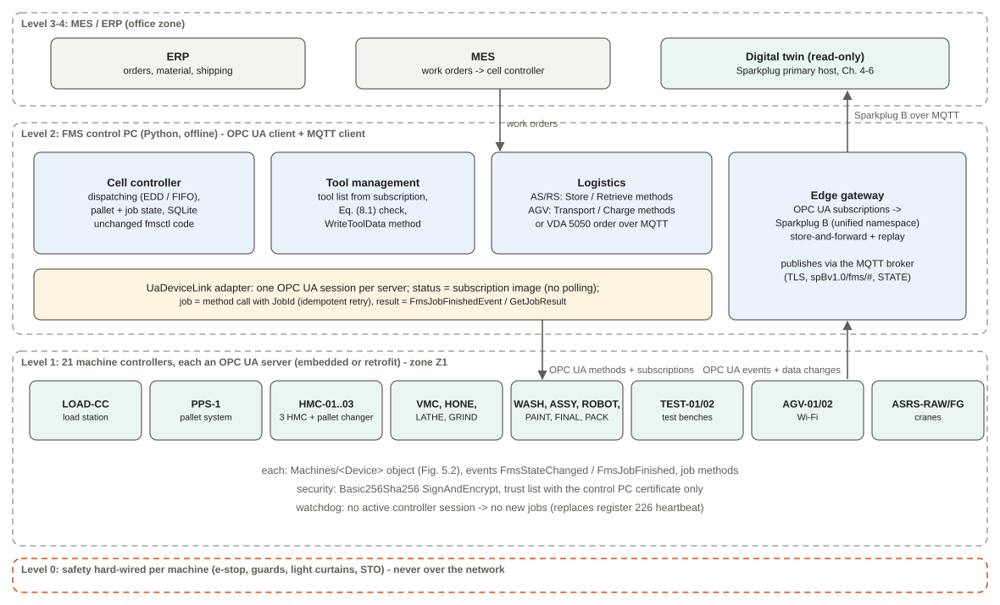
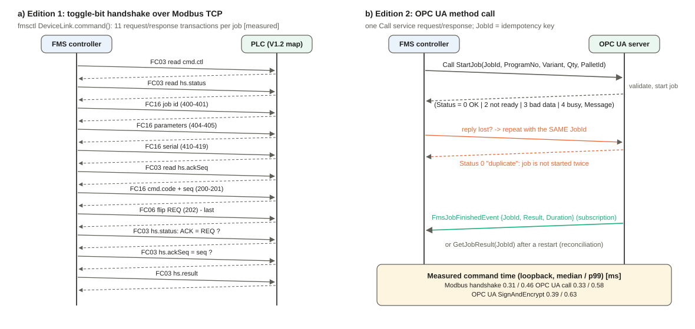
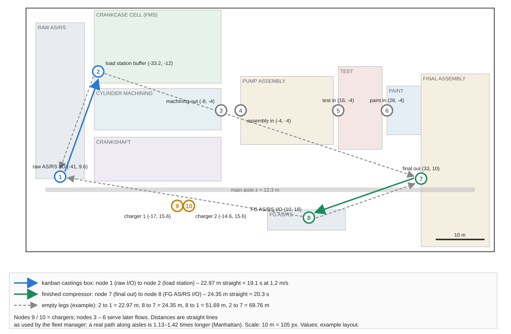

# Chapter 8 – Implementation

> Draft v2.0 (second edition) – 2026-11-15. Describes the software that implements the method of Chapters 4–7: the
> factory digital twin (`server.py`, `twin/`, `web/`), the thesis modules (`thesis_modern/code/`), the browser
> implementation of the thesis calculations, and — new in this edition — the OPC UA / MQTT communication software
> (`thesis_modern/code/modern/`) and the FMS control system on OPC UA. Figures are **[measured]** on the development PC
> unless stated otherwise; test results: `thesis_modern/data/modern/test_modern.json`.

## 8.1 Purpose and requirements

The method must be usable by the company that it is designed for. Chapter 5 fixed the communication architecture
(OPC UA servers in or next to the machines, an MQTT unified namespace with Sparkplug B, no cloud); this chapter adds
the software constraints that follow from the same context:

| Id | Requirement | Consequence for the implementation |
|---|---|---|
| S1 | Runs on one offline industrial PC; no internet, no cloud services | all packages installed from a local wheel folder with a lock file; no CDN; offline certificate authority |
| S2 | Maintainable by the company's own engineers | one language per side (Python on the server, JavaScript in the browser); open-source protocol stacks only (asyncua, paho-mqtt, Mosquitto / amqtt); readable code |
| S3 | Reproducible results for the thesis and for audits | seeded random numbers, append-only prediction records, version tags, every number re-computable by one command |
| S4 | Same formulas everywhere | one reference implementation (Python), ports checked number by number |
| S5 | Response times compatible with daily use | monthly update + prediction in seconds; planning decisions in minutes; machine data to the twin in < 1 s |
| S6 | Standard interfaces towards machines and plant-wide consumers | OPC UA information model V2.0 (Section 5.4), Sparkplug B topics (Section 5.5), job commands as OPC UA methods |

## 8.2 Software architecture

The implementation follows the layers of Chapter 5 and the functional view of ISO 23247 (observable manufacturing
elements → data collection and device control → digital twin core → user entities). Compared with the first edition,
the gateway layer changes completely: instead of a Modbus client that polls register blocks, an OPC UA client receives
subscriptions and events and republishes them in the unified namespace; the twin reads the namespace as Sparkplug
primary host (Figure 8.1).

**Figure 8.1** Software layers of the implementation (second edition).

The project contains about 101 600 lines of code and documentation scripts (Python and JavaScript); the twin core
`twin/` has 13 165 lines of Python, the thesis modules about 2 000 lines, the browser implementation of the thesis
calculations 576 lines, and the new communication and control software of this edition 4 151 lines in 17 Python
modules (`thesis_modern/code/modern/`, including tests, benches and figure scripts). The twin core and the thesis
modules still use the Python standard library only. The communication layer uses three open-source protocol
packages — asyncua 1.1.5 (OPC UA client and server, LGPL), paho-mqtt 2.1.0 (MQTT client, EPL/EDL) and, in the
laboratory, amqtt 0.11.0 (MQTT broker, MIT) — with their dependencies (cryptography, pyOpenSSL and others; 27 wheel files in
total). They are installed from a local wheel folder with a lock file (`thesis_modern/vendor/`) into a separate
virtual environment, so that the offline rule S1 holds and an update is a deliberate, versioned act. The only
third-party browser library remains Three.js for 3D views, served from the local `web/vendor/` folder. Sparkplug B
payloads are encoded by a 196-line module written for this work (`sparkplug.py`), because no protobuf package is
available offline; Section 8.9.2 describes it.

## 8.3 The factory twin

The factory twin is an event-driven simulation of the complete compressor factory (16 stations, buffers, pallet pools,
AGVs, two AS/RS) running in real time or accelerated, with MES and ERP functions, a SCADA view and an HTTP API of about
30 endpoints (`/api/state`, `/api/stream` for Server-Sent Events, `/api/fms`, `/api/mes`, `/api/erp`, `/api/ingest`
for real machine data, and the endpoints of the ball screw factory under `/api/bsf/...`). Its configuration — products,
mix, routings, cycle times, reliability and scrap per station, layout — is one JSON file (`config/factory.json`), which
is also the source of the design estimates of Table 4.2. In the second edition the twin receives real machine data
through the unified namespace: a subscriber (`twin_sub.py`, Section 8.9.2) turns Sparkplug DDATA messages into the
events and counters of Table 4.5 and hands them to `/api/ingest`; the HTTP API remains the interface for browsers
and office applications, where it is the simplest and best-supported choice.

**Verification of the engine.** `tools/verify_engine.py` compares the twin with eleven hand calculations (single machine,
serial line, parallel machines, assembly of two components, breakdowns with MTBF/MTTR, scrap, test-bench rejects, the
three-variant compressor factory with perfect machines, change-overs with alternating and batched variants, and two
machines with 80 % availability and a large buffer). All eleven cases pass; deviations are below 1 % except the
test-bench reject share (1.34 % against 1.15 %), a small-number statistical effect within the tolerance of the test; the
run is repeatable with a fixed seed [measured, 2026-11-13].

## 8.4 Thesis modules

### 8.4.1 Bayesian updating (`bayes.py`)
Four classes implement the conjugate models of Table 4.4 with the design-statement constructors of Section 4.5.3, the
update with forgetting (Eq. 4.11), posterior means and Monte Carlo intervals. The point estimate of a mean MTBF, MTTR or
variance falls back from $b/(a-1)$ to $b/a$ when strong forgetting with few events drives the shape below 1 — a case
found during the experiments of Chapter 6. `chapter4_examples()` re-computes every worked number of Chapter 4.

### 8.4.2 Reduced-order DES (`flowline.py`)
The departure-time recursion of Eq. (6.2) computes one month of production (about 5 700 parts × 13 stations) in
0.034 s in Python; it records the observations of Table 4.5 for the twin. It is verified against the static upper bound
of Eq. (4.2) (0.4 % below the bound for the design line, Section 6.4.1) and used in Chapters 6, 7 and 9.

### 8.4.3 Prediction, discrepancy and staging
`rampup_experiment.py` implements Algorithms 6.2–6.3; `discrepancy.py` the model-discrepancy learning of Eq. (6.1);
`staging.py` the decision model of Chapter 7 with the screening model of Eq. (7.3), whose blocking efficiency is
calibrated against the DES at start-up and validated on 40 random cases (1.19 % mean deviation).

### 8.4.4 Communication software and measurement benches
The first edition's benches (`commbench.py`, `httpbench.py`) remain in the code folder as the Modbus TCP/HTTP baseline
of Section 5.8.9. The second edition adds the modules listed below. They run as separate processes on one PC and are
orchestrated by `campaign.py`, which also evaluates every run against the logged truth. The modules are:

| Module | Lines | Function |
|---|---|---|
| `infomodel.py` | 276 | mapping table register map V1.2 → OPC UA nodes / method arguments / replaced mechanisms; builder of the device objects and event types |
| `vplant_ua.py` | 462 | OPC UA virtual plant: measurement mode (random state process) and control mode (fmsctl process models behind job methods) |
| `gateway.py` | 435 | edge gateway: OPC UA subscriptions and events → Sparkplug B edge node with store-and-forward and replay buffer |
| `twin_sub.py` | 172 | Sparkplug primary host for the twin: STATE, alias resolution, sequence check, counter-gap replay |
| `sparkplug.py` | 196 | hand-coded Sparkplug B protobuf encoder / decoder and topic helpers |
| `ua_link.py` | 229 | adapter that lets the unchanged fmsctl controller command OPC UA machines |
| `broker.py`, `proxy.py`, `certs.py` | 248 | laboratory broker with scheduled restart, byte-counting relay, offline PKI |
| `campaign.py`, `analyse_modern.py`, `cmdbench.py` | 696 | measurement campaign of Section 5.8, evaluation, command bench |
| `make_figures_modern.py`, `fill_ch05.py`, `fill_texts.py` | 788 | figures of Chapters 5 and 8; Chapter 5 tables and numbers generated from the results |
| `test_modern.py` | 477 | 37 automated acceptance checks (Section 8.9.6) |

Developing the benches exposed two further platform pitfalls in addition to the two of the first edition (coarse
`time.time()` and early asyncio timers on Windows): `time.process_time()` reports almost zero CPU time for processes
whose work is triggered by timers, because Windows charges CPU time at clock ticks — the campaign therefore measures CPU
time with the processor cycle counter (`QueryProcessCycleTime`); and asyncua runs plain-function method callbacks in a
thread pool and does not check the number and type of method arguments, so the server code must do both (Section
8.9.3). These findings are documented in the module headers because they would silently distort measurements or
commands made by others on the same platform.

## 8.5 Browser implementation of the thesis calculations

All calculation systems of the thesis are also available interactively in the twin's browser interface (tab "Doctoral
research"), so that planners can use them without Python:

| Item | Function | Port of |
|---|---|---|
| 1 | thesis map, hypotheses, status | – |
| 2 | capacity / bottleneck table; Bayesian updater for MTBF, MTTR, cycle time, scrap | `bayes.py` |
| 3 | results of the virtual ramp-up; live lab running a hidden true factory month by month | `flowline.py`, `rampup_experiment.py`, `discrepancy.py` |
| 4 | communication sizing calculator; measured campaign | Chapter 5 formulas (first-edition Modbus TCP/HTTP version; OPC UA/MQTT version open, Section 8.10) |
| 5 | staging results; investment-plan calculator with the thesis decision rule | `staging.py` |

`web/phd_calc.js` is a dependency-free port with a seeded random-number generator (Mulberry32, Marsaglia–Tsang gamma
sampling); `web/phd_data.js` contains the stored thesis results and is generated by `export_web.py`, never edited by
hand.

**Cross-verification Python ↔ JavaScript** (headless Chrome, 2026-11-13): Example 4.1 MTBF 26.04 h, Example 4.2 MTTR
27.42 min, Example 4.4 scrap 1.69 %, all 13 static capacities, the first-edition communication formulas and the staging
rule's plan (AS2 + FRB, then GR2) are identical in both implementations; the browser DES simulates one month in about
7 ms [measured].

## 8.6 Data management and reproducibility

- **Prediction records.** Every prediction is stored with date, model version, parameter state and seed before the
  predicted period starts (Section 6.2). The frozen design prediction of the case factory is `data/case1_P0.json`.
- **Raw results are never edited.** Experiments write CSV/JSON to `data/` (communication campaign: `data/modern/raw/
  <block>/<run>/` with the truth log of the plant, the receive logs of gateway and twin, broker and relay logs);
  analysis scripts read them; chapter tables and figures are generated from them.
- **Seeds.** All experiments use explicit seeds; common random numbers are used where policies are compared (Chapter 7);
  the communication runs use seeds 1–3 per configuration.
- **One command per result.** The README lists, for every table and figure, the command that reproduces it.
- **Machine data provenance.** Every value in the unified namespace carries the machine's source time stamp; every state
  change carries the device's StateChangeCounter, so that the historian can prove completeness (Section 5.5.5).
- **Labels.** Every number in the thesis carries one of the labels design estimate / assumption / reference estimate /
  calculated / simulated / measured / cited.

## 8.7 Performance

**Table 8.1** Run times and resources on the development PC (Windows Server 2022, AMD Ryzen 7 9700X, 16 logical cores,
64 GB RAM, Python 3.12) [measured].
| Task | Time / resource |
|---|---|
| Bayesian update of all 13 stations (Algorithm 6.2) | < 1 ms |
| One simulated month, Python reduced-order DES | 0.034 s |
| One simulated month, browser DES | ≈ 7 ms |
| Monthly prediction with 40 parameter samples (Algorithm 6.3) | < 2 s |
| Staging decision at one stage (≤ 64 option sets × 60 samples, screening model) | seconds |
| Virtual ramp-up experiment, 30 scenarios × 12 months × 5 predictors | ≈ 2 min on 15 cores |
| Staging experiment, 40 scenarios × 6 policies | ≈ 1 min on 15 cores |
| Edge gateway, 21 devices, OPC UA → Sparkplug (Section 5.8.6) | 1.2 % of one core, 60 MB |
| Machine state change → twin, 21 devices, median / 99th percentile (Section 5.8.5) | 54 ms / 112 ms |
| Job command as OPC UA method call, median (Section 5.8.8) | 0.33 ms |

These times are negligible against the monthly update rhythm and the half-yearly investment rhythm of the method, and
the communication figures leave a large margin on one industrial PC.

## 8.8 Deployment in the case factory
1. **Hardware:** one industrial PC (8 cores, 16 GB RAM, SSD) in the IT/OT room, UPS-backed, running the MQTT broker,
   the edge gateway, the FMS control and the twin; a second PC as cold spare with a nightly copy of the historian, the
   prediction records, the broker configuration and the certificate store.
2. **Software:** Python 3.12 with the vendored wheels of Section 8.2, Eclipse Mosquitto as production broker
   (persistence on, TLS listener only), the project folder, scheduled tasks that start broker, gateway, controller and
   twin at boot; browsers on MES terminals and offices open the twin by its local address.
3. **Machines:** each new machine is ordered with an OPC UA server that implements the information model of Section
   5.4 (or the supplier's companion-specification model plus the FMS extensions — to be agreed per machine); old CNCs
   and small PLCs get a retrofit OPC UA server (Section 5.3.3). The factory acceptance test of every machine includes
   the checks of Table 8.2 that concern a single device.
4. **Network and security:** machine VLANs per area (zone Z1), the industrial PC in zone Z2, office applications in Z3;
   only OPC UA (4840/tcp, SignAndEncrypt) from Z2 to Z1 and MQTT over TLS (8883/tcp) inside Z2 / from Z3; no route to
   the internet (Section 5.6). The offline certificate authority runs on a separate, normally switched-off notebook.
5. **Operation:** the twin accumulates the statistics of Table 4.5 continuously from the namespace; at the end of every
   month it updates, stores its prediction for the next month and shows predicted vs actual; every half-year the
   staging calculator is re-run with the updated twin and the current quotations.

## 8.9 The FMS control system on OPC UA and MQTT

The twin of Sections 8.3–8.5 observes and predicts; it never commands a machine. A flexible manufacturing system,
however, only exists when a supervisory controller decides in real time which pallet goes to which machine, which NC
program runs, which tool is fit for the next job and which AGV carries which load. In the target context such
controllers are usually bought as closed packages from the machine supplier, which ties the factory to one vendor and
to protocols it cannot maintain itself [observation in the case context]; complex control is also one of the reasons
why FMS projects have missed their planned output (Section 2.2.3). The first edition showed with the control software
`fmsctl` (cell controller, tool management, logistics; 61 acceptance checks on a virtual plant of 21 Modbus PLCs) that
the factory can own its FMS control. This edition moves the same control onto the standard interfaces of Chapter 5:
machine status comes from OPC UA subscriptions and events, jobs are OPC UA method calls, and plant-wide consumers read
the MQTT unified namespace. The decisive design choice is that **the control logic itself is not rewritten**: the
cell controller, the tool manager and the logistics manager of `fmsctl` run unchanged, and an adapter of 229 lines
(`ua_link.py`) replaces the Modbus device link. This both protects the verified control logic and measures how much of
a control system actually depends on the transport.

### 8.9.1 Control hierarchy and responsibilities
Figure 8.2 places the control system in the ISA-95 / IEC 62264 hierarchy. Level 1 consists of the 21 machine
controllers of the case factory (7 CNC machines including 3 horizontal machining centres, the pallet system, the load
station, 7 other stations, 2 test benches, 2 AGVs and 2 AS/RS cranes), each an OPC UA server — embedded in the CNC or
PLC, or a retrofit server next to an old controller (Section 5.3.3). Level 2 is the FMS control PC. Its functions are
the cell controller, tool management, logistics (AGV fleet and AS/RS warehouse management), the edge gateway that
publishes machine data to the unified namespace, and an HTTP server for operator screens; MES and ERP at levels 3 and 4
exchange work orders and confirmations with it. The division of work is unchanged from the first edition: level 2
decides *what* and *when* (which pallet, which machine, which program, which tool, which transport); level 1 decides
*how* (motion, interlocks, the machining cycle). Functional safety is never transmitted over the network: e-stop
chains, guard doors, light curtains and safe torque off are hard-wired per machine. A lost network therefore means "no
new jobs", never a hazard. The first edition's gateway heartbeat (register 226, PLC watchdog 5 s) is replaced by the
OPC UA session: a machine accepts jobs only while a session of the control PC is active, and the session's keep-alive
and timeout (5–10 s in the factory) take over the watchdog role [design; not yet enforced by the virtual plant, open
item of Section 8.10]. The twin reads the namespace and
remains a separate, read-only system.

**Figure 8.2** Control hierarchy of the compressor FMS in the second edition: OPC UA servers at level 1, the control PC
as OPC UA client (methods, subscriptions) and Sparkplug edge node, the twin as read-only primary host, safety outside the
network.

### 8.9.2 Machine interface: information model, subscriptions and the unified namespace
All 21 machines expose the information model V2.0 of Section 5.4 (Table 5.3, Figure 5.2): one object per device under
`Objects/Machines`, typed by device class (FmsMachineToolType, FmsPalletSystemType, FmsLoadStationType,
FmsStationType, FmsTestBenchType, FmsAgvType, FmsAsrsCraneType), with Identification, MachineryItemState,
MachineryOperationMode, Monitoring, Production and the device-type folders (tool list of the CNC, pallet locations of
the pallet system, vehicle data of the AGV, crane data of the AS/RS, last test result of the test bench). Every
register field of map V1.2 is accounted for: summed over the seven device types, 200 field definitions became
variables, 25 became method arguments and 188 (header, handshake, command block, event ring) are replaced by OPC UA
mechanisms; none is unmapped (Table 5.3).

The controller does not poll. At start-up the adapter opens **one session per OPC UA server**, browses the machine
objects once, reads their type definitions and creates one subscription with a data-change monitored item for every
mapped variable (708 monitored items for the 21 devices, queue size 10, publishing interval 50 ms on the virtual plant; 250–500 ms is sufficient in the factory [design]). Every notification is written into a local
image of the device data, so that the controller's existing code that reads "the pallet table" or "the tool life of
pocket 11" reads always-fresh local data. Because the image is filled through the inverse of the mapping table, the
unchanged controller still sees its familiar register addresses; a new controller would use the browse names directly.
State changes and job completions arrive in addition as events (FmsStateChangedEventType with StateChangeCounter,
FmsJobFinishedEventType with JobId, Result and Duration), whose queue keeps every event even when several occur within
one publishing interval (Section 5.5.2).

The **unified namespace** is served by the edge gateway (`gateway.py`), an OPC UA client that publishes every event and
every batch of data changes as Sparkplug B messages: `spBv1.0/fms/NBIRTH/gw1` and `DBIRTH/gw1/<device>` with all metric
names, aliases, data types and current values after every (re)connection; `DDATA/gw1/<device>` with aliases only;
`NDEATH` as MQTT last will. One sequence number (0–255) runs over all messages of the edge node, so that the twin
detects any lost message; the birth/death sequence number bdSeq links a death to its birth. The gateway publishes only
while the primary host — the twin — has announced itself online on `spBv1.0/STATE/twin`; otherwise, and while the
broker is unreachable, it stores messages and forwards them later, flagged `is_historical`. Since no protobuf package is
available offline, the Sparkplug payload is encoded by hand (`sparkplug.py`: varints, length-delimited fields, the
Payload and Metric messages of the Sparkplug B schema with 14 data types, no templates or data sets); a state-change
DDATA with three metrics is 70 bytes of payload, against 375 bytes for the same content as JSON [calculated with the
encoder]. Two Sparkplug details matter in practice: aliases must be unique within the edge node, not only per device
(the gateway uses device index × 64 + metric number), and the twin may only resolve DDATA after it has seen the
device's DBIRTH, so a missed birth must trigger a rebirth request.

### 8.9.3 Job commands as OPC UA methods
The first edition gave a job to a PLC with a toggle-bit handshake: write the parameters, then command code and sequence
number, then invert the request bit, and poll until the PLC mirrors it (Figure 8.3a). Measured on the fmsctl
implementation, one job command for a station takes 11 Modbus request/response transactions. In the second edition a
job is **one OPC UA method call** on the machine object (Figure 8.3b), for example

`StartJob(JobId: UInt32, ProgramNo: UInt16, Variant: UInt16, Quantity: UInt16, PalletId: UInt16) → (Status: UInt16, Message: String)`

for a machining centre, and correspondingly `MovePallet`, `OperatorTask`, `StartTest`, `Transport`, `Charge`, `Store`,
`Retrieve`, `WriteToolData`, `AckAlarm` and `GetJobResult` for the other device types (Table 5.2). The machine validates
the call in the same way as the PLC validated the handshake (known command, device ready and in automatic mode, pallet
really at the machine, parameters plausible) and returns the status codes of the first edition (0 OK, 2 not ready,
3 bad data, 4 busy) — so that the controller's error handling is reused. The job result arrives as
FmsJobFinishedEvent; LastJob/{JobId, Result, Duration} is written before the event, so the controller always finds a
consistent result.

**Idempotency.** The toggle bit protected the first edition against a lost or repeated frame. Its equivalent here is
the JobId, which the controller generates once per job and stores in its database *before* the call. The machine keeps
the results of its last 256 JobIds. If the reply to a call is lost — a time-out, a broken secure channel — the
adapter repeats the call with the same JobId; a machine that has already accepted the job answers "duplicate: original
result returned, job not started again" with the original status. The controller therefore never needs to decide
whether a job "might have started". After a controller restart, `GetJobResult(JobId)` returns whether a job is
finished (with its result), running, rejected or unknown to the machine — the latter after a machine restart, which
leads to the same operator decision as the first edition's state *unknown*. Two implementation details are worth
recording because they are easy to miss: asyncua does not check the number and types of the call arguments against the
method's InputArguments, so the server code checks them and answers `BadArgumentsMissing`, `BadTooManyArguments` or
`BadTypeMismatch` (a call with missing arguments would otherwise have started a job with stale parameters — found by
test B7); and plain-function callbacks run in a thread pool, so the callbacks are written as coroutines.

**Figure 8.3** Job command for a station: (a) toggle-bit handshake of the first edition with the transactions actually
issued by fmsctl, (b) OPC UA method call with JobId as idempotency key, lost-reply retry and result event; measured
command times from Section 5.8.8.

### 8.9.4 Cell controller and tool management
The cell controller's logic is the one described in the first edition and verified by its acceptance tests: a cyclic
loop that reads the five cell devices, closes finished jobs and — in automatic mode — dispatches with fixed priorities
(start an HMC whose changer holds a raw pallet and whose tool check passes; give the operator the next load-station
task for the most urgent work order whose fixture fits; move one pallet with the shuttle; earliest due date or FIFO;
automatic replacement of scrapped parts; fixture-balance rule). The pallet locations still come from the pallet system,
which remains the source of truth — now from the PalletSystem/Locations folder instead of registers 300–315. What
changes is the cost of reading: the loop no longer issues three to five Modbus requests per device and cycle; it reads
the subscription image, and the network carries only changes.

Tool management uses the CNC's tool list: Equipment/Tools/Pocket01..30/RemainingLife in percent (the register map
used 0.1 % units; the conversion is part of the mapping table). Before every machining job the manager checks Eq.
(8.1) for every tool type $k$ of the NC program:

$$\sum_{j \in G_k} L_j \;\ge\; \frac{1000\, u_k\, Q}{T_k} + L_{res} \tag{8.1}$$

with $L_j$ the remaining life of pocket $j$ in sister group $G_k$ [0.1 %], $u_k$ the uses of tool $k$ per part (for
example 16 threads M8 per crankcase), $Q$ the parts in the job, $T_k$ the nominal life in uses (1 500 for the M8 tap)
and $L_{res} = 20$ (2 %) [design]. For the tap, one part consumes $1000 \cdot 16 / 1500 = 10.7$ units (1.07 %). When the
setter mounts a tool measured on the presetter, the method `WriteToolData(JobId, Pocket, Length, Radius, LifeSet)`
writes life and offsets into the CNC, and the tool is booked into the magazine only after the CNC shows the written
values in Equipment/Tools/LastToolData. Where a CNC supplier provides the tool list of the OPC UA for Machine Tools
companion specification, the same check runs on that list; tool offsets may then also be written as variable writes
with write permission restricted to the tool-setter role (Section 5.6). Section 9.2.6 shows that the fixed 2 % reserve
covers planning errors but not the spread of real tool life.

### 8.9.5 Logistics: AS/RS warehouse management and AGV fleet
The warehouse management and fleet functions are unchanged in their logic (location tables of both AS/RS with
put-away nearest to the input/output point and FIFO retrieval; kanban supply of castings from the raw AS/RS to the load
station; finished compressors to the finished-goods AS/RS; nearest idle AGV with battery penalty; reservation of pick-up
and drop nodes; charging below 25 %; chaining of crane and AGV jobs; crane fault with the load on the fork blocks the
stock record until the operator confirms). In the OPC UA model the cranes offer `Store` / `Retrieve(JobId, Bay, Level,
Side)` and publish Crane/{Bay, Level, LoadOnFork, IOReady}; the AGVs offer `Transport(JobId, FromNode, ToNode,
LoadType)` and `Charge(JobId, ChargerNode)` and publish Vehicle/{CurrentNode, TargetNode, BatteryCharge, Loaded,
VehicleState} (Figure 8.4 shows the node map).

For the AGVs, a dedicated standard exists and is now allowed in the factory design: **VDA 5050** defines the
communication between AGVs and a master control over MQTT with JSON messages (topics `order`, `instantActions`, `state`,
`visualization`, `connection`; orders as graphs of nodes and edges with released and planned parts; version 2.0.0 of
2022, 2.1.0 of 2024). It is the preferred interface whenever the AGV supplier offers it, because it makes the fleet
manager independent of the vehicle make. In the architecture of Chapter 5, VDA 5050 traffic uses the same broker as the
unified namespace but its own topic tree (`uagv/v2/<manufacturer>/<serial>/...`); the logistics manager then translates
a transport into a VDA 5050 order instead of a `Transport` method call, while crane and machine interfaces stay on OPC
UA. The OPC UA AGV object of the virtual plant remains the fallback for vehicles without VDA 5050 and the model used in
the tests below; a VDA 5050 adapter is an open item (Section 8.10).

**Figure 8.4** AGV node map of the case factory with the two automated flows: castings from the raw AS/RS to the load
station and finished compressors to the finished-goods AS/RS [design example; coordinates in metres].

### 8.9.6 Virtual commissioning and acceptance tests
All functions were developed and tested against an **OPC UA virtual plant** (`vplant_ua.py`, control mode): one OPC UA
server with the 21 device objects of the information model, whose behaviour comes from the unchanged process models of
the first edition's virtual plant (`fmsctl.sim.virtual_plant`: machining times from Table 4.2 with spread and failures,
pallet moves, operator tasks, CNC tool wear with sister groups, test-bench results, AGV travel and battery, crane
cycles). The process models' register images are mirrored into the OPC UA nodes; every state change of a model becomes
an FmsStateChangedEvent with its counter, every finished job an FmsJobFinishedEvent; every job is a method call with
the idempotency table described above. Time runs 50 times faster than real time in the tests. Switching to the real
factory changes only the endpoint URLs and certificates; the controller code is identical. Table 8.2 lists the
automated acceptance checks of `test_modern.py`; all 37 passed in the final run (2026-11-15, 65 s) [measured on the
virtual plant]. They complement — they do not replace — the 61 checks of the first edition, which test the control
logic itself on the Modbus virtual plant and remain valid because that logic is unchanged.

**Table 8.2** Acceptance tests of the OPC UA / MQTT communication and control software on the OPC UA virtual plant (37 of
37 passed, 2026-11-15) [measured on the virtual plant].
| Group | Checks | What is checked |
|---|---|---|
| A Information model | 5 | mapping table covers every register of map V1.2 for all 7 device types (0 unmapped); 21 typed device objects; Identification, MachineryItemState, MachineryOperationMode and Monitoring on every device; model version 2.0.0 published; values equal the process model's data with unit conversion (tool life 76.2 % = register 762) |
| B Job methods | 12 | StartJob accepted; second job while busy → Status 4; FmsJobFinishedEvent with the same JobId; repeated call with the same JobId returns the original result and the job runs once (good counter +1, not +2); GetJobResult for finished and unknown jobs; HMC job with a pallet not at its changer → Status 3; impossible pallet move → Status 3; call with missing arguments → BadArgumentsMissing; DOWN shown as OutOfService and AckAlarm returns the station to IDLE; WriteToolData sets life 100 % with offset echo; AGV transport ends at the target node; crane fault → result 2 with LoadOnFork = true |
| C Events | 2 | every state change of the process models arrives as an event with consecutive StateChangeCounter (no gap); source time stamps monotonic per device |
| D Cell controller on OPC UA | 8 | unchanged fmsctl CellController with the injected UaDeviceLink completes three work orders (7 crankcases, 0 scrap, 56 jobs) with HMC-03 switched off; EDD order; HMC-03 detected OFFLINE and given no job; no command rejected, no loop error; a lost method reply (injected) is retried with the same JobId, the machine answers "duplicate" and the job runs once; all 12 pallets located, none with an unfinished part; 57 method calls for 56 jobs and 1 611 subscription notifications, no polling |
| E Sparkplug B / MQTT | 5 | 14 data types round-trip through the hand-coded protobuf; NBIRTH + DBIRTH first, 300 DDATA with aliases, sequence 0–255 wraps without gap; rebirth request → new births; broker restart (2 s down, sessions and retained messages lost) with QoS 1, store-and-forward and counter-gap replay delivers 400 of 400 messages; primary host offline → the edge stores, online again → rebirth and all 10 messages flagged historical |
| F Security | 5 | trusted gateway certificate: Basic256Sha256 SignAndEncrypt session and method call; client without security refused (no unsecured endpoint); client with a certificate that is not in the trust list refused (BadCertificateUntrusted); MQTT over TLS 1.3 with the offline factory CA; plain TCP client refused by the TLS listener |

The tests found three defects that would have reached the factory otherwise: the missing argument check (B), an
edge node that kept publishing while the primary host was offline (E), and a broker-acknowledged QoS-1 message lost
across a broker restart (E, first version of the restart test), which led to the counter-gap replay of Section 5.5.5;
the DBIRTH carries the last *published* counter so that the replay is not triggered by messages still waiting in the
gateway's store. The controller
test D also measured what the change of transport costs the control logic: nothing — the three work orders finished
in 36 s wall time at 50 × real time with the EDD order and the fixture rule respected, and the only adapter
code that knows about OPC UA is the 229-line `ua_link.py`.

Templates of the OPC UA server side for the machine suppliers are not part of this work: the information model is
handed over as the mapping table (`data/modern/mapping_v12_to_ua.json`) and the browse-name tree of Figure 5.2, and the
checks of groups A–C and F that concern a single device are the basis of the factory acceptance test of every machine.
Whether a given CNC or PLC can host the model natively (custom namespace, methods, events) or needs a retrofit server is
to be checked with each supplier (Section 5.10).

## 8.10 Summary
The method is implemented as a Python and JavaScript system that runs on one offline PC: a verified factory twin
(11 of 11 hand calculations passed), thesis modules that implement the Bayesian updating, the fast DES, discrepancy
learning and the staging decisions, a browser implementation whose results match the Python reference number by
number, and — new in this edition — a communication layer built on open standards and open-source stacks installed
offline: an OPC UA information model derived from register map V1.2 and structured after OPC 40001-1 / OPC 40501-1,
an edge gateway that turns OPC UA subscriptions and events into a Sparkplug B unified namespace with store-and-forward
and counter-gap replay, and a twin that reads that namespace as primary host. The FMS control system of the first
edition was moved onto OPC UA without changing its control logic: job commands are idempotent method calls with a
JobId, machine status arrives by subscription, and AGVs may use VDA 5050 over the same broker. 37 automated acceptance
checks passed on an OPC UA virtual plant whose behaviour comes from the first edition's process models.

Open items: (1) a VDA 5050 adapter for the fleet manager; (2) the OPC UA/MQTT version of the sizing calculator in the
browser tab (item 4 still shows the first-edition Modbus/HTTP calculator); (3) tests against real OPC UA servers in
CNCs and PLCs and against Mosquitto (Section 5.11); (4) user roles (operator, tool setter, engineer) are designed
(Section 5.6) but not yet enforced in the virtual plant; (5) the session-based job watchdog that replaces the
register-226 heartbeat is designed but not yet enforced in the virtual plant. All results are reproducible by one command each; monthly
updates and predictions take seconds. Chapter 9 applies this implementation to the two reference cases.
